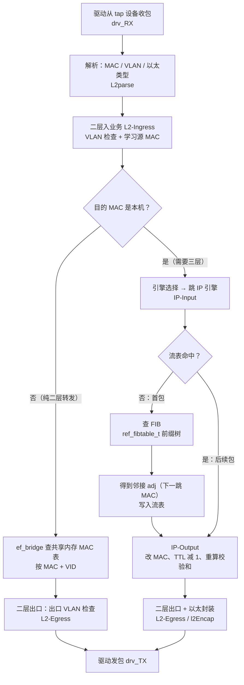

# X86 模拟器缺失进程与功能影响清单

> **一句话结论**：对照《RGOS 平台测试支持名单-2024》的「测试支持名单」页签（588 行）与本机实测的目录/进程清单，**有 45 个组件行、93 个进程/库名称在真机上存在、在 X86 模拟器上完全不存在**；其中 40 行属于「组件二进制整体缺失」（L2），5 行属于「仅缺控制面/转发面平面进程，模拟器另有替代实现」（L1）。缺失集中在**数据面域**（35 行，占 78%），与「模拟器无 ce/fe 双平面实体、转发由用户态软转引擎（EFD）承接」这一结构性事实完全吻合（实测 Linux 内核不参与转发，见 [[#4 二层 / 三层转发路径：真机走芯片，x86 走软件|§4]]）。

> **只想知道「缺了哪个功能、会导致什么问题」？** 直接跳 [[#3 功能缺失影响：缺了哪个功能，会导致什么问题|§3 功能缺失影响]]——按功能分块，每块固定回答四件事：缺的是哪个功能、这功能本来干什么、缺了会导致什么问题（编号列出）、真机上这类故障怎么查而模拟器断在哪。
>
> 全文只回答两个问题：**① 哪些进程不在（[[#2 缺失进程主表|§2]]）；② 少了这些进程等于少了哪个功能、后果是什么（[[#3 功能缺失影响：缺了哪个功能，会导致什么问题|§3]]）。** 不回答「功能在但结果错」——那需要打流，见 [[#8 待确认项|§8]] 第 6 项。

---

## 目录

| 章节 | 内容 |
|---|---|
| [[#0 体例与判定口径\|§0]] | 判定口径、L1/L2 层级、为什么不能看 CLI 回显 |
| [[#1 统计总览\|§1]] | 两侧规模对比、缺失行按域分布 |
| [[#2 缺失进程主表\|§2]] | **45 行主表**：组件域 / 组件包 / 功能模块 / 缺失进程 / 支持人（含「作用」跳转列） |
| [[#3 功能缺失影响：缺了哪个功能，会导致什么问题\|§3]] | **核心章节**：14 个功能块，每块讲清「缺哪个功能 → 导致什么问题 → 真机故障怎么查、模拟器断在哪」，末尾一张后果总表 |
| [[#4 二层 / 三层转发路径：真机走芯片，x86 走软件\|§4]] | **二三层转发路径对照**：真机 14 级芯片流水线 vs x86 软转 7 步；含 8 张官方流程图与文档出处 |
| [[#5 附录 A：模拟器侧已具备的组件（141 行）\|§5]] | 反向核对用 |
| [[#6 附录 B：表内有名但两侧都无独立进程（135 行）\|§6]] | 划清边界，说明为何不算缺失 |
| [[#7 复核方法\|§7]] | 30 秒复现任一结论的命令 |
| [[#8 待确认项\|§8]] | 需支持人确认的 8 项（含 2 项本轮新增的【推断】待验） |
| [[#9 附录 C：缺失进程的作用说明（conf 检索结果）\|§9]] | **每个缺失进程是做什么的**，带 conf 页面出处 |

---

## 0 体例与判定口径

### 0.1 这份清单回答什么问题

回答两个问题：

1. **支持名单里登记的那些进程，哪些在 X86 模拟器上根本不存在** —— 见 [[#2 缺失进程主表|§2]]，判定只认文件与进程清单；
2. **少了这些进程，等于少了哪个功能，这个功能缺失会导致什么问题** —— 见 [[#3 功能缺失影响：缺了哪个功能，会导致什么问题|§3]]，按功能组织，每条后果都标明证据强度。

不回答「功能在但结果错」（如 ACL 计数不准、表项下发成功但内容错）——那需要打流验证，见 [[#8 待确认项|§8]] 第 6 项。

### 0.2 数据源（三份，均可复现）

| 编号 | 数据源 | 用途 | 规模 |
|---|---|---|---|
| S1 | 飞书 Wiki《RGOS平台测试支持名单-2024》→ sheet「测试支持名单」（sheet_id `0FFvyC`，表 588 行） | 组件域、组件包、功能模块、交换产品支持人员 | 388 行有效区、337 行填写了进程名 |
| S2 | 真机 `10.104.36.146` 的 `/sbin`、`/usr/sbin`、`/usr/bin`、`/bin`、`/lib` 清单 + `ps` | 判定「真机是否存在」 | `/sbin` 525 项；用户态进程 344 项 |
| S3 | X86 虚拟机 `10.110.170.111:10010` 同口径清单 | 判定「模拟器是否存在」 | `/sbin` 340 项；用户态进程 267 项 |
| S4 | 公司内网 Confluence `conf.ruijie.work` 全站检索 | 补齐每个缺失进程的**作用说明** | 7 个批次、命中设计类页面 200+ 篇 |

> 采集与解析脚本、原始输出目录见文末 [[#7 复核方法|§7]]。全部为只读命令，未下发任何配置。

### 0.3 判定规则（一行说清）

对名单 F 列「进程在操作系统中全称」按 `换行 / 斜杠 / 逗号 / 顿号` 切分为名称集合，逐个判定：

1. **真机存在**：该名称出现在 S2 的文件清单中，或其 `+ .elf` 变体出现在 S2 的 `ps` 中；
2. **模拟器存在**：同口径在 S3 中能命中；
3. **缺失** = ①成立 且 ②不成立。

由此每个组件行落以下五种状态之一：

| 状态 | 含义 | 行数 |
|---|---|---|
| 缺失 | 真机有、模拟器没有 | **45** |
| 存在 | 两侧都有（含「仅库/仅内核模块」形态） | 141 |
| 未匹配 | 真机也没有该名称（成因见附录 B） | 135 |
| 部分缺失 | 同一行内部分名称缺失（1 行，见 3.5 节） | 1 |
| 未填 | F 列为空（多为组件化前期条目） | 63 |

「未匹配」的 135 行不等于缺失，成因与处置见 [[#6 附录 B：表内有名但两侧都无独立进程（135 行）|§6]]。

### 0.4 缺失层级：L1 与 L2（这是「模糊」的主要来源）

单说「缺失」会产生歧义——`ce.qos.sw` 没了，但 QoS 功能可能由另一个进程承担。因此本清单对每一行标一个层级：

- **L1 ＝ 平面进程缺失，但模拟器存在替代实现**。例：`ce.vxlan.sw` 在模拟器上没有，但 `vxlan.elf` 在，VXLAN（虚拟可扩展局域网）以软件设备形态承担。**结论：功能大概率可用，形态退化。**
- **L2 ＝ 组件二进制整体缺失，无同名替代**。例：`qosd.elf`、`span.elf`、`mlag.elf`、`qosd` 系列在模拟器侧一个都不存在。**结论：功能真空，或仅有控制面配置存储（如 `redis_qos_*`），无执行体。**

合计：L2 共 40 行，L1 共 5 行（PBR、VXLAN、L3OAM、`ce.cap.sw`、`fe.cap.sw`）。

### 0.5 为什么不能用 show 命令判断「有没有」

已有的实测证据表明：**模拟器上 CLI 命令经常存在，但没有任何执行体**——这正是先前误判的来源。三条独立证据：

1. `show acl capability` 46 项能力位中，`counter support` / `redirect support` / `counter-only` 在真机为 `enable`、模拟器为 `disable`；
2. 真机 `show acl res` 能列出 IFP/EFP/VFP 三级流水线（IFP 8176 条、单 slice 508、used=100），**模拟器上该命令根本不存在**（`% Invalid input detected`，非「输出为空」）；
3. 模拟器 `show efmp counter` 反而有 PARSER / FRAG-REASM / FW 三阶段计数，`efmp_frame.elf` CPU 占用 99%（累计 2 天 19 小时），真机同进程仅 1%——说明模拟器是**逐包软件转发**，路径与真机完全不同。

所以本清单一律以**文件系统与进程表**为准，不以命令回显为准。

但回显本身仍是一个有用的**旁证**，前提是会分辨这三种报错：

| 回显 | 字面意思 | 真实含义 | 说明什么 |
|---|---|---|---|
| `% Incomplete command.` | 话没说完 | **这个词认识，只是参数没给全** | 命令树在，功能可能有 |
| `% Invalid input detected at '^' marker.` | `^` 指的词不对 | **这个词根本不认识** | 命令树里没有 |
| `% Unrecognized command.` | 整句都不认 | 连第一个词都不对（常见于敲错视图） | 功能不在，或视图不对 |

于是有一个省事的判据：**把真机上的运维命令原样搬到模拟器上跑一遍，看它从 `Incomplete` 掉成 `Invalid` 的，就是功能边界。** 但要注意两个反例：`show mpls` 两侧都是 `Incomplete`（树在、转发面实体不在，见 [[#3.10 MPLS / VXLAN（隧道与标签转发）—— 最危险的一类：能 ping 通，但通的不算数|§3.10]]）；`show mirror` 两侧都是 `Invalid`（该机型镜像命令不叫这个），不能据此说真机没有镜像。

---

## 1 统计总览

| 维度 | 真机 | X86 模拟器 | 差异 |
|---|---|---|---|
| `/sbin` 条目 | 525 | 340 | 仅真机 215 |
| 其中 `ce.`（控制面）/ `fe.`（转发面）/ `xe.`（扩展面）平面实体 | 113（覆盖 68 个组件令牌） | **0** | 结构性缺失 |
| 用户态进程（`ps`） | 344 | 267 | 仅真机 116（非内核） |
| 名单中「缺失」组件行 | — | — | **45 行 / 93 个去重名称** |

按组件域分布：

| 组件域 | 缺失行数 | 占比 |
|---|---|---|
| 数据面域 | 35 | 77.8% |
| 系统服务域 | 6 | 13.3% |
| 二层域 | 3 | 6.7% |
| 极光 | 1 | 2.2% |

按组件包分布（前 8）：`ROUTE` 6、`CLUSTER` 6、`MPLS` 5、`switch_frame` 5、`BRIDGE` 4、`MONITOR` 4、`INTF` 3、`POLICY` 3、`OVERLAY` 3、`ppf_lsm` 3。

---

## 2 缺失进程主表

> 说明：**「缺失进程」列保留名单原文**，因此存在被表格截断的写法（如 `ce.ebrg` 实际为 `ce.ebrg.dp`）——这不影响判定，因为匹配时已按前缀展开。「表行号」指 sheet「测试支持名单」页签的**实际行号**，可直接跳转核对。**每一行的功能缺失会造成什么后果、属于 A/B/C 哪一类，见 [[#3 功能缺失影响：缺了哪个功能，会导致什么问题|§3]] 的对应功能块。**「作用」列给出 `C01`–`C46` 编号，点击跳到 [[#9 附录 C：缺失进程的作用说明（conf 检索结果）|§9]] 的对应条目（标注「含推断」的表示该行有名称仅有间接依据）。

### 2.1 数据面域（35 行）

| # | 组件包/组件域 | 功能模块 | 缺失进程（真机名称） | 层级 | 模拟器侧对应实现 | 作用（跳转） | 交换产品支持人员 | 联系电话 | 表行号 |
|---|---|---|---|---|---|---|---|---|---|
| 1 | INTF | AP | ce.ap.sw<br>fe.ap.sw | L2 | 无同名二进制 | [[#C01｜AP\|C01]] | 陈星晨 | 13859675899 | 6 |
| 2 | INTF | MLAG | ce.mlag.sw<br>fe.mlag.sw | L2 | 无同名二进制 | [[#C02｜MLAG\|C02]] | 苏振昭 | 18659507269 | 7 |
| 3 | INTF | POE | ce.ui.poe.sw<br>ce.mng.poe.sw<br>fe.mng.poe.sw | L2 | 无同名二进制 | [[#C03｜POE\|C03]] | 陈星晨 | 13859675899 | 8 |
| 4 | BRIDGE | EBRIDGE | ce.ebrg<br>fe.ebrg.sw | L2 | 无同名二进制 | [[#C04｜EBRIDGE\|C04]] | 林培辉 | 13960171358 | 11 |
| 5 | BRIDGE | EMAC | ce.emac<br>fe.emac.sw | L2 | 无同名二进制 | [[#C05｜EMAC\|C05]] | 黄清松 | 18259161659 | 12 |
| 6 | BRIDGE | APP_MAC | ce.appmac.sw | L2 | 无同名二进制 | [[#C06｜APP_MAC\|C06]] | 黄清松 | 18259161659 | 13 |
| 7 | BRIDGE | L2TOPO | ce.ebrg<br>fe.ebrg.sw | L2 | 无同名二进制 | [[#C07｜L2TOPO\|C07]] | 林培辉 | 13960171358 | 14 |
| 8 | ROUTE | EF | ce.ef.sw | L2 | 无同名二进制 | [[#C08｜EF\|C08]] | 吴成辉 | #N/A | 17 |
| 9 | ROUTE | L3TABLE | ce.en.l3tb.sw<br>ce.glb.l3tb.sw<br>ce.hit.l3tb.sw<br>ce.mc.l3tb.sw<br>ce.nh.l3tb.sw<br>fe.en.l3tb.sw<br>fe.hit.l3tb.sw<br>fe.iif.l3tb.sw<br>fe.mac.l3tb.sw<br>fe.mc.l3tb.sw<br>fe.nh.l3tb.sw | L2 | 无同名二进制 | [[#C09｜L3TABLE\|C09]]（含推断） | 吴成辉 | #N/A | 18 |
| 10 | ROUTE | L3INTF | ce.l3intf.sw<br>fe.l3intf.sw | L2 | 无同名二进制 | [[#C10｜L3INTF\|C10]] | 吴成辉 | #N/A | 19 |
| 11 | ROUTE | UC | fe.uc.sw | L2 | 无同名二进制 | [[#C11｜UC\|C11]] | 吴成辉 | #N/A | 20 |
| 12 | ROUTE | MC | ce.mc.sw<br>fe.mc.sw | L2 | 无同名二进制 | [[#C12｜MC\|C12]] | 林国辉 | #N/A | 21 |
| 13 | ROUTE | PBR | ce.pbr.sw<br>fe.pbr.sw | L1 | pbr.elf | [[#C13｜PBR\|C13]] | 吴成辉 | #N/A | 22 |
| 14 | CLUSTER | PKTF | xe.ctrl.pkt.sw<br>xe.mng.pkt.sw<br>xe.vhost.pkt.sw | L2 | 无同名二进制 | [[#C14｜PKTF\|C14]]（含推断） | 陈星晨/于孙汛 | 13859675899/18558892598 | 24 |
| 15 | CLUSTER | PKTR | ce.cfg.pktr.sw<br>xe.cfg.pktr.sw<br>xe.ctrl.pkt.sw<br>xe.mng.pkt.sw | L2 | 无同名二进制 | [[#C15｜PKTR\|C15]] | 陈星晨/于孙汛 | 13859675899/18558892598 | 25 |
| 16 | CLUSTER | PKTD | oob_agent.pktd.sw.ko<br>agent.pkt.sw.ko | L2 | 无同名二进制 | [[#C16｜PKTD\|C16]]（含推断） | 陈星晨/于孙汛 | 13859675899/18558892598 | 26 |
| 17 | CLUSTER | DPM | ce.dpm.dp<br>fe.dpm.sw | L2 | 无同名二进制 | [[#C17｜DPM\|C17]] | 任朝辉/于孙汛 | 13623856605/18558892598 | 28 |
| 18 | CLUSTER | CPP | ce.cli.cpp<br>ce.cpp<br>fe.cpp.sw<br>xe.cpp | L2 | 无同名二进制 | [[#C18｜CPP\|C18]] | 裴江华/于孙汛 | 17759469476/18558892598 | 29 |
| 19 | CLUSTER | NFPP | ce.cli.nfpp<br>ce.nfpp<br>fe.nfpp.sw | L2 | 无同名二进制 | [[#C19｜NFPP\|C19]] | 裴江华/于孙汛 | 17759469476/18558892598 | 30 |
| 20 | POLICY | FP | ce.fp.sw<br>fe.fp.sw<br>fe.pceinst.sw | L2 | 无同名二进制 | [[#C20｜FP\|C20]] | 裴江华/林文伟 | 17759469476/13130422611 | 31 |
| 21 | POLICY | QOS | ce.qos.sw<br>fe.qos.sw<br>fe.fcnt.sw<br>ce.sp.sw<br>fe.sp.sw | L2 | 无同名二进制 | [[#C21｜QOS\|C21]]（含推断） | 裴江华/林文伟 | 17759469476/13130422611 | 32 |
| 22 | POLICY | NACM | ce.nacm.sw | L2 | 无同名二进制 | [[#C22｜NACM\|C22]] | 裴江华/林文伟 | 17759469476/13130422611 | 33 |
| 23 | TRAFFIC | BUFFER | ce.proxy.traf<br>ce.mmu<br>fe.mmu.sw | L2 | 无同名二进制 | [[#C23｜BUFFER\|C23]] | 周鹏3 | 18359190159 | 35 |
| 24 | OVERLAY | OLINTF | fe.olintf.sw | L2 | 无同名二进制 | [[#C24｜OLINTF\|C24]] | 高强5 | 17628175685 | 40 |
| 25 | OVERLAY | OLBRIDGE | fe.olbridge.sw | L2 | 无同名二进制 | [[#C25｜OLBRIDGE\|C25]] | 高强5 | 17628175685 | 41 |
| 26 | OVERLAY | VXLAN | ce.vxlan.sw | L1 | vxlan.elf（软件 VXLAN 设备，非 ce./fe. 平面实现） | [[#C26｜VXLAN\|C26]] | 高强5 | 17628175685 | 43 |
| 27 | MONITOR | xFLOW | ce.sflow.sw<br>libsflow.so<br>libpkt_ce_sflow.so<br>fe.sflow.sw<br>libpkt_fe_sflow.so | L2 | 无同名二进制 | [[#C27｜xFLOW\|C27]]（含推断） | 周鹏3 | 18359190159 | 47 |
| 28 | MONITOR | IPFIX | ce.ipfix.sw<br>libipfix.so<br>libpkt_ce_ipfix.so<br>fe.ipfix.sw<br>libpkt_fe_ipfix.so | L2 | 无同名二进制 | [[#C28｜IPFIX\|C28]] | 周鹏3 | 18359190159 | 48 |
| 29 | MONITOR | L3OAM | proxy.bfd.sw<br>ce.bfd.sw<br>libce_bfd_pkt.so<br>libcom_bfd.so<br>fe.bfd.sw<br>libfe_bfd_pkt.so | L1 | bfd.elf（仅控制面 BFD 会话，无 proxy.bfd.sw 转发面） | [[#C29｜L3OAM\|C29]]（含推断） | 周鹏3/陈星晨 | 18359190159/13859675899 | 50 |
| 30 | MONITOR | DAD | ce.dad.sw<br>libpkt_ce_dad.so<br>fe.dad.sw | L2 | 无同名二进制 | [[#C30｜DAD\|C30]]（含推断） | 周鹏3/陈星晨 | 18359190159/13859675899 | 52 |
| 31 | MPLS | L2VPN | ce.mpls.sw | L2 | 无同名二进制 | [[#C31｜L2VPN\|C31]] | 万潇潇 | 18382014066 | 55 |
| 32 | MPLS | L3VPN | ce.mpls.sw<br>fe.mpls.sw | L2 | 无同名二进制 | [[#C32｜L3VPN\|C32]] | 黄健3 | 13164804687 | 56 |
| 33 | MPLS | MPLSTE | ce.mpls.sw | L2 | 无同名二进制 | [[#C33｜MPLSTE\|C33]] | 黄健3 | 13164804687 | 57 |
| 34 | MPLS | MPLSTP | ce.mpls.sw | L2 | 无同名二进制 | [[#C34｜MPLSTP\|C34]] | 黄健3 | 13164804687 | 58 |
| 35 | MPLS | SR/SRV6 | ce.mpls.sw<br>fe.mpls.sw | L2 | 无同名二进制 | [[#C35｜SR／SRV6\|C35]] | 黄健3 | 13164804687 | 59 |

### 2.2 系统服务域（6 行）

| # | 组件包/组件域 | 功能模块 | 缺失进程（真机名称） | 层级 | 模拟器侧对应实现 | 作用（跳转） | 交换产品支持人员 | 联系电话 | 表行号 |
|---|---|---|---|---|---|---|---|---|---|
| 1 | switch_frame | sw-frame-ce-cap | ce.cap.sw | L1 | rg_cap / rg_cap_tran（能力库形态，无 ce./fe. 平面进程） | [[#C36｜sw-frame-ce-cap\|C36]] | 许加全 | 18850149827 | 250 |
| 2 | switch_frame | sw-frame-ce-tran-cap | ce.tran.cap.sw | L2 | 无同名二进制 | [[#C37｜sw-frame-ce-tran-cap\|C37]]（含推断） | 许加全 | 18850149827 | 251 |
| 3 | switch_frame | sw-frame-fe-cap | fe.cap.sw | L1 | rg_cap / rg_cap_tran（能力库形态，无 ce./fe. 平面进程） | [[#C38｜sw-frame-fe-cap\|C38]] | 许加全 | 18850149827 | 252 |
| 4 | switch_frame | sw-frame-lib-cap | libs_cap.so | L2 | 无同名二进制 | [[#C39｜sw-frame-lib-cap\|C39]] | 许加全 | 18850149827 | 254 |
| 5 | switch_frame | sw-frame-libs-cap-cli | libs_cap_cli.so | L2 | 无同名二进制 | [[#C40｜sw-frame-libs-cap-cli\|C40]]（含推断） | 许加全 | 18850149827 | 255 |
| 6 | ppf_dev | dm_ucm | dm_ucm | L2 | 无同名二进制 | [[#C41｜dm_ucm\|C41]] | 饶晨辉 | 18054880199 | 354 |

### 2.3 二层域（3 行）

| # | 组件包/组件域 | 功能模块 | 缺失进程（真机名称） | 层级 | 模拟器侧对应实现 | 作用（跳转） | 交换产品支持人员 | 联系电话 | 表行号 |
|---|---|---|---|---|---|---|---|---|---|
| 1 | ppf_lsm | QoS | qosd.elf | L2 | 无同名二进制 | [[#C42｜QoS\|C42]] | 陈健先（交换） | 18695613105<br>15959082070 | 326 |
| 2 | ppf_lsm | SPAN | span.elf | L2 | 无同名二进制 | [[#C43｜SPAN\|C43]]（含推断） | 陈健先（交换）<br>陈夏韡（无线） | 18695613105<br>15959082070 | 327 |
| 3 | ppf_lsm | MLAG | mlag.elf | L2 | 无同名二进制 | [[#C44｜MLAG\|C44]]（含推断） | 陈健先（交换） | 18695613105 | 328 |

### 2.4 极光（1 行）

| # | 组件包/组件域 | 功能模块 | 缺失进程（真机名称） | 层级 | 模拟器侧对应实现 | 作用（跳转） | 交换产品支持人员 | 联系电话 | 表行号 |
|---|---|---|---|---|---|---|---|---|---|
| 1 | — | RGOS部分 | amaint_app.elf | L2 | 无同名二进制 | [[#C45｜RGOS部分\|C45]]（含推断） | 宋锦凌 | 15960001692 | 73 |
---

## 3 功能缺失影响：缺了哪个功能，会导致什么问题

> 这一章是全文重点。[[#2 缺失进程主表|§2 主表]] 告诉你「哪些进程不在」，这一章告诉你「少了这些进程，等于少了哪个功能，这个功能缺失会造成什么后果」。
>
> 每个功能块固定四段，顺序始终一致：
>
> 1. **缺的是哪个功能** —— 不是「少了哪个文件」，而是「少了哪几件事」，以及每件事本来用来干什么；
> 2. **这个功能本来是干什么的** —— 业务语言，不懂转发面也能看懂；
> 3. **缺了会导致什么问题** —— 编号列出，每条都是现场真会遇到的事，不是「命令查不到」；
> 4. **真实故障对照** —— 真机上这类故障的定位链是什么、模拟器断在第几步。
>
> 每块开头有 **一句话 + 生活比喻**，给不熟悉这个领域的同学。不需要懂 `ce.` / `fe.` 是什么也能读完。

### 3.0 先分清三种「缺」—— 这是判断后果的前提

同样是「文件不在」，后果完全不同。不分清这三种，结论一定是错的：

| 类型 | 含义 | 后果强度 | 本文中的例子 |
|---|---|---|---|
| **A 类·功能真空** | 模拟器上没有任何等价实现 | **功能不可用**，相关问题不可测、不可定位 | QoS、端口镜像、sFlow/IPFIX、NFPP/CPP、MLAG 的 MAC 同步、MPLS |
| **B 类·形态退化** | 有替代实现，但不是同一条代码路径 | **看起来能用，结论不可外推（最危险）** | VXLAN（内核设备兜底）、PBR（整机实现、无平面拆分）、二层转发（内核 bridge）、链路聚合（内核 bonding） |
| **C 类·形态差异** | 模拟器没有对应硬件，功能本来就无从谈起 | **不算缺陷，不该在模拟器上要求** | POE 供电、DPM 跨芯片路径、`mtdoops` 落盘分区、芯片级缓存（`fe.mmu`） |

这张表是本文最容易踩坑的地方：

- 把 **C 类当 A 类**报 → 得到「模拟器缺 45 个功能」的夸张结论，支持人一看就知道不专业；
- 把 **B 类当 A 类**报 → 得到「功能没了」的错误结论，实际还能跑；
- 把 **B 类当「没问题」** → 在模拟器上测出一个「通过」，到真机上翻车，**这是代价最高的一种**。

主表里的「L1 / L2」是按**文件存在性**判的（L1 = 有替代实现，L2 = 整体缺失），和这里的 A/B/C 是两个维度：L1 大体对应 B 类，L2 里既有 A 类也有 C 类。下文每个功能块都会明确标出属于哪一类。

### 3.1 为什么数据面域整层不在（结构性事实）

这不是零散的 bug，是架构选择。四条独立证据：

1. **双平面实体整体缺席**。模拟器 `/sbin` 里 `ce.`（控制面实体）/ `fe.`（转发面实体）/ `xe.`（扩展实体）前缀文件**数量为 0**，真机 113 个（覆盖 68 个组件令牌）。
2. **转发改由用户态软转引擎（EFD）承接**。模拟器 `/bin` 独有 13 个 iproute2 工具（`ip`、`tc`、`bridge`），真机 `/bin` 独有 15 个线卡工具（`lc`、`daemon4lc`）；模拟器内核模块独有 `virtio-net` / `vmxnet3` / `igb_uio` / `uio_pci_generic`（DPDK 用户态收包），真机独有 `dal` / `knet` / `rg_ihd_drivers_*`（自研转发面驱动）。**注意：这里的 iproute2 工具与 DPDK 不代表"内核在转发"——实测模拟器 `ip_forward=0`、内核路由表为空、无 bridge 模块，转发全部在 `efd_main.elf` 用户态进程内完成，详见 [[#4.1 先纠正一个想当然：x86 不是「Linux 内核转发」|§4.1]]。**
3. **转发是逐包软件处理**。模拟器 `efmp_frame.elf` CPU 占用 99%（累计 2 天 19 小时），真机同进程 1%；模拟器 `show efmp counter` 有 PARSER / FRAG-REASM / FW 三阶段计数——每个包都要过一遍软件流水线。
4. **官方定位就是「x86 只验控制面」**。《12.6PL4-ITP》写的是「先通过 x86-64 进行控制面的功能集成，以此检验 EFMP 的转发功能」，等硬件就绪后再「在 RSR77XA 上完整集成」（[pageId 379650518](http://conf.ruijie.work/pages/viewpage.action?pageId=379650518)）。

**这条结构性事实决定了后面所有后果的共同点：控制面（配置、协议、状态机）基本都在，转发面（真正处理报文的那一层）整体不在。** 所以「配置能配进去」永远不能作为「功能可用」的证据。

### 3.2 ACL（访问控制列表）—— 规则配得进去，但「拦没拦住」永远说不清

**对应主表**：第 20 行（POLICY / FP，裴江华、林文伟）

> **一句话**：ACL 是交换机里的**保安名单**——「谁能进、谁不许进」。运维写一条「禁止 10.1.1.0/24 访问服务器」，就是往名单上加一行。

**缺的是这四个功能**（不是「少了 `ce.fp.sw` 这个文件」，是少了下面四件事）：

| 缺的功能 | 真机上由谁实现 | 这个功能用来干什么 | 缺了之后 |
|---|---|---|---|
| **命中计数**（counter） | 每条 ACE 自带计数器 | 回答「这条规则拦住了多少包」 | 规则是否真的生效，无法判断 |
| **重定向**（redirect） | ACL redirect 能力 | 把命中的流量**引到别处**（防火墙、审计、旁路设备） | 引流类方案整体做不了 |
| **表项与资源视图** | `show acl res`（IFP/EFP/VFP 三级流水线 + slice 占用） | 看规则有没有真的装进芯片、还剩多少空间 | 「配了不生效」无从定位 |
| **批量装表** | `fe.pceinst.sw`（2 秒周期异步批量下发） | 大规模规则变更时的下发时序 | 规则多时「部分生效」无法验证 |

**这个功能本来是干什么的**：① 安全隔离（哪些网段不许互访）；② 安全审计（这条策略到底拦了多少攻击）；③ 策略引流（把可疑流量导去清洗）；④ 划故障边界（业务不通时，先排除「是不是被 ACL 挡了」）。

**缺了会导致什么问题**：

1. **「配了规则，到底拦没拦住」没法回答。** 现场挂一条 deny 挡住扫描源，第二天要出报告「拦截了多少次」。真机上每条 ACE 自带计数，`show acl capability` 里 `counter support` 是 enable；模拟器上这项能力位是 **disable**——规则能配、`show access-lists` 也能看到，**但没有计数**。报告里只能写「已配置」，写不了「已生效」。
2. **多条规则冲突时，无法定位是哪一条在生效。** ACL 是「从上往下，第一条命中就生效」。业务不通时真机的动作是 `show acl res detail` 看 `stage: IFP`、`group id`、`used`，确认哪条规则装到了哪级流水线；模拟器上这条命令不存在，只能人工翻配置文件逐条数——规则上百条时基本靠猜。
3. **「引流到防火墙」这类方案整体不可行。** 把去往外网的流量从 ACL 引到防火墙、清洗后再送回，是数据中心常见做法。模拟器上 `redirect support` 能力位是 disable：既引不过去，也看不到引没引成功。
4. **「规则配了但不生效」—— 现场最高频的 ACL 故障 —— 排不掉。** 真机的定位链是两级：CLI 侧 `show acl res detail` 看**软件装表结果**，数据面侧 `ut dump_acl` 看**芯片里的 FP 表项**。模拟器上第一级就没有，第二级更不存在，**排障链在第一步之前就断了**。
5. **表项容量看不见，规则静默失效无人知。** 真机 IFP 共 8176 条，切成 8 片 slice：前 4 片各 508 条、后 4 片各 1536 条（实测 `used: 100` 全部落在 slice0，占那片 19%）。规则装不下时**往往不报错、只是不生效**。模拟器上连「用了多少」都看不到，等于把一个已知的失效模式变成不可见。

**真实故障对照**：

> **真机故障**：ACL 匹配 L4 目的端口做过滤，配置和 `show acl res` 都正常，但 VXLAN、IPv6-over-UDP 这类**封装报文始终不命中**，普通报文正常。根因是芯片解析器把 UDP 头折叠进 IPv4 头，ACL 看不到 UDP 头，转而去匹配内层头。定位靠 `dbal table dump table=PEMLA_PARSERUDP` 看解析结果。
> —— [JR2 SDK6.5.21 ACL 匹配 L4 dport 表项不命中](http://conf.ruijie.work/pages/viewpage.action?pageId=104000412)
>
> **模拟器上**：连「规则装没装上」都看不到，这类「配了但不命中」的问题既复现不了、也定位不了。能给的只有「配置没写错」。

**证据**：【本机实测】`show acl capability` 46 项能力位（`counter support` / `redirect support` / `counter-only` 真机 enable、模拟器 disable）、`show acl res` 真机有完整输出、模拟器 `% Invalid input`；【本机实测】`/sbin` 无 `ce.fp.sw` / `fe.fp.sw` / `fe.pceinst.sw`；【conf 实证】上述故障页。**归类：A 类（功能真空）。**

### 3.3 QoS（服务质量）—— 承诺的带宽兑现不了，拥塞时也没有先后

**对应主表**：第 21 行（POLICY / QOS，裴江华、林文伟）、第 23 行（TRAFFIC / BUFFER，周鹏3）；二层域 `qosd.elf`（陈健先）

> **一句话**：QoS 是给流量**排队、限速、分优先级**——像高速路的收费站和专用车道：承诺给某客户 500 Mbps 就限到 500M，语音视频走 ETC 车道，别人堵着也不影响打电话。

**缺的是这五个功能**：

| 缺的功能 | 真机上由谁实现 | 这个功能用来干什么 | 缺了之后 |
|---|---|---|---|
| **队列与调度** | `ce.qos.sw` / `fe.qos.sw`，8 个队列，SP / WRR | 分出优先级，让重要流量先走 | 所有流量一视同仁，拥塞时语音一起卡 |
| **限速**（meter） | 端口 / 流限速，实测上限 1 / 100 Mbps 两档、burst 0~8192 | 兑现带宽承诺、抑制超额占用 | 客户买了 500M，也管不住别人超用 |
| **缓存管理**（MMU） | `ce.mmu` / `fe.mmu.sw`，共享池 / 丢弃门限 | 决定拥塞时丢谁、留谁 | 突发流量直接尾丢，重要报文先被丢 |
| **流计数** | `fe.fcnt.sw` | 每条流命中次数 / 字节数统计 | 流分类对不对，无法验证 |
| **配置执行体** | `qosd.elf`（QoS 守护进程） | 把配置翻译成芯片表项 | 配置只存在配置文件里，不下去 |

**这个功能本来是干什么的**：① 带宽承诺（卖 500M 就限到 500M）；② 业务分级（语音 / 视频 / 办公 / 下载，各自排队）；③ 拥塞控制（队列满了丢谁）；④ 容量规划（各队列丢了多少、缓存峰值多少）。

**缺了会导致什么问题**：

1. **带宽承诺类需求无法验收。** 「限速 500M，实测不超 500M」是最基本的交付项。模拟器上 `show qos` / `show queue-counter` / `show queue-buffer` **整套命令树都不在**，背后的 `qosd.elf`、`ce.qos.sw` / `fe.qos.sw`、`ce.mmu` / `fe.mmu.sw` 也一个都没有。**不是「限得不准」，是「没有这个功能」。**
2. **业务分级保障无法验证。** 语音、视频、办公、下载分四个队列，拥塞时语音不掉——这类方案在模拟器上无法证明，因为既没有队列、也没有调度算法。
3. **拥塞行为无法观察，突发丢包类故障无法定位。** 真机上「静置打流也周期性丢几毫秒包」这类疑难问题，标准定位是看 TM 缓存峰值与 `*_TM_DROP` 丢包记录、配 fuzzy 抓 trace；模拟器上没有缓存管理实体，这些指标全部不存在。
4. **「限速配了不生效」排不掉。** 真机的定位链是：`qos_lif` 里有没有生成 `lif_meter_idx` → `show meter all` 有没有表项 → `lif_meter_action` 有没有改写默认行为 → `snap` 抓包看报文有没有命中 meter 表（[QOS 常见问题排查](http://conf.ruijie.work/pages/viewpage.action?pageId=185172596)）。模拟器上这四步**一步都做不了**。
5. **打流本身可能把环境打挂。** 即使不谈功能，模拟器的转发能力也是百 pps 级：「打 1000 pps，转发的流量为 260 pps」「打流 EZsim 挂死」「ping 本机时延大」（[2019-05-22 X86 平台验证记录](http://conf.ruijie.work/pages/viewpage.action?pageId=21005060)）。

> **一个必须说的易误判点**：模拟器 `ps` 里能看到 `redis_qos_global`、`redis_qos_host`，看起来「QoS 是在的」。那是**配置存储层**（把 QoS 配置写进 redis），不是执行体。`qosd.elf` 才是执行体，它不在。

**真实故障对照**：

> **真机故障**：限速命令下发后实测速率不受限。排查要一路从 `qos_lif` 的 `lif_meter_idx`，到 `show meter all` 的 meter 表项，到 `lif_meter_action`，再到 `snap` 抓包确认报文命中 meter；流映射不对还要查 `trust_mode`、`ds` 域、`show qos_map_ingress all`。
> **模拟器上**：这一整条链的每一环都不存在。所以这类问题在模拟器上**不是「难查」，是「无法开始查」**。

**证据**：【本机实测】`show qos` 真机 `% Incomplete`（树在）、模拟器 `% Invalid input`；真机 `show mls qos features` 47 项能力位、`g_queue_num=8`、`g_police_bps_max=100000000`（100 Mbps）、`g_police_burst_max=8192`；【本机实测】`/sbin` 无 `qosd.elf` / `ce.qos.sw` / `fe.qos.sw` / `ce.mmu` / `fe.mmu.sw` / `fe.fcnt.sw`；【conf 实证】性能数字与排查页。**归类：A 类（功能真空），缓存部分兼有 C 类成分（无芯片缓存）。**

### 3.4 端口镜像（SPAN）—— 出问题抓不到包，只能靠猜

**对应主表**：二层域 `span.elf`（陈健先）

> **一句话**：端口镜像就是**把某个口的流量复制一份到另一个口**，另一头接抓包工具。相当于在电话线上并了一台录音机。

**缺的是这两个功能**：

| 缺的功能 | 真机上由谁实现 | 这个功能用来干什么 | 缺了之后 |
|---|---|---|---|
| **报文复制** | `span.elf` + 转发面镜像表项 | 把源口 / VLAN / 指定流的流量复制到目的口 | 目的口什么都收不到 |
| **镜像会话管理** | 同上，含限速（`span_car`） | 控制会话启停、镜像带宽 | 会话状态无法核对 |

**这个功能本来是干什么的**：它是**所有疑难故障的最后手段**。日志和计数器只能告诉你「丢了」，抓包才能告诉你「丢的是什么包、为什么丢」。安全事件取证、第三方分析设备接入、协议交互异常定位，都靠它。

**缺了会导致什么问题**：

1. **现场疑难故障失去唯一的一手证据来源。** 「访问某系统时快时慢」这种问题，标准动作是镜像到笔记本用 Wireshark 抓十分钟，看有没有重传、有没有异常广播。模拟器上 `span.elf` 不存在，这条路直接断掉，只能退回看日志和计数器——而计数器本身在模拟器上也是缺的（见上一节）。
2. **镜像「配了不出包」而且不报错。** 镜像的本质是「转发的同时顺手复制一份」，而模拟器上没有转发面实体（`span.elf` 缺失）、转发由用户态软转 `efd_main.elf` 完成（Linux 内核不参与，见 [[#4.1 先纠正一个想当然：x86 不是「Linux 内核转发」|§4.1]]），没有「顺手复制」这一环。【推断】即使配置能写进去，也不会有报文从镜像口出来——**这比报错更麻烦，因为它不报错**，你会以为镜像在工作。
3. **安全审计与流量留存做不了。** 有些行业要求把指定链路流量留存一段时间供审计，这依赖镜像能力。
4. **镜像类故障无法定位。** 真机上「源口镜像不生效」的定位是进线卡 shell 用 `ut acl-info` 核对镜像 FP 表项的 `dir`（方向）与 `phyid`（源口）是否一致，再查 redis 里 `span_car` 有没有异常限速（[span 源口镜像不生效](http://conf.ruijie.work/pages/viewpage.action?pageId=212009941)）。模拟器上既没有 FP 表项可查，也没有 `span` 组件。

**真实故障对照**：

> **真机故障**：配好镜像后目的口抓不到包。要分「表项没下发」还是「表项下发了但转发面没复制」——靠 `ut acl-info` 看 `apply` 里的 `dir` 和 `phyid` 判断。
> **模拟器上**：没有表项可查、没有复制动作，**连「是哪一半坏了」都分不出来**。

> **旁证**：X86 环境**没有可用的收发包通道**——TWAMP-LIGHT 的定位文档标题就写着「不支持 X86」，正文写「不支持 X86 收发包，仅支持线卡收发包」（[pageId 228426665](http://conf.ruijie.work/pages/viewpage.action?pageId=228426665)）。收发包通道都没有的环境，抓包类场景自然无从谈起。

**证据**：【本机实测】`/sbin` 中 `span.elf` 仅真机有；【conf 实证】X86 不支持收发包；【推断】「配了也不出包」这一具体表现（见 [[#8 待确认项|§8]] 第 7 项）。**归类：A 类（功能真空）。**

### 3.5 sFlow / IPFIX（流量采样与导出）—— 全网在跑什么，看不见了

**对应主表**：第 27 行（MONITOR / xFLOW）、第 28 行（MONITOR / IPFIX），周鹏3

> **一句话**：sFlow 和 IPFIX 都是**抽样统计**——交换机按比例抽一部分报文，把「谁跟谁通信、多大、多久」打包发给采集服务器，用来画流量饼图、找异常。sFlow 像随机抽查，IPFIX 像记账（按流记全）。

**缺的是这三个功能**：

| 缺的功能 | 真机上由谁实现 | 这个功能用来干什么 | 缺了之后 |
|---|---|---|---|
| **采样点** | `ce.sflow.sw` / `fe.sflow.sw`、`ce.ipfix.sw` / `fe.ipfix.sw` | 在转发路径上「顺手抄一份」 | 采不到任何样本 |
| **报文构造与上送** | `libpkt_ce_sflow.so`、`libpkt_fe_sflow.so`、`libipfix.so` 等 | 把样本封成 UDP 报文发给采集器（sFlow 端口 6343） | 采集器一包都收不到 |
| **模板与统计** | `libsflow.so`、IPFIX 模板管理 | 定义导出字段、聚合统计 | 采集器无法解析 |

**这个功能本来是干什么的**：① 流量构成分析（哪个业务占带宽最多）；② 容量规划（出口什么时候会打满）；③ 异常发现（扫描、DDoS、异常外联）；④ 计费与审计的原始数据。

**缺了会导致什么问题**：

1. **流量可视化整条链断掉。** 没有采样就没有数据，没有数据画不出 Top N，也没法回答「这条链路被谁占了」。对运维来说，等于**从「看得见」退回「看不见」**。
2. **异常流量发现能力丧失。** 扫描、异常外联这类问题，往往最先在流量图上体现出来（某个目的地址流量突增）。采样缺失后，只能等业务侧报障。
3. **sFlow / IPFIX 自身的故障无法定位。** 真机上「sFlow 无数据」的排查是四层：配置 → 上送 → 下发 → 硬件表项（`show cpu-protect type sflow device` 看采样报文有没有上送、查 CFG_DB 里 `sflow_cfg_int_enable` 等字段、XGS 用 `listreg sflow` 看 enable 与 threshold）（[sFlow 问题排查指南](http://conf.ruijie.work/pages/viewpage.action?pageId=261916598)）。模拟器上第一层就断。
4. **采样方向 / 模板错乱类问题不可复现。** 真机上出现过「只配 ingress 却收到 egress 模板」「CLI 说 IP 采样、报文中 proto 解析成 IPv6」这类问题，需要 Wireshark 解 IPFIX 比对模板号（ingress=266、egress=318）。模拟器上根本没有报文可抓。

**真实故障对照**：

> **真机故障**：sFlow 配了但采集器收不到。要按「配置可达性 → 采样报文有没有上送 CPU → CFG_DB/UDP_DB 字段是否齐全 → 硬件 `listreg` 的 enable 与 threshold」四层往下走。
> **模拟器上**：【推断】配置能写进去、采集器一包都收不到，而且**设备上没有任何报错**——因为根本没有采样线程在跑，也就没有「采样失败」这个事件可以报。

**证据**：【本机实测】`show sflow` / `show ipfix` 真机 `% Incomplete`、模拟器 `% Invalid input`；【本机实测】`/sbin` 与 `lib` 中相关实体与 6 个配套库均无；【conf 实证】排查指南页；【推断】「配置成功但无数据」。**归类：A 类（功能真空）。**

### 3.6 MLAG（跨设备链路聚合）—— 双活组网最核心的那条验收项做不了

**对应主表**：第 2 行（INTF / MLAG，苏振昭）、二层域 `mlag.elf`（陈健先）

> **一句话**：MLAG 让**两台物理交换机对外表现得像一台**。服务器双网卡分别插到两台交换机上，做 bonding 后两条链路同时可用，任意一台交换机挂了业务都不中断。两台交换机之间那根线叫 peer-link。

**缺的是这三个功能**：

| 缺的功能 | 真机上由谁实现 | 这个功能用来干什么 | 缺了之后 |
|---|---|---|---|
| **MAC 表项跨设备同步** | `ce.mlag.sw` / `fe.mlag.sw` + 数据面同步 | 同一个 MAC 在两台设备上都学到，切换时不用重新学习 | 【conf 实证】X86 **不支持** |
| **双活 / 单向保护** | `mlag.elf` | peer-link 断了以后防止两台都当主用，避免环路 | 双主场景无法演练 |
| **故障收敛** | 同上 | 一台挂了，另一台秒级接管 | 收敛时间不可测 |

**这个功能本来是干什么的**：服务器双上行、核心双活、机柜级冗余。它解决的痛点是「既要冗余，又不想跑 STP 把一半链路 block 掉」。

**缺了会导致什么问题**：

1. **MAC 同步做不了，切换后可能出现流量黑洞或泛洪。** 这是 MLAG 最核心的验收项，官方文档明文写着限制（见下方引文）。表现是：切换瞬间新设备不认识这些 MAC，只能泛洪；泛洪被抑制时就丢包。
2. **「拔线看收敛」这个动作失真。** X86 拓扑中间存在透传设备、**非直连**，一端物理 down 时另一端感知不到，只能靠 LACP 协议感知——也就是说，你拔线看到的收敛时间，不是真机拔线的收敛时间。
3. **peer-link 故障场景不可演练。** 真机上的经典故障是「peer-link 不关 mac-learn 直接切 MLAG，导致本地 MAC 残留」（[案例页](http://conf.ruijie.work/pages/viewpage.action?pageId=310412860)）：切换时先下发 `peer-link no learn`、`peer-link flush`，但 flush 被后续 add 消息打断，部分地址没清掉。这类问题必须在真实数据面才能复现。
4. **双主（两台都以为自己是主）这个最危险的场景无法演练。** 双主一旦发生，全网 IP 冲突、MAC 冲突，影响面是整个机房。`mlag.elf` 不在，这个场景在模拟器上做不了。

**真实故障对照**：

> **【conf 实证】官方明文**：《X86-MLAG 环境说明》「限制」一节原文——**「12x 的 MAC 表项由数据面同步，因此 X86 目前还不支持 MAC 地址同步。」** 同节还写：X86 拓扑中间都存在透传设备、非直连，一端物理 down 时另一端感知不到，除非靠 LACP 协议感知。
> —— [X86-MLAG 环境说明](http://conf.ruijie.work/pages/viewpage.action?pageId=808157461)
>
> 翻译成场景语言：**MLAG 最核心的验收项「MAC 表项跨设备同步」在模拟器上做不了**；「拔线看收敛」也失真。能做的只有「配置能不能配进去、`show vap` 状态对不对」这一层。

**证据**：【conf 实证】页面原文（含配置样例，可直接照抄搭环境）；【本机实测】`ce.mlag.sw` / `fe.mlag.sw` / `mlag.elf` 在模拟器 `/sbin` 中均不存在；【推断】「切换后泛洪 / 丢包」这一具体表现。**归类：A 类（功能真空）。**

### 3.7 链路聚合（AP，Aggregate Port）—— 均衡和倒换不是同一套实现

**对应主表**：第 1 行（INTF / AP，陈星晨）

> **一句话**：链路聚合把**几根网线捆成一根**用——既加带宽，也做冗余。捆起来之后，流量要按某种算法（通常按源 / 目的 IP、MAC 算 HASH）分摊到各成员口上。

**缺的是这两个功能**：

| 缺的功能 | 真机上由谁实现 | 这个功能用来干什么 | 缺了之后 |
|---|---|---|---|
| **成员口转发面表项** | `fe.ap.sw` | 让「聚合口」这个逻辑口真正能收发，成员口按 HASH 分担 | 成员口分担无硬件/驱动支撑，**实测也不存在内核 bonding**（见下） |
| **成员管理与防多包** | `ce.ap.sw`（含 NONUC_BLK 防多包机制，30 ms 定时器先阻塞再下发成员表） | 成员加入 / 退出时不出现重复包、不乱序 | 成员变动时的行为与真机不同 |

**这个功能本来是干什么的**：把多条物理链路当一个逻辑链路用，带宽叠加 + 冗余，是交换机之间、交换机与服务器之间最基础的组网方式。

**缺了会导致什么问题**：

1. **「4 根线均不均」这个验收项，测出来的结论不能代表真机。** 【本机实测】模拟器上 `lsmod` 里**没有 `bonding` 模块**，`ip -d link show` 里 21 个接口全部是 `tun type tap`、**没有任何 bond 类型接口**——所以它连"退化成内核 bonding"都不是（上一版这样推断，本轮实测已否定）。【推断】聚合大概率由软转内部某个业务模块挑成员口，或干脆没有等价实现。无论哪种，**HASH 分担算法、成员口级均衡、故障切换时序与真机的 `fe.ap.sw` 都不是同一套实现**——LACP 协商、成员口 up/down 这些控制面动作大概率正常（所以看配置会觉得没问题），转发面则不可比。
2. **成员口故障倒换的时序不可测。** 拔一根线，剩下几根多久接管、有没有丢包，这是聚合的核心指标；模拟器上既没有 `fe.ap.sw` 的快切机制，也没有内核 bonding 的倒换机制，这项指标**在模拟器上没有承载物**。
3. **真机高频故障在模拟器上复现不了。** 「AP 口出流量只走单个成员口」是 AP 组件最常见的现场问题（原因是均衡模板不生效、模板因子与报文变化域不一致、命中对称 HASH 限制），定位靠 `show int xxx rate up` 看各成员口速率分布（[AP 组件常见问题](http://conf.ruijie.work/pages/viewpage.action?pageId=36332643)）。模拟器上没有 `fe.ap.sw`，没有这套均衡逻辑，**问题不会发生，也就学不到怎么定位**。
4. **VSU 主从切换后 AP 配置不生效这类数据同步问题不可验。** 真机上进程重启 / 主从切换后可能出现「配置已下发但不生效」，靠查 MOM DS 记录、redis 库、`ce_ap` / `fe_ap` 日志定位。模拟器上这些层面不存在。

> **这是本文推断成分最重的一节**：`/sbin` 里「实体不在」是硬事实，「模拟器上没有内核 bonding」也是本轮实测的硬事实，但**「那它到底怎么转发」没有任何文档或实测支撑**——只能确定"不是真机那套、也不是内核那套"。已在 [[#8 待确认项|§8]] 第 8 项挂给网络组确认。转发路径的完整对照见 [[#4 二层 / 三层转发路径：真机走芯片，x86 走软件|§4]]。

**证据**：【本机实测】`/sbin` 无 `ce.ap.sw` / `fe.ap.sw`；`lsmod` 无 `bonding` 模块、`ip -d link show` 无 bond 接口；【conf 实证】AP 常见问题页；【推断】成员口选择由软转内部模块承担或缺失、HASH 行为不等价。**归类：B 类（形态退化）。**

### 3.8 NFPP / CPP（CPU 防护）—— 防攻击能力不可验，而且连「攻击」都造不出来

**对应主表**：第 18 行（CLUSTER / CPP）、第 19 行（CLUSTER / NFPP），裴江华、于孙汛

> **一句话**：交换机的 CPU 很弱，正常只处理「管理类」报文（ARP、协议报文）。有人每秒灌几百万个包进来，CPU 会被打满，**整机失联、协议全部震荡**。NFPP 和 CPP 就是**给送 CPU 的报文分级限速**的守门员。

**缺的是这三个功能**：

| 缺的功能 | 真机上由谁实现 | 这个功能用来干什么 | 缺了之后 |
|---|---|---|---|
| **CPU 口带宽限速** | `ce.cpp` / `fe.cpp.sw` / `xe.cpp` | 按报文类型分配送 CPU 的带宽（真机基线 4500 pps） | 攻击来了没人挡 |
| **攻击识别与隔离** | `ce.nfpp.dp` / `fe.nfpp.sw`，9 个 guard（ARP / TCP-SYN / DHCP 等） | 识别扫描 / 泛洪源，把攻击源隔离 | 攻击源无法自动隔离 |
| **命令行与统计** | `ce.cli.cpp` / `ce.cli.nfpp` | 配置与查看限速、丢弃计数 | 无法配置也无法查看 |

**这个功能本来是干什么的**：保证「被攻击时设备还活着」。它不是性能优化，是**可用性底线**——没有它，一个 ARP 扫描就能把整台交换机打死，全网断。

**缺了会导致什么问题**：

1. **防御能力无法验证。** 真机上有 9 个 guard、ARP 表上限 20000 主机、限速 30/30/256、阈值 200/200/400（本轮实测 `show nfpp arp-guard summary`）。模拟器上 `show cpu-protect` / `show nfpp` **整套命令树不在**，`ce.nfpp.dp` / `fe.nfpp.sw` / `ce.cpp` / `fe.cpp.sw` / `xe.cpp` 全部没有。
2. **更根本的问题：连「攻击」都造不出来。** 模拟器不支持 X86 收发包（[pageId 228426665](http://conf.ruijie.work/pages/viewpage.action?pageId=228426665)）。「从测试仪灌 1.48 Mpps ARP，看 CPU 口是不是被压到 512 pps」这个动作，在模拟器上**物理上无法进行**。所以「打了 1.48 Mpps 之后 CPU 还活着」这个结论，不是「没测」，是「不可能测」。
3. **误隔离类问题不可复现。** 真机出过「tcp-syn-guard 隔离表项以 ip/mac + 端口 + vid 为键，在 SVI / 路由口场景把正常转发的 IP 报文一起隔离，攻击停止后业务仍不通」（[NFPP/CPP 遗留问题](http://conf.ruijie.work/pages/viewpage.action?pageId=96508893)）。这类「防护过头反而伤业务」的问题，必须在真实转发面才能复现。
4. **限速统计口径问题不可查。** 真机上有「走 NFPP 端口限速表项时，CPP 硬件统计为 0」的现象（NFPP 硬件限速在 CPP 之前生效，软件限速在 CPP 的 FE 之后）。这种口径差异会导致误判「没限速成功」，需要在真实硬件上对照两组统计才能看清。

**真实故障对照**：

> **真机故障**：开 NFPP arp-guard（限速 20 pps、检测 25 pps、隔离关闭），从 `tf1/0/10` 打 1500 pps ARP。软件侧能看到报文送 CPU，但 `show cpu-protect hardware-statistics` 硬件统计为 0——因为报文走的是 NFPP 端口限速硬件表项，而 CPP 硬件统计取自 CPP 的 ACE 计数，统计不到这部分。
> **模拟器上**：既没有 NFPP 表项，也没有 CPP 统计，**连「统计口径不一致」这种问题都不会暴露**——你会以为一切正常。

**证据**：【本机实测】两条命令真机有完整输出、模拟器 `% Invalid input`；【本机实测】`/sbin` 无相关实体；【conf 实证】CPP 打流测试页、NFPP/CPP 遗留问题页。**归类：A 类（功能真空）。**

### 3.9 三层转发表（L3TABLE / L3INTF / UC / MC / EF）—— 路由算对了，不代表转发对了

**对应主表**：第 8–12 行（ROUTE 包，吴成辉 / 林国辉）

> **一句话**：三层转发分两半——**控制面算路**（「去 10.2.0.0 该从哪个口出去」），**转发面执行**（每个进来的包照着算好的表发出去）。就像导航软件规划路线（控制面）和司机按路线开车（转发面）。

**缺的是这三个功能**：

| 缺的功能 | 真机上由谁实现 | 这个功能用来干什么 | 缺了之后 |
|---|---|---|---|
| **转发表项下发** | `ce.en/gbl/hit/mc/nh.l3tb.sw` + `fe.*.l3tb.sw` | 把路由表翻译成芯片能执行的下一跳 / 出口 / MAC 表项 | 表项下发这一环不存在（模拟器发到用户态） |
| **三层接口与单播转发** | `ce.l3intf.sw` / `fe.l3intf.sw`、`fe.uc.sw` | 逻辑三层口收发、单播转发查表 | 走内核软转，路径不同 |
| **组播与命中计数** | `ce.mc.sw` / `fe.mc.sw`、`fe.hit.l3tb.sw` | 组播复制、表项命中统计 | 组播与命中情况不可验 |

**这个功能本来是干什么的**：所有跨网段通信的基础。它同时决定了三件事：能不能通、从哪条路通（ECMP）、通了之后能不能查（命中计数）。

**缺了会导致什么问题**：

1. **「路由有，但 ping 不通」这类问题定位不了。** 真机的定位链是四段：`show ip route` 看前缀与下一跳 → `show arp` 看下一跳 MAC → `ce.ef.sw` 的 UDP-DB 看 `nhblk` 的 `nh_ifx` / `nh_ip` → `fe.uc.sw` 的 ASIC-DB 看 `nhbase_id` 非 0、`nh_hw_res` 的 `action=FORWARD`、`encap_id` / `phyid`、MAC 是否为 ARP 学到的（[普通单播静态 v4 路由转发不通](http://conf.ruijie.work/pages/viewpage.action?pageId=217220000)）。模拟器上**后两段不存在**，断在第三段。
2. **同一个症状，根因完全不同 —— 极易误判。** 【conf 实证】模拟器把路由和 ACL 表项**下发到用户态软件转发进程（UDP）**，还需要手动安装能力值文件（`dev_cap-x886-db.tar` 解到 `/etc/cfg/cap` 替换 `dev_cap` 后重启，[pageId 69242831](http://conf.ruijie.work/pages/viewpage.action?pageId=69242831)）。装错能力值文件，表项就下不去，表现同样是「路由表有、就是不通」——**症状和真机一模一样，根因却完全不同**。用模拟器上学到的经验去排真机故障，会走偏。
3. **ECMP 与组播不可验证。** 真机上「ECMP 下一跳为 SVI 时缺 MAC 出口，该路径失效或直接 drop」这类问题，需要看多条等价路径的表项与出口 MAC；模拟器上没有这套表项。
4. **表项容量差异带来隐性失效。** 【conf 实证·中】x86_opt-LLD1 把快转流表从 100 万条裁到 **8k**、ARP/ND 从 8K 裁到 **1K**，并写明「只需要保证基本功能可以用，无需考虑性能测试场景」（[pageId 211160218](http://conf.ruijie.work/pages/viewpage.action?pageId=211160218)）。这是单核 1GB 场景的方案，标准测试床镜像未必同样裁剪，但方向明确：**大表项场景在模拟器上会静默失效**。

**真实故障对照**：

> **真机故障**：DUT 配静态路由 30.0.0.0/24 指向下一跳 20.0.0.2，测试仪从另一口打流，出接口收不到。按「控制面 → 数据面 → 转发面」逐层查，结论可能是 ARP 没学到、表项没下发、或 ASIC 没装表——三者症状相同，处理完全不同。
> **模拟器上**：只能查到第一、二段（路由表、ARP），**无法区分「表项没下发」和「ASIC 没装表」**，而这两者的修复责任方完全不同。

**同一族里的 PBR（策略路由，第 13 行）单独说明**：`ce.pbr.sw` / `fe.pbr.sw` 不在，但模拟器有 `pbr.elf`（整机实现、无平面拆分），属 L1 / B 类。**能配、大概率能用，但没有转发面快速路径**，策略路由的匹配规模与性能不可验。它和 ACL 的区别是：ACL 决定「放行还是丢弃」，PBR 决定「从哪条路走」——后者在模拟器上是否真的按策略选路，只能靠端到端 ping 间接判断，看不到表项。

**证据**：【本机实测】整族 `l3tb` 实体在模拟器 `/sbin` 中不存在；【conf 实证】UDP 下发与能力值文件、表项裁剪数字；【推断】「路由有但不通」的具体表现。**归类：B 类（形态退化）—— 能通，但走的是另一条路。**

### 3.10 MPLS / VXLAN（隧道与标签转发）—— 最危险的一类：能 ping 通，但通的不算数

**对应主表**：第 24–26 行（OVERLAY，高强5）、第 31–35 行（MPLS，万潇潇 / 黄健3）

> **一句话**：VXLAN 是把二层报文**装进一个信封**（UDP 隧道）跨三层网络送到对面，拆开还是一层；MPLS 是运营商常用的**贴标签转发**。两者都是「多层封装 → 中间设备只看外层 → 到边上去掉外壳」。

**缺的是这三个功能**：

| 缺的功能 | 真机上由谁实现 | 这个功能用来干什么 | 缺了之后 |
|---|---|---|---|
| **隧道封装 / 解封装** | `ce.vxlan.sw`、`fe.olintf.sw`、`fe.olbridge.sw` | 报文进出隧道时的加壳 / 去壳 | 模拟器用 `vxlan.elf`（软件 VXLAN 设备）兜底，无平面实体 |
| **标签转发** | `ce.mpls.sw` / `fe.mpls.sw`（五种形态共用） | L2VPN / L3VPN / 流量工程 / SR 的标签交换 | 只有命令树，没有转发面 |
| **EVPN 等控制面特性** | 与上述实体配套 | 双活、anycast 网关、MAC 学习 | 特性层完全没有 |

**这个功能本来是干什么的**：跨机房大二层、运营商专网、数据中心 underlay / overlay 解耦。它的价值在「特性」，不在「能 ping 通」——能 ping 通是最低要求。

**缺了会导致什么问题**：

1. **最危险的一点：`show mpls` 两侧都在。** 真机和模拟器敲下去都提示 `% Incomplete command.`，也就是**命令树完整**。这几乎必然导致一个误判：「MPLS 是支持的」。实际上转发面实体 `ce.mpls.sw` / `fe.mpls.sw` 一个都没有。
2. **「能 ping 通」会制造假阳性。** 【推断】模拟器上很可能用 `vxlan.elf` 以软件 VXLAN 设备形态兜底（该文件在，但不确定是否走内核 vxlan 模块——模拟器上未加载任何 vlan/bridge 类内核模块）。基础连通性可能真的通，但 EVPN、anycast-gateway、双活这些**特性一层都没有**。于是「跨机房能 ping 通」这个结论被写进报告，真机上却可能因为 anycast-mac 配错而不通——真机上就出过「对称式 VXLAN 开启 anycast-mac 后，跨 L2VNI 的两个网关互 ping 不通」的案例（[VXLAN 网关 ping 不通](http://conf.ruijie.work/pages/viewpage.action?pageId=219547418)）。
3. **MPLS 表项类故障无法复现。** 真机故障「静态黏连配置完全正确，但入标签没生成 MPLS 转发表项，报文无法按标签转发」，定位靠 `show mpls ilm-detail-table-i` 和 `show mpls forwarding-table label` 看表项是否存在（[案例页](http://conf.ruijie.work/pages/viewpage.action?pageId=219547434)）。模拟器上没有转发面实体，这类「配了没表项」的问题不会发生，也就测不到。
4. **结论责任边界必须写清。** 【conf 实证】《12.6PL4-ITP》的策略是「先通过 x86-64 进行控制面的功能集成，以此检验 EFMP 的转发功能」，等硬件就绪后再「在 RSR77XA 上完整集成」。**官方口径就是：x86 上验控制面，硬件通路回真机。**

**真实故障对照**：

> **真机故障**：MPLS 静态黏连，`show run` 看配置没问题，但报文不按标签转发。要查 ILM 表与 forwarding table，两者都没有表项才能判定「表项未生成」。
> **模拟器上**：`show mpls` 树在，但没有任何表项可查——**这会让人误以为「没有表项是配置问题」，实际是根本没有转发面。**

**证据**：【本机实测】`show mpls` 两侧均 `% Incomplete`；`/sbin` 无 `ce.mpls.sw` / `fe.mpls.sw` / `ce.vxlan.sw` / `fe.olintf.sw` / `fe.olbridge.sw`；【conf 实证】ITP 集成方案与两个故障案例；【推断】内核 VXLAN 兜底。**归类：B 类（形态退化），且是「假阳性」风险最高的一类。**

### 3.11 BFD / L3OAM / DAD（保护与检测）—— 保护机制失效，故障发现不了

**对应主表**：第 29 行（MONITOR / L3OAM）、第 30 行（MONITOR / DAD），周鹏3、陈星晨

> **一句话**：BFD 是**心跳检测**——两台设备每隔几十毫秒互发一个包，几个包没收到就认为「对面死了」，立刻切到备用路径。DAD 是 **VSU 双主检测**——两台设备都以为自己是主时，用专门的报文互相「对表」，发现冲突就降级，避免全网 IP / MAC 冲突。

**缺的是这三个功能**：

| 缺的功能 | 真机上由谁实现 | 这个功能用来干什么 | 缺了之后 |
|---|---|---|---|
| **BFD 报文转发面收发** | `proxy.bfd.sw` / `fe.bfd.sw` + 三个配套库 | 毫秒级心跳报文的构造、发送、接收 | 只剩控制面会话，无快速检测 |
| **DAD 双主检测报文** | `ce.dad.sw` / `fe.dad.sw`、`libpkt_ce_dad.so`（目的 MAC 固定 `01d0.f800.000b`） | 检测到双主后降级，避免全网冲突 | 双主场景无法演练 |
| **DLDP 等链路检测** | L3OAM 组件 | 检测链路单向故障 | 单向故障不可发现 |

**这个功能本来是干什么的**：**在不该断的时候快速切，在该断的时候不要假活**。它决定了网络的「自愈速度」和「故障可见性」。

**缺了会导致什么问题**：

1. **「链路断了多久切过去」这个指标不可测。** BFD 的价值是毫秒级检测，模拟器上只有控制面会话（`bfd.elf` 在），转发面收发不在，测出来的切换时间没有意义。
2. **路由黑洞类问题无法复现。** 真机出过「BFD 代理保活不依赖 ARP/ND，ARP 异常老化后 BFD 仍保持 UP，静态路由联动该 BFD 不失效，但对端实际已不可达，形成路由黑洞」（[三层域案例手册](http://conf.ruijie.work/pages/viewpage.action?pageId=855179951)）。这类「假活」问题正是 BFD 最需要防的，而它依赖真实转发面。
3. **震荡类问题不可复现。** 品控 163579：「bfd up-dampening 2000 ms 与 BGP fall-over peer-down 叠加，形成会话删除重建循环，持续震荡」。这类问题的根因是定时器交互，模拟器上虽然能配，但没有真实会话与转发路径，复现不了。
4. **VSU 双主这个最危险的场景无法演练。** DAD 检测不到双主，就意味着两台设备可能同时当主用，全网 IP 冲突。`ce.dad.sw` / `fe.dad.sw` 不在，这个演练做不了。

**真实故障对照**：

> **真机故障**：三层接口 DLDP 反复震荡。定位要分三段：链路 / 运营商、设备侧配置、对端行为；DLDP 构造的 ICMP 特征 sequence 固定 `0x2500`，抓包比对请求与应答周期。
> **模拟器上**：既没有稳定的转发路径，也没有可抓的包，**三段定位一段都走不了**。

**证据**：【本机实测】`proxy.bfd.sw` / `ce.bfd.sw` / `fe.bfd.sw`、`ce.dad.sw` / `fe.dad.sw` 与配套库在模拟器均不存在，仅 `bfd.elf` 在；【conf 实证】三份案例页；【推断】「切换时间无意义」这一判断。**归类：B 类（形态退化，仅控制面）。**

### 3.12 二层转发（EBRIDGE / EMAC / APP_MAC / L2TOPO / NACM）—— 能通，但不是同一张 MAC 表

**对应主表**：第 4–7 行（BRIDGE，林培辉 / 黄清松）、第 22 行（POLICY / NACM）

> **一句话**：二层转发就是**在同一网段内按 MAC 地址找门牌号**——交换机记住「这个 MAC 在哪个口」，之后只往那个口发，不用广播。

**缺的是这四个功能**：

| 缺的功能 | 真机上由谁实现 | 这个功能用来干什么 | 缺了之后 |
|---|---|---|---|
| **MAC 表管理与老化** | `ce.emac` / `fe.emac.sw` | 学习、老化、静态 MAC、MAC 漂移检测 | 由内核 bridge 接管，容量与行为不同 |
| **二层转发与拓扑** | `ce.ebrg` / `fe.ebrg.sw`（L2TOPO 同一实体） | VLAN、广播域、STP 交互 | 形态退化 |
| **应用 MAC** | `ce.appmac.sw` | 给特定业务绑定 / 识别 MAC | 不可用 |
| **NETCONF 访问控制** | `ce.nacm.sw` | 网管通道的权限模型 | 网管侧权限不可验 |

**这个功能本来是干什么的**：让同一网段内的设备能互相找到、只把流量发给该发的人。它同时决定了三件事：能不能通、会不会泛洪、MAC 表够不够用。

**缺了会导致什么问题**：

1. **基本二层转发仍然能通，所以「看起来没问题」。** 内核 bridge 承担了收发与学习，ping 得通、业务能跑。这正是 B 类最危险的地方——**没有报错，也没有症状**。
2. **MAC 表的容量、老化、漂移检测不可验。** 真机的 MAC 表有明确规格与老化策略，还有「MAC 漂移」告警（同一个 MAC 在两个口来回跳，通常意味着环路）。这些在模拟器上没有对应实现。
3. **这也是 MLAG / VXLAN 做不了 MAC 同步的根因。** MAC 表都不归 `fe.emac.sw` 管了，「由数据面同步给对端设备」自然无从谈起——两条结论是同一件事的两面。
4. **NACM（NETCONF 访问控制）缺失，网管侧的权限模型不可验证。** 影响面较小，但如果项目依赖 NETCONF 做分级运维，需要单独确认。

**证据**：【本机实测】四个实体在模拟器 `/sbin` 中不存在；【本机实测】`/bin` 中模拟器独有 `bridge` 工具（内核网桥）；【conf 实证】MLAG 文档中「MAC 表项由数据面同步」。**归类：B 类（形态退化）。**

### 3.13 收发包通道与跨芯片路径（PKT 族 / DPM）—— 大半属于形态差异

**对应主表**：第 14–17 行（CLUSTER，陈星晨 / 于孙汛 / 任朝辉）

> **一句话**：PKT 族是**报文进出 CPU 的通道**（控制通道、管理通道、vhost 通道、带外通道）；DPM 是**多芯片之间怎么走**的路径管理——一台设备里有多颗转发芯片时，报文从 A 芯片进来、要从 B 芯片的口出去，得有人算这条路。

**缺的是这三个功能**：

| 缺的功能 | 真机上由谁实现 | 这个功能用来干什么 | 缺了之后 |
|---|---|---|---|
| **收发包通道** | `xe.ctrl.pkt.sw` / `xe.mng.pkt.sw` / `xe.vhost.pkt.sw` / `xe.cfg.pktr.sw` 等 | 协议报文、管理报文进出 CPU | 模拟器**不支持 X86 收发包**（官方定位） |
| **包分发** | `oob_agent.pktd.sw.ko` / `agent.pkt.sw.ko` | 带外管理报文分发 | 带外管理场景不可验 |
| **跨芯片路径** | `ce.dpm.dp` / `fe.dpm.sw` | 计算跨芯片转发表、板卡变动后重算 | 模拟器没有芯片与背板（**C 类**） |

**这个功能本来是干什么的**：保证「协议报文能被 CPU 收到、CPU 发出的报文能送到正确的口」，以及「多芯片设备里报文跨芯片转发时路径正确」。前者是所有协议能跑起来的前提，后者是多板卡设备才有的问题。

**缺了会导致什么问题**：

1. **这一族的缺失和「不支持 X86 收发包」是同一件事的两面。** 【conf 实证】「不支持 X86 收发包，仅支持线卡收发包」。后果是**所有「打流 → 看设备怎么处理」的用例都做不了**——而这是转发类测试的通用前提，不只是 PKT 族自己的问题。
2. **DPM 的缺失属于 C 类，不是缺陷。** 模拟器没有多颗交换芯片、没有背板，跨芯片转发本来就无从谈起。真机上「FE/CM 插入后断流十几秒」「背板流量没均衡到某张 FE/CM」这类问题（[DPM 问题定位](http://conf.ruijie.work/pages/viewpage.action?pageId=22972227)），在单机模拟器上不可能复现。**这类不应列入「模拟器缺失能力」的清单，只作为形态说明。**
3. **带外管理链路不可验证。** `oob_agent.pktd.sw.ko` 管带外通道，模拟器上不带外管理口时自然不需要；如果项目要求验证带外管理，需要单独确认。

**证据**：【本机实测】`/sbin` 中该族实体均不存在；【conf 实证】不支持 X86 收发包；【推断】带外管理影响范围。**归类：PKT 族 A 类（与「不支持收发包」等同），DPM 属 C 类。**

### 3.14 switch_frame 能力框架（cap）—— 会污染所有组件的「能力上报」

**对应主表**：系统服务域 6 行中的 5 行（`switch_frame`，许加全）+ `dm_ucm`（饶晨辉）

> **一句话**：能力框架是**设备的「能力清单」**——每个组件通过它告诉外界「我支持什么、不支持什么」。CLI、网管、上层业务都靠这份清单决定「能不能配、要不要拦」。

**缺的是这两个功能**：

| 缺的功能 | 真机上由谁实现 | 这个功能用来干什么 | 缺了之后 |
|---|---|---|---|
| **能力注册与上报** | `ce.cap.sw` / `fe.cap.sw` / `libs_cap.so` | 各组件注册自己的能力位，供 CLI 与网管查询 | 能力清单可能不准 |
| **能力转换** | `ce.tran.cap.sw` / `libs_cap_cli.so` | 内部能力位与对外呈现之间的映射 | 同一能力在不同入口显示不一致 |

**这个功能本来是干什么的**：让「设备到底支持什么」这件事有一个**统一、可信的答案**。没有它，每个组件各自说自己支持什么，CLI、网管、上层业务看到的口径可能不一致。

**缺了会导致什么问题**：

1. **能力位可能「显示 disable，但功能其实有」，也可能反过来。** 这是最麻烦的一类——你无法判断「`counter support disable`」到底是「真的不支持」，还是「能力框架没注册上」。**本文 ACL 一节的结论之所以可靠，是因为它有三条独立证据互证（能力位 + 表项命令 + 进程文件），而不是只看能力位。**
2. **排障时会被自己的能力清单误导。** 现场同学第一反应是查能力位，能力位不准就会往错误方向排查，浪费大量时间。
3. **这是「框架层」缺失，会连带影响所有依赖 cap 的组件。** 建议支持人优先确认这 5 行，而不是逐个组件排查——这一点已写进 [[#8 待确认项|§8]] 第 1 项。
4. **`dm_ucm`（统一配置管理）为孤立缺失**，模拟器侧无同名也无近名文件，是否影响配置管理链路需饶晨辉确认。

**证据**：【本机实测】5 个名称在模拟器均无；模拟器侧仅有 `rg_cap` / `rg_cap_tran` 两个库形态（无平面进程）；【推断】能力位与实际功能的偏差方向。**归类：B 类（形态退化）。**

### 3.15 POE 与其余孤立项（形态差异为主）

**对应主表**：第 3 行（INTF / POE，陈星晨）、极光 `amaint_app.elf`（宋锦凌）、驱动域 `mtdoops`（靳海涛）

**这个功能本来是干什么的**：POE 是给下挂的 AP、摄像头、IP 电话**通过网线供电**；`amaint_app` 是设备的**自动维护**（定时巡检、故障自愈）；`mtdoops` 是**内核崩溃时把日志写进闪存**，用于事后定位死机原因。三者都不参与报文转发。

**缺的是什么**：这一组一共 5 项（POE 三个实体、`amaint_app.elf`、`mtdoops`、`dm_ucm`），但性质完全不同——**前两项是硬件形态差异（C 类），后两项是待确认项**。单独说明正是为了避免被误读成「功能缺失」：

| 项 | 缺的是什么 | 为什么属于形态差异 | 要不要管 |
|---|---|---|---|
| **POE 供电** | `ce.ui.poe.sw` / `ce.mng.poe.sw` / `fe.mng.poe.sw` | 模拟器没有 POE 供电硬件，供电管理无从谈起 | **不用管**，但 POE 相关用例不应在模拟器上排 |
| **`amaint_app.elf`** | 自动维护应用（极光） | 模拟器侧无同名文件，是否影响用例需确认 | 问宋锦凌 |
| **`mtdoops`** | MTD（闪存）的 oops 日志落盘驱动 | 真机根分区 `/dev/mmcblk0p11`、模拟器 `/dev/sda7`（虚拟磁盘），落盘路径本就不同 | 问靳海涛确认模拟器崩溃日志落盘方式 |
| **`dm_ucm`** | 统一配置管理 | 孤立缺失，无近名替代 | 问饶晨辉 |

> 需要强调的是：**把 C 类列进「缺失」会稀释真正的问题**。主表按文件判定必须标 L2，但读表的人要知道这一组不影响测试结论。

**缺了会导致什么问题**：这一组**没有「业务后果」**——POE 供电在模拟器上不存在硬件，`mtdoops` 的落盘路径本就随根分区变化，两者都不影响任何转发类测试结论。真正要确认的只有两项：`amaint_app.elf` 是否被某些用例依赖（问宋锦凌）、`dm_ucm` 是否影响配置管理链路（问饶晨辉）。

各进程的具体职责见 [[#9 附录 C：缺失进程的作用说明（conf 检索结果）|§9]]：`amaint_app.elf` 为 [[#C45｜RGOS部分|C45]]、`mtdoops` 为 [[#C46｜pi_bsp|C46]]。

**归类：C 类（形态差异）为主，`amaint_app.elf` 与 `dm_ucm` 待确认。**

### 3.16 一张表看完：缺了哪个功能 → 会导致什么问题 → 还能不能验

| 缺失的功能 | 最典型的后果（选最要命的一条） | 类型 | 模拟器上还能验什么 |
|---|---|---|---|
| **ACL 计数 / 重定向 / 表项视图** | 规则拦没拦住说不清；「配了不生效」排不掉 | A | 配置能否下发、`show access-lists` 是否正确 |
| **QoS 队列 / 限速 / 缓存** | 带宽承诺与业务分级无法兑现，拥塞行为不可观察 | A | 配置语法、QoS map 能否建 |
| **端口镜像** | 疑难故障失去唯一一手证据，且「配了不出包还不报错」 | A | 配置能否下发（不代表能复制） |
| **sFlow / IPFIX** | 流量可视化整条链断掉，异常流量发现能力丧失 | A | 配置能否下发（不代表有数据） |
| **MLAG MAC 同步** | 切换后泛洪 / 黑洞；双主场景无法演练 | A | 配置、`show vap` 状态 |
| **链路聚合转发面** | 均衡与倒换不是同一套实现，结论不可外推 | B | LACP 协商、成员口 up/down |
| **NFPP / CPP** | 防攻击能力不可验，且连攻击流量都造不出来 | A | 配置语法 |
| **三层转发表下发** | 「路由有但不通」无法定位；症状与真机同、根因不同 | B | 路由表、ARP 学习 |
| **MPLS / VXLAN 转发面** | 「能 ping 通」制造假阳性；特性层完全没有 | B | 命令树、基础连通性 |
| **BFD 转发面 / DAD** | 切换时间无意义；路由黑洞与双主场景不可复现 | B | BFD 会话能否建立 |
| **二层 MAC 表** | MAC 容量 / 老化 / 漂移检测不可验，且是 MLAG 做不了同步的根因 | B | 基本二层连通 |
| **收发包通道（PKT）** | 所有「打流看设备处理」的用例前提不成立 | A | 控制面协议 |
| **switch_frame 能力框架** | 能力位可能不准，排障被误导 | B | 能力位能否查询 |
| **POE / DPM / mtdoops** | 形态差异，不是缺陷 | C | 不该在模拟器上要求 |

> **一句话给不熟悉这个领域的同学**：**模拟器能证明「配置和协议是对的」，不能证明「转发是对的」。** 凡是要打流看结果的验收项，都得回真机。凡是「配上了但没效果」的故障，模拟器上大多查不出原因。

### 3.17 证据强度与推断边界

本文每条结论都标了出处，分三档：

| 标记 | 含义 | 可信度 |
|---|---|---|
| 【conf 实证】 | 公司内网 Confluence 有页面原文这么写，可点开逐字核对 | 最高 |
| 【本机实测】 | 2026-11-02 在 `10.104.36.146` / `10.110.170.111` 上跑出来的原始回显或文件清单 | 高 |
| 【推断】 | 没有直接文档，按已有证据推的；**方向可信，具体表现可能有出入** | 需打流确认 |

需要特别说明的三点：

1. **命令存在性来自本机实测，可直接复现**（命令见 [[#7 复核方法|§7]]）。但「命令不存在」只作为**佐证**，本文判断功能缺失的主证据是**文件与进程清单**——因为模拟器上 CLI 常在、执行体不在，这正是之前误判的来源（见 [[#0.5 为什么不能用 show 命令判断「有没有」|§0.5]]）。
2. **纯推断只有两处**：链路聚合退化为内核 bonding（[[#3.7 链路聚合（AP，Aggregate Port）—— 均衡和倒换不是同一套实现|§3.7]]）、镜像「配了不出包」（[[#3.4 端口镜像（SPAN）—— 出问题抓不到包，只能靠猜|§3.4]]）。两处都已挂进 [[#8 待确认项|§8]] 第 7、8 项。
3. **本文只覆盖「功能在不在」，不覆盖「功能在但结果错」**。后者（如 ACL 计数不准、表项下发成功但内容错）需要打流验证，不在本次范围——这一条也写在 [[#8 待确认项|§8]] 第 6 项。

---
---

## 4 二层 / 三层转发路径：真机走芯片，x86 走软件

> 这一节回答三个问题：**这个区别在 conf（Confluence，公司内网知识库）上找得到吗？二层在 x86 上怎么走？三层在 x86 上怎么走？** 答案是"能找到，而且是官方设计文档级别"，本节所有路径都给出页面链接与原图。

### 4.0 三句话回答

| 问题 | 回答 | 依据强度 |
|---|---|---|
| conf 上找得到吗？ | **找得到**。9 篇相关文档 + 8 张官方流程图，全部列在 [[#4.8 图与文档索引：自己去看\|§4.8]] | 【conf 实证】 |
| 二层在 x86 上怎么走？ | 网卡（**tap 设备**，不是物理口）→ 软转驱动收包 → 二层解析 → 软件桥 `ef_bridge` 查 **共享内存里的 MAC 表** → 二层封装 → 驱动发包。**全程在用户态进程 `efd_main.elf` 内，Linux 内核不参与** | 【conf 实证】+【本机实测】 |
| 三层在 x86 上怎么走？ | 首包：解析 → `IP-Input` → 流表未命中 → 查 **FIB**（转发信息库）→ 查到邻接（adj）→ **把这条流写进流表** → `IP-Output` 改写 MAC → 发出。后续包：直接命中流表取 adj，**不再查路由** | 【conf 实证】+【本机实测】 |

先看一张决策图，它把下面几节要讲的东西一次串起来（**这是 x86 侧的真实判断顺序**，真机侧对应的是一次硬件查表选择）：



*图 4-0　x86 侧一条报文的完整决策路径。上半（D→否）是二层转发，下半（D→是）是三层转发；三层里又按「流表命中 / 未命中」分成首包与后续包两条。依据 [《EFD软转框架介绍》](http://conf.ruijie.work/pages/viewpage.action?pageId=514950272) 的「转发主流程」与 [《x86转发报文流程》](http://conf.ruijie.work/pages/viewpage.action?pageId=242113516)*

一句话概括两者的根本差别：

> **真机是"报文进芯片、芯片按固定级数查表转发"；x86 是"报文进用户态进程、按软件函数顺序调用转发"。** 前者级数固定、行为确定；后者级数取决于业务注册，行为取决于代码路径。

### 4.1 先纠正一个想当然：x86 不是「Linux 内核转发」

做这个对比时最容易犯的错，是把 x86 模拟器想成"Linux 机器 + 内核转发"（`ip_forward=1`、内核路由表、内核 bridge）。**实测不是这样。**

2026-11-03 在模拟器 `10.110.170.111` 的 `run-system-shell` 里跑了两组共 23 条只读命令（未进配置态、未下发任何配置），结论明确：

| 检查项 | 命令 | 实测结果 | 说明什么 |
|---|---|---|---|
| 内核转发开关 | `cat /proc/sys/net/ipv4/ip_forward` | **0** | 内核不做三层转发 |
| 内核路由表 | `cat /proc/net/route` | **只有表头，零条路由** | 路由不在内核里 |
| 内核 ARP 表 | `cat /proc/net/arp` | **只有表头，零条表项** | ARP 表也不在内核里 |
| 内核网桥模块 | `lsmod`（过滤 bridge / vlan / bond 三个关键字） | **过滤后为空** | 没有加载内核 bridge / VLAN / bonding 模块 |
| 网桥管理工具 | `brctl show` | `brctl: not found` | 连工具都没编进镜像 |
| 业务口形态 | `ip -d link show` | **21 个口全部是 `tun type tap`**，`eth0` 是管理口 | 业务口是虚拟网卡（tap），不是物理网卡、也不是网桥成员 |
| 大页内存 | `grep Huge /proc/meminfo` | `HugePages_Total: 256`（2 MB × 256 = 512 MB） | 预留给 DPDK（数据平面开发套件）用户态收发包 |

**所以转发发生在哪？** 在用户态软转进程里。conf 的《快转》页面把话说得很直：

> 用户空间 SDK（DPDK 库），NSG 的用户空间网络驱动，以库的形式链接到用户空间快转，**作为快转进程的一部分**，用于实现 NSG 收发包。

出处：[[#4.8 图与文档索引：自己去看|§4.8]] 第 3 条（`242105864`）。

**这条纠正的实际影响**（比结论本身更重要）：

- 在模拟器上**抓包抓不到转发面报文**——报文不走内核协议栈，`tcpdump` 挂在 `eth0` 上只能看到管理面流量；
- 在模拟器上**看内核路由表、内核 ARP 表完全无意义**——它们是空的，且空不代表"没配"，配置在软转进程的表里；
- 在模拟器上**没有 `brctl` / `ebtables` / `iptables` 可用**——二层三层都不是内核的事。

> **推断**（本轮未在真机验证）：真机的 Linux 内核同样不参与转发，转发在交换 ASIC（专用集成电路）里完成，内核只跑管理面。依据是 conf 的芯片流水线文档（[[#4.2 两边各自的转发引擎长什么样|§4.2]]）与真机存在 113 个 `ce.`/`fe.` 双平面实体这一事实。本轮真机 `run-system-shell` 需要账号认证（此前免认证），未能取到内核侧证据，故标为推断。

### 4.2 两边各自的转发引擎长什么样

#### 4.2.1 真机：ASIC 流水线，级数固定

真机报文进芯片后走的是一条**固定的多级流水线**（pipeline，流水线）。下面是 CTC7132 芯片的入方向流水线，共 14 级，**自下往上**执行：

![[attachments/双机对比-2026-11-02/conf图片/ASIC-IPE流水线14级.png|420]]

*图 4-1　CTC 芯片 IPE（Ingress Packet Engine，入方向包引擎）流水线，共 14 级。**把它和图 4-0 对照看**：图 4-0 里那些「函数调用」，在图 4-1 里就是这些「流水级」。原图 `image2022-8-29_10-5-22.png`，出处 [《CTC芯片二三层学习记录》](http://conf.ruijie.work/pages/viewpage.action?pageId=290750607)*

把它翻成中文件话，从下往上：

| 级 | 英文 | 中文 | 干什么 |
|---|---|---|---|
| 1 | 1st Parsing | 一级解析 | 认出这是以太网帧还是别的 |
| 2 | SCL | 服务分类与标签 | 给报文打上"属于哪个用户/哪个 VLAN"的标签 |
| 3 | Interface Mapper | 接口映射 | 确定入口 VLAN，做 VLAN 过滤与 STP（生成树）状态检查 |
| 4 | Decapsulation | 解封装 | 剥掉隧道外层 |
| 5 | 2nd Parsing | 二级解析 | 剥完隧道后再认一次内层报文 |
| 6 | Lookup Manager | 查表调度 | 决定接下来查哪几张表 |
| 7 | Flow HASH | 流哈希 | 给报文算一个哈希，用于负载分担 |
| 8 | **L2 Bridging / L3 Routing** | **二层桥接 / 三层路由** | **二三层在这里分道**——查 MAC 表或查路由表 |
| 9 | Per-hop Behavior | 逐跳行为 | 打 DSCP 优先级 |
| 10 | OAM | 操作管理维护 | 连通性检测类处理 |
| 11 | ACL/TCAM | 访问控制（三态内容寻址存储器） | 规则匹配，即 ACL 的 IFP（入口 ACL） |
| 12 | Storm Control / Policing / CoPP | 风暴控制 / 限速 / CPU 保护 | 防攻击、限速 |
| 13 | Learning | 学习 | MAC 学习、路由命中上报 |
| 14 | Destination Processing | 目的处理 | 决定出哪个口 |

之后进入 TM（Traffic Manager，流量管理器，负责队列调度）与 EPE（Egress Packet Engine，出方向包引擎，负责改 MAC、出口 ACL）。

**关键点：第 8 级是二三层唯一的分叉点。** 报文要么走 L2 Bridging，要么走 L3 Routing，走完就进同一个后半段。这跟 x86 的"引擎选择"机制在思路上一样，但真机是**硬件里的一次查表选择**，x86 是**软件里的一个函数返回值**。

#### 4.2.2 x86：EFD 软转框架，业务函数顺序调用

x86 侧的转发引擎叫 **EFD**（EF Dataplane，转发面执行体）。它的官方结构分三层：

![[attachments/双机对比-2026-11-02/conf图片/EFD-软转框架总览.png|680]]

*图 4-2　软转框架总览（含控制面、数据面、SDK 层、硬件层）。原图 `image2023-9-5_18-49-14.png`，出处 [《EFD软转框架介绍》](http://conf.ruijie.work/pages/viewpage.action?pageId=514950272)*

三层各管什么：

| 层 | 全称 | 中文 | 职责 |
|---|---|---|---|
| **EFC** | EF Control | 控制面 | 框架初始化、驱动注册、链路层协议注册、流水线组织、虚线程组织 |
| **EFD** | EF Dataplane | 数据面 | 执行具体报文处理，**流水线执行，跑虚线程**（即实际转发的那个人） |
| **RDP** | — | 对上适配层 | 订阅 MOM（消息中间件）消息，对上对接 UDP（统一数据平面，见 [[#4.4.3 一张表看清差异\|§4.4.3]]） |

EFD 内部把报文处理分成**分层的业务阶段**，这是它和芯片流水线最像的地方：

| 阶段 | 这一阶段跑什么业务 |
|---|---|
| `RX` | 驱动收报文 |
| `L2-IN` | QoS（服务质量）L2 流分类、**二层协议解析**、MPLS（多协议标签交换）入口处理 |
| `L3` | QoS 流分类与流量控制；流业务（FPM、URPF、IPACCOUNT、IPFIX、FW、ACL、REF、PBR）；隧道业务（L2TP、PPTP、IPIP、GRE、NAT）；BFD |
| `L2-OUT` | MPLS 出口处理、HQOS（分层 QoS）调度 |
| `L2封装` | 各种二层协议封装 |
| `TX` | 面板以太驱动发包、QoS 出队调度 |

出处：[《EFD软转框架介绍》](http://conf.ruijie.work/pages/viewpage.action?pageId=514950272)「PP转发处理流水线」一节。

**"引擎选择"是 x86 独有的机制**。真机在第 8 级一次性决定走二层还是三层，x86 允许报文在引擎之间**跳转**：

![[attachments/双机对比-2026-11-02/conf图片/EFD-多层转发引擎.png|420]]

*图 4-3　多层转发引擎：三个引擎（二层 / IP / IPv6）各自是"入业务 → 引擎选择 → 选路 → 出业务 → 封装 → 引擎选择"，箭头表示报文可以在引擎间跳转。原图 `image2024-10-16_15-58-4.png`，出处 [《快转》](http://conf.ruijie.work/pages/viewpage.action?pageId=804028596)*

跳转规则由解析阶段决定，官方原文：

> 解析之后，根据**接口类型以及报文类型**判断进入哪个转发引擎处理（例如，报文类型是 IP 且接口类型为交换口、以太口的，将送到**二层转发引擎**处理，即通过 MAC 头部进行转发；报文类型是 IP 且接口类型为同步口、异步口、CE1/E1、CPOS 等，将送到 **IP 转发引擎**处理）。该部分功能由解析阶段的函数完成，即**解析函数告知快转框架下一个转发引擎**。

出处：[《快转》](http://conf.ruijie.work/pages/viewpage.action?pageId=804028596)「多层转发引擎」一节。

> 注意最后一句：**"下一个转发引擎"是由解析函数返回的**。这意味着"这个报文走二层还是三层"在 x86 上是**一段代码的判断结果**，而不是一张固定的硬件表。业务代码改动、注册顺序变化，都可能改变走向——这是"行为不可外推"的技术根源。

### 4.3 二层转发路径

#### 4.3.1 真机：芯片内 7 步

![[attachments/双机对比-2026-11-02/conf图片/ASIC-L2-CTC8180二层流程.png|680]]

*图 4-4　CTC-8180 二层芯片实现整体流程。原图 `screenshot-20260429-174550.png`，出处 [《CTC-8180 L2芯片原理学习》](http://conf.ruijie.work/pages/viewpage.action?pageId=1127579821)*

七步，逐个说人话：

| 步 | 英文 | 中文 | 具体做什么 |
|---|---|---|---|
| 1 | Parser Process | 报文解析 | 拆出源 MAC、目的 MAC、VLAN 标签、以太类型 |
| 2 | VLAN Filter | VLAN 过滤 | 这个口允许哪些 VLAN 进来？不允许直接丢 |
| 3 | STP Check | 生成树检查 | 这个口在生成树里是转发状态还是阻塞状态？阻塞就丢（防环） |
| 4 | MACSA / MACDA Lookup | 源/目的 MAC 查找 | **同时查两张表**：源 MAC 用于学习，目的 MAC 用于转发 |
| 5 | Learning / Bridging | 学习 / 桥接 | 源 MAC 记进 MAC 表（带老化时间）；目的 MAC 决定从哪个口出 |
| 6 | MAC limit / Storm control | MAC 数量限制 / 风暴控制 | 这个口学到的 MAC 数超限了？广播包速率超限了？ |
| 7 | L2 broadcast / mcast / unicast forwarding | 广播 / 组播 / 单播转发 | 三种结果：查不到就泛洪、查到就单播、组播按组播表复制 |

**这七步是芯片硬件行为，CPU 完全不参与。** 芯片只把两件事上报给 CPU：学到一个新 MAC（Learning 级）、以及各类计数器。

#### 4.3.2 x86：软件桥 7 步

先看官方画的完整报文流程（二三层在同一张图上，本节只看二层那一路）：

![[attachments/双机对比-2026-11-02/conf图片/EFD-报文二三层转发流程.png|680]]

*图 4-5　报文二、三层转发处理流程。红色竖块「桥转发」就是二层分支；其余竖块是三层分支。原图 `image2022-7-1_17-44-2.png`，出处 [《NSG快转流平台组件介绍》](http://conf.ruijie.work/pages/viewpage.action?pageId=242105864)*

图里那条**从「二层 ACL」直接拐进红色「桥转发」、然后跳到下方「以太封装」**的路径，就是二层转发。翻译成 7 步：

| 步 | 对应模块 | 中文 | 具体做什么 |
|---|---|---|---|
| 1 | `drv_RX`（驱动收包） | 收包 | 从 **tap 设备**取到报文，拿到接口索引 |
| 2 | `efmp` 解析 + `L2parse` | 报文解析 | 拆 MAC、VLAN、以太类型（等价于真机第 1 步） |
| 3 | `L2-Ingress`（二层入业务） | 二层入口处理 | 桥的 VLAN 解析、入口 VLAN 检查（**注意：没有真机那种逐包的 STP 检查**，见 [[#4.3.3 x86 二层缺了什么（对照真机七步）\|§4.3.3]]） |
| 4 | 桥 BD 解析 | 桥广播域解析 | 找子接口、绑定 BD（Bridge Domain，广播域）、**学习源 MAC** |
| 5 | 二层引擎选路 | 决定去哪 | 目的 MAC 不是本机 → 走 `ef_bridge` 桥转发；是本机 → 跳到 IP 引擎（三层） |
| 6 | `ef_bridge` 查 MAC 表 | 查转发表 | 按 **MAC + VID（VLAN ID）** 查共享内存里的 MAC 表，得到出接口 |
| 7 | `L2-Egress` + `drv_TX` | 出口处理与发包 | 出口 VLAN 检查（`ef_bridge_output_vlan_check_sfw`）→ 打 VLAN tag → 驱动发包 |

**MAC 表在 x86 上长什么样**（这块关键，因为它决定了"能不能看、能不能学"）：

- 存放位置：**共享内存**，不在内核、也不在数据库；
- 数据结构：`bridge_mac_mng_t` 的 `base_node` 存真实 MAC 节点；`macdb_1q_hash` / `macdb_1d_hash` / `macdb_1q_tree` / `macdb_1d_tree` 四张表存的只是**节点在 base_node 中的位置**（1q = 带 VLAN 的 MAC，1d = 不带 VLAN 的 MAC）；
- 谁能写：**只有快转（`ef_bridge`）能写 MAC 表**，连增删静态 MAC 也是——`bridge.elf`（桥进程）收到 CLI 配置后，先改全局表，再**通告快转**，快转在共享内存里做完操作再回头通告 bridge；
- 对比 VLAN：**VLAN 相关的共享内存由 `bridge.elf` 直接写**，不受这条限制。

出处：[《BRIDGE》](http://conf.ruijie.work/pages/viewpage.action?pageId=873922810)「共享内存」与「其他」两节，原文：

> VLAN 相关的共享内存直接由 bridge 进程写，但是 MAC 相关的共享内存却**只能由快转写**，即使是增删静态 MAC 地址也一样。

#### 4.3.3 x86 二层缺了什么（对照真机七步）

| 真机那一步 | x86 有没有 | 差异性质 | 后果 |
|---|---|---|---|
| VLAN 过滤 | 有（软件实现 `ef_bridge` 内） | 形态差异 | 能测，但性能与规模不可比 |
| **STP 检查** | **未找到转发主路径上的逐包 STP 判断**（STP 协议本身在控制面跑；转发面是否逐包查端口状态，本轮未证实） | **形态退化**（**推断**） | 环路场景下的阻塞行为可能与真机不同，**起环测试结论不可外推** |
| MAC 查表 | 有（共享内存 hash + 树） | 形态差异 | `show mac-address-table` 能看到，能测 |
| MAC 学习与老化 | 有（`ef_bridge` 写、`bridge.elf` 同步 MOM） | 形态差异 | **与真机芯片学习机制不同**，MLAG 的 MAC 同步因此做不了（见 [[#3.6 MLAG（跨设备链路聚合）—— 双活组网最核心的那条验收项做不了\|§3.6]]） |
| **MAC 数量限制** | **未找到对应实现** | A 类·功能真空（**推断**） | MAC 地址攻击/超限保护类用例无法验证 |
| **风暴控制** | **未找到对应实现**（真机在芯片里限速） | A 类·功能真空（**推断**） | 广播风暴抑制类用例无法验证 |
| 广播/组播/单播三种转发 | 有 | 形态差异 | 能测功能，不能测规模 |

> 表中"未找到对应实现"是基于模拟器 `/sbin` 与 `ps` 的双侧比对（无 `fe.*` 平面实体、无风暴控制/端口安全的执行体）得出的**推断**，尚未在模拟器上做打流实测。已列入 [[#8 待确认项|§8]]。

### 4.4 三层转发路径

#### 4.4.1 真机：查一串硬件表

![[attachments/双机对比-2026-11-02/conf图片/ASIC-L3-XGS三层查表链.png|680]]

*图 4-6　XGS 芯片三层单播查表链。原图 `image2022-3-29_19-0-57.png`，出处 [《路由单播芯片模型》](http://conf.ruijie.work/pages/viewpage.action?pageId=937603386)*

这条链的读法（左进右出）：

| 环节 | 表名 | 中文 | 干什么 |
|---|---|---|---|
| ① | `L3_ENTRY`（HASH） | 三层入口表（哈希） | 用 目的 IP + VRF 算哈希，定位到路由表分片 |
| ② | `L3_DEFIP` / `L3_DEFIP_PAIR_128`（TCAM） | 三层默认路由表（前缀匹配） | 最长前缀匹配。`PAIR_128` 是 IPv6 用的 128 位成对表；`ECMP=0/1` 表示这张表支持多条等价路径 |
| ②' | `EXT_L3_HOST` / `EXT_L3_DEFIP` | 扩展主机路由 / 扩展默认路由 | 主机路由（/32）与例外表项 |
| ③ | `RPF` | 反向路径检查 | 防源地址伪造 |
| ④ | `next_hop_index` → `L3_ECMP_GROUP` / `L3_ECMP` | 下一跳索引 → 等价多路径表 | 有多条路时做哈希选一条（**这是 ECMP 分流真正发生的地方**） |
| ⑤ | `ING_L3_NEXT_HOP` / `EGR_L3_NEXT_HOP`（`MAC_DA`） | 下一跳表（目的 MAC） | 拿到下一跳的**目的 MAC** |
| ⑥ | `EGR_L3_INTF`（`MAC_SA`、`vid`、`tunnel_idx`） | 出接口表（源 MAC、VLAN、隧道索引） | 拿到**源 MAC**、出口 VLAN、隧道信息 |
| ⑦ | `EGR_IP_TUNNEL` / `MPLS_RES` → `EGR_IP_TUNNEL__MPLS` | 隧道封装 / MPLS 资源 | 需要封装时在这做 |

**关键点：三层转发 = 查 6 张硬件表 + 改两个 MAC 字段。** 每一步都是固定的硬件查表，表项由 `ce.*`（控制面实体）算好、`fe.*`（转发面实体）写进芯片。真机 ACL 的 IFP 有 8176 条、分 8 片 slice，也是同一套硬件资源管理的产物。

#### 4.4.2 x86：查一次软件路由表，然后把结果缓存进流表

x86 三层分两条路径——**首包**和**后续包**，这是理解它行为的关键。

**首包（新建流）**：

![[attachments/双机对比-2026-11-02/conf图片/EFD-三层新建流流程.png|680]]

*图 4-7　三层新建流处理流程。原图 `image2022-7-1_12-1-58.png`，出处 [《NSG快转流平台组件介绍》](http://conf.ruijie.work/pages/viewpage.action?pageId=242105864)*

| 步 | 图中节点 | 中文 | 干什么 |
|---|---|---|---|
| 1 | 接收报文 `efmp_rtc_vth_func` | 收包 | RTC（Run-To-Complete，一个核跑完全程）虚线程从 tap 收包 |
| 2 | 解析报文 `efmp_fw_parse_multi` | 解析 | 解析以太头 |
| 3 | 报文处理 `efmp_serv_multi_whole_rtc` | 报文分发 | 按接口挑处理函数 |
| 4 | 进行报文解析 `efmp_parse_whole \|\| efmp_parse_min` | 完整/精简解析 | 完整解析（含 L4）或精简解析（只看 L3） |
| 5 | 根据引擎处理报文 | 选引擎 | 决定进 IP 引擎 |
| 6 | 全路径转发引擎处理 `efmp_whole_engine` | 全路径引擎 | 走完整的转发业务链 |
| 7 | 入业务处理 `efmp_run_app` | 跑入方向业务 | 依次调注册的入业务（ACL、NAT、FPM……） |
| 8 | `EF_APP_IP_IN` / `EF_FPM_IN_NO` | 判断 | **流表命中与否**：`EF_FPM_IN_NO` = 未命中，要建流 |
| 9 | 流平台入/出业务 `fpm_egress` | 流平台 | FPM（Fast Path Module，快转流平台）处理 |
| 10 | 新建流 `fpm_egress_new` → `fpm_egress_new_handler` | 建流 | **查 FIB → 得到邻接 adj → 写进流表** |

官方对这一步的描述（《x86转发报文流程》原文）：

> `ref_id`：全路径选路：`ref_ipv4_deal_pkt_route`，对于 x86，**新流查路由（adj），旧流直接用流表保存的流**。
>
> 当业务调用 `fpm_announce_event`，会让 `hfpm->event_counter++`，在跑流平台注册在 ip 引擎的入业务时，判断 `hfpm->event_counter` 与 `pflow->ori_event_counter` 不一致，就将 `pflow->ori_event_flags` 置成全 F，然后跑 `ref_ip` 业务的时候，根据 `pflow->ori_event_flags` 判断知道要新建流，因此 `ref_ip` 会重新查询路由，并将 adj 保存到流表中。后续的报文过来，`event_counter` 一致，`ref_ip` 会直接用流表中的 adj，不重新查询路由了。

出处：[《x86转发报文流程》](http://conf.ruijie.work/pages/viewpage.action?pageId=242113516)（全文仅 506 字，但这句话是理解 x86 三层行为的钥匙）。

**这段话说人话**：

1. 第一条报文来 → 查路由表 → 算出"下一跳是谁、它的 MAC 是多少"（这就是**邻接 adj**）→ 把这条流连同 adj 存进流表；
2. 同一流的后续报文 → **不再查路由**，直接用流表里存好的 adj，改完 MAC 就发；
3. 只有当**业务配置变化**（`fpm_announce_event` 让计数器加一）时，已建的流才被标记失效、强制重建。

**为什么要这么设计？** 因为软件查路由比硬件慢几个数量级，只能靠"查一次、缓存住"来撑转发量。代价是：**路由变化到流表失效之间，存在一段"用旧 adj 转发"的窗口**。

**后续包（命中流表）**：

| 步 | 模块 | 中文 | 干什么 |
|---|---|---|---|
| 1 | `drv_RX` → `L2parse` | 收包与解析 | 同二层 |
| 2 | `IP-Input` | 三层入口 | 校验、TTL、找流表 |
| 3 | `fpm` 查流表 | 流表命中 | **直接取流里保存的 adj**（含二层源/目的 MAC） |
| 4 | `IP-Output` | 三层出口 | TTL 减 1、重算校验和、**改写 MAC** |
| 5 | `L2-Egress` / `l2Encap` | 二层出口与封装 | 打二层头 |
| 6 | `drv_TX` | 发包 | 从 tap 发出去 |

**表在哪**（这点与二层的共享内存 MAC 表不同）：

| 表 | 存在哪 | 谁生成 | 谁下发 |
|---|---|---|---|
| 路由表（FIB） | **REF 进程内的 `ref_fibtable_t`**，每个 VRF 一棵 radix/mtrie 前缀树 | `ce.*`/NSM 算好 | NSM →（经 UDP-DB）→ REF |
| 下一跳 / 邻接（adj） | 下一跳块 + 邻接索引 + 邻接，含二层源/目的 MAC | REF 结合 ARP 结果生成 | 同上 |
| ARP / ND | **TCPIP 协议栈** | 协议栈收发 | 转发面只保存由 ARP 结果生成的邻接 |
| 流表（快转表） | 快转进程内存 | FPM 首次转发时写入 | 自身 |

#### 4.4.3 一张表看清差异

| 维度 | 真机（ASIC） | x86（EFD 软转） | 差异性质 |
|---|---|---|---|
| 路由表在哪 | **芯片里的 `L3_DEFIP` 等表** | **REF 进程内存**（`ref_fibtable_t`） | B 类·形态退化 |
| 查表方式 | 逐包查硬件表，级数固定 | 首包查软件 FIB，后续包查流表 | B 类 |
| 流表容量 | 逐包查表，**没有"流表缓存"这一层** | **快转流表 100 万 → 8k**（官方裁剪） | A 类（规模塌缩） |
| ARP / ND 容量 | 8K | **1K** | A 类（规模塌缩） |
| ECMP 分流 | `L3_ECMP_GROUP` 硬件哈希 | 软件哈希（未找到独立硬件等价物） | B 类 |
| 路由变化响应 | 表项直接更新，下一个包即生效 | **靠事件计数器触发流表重建**，存在窗口期 | B 类 |
| 热备 | 支持 | **明确不支持**（"不需要支持热备"） | A 类 |
| 改 MAC 在哪做 | `EGR_L3_NEXT_HOP` + `EGR_L3_INTF` 硬件改写 | `IP-Output` 函数里改 | 形态差异 |
| 热路径可观测性 | `show acl res` 看芯片表项、`ut dump_acl` 看 dump | **无对应手段**，只能看流表条数 | A 类 |

> 表中"流表 100 万→8k、ARP/ND 8K→1K、不需要支持热备"三项来自 [x86_opt-LLD1](http://conf.ruijie.work/pages/viewpage.action?pageId=211160218) 原文，属【conf 实证】。
>
> 表中「A 类（规模塌缩）」沿用 [[#3 功能缺失影响：缺了哪个功能，会导致什么问题|§3]] 的 A/B/C 分类，指「这个能力在模拟器上不存在或小到不可用」，与「B 类·形态退化（有替代但路径不同）」区分开——**A 类是不可测，B 类是测了也不算数**。

### 4.5 一条报文，两条路径：并排看

同一个"从口 A 进来、要从口 B 出去的三层报文"，两边各走什么：

| 步骤 | 真机（芯片） | x86（软转） |
|---|---|---|
| ① 收包 | 芯片 MAC/PCS 层收帧，进流水线 | 驱动从 **tap 设备**读报文到内存 |
| ② 解析 | 1st Parsing → SCL → Interface Mapper | `efmp` 解析 + `L2parse` |
| ③ 二层判断 | 第 8 级 `L2 Bridging`：目的 MAC 是芯片自己 → 转 `L3 Routing` | 二层引擎选路：目的 MAC 是本机 → **跳转到 IP 引擎** |
| ④ 查路由 | `L3_ENTRY` → `L3_DEFIP`（TCAM 最长前缀匹配） | `IP-Input` → **查流表**；未命中则查 `ref_fibtable_t` |
| ⑤ 下一跳 | `next_hop_index` → `L3_ECMP` → `EGR_L3_NEXT_HOP` | 从 adj 取出下一跳 MAC |
| ⑥ 改包头 | `EGR_L3_INTF` 改源 MAC/VID；TTL 递减 | `IP-Output` 改 MAC、TTL 减 1、重算校验和 |
| ⑦ 出队调度 | TM（硬件队列） | `QoS-ETM` 伪线程（软件队列，`etm` 断点） |
| ⑧ 发包 | EPE → 端口 MAC | `L2-Egress` → `drv_TX` → tap 设备 |
| **总耗时量级** | **百纳秒级**（硬件流水线） | **毫秒级**（conf 会议记录原文：打 1000 pps，转发只有 260 pps） |

**"级数"对比最直观**：真机三层要串 6 张表、14 级流水线，全程硬件；x86 三层首包要串 10 个函数调用、1 次软件路由查找、1 次流表写入，后续包只串 6 步。

### 4.6 这个差异让哪些测试做不了

本节的结论直接支撑 [[#3 功能缺失影响：缺了哪个功能，会导致什么问题|§3]] 里的三个判断：

| 结论 | 由本节哪条支撑 |
|---|---|
| 转发性能类用例在模拟器上无意义 | x86 是"首包查表 + 流表缓存"的软件模型，不是逐包硬件查表；实测 1000 pps 打进去只转发 260 pps |
| 表项容量类用例不可测 | 流表 8k、ARP/ND 1K，都是官方裁剪值，不是"配不上去"而是"设计上就没那么大" |
| 路由/表项"下发成功但结果错"查不出来 | 芯片侧有 `show acl res`、`ut dump_acl` 可看表项内容；x86 侧只有流表条数，看不到"这条表项装成了什么" |

反过来，**模拟器能证明的**也很明确：配置解析、协议交互、表项计算逻辑是对的。因为 `ce.*` 那层（算表的那层）在模拟器上是**真的在跑**（真机 113 个 `ce.*` 实体里，控制面部分在模拟器上有等价实现），只是算完之后没有芯片可下。

### 4.7 本节证据强度说明

| 结论 | 强度 | 依据 |
|---|---|---|
| x86 转发不走 Linux 内核 | 【本机实测】 | 7 项内核检查（`ip_forward=0`、路由表空、无 bridge 模块、21 个 tap 口） |
| x86 二层查共享内存 MAC 表 | 【conf 实证】 | 《BRIDGE》原文"MAC 相关的共享内存只能由快转写" |
| x86 三层首包查 FIB、后续包查流表 | 【conf 实证】 | 《x86转发报文流程》原文 |
| x86 转发流水线七阶段 | 【conf 实证】 | 《EFD软转框架介绍》「PP转发处理流水线」表 |
| 真机 14 级流水线 / 二层 7 步 / 三层 6 表 | 【conf 实证】 | 三篇芯片文档 + 三张官方流程图 |
| **真机 Linux 内核不参与转发** | **【推断】** | 未取到真机内核侧证据（`run-system-shell` 现需认证） |
| **x86 无 MAC 数量限制 / 风暴控制** | **【推断】** | 依据是双侧文件与进程比对，未打流实测 |
| x86 二层无逐包 STP 检查 | **【推断】** | 未找到主路径上的 STP 判断，仅有状态表 |

### 4.8 图与文档索引：自己去看

上面 7 张图全部来自以下页面，原始文件名已随图注明。想自己核对的，直接点：

| # | 页面 | 空间/作者 | 讲什么 | 本节的图 |
|---|---|---|---|---|
| 1 | [EFD软转框架介绍](http://conf.ruijie.work/pages/viewpage.action?pageId=514950272) | 林志群 | **x86 软转最权威的一篇**：三层视图、PP 流水线七阶段、RTC/PIPELINE 两种模型、LCPU 潮汐分配 | [[#4.2.2 x86：EFD 软转框架，业务函数顺序调用\|图 4-2]] |
| 2 | [快转](http://conf.ruijie.work/pages/viewpage.action?pageId=804028596) | 林涛 | 快转框架、宏内核 vs 简内核、**多层转发引擎与引擎选择规则** | [[#4.2.2 x86：EFD 软转框架，业务函数顺序调用\|图 4-3]] |
| 3 | [NSG快转流平台组件介绍](http://conf.ruijie.work/pages/viewpage.action?pageId=242105864) | — | **二三层转发处理流程图**、新建流流程、隧道封装/解封装、跨 VRF 流程 | [[#4.3.2 x86：软件桥 7 步\|图 4-5]]、[[#4.4.2 x86：查一次软件路由表，然后把结果缓存进流表\|图 4-7]] |
| 4 | [x86转发报文流程](http://conf.ruijie.work/pages/viewpage.action?pageId=242113516) | 李恝 | x86 报文处理 5 步 + **流表与 adj 的缓存机制**（全文仅 506 字） | — |
| 5 | [BRIDGE](http://conf.ruijie.work/pages/viewpage.action?pageId=873922810) | 黄乾欢 | x86 桥进程与桥库、**共享内存 MAC 表结构**、与 `ef_bridge` 的消息机制 | — |
| 6 | [CTC芯片二三层学习记录](http://conf.ruijie.work/pages/viewpage.action?pageId=290750607) | — | 真机芯片 **IPE 14 级流水线**、TM 流水线、二三层学习记录 | [[#4.2.1 真机：ASIC 流水线，级数固定\|图 4-1]] |
| 7 | [CTC-8180 L2芯片原理学习](http://conf.ruijie.work/pages/viewpage.action?pageId=1127579821) | — | 真机**二层芯片 7 步流程**、逐级解析细节 | [[#4.3.1 真机：芯片内 7 步\|图 4-4]] |
| 8 | [路由单播芯片模型](http://conf.ruijie.work/pages/viewpage.action?pageId=937603386) | — | 真机 **XGS 三层查表链**、DUNE 芯片流程、芯片抽象模型 | [[#4.4.1 真机：查一串硬件表\|图 4-6]] |
| 9 | [X86 软件转发原型图](http://conf.ruijie.work/pages/viewpage.action?pageId=62346337) | — | X86 软转适配的整体架构（REF / pkt_ctrl / RDP / RDA / ef_data / X86 驱动） | [[#4.8 图与文档索引：自己去看\|图 4-8]] |

![[attachments/双机对比-2026-11-02/conf图片/EFD-X86软转适配.png|680]]

*图 4-8　X86 软转适配图：控制面 APP → APP DB → 各 UDP 进程 → UDP DB → SDP → HOST DB → RDP(`ef_adaptor`) → RDA(`ef_ctrl`/`port_driver`/`ef_pkt_adaptor`) → X86 驱动 / `ef_data`。原图 `X86 软转适配图.png`（drawio），出处 [《X86 软件转发原型图》](http://conf.ruijie.work/pages/viewpage.action?pageId=62346337)*

**两点使用提醒**：

1. 第 1–5 篇是 **x86 软转**的文档，第 6–8 篇是**真机芯片**的文档，两套文档在命名上不交叉（一套讲 `efd`/`efmp`/`fpm`，一套讲 `IPE`/`TCAM`/`EGR_L3_INTF`），互相搜索不到，**必须分两组关键词分别搜**；
2. 第 6–8 篇讲的是**具体芯片型号**（CTC7132 / CTC-8180 / XGS），真机换了芯片型号，级数和表名都会变。**本节的流水线级数只对应当前实测的这两台设备**，不构成"锐捷所有交换机都长这样"的结论。


## 5 附录 A：模拟器侧已具备的组件（141 行）

> 用途：反向核对。这 141 行在两侧都能找到同名文件或进程，**不属于本次缺失结论范围**。其中 102 行在模拟器 `ps` 中确有运行实例，39 行仅为库（`.so`）或内核模块（`.ko`），属正常形态。

**系统服务域（55 行）**

- app_df：app_df（许加全，表行 222）
- congestctrl：congestctrl_server（许加全，表行 223）
- group：libarch_group.so（许加全，表行 224）
- libcgstctrl：libcgstctrl.so（许加全，表行 225）
- mng-rg_aof：rg_aof（周华伟，表行 229）
- mng-rg_at：rg_at（周华伟，表行 230）
- mng-rg_at_libs：librg_at.so（周华伟，表行 231）
- mng-rg_drdb：rg_aof（周华伟，表行 232）
- rg-mom：librg_mom_impl.so（黄桂盛，表行 233）
- rg-mom-cython：librg_mom_impl.so（黄桂盛，表行 234）
- rg-mom-deamon：rgmomd（许加全，表行 235）
- rg-mom-lua：librg_mom_impl.so（黄桂盛，表行 236）
- rg-mom-proto-pass：rg_mom_proto_pass（黄桂盛，表行 237）
- rg-mom-rdndctrl：mom_rdnd_ctrl（周华伟，表行 238）
- rg-mom-server：redis-server、redis_*（周华伟，表行 239）
- rg-sdk：librg_sdk_impl.so（许加全，表行 244）
- rg_cap：rg_cap（许加全，表行 245）
- rg_cap_lib：libcap.so（许加全，表行 246）
- rg_cap_lib_mini：librg_cap_mini.so（许加全，表行 247）
- rg_cap_tran：rg_cap_tran（许加全，表行 248）
- rg_cap_xml_lib：librg_cap_xml.so（许加全，表行 249）
- 基础开源组件：procd、jemalloc、opkg、rpm、ubus等等（饶晨辉，表行 263）
- CBB开源组件：procd、jemalloc、opkg、rpm、ubus等等（饶晨辉，表行 264）
- safe_verify：safe_verify.elf（饶晨辉，表行 265）
- cmpnt_upgrade：cmpnt_upgrade_client.elf<br>cmpnt_upgrade_server.elf（杨新奇，表行 266）
- demand_start：demand_start.elf（杨新奇，表行 272）
- flinfod：flinfod（黄智鹏，表行 282）
- rgconf：librgconf.so（黄智鹏，表行 283）
- rg-resmon：rg-resmon（周超勇，表行 284）
- mdev-logger：mdev_logger（黄智鹏，表行 285）
- rg-lib_perm：libperm.so（0，表行 286）
- rg-status-notifier-dep：rg-status-notifier.ko（黄智鹏，表行 287）
- hotpatch_create：hotpatch_create（雷瑞棠，表行 290）
- tftp-tipc-client-elf：tftp_tipc_client_elf（雷瑞棠，表行 291）
- tftp-tipc-lib：libtftp.so/libtftp_tipc_client.so（雷瑞棠，表行 292）
- tftp-tipc-server：tftp_tipc_server（雷瑞棠，表行 293）
- rgos-platform：python/shell（陈子涵，表行 299）
- psh：psh_proxy、libpsh.so（黄智鹏，表行 300）
- ham：rg_thread_det（黄智鹏，表行 302）
- hdf(框架)：hdf_sys（黄智鹏，表行 303）
- ids：ids.elf（饶晨辉，表行 304）
- ids_common_lib：libids_common.so（饶晨辉，表行 305）
- ids_lib：libids_essence.so（饶晨辉，表行 306）
- libcscm：libcscm.so（饶晨辉，表行 307）
- rg-sysha：sysha（黄智鹏，表行 309）
- rdnd_usr：rg_rdnd_server.elf/rg_rdnd_faultinjection.elf/rg_rdnd_statctrl.elf/rg_rdnd_stubclient.elf（黄智鹏，表行 310）
- rdnd_lib：librg_rdnd.so/librg_rdnd_mom.so（黄智鹏，表行 311）
- cmdk：cmdk.elf（黄智鹏，表行 313）
- dm_dp：dm_dp（饶晨辉，表行 351）
- dm_app_pd：dm_app_pd（饶晨辉，表行 352）
- vsd：vsdm（饶晨辉，表行 353）
- librg_app_dmdb：librg_dm_cache.so（饶晨辉，表行 355）
- librg_dm_cmn：librg_dm_cmn.so（饶晨辉，表行 356）
- librg_dm_indep：librg_dm_indep.so（饶晨辉，表行 357）
- librg_dcm：librg_dcm.so（饶晨辉，表行 358）

**路由域（24 行）**

- isis：isis.elf（陆修宇，表行 160）
- ospf：ospf.elf（周松林，表行 161）
- ospfv3：ospfv3.elf（周松林，表行 162）
- rip：rip.elf（陆修宇，表行 163）
- ripng：ripng.elf（陆修宇，表行 164）
- bgp：bgp.elf（Mario<br>冯超，表行 165）
- pbr：pbr.elf（郑俊敏<br>陈文5，表行 166）
- rpi：rpi.elf（邵珠要，表行 167）
- nsm：nsm.elf（郑俊敏<br>陈文5，表行 168）
- vxlan：vxlan.elf（邵珠要，表行 169）
- LDP：ldp.elf（杨键鼐，表行 173）
- igmp_snp：igmp_snp.elf（欧阳昆，表行 179）
- mld_snp：mld_snp.elf（欧阳昆，表行 180）
- msf：msf.elf（欧阳昆，表行 181）
- msf6：msf6.elf（欧阳昆，表行 182）
- ef_mcast：librg_ef_mcast.so/ef_mcast.ko（欧阳昆，表行 183）
- igmp：igmp.elf（欧阳昆，表行 184）
- mld：mld.elf（欧阳昆，表行 185）
- pim-sm：pimd.elf（欧阳昆，表行 186）
- pim-smv6：pim6d.elf（欧阳昆，表行 187）
- pim-dm：pdmd.elf（欧阳昆，表行 188）
- nsm_mcast：nsm.elf（欧阳昆，表行 189）
- nsm_mcastv6：nsm.elf（欧阳昆，表行 190）
- msdp：msdp.elf（欧阳昆，表行 191）

**管理域（22 行）**

- CLI：cli-server/cli-procxy（余越(交换)<br>邓楷耀（无线），表行 360）
- TTY：rg-tty-admin/vty/rl-con（余越(交换)<br>邓楷耀（无线），表行 361）
- CONFIGD：rg-configd（余越(交换)<br>邓楷耀（无线），表行 362）
- RBAC：rbac（余越(交换)<br>邓楷耀（无线），表行 363）
- telnet：rg-telnetc<br>rg-telnetd（余越(交换)<br>邓楷耀（无线），表行 364）
- rg_zlog：zlogd（谢福怀，表行 366）
- rg_syslogd：rg_syslogd<br>printk（卓德珊，表行 367）
- SNMP：rg-snmpd（卓德珊，表行 369）
- RMON：rg-rmond（卓德珊，表行 370）
- OPENFLOW：openflow（刘彬彬1，表行 371）
- NETCONF：netconf.elf<br>libremote_api.so<br>libyang.so（周盛谨，表行 372）
- PASSWORD：password_policy（刘彬彬1，表行 373）
- ZAM：zam.elf（叶林铨，表行 374）
- IPMIX：ipmix.elf（叶林铨，表行 375）
- DLOG：diag_log.elf （卓德珊，表行 376）
- SECURITY_LOG：security_log.elf（卓德珊，表行 377）
- HTTP：http_client.elf<br>libhttp_agent.elf<br>libhttp_util.so<br>httpd.elf<br>nginx<br>nginx_cmd.elf（吴仁福，表行 378）
- trancode-lib：libutf8_gb2312.so （吴仁福，表行 379）
- GRPC：grpc.elf（王家祥，表行 380）
- CWMP：cwmp.elf（吴仁福，表行 381）
- alarm：alarm.elf（刘彬彬1，表行 385）
- rg_log：rg_oam_server.elf<br>rg_oam_agent.elf（叶林铨，表行 386）

**二层域（11 行）**

- LSM：lsm.elf<br>lsmk.ko（陈健先（交换）<br>陈夏韡（无线），表行 324）
- LACP：lacp.elf（陈健先（交换）<br>陈夏韡（无线），表行 325）
- VLAN：bridge.elf<br>ef_bridge_ko.ko（王进銮<br>黄强，表行 329）
- BRIDGE/BD：bridge.elf<br>ef_bridge_ko.ko（王进銮<br>黄强，表行 330）
- DLDP（11.x）：dldp.elf（黄强，表行 331）
- LLDP：lldp.elf（黄强<br>郑宁，表行 332）
- RLDP：rldp.elf（黄强<br>郑宁，表行 333）
- MSTP：mstp.elf（黄强<br>郑宁，表行 334）
- REUP：reup.elf（黄强<br>郑宁，表行 335）
- ERPS：erps.elf（黄强<br>郑宁，表行 336）
- GVRP：gvrpd（黄强<br>郑宁，表行 338）

**应用域（10 行）**

- dhcp：dhcp.elf,dhcpc.elf（林嘉锋，表行 60）
- dhcpv6：dhcp6.elf,dhcp6c.elf（林嘉锋，表行 61）
- dns_client：dnsd.elf,dns_client.elf（魏奇，表行 62）
- dns snooping：dns_snp.elf（魏奇，表行 63）
- savi：savi.elf（陈昌源，表行 64）
- ipv4/ipv6 check：snooping.elf（陈昌源，表行 65）
- ntp：ntp.elf（魏奇，表行 67）
- sntp：sntp.elf（魏奇，表行 68）
- ftp：ftp_server.elf/libftp_client.so（魏奇，表行 69）
- tftp：tftpd.elf/libtftp.so（魏奇，表行 70）

**三层域（7 行）**

- VRRP：vrrp.elf（陈豪1，表行 342）
- VRRP PLUS：vrrp_plus.elf（陈豪1，表行 343）
- URPF：urpf.elf（陈豪1，表行 344）
- TCP/IP：tcpip.elf（李恝（无线）<br>胡誉生（交换），表行 345）
- arp supress：arp_sprs.elf（李恝（无线）<br>胡誉生（交换），表行 346）
- nd supress：nd_sprs.elf（李恝（无线）<br>胡誉生（交换），表行 347）
- tir：tir.elf（李恝，表行 350）

**软件转发域（6 行）**

- EFMP：efmp_frame.elf（张博勋（无线）<br>温其城（无线）<br>董金荣（园区），表行 213）
- FPM：fpm.ko/libef_fpm.so（张博勋（无线）<br>温其城（无线）<br>董金荣（园区），表行 214）
- ref_proxy：ref_proxy.elf（张博勋（无线）<br>温其城（无线）<br>董金荣（园区），表行 217）
- af packet：af_packet.ko/libaf_packet.so（张博勋（无线）<br>温其城（无线）<br>董金荣（园区），表行 218）
- packet capture：efmp_frame.elf（张博勋（无线）<br>温其城（无线）<br>董金荣（园区），表行 219）
- TCP/IP：ipv4.ko、ipv6.ko（温其城（无线）<br>金水生（交换），表行 221）

**OAM域（2 行）**

- bfd：bfd.elf（林瑾，表行 75）
- rns：rns.elf（林瑾，表行 78）

**操作系统域（2 行）**

- tipc：tipc.ko（叶林飞/蔡晨烨，表行 258）
- toolchain：gdb/glibc（蔡晨烨，表行 262）

**解决方案软件（1 行）**

- —：tir（—，表行 158）

**驱动域（1 行）**

- hdf_dev：hdf_mgnt（袁立伟，表行 317）

---

## 6 附录 B：表内有名但两侧都无独立进程（135 行）

> 用途：划清边界。这 135 行**不能算作「x86 缺失」**，因为它们在本台真机上也找不到独立进程。成因有三类，处置方式不同：

| 成因 | 典型例子 | 处置 |
|---|---|---|
| 名单登记的是**库/脚本/配置**，本就不是独立进程 | `libarch_group.so`、`libcap.so`、`启动框架(脚本)`、`*.proto` | 忽略 |
| **名称与镜像内实际文件名不一致**（如缺 `.elf` 后缀、被表格截断） | `rg-sysmon.elf`（实为 `rg-sysmon`）、`rg-fsui.elf`（实为 `rg-fsui`）、`lmk`（实为 `rg-utils-lmk.ko`） | 人工改名后可并入统计 |
| **本机型不部署**该组件（名单覆盖路由/网关/无线产品线） | 网关域 15 行（`app_identify.elf`、`ipsec.elf` 等）、安全接入域 3 行 | 忽略 |

> 这批 135 行**建议由名单维护人回填一次**：把「库/进程/脚本」类型和实际文件名写清楚，否则每次做差异分析都要重新人工判定一遍。这是本次分析中耗时最多的环节。

**系统服务域（32 行）**

- librg_cap_test：None，仅用于测试（表行 226）
- vframe.cli.elf：vframe.cli.elf（表行 227）
- libvframe：libvframe.so（表行 228）
- rg-mom-trace：mom_trace（表行 240）
- rg-protobuf：*.proto（表行 241）
- rg-protobuf-lua：*.proto（表行 242）
- rg-protobuf-python：*.proto（表行 243）
- sw-frame-header：—（表行 253）
- libhotpatch_ma-ger：libhotpatch_ma-ger.so（表行 267）
- rg-sysmon：rg-sysmon.elf（表行 268）
- rg-fsui：rg-fsui.elf（表行 269）
- cpurule：cpurule.ko（表行 270）
- proc_info：proc_info.ko（表行 271）
- rg-coredump-mon：rg-coredump-mon.elf（表行 273）
- upgrade：upgrade_platform（表行 274）
- rg-license：rg-license.elf（表行 275）
- cpconfig：脚本（表行 276）
- init-scripts：脚本（表行 277）
- common_script：脚本（表行 278）
- librg-tar：librg-tar.so（表行 279）
- 编译工程：11x与12x编译工程/basecmp/baseenv（表行 280）
- startup：启动框架(脚本)（表行 281）
- rg-sysfs：rg-sysfs.ko（表行 288）
- rg-utils-adjust_memory：adjust_memory.ko/adjust_client（表行 289）
- rg-ftp-tipc：ftp-tipc（表行 294）
- rg-ftpd-tipc：ftpd-tipc（表行 295）
- build_script：build_script（表行 296）
- rg-upgrade：rg-upgrade.elf（表行 297）
- libsyssec：libsyssec.so（表行 298）
- lmk：lmk（表行 301）
- sem：sem（表行 308）
- rdnd_pub_lib：rdnd_pub.a（表行 312）

**路由器转发域（23 行）**

- ef_ipref：efd_frame.elf（表行 135）
- ef_ip6ref：efd_frame.elf（表行 136）
- ef_iprmef：efd_frame.elf（表行 137）
- ef_acl：efd_frame.elf（表行 138）
- ef_mpls：efd_frame.elf（表行 139）
- ef_pbr：efd_frame.elf（表行 140）
- ef_fpm：efd_frame.elf（表行 141）
- ef_qos：efd_frame.elf（表行 142）
- hqos：hqos_ui.elf（表行 143）
- ef_ipfix：efd_frame.elf（表行 144）
- ef_rnfp：efd_frame.elf（表行 145）
- ef_urpf：efd_frame.elf（表行 146）
- ef_tunnel：efd_frame.elf（表行 147）
- ef_nat：efd_frame.elf（表行 148）
- ef_rlog：efd_frame.elf（表行 149）
- ef_mss：efd_frame.elf（表行 150）
- ef_debug：efd_frame.elf（表行 151）
- efd_wan-ta：efd_frame.elf（表行 152）
- efd_fw：efd_frame.elf（表行 153）
- efd_vag：efd_frame.elf（表行 154）
- efd_nac：efd_frame.elf（表行 155）
- efd_sdg：efd_frame.elf（表行 156）
- event_mng：event_mng.elf（表行 157）

**网关域（15 行）**

- 应用识别：app_identify.elf（表行 102）
- 用户管理：layer23_process（表行 103）
- 内容审计：content_audit.elf/content_show.elf（表行 104）
- 流量审计：flow_audit_hd.elf（表行 105）
- 模式管理：mode_mgmt.elf（表行 106）
- 流控：flowctrl（表行 107）
- 会话数管理：flowpm.elf（表行 108）
- 网监对接：police_log.elf/snmptrapd（表行 109）
- DNS缓存：dns_cache.elf（表行 110）
- DNS代理：dns_proxy.elf（表行 111）
- 本地防攻击：rnfp（表行 113）
- 日志对接：rlog.elf/rlog_file.elf（表行 114）
- 应用体验度量：aem.elf（表行 115）
- 终端链路检测、AP拨测：nqe.elf（表行 116）
- URL过滤：url_identify.elf（表行 117）

**路由域（12 行）**

- pfc：pfc.elf（表行 170）
- rdma：rdma.elf（表行 171）
- MPLS-BASE：mpls.elf（表行 172）
- MPLS-L2VPN：mpls.elf（表行 174）
- MPLS-L3VPN：mpls.elf（表行 175）
- MPLS-TE：mpls.elf（表行 176）
- SR-MPLS：mpls.elf（表行 177）
- SRv6：srp.elf（表行 178）
- mdcd：mdcd.elf（表行 194）
- tunk_mvpn：tunk_mvpn.ko（表行 195）
- timerange：timerange.elf（表行 196）
- rg_thread：rg_thread.so（表行 197）

**数据面域（9 行）**

- VIRVLAN：ce.virvlan.<br>fe.virvlan.sw（表行 15）
- EXTVLAN：ce.macvlan.<br>fe.macvlan.sw<br>ce.protvlan.<br>fe.protvlan.sw（表行 16）
- UFT：fe.uft.sw（表行 23）
- IXN：ce.ixn.<br>fe.ixn.sw<br>ce.cli.ixn.（表行 27）
- OFA：ce.ofa.sw/fe.ofa.sw（表行 34）
- DCB：ce.pfc.<br>fe.pfc.sw（表行 37）
- RDMA：ce.pfc.<br>ce.ecn.<br>ce.rdma.<br>fe.pfc.sw<br>fe.ecn.sw（表行 39）
- OLROUTE：fe.olroute.sw（表行 42）
- IFIT：ce.ifit./fe.ifit.sw（表行 53）

**路由转发域（7 行）**

- ap：efd_frame.elf（表行 128）
- bfd：efd_frame.elf（表行 129）
- support/定时器：efd_frame.elf（表行 130）
- topo/接口管理：efd_frame.elf（表行 131）
- 链路：efd_frame.elf（表行 132）
- buff管理：efd_frame.elf（表行 133）
- ppp/hdlc/mp：efd_frame.elf（表行 134）

**管理域（6 行）**

- tech-support：tech_support（表行 365）
- SSH：ssh-client<br>sshd<br>openssh（表行 368）
- NET2CON：net2con（表行 382）
- SHELL_CLI：shell_cil.elf（表行 383）
- mqtt：mqtt.elf（表行 384）
- oam-oampub-lib：oam-oampub-lib（表行 387）

**广域网域（6 行）**

- 广域口管理：wan-dm.elf（表行 121）
- 广域口业务配置：wan-usr.elf（表行 122）
- L3AP主卡：wan-usr.elf（表行 123）
- 广域网传输优化：wan-ta.elf（表行 124）
- ppp认证：ppp.elf（表行 125）
- 控制面广域接口链路处理：librg_ppp_ef.so（表行 126）

**操作系统域（5 行）**

- kernel：kernel（表行 257）
- osal：psp_cm、ose（表行 259）
- os dfx：os dfx（表行 260）
- os dfx：os dfx（表行 261）
- dpdk：dpdk（表行 314）

**驱动域（4 行）**

- dfd/im：dfd/im（表行 315）
- uboot：uboot（表行 318）
- rboot：rboot（表行 319）
- bios：bios（表行 320）

**三层域（4 行）**

- NAT：nat.elf（表行 340）
- TUNNEL：tunneld（表行 341）
- l2_arp_proy：arp_proxy.elf（表行 348）
- l2_nd_proy：nd_proxy.elf（表行 349）

**二层域（3 行）**

- 10.x链路框架：linklayer（表行 323）
- MRP：mrp.elf（表行 337）
- MESH：mesh_topo.elf（表行 339）

**安全接入域（3 行）**

- 加密：ipsec.elf（表行 118）
- 接入认证：vpdn.elf（表行 119）
- 拨号认证：pppoe.elf（表行 120）

**软件转发域（3 行）**

- ref_ip：ref_ip.ko/libref_ip.a（表行 215）
- ref_ipv6：ref_ipv6.ko/libref_ipv6.a（表行 216）
- ef_msg：ef_msg.ko、libef_msg.so（表行 220）

**生测装备域（2 行）**

- sonic_mtp：factest（表行 321）
- factory：factory_app（表行 322）

**未标注组件域（1 行）**

- wlan_aimode：tide（表行 159）

---

## 7 复核方法

任何人可在 30 秒内复现任一行结论。以第 326 行 `qosd.elf` 为例：

```bash
# 真机（telnet 进 shell 后）
ls /sbin | grep -x 'qosd.elf'     # 有输出 → 真机存在
ps | grep -c 'qosd.elf'           # 1

# 模拟器（同口径）
ls /sbin | grep -x 'qosd.elf'     # 无输出 → 模拟器不存在
```

原始证据：

- 采集脚本与解析器：`D:/SOFTERWARE/workbudy/tmp/2026-09-30-09-19-26/`（`_sbin.json`、`_ps.json`、`_allnames.json`、`_judge.json`）
- 两侧目录清单与能力探测原始输出：`attachments/双机对比-2026-11-02/{真机,虚拟机}/`
- 本次名单数据：飞书 sheet `0FFvyC` 全量 388 行，导出件 `_mat.json`

## 8 待确认项

| # | 事项 | 需要谁确认 |
|---|---|---|
| 1 | `switch_frame` 的 5 个 cap 条目缺失，是否会连带影响其它组件在模拟器上的能力上报 | 许加全 |
| 2 | MPLS 五种形态在模拟器上「有库无进程」，是否属于「本轮不交付」 | 黄健3 / 万潇潇 |
| 3 | 第 13/26/29 行（PBR / VXLAN / L3OAM）判定为 L1 是否成立——即「无平面进程但有慢路径」是否满足测试要求 | 吴成辉 / 高强5 / 周鹏3 |
| 4 | 附录 B 中名称不一致的条目（`rg-sysmon`、`rg-fsui` 等）是否需要在名单里改回真实文件名 | 名单维护人 |
| 5 | 「极光」类目下 `amaint_app.elf` 缺失的影响面 | 宋锦凌 |
| 6 | 本清单仅覆盖**进程/文件存在性**，未覆盖「存在但结果错误」的情形（如 ACL 计数不准、表项下发失败） | 需打流验证，另行安排 |
| 7 | 模拟器上端口镜像「配了到底出不出包」——本轮为【推断】，需在模拟器上配一条镜像后用计数器或抓包实测 | 陈健先（交换） |
| 8 | 模拟器上链路聚合是否退化为内核 bonding、HASH 分担是否与真机一致——本轮为【推断】 | 网络组 / 陈星晨 |


---

## 9 附录 C：缺失进程的作用说明（conf 检索结果）

> **数据来源**：公司内网 Confluence `conf.ruijie.work` 全站检索，2026-11-02 快照。7 个检索批次并行执行，共命中设计类页面 200+ 篇。本节每条结论都带页面出处（可点击），**没有出处的写法一律不写**。
>
> **覆盖情况**：46 行 / 94 个名称中，**82 个有明确设计文档依据**（found），**12 个仅有间接依据或按组件职责推断**（partial，已在条目标注），**0 个完全检索不到**。`partial` 的含义是：conf 上有该组件的设计文档，但文档里没有直接写出这个具体进程名的职责，是按同族进程分工规律推出来的。
>
> **术语约定**：`ce.` = 控制面实体（control plane entity），负责决策、资源分配、配置管理；`fe.` = 转发面实体（forwarding plane entity），负责把结果透传并写入芯片（SDA）；`xe.` = 扩展实体；`proxy.` = 代理实体，只做消息转换不落状态。同一组件的 ce/fe 通常是一份代码的两种角色。
>
> **四个容易望文生义的缩写（本轮检索中已纠偏，建议先看）**：
> - `AP` 不是无线接入点，是 **Aggregate Port（链路聚合口）**——依据 [数据面AP](http://conf.ruijie.work/pages/viewpage.action?pageId=330173638)
> - `CPP` 不是"集群协议处理"，是 **CPU 保护（CPU Protection）**，负责报文分类送 CPU、限速与带宽分配——依据 [CPP消息流](http://conf.ruijie.work/pages/viewpage.action?pageId=1091535073)
> - `DPM` 是 **Dataplane Path Management（数据面通路管理）**，VSU 多芯片场景下计算跨芯片转发表，不是"分布式端口管理"——依据 [05-DPM](http://conf.ruijie.work/pages/viewpage.action?pageId=16942322)
> - `DAD` 是 **双主机检测（dual-active detection）**，不是 IPv6 重复地址检测——依据 [DAD](http://conf.ruijie.work/pages/viewpage.action?pageId=167838302)
>
> **与主表的关系**：[[#2 缺失进程主表|§2]] 各表的「作用」列 给出 `C01`–`C46` 编号，点击即跳到本节对应条目；本节每段末尾也链回主表。


### 8.1 数据面域


#### C01｜AP

**表行 6｜组件包 INTF｜功能模块 AP｜支持人 陈星晨**

- `ce.ap.sw`：AP 组件控制面实体，负责聚合口成员管理与 AP 属性配置：接收 LSM 的接口/成员口事件，处理成员变动并做判重过滤，把 UIntf__ApMbrTbl 等成员表发布到 TOPO_DB，同时发布 arch_group 消息供数据面使用。采用透明双活热备，只有 MASTER 角色的 ce.ap.sw 才能向全局库写数据，并负责 apid 分配与 ApRemapTbl 发布。（依据：[天枢5.0](http://conf.ruijie.work/pages/viewpage.action?pageId=1094058043)、[数据面AP](http://conf.ruijie.work/pages/viewpage.action?pageId=330173638)、[数据面AP&mlag](http://conf.ruijie.work/pages/viewpage.action?pageId=1073742133)；备注：ce.ap.sw 本身不跑 LACP 协议，LACP 协商由 LACP 组件完成，ce.ap.sw 只处理聚合口/成员口模型与下发。）
- `fe.ap.sw`：AP 组件转发面实体，负责 AP 属性与成员属性配置下发：对上层消息基本透传、不缓存不过滤，把 AP 成员表/配置表转成芯片模型交 SDA，并根据 UNKNOWN 与否选择全局或基于 AP 的均衡模式。实现防多包逻辑（NONUC_BLK，30ms 定时器先阻塞再下发成员表），并订阅 ce.ap.sw 的 GROUP 消息初始化本地 group 资源。（依据：[天枢5.0](http://conf.ruijie.work/pages/viewpage.action?pageId=1094058043)、[数据面AP](http://conf.ruijie.work/pages/viewpage.action?pageId=330173638)、[数据面AP&mlag](http://conf.ruijie.work/pages/viewpage.action?pageId=1073742133)）

↑ 回到 [[#2 缺失进程主表|§2 主表]]


#### C02｜MLAG

**表行 7｜组件包 INTF｜功能模块 MLAG｜支持人 苏振昭**

- `ce.mlag.sw`：MLAG 控制面实体，负责 MLAG 系统配对与设备角色选举、维护 MLAG 成员口/VAP 组状态并在两端设备间互相同步、对外通告事件。同时实现双主检测、保活与启机延迟 UP 等控制逻辑，与 LSM、BRIDGE、MOM 交互（进程内分 role/group/dad/ha/ipc 等子模块）。（依据：[天枢5.0](http://conf.ruijie.work/pages/viewpage.action?pageId=1094058043)、[DP-MLAG](http://conf.ruijie.work/pages/viewpage.action?pageId=52992595)、[MLAG组件](http://conf.ruijie.work/pages/viewpage.action?pageId=16942450)；备注：DP-MLAG 文档中控制面称 MLAG、数据面称 DP-MLAG；与 ce.mlag.sw/fe.mlag.sw 的对应关系由“CE-MLAG->FE-MLAG->SSA”报文链路佐证。）
- `fe.mlag.sw`：MLAG 数据面实体（DP-MLAG/FE-MLAG），负责 VAP 口与 peer-link 口之间的单向隔离（环路阻止）及 AP 备份：VAP DOWN 时把 peer-link 的 AP 成员口加入该 VAP 完成流量切换并设置芯片，AP 备份关闭时恢复单向隔离。芯片上生效的隔离状态需上报 CE-MLAG，并负责 MLAG 同步报文的 CPP（送 CPU）配置下发。（依据：[DP-MLAG](http://conf.ruijie.work/pages/viewpage.action?pageId=52992595)、[数据面MLAG-CPP协议](http://conf.ruijie.work/pages/viewpage.action?pageId=853803662)、[天枢5.0](http://conf.ruijie.work/pages/viewpage.action?pageId=1094058043)；备注：天枢5.0 中 ce.mlag.sw 与 fe.mlag.sw 的说明文字相同（均为“实现mlag及mlag成员管理和peerlink切换”），ce/fe 分工依据取自 DP-MLAG 设计文档。）

↑ 回到 [[#2 缺失进程主表|§2 主表]]


#### C03｜POE

**表行 8｜组件包 INTF｜功能模块 POE｜支持人 陈星晨**

- `ce.ui.poe.sw`：PoE 的用户交互实体，即 PoE-UI，负责 PoE 的 CLI/MIB(SNMP)/CWMP(MACC) 界面管理：解析并下发全局/线卡/端口配置，展示系统与端口供电状态、上下电告警。作为管理面/控制面进程运行，配置经 PoE-MNG 落到驱动。（依据：[天枢5.0](http://conf.ruijie.work/pages/viewpage.action?pageId=1094058043)、[SWITCH-INTF-POE-FEAT-LDD](http://conf.ruijie.work/pages/viewpage.action?pageId=64741401)、[MNG设计](http://conf.ruijie.work/pages/viewpage.action?pageId=80114326)）
- `ce.mng.poe.sw`：PoE 管理实体（PoE-MNG）的控制面部分，承担 PoE 全部功能管理，含配置管理、状态管理与功率管理策略（自动/节能/静态模式、预算与预留功率、端口与线卡优先级抢占、告警水线）。MNG 代码进一步拆解为 CE 与 FE 后，配置、状态、功率管理主要由 CE 实现。（依据：[天枢5.0](http://conf.ruijie.work/pages/viewpage.action?pageId=1094058043)、[POE MNG设计与代码分析](http://conf.ruijie.work/pages/viewpage.action?pageId=242099921)、[MNG设计](http://conf.ruijie.work/pages/viewpage.action?pageId=80114326)）
- `fe.mng.poe.sw`：PoE 管理实体的转发面部分，以透传为主：把 CE 下发的 PoE 配置写入 ASIC_DB，再把 ASIC_DB 中的端口供电状态上传到 UDP_DB，供 CE 侧做功率与状态管理。本身不承担功率分配决策。（依据：[天枢5.0](http://conf.ruijie.work/pages/viewpage.action?pageId=1094058043)、[POE MNG设计与代码分析](http://conf.ruijie.work/pages/viewpage.action?pageId=242099921)）

↑ 回到 [[#2 缺失进程主表|§2 主表]]


#### C04｜EBRIDGE

**表行 11｜组件包 BRIDGE｜功能模块 EBRIDGE｜支持人 林培辉**

- `ce.ebrg`：EBRIDGE 控制面实体，负责端口与 VLAN 映射关系的下发及通告、EVLAN/EPORT 资源的统一分配管理（含资源分类、优先级冲突、重复申请去重、超容量处理），以及 L2TOPO 配置下发。FE 侧发起的 eport/evlan 索引请求统一由 ce.ebrg 在 CE 节点分配并应答。（依据：[BRIDGE C&C视图](http://conf.ruijie.work/pages/viewpage.action?pageId=383682953)、[DP-BRIDGE-LLD2](http://conf.ruijie.work/pages/viewpage.action?pageId=78003953)、[资源索引请求框架](http://conf.ruijie.work/pages/viewpage.action?pageId=493289957)；备注：conf 中该实体的完整写法为 ce.ebrg.dp / ce.ebrg.udp，本表按题目给出的 ce.ebrg 记录。）
- `fe.ebrg.sw`：EBRIDGE 转发面实体，负责端口与 VLAN 映射关系设置，把各业务设置的 EVLAN/EPORT 属性合并后统一下发，并维护 EVLAN/EPORT 资源与申请业务的映射关系。提供 EMATCH 规则设置服务并把设置结果通告业务，最终经 ASIC_DB 下发 SDA 落芯片。（依据：[BRIDGE C&C视图](http://conf.ruijie.work/pages/viewpage.action?pageId=383682953)、[DP-BRIDGE-LLD2](http://conf.ruijie.work/pages/viewpage.action?pageId=78003953)、[EBRIDGE业务](http://conf.ruijie.work/pages/viewpage.action?pageId=69243875)）

↑ 回到 [[#2 缺失进程主表|§2 主表]]


#### C05｜EMAC

**表行 12｜组件包 BRIDGE｜功能模块 EMAC｜支持人 黄清松**

- `ce.emac`：EMAC 控制面实体（UDP-MAC），把静态/过滤/强制清除等业务模型转换为统一数据模型下发 SDP-MAC，并对本地学习与远端同步（VXLAN/EVPN/dot1q）的动态地址做多源决策——按静态/远端/本地/复制的冲突链优先级选出对外地址，决策结果同步所有线卡并通告控制面。同时实现整机及 VLAN/端口级的容量控制、学习开关、限数与老化策略。（依据：[MAC-CAP-HLD2](http://conf.ruijie.work/pages/viewpage.action?pageId=100666682)、[emac软件流程梳理](http://conf.ruijie.work/pages/viewpage.action?pageId=277088337)、[MAC业务特点和架构分析](http://conf.ruijie.work/pages/viewpage.action?pageId=413795556)；备注：conf 中该实体的完整写法为 ce.emac.dp，进程名 udpmac。）
- `fe.emac.sw`：EMAC 转发面实体（SDP-MAC），把统一数据模型转换为芯片抽象模型下发转发面 SDA，实现地址表在芯片上的安装；同时把 SDA 通告的本卡学习/老化/迁移地址上报 UDP-MAC，并负责端口、VLAN 的地址学习控制。Overlay 地址需调用 EBRIDGE 的映射关系转换为业务信息后通告上层。（依据：[MAC-CAP-HLD2](http://conf.ruijie.work/pages/viewpage.action?pageId=100666682)、[emac软件流程梳理](http://conf.ruijie.work/pages/viewpage.action?pageId=277088337)、[DP-BRIDGE-LLD2](http://conf.ruijie.work/pages/viewpage.action?pageId=78003953)；备注：MAC-CAP-HLD2 元素表中该行误写为 fe.emap.sw(SDP-MAC)，同文档报文链路与 DP-BRIDGE-LLD2 均写 fe.emac.sw，按 fe.emac.sw 处理。）

↑ 回到 [[#2 缺失进程主表|§2 主表]]


#### C06｜APP_MAC

**表行 13｜组件包 BRIDGE｜功能模块 APP_MAC｜支持人 黄清松**

- `ce.appmac.sw`：APPMAC 实体，负责远端多源 MAC 的决策：把 EVPN VPLS/VXLAN 等业务通告的远端地址与 MLAG 地址（写入 MLAG-DB、按 group_id 转换出口）做优先级决策后通告 UDP-MAC，静态地址删除时重新通告次优先级地址。它只做地址同步与决策，不感知芯片设置（具体芯片表项由 EMAC 负责），并实现 MLAG 地址批量切换、消息缓存限速与基于 HIT 的老化控制。（依据：[MAC-CAP-HLD2](http://conf.ruijie.work/pages/viewpage.action?pageId=100666682)、[APPMAC学习文档](http://conf.ruijie.work/pages/viewpage.action?pageId=21008282)、[MAC业务特点和架构分析](http://conf.ruijie.work/pages/viewpage.action?pageId=413795556)；备注：DP-MLAG 文档把 APPMAC 归入数据面（DP-APPMAC），本表按题目给出的 ce.appmac.sw 记录；其日志/调试入口为 rg_at/group_ce.appmac.sw。）

↑ 回到 [[#2 缺失进程主表|§2 主表]]


#### C07｜L2TOPO

**表行 14｜组件包 BRIDGE｜功能模块 L2TOPO｜支持人 林培辉**

- `ce.ebrg`：EBRIDGE 控制面实体，负责端口与 VLAN 映射关系的下发及通告、EVLAN/EPORT 资源的统一分配管理（含资源分类、优先级冲突、重复申请去重、超容量处理），以及 L2TOPO 配置下发。FE 侧发起的 eport/evlan 索引请求统一由 ce.ebrg 在 CE 节点分配并应答。（依据：[BRIDGE C&C视图](http://conf.ruijie.work/pages/viewpage.action?pageId=383682953)、[DP-BRIDGE-LLD2](http://conf.ruijie.work/pages/viewpage.action?pageId=78003953)、[资源索引请求框架](http://conf.ruijie.work/pages/viewpage.action?pageId=493289957)；备注：conf 中该实体的完整写法为 ce.ebrg.dp / ce.ebrg.udp，本表按题目给出的 ce.ebrg 记录。）
- `fe.ebrg.sw`：EBRIDGE 转发面实体，负责端口与 VLAN 映射关系设置，把各业务设置的 EVLAN/EPORT 属性合并后统一下发，并维护 EVLAN/EPORT 资源与申请业务的映射关系。提供 EMATCH 规则设置服务并把设置结果通告业务，最终经 ASIC_DB 下发 SDA 落芯片。（依据：[BRIDGE C&C视图](http://conf.ruijie.work/pages/viewpage.action?pageId=383682953)、[DP-BRIDGE-LLD2](http://conf.ruijie.work/pages/viewpage.action?pageId=78003953)、[EBRIDGE业务](http://conf.ruijie.work/pages/viewpage.action?pageId=69243875)）

↑ 回到 [[#2 缺失进程主表|§2 主表]]


#### C08｜EF

**表行 17｜组件包 ROUTE｜功能模块 EF｜支持人 吴成辉**

- `ce.ef.sw`：数据面快转适配组件（路由管理 UDP 组件），把 PI NSM 的 FIB 与 TCP/IP 的邻接模型适配为 PD 的转发模型；对 SVI 等需要 L3+L2 两段流程的转发由 EF 屏蔽差异，把 L2 出口当作 ADJ 的属性，从而保持标准转发模型不变。邻接不存在时由 EF 触发 TCP/IP 发 ARP/ND 打通，之后把虚拟路由经 ASIC_FWD_DB 交给 fe.uc.sw。（依据：[平台架构学习](http://conf.ruijie.work/pages/viewpage.action?pageId=98346282)、[UC学习笔记](http://conf.ruijie.work/pages/viewpage.action?pageId=927105273)、[PI-PBR-LDD](http://conf.ruijie.work/pages/viewpage.action?pageId=398722573)）

↑ 回到 [[#2 缺失进程主表|§2 主表]]


#### C09｜L3TABLE

**表行 18｜组件包 ROUTE｜功能模块 L3TABLE｜支持人 吴成辉**

- `ce.en.l3tb.sw`：L3table 的 encap 全局资源管理进程，部署在管理板端，与线卡端 fe.en.l3tb.sw 共同组成 encap 组件的两端。encap 组件由线卡端接受全局资源申请后向管理板申请，管理板决策后应答业务并由线卡设置硬件；管理板 ce.en 对已分配资源带缓存机制，超容量时才会立即删除。（依据：[L3TABLE-ENHANCE-LLD](http://conf.ruijie.work/pages/viewpage.action?pageId=77998313)、[DP-ROUTE-L3TABLE-OPT-LDD](http://conf.ruijie.work/pages/viewpage.action?pageId=402850580)）
- `ce.glb.l3tb.sw`（推断）：L3table 页面的 ALPM 小节对应 ce.glb.l3tb.sw / fe.glb.l3tb.sw，即 glb（全局）分片承载 ALPM 路由前缀表类资源。全局资源要求各线卡分配的资源 ID 一致，由线卡 fe 向管理板 ce 申请、ce 决策后回传 ID；VXLAN/VPLS 组播泛洪场景中也会向 glb.l3tb 申请 rid 资源来组装 ipmc_sub_port。该进程部署在管理板，与 ce.hit.l3tb.sw 等同属组播数据面进程。（依据：[L3table](http://conf.ruijie.work/pages/viewpage.action?pageId=908230828)、[L3TABLE-ENHANCE-LLD](http://conf.ruijie.work/pages/viewpage.action?pageId=77998313)、[DP-EVC-QINIQ-LLD 草稿](http://conf.ruijie.work/pages/viewpage.action?pageId=427164426)；备注：conf 中未见针对 ce.glb 的单句职责定义，描述由 ALPM 映射、全局资源分配机制与 rid 申请用例综合得出）
- `ce.hit.l3tb.sw`：主控板上的 HIT 功能管理组件，接收 fe.hit.l3tb.sw 上送的 HIT 消息并转发给 ce.mc.sw。SDA 每 60 秒发布一次路由 HIT 信息，经 fe.hit、ce.hit 逐级发布，最终由 ce.mc.sw 写库用于组播表项老化判决（连续 7 次查询无命中才老化）。（依据：[组播学习](http://conf.ruijie.work/pages/viewpage.action?pageId=631178565)、[DP-MC-NSR-HLD2](http://conf.ruijie.work/pages/viewpage.action?pageId=96529619)）
- `ce.mc.l3tb.sw`：IPMC 全局资源管理组件，接收 fe.mc.l3tb.sw 申请全局资源的消息，并把 IPMC 的 ID 回给 fe.mc.l3tb.sw。线卡侧通过向 udp fwd db 写 ipmc_global_res 发起申请，ce 侧订阅后调用框架接口 res_comm_set_handler 向 de 端完成分配。（依据：[组播学习](http://conf.ruijie.work/pages/viewpage.action?pageId=631178565)、[组播快览](http://conf.ruijie.work/pages/viewpage.action?pageId=310412178)）
- `ce.nh.l3tb.sw`：部署在管理板的下一跳资源进程，输入 SRoute__NhGlobalRes（RG_MOM_MONITOR_DB）、输出 SRoute__NhAllocGlobal（RG_MOM_UDP_FWD_DB）。下一跳在多数场景要求各线卡 ID 一致，属全局资源，故由 ce 统一决策后再回传分配结果给 fe.nh.l3tb.sw。（依据：[NHOP](http://conf.ruijie.work/pages/viewpage.action?pageId=923468199)、[L3TABLE-ENHANCE-LLD](http://conf.ruijie.work/pages/viewpage.action?pageId=77998313)；备注：页面只给出部署位置与收发消息，未直接写“全局分配”，该结论由 NhGlobalRes/NhAllocGlobal 消息与全局资源机制推出）
- `fe.en.l3tb.sw`：线卡端的 encap 资源管理进程，接收业务（如 fe.uc.sw）的目的封装资源申请；需要全局一致时把请求转交 ce.en.l3tb.sw，取回 ID 后写 sda 并向业务应答。encap 表项 key 含 PHASE_ENCAP_L2/L3/L4，区分 L2/L3/L4 封装阶段。（依据：[L3TABLE-ENHANCE-LLD](http://conf.ruijie.work/pages/viewpage.action?pageId=77998313)、[DP-ROUTE-L3TABLE-OPT-LDD](http://conf.ruijie.work/pages/viewpage.action?pageId=402850580)）
- `fe.hit.l3tb.sw`：线卡上的 HIT 功能管理组件，从 sda.sw 订阅组播表项的 hit 信息（SDA 每 60 秒发布），再发布路由 HIT 消息上送主控 ce.hit.l3tb.sw。命中结果最终供业务判断表项是否仍在使用，从而决定老化。（依据：[组播学习](http://conf.ruijie.work/pages/viewpage.action?pageId=631178565)、[DP-MC-NSR-HLD2](http://conf.ruijie.work/pages/viewpage.action?pageId=96529619)）
- `fe.iif.l3tb.sw`：L3IIF 三层口索引资源的管理进程，只部署在盒式或箱式线卡端，模块名 sdp-l3table-l3iif，采用 bitmap 算法，含 unl_l3iif_rm、ol_l3iif_rm、un_l3iif_rm2 三个资源管理器。按 evlan_type+res_type 区分 overlay/underlay/WAN 资源，并有 STATIC、DYNAMIC、LIMITED_STATIC 三种分配模式（STATIC 下 base_id 直接等于 evlan，DYNAMIC 下为独立三层口表项 ID）。内部用 user db、dec db、evlan db 分别记录使用者、同 base_id 的最优属性决策与 evlan 关联，最后一个 user 删除后才释放资源 ID。（依据：[L3IIF](http://conf.ruijie.work/pages/viewpage.action?pageId=918552936)）
- `fe.mac.l3tb.sw`：三层 MAC（l3mac）表项的管理进程，只部署在盒式或箱式线卡端，处理时对 vlan 做合并、mac 不合并。它接收 fe.l3intf.sw 的 l3mac_res 申请并分配，命中后写 l3mac_hw_res（evlan+MAC）到硬件，用于让目的 MAC 为本机三层 MAC 或 VRRP 虚 MAC 的报文走三层转发。（依据：[L3table](http://conf.ruijie.work/pages/viewpage.action?pageId=908230828)、[三层口配置流程观察](http://conf.ruijie.work/pages/viewpage.action?pageId=812877054)、[L3INTF知识点整理](http://conf.ruijie.work/pages/viewpage.action?pageId=43077786)）
- `fe.mc.l3tb.sw`：线卡上的组播资源管理组件，接收 fe.mc.sw 申请资源的消息，需要全局分配时把 ipmc_global_res 消息发给 ce.mc.l3tb.sw。同时订阅 asic fwd db 的 ipmc_sub_port 消息，写 ipmc_hw_port 完成组播出口硬件表项。（依据：[组播学习](http://conf.ruijie.work/pages/viewpage.action?pageId=631178565)、[组播快览](http://conf.ruijie.work/pages/viewpage.action?pageId=310412178)）
- `fe.nh.l3tb.sw`：线卡端的下一跳资源管理进程，输入 NhRes/NhSubRes/NhAllocGlobal/NhHwAck，输出 NhHwRes/NhAlloc/NhSubAlloc；本地资源由 fe 直接分配并写 sda，全局资源则把请求上送 ce.nh.l3tb.sw 并把返回 ID 下发给业务。支持 need_ack 语义，即等硬件安装完成后再向业务反馈分配结果。（依据：[NHOP](http://conf.ruijie.work/pages/viewpage.action?pageId=923468199)、[L3TABLE-ENHANCE-LLD](http://conf.ruijie.work/pages/viewpage.action?pageId=77998313)）

↑ 回到 [[#2 缺失进程主表|§2 主表]]


#### C10｜L3INTF

**表行 19｜组件包 ROUTE｜功能模块 L3INTF｜支持人 吴成辉**

- `ce.l3intf.sw`：控制面三层接口组件，订阅 LSM 的 PIntf__DataIntf（link/admin 状态、接口类型、子接口 main_ifx 与封装 l3_vid、流统开关）、TCPIP 的 PNet__NetifData（VRF、v4/v6 MTU 与使能）、uRPF、VRRP 虚 MAC、VXLAN 及组播使能等消息，汇总接口三层属性。聚合后经 UDP DB 透传给 FE-L3INTF 处理，并向 LSM 通告 MTU 等状态。（依据：[L3INTF模块定位手册](http://conf.ruijie.work/pages/viewpage.action?pageId=1112244420)、[平台架构学习](http://conf.ruijie.work/pages/viewpage.action?pageId=98346282)）
- `fe.l3intf.sw`：转发面三层接口组件，负责把三层口属性落到硬件：向 L3TABLE 申请 l3mac_res、l3iif_res 等资源并回填接口状态（sw_l3intf 中的 l3iif/evlan/intf_id）；组播使能场景下订阅 asic fwd db 的 l3iif_res，经 l3iif_set_output 写 l3iif_hw_res。另按接口下发 ACL/ACE/APPLY 到 FP 实现 IPv4/IPv6 三层流量统计，FP 每 2 秒通告增量，由本进程累加后上报。（依据：[L3INTF模块定位手册](http://conf.ruijie.work/pages/viewpage.action?pageId=1112244420)、[三层口配置流程观察](http://conf.ruijie.work/pages/viewpage.action?pageId=812877054)、[组播快览](http://conf.ruijie.work/pages/viewpage.action?pageId=310412178)）

↑ 回到 [[#2 缺失进程主表|§2 主表]]


#### C11｜UC

**表行 20｜组件包 ROUTE｜功能模块 UC｜支持人 吴成辉**

- `fe.uc.sw`：单播路由管理 SDP 组件，采用与芯片转发模型对应的方式直接维护硬件资源数据，内部按 PREFIX/ECMP/NH/ADJ/L3INTF/UC_APP/UC_RES_MNG/FAST_SWITCH 等模块划分。接收 EF 下发的带出口邻接、下一跳与前缀，向 L3TABLE 申请目的封装和下一跳资源，并负责把前缀写入硬件；PBR 场景下再把虚拟路由与下一跳信息传给 fe.pbr.sw。（依据：[UC学习笔记](http://conf.ruijie.work/pages/viewpage.action?pageId=927105273)、[PI-PBR-LDD](http://conf.ruijie.work/pages/viewpage.action?pageId=398722573)）

↑ 回到 [[#2 缺失进程主表|§2 主表]]


#### C12｜MC

**表行 21｜组件包 ROUTE｜功能模块 MC｜支持人 林国辉**

- `ce.mc.sw`：主控板上的组播管理组件，分发来自 MSF 下发的组播转发表信息到线卡、FE 卡，并接收 ce.hit.l3tb.sw 的 hit 信息写入 app-fwd-db。下发给转发面时把 udp_mc_intf、udp_mc_prefix、udp_mc_port 等消息写入 udp_fwd_db 供 fe.mc.sw 使用。（依据：[组播学习](http://conf.ruijie.work/pages/viewpage.action?pageId=631178565)、[组播快览](http://conf.ruijie.work/pages/viewpage.action?pageId=310412178)）
- `fe.mc.sw`：线卡上的组播路由管理组件，接收管理板的组播转发表信息，向 fe.mc.l3tb.sw 申请资源并向 sda.sw 写入表项。具体包括订阅 udp_mc_intf 配置端口组播使能（de_mc_set_intf）、把 udp_mc_prefix 写成 asic_mc_prefix、把 udp_mc_port 写成 ipmc_sub_port，并下发组播相关 CPP 送 CPU 配置。（依据：[组播学习](http://conf.ruijie.work/pages/viewpage.action?pageId=631178565)、[组播快览](http://conf.ruijie.work/pages/viewpage.action?pageId=310412178)）

↑ 回到 [[#2 缺失进程主表|§2 主表]]


#### C13｜PBR

**表行 22｜组件包 ROUTE｜功能模块 PBR｜支持人 吴成辉**

- `ce.pbr.sw`：策略路由管理 UDP 组件，从 PBR 组件接收 PBR 路由（MOM FWD_EXT_DB），再向 ce.ef.sw 与 ce.mpls.sw 传递虚拟路由，使 PBR 的下一跳能进入正常单播/MPLS 转发流程并最终设置到芯片。（依据：[PI-PBR-LDD](http://conf.ruijie.work/pages/viewpage.action?pageId=398722573)、[平台架构学习](http://conf.ruijie.work/pages/viewpage.action?pageId=98346282)）
- `fe.pbr.sw`：策略路由管理 SDP 组件，接收 fe.uc.sw 传来的虚拟路由和下一跳信息（MOM ASIC_FWD_DB），并向芯片 bfn.sda.sw 传递 FP 数据。PBR 流程的定位要点中，fe 侧需确认 PBR INFO/ACL/ACE 信息齐全，最终体现为入口 FP 上的 PBR ACL 表项。（依据：[PI-PBR-LDD](http://conf.ruijie.work/pages/viewpage.action?pageId=398722573)、[PBR流程](http://conf.ruijie.work/pages/viewpage.action?pageId=69245577)）

↑ 回到 [[#2 缺失进程主表|§2 主表]]


#### C14｜PKTF

**表行 24｜组件包 CLUSTER｜功能模块 PKTF｜支持人 陈星晨/于孙汛**

- `xe.ctrl.pkt.sw`：控制面（CTRL）报文通路的主进程（pkt_ctrl），负责控制帧收发与选路：libctrl.pktr.sw 挂载其中，初始化 local/inb_eth/inb_stack/oob_eth/oob_stack 五类 pktr 端口并处理收发。该进程按带外能力文件 s_cluster_pktd_ctrl_oob.xml 解析控制通路选路；NFPP 流核心库 librg_nfpp.so 及部分 CPP 计数库也挂载在它上面。（依据：[NFPP消息流](http://conf.ruijie.work/pages/viewpage.action?pageId=1029799986)、[PKTR代码学习](http://conf.ruijie.work/pages/viewpage.action?pageId=1219231758)、[12.x 带外能力适配](http://conf.ruijie.work/pages/viewpage.action?pageId=43058955)；备注：1029799986 原文：三个进程一个动态库，动态库挂载在 pkt_ctrl 主进程上（xe.ctrl 进程））
- `xe.mng.pkt.sw`：管理面（MNG）报文通路进程，即 PKT_MNG：管理帧的选路与报文分发部署在该进程中，以库的形式为各 APP 提供收发服务并完成 MDP 头封装/解封装。libmng.pktr.sw 挂载其中，初始化 local/inb_stack/oob_stack 三类端口，并按 s_cluster_pktd_mng_oob.xml 解析管理通路的带外选路。（依据：[SWITCH-CLUSTER学习笔记-3.CLUSETER组件及三通路功能设计](http://conf.ruijie.work/pages/viewpage.action?pageId=392989461)、[PKTR代码学习](http://conf.ruijie.work/pages/viewpage.action?pageId=1219231758)、[12.x 带外能力适配](http://conf.ruijie.work/pages/viewpage.action?pageId=43058955)）
- `xe.vhost.pkt.sw`（推断）：PKT 通路的 vhost 通道进程：Vhost0/Vhost1 作为虚拟主机通道，各业务以 appid/app_name 注册收包回调（rx_func），由该通道按 appid 分发报文并统计收发。frame 与 vhost 进程之间建管理通道、控制通道和两路数据通道（domain socket + rte_ring），vhost 侧加载业务动态库后完成收包与处理。（依据：[06-   CLUSTER诊断命令](http://conf.ruijie.work/pages/viewpage.action?pageId=211157459)、[CPU_ETH_FRAME框架学习](http://conf.ruijie.work/pages/viewpage.action?pageId=427163865)、[系统设计](http://conf.ruijie.work/pages/viewpage.action?pageId=537887626)；备注：conf 中未找到专门讲 xe.vhost.pkt.sw 的页面，仅进程清单（537887626）列名；职责据 pktf-vhost0/vhost1 业务信息与 vhost 进程通道机制归纳）

↑ 回到 [[#2 缺失进程主表|§2 主表]]


#### C15｜PKTR

**表行 25｜组件包 CLUSTER｜功能模块 PKTR｜支持人 陈星晨/于孙汛**

- `ce.cfg.pktr.sw`：管理板侧 PKTR 配置进程：把 DTM 表项配置下发到线卡，并按 ValidSlot 计算代理卡后写 local 数据库（供控制帧选路）。同时依据 VslLocalLink 选取代理口写 TOPO_DB/LOCAL_DB，更新远端表与过滤表（供管理帧选路）。（依据：[PKTR代码学习](http://conf.ruijie.work/pages/viewpage.action?pageId=1219231758)；备注：代码路径 dataplane_cluster\pktx\pkt_proc\pktr_cfg_cm）
- `xe.cfg.pktr.sw`：线卡侧 PKTR 配置进程：订阅 DTM 表项并写入数据库和软件表，处理 vsllink 消息。它还订阅 TOPO_DB 的代理口信息并写入 local 数据库，供本卡报文选路使用。（依据：[PKTR代码学习](http://conf.ruijie.work/pages/viewpage.action?pageId=1219231758)；备注：代码路径 switch_cluster\pktr_cfg_lc）
- `xe.ctrl.pkt.sw`：控制面（CTRL）报文通路的主进程（pkt_ctrl），负责控制帧收发与选路：libctrl.pktr.sw 挂载其中，初始化 local/inb_eth/inb_stack/oob_eth/oob_stack 五类 pktr 端口并处理收发。该进程按带外能力文件 s_cluster_pktd_ctrl_oob.xml 解析控制通路选路；NFPP 流核心库 librg_nfpp.so 及部分 CPP 计数库也挂载在它上面。（依据：[NFPP消息流](http://conf.ruijie.work/pages/viewpage.action?pageId=1029799986)、[PKTR代码学习](http://conf.ruijie.work/pages/viewpage.action?pageId=1219231758)、[12.x 带外能力适配](http://conf.ruijie.work/pages/viewpage.action?pageId=43058955)；备注：1029799986 原文：三个进程一个动态库，动态库挂载在 pkt_ctrl 主进程上（xe.ctrl 进程））
- `xe.mng.pkt.sw`：管理面（MNG）报文通路进程，即 PKT_MNG：管理帧的选路与报文分发部署在该进程中，以库的形式为各 APP 提供收发服务并完成 MDP 头封装/解封装。libmng.pktr.sw 挂载其中，初始化 local/inb_stack/oob_stack 三类端口，并按 s_cluster_pktd_mng_oob.xml 解析管理通路的带外选路。（依据：[SWITCH-CLUSTER学习笔记-3.CLUSETER组件及三通路功能设计](http://conf.ruijie.work/pages/viewpage.action?pageId=392989461)、[PKTR代码学习](http://conf.ruijie.work/pages/viewpage.action?pageId=1219231758)、[12.x 带外能力适配](http://conf.ruijie.work/pages/viewpage.action?pageId=43058955)）

↑ 回到 [[#2 缺失进程主表|§2 主表]]


#### C16｜PKTD

**表行 26｜组件包 CLUSTER｜功能模块 PKTD｜支持人 陈星晨/于孙汛**

- `oob_agent.pktd.sw.ko`（推断）：PKTD 带外（OOB）通路的内核侧模块，以字符设备形式承载带外收发的 ebuf 环：带外内核驱动由 BSP/ETH 实现，ETH 主设备下挂 MNG、CTRL 两个次设备，分别对应带外管理报文与控制报文的 ebuf 环。用户态由 PKT_OOB_DRV 适配这组带外口字符设备，为上层屏蔽内核实现。（依据：[12.5PL2 FT2000_4.19 Kernel KO列表](http://conf.ruijie.work/pages/viewpage.action?pageId=69240823)、[CLUSTER-PKTD-3.主要结构](http://conf.ruijie.work/pages/viewpage.action?pageId=400297323)、[pktd知识点梳理](http://conf.ruijie.work/pages/viewpage.action?pageId=266078456)；备注：该 .ko 仅在内核 KO 打包清单中出现，conf 无专门说明页；职能按 PKTD 带外内核驱动/字符设备章节推断，进程归属未直接证实）
- `agent.pkt.sw.ko`：PKT_AGENT 内核代理模块：封装 ebuf 环形队列的创建、配置与地址映射，以字符设备驱动形式在不同上下文之间传递 ebuf，并基于 POLL 从内核态通告用户态收帧事件。每个 PKT_AGENT 实例对应一个字符设备/一个上下文，与 linux-bcm-knet 绑定完成带内收帧；组件对外提供 ETH 口带内通路帧收发，主要服务 IPFIX、BFD 业务。（依据：[CLUSTER-PKTD-3.主要结构](http://conf.ruijie.work/pages/viewpage.action?pageId=400297323)、[12.RPL1-CLUSTER-PKT-LLD](http://conf.ruijie.work/pages/viewpage.action?pageId=52990323)、[12.5PL2 FT2000_4.19 Kernel KO列表](http://conf.ruijie.work/pages/viewpage.action?pageId=69240823)；备注：conf 描述的组件名为 PKT_AGENT（内核实现）；.ko 文件名见 KO 打包清单）

↑ 回到 [[#2 缺失进程主表|§2 主表]]


#### C17｜DPM

**表行 28｜组件包 CLUSTER｜功能模块 DPM｜支持人 任朝辉/于孙汛**

- `ce.dpm.dp`：DPM 的控制面进程（VSU 场景使用；单机对应 ce.alone.dpm.dp），负责跨芯片数据通路的拓扑与表项计算：为每块在线交换芯片生成到其它交换芯片（按 modid 索引）的单播转发表与下一跳，并完成 TRUNK/VSL AP 的分配与均衡。DPM 组件本身实现单播、广播报文在机箱内及 VSU 机箱间的跨 MAC 芯片转发，并把代理卡可用槽位提供给 PKTR。（依据：[05-DPM](http://conf.ruijie.work/pages/viewpage.action?pageId=16942322)、[DPM学习记录](http://conf.ruijie.work/pages/viewpage.action?pageId=889913370)、[DPM组件](http://conf.ruijie.work/pages/viewpage.action?pageId=281839022)；备注：16942322：DPM 共 5 个进程，VSU 用 ce.dpm.dp/fe.dpm.sw（代码目录名为 VSU））
- `fe.dpm.sw`：DPM 的转发面（SDP）进程，部署在线卡/FE 侧，对控制面下发的 DPM 表项以透传为主，再由 sda 进程调用 SDK 接口写入 MAC 芯片。它与 ce.dpm.dp 配合完成单机及 VSU 跨机箱的单播、广播/组播跨片转发。（依据：[05-DPM](http://conf.ruijie.work/pages/viewpage.action?pageId=16942322)、[DPM学习记录](http://conf.ruijie.work/pages/viewpage.action?pageId=889913370)、[DPM组件](http://conf.ruijie.work/pages/viewpage.action?pageId=281839022)；备注：889913370 进程表：SDP_DPM 对 UDP_DPM 表项为“透传”；xgs.sda.sw 负责调 SDK 落表）

↑ 回到 [[#2 缺失进程主表|§2 主表]]


#### C18｜CPP

**表行 29｜组件包 CLUSTER｜功能模块 CPP｜支持人 裴江华/于孙汛**

- `ce.cli.cpp`：CPP 的 CLI 进程（dataplane_cluster\cpp_cli）：负责报文队列、带宽、白名单/黑名单等设置，以及报文统计的查询与清除。它从 MONITOR_DB 取报文统计与报文能力，向 APP_DB/UDP_DB 下发全局配置、报文配置、槽位配置和端口防护信息。（依据：[CPP消息流](http://conf.ruijie.work/pages/viewpage.action?pageId=1091535073)；备注：清单中写作 ce.cli.cpp；conf 进程全名为 ce.cli.cpp.dp）
- `ce.cpp`：CPP 的控制面进程（dataplane_cluster\cpp）：为送 CPU 的报文分配 PKT_TYPE 和 CPU_CODE，并从能力值中获取报文队列优先级、带宽等配置。它把报文配置、全局配置、槽位带宽、白名单/端口黑名单等同步输出到 UDP_DB，供转发面与硬件使用。（依据：[CPP消息流](http://conf.ruijie.work/pages/viewpage.action?pageId=1091535073)、[CPP UDP （ce.cpp.dp）](http://conf.ruijie.work/pages/viewpage.action?pageId=576094558)；备注：清单中写作 ce.cpp；conf 进程全名为 ce.cpp.dp）
- `fe.cpp.sw`：CPP 的转发面进程（switch_cluster\cpp\proc_cpp）：处理业务送 CPU 的服务，为这些业务下发报文的 FP 表项。它同时负责 cpu_code 分配（SCluster__PacketCount / sdp_cpp_mom_get_next_cpu_code）。（依据：[CPP消息流](http://conf.ruijie.work/pages/viewpage.action?pageId=1091535073)）
- `xe.cpp`：CPP 的代理进程（switch_cluster\cpp\proc_cpp_proxy），职责是 CPP 消息的透传与配置整合。例如端口防护/黑名单状态由 xe.cpp.dp 透传到 ASIC_DB，再交给计数等库处理。（依据：[CPP消息流](http://conf.ruijie.work/pages/viewpage.action?pageId=1091535073)；备注：清单中写作 xe.cpp；conf 进程全名为 xe.cpp.dp）

↑ 回到 [[#2 缺失进程主表|§2 主表]]


#### C19｜NFPP

**表行 30｜组件包 CLUSTER｜功能模块 NFPP｜支持人 裴江华/于孙汛**

- `ce.cli.nfpp`：NFPP 的 CLI 进程，负责用户配置及信息显示（nfpp 模式/接口模式下的 guard、限速水线、攻击水线、隔离时间、信任主机等）。配置以 PCluster__GuardTblEntry、IsolateTblEntry、GlobalFlowTblEntry、IntfGuardTblEntry、IntfFlowTblEntry、ClrMntTblEntry、TrustTblEntry 等消息写入 APP_DB，供控制面与转发面订阅。（依据：[NFPP消息流](http://conf.ruijie.work/pages/viewpage.action?pageId=1029799986)、[NFPP简介](http://conf.ruijie.work/pages/viewpage.action?pageId=95243551)）
- `ce.nfpp`：NFPP 的控制面进程：从能力值获取各防攻击类型的硬件限速/隔离能力和默认流表，写入 APP_DB 与 UDP_DB。它负责配置向下、攻击用户信息向上，并把 CLI 侧的隔离表、信任表等透传到 UDP_DB。NFPP 的防护对象为 ARP、IP 扫描、ICMP、DHCP、DHCPv6、ND 等报文类型，按限速水线与攻击水线区分限速与隔离。（依据：[NFPP消息流](http://conf.ruijie.work/pages/viewpage.action?pageId=1029799986)、[NFPP简介](http://conf.ruijie.work/pages/viewpage.action?pageId=95243551)；备注：清单中写作 ce.nfpp；conf 进程全名为 ce.nfpp.dp）
- `fe.nfpp.sw`：NFPP 的转发面进程：接收配置并处理接口流核心上送的攻击用户信息，生成监控/隔离用户，对监控用户做软件监控或硬件隔离并支持老化，同时处理 CLI 手动删除监控用户与 LSM 端口变动引起的删除。它把隔离表、guard 表、全局/接口流表、信任表等以 SCluster__* 消息写入 ASIC_DB，最终由硬件完成限速与隔离。（依据：[NFPP消息流](http://conf.ruijie.work/pages/viewpage.action?pageId=1029799986)、[4.3.4.1 NFPP软件结构](http://conf.ruijie.work/pages/viewpage.action?pageId=233835884)；备注：233835884：NFPP CLI/UDP/SDP 分布在 VSD 内部，NFPP.so 挂载在 PKT_CTRL 下做攻击检测限速）

↑ 回到 [[#2 缺失进程主表|§2 主表]]


#### C20｜FP

**表行 31｜组件包 POLICY｜功能模块 FP｜支持人 裴江华/林文伟**

- `ce.fp.sw`：数据面 ACL 业务进程（udp.policy.acl），接收 sccd 下发的 acl/ace/apply 配置，对输入的 ACL 配置信息进行分类。分类结果经 UDP-DB 发布给 fe.fp.sw，为 sccd 安装 acl 分类器。（依据：[ACL交流学习](http://conf.ruijie.work/pages/viewpage.action?pageId=909116085)、[02-POLICY DP C&C视图](http://conf.ruijie.work/pages/viewpage.action?pageId=93796041)、[01-POLICY DP模块视图](http://conf.ruijie.work/pages/viewpage.action?pageId=93796026)；备注：VFP/IFP/EFP 是芯片上实现 ACL 的三个处理引擎（V-vlan、I-入口、E-出口），FP=field processor，三者资源独立；本进程负责把 ACL 转成 FP 数据模型这一层，不直接写 TCAM。）
- `fe.fp.sw`：SDP 层 ACL 整合与安装进程（sdp.policy.fp）：对 ACL 依据作用域进行整合，目的是节省消耗的 TCAM 硬件资源；为整合后的表项基于分组选择安装模板。对外提供 acl/ace/apply 形式的分流分类与动作安装服务，并管理 VAG/KEY/TCAM BLOCK/TCAM entry/UDF/range check/bind info/meter/counter 等芯片资源。（依据：[02-POLICY DP C&C视图](http://conf.ruijie.work/pages/viewpage.action?pageId=93796041)、[01-POLICY DP模块视图](http://conf.ruijie.work/pages/viewpage.action?pageId=93796026)、[SPAN c&c视图](http://conf.ruijie.work/pages/viewpage.action?pageId=107470126)；备注：该页亦称其为“提供acl/ace/apply服务”的进程；整合后的表项由 fe.tcammng.sw 选位、fe.pceinst.sw 批量安装。）
- `fe.pceinst.sw`：PCE 表项批量安装执行进程（PCEINST）：提供异步批量安装服务，定时周期 2s，一批处理时间 1s。支持增量安装（安装过程中不断流），并对 SDA 提供主动抑制响应——若本周期处于繁忙状态则本周期不处理。（依据：[02-POLICY DP C&C视图](http://conf.ruijie.work/pages/viewpage.action?pageId=93796041)、[QOS C&C视图](http://conf.ruijie.work/pages/viewpage.action?pageId=255494154)；备注：该页术语表明确 PCE = policy control entry（不是路径计算单元 Path Computation Element），pceinst 即 PCE entry 的安装实例；设计动机是生产（业务下发 ACE）与消费（SDA 装 TCAM）速率不匹配，中间加缓存批量整合。）

↑ 回到 [[#2 缺失进程主表|§2 主表]]


#### C21｜QOS

**表行 32｜组件包 POLICY｜功能模块 QOS｜支持人 裴江华/林文伟**

- `ce.qos.sw`：QoS 控制面侧统一数据面进程（模块 UDP QOS）：接收 qosd.elf 做合法性处理后的配置（policy-map/class-map、信任模式、调度/映射关系、队列限速、WRED），完成 QoS 参数检测后经 UDP-DB 发布给 fe.qos.sw，并维护 QoS 统计、把实际生效值反馈给 qosd.elf 呈现。分工上 qosd.elf 只是配置界面与合法性处理/呈现，真正的参数检测、下发与统计由 ce.qos.sw 承担。（依据：[QOS C&C视图](http://conf.ruijie.work/pages/viewpage.action?pageId=255494154)、[PI-QOS-LLD3](http://conf.ruijie.work/pages/viewpage.action?pageId=103981139)、[02-POLICY DP C&C视图](http://conf.ruijie.work/pages/viewpage.action?pageId=93796041)；备注：PI-QOS-LLD3 原文：qosd.elf 将配置做合法性处理后发布给 ce.qos.sw；ce.qos.sw 反馈实际生效的 QoS 值给 qosd.elf 呈现。统计值因 FP 定期返回增量存在约 10s 延迟。）
- `fe.qos.sw`：QoS 数据面进程（模块 SDP QOS）：对 ce.qos.sw 下发的参数做 QoS 参数检测与 QoS 资源管理，把 QoS 表项安装到 SDA（xgs.sda.sw 等），并把 QoS 统计值回传。三色限速按 CIR/PIR 着色后，CoS 用于 QoS 入队、Color 用于 WRED 丢包，队列调度支持 SP/WFQ 等。（依据：[QOS C&C视图](http://conf.ruijie.work/pages/viewpage.action?pageId=255494154)、[PI-QOS-LLD3](http://conf.ruijie.work/pages/viewpage.action?pageId=103981139)、[DP-QOS-LLD2](http://conf.ruijie.work/pages/viewpage.action?pageId=103977474)；备注：与独立进程 qosd.elf 的分工：qosd.elf 是 QoS 业务控制面进程（参数配置、统计呈现），fe.qos.sw 只做数据面检测/资源管理/装表；ce.qos.sw 与 fe.qos.sw 之间走 UDP-DB。）
- `fe.fcnt.sw`（推断）：流统计（flexcounter）数据面进程：流统使用 FP counter 资源，由该进程承接 counter 的申请/释放，并把 SDA-FCNT 通告的计数透传给申请的业务。所属 flexcounter 组件按 user、uuid 管理 counter 属性与计数，容量上区分入向/出向的保留与可用量。（依据：[TUNNEL](http://conf.ruijie.work/pages/viewpage.action?pageId=622954214)、[策略-FCNT-数通记录](http://conf.ruijie.work/pages/viewpage.action?pageId=74534525)；备注：TUNNEL 页只写“流统使用fp-counter资源、fe.fcnt.sw不同产品可能不打包”；flexcounter 细节页（74534525）未直接点名进程名，按 ssd_fcnt_* 代码与申请/通告模型判断为同一组件，故标 partial。）
- `ce.sp.sw`：流出口组数据面组件（属 udp.policy.qos 包）：1) 负责表项设置和设置结果表项的透传；2) 负责 AP 的拆分和变动处理。（依据：[02-POLICY DP C&C视图](http://conf.ruijie.work/pages/viewpage.action?pageId=93796041)、[01-POLICY DP模块视图](http://conf.ruijie.work/pages/viewpage.action?pageId=93796026)；备注：conf 中 sp 指“流出口组”（SPAN/镜像出口组，out-flow group），并非 shared pool；该进程描述仅一句透传职责，细节较少故 confidence 降为 medium。）
- `fe.sp.sw`：流出口组数据面组件，承接 ce.sp.sw 的安装请求：维护流出口组 ID 和组播组 ID 的映射关系、组与成员的关系，并对外发布流出口组变动通告。向 fe.span.sw 提供出口组信息，包括流出口组成员、CLI 显示流出口组 id 与硬件组播 id 的对应关系。（依据：[02-POLICY DP C&C视图](http://conf.ruijie.work/pages/viewpage.action?pageId=93796041)、[SPAN c&c视图](http://conf.ruijie.work/pages/viewpage.action?pageId=107470126)；备注：fe.span.sw 订阅 s_policy/outf_group_mbr 与 outf_group_attr 获取成员及 id 映射。）

↑ 回到 [[#2 缺失进程主表|§2 主表]]


#### C22｜NACM

**表行 33｜组件包 POLICY｜功能模块 NACM｜支持人 裴江华/林文伟**

- `ce.nacm.sw`：接入控制（NACM）数据面组件（udp.policy.nacm）：使用 SCC 生成的合法用户信息与接口受控信息，通过 FP 的 ACL 安装服务实现放行合法用户报文、丢弃非法用户报文的配置，并决定受控口的受控逻辑。同时获取合法用户 MAC 的 hit 信息，负责用户无流量下线决策。（依据：[02-POLICY DP C&C视图](http://conf.ruijie.work/pages/viewpage.action?pageId=93796041)、[01-POLICY DP模块视图](http://conf.ruijie.work/pages/viewpage.action?pageId=93796026)；备注：依赖 udp.bridge.ebridge 安装控制地址学习配置以支撑认证端口的 MAC 受控；对端口源 MAC 未知报文的处理策略发布给 ce.emac.dp 订阅。）

↑ 回到 [[#2 缺失进程主表|§2 主表]]


#### C23｜BUFFER

**表行 35｜组件包 TRAFFIC｜功能模块 BUFFER｜支持人 周鹏3**

- `ce.proxy.traf`：TRAFFIC/MMU 的控制面代理进程（模块 UI_MMU/PROXY_MMU）：通过 CLI、MIB、GRPC、NETCONF 等与用户交互，维护配置与统计的软件表；并负责 CLI 实现、配置回滚、配置存储与 CLI 能力值控制。消息经 ce.mmu.dp 基本透传下到线卡。（依据：[MMU](http://conf.ruijie.work/pages/viewpage.action?pageId=623673410)、[PJ46-RLTK-MMU](http://conf.ruijie.work/pages/viewpage.action?pageId=676233257)、[01-POLICY/TRAFFIC 测试支持](http://conf.ruijie.work/pages/viewpage.action?pageId=14975585)；备注：conf 中 TRAFFIC 组件下即 ce.proxy.traf / ce.mmu.dp / fe.mmu.sw 三者配套，整体功能分为缓存调整、缓存监控、队列统计。）
- `ce.mmu`：MMU 组件板端进程（模块 UDP_MMU，conf 中写作 ce.mmu.dp）：负责 MMU 组件管理板端功能的实现，包括与 UI_MMU、SDP_MMU 之间的通信、MMU 资源管理以及与 QOS 组件的交互。对下主要做消息透传与 VOQ 处理，并对配置做资源预判后返回预判结果。（依据：[MMU](http://conf.ruijie.work/pages/viewpage.action?pageId=623673410)、[PJ46-RLTK-MMU](http://conf.ruijie.work/pages/viewpage.action?pageId=676233257)、[QOS C&C视图](http://conf.ruijie.work/pages/viewpage.action?pageId=255494154)；备注：待查名 ce.mmu 在 conf 中的实际进程名为 ce.mmu.dp（UDP_MMU）；QOS C&C 中“ce.mmu.dp 对 ce.qos.sw 的配置进行资源预判并返回预判结果”即此进程。）
- `fe.mmu.sw`：MMU 线卡侧进程（模块 SDP_MMU）：负责 MMU 模板资源的管理与资源判断、消息透传，把入口 FC 水线与出口队列水线以模板形式下发到芯片；模板资源归属线卡，需支持多线卡与重启后模板 ID 与配置内容一致。（依据：[PJ46-RLTK-MMU](http://conf.ruijie.work/pages/viewpage.action?pageId=676233257)、[MMU](http://conf.ruijie.work/pages/viewpage.action?pageId=623673410)、[01-POLICY/TRAFFIC 测试支持](http://conf.ruijie.work/pages/viewpage.action?pageId=14975585)；备注：MMU 页把线卡端记为 fe.mmu.dp（SDP_MMU），PJ46 记为 fe.mmu.sw，同一角色两种命名。缓存分配机制：按 PG Min → Port Min（保证/独享）→ 共享（PG Shared / Port Shared / ServicePool Limit 三个计数器同时生效）→ Headroom 逐级申请；动态水线=空闲资源×alpha，配合 WRED/尾丢弃；buffer 申请单位为 page。）

↑ 回到 [[#2 缺失进程主表|§2 主表]]


#### C24｜OLINTF

**表行 40｜组件包 OVERLAY｜功能模块 OLINTF｜支持人 高强5**

- `fe.olintf.sw`：转发面 OVERLAY 逻辑口实体，提供逻辑口统一模型，完成 overlay 逻辑口资源处理。VXLAN 场景下由它创建隧道接口、维护接口及属性、更新隧道路由，并申请 ENCAP（封装方向）与 Decap（解封装方向）资源做硬件适配。（依据：[12.5PL4-OVERLAY-PROC-MERGE-LDD](http://conf.ruijie.work/pages/viewpage.action?pageId=74515350)、[【XGS】【TD3】VXLAN总体设计](http://conf.ruijie.work/pages/viewpage.action?pageId=453979617)；备注：OL-INTF 是 OVERLAY 业务逻辑最复杂的组件，采用事件-状态-服务驱动框架）

↑ 回到 [[#2 缺失进程主表|§2 主表]]


#### C25｜OLBRIDGE

**表行 41｜组件包 OVERLAY｜功能模块 OLBRIDGE｜支持人 高强5**

- `fe.olbridge.sw`：转发面 OVERLAY 网桥实体，负责 VXLAN 桥成员与组播泛洪、资源处理及实例三层属性处理。它订阅 olintf 逻辑口属性消息用于 VXLAN 组播泛洪设置，并作为 OL-BRIDGE 为 OL-VXLAN 提供 VXLAN 桥的交换适配服务。（依据：[12.5PL4-OVERLAY-PROC-MERGE-LDD](http://conf.ruijie.work/pages/viewpage.action?pageId=74515350)、[【XGS】【TD3】VXLAN总体设计](http://conf.ruijie.work/pages/viewpage.action?pageId=453979617)；备注：12.5PL4 起 fe.olroute.sw 合并入 fe.olbridge.sw，仅保留 olbridge 进程名）

↑ 回到 [[#2 缺失进程主表|§2 主表]]


#### C26｜VXLAN

**表行 43｜组件包 OVERLAY｜功能模块 VXLAN｜支持人 高强5**

- `ce.vxlan.sw`：控制面 VXLAN 实体，负责 VXLAN 实例、逻辑口、桥成员与隧道路由的配置管理，并向转发面下发 VXLAN 业务配置。VXLAN 报文的实际封装/解封装由芯片转发面完成，CE 侧只维护实例与隧道路由。（依据：[12.5PL4-OVERLAY-PROC-MERGE-LDD](http://conf.ruijie.work/pages/viewpage.action?pageId=74515350)、[【XGS】【TD3】VXLAN总体设计](http://conf.ruijie.work/pages/viewpage.action?pageId=453979617)；备注：该页明确 ce.vxlan.sw 为 CE 端进程，与 ce.iptnl.sw 并列部署）

↑ 回到 [[#2 缺失进程主表|§2 主表]]


#### C27｜xFLOW

**表行 47｜组件包 MONITOR｜功能模块 xFLOW｜支持人 周鹏3**

- `ce.sflow.sw`：控制面 sFlow 实体，负责采样使能处理：接收 PI 下发的全局采样率/采样间隔与接口使能，维护 AP 口等接口的采样信息并写入 UDP 库供线卡订阅。Counter 采样所需的 MIB 统计由 CE 侧从 APP 库读取后送往 FE 端封装发送。（依据：[SFLOW 设计文档学习](http://conf.ruijie.work/pages/viewpage.action?pageId=324929944)、[12.5PL2 MONITOR组件内存优化](http://conf.ruijie.work/pages/viewpage.action?pageId=69269943)；备注：该页使用 ce_sflow / fe_sflow 命名，与 ce.sflow.sw / fe.sflow.sw 对应）
- `libsflow.so`（推断）：sFlow 组件的主库（源文件路径 dataplane_monitor/lib_sflow），由 sflow dp 进程链接使用；组件内按平面再拆出 libpkt_ce_sflow.so / libpkt_fe_sflow.so 承担报文构造与解析。（依据：[编译sflow dp进程时，提示can`t not find -lsflow](http://conf.ruijie.work/pages/viewpage.action?pageId=64741327)、[SFLOW](http://conf.ruijie.work/pages/viewpage.action?pageId=860291115)；备注：库名仅命中编译问题页（libsflow 需先单独编译，供 sflow dp 进程链接）与 860291115 的 lib_sflow 源文件路径表，未见直接的职责描述段落；按组件主库定位。）
- `libpkt_ce_sflow.so`：sFlow 控制面（ce）报文库，部署在 ce 端帧收发组件中，匹配 pkt_acl 规则捕获 PI 定时发送的 sFlow 报文，解析其 l2/l3/l4 头部（hdr_len、ip_type、dst_port、data）并写入 UDP_DB，供 fe 端封装完整 sFlow 报文时复用。（依据：[SFLOW 设计文档学习](http://conf.ruijie.work/pages/viewpage.action?pageId=324929944)、[SFLOW](http://conf.ruijie.work/pages/viewpage.action?pageId=540378021)；备注：承接 flow 采样的“PI 发包捕获”，因捕获点只能在 ce 端的帧收发组件内，故相关逻辑落在本库。）
- `fe.sflow.sw`：转发面 sFlow 实体，把采样配置写入 ASIC 库、将 AP 各成员口的采样信息下发芯片，并在线卡完成 sFlow 报文的封装与发送。Flow 采样报文经接口寄存器使能后由 CPP/ACL 规则送 CPU，再封装为 sFlow 报文以 UDP 6343 端口上送 collector。（依据：[SFLOW 设计文档学习](http://conf.ruijie.work/pages/viewpage.action?pageId=324929944)、[SFLOW](http://conf.ruijie.work/pages/viewpage.action?pageId=860291115)、[XGS IFPIX](http://conf.ruijie.work/pages/viewpage.action?pageId=86837294)；备注：封装由 libpkt_fe_sflow.so 实现，fe.sflow 进程负责 ASIC 配置与驱动）
- `libpkt_fe_sflow.so`：sFlow 转发面（fe）报文库，挂在帧收发框架中运行：订阅 counter/flow 采样信息与 udp_hdr，按配置分配缓存，调用 PI 的报文封装接口把采样信息封装成 sFlow 报文，缓存满后补 UDP 头并经帧收发 PKT 接口发送。（依据：[SFLOW 设计文档学习](http://conf.ruijie.work/pages/viewpage.action?pageId=324929944)、[SFLOW](http://conf.ruijie.work/pages/viewpage.action?pageId=540378021)、[sflow动态库改造](http://conf.ruijie.work/pages/viewpage.action?pageId=82522295)；备注：82522295 说明该库挂在 vhost_0，改造后 udp_hdr 由 SFLOW.SO 经 ASIC_DB 转发给它。）

↑ 回到 [[#2 缺失进程主表|§2 主表]]


#### C28｜IPFIX

**表行 48｜组件包 MONITOR｜功能模块 IPFIX｜支持人 周鹏3**

- `ce.ipfix.sw`：控制面 IPFIX 实体，判断采样配置是否就绪并将其下发给 fe.ipfix，同时负责报文封装相关信息的拼接与展开后交 libpkt。采样比、输出等全局配置均由控制面统一下发。（依据：[IPFIX 配置&数据结构](http://conf.ruijie.work/pages/viewpage.action?pageId=555877190)）
- `libipfix.so`：IPFIX 组件的公共/主库，提供采样报文识别与流表基础能力：以太类型与 VXLAN 报文判断（ipfix_eth_type、ipfix_eth_is_vxlan_pkt）、流表 hash 插入（pkt_fe_ipfix_hash_insert）以及流类型统计（ipfix_flow_type_statics）等函数，供 fe_ipfix 等业务库调用。（依据：[作品（SWITCH-MONITOR-IPFIX-FEAT-LLD）](http://conf.ruijie.work/pages/viewpage.action?pageId=43080536)、[【结项】1216-MONITOR-IPFIX-LLD3](http://conf.ruijie.work/pages/viewpage.action?pageId=54340121)；备注：页面未给整段职责描述，依据是 43080536 性能分析表中的“函数-所属库”归属；54340121 分配视图显示 dp_monitor 下并列 lib_ipfix 与 libpkt_ipfix 两个目录。）
- `libpkt_ce_ipfix.so`：IPFIX 控制面（ce）报文库，通过 MOM 下发捕获 PI 发包的抓包规则，vhost 进程把命中的 PI 发送报文交给它；它解析报文头部（如目的地址）并写入 UDP_DB，供 fe 侧封装 IPFIX 报文使用。（依据：[01-IPFIX](http://conf.ruijie.work/pages/viewpage.action?pageId=69255465)、[12.4PL1 IPFIX常见问题经验](http://conf.ruijie.work/pages/viewpage.action?pageId=36331652)；备注：36331652 的排障路径亦以“udp_db 目的地址为空 → libpkt_ce_ipfix.c 捕获 PI 发包失败”来定位。）
- `fe.ipfix.sw`：转发面 IPFIX 实体，接收 ce.ipfix 下发的采样配置并沿 fe.ipfix—fe.sflow—SDA 通路落地到芯片，由接口寄存器实现采样报文上送 CPU。它与 sFlow 共用 fe.sflow 的芯片采样服务，并按芯片维度做功能互斥检测（同一芯片所有端口只能开一个功能）。（依据：[IPFIX 配置&数据结构](http://conf.ruijie.work/pages/viewpage.action?pageId=555877190)、[XGS IFPIX](http://conf.ruijie.work/pages/viewpage.action?pageId=86837294)；备注：进程职责只有一两句描述，未找到 fe.ipfix 专项设计页）
- `libpkt_fe_ipfix.so`：IPFIX 转发面（fe）报文库，挂载在 xe.vhost.pkt.sw 进程，承接 libpkt_fe_ipfix_ctrl.so 转来的采样报文，负责主要 IPFIX 业务逻辑：报文解析、流表维护与 IPFIX 报文封装发送。（依据：[作品（SWITCH-MONITOR-IPFIX-FEAT-LLD）](http://conf.ruijie.work/pages/viewpage.action?pageId=43080536)、[SFLOW](http://conf.ruijie.work/pages/viewpage.action?pageId=860291115)、[12.4PL1 IPFIX常见问题经验](http://conf.ruijie.work/pages/viewpage.action?pageId=36331652)；备注：配套的 ctrl 库按 pkt_type 判定采样报文后再送入本库。）

↑ 回到 [[#2 缺失进程主表|§2 主表]]


#### C29｜L3OAM

**表行 50｜组件包 MONITOR｜功能模块 L3OAM｜支持人 周鹏3/陈星晨**

- `proxy.bfd.sw`：代理实体，对接 PI-BFD，把 MOM 消息与 PI-BFD 消息相互转换，会话信息仅透传、本地不保存。它把会话信息转成 MOM 消息下发 ce.bfd，并把下游会话状态（重点关注 down）反向通告给 PI，自身不直接收发 BFD 报文。（依据：[1216-MONITOR-BFD-LLD3](http://conf.ruijie.work/pages/viewpage.action?pageId=48074554)、[BFD软件交互及报文发送](http://conf.ruijie.work/pages/viewpage.action?pageId=599525408)；备注：proxy 位于 PI-BFD 与 CE/FE 之间做消息转换，故称 proxy）
- `ce.bfd.sw`：控制面 BFD 实体，内部建 hash 表维护会话，向下发布会话控制信息。它通过 libce_bfd_pkt 使能 vhost 抓取 TX 方向的 BFD 报文以补全会话信息，并维护会话组状态——多线卡子会话全部 down 才判定会话 down。（依据：[1216-MONITOR-BFD-LLD3](http://conf.ruijie.work/pages/viewpage.action?pageId=48074554)、[BFD软件交互及报文发送](http://conf.ruijie.work/pages/viewpage.action?pageId=599525408)）
- `libce_bfd_pkt.so`：BFD 控制面（ce）报文库，挂在 xe.vhost.pkt.sw 的 PKTF 中抓取 BFD/SBFD 的 TX 报文：按 BFD 控制头版本分流（ver=5 为送 ce.bfd.sw 的控制报文则拦截不再转发，ver=1 继续正常转发），并将报文信息经 MOM/UDP_DB 传给 ce.bfd.sw。（依据：[高路PD-BFD交接](http://conf.ruijie.work/pages/viewpage.action?pageId=547882764)、[1216 BFD报文路径](http://conf.ruijie.work/pages/viewpage.action?pageId=74539643)、[SWITCH-MONITOR-BFD-LLD3-v1.0](http://conf.ruijie.work/pages/viewpage.action?pageId=86853172)；备注：86853172 分配视图将其功能概括为“捕获 PI BFD 发送报文”，源文件 dataplane_monitor/libpkt_bfd/libce_bfd_pkt.c。）
- `libcom_bfd.so`（推断）：BFD 两侧（ce/fe）共用的公共库，随 BFD 相关进程一起加载，提供 BFD 组件通用的公共代码。（依据：[ctc_4.9 s57x 产品asan问题](http://conf.ruijie.work/pages/viewpage.action?pageId=43061112)、[/sbin/rg-mtdoops-cli 与 /sbin/bspinfo.elf 合并](http://conf.ruijie.work/pages/viewpage.action?pageId=82522088)、[ASAN](http://conf.ruijie.work/pages/viewpage.action?pageId=741867598)；备注：库名未直接命中职责描述，仅出现在 rootfs/lib 清单与进程依赖统计中（与 libcom_dldp.so 等同类公共库并列，xgs.sda.sw 等进程均引用）；按 libcom_* 为两侧共用公共库的命名规律推断，具体函数职责未查到。）
- `fe.bfd.sw`：转发面 BFD 实体，双线程基于 DPDK 收发包，内部建 hash 表维护会话并申请 encap 资源占位，实现高精度（3.3ms）、大容量（单板 6000 路）会话保活与超时检测。它还设置 CPP 规则把芯片上的 BFD 报文送 CPU，需控制面处理的报文经框架上送 PI-BFD。（依据：[1216-MONITOR-BFD-LLD3](http://conf.ruijie.work/pages/viewpage.action?pageId=48074554)、[BFD软件交互及报文发送](http://conf.ruijie.work/pages/viewpage.action?pageId=599525408)；备注：支持通过能力值 bfd_dpdk_enable 区分 DPDK 代码与旧代码）
- `libfe_bfd_pkt.so`：BFD 转发面（fe）报文库，由 fe.bfd.sw 拉起（按设备能力挂在 xe.vhost.pkt.sw 或 dnx.sda.sw），负责 BFD 会话的定时发包与超时检测、收包处理、配置 CPP 规则、打包会话状态，并按 phyid/dmac 获取出口与 encap_id 资源。（依据：[SWITCH-MONITOR-BFD-LLD3-v1.0](http://conf.ruijie.work/pages/viewpage.action?pageId=86853172)、[BFD分层动作测试说明](http://conf.ruijie.work/pages/viewpage.action?pageId=36313981)、[BFD软件实现](http://conf.ruijie.work/pages/viewpage.action?pageId=62355876)；备注：62355876 提到能力位 bfd_sda_enable 决定该库是否挂到 sda 进程。）

↑ 回到 [[#2 缺失进程主表|§2 主表]]


#### C30｜DAD

**表行 52｜组件包 MONITOR｜功能模块 DAD｜支持人 周鹏3/陈星晨**

- `ce.dad.sw`：管理板侧 DAD 数据面进程，随双主检测配置由按需启动框架拉起，负责 DAD 运行态维护与 DAD 配置热备份（dad_sync）。检测时由 PI 发布 DadTxPkt 消息，经 vhost 向对端直连端口发探测报文，收包超时即判定该端口异常。（依据：[DEV-STARTUP-LDD](http://conf.ruijie.work/pages/viewpage.action?pageId=74537869)、[DM-DCPL-LDD](http://conf.ruijie.work/pages/viewpage.action?pageId=74543451)、[DAD](http://conf.ruijie.work/pages/viewpage.action?pageId=167838302)；备注：conf 中 DAD 指 VSU 双主检测（dual-active detection），非 IPv6 重复地址检测；IPv6 DAD 见 826180488，与这两个进程无关）
- `libpkt_ce_dad.so`：DAD（双主机检测，dual-active detection，VSU 双机场景用）控制面的报文构造与收发库：订阅 PDev__DadTxPkt 消息，经 vhost_0 发包接口把检测报文送到对应端口板卡发出；同时挂在 vhost_0 注册收包点，收到对端回包后发布 PDev__DadRxPkt 给 PI DM，用于判定检测端口是否异常。检测报文目的 MAC 固定为 01d0.f800.000b。（依据：[DAD](http://conf.ruijie.work/pages/viewpage.action?pageId=167838302)；备注：注意：此 DAD 是 VSU 双主检测，不是 IPv6 重复地址检测）
- `fe.dad.sw`（推断）：线卡侧 DAD 双主检测数据面进程，与管理板 ce.dad.sw 配合承载双主检测报文的收发与检测：管理板跑 ce.dad.sw、线卡跑 fe.dad.sw，双主检测配置生效时由按需启动框架一并拉起。（依据：[DEV-STARTUP-LDD](http://conf.ruijie.work/pages/viewpage.action?pageId=74537869)、[DAD](http://conf.ruijie.work/pages/viewpage.action?pageId=167838302)；备注：仅有部署位置与启停证据（管理板/线卡分工），未找到 fe.dad.sw 的专项功能设计页）

↑ 回到 [[#2 缺失进程主表|§2 主表]]


#### C31｜L2VPN

**表行 55｜组件包 MPLS｜功能模块 L2VPN｜支持人 万潇潇**

- `ce.mpls.sw`：控制面 MPLS 实体，与 fe.mpls 成对部署（ce 对齐控制面、fe 承载数据面），是 MPLS/SR/L2VPN/L3VPN 统一成“块”模型的业务主体。它维护 FTN（前缀+VRF 到下一跳块）、ILM（入标签到 VRF/VC/下一跳块）与 IN_ADJ 等表项，管理 nhb 级联关系并向 EF/数据面发布。（依据：[数据面MPLS简要设计](http://conf.ruijie.work/pages/viewpage.action?pageId=90815182)、[CE_MPLS构建的HASH表描述](http://conf.ruijie.work/pages/viewpage.action?pageId=69258383)；备注：标签的具体分配由 LDP 等协议进程完成；ce.mpls 负责 FTN/ILM/IN_ADJ 表项与下一跳块的组织和下发）

↑ 回到 [[#2 缺失进程主表|§2 主表]]


#### C32｜L3VPN

**表行 56｜组件包 MPLS｜功能模块 L3VPN｜支持人 黄健3**

- `ce.mpls.sw`：控制面 MPLS 实体，与 fe.mpls 成对部署（ce 对齐控制面、fe 承载数据面），是 MPLS/SR/L2VPN/L3VPN 统一成“块”模型的业务主体。它维护 FTN（前缀+VRF 到下一跳块）、ILM（入标签到 VRF/VC/下一跳块）与 IN_ADJ 等表项，管理 nhb 级联关系并向 EF/数据面发布。（依据：[数据面MPLS简要设计](http://conf.ruijie.work/pages/viewpage.action?pageId=90815182)、[CE_MPLS构建的HASH表描述](http://conf.ruijie.work/pages/viewpage.action?pageId=69258383)；备注：标签的具体分配由 LDP 等协议进程完成；ce.mpls 负责 FTN/ILM/IN_ADJ 表项与下一跳块的组织和下发）
- `fe.mpls.sw`：转发面 MPLS 实体，负责把 MPLS 转发行为落到芯片：按入标签查 ILM 表完成标签交换（SWAP）、倒数第二跳弹出（PHP）、解封装（DECAP），以及入/出 PE 的 VPN 标签与隧道标签封装（ENCAP）。查表结果经 nhid 关联 l2/l3/l4 encap 表得到 MAC/VLAN 与标签封装信息后转发。（依据：[数据面MPLS简要设计](http://conf.ruijie.work/pages/viewpage.action?pageId=90815182)、[MPLS转发面需求](http://conf.ruijie.work/pages/viewpage.action?pageId=535627499)、[MPLS VPN转发面表处理流程总结](http://conf.ruijie.work/pages/viewpage.action?pageId=531726977)；备注：即“ce 组织标签/表项、fe 执行标签交换”的分工；原型阶段 fe.mpls 与 fe.srv6 仍分开部署）

↑ 回到 [[#2 缺失进程主表|§2 主表]]


#### C33｜MPLSTE

**表行 57｜组件包 MPLS｜功能模块 MPLSTE｜支持人 黄健3**

- `ce.mpls.sw`：控制面 MPLS 实体，与 fe.mpls 成对部署（ce 对齐控制面、fe 承载数据面），是 MPLS/SR/L2VPN/L3VPN 统一成“块”模型的业务主体。它维护 FTN（前缀+VRF 到下一跳块）、ILM（入标签到 VRF/VC/下一跳块）与 IN_ADJ 等表项，管理 nhb 级联关系并向 EF/数据面发布。（依据：[数据面MPLS简要设计](http://conf.ruijie.work/pages/viewpage.action?pageId=90815182)、[CE_MPLS构建的HASH表描述](http://conf.ruijie.work/pages/viewpage.action?pageId=69258383)；备注：标签的具体分配由 LDP 等协议进程完成；ce.mpls 负责 FTN/ILM/IN_ADJ 表项与下一跳块的组织和下发）

↑ 回到 [[#2 缺失进程主表|§2 主表]]


#### C34｜MPLSTP

**表行 58｜组件包 MPLS｜功能模块 MPLSTP｜支持人 黄健3**

- `ce.mpls.sw`：控制面 MPLS 实体，与 fe.mpls 成对部署（ce 对齐控制面、fe 承载数据面），是 MPLS/SR/L2VPN/L3VPN 统一成“块”模型的业务主体。它维护 FTN（前缀+VRF 到下一跳块）、ILM（入标签到 VRF/VC/下一跳块）与 IN_ADJ 等表项，管理 nhb 级联关系并向 EF/数据面发布。（依据：[数据面MPLS简要设计](http://conf.ruijie.work/pages/viewpage.action?pageId=90815182)、[CE_MPLS构建的HASH表描述](http://conf.ruijie.work/pages/viewpage.action?pageId=69258383)；备注：标签的具体分配由 LDP 等协议进程完成；ce.mpls 负责 FTN/ILM/IN_ADJ 表项与下一跳块的组织和下发）

↑ 回到 [[#2 缺失进程主表|§2 主表]]


#### C35｜SR／SRV6

**表行 59｜组件包 MPLS｜功能模块 SR/SRV6｜支持人 黄健3**

- `ce.mpls.sw`：控制面 MPLS 实体，与 fe.mpls 成对部署（ce 对齐控制面、fe 承载数据面），是 MPLS/SR/L2VPN/L3VPN 统一成“块”模型的业务主体。它维护 FTN（前缀+VRF 到下一跳块）、ILM（入标签到 VRF/VC/下一跳块）与 IN_ADJ 等表项，管理 nhb 级联关系并向 EF/数据面发布。（依据：[数据面MPLS简要设计](http://conf.ruijie.work/pages/viewpage.action?pageId=90815182)、[CE_MPLS构建的HASH表描述](http://conf.ruijie.work/pages/viewpage.action?pageId=69258383)；备注：标签的具体分配由 LDP 等协议进程完成；ce.mpls 负责 FTN/ILM/IN_ADJ 表项与下一跳块的组织和下发）
- `fe.mpls.sw`：转发面 MPLS 实体，负责把 MPLS 转发行为落到芯片：按入标签查 ILM 表完成标签交换（SWAP）、倒数第二跳弹出（PHP）、解封装（DECAP），以及入/出 PE 的 VPN 标签与隧道标签封装（ENCAP）。查表结果经 nhid 关联 l2/l3/l4 encap 表得到 MAC/VLAN 与标签封装信息后转发。（依据：[数据面MPLS简要设计](http://conf.ruijie.work/pages/viewpage.action?pageId=90815182)、[MPLS转发面需求](http://conf.ruijie.work/pages/viewpage.action?pageId=535627499)、[MPLS VPN转发面表处理流程总结](http://conf.ruijie.work/pages/viewpage.action?pageId=531726977)；备注：即“ce 组织标签/表项、fe 执行标签交换”的分工；原型阶段 fe.mpls 与 fe.srv6 仍分开部署）

↑ 回到 [[#2 缺失进程主表|§2 主表]]


### 8.2 系统服务域


#### C36｜sw-frame-ce-cap

**表行 250｜组件包 switch_frame｜功能模块 sw-frame-ce-cap｜支持人 许加全**

- `ce.cap.sw`：管理板侧能力框架进程（ssc_cap），把各线卡/子卡上报的本地能力汇总计算为全局能力（所有线卡本地能力值取最小），并负责板卡禁用判断、子卡预安装与热插拔/热替换时的能力增删，计算完成后通告全局能力就绪供业务初始化。（依据：[CAP-HPS-LLD](http://conf.ruijie.work/pages/viewpage.action?pageId=254739425)、[104 ARCH-CAP-SUBCARD-LLD3](http://conf.ruijie.work/pages/viewpage.action?pageId=409046254)、[关于能力框架s_url（本地能力）和p_url（全局能力）的说明](http://conf.ruijie.work/pages/viewpage.action?pageId=478053953)；备注：281837862 中 ssc_cap 的日志名为 vsd0.ce.cap.sw.debug.log，可确认二者为同一进程）

↑ 回到 [[#2 缺失进程主表|§2 主表]]


#### C37｜sw-frame-ce-tran-cap

**表行 251｜组件包 switch_frame｜功能模块 sw-frame-ce-tran-cap｜支持人 许加全**

- `ce.tran.cap.sw`（推断）：能力“转换”（tran）进程，负责能力数据的二次同步：全局能力计算完成后，把 cap 数据库中的全局能力 cap_table 同步回管理板 host 数据库，替换掉就绪前写入的本地默认能力值；同时把备份的能力文件整合成一个文件提供给 DM 使用。（依据：[关于cap_table和cap_glb_table的说明](http://conf.ruijie.work/pages/viewpage.action?pageId=538675569)、[104 ARCH-CAP-SUBCARD-LLD3](http://conf.ruijie.work/pages/viewpage.action?pageId=409046254)、[如何开启能力框架log](http://conf.ruijie.work/pages/viewpage.action?pageId=421336104)；备注：进程名未直接命中，按 rg_cap_tran / ssc_cap_tran 组件职责推断；“转换”指全局能力与本地能力的同步转存，非协议转换）

↑ 回到 [[#2 缺失进程主表|§2 主表]]


#### C38｜sw-frame-fe-cap

**表行 252｜组件包 switch_frame｜功能模块 sw-frame-fe-cap｜支持人 许加全**

- `fe.cap.sw`：线卡侧能力框架进程（ssd_cap），负责把本板/本子卡的本地能力同步到全局 cap 数据库并通告同步完成，供管理板汇总出全局能力；同时结合 UFT 模式与板卡在位情况维护本节点的能力项。（依据：[CAP-HPS-LLD](http://conf.ruijie.work/pages/viewpage.action?pageId=254739425)、[104 ARCH-CAP-SUBCARD-LLD3](http://conf.ruijie.work/pages/viewpage.action?pageId=409046254)、[12.6SPJ48_S2能力框架内存优化工作包测试记录](http://conf.ruijie.work/pages/viewpage.action?pageId=983564775)；备注：conf 以 FE.CAP.SW 组件名出现（同步本地能力至 CAP 数据库），与 ssd_cap 对应）

↑ 回到 [[#2 缺失进程主表|§2 主表]]


#### C39｜sw-frame-lib-cap

**表行 254｜组件包 switch_frame｜功能模块 sw-frame-lib-cap｜支持人 许加全**

- `libs_cap.so`：能力查询库，只在管理板上提供，向业务提供订阅/获取全局能力与线卡本地能力的接口，数据取自 cap 数据库的 cap_table（全局能力）和 cap_glb_table（线卡本地能力）。其可用前提是全局能力已就绪（cap_glb_state 为 true，或已发布 LIBS_CAP_GLOBAL_READY 通告）。（依据：[关于cap_table和cap_glb_table的说明](http://conf.ruijie.work/pages/viewpage.action?pageId=538675569)、[CAP-HPS-LLD](http://conf.ruijie.work/pages/viewpage.action?pageId=254739425)、[如何开启能力框架log](http://conf.ruijie.work/pages/viewpage.action?pageId=421336104)；备注：对外提供 libs_cap_ce_get_* / libs_cap_ce_subscribe_* 等能力获取与订阅接口）

↑ 回到 [[#2 缺失进程主表|§2 主表]]


#### C40｜sw-frame-libs-cap-cli

**表行 255｜组件包 switch_frame｜功能模块 sw-frame-libs-cap-cli｜支持人 许加全**

- `libs_cap_cli.so`（推断）：能力框架的管理板侧 CLI 支撑组件，负责能力值在 write 时的转存：单张板卡 write 时转存本板能力，多张板卡（在线线卡与预安装卡混插）时按板卡分别转存，使重启后能恢复预安装/在位板卡的能力。（依据：[如何开启能力框架log](http://conf.ruijie.work/pages/viewpage.action?pageId=421336104)、[12.6SPJ48_S2能力框架内存优化工作包测试记录](http://conf.ruijie.work/pages/viewpage.action?pageId=983564775)；备注：conf 仅有 libs_cap_cli.conf 的部署位置与“write 转存”的测试记录，未找到详细设计）

↑ 回到 [[#2 缺失进程主表|§2 主表]]


#### C41｜dm_ucm

**表行 354｜组件包 ppf_dev｜功能模块 dm_ucm｜支持人 饶晨辉**

- `dm_ucm`：设备管理中的子卡检测与管理模块：各板卡检测本卡子卡信息并上报本地主，本地主汇总本机箱所有子卡信息后上报全局主，由 GDP 执行子卡上下电，并向 MOM 发布子卡信息供 dm_app_pd 安装/卸载子卡与端口。12.5PL4 起由独立进程改为 libdm_ucm.so 并入 dm_dp 运行，以降低小内存设备的内存占用。（依据：[UCM学习报告](http://conf.ruijie.work/pages/viewpage.action?pageId=43075110)、[DEV-UCM-MERGE-LDD(删除)464166](http://conf.ruijie.work/pages/viewpage.action?pageId=74537872)；备注：UCM 内部划分 UCM_LDP/UCM_PROXY/UCM_GDP 三段；融合后独立进程名消失，功能仍在 dm_dp 内）

↑ 回到 [[#2 缺失进程主表|§2 主表]]


### 8.3 二层域


#### C42｜QoS

**表行 326｜组件包 ppf_lsm｜功能模块 QoS｜支持人 陈健先（交换）**

- `qosd.elf`：QoS 业务控制面进程，负责 QoS 参数配置与 QoS 统计呈现：把管理员的限速/整形/队列带宽等配置做合法性处理后，经 APP-DB 以 Key 发布给 ce.qos.sw，并以 IFX 为 Key 订阅 ce.qos.sw 反馈的实际生效值用于呈现。策略统计的查看、清空也由它向 ce.qos.sw 实时请求后呈现。（依据：[PI-QOS-LLD3](http://conf.ruijie.work/pages/viewpage.action?pageId=103981139)、[12.8PL3-PI-QOS-LLD3](http://conf.ruijie.work/pages/viewpage.action?pageId=111294882)；备注：主备切换或 qosd.elf 重启要求下发消息不丢失、不出现消息振荡）

↑ 回到 [[#2 缺失进程主表|§2 主表]]


#### C43｜SPAN

**表行 327｜组件包 ppf_lsm｜功能模块 SPAN｜支持人 陈健先（交换）、陈夏韡（无线）**

- `span.elf`（推断）：端口镜像组件进程，负责镜像会话管理：把源端口/VLAN/ACL 匹配的报文复制到本地目的端口（LSPAN），并支持 RSPAN 用专用 Remote VLAN 做二层封装跨设备传递、ERSPAN 用 GRE+IP 封装跨三层送达，最终把镜像源/目的/方向等属性下发芯片。（依据：[SPAN](http://conf.ruijie.work/pages/viewpage.action?pageId=852951668)、[SPAN](http://conf.ruijie.work/pages/viewpage.action?pageId=541852717)、[SPAN-SOURCE-EX-LLD2](http://conf.ruijie.work/pages/viewpage.action?pageId=255492296)；备注：进程名未直接命中，按组件功能推断；conf 中 span.elf 仅出现在附件，未找到其专项设计页）

↑ 回到 [[#2 缺失进程主表|§2 主表]]


#### C44｜MLAG

**表行 328｜组件包 ppf_lsm｜功能模块 MLAG｜支持人 陈健先（交换）**

- `mlag.elf`（推断）：MLAG 控制面进程，负责双机配对与设备角色选举、维护 VAP 与 peer-link 成员口状态并向对端同步，同时向数据面 MAC/ARP 提供 VAP、peer-link 信息与端口故障通告。配合防环隔离方案，在 peer-link 入方向与 VAP 成员出方向设置隔离，避免双归流量成环。（依据：[DP-MLAG](http://conf.ruijie.work/pages/viewpage.action?pageId=52992595)、[MLAG 防环隔离方案/原理介绍](http://conf.ruijie.work/pages/viewpage.action?pageId=1207828557)、[【12.6SPR55】MLAG & RBS整理](http://conf.ruijie.work/pages/viewpage.action?pageId=1212940486)；备注：进程名仅在部署说明中命中（x86 不打包 mlag.elf），功能按 MLAG 控制面组件描述推断）

↑ 回到 [[#2 缺失进程主表|§2 主表]]


### 8.4 极光


#### C45｜RGOS部分

**表行 73｜组件包 —｜功能模块 RGOS部分｜支持人 宋锦凌**

- `amaint_app.elf`（推断）：场景类 APP 组件，需与控制器联动、在空配置下才能跑完整流程，按 conf 中的工作包划分覆盖 ZERO（零配置）、IDCP（极光免 SN 认证）、VSU 等自动维护/自动开通场景，由它承接设备与控制器之间的场景化交互。（依据：[amaint-app组件覆盖率-GCOV](http://conf.ruijie.work/pages/viewpage.action?pageId=609191577)、[PI-AMAINT-APP-ZERO](http://conf.ruijie.work/pages/viewpage.action?pageId=806420963)、[AMAINT-APP-IDCP-LDD](http://conf.ruijie.work/pages/viewpage.action?pageId=622199631)；备注：进程名在编译/覆盖率文档中命中（/sbin/amaint_app.elf），但具体功能只有场景工作包标题、缺正文设计，故按组件定位推断）

↑ 回到 [[#2 缺失进程主表|§2 主表]]


### 8.5 驱动域


#### C46｜pi_bsp

**表行 316｜组件包 ppf_bsp｜功能模块 pi_bsp｜支持人 靳海涛**

- `mtdoops`：MTD 设备上的 oops/panic 日志落盘驱动：注册 kmsg_dump 回调，panic() 时调用 kmsg_dump() 把 printk 缓冲写入 Flash 上预分配的 mtdoops 分区（需 2 个 block，Nor/Spi Flash 约 128KB、Nand 约 1MB），show exception 时再从该分区读出死机栈回溯；主要用于带 Flash 的 arm/mips 设备。（依据：[exception死机栈回溯记录mtdoops pstore kdump的实现和优缺点比较](http://conf.ruijie.work/pages/viewpage.action?pageId=43085243)、[/sbin/rg-mtdoops-cli 与 /sbin/bspinfo.elf 合并](http://conf.ruijie.work/pages/viewpage.action?pageId=82522088)；备注：与 pstore（x86，RAM 暂存后转存文件系统）、kdump（保留大内存另起捕获内核）互为替代方案；配套用户态工具为 /sbin/rg-mtdoops-cli。）

↑ 回到 [[#2 缺失进程主表|§2 主表]]


---

*本文档基于 2026-11-02 的实测快照生成。名单会更新，镜像会迭代，结论有时效性；引用时请标注日期与镜像版本（两侧均为 RGOS 12.6(4) 分支）。*
