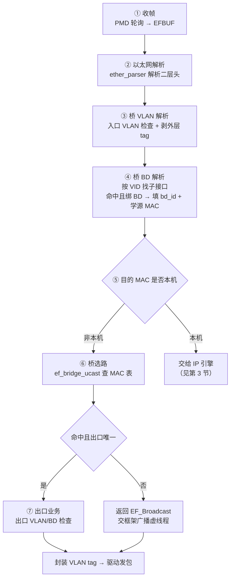
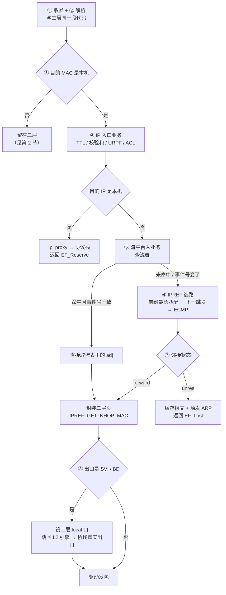

# x86 虚拟机二三层转发实现

> **本文只回答四个问题**：报文怎么进、怎么出、中间谁在处理、表项从哪来。
>
> 不讨论框架设计理念，不讨论真机芯片，不讨论性能。这些在 [[EFMP引擎与二三层业务对接及转发流程-2026-11-04]] 和 [[X86模拟器缺失进程清单-2026-11-02]] 里。
>
> **信源分级**：【实测】= 2026-11-04 在虚拟机 `10.110.170.111:10010` 上跑出来的（全程只读）；【实测·真机】= 同日在真机 `10.104.36.146:23` 上采集的对照组；【conf】= 公司 wiki 原文，页面 ID 可点；【LLD】= `ARCH-EF-LLD.doc`；【推断】= 我的推断，给依据链。
>
> **设备口径（本文唯一基准）**：真机 = `10.104.36.146:23`（Telnet，admin）；虚拟机 = `10.110.170.111:10010`（Telnet，免认证）。此前版本的【实测】取自 `172.28.15.168`，那是**第三台**设备（CI 环境模拟器，`X86_RGOS 12.5(1)B1418S1`），已全部替换为本机数据，差异见 [[#5 设备实证：真机 vs 虚拟机|§5]]。

## 目录

- [[#0 结论先行：三张表|0 结论先行]]
- [[#1 报文怎么进、怎么出|1 报文怎么进出]]
- [[#2 二层：一个单播帧的七步|2 二层流程]]
- [[#3 三层：一个跨网段报文的八步|3 三层流程]]
- [[#4 二层与三层的三处结构性差别|4 结构性差别]]
- [[#5 设备实证：真机 vs 虚拟机|5 设备实证]]
- [[#6 还没证实的部分|6 未证实项]]

---

## 0 结论先行：三张表

先把答案摆出来，后面再给过程。

### 0.1 组件清单

进程只有一个：`/sbin/efmp_frame.elf`【实测】。二层和三层不是两个进程，是同一个进程里 dlopen 进来的两个 `.so`。

| 角色 | 实体 | 干什么 | 证据 |
|---|---|---|---|
| 框架本体 | `/sbin/efmp_frame.elf`（49 MB） | 收发包、引擎调度、广播虚线程、流表、**三层选路 IPREF** | 【实测】`ps` + `strings` |
| 框架库 | `librg_efmp.so` | 业务注册、服务注册、业务跳转 | 【实测】`/proc/2984/maps` |
| 内核侧支撑 | `/dev/efmp`、`/dev/efbuff`、`/dev/lsm` | 无锁环、报文缓冲区、接口表事件 | 【实测】`/proc/2984/fd` |
| **二层转发** | **`librg_ef_bridge.so`** | 桥、MAC 学习、MAC 查表、VLAN/BD 处理 | 【实测】符号表 |
| **三层选路** | **`efmp_frame.elf` 内建（`IPREF_*`）** | 路由匹配、邻接、ECMP、封装二层头 | 【实测】`strings /sbin/efmp_frame.elf` 抓到 `IPREF_MATCH_ROUTE` 等 |
| 路由表接入 | `libref_fib.so`（约 200 KB） | FIB 客户端，从控制面接路由表 | 【实测】符号 `ref_fib_client_connect` |
| 报文解析 | `librg_ether_parser.so` | 以太网头解析 | 【实测】 |
| 子接口/VLAN | `librg_eth_subif.so` | VLAN 终结、子接口 | 【实测】 |
| 上送本机 | `librg_ip_proxy.so` | 把「给本机」的报文交给协议栈 | 【实测】 |
| 组播 | `librg_ef_mcast.so` | 组播表与复制 | 【实测】 |
| 控制面 | `/sbin/nsm.elf`、`/sbin/arp_sprs.elf` | 写路由表、跑 ARP | 【实测】`ps` |

**这里有一处名称错位，必须记下来**：你在 LLD 里找不到 `IPREF` 是正常的，但更要注意——**`IPREF` 根本没有独立的 `.so` 文件**。

- 早前在另一台 12.5 版本设备上确实有 `librg_srp_ref.so`；
- 在本文这两台 12.6 设备上（真机 `10.104.36.146` 与虚拟机 `10.110.170.111`），**`/lib` 里没有 `librg_srp_ref.so`**；
- `IPREF_*` 的**实现符号全部在主程序 `efmp_frame.elf`（49 MB）里**；`librg_efpbr`、`librg_vxlan_ef`、`librg_mpls_ref`、`librg_urpfk_ef`、`librg_natk_ef`、`librg_l2vpn_ref`、`librg_ip_proxy` 这 7 个库只是**引用**它；
- `libref_fib.so` 不是选路实现，它是 FIB 客户端（`ref_fib_client_connect`），负责把控制面的路由表接进来。

所以问「三层由哪个进程/库负责」，准确答案是：**`efmp_frame.elf` 本身**，不是某个 `librg_*.so`。

### 0.2 表项来源

这张表是全文的核心。**「功能在不在」和「表里有没有条目」是两件事**，混起来排障就会走错方向。

| 表 | 谁产生 | 怎么到转发面 | 转发面谁查 | 证据 |
|---|---|---|---|---|
| 接口表 | LSM（Link State Management，接口管理） | 快转**自己维护一份**，订阅数据库接口事件同步 | 桥、REF | 【LLD】2.6.2 节 |
| VLAN / BD 表 | 配置面（VLAN、桥域） | MOM（Message Oriented Middleware，消息中间件）下发 → `ef_bridge_vlandb_init` | 桥 | 【实测】符号 |
| **MAC 表（FDB）** | **只有快转自己能写** | 源 MAC 学习，发生在「BD 解析」阶段 | `ef_bridge_ucast` | 【conf】`BRIDGE` |
| 组播表 | 配置面 + IGMP 学习 | `ef_bridge_maddr_oper` | `ef_bridge_mcast` | 【实测】符号 |
| 路由前缀表 | `nsm.elf` + 路由协议 | 写库 → `ref_mom_thread` 订阅 | `IPREF_MATCH_ROUTE` | 【设计文档】ARCH-EF-HLD2 |
| 邻接表（adj） | IPREF 自建 + ARP 结果 | `IPREF_CREATE_ADJ` / `IPREF_NBR_CHG` | `IPREF_LOOKUP_ADJ` | 【实测】符号 |
| ARP 表 | `arp_sprs.elf` | 通告 IPREF 更新 adj | `IPREF_GET_NHOP_MAC` | 【conf】`12.X EFMP 业务学习记录` |
| 流表 | 流平台（FPM，Flow Platform Module） | 首包处理结果写入 | 流平台入业务 | 【conf】`x86转发报文流程` |

**一句话记法**：二层表是**数据面自己学出来的**，三层表是**控制面送进来的**。这是两层最根本的差别，比「查什么表」重要得多。

### 0.3 谁查表、谁转发

| 动作 | 执行者 | 位置 |
|---|---|---|
| 收包 | DPDK 轮询线程 `data_rx_thread` / `cpa_rx_thread` / `lcore-slave-1` | 用户态 |
| 转发决策 | `EFMP-1` 线程（转发工作线程） | 用户态 |
| 二层查 MAC 表 | `librg_ef_bridge.so` 的 `ef_bridge_ucast` | 用户态，在 `EFMP-1` 里同步执行 |
| 三层查路由/邻接 | `efmp_frame.elf` 内建的 IPREF 的 `IPREF_MATCH_ROUTE` / `IPREF_LOOKUP_ADJ` | 同上 |
| 发包 | 驱动发包回调 → DPDK TX，另有 `ef_output_thd` 线程 | 用户态 |
| 内核 | **不参与转发** | 只承载上送本机的协议报文 |

---

## 1 报文怎么进、怎么出

### 1.1 x86 上其实有三条通道

这台机器上同时存在三种「网口」，很容易看混。

| 通道 | 内核里长什么样 | 谁在用 | 是否承载转发 |
|---|---|---|---|
| 管理口 `eth0` | 普通网卡 | 内核协议栈 | 否 |
| 业务口（数据面） | **看不到物理网卡**，只有同名的 tap 影子口 | `efmp_frame.elf` 通过 `/dev/uio*` 直接驱动 | **是** |
| 业务口（控制面影子） | `Gi1-0-0` … `Gi2-0-9`，共 21 个 `tun type tap` | 内核协议栈发/收协议报文 | 否 |

**关键点**：数据面那 10 个口，内核是看不见的。

【实测】10 个 virtio 网卡 `0000:00:04.0` 到 `0000:00:0d.0` 绑在 **`igb_uio`**（`uio_pci_generic` 绑 0 个），被 `efmp_frame.elf` 以 `/dev/uio0` 到 `/dev/uio9` 全部打开——进程 fd 里这 10 个句柄一个不少。这意味着**内核驱动根本没接管这些网卡**，DPDK 的 PMD（Poll Mode Driver，轮询模式驱动）直接在用户态读寄存器、读 DMA 描述符。

内核里那 21 个 `Gi1-0-0`…`Gi2-0-9` 是 `tun type tap`，是**影子口**，只用来让内核协议栈能收到 ARP、BPDU、LLDP 这类要送 CPU 的帧，以及让协议栈能主动发包。它们不参与转发，进程也**没有打开任何 tap 句柄**（实测 tap 句柄数 = 0）。

> **这一条我此前推错过，原因值得记下来。** 早前在**同一台**虚拟机 `10.110.170.111` 上只执行了 `ip link`，看到 21 个接口全是 `tun type tap`，就推断「转发可能经内核」。错在只看了一层：`ip link` 显示的是内核网络栈视角，而 DPDK 接管的网卡**在内核里根本不出现**。补查 PCI 绑定层（`/sys/bus/pci/drivers/igb_uio`）才看到 10 个网卡已从内核摘走，进程句柄里是 `/dev/uio0`–`/dev/uio5`，**tap 句柄 0 个**。【实测】所以判断「谁在转发」必须同时看三层：内核接口（`ip link`）、PCI 驱动绑定、进程 fd。

### 1.2 收包：从网卡到 EFBUF


【LLD】第 2.3 节「X86 缓冲区管理」原文：x86 上 DPDK 用 `rte_mbuf` 管理报文缓冲区，**为了让业务不感知 mbuf 的存在，且实现报文零拷贝，本文需要复用 mbuf 来实现 EFBUF**。

所以上图的 `rte_mbuf → EFBUF` 不是拷贝，是**同一块内存换了名字**。这也是为什么 x86 能做到零拷贝：网卡 DMA 写进来的地址，一路传到业务库手里都没变过。

【实测】支撑证据：进程内 141 处 `hugepage` 映射，`/proc/meminfo` 里 `HugePages_Total: 256`、`Hugepagesize: 2048 kB`。巨型页（hugepage）就是为了让这些缓冲区常驻 TLB（Translation Lookaside Buffer，地址转换缓存），否则每包一次 TLB Miss 就把性能吃掉了。

### 1.3 发包：从 EFBUF 到网卡


【实测】进程里确实有独立的 `ef_output_thd` 发包线程。但【conf】`快转`（[pageId 804028596](http://conf.ruijie.work/pages/viewpage.action?pageId=804028596)）说二层引擎出口是「直接通过驱动注册的发包函数将报文发送出去」。两者不矛盾也不完全一致——**大概率是：快路径在 `EFMP-1` 里直调发包回调，`ef_output_thd` 承接慢路径和本机发包**。这一条我没有打流验证，标【推断】，挂在 [[#6 还没证实的部分|§6]]。

### 1.4 进程内的线程分工

【实测】`efmp_frame.elf` 共 27 个线程，去掉 DPDK 自带的，和转发相关的分成六组：

| 组 | 线程名 | 说明 |
|---|---|---|
| 转发 | `EFMP-1` | 真正跑引擎链的工作线程，一个核一个 |
| 收 | `packet-high_rx`、`packet-nor_rx`、`data_rx_thread`、`cpa_rx_thread` | 轮询 DPDK 端口 |
| 发 | `ef_output_thd` | 发包 |
| 上送本机 | `ip_proxy` | 把给本机的报文送协议栈 |
| 流表 | `fpm_flow_refres`、`fpmv6_flow_refr`、`fpm_dyn_filter_` | 流表老化与动态过滤 |
| 表同步 | `ref_mom_thread`、`ref_res_thread`、`refv6_mom_threa`、`refv6_res_threa` | 订阅路由/邻接变化并更新转发面 |

**这里有个反直觉的结论**：**没有 bridge 线程**。

三层有 4 个 `ref_*` 线程专门同步表项，二层一个都没有。原因在于 [[#0.2 表项来源|§0.2]] 那张表——二层表是自己学的，不需要从外面接消息，所以不需要常驻线程；三层表要从控制面订阅，必须有线程接。

但这不代表二层没有异步。广播复制仍然要甩出去，只是用的是框架的**广播虚线程**，不是一个具名线程。

---

## 2 二层：一个单播帧的七步

### 2.1 七步流程



逐步对照组件：

| 步 | 动作 | 谁执行 | 落在哪张表 |
|---|---|---|---|
| ① | 收帧 | PMD + 收包线程 | — |
| ② | 解析以太头 | `librg_ether_parser.so` → `ef_bridge_pkt_l2header_parse` | — |
| ③ | 入口 VLAN 检查、剥 tag | `ef_bridge_parser_for_vid`、`ef_bridge_remove_vlan_tag` | VLAN 表 |
| ④ | 找子接口、填 `bd_id`、**学源 MAC** | `ef_bridge_parser_sfw` | **写 MAC 表** |
| ⑤ | 判断目的 MAC 是否本机 | `ef_bridge_local_intf` | 接口表 |
| ⑥ | 按 MAC + VID 查表得出口 | `ef_bridge_ucast` | **读 MAC 表** |
| ⑦ | 出口 VLAN/BD 与接口状态校验 | `ef_bridge_output_vlan_check_sfw` | VLAN 表 + 接口表 |

上表的函数名全部来自【实测】`strings /lib/librg_ef_bridge.so`，与【conf】`网桥的软转发流程梳理`（[pageId 338919620](http://conf.ruijie.work/pages/viewpage.action?pageId=338919620)）的五个注册点一一对应。交叉解读见 [[EFMP引擎与二三层业务对接及转发流程-2026-11-04#5 二层：桥业务挂上 L2 引擎|§5]]。

> **对应关系的可信度要分清**：第 ②③④⑥⑦ 步的动作描述来自 conf 原文，可以直接核对；第 ⑤ 步「判断目的 MAC 是否本机」对应的函数 `ef_bridge_local_intf` 是我**按函数名反推**的【推断】——语义方向不会有错，但具体在哪一行调用没验证过。

**最容易排错的地方**：第 ④ 步学，第 ⑥ 步查，**中间隔着一次引擎进入**。

所以「MAC 表里没条目」有四种可能的成因，只有一种是查表坏了：

1. 子接口没绑 BD → 第 ④ 步根本没执行，学不进去；
2. 入口 VLAN 检查没过 → 第 ③ 步就返回了；
3. 报文是上送本机的（目的 MAC 是本机）→ 走第 ⑤ 步右侧，压根不学也不查；
4. `ef_bridge_ucast` 自己有问题 → 这才是「查表坏了」。

前三种现象一致，成因完全不同。**先看 `show mac-address-table` 有没有条目，再判断是哪一类**，比直接怀疑桥逻辑靠谱。

### 2.2 广播与未知单播：为什么不能就地复制

桥**不自己复制报文**，只返回一个「这包要广播」的结果，复制交给框架。

【conf】ARCH-EF-HLD2 第 2.1.2 节原文：

> 比如桥遍历 vlan 内的所有接口做广播处理，一旦 vlan 内有几千个接口存在的情况下，这个处理就特别慢……桥可以直接返回广播的处理结果给快转框架，快转框架将该报文加入广播处理队列，激活广播处理虚线程单独处理。

所以流程是：

```
桥选路未命中 → 返回 EF_Broadcast → 框架广播队列
→ 广播虚线程 → 回调 ef_bridge_get_bcast_oifs 取出口链表
→ 逐个复制 EFBUF → 逐个调发包回调
```

这不是理论推演，是出过故障的。`快转广播处理`（[pageId 555188275](http://conf.ruijie.work/pages/viewpage.action?pageId=555188275)）记着：

> 中国地质大学故障改动 62553：在 L2 流水线上，桥获取广播出口链表影响报文收发处理，导致**报文堆积、ebuf 不足**。

**实用推论**：如果怀疑「广播风暴把缓冲池打空」，看的是 EFBUF 池的剩余量，不是 CPU。因为复制动作发生在广播虚线程，卡住的是内存不是核。

### 2.3 二层的表项从哪来

二层涉及四张表，来源分两类。

**第一类：配置面送进来的（VLAN、BD、接口）**

| 表 | 来源 | 到转发面的路径 |
|---|---|---|
| 接口表 | LSM | 快转**不直接依赖 LSM**，而是订阅数据库的接口事件，自己维护一份 |
| VLAN 表 | VLAN 配置 | MOM 消息 → `ef_bridge_vlandb_init` |
| BD 表 | 桥域配置 | 同上，`ef_bridge_recv_intf_msg` 处理接口增删 |

【LLD】第 2.6.2 节说得很直白：11.x 里快转把业务信息存在 LSM 的接口控制块里，紧耦合；12.x 改成**快转自己维护接口表，通过订阅数据库的表项变化来管理**。

这带来一个后果：**接口表和内核的 `ip link` 不是同一份**。你在 shell 里 `ip link` 看到的口，和快转认为存在的口，可能不一致。排障时以 `show interface` 为准。

**第二类：数据面自己学的（MAC 表）**

【conf】`BRIDGE`（[pageId 873922810](http://conf.ruijie.work/pages/viewpage.action?pageId=873922810)）：

> MAC 表（FDB，Forwarding Data Base）住在桥快转的**共享内存**里：`base_node` 存真实表项，1q/1d HASH 与二叉树**只存节点位置**，且**只有快转能写**。

三个后果：

1. **控制面进程改不了表**。`bridge.elf` 要加静态 MAC 或过滤 MAC，只能通过 MOM 表达意图，由 `ef_bridge` 自己写。
2. **表容量 = 共享内存池容量**，不是芯片规格。这条对模拟器尤其重要——不能拿真机的 MAC 表规格去套。
3. **老化时间也是软件参数**（`ef_bridge_set_mac_agetime`），不是硬件定时器。

### 2.4 二层在 x86 上的边界

先说清这张表怎么读，否则「有」这个字会被误读成三种意思。

> 本节的判定与同目录 [[X86模拟器缺失进程清单-2026-11-02#1.1 功能存活状态总表（45 行缺失逐条复核）|缺失进程清单 §1.1 功能存活状态总表]] 采用同一口径：**`ce.ebrg` / `fe.ebrg.sw` 这些平面进程确实不在（文件维度 L2），但二层转发功能由 `librg_ef_bridge.so` 承担，功能判定为「退化」而不是「缺失」**。两份文档不矛盾，是同一事实的两个维度。

**「有」的判定走四级，四级都过才算「可用」**：

1. **库在不在** —— `/lib/librg_ef_bridge.so`（符号链接，实体 `librg_ef_bridge.so.0.9`，解引用后约 **1.05 MB**）；
2. **有没有被加载** —— 在 `/proc/<pid>/maps` 里能不能找到，即 `efmp_frame.elf` 有没有 `dlopen` 它；
3. **符号在不在** —— `strings` 能不能捞到对应函数名，排除「空壳库」；
4. **有没有真在跑** —— `show efmp counter` 里对应阶段有没有计数增长。

四级里前三级是这次的实测结论，第四级只能间接看（见 [[#5 设备实证：真机 vs 虚拟机|§5]]）。**只过前三级、没过第四级的，本文一律写「有（未打流验证）」。**

| 能力 | 判定 | 实现位置（库 · 函数） | 说明：这一项「有」到底意味着什么，边界在哪 |
|---|---|---|---|
| 单播转发（已知目的 MAC） | 有 | `librg_ef_bridge.so` · `ef_bridge_ucast` | 这是二层转发的主干：拿「目的 MAC + VID」去共享内存里的 MAC 表查，命中就取到出接口索引，交回框架发包。**边界**：表里没有这个 MAC 时不会转发，而是转入泛洪；查表本身不产生差错，所以「单播不通」永远要先去查表里有没有条目，而不是先怀疑查表逻辑。 |
| 未知单播泛洪 | 有（推断） | 桥选路返回 `EF_Broadcast` → 框架广播虚线程 | 桥自己**不复制报文**，只把「这包要广播」这个结论返回给框架，由框架的广播虚线程统一复制。**边界**：所以泛洪丢包时，问题可能在广播队列而不在桥；这条是【推断】，依据是 RTC 调度模型对桥广播的描述（见 [[#2.2 广播与未知单播：为什么不能就地复制\|§2.2]]），没有函数名直接对应。 |
| 广播/组播复制 | 有 | `librg_ef_bridge.so` · `ef_bridge_mcast`、`ef_bridge_get_bcast_oifs` | 后一个函数解决的是「这个广播域里有哪些口要发」——它去查接口表拿 VLAN 内的出接口列表。**边界**：它给出的是**候选口集合**，最终哪些口真发，还要过出口 VLAN 检查（第 ⑦ 步）和 STP 状态；所以「广播到不了某个口」要先分清是没进候选集，还是进了但被出口检查挡掉。 |
| 源 MAC 学习与老化 | 有 | `librg_ef_bridge.so` · `ef_bridge_parser_sfw`（学）、`ef_bridge_set_mac_agetime`（老化参数） | 学习发生在第 ④ 步「BD 解析」，**不是**查表那一步。**边界**：老化时间由 `ef_bridge_set_mac_agetime` 设的软件参数决定，不是硬件定时器；表项住共享内存，进程重启即清空，所以「重启后首包泛洪」是正常现象，不是故障。 |
| VLAN 与 QinQ | 有 | `librg_ef_bridge.so` · `ef_bridge_qinq_term_bcast`、`ef_bridge_remove_vlan_tag` | 能剥外层 tag、能在 QinQ 终结场景下正确算出广播域。**边界**：这里做的是「入口解析 + 出口改 tag」，VLAN 的**配置语义**（哪些口属于哪个 VLAN、PVID 是多少）来自接口表，接口表错了，这一层再对也转发错。 |
| Super VLAN | 有 | `librg_ef_bridge.so` · `ef_bridge_super_vlan_bcast` | 只覆盖 Super VLAN 的**广播处理**这一段；同一功能下的 ARP 代理、子 VLAN 间隔离等不在这个名字能证明的范围内。**边界**：不要把「有这个函数」当成「Super VLAN 整套可用」，它只说明广播分支认得这种 VLAN 类型。 |
| 协议报文识别（BPDU/LLDP/CDP/ERPS/RLDP） | 有 | `librg_ef_bridge.so` · `ef_bridge_pkt_is_bpdu` 等一组 | 作用是「认出这是协议报文，别按普通数据帧转发，要上送 CPU」。**边界**：识别在转发面，处理在控制面——认出 BPDU 之后交给谁、STP 怎么算，都不在这个库里，所以 STP 收敛慢的问题不会体现为 `ef_bridge` 的错。 |
| VXLAN 二层转发 | 有 | `librg_ef_bridge.so` · `ef_bridge_vxlan_forward` | 桥这一侧认得 VXLAN 封装，能在 VTEP 场景下做二层转发。**边界**：真正建隧道、封外层头的是 `librg_vxlan_ef.so`（同样被 `efmp_frame.elf` 加载），两者分工不同；只查 `ef_bridge` 会漏掉隧道那一半。 |
| MAC 过滤 / 防漂移 | 有 | `librg_ef_bridge.so` · `ef_bridge_mac_filter`、`ef_bridge_xmac_filter` | 按 MAC 做准入，并识别「同一个 MAC 在两个口来回跳」。**边界**：漂移的**判定与告警上报**在控制面；转发面这层只负责识别与拦截，所以「有没有告警」不能拿这里当证据。 |

**三个必须一起记住的限制**：

1. **这些都只证明「代码路径在」。** 转发面能力齐全不等于**规格**齐全：MAC 表容量由共享内存池决定（见 [[#2.3 二层的表项从哪来\|§2.3]]），不是真机芯片的规格，不能拿真机 MAC 表容量去套模拟器。
2. **STP 状态机不在这一层。** 转发面只认「这个口能不能出」，收敛过程、拓扑计算都在控制面进程里。
3. **没有 LLD。** `ARCH-EF-HLD2` 的下级详细设计里只列了三层相关的 `IPREF-MOM-LLD`，二层没有对应 LLD——所以二层的完整实现（学习时序、VLAN 处理细节、STP 交互）从来没有一份成文设计，这也是模拟器上很难用一条 `show` 命令判定二层「在不在」的根本原因。

---

## 3 三层：一个跨网段报文的八步

### 3.1 八步流程



逐步对照组件：

| 步 | 动作 | 谁执行 | 落在哪张表 |
|---|---|---|---|
| ③ | 判断是否三层 | 路径选择函数（桥提供，见 [[#2.1 七步流程\|§2.1]] 第 ⑤ 步） | 接口表 |
| ④ | 入口检查、判断本地 | IP 引擎入口业务链 | 路由表（Local 路由） |
| ⑤ | 查流表 | 流平台 | **流表** |
| ⑥ | 路由最长匹配 | `IPREF_MATCH_ROUTE` → `IPREF_MATCH_ECMP_ROUTE` | **路由前缀表 + 下一跳块表** |
| ⑦ | 取邻接 | `IPREF_LOOKUP_ADJ` | **邻接表** |
| ⑧ | 封二层头 | `IPREF_GET_NHOP_MAC` | ARP 表 |
| ⑧ | 出口判断（是 SVI/BD 就跳回二层） | 框架 `efmp_skip_fw` | 接口表 |

三层表的组织是**两级间接**，这一点决定了查表次数：

> IPREF 按照是否存在下一跳块 id 区分，若存在下一跳块 id，则路由前缀根据下一跳块 id 生成 `rt_data` 间接关联邻接表（先通过下一跳块 id 找到邻接索引表，再通过邻接索引表找到邻接表）；当处理不存在下一跳块 id 的路由时，EF-REF 路由前缀根据邻接索引 id 直接关联邻接表。
> 四张表项：**前缀表、邻接索引表、负载均衡表、邻接表**。
> —— 【conf】`12.X EFMP（快转）业务学习记录`（[pageId 217222533](http://conf.ruijie.work/pages/viewpage.action?pageId=217222533)）

【实测】这条在符号表里能对上：`IPREF_LOOKUP_IFX_NHOP`、`IPREF_FIND_IFX_NHOP_DEF`、`IPREF_FIND_NHOP_DEF_BY_OUTIF`、`IPREF_LOOKUP_ADJ_BY_MAC_IFX`——**「下一跳」和「邻接」是两级查找**，不是一次。

### 3.2 首包与后续包：流表在哪一步接管

第 ⑤ 步是性能分水岭。

**首包**走完整条链：流表未命中 → 查路由 → 查邻接 → 封装 → 把结果写进流表。

**后续包**在第 ⑤ 步就命中，直接拿到 `adj`，第 ⑥ 步整个跳过。这就是「一次处理、多次转发」。

失效机制靠**事件号比对**，不是定时刷新：

```c
/* 业务侧：路由或邻接有变化就调 */
fpm_announce_event();        /* → hfpm->event_counter++ */

/* 流平台入业务：每个包都比一次 */
if (hfpm->event_counter != pflow->ori_event_counter) {
    pflow->ori_event_flags = 全F;      /* 标记这条流要重建 */
}
```

【实测】支撑：进程里有 `fpm_flow_refres`、`fpmv6_flow_refr`、`fpm_dyn_filter_` 三个流表线程。

**这个设计的代价要知道**：每条流都要存一个 `ori_event_counter`，全局计数器一变，**所有流同时作废**。所以路由震荡时不是「一条流重建」，而是「全部流重建」——首包洪峰。这是流表方案的固有特性，不是 bug。

**排障价值**：如果现象是「路由一改，瞬间大量丢包或时延抖动」，方向应该是流表重建，不是链路。

### 3.3 三层的表项从哪来

三层的表**全部来自控制面**，这是与二层的根本差别。

| 表 | 谁写 | 怎么到转发面 |
|---|---|---|
| 路由前缀表 | `nsm.elf` + OSPF/BGP/IS-IS 等协议进程 | 写库并发布 → IPREF 订阅 |
| 下一跳块表 | 同上 | 同上 |
| 邻接表（adj） | **IPREF 自建** | `IPREF_CREATE_ADJ` / `IPREF_REFER_ADJ` |
| ARP / ND | `arp_sprs.elf`（IPv4）/ 协议栈（IPv6） | 通告 `IPREF_NBR_CHG` 更新 adj |
| 流表 | 流平台 | 首包写入，事件号失效 |

【设计文档】与【conf】对这条链的说法一致：

> 三层表项：NSM 把路由表写库并发布，TCP/IP 把 ARP、ND 写库并发布，IPREF **从数据库订阅**，不再与 NSM、TCP/IP 直接建立连接。

【实测】对应到线程就是那 4 个 `ref_mom_thread` / `ref_res_thread`——**`mom` 是收消息的，`res` 是算资源的**。

邻居打通的过程值得单独记，因为「ping 不通但设备没报错」多半发生在这里：

1. `ip_proxy` 收到要转发的报文，发现邻居未解析，建一个 adj，通告 `arp_sprs.elf` 发 ARP；
2. 报文继续走，在 `efmp_output_pkt` 里查 adj，仍未解析 → **报文缓存进邻接队列**；
3. ARP 应答回来 → `arp_sprs.elf` 更新 ARP → 通告 IPREF → IPREF 更新 adj → **发出缓存报文**；
4. 5 秒（默认）没应答 → 删 ARP → flush adj → **释放缓存报文**。

缓冲有上限，写进了设计约束：

> 选路的 IPREF 在邻居未打通的时候需要缓冲报文。但是为了不影响系统的转发，缓冲的报文**不能超过系统报文缓冲区总数的 1/100**。

**这条约束解释了「为什么大量目的不可达时整机转发会抖动」**：缓存占满 1/100 之后，新报文直接丢，连「缓存等待」的待遇都没有。

### 3.4 三层在 x86 上的边界

> 与 [[X86模拟器缺失进程清单-2026-11-02#1.1 功能存活状态总表（45 行缺失逐条复核）|缺失进程清单 §1.1]] 同口径：`ce.en.l3tb.sw` 一族不在是**文件维度**的事实，三层转发功能由 `efmp_frame.elf` 内建的 IPREF 承担是**功能维度**的事实。两个结论同时成立。

三层比二层更需要小心，因为**三层的实现不集中在一个库**。`IPREF_*` 在 `efmp_frame.elf` 主程序里，而调用它的是一圈业务库（`efpbr`、`vxlan_ef`、`mpls_ref`、`urpfk_ef`、`natk_ef`、`l2vpn_ref`、`ip_proxy`）；这些库**不是全部被加载**。

最典型的是 `librg_mpls_ref.so`：虚拟机上是 **2.9 MB**，MPLS 表结构（`mpls__ftn_fwd`、`mpls__fragment` 等）一应俱全，但 `efmp_frame.elf` **没有加载它**。真机上的同名库只有 495 KB，同样没加载——因为真机的 MPLS 转发走芯片。

这就是「MPLS 在模拟器上能 ping 通、但标签转发不走」的真正原因：控制面 `mpls.elf` 在，能配、能生成转发表；转发面那份库躺着没被装进来。**报文最后是按 IP 转发的，不是按标签转发的。**

| 能力 | 判定 | 实现位置（库 · 函数 / 线程） | 说明：这一项「有」到底意味着什么，边界在哪 |
|---|---|---|---|
| IPv4 单播转发 | 有 | `efmp_frame.elf` 内建的 IPREF · `IPREF_MATCH_ROUTE` → `IPREF_LOOKUP_ADJ` | 完整走「前缀最长匹配 → 下一跳块 → 邻接」两级查找。**边界**：查表结果只是「该从哪个口出去、下一跳 MAC 是什么」，封装与发包在框架；所以「路由查对了但不通」要把查表与封装分成两段排。 |
| IPv6 单播转发 | 有 | `efmp_frame.elf` 内建的 IPREF 的 v6 变体 + `refv6_*` 线程 | 进程内确实存在 v6 选路线程，说明 v6 不是复用 v4 代码路径，而是独立一路。**边界**：v4 与 v6 的邻接表是两套，v4 的排查经验不能直接套到 v6。 |
| ECMP（Equal Cost Multi Path，等价多路径） | 有 | `efmp_frame.elf` 内建的 IPREF · `IPREF_MATCH_ECMP_ROUTE`、`IPREF_GET_ECMP_SCHEME` | 支持多下一跳并按 HASH 选一条。**边界**：HASH 因子与算法决定「同一条流会不会换路」，这部分与真机芯片的 ECMP HASH 未必一致，**链路级负载均衡的结论不能外推**。 |
| 邻接管理与主动打通 | 有 | `efmp_frame.elf` 内建的 IPREF · `IPREF_CREATE_ADJ`、`IPREF_GET_NHOP_MAC` | 负责「这条路由的下一跳是谁的 MAC」，未解析时触发 ARP 并缓存报文。**边界**：缓存有硬上限（系统缓冲区总数的 1/100，见 [[#3.3 三层的表项从哪来\|§3.3]]），超限后新报文直接丢——大量目的不可达时表现为「整机转发抖动」，容易误判成链路问题。 |
| 流表加速 | 有 | 框架 `fpm_*` 线程 + 流表 | 首包走完整链，后续包在流表命中直接取 `adj`，第 ⑥ 步整个跳过。**边界**：失效靠全局事件号比对，路由一震荡就是**全表重建**、首包洪峰，不是单条流重建。 |
| URPF（Unicast Reverse Path Forwarding，单播反向路径转发） | 有 | `librg_urpfk_ef.so`（转发面，已加载）+ `librg_urpf.so`（控制面） | 反查源地址是否从正确方向来，用于防源地址伪造。**边界**：严格模式的判定依赖路由表完整性，路由不全时会误丢，这是功能的正确行为，不是 bug。 |
| PBR（Policy Based Routing，策略路由） | 有 | `librg_efpbr.so`（已加载） | 按策略把流量导到指定下一跳，优先级高于普通路由。**边界**：库在但没配策略时行为等同普通路由，**抓包看不出差别**；「PBR 生效了吗」只能靠配置与策略命中计数判断。 |
| 隧道 / VXLAN / IPsec | 有 | `librg_tunnelk_ef.so`、`librg_vxlan_ef.so`、`librg_ipsec_ef.so`（三者均已加载） | 封装/解封装在转发面完成，不交给内核或外部设备。**边界**：MTU 与分片是这类功能的高发问题——封装后报文变长，超 MTU 是否分片、分片能否重组，取决于 `efmp_ipfrag_ref` 那条路径，不能只看隧道本身。 |
| 分片重组 | 有（未跑过流量） | 线程 `efmp_ipfrag_ref`、`efmp_ipv6frag_r` | 有独立线程处理 v4/v6 分片重组。**边界**：`show efmp counter` 里 `FRAG-REASM-STAGE` **实测是空的**（无任何计数），说明这条路就绪但没跑过流量——「能重组」目前只是代码层判断。 |

**这张表里最容易被误用的两行**：

- **ECMP**：查到「有」不等于「分担比例和真机一致」。验收「4 条链路均不均」时，模拟器给的结论不能代表真机。
- **PBR**：库加载了但策略没配，行为与普通路由完全一样。所以 PBR 的「配了不生效」在模拟器上连「不生效」都观察不到——它看起来一直是对的。

---

## 4 二层与三层的三处结构性差别

这三条决定了同一个问题在两层上的表现完全不同。

### 4.1 谁决定「走二层还是三层」：是函数返回值，不是查表

真机是在流水线的某一级用表项把二三层分开的；x86 上是**解析函数返回下一个引擎**。

```c
/* 桥提供的路径选择函数，概念示意 */
if (目的MAC == 本机接口MAC)  return EF_ENGINE_IP;   /* 跳三层 */
else                        return EF_ENGINE_L2;    /* 留二层 */
```

【conf】`快转`（[pageId 804028596](http://conf.ruijie.work/pages/viewpage.action?pageId=804028596)）确认：二层引擎的默认路径选择函数由桥提供。

**推论**：如果这个判断错了，现象是「本该三层转发的报文被当二层转发（或反过来）」，而不是「某条路由不通」。**这种故障在路由表上是查不出问题的。**

### 4.2 二层出口不判引擎，三层出口要判

> 二层转发引擎**没有在出口业务处理之后判断下一个转发引擎**，而是直接通过驱动注册的发包函数将报文发送出去。

三层不一样：出口如果是 SVI（Switch Virtual Interface，交换机虚拟接口）或 BD，要设一个「二层 local 口」，再绕回 L2 引擎走桥。

**后果**：三层路径天然比二层多跑一遍业务表。在真机上这是流水线并行度的问题，在 x86 上这是**实打实的两次 CPU 开销**。所以「三层转发性能比二层低」在软转上是结构性的，不是没优化好。

### 4.3 二层表自己学，三层表从外面接

| | 二层 | 三层 |
|---|---|---|
| 表项产生 | 数据面学习 | 控制面下发 |
| 是否需要常驻线程 | 否 | 是（4 个 `ref_*` 线程） |
| 表的容量上限 | 共享内存池大小 | 内存 + 控制面规模 |
| 表为空时的现象 | 泛洪 | 直接丢 |
| 典型排障入口 | `show mac-address-table` | `show ip route` / `show arp` |

**最后一行「表为空时的现象」值得单独记**：二层表空了会泛洪，报文还能到；三层表空了直接丢，一点声音都没有。所以「用户说时通时不通」大概率是二层问题，「用户说完全不通」大概率是三层问题。

---

## 5 设备实证：真机 vs 虚拟机

两台设备同日同口径采集，全程只读，未下发任何配置。

| 项 | 真机 | 虚拟机 |
|---|---|---|
| 地址 | `10.104.36.146:23`（Telnet，admin） | `10.110.170.111:10010`（Telnet，免认证） |
| 型号 | **S5760C-48GT4XS-X**（盒式 10G 交换机，双主控） | Ruijie (X86 TESTBENCH)，x86_64 |
| 软件版本 | S5760X_RGOS **12.6(4)B0706** | X86_RGOS **12.6(4)B0101** |
| 运行时长 | 2026-11-02 14:21 起 | 2026-10-30 起 |

> 版本号只差一个 B 号，CLI 与 `show` 输出格式几乎一致。**所以下面的差异不是版本差异，是转发实现路线的差异。**

### 5.1 一张表看完两台的差别

| 维度 | 真机 | 虚拟机 | 含义 |
|---|---|---|---|
| 转发主体 | ASIC 芯片 | `efmp_frame.elf` 用户态 | — |
| 平面实体 `ce.*`/`fe.*`/`xe.*` | **209 个** | **0 个** | 虚拟机一个都没有 |
| `/sbin` 文件总数 | 524 | 340 | 差 184 |
| `/lib` 下 `librg_*.so` | 138 | 144 | 虚拟机反而多 6 个 |
| `efmp_frame.elf` 实际加载 | 25 个 | 31 个 | 见 [[#5.3 进程与业务库\|§5.3]] |
| 转发线程模型 | 8 个 `ef_*_ring` 环线程 | DPDK 轮询线程 | 见 [[#5.4 线程模型：两台根本不是一回事\|§5.4]] |
| 巨型页 | **0** | 256 × 2MB（进程内 179 处映射） | 真机不需要 |
| 业务口形态 | 真实 netdev，接口 108 个，`tap` **0** 个 | 10 个 `igb_uio` + 21 个 `tap` 影子口，接口 23 个 | — |
| `ip_forward` | 0 | 0 | **两台内核都不转发** |
| `/proc/net/route` | 只有表头 | 只有表头 | 内核无路由 |
| `/proc/net/arp` | 只有表头 | 只有表头 | 内核无邻居 |

**最后三行是本节最重要的结果**：真机是硬件转发，内核不参与理所当然；虚拟机也没有让内核参与——`ip_forward=0`、内核路由表与 ARP 表全空、没有加载 `bridge`/`vlan`/`bond` 任何内核模块。【实测】

### 5.2 「平面实体 209 对 0」为什么不等于「虚拟机少了 209 个功能」

这是本文最需要说清、也是我上一版判错的地方。

真机的 `ce.*` / `fe.*` 是**紧贴芯片的平面实体**——它们负责把配置翻译成芯片表项、把芯片中断翻译成事件。虚拟机没有这一层，**能力不是消失，而是下沉到了 `efmp_frame.elf` 加载的业务库里**。库的体积直接证明了这件事：

| 库 | 真机 | 虚拟机 | 倍数 | 说明 |
|---|---|---|---|---|
| `librg_efacl.so` | 378 KB | 2.2 MB | 5.9× | 真机逻辑在 ASIC，库只是下发壳 |
| `librg_ef_bridge.so` | 255 KB | 1.39 MB | 5.5× | 二层的查表与学习在虚拟机里是软件实现 |
| `librg_mpls_ref.so` | 495 KB | 2.9 MB | 5.9× | 库在，但两台都没加载（见下） |
| `librg_ap.so` | 263 KB | 725 KB | 2.8× | 聚合的哈希与选成员口在虚拟机里是软件实现 |
| `librg_span.so` | 14.8 KB | **无此文件** | — | 镜像功能**确实真空** |
| `librg_nfpp.so` | 198 KB | **无此文件** | — | 防攻击**确实真空** |

**所以判「功能在不在」要分两级**：先看库文件在不在（真空与否），再看库有没有被装进进程（加载与否）。只做第一级会把「有实现但没启用」误判成「有功能」，只做第二级会把「换了实现路径」误判成「功能消失」。

### 5.3 进程与业务库

虚拟机上的进程（与真机同名，参数也相同）：

```
/sbin/efmp_frame.elf -c 3 -b 0000:00:03.0 --log-level=4
```

- `-c 3`：lcore 掩码 `0x3`，用 0、1 两个核【推断，按 DPDK 惯例】
- `-b 0000:00:03.0`：**屏蔽**管理口网卡，避免 DPDK 抢走导致失联【推断，但方向明确】

【实测】虚拟机 `/proc/2984/maps` 已加载 **31 个** `librg_*.so`；真机 `/proc/3228/maps` 加载 **25 个**。两者的差集很说明问题：

| 集合 | 库 |
|---|---|
| 两台都加载（23 个） | `af_key` `ap` `at` `bfd` `cap_mini_real` `cap_real` `datastruct` `ef_bridge` `ef_mcast` `efacl` `efpbr` `eth_subif` `ether_parser` `ham` `ip_proxy` `lib` `lsm_impl` `mom_impl` `mom_proto_pass` `osal` `sys_raw` `tunnelk_ef` `udph_ef` `urpfk_ef` `vxlan_ef` |
| **只在虚拟机加载（6 个）** | `dm_cmn_essence` `dm_essence` `ipsec_ef` `natk_ef` `ppp_ef` `pppoe_ef` |
| **只在真机加载（0 个）** | — |

**虚拟机加载的库是真机的超集**——它把 NAT、PPP/PPPoE、IPsec 这些真机靠芯片或专用平面做的功能，全部用软件库补上了。这反过来说明：**「虚拟机功能少」这个印象，在业务库层面是不成立的**。

`/etc/dynlib_monit_dir` 里两台都是同样的 **18 个**标记（`af_key ap ef_bridge ef_mcast efacl efpbr eth_subif ether_parser ipsec_ef natk_ef ppp_ef pppoe_ef srp_ref srv6_ref tunnelk_ef udph_ef urpfk_ef vxlan_ef`），这是【LLD】第 2.6.1 节说的动态加载开关：**放一个同名空文件进去，快转就用 `inotify` 感知并 dlopen 对应库**。

**注意标记与加载不是一一对应**：标记里有 `srp_ref`、`srv6_ref`、`ipsec_ef`，但真机 maps 里没有 `ipsec_ef`——**有标记不等于被加载**，还要看配置有没有触发。

`srp_ref` 这个标记还有一层歧义：标记名指向 `librg_srp_ref.so`，但 12.6 两台设备的 `/lib` 里**没有这个文件**，只有 `libref_fib.so`。所以标记到底是"加载 `libref_fib.so`"的开关，还是遗留项，本文不下结论，列进 [[#6 还没证实的部分|§6]]。

**两个库的真假要分清**：

| 库 | 真机 | 虚拟机 | 结论 |
|---|---|---|---|
| `librg_span.so`（端口镜像） | 在（14.8 KB） | **文件不存在** | 虚拟机镜像功能真空 |
| `librg_nfpp.so`（防攻击） | 在（198 KB） | **文件不存在** | 虚拟机 NFPP 真空 |
| `librg_dia_fid.so` | 在 | **文件不存在** | — |
| `librg_mpls_ref.so` | 在（495 KB），**未加载** | 在（2.9 MB），**未加载** | **两台都没装进转发进程** |
| `librg_qos.so` / `librg_mlag.so` | **不在** | **不在** | 两台都没有这个库 |

`librg_mpls_ref` 那一行值得单独记：**这不是模拟器独有的问题**。真机上这个库同样没被 `efmp_frame.elf` 加载——真机的 MPLS 转发走芯片，不需要它；虚拟机的库虽然完整（2.9 MB），但没进进程，所以标签转发不生效、报文按 IP 转。

**三层没有独立库，这一点和二层不一样，容易踩坑**：二层的 `librg_ef_bridge.so` 是货真价实的独立 `.so`，`strings` 就能看到 `ef_bridge_ucast`；三层不是——`/lib` 顶层只有 `libref_fib.so`（约 200 KB，符号是 `ref_fib_client_connect`，它只是把控制面路由表接进来的客户端），真正的 `IPREF_*` 实现在 49 MB 的 `efmp_frame.elf` 里。**所以「三层功能在不在」不能用「查库文件」的办法判，必须查主程序符号或直接看 `show ip route` 的转发行为。**

### 5.4 线程模型：两台根本不是一回事

这是两套实现最本质的差别，线程名一眼就能看出来。

**真机**（`/proc/3228/task`，共 23 个线程）——核心是 8 个收发环线程：

```
EFMP-1  ef_la_tx_ring  ef_lv4_tx_ring  ef_lv6_tx_ring  ef_m_rx_ring
ef_nm_rx_ring  ef_nmh_rx_ring  ef_nmv4_rx_ring  ef_nmv6_rx_ring
ef_output_thd  ef_path_thread  efmp-task  efmp-topf
efmp_ipfrag_ref  efmp_ipv6frag_r  ip_proxy  pcap_thread
ref_mom_thread  ref_res_thread  ref_rt_search  refv6_mom_threa  refv6_res_threa  rg-packet-fwd
```

`*_rx_ring` / `*_tx_ring` 是**和芯片交互的环形队列线程**：报文由 ASIC 收好放进环，线程从环上取；要发包就往环里放，芯片自己发。

**虚拟机**（`/proc/2984/task`，共 24 个线程）——核心是 DPDK 轮询线程：

```
EFMP-1  cpa_rx_thread  data_rx_thread  dpdk_mom  eal-intr-thread
ef_output_thd  ef_path_thread  efmp-task  efmp-topf
efmp_ipfrag_ref  efmp_ipv6frag_r  fpm_dyn_filter_  fpm_flow_refres  fpmv6_flow_refr
ip_proxy  lcore-slave-1  pcap_thread
ref_mom_thread  ref_res_thread  ref_rt_search  refv6_mom_threa  refv6_res_threa  rg-packet-fwd  rte_mp_handle
```

`data_rx_thread` + `lcore-slave-1` + `eal-intr-thread` + `rte_mp_handle` 是 DPDK 的典型线程组：**没有中断，靠核上死循环轮询网卡**。`fpm_flow_refres` / `fpm_dyn_filter_` 是流表老化与动态过滤，只在软件转发里才有意义。

**两边都有的线程**：`ref_mom_thread`、`ref_res_thread`、`refv6_mom_threa`、`refv6_res_threa`、`ref_rt_search`——这是三层选路（[[#3 三层：一个跨网段报文的八步|§3]]）的订阅与资源解析，两台都要接控制面的路由与邻居，所以都在。

**二层没有专属线程，三层有 4 个**——这是 [[#4.3 二层表自己学，三层表从外面接|§4.3]] 那张表最直接的证据。

### 5.5 通道与内存

| 项 | 虚拟机实测 | 真机实测 | 含义 |
|---|---|---|---|
| 业务口网卡 | `0000:00:04.0` – `0000:00:0d.0` 共 10 个 | 真实网卡 108 个接口 | 虚拟机是 virtio |
| PCI 驱动绑定 | `igb_uio` 绑 10 个，`uio_pci_generic` 绑 0 个 | 不适用 | 用户态直驱 |
| 进程句柄 | `/dev/uio0` – `/dev/uio5`（tap 句柄 **0** 个） | — | 数据面通道 |
| 内核网口 | `Gi1-0-0`…`Gi2-0-9` 共 21 个 `tun type tap` | 0 个 tap | 虚拟机是影子口 |
| 管理口 | `eth0` | 管理口另有 netdev | 内核驱动 |
| 巨型页 | 256 × 2MB，进程内 **179** 处 huge 映射 | **0** | EFBUF 池只在虚拟机需要 |
| 内核模块 | `igb_uio`；无 `bridge`/`vlan`/`bond` | `dal.ko`、`knet.ko` 等芯片驱动 | — |

**「巨型页 0 对 256」是两套架构最直白的注脚**：真机的报文缓冲区在芯片里，主机内存不需要大页；虚拟机的整个转发面都在用户态内存里，必须用大页把 TLB Miss 压下去。

`show mac-address-table` 与 `show ip route` 在虚拟机上都是空/仅直连——**这台设备没有承载业务流量**。所以上面的二层流程是按代码路径还原的，不是打流观察的，见 [[#6 还没证实的部分|§6]]。

---

## 6 还没证实的部分

诚实列出来，不含糊。

| # | 待确认 | 现状 | 怎么验 |
|---|---|---|---|
| 1 | 二层路径是否真的零拷贝 | 【LLD】说复用 mbuf，未实测 | 打流看 CPU 与 memcpy 计数 |
| 2 | `ef_output_thd` 与「二层直调发包」的关系 | 两者并存，机制未定 | 抓线程栈 |
| 3 | 收包线程到 `EFMP-1` 之间是否是环 | 线程名支持，未见代码 | 查 `/dev/efmp` 环数量 |
| 4 | 二层是否也走流表 | 流程里没看到，未证伪 | 二层打流看流表计数 |
| 5 | `librg_at.so` 是什么 | 已加载，用途不明 | 查符号或问作者 |
| 6 | 广播虚线程的实际并发度 | 未见参数 | `show` 类命令或配置 |
| 7 | `librg_srp_ref.so` 在 12.5 有、12.6 无，`srp_ref` 加载标记指向哪个文件 | `/lib` 只有 `libref_fib.so`（FIB 客户端） | 问框架组，或比对两个版本的打包清单 |
| 8 | 真机 `efmp_frame.elf` 也加载了 25 个业务库，但转发最终走 ASIC——这些库在真机上的作用是什么 | 推测是配置下发与表项同步，未见文档 | 查 `librg_ef_bridge` 在真机上的调用栈 |

前四条都需要**打流**才能定论。打流本身有风险（广播风暴、环回），需要你确认后我再做。

---

## 附：一句话压缩版

**x86 上，二层是「学着自己查、自己转」，三层是「别人给表、我只查」。两者都跑在同一个进程 `efmp_frame.elf` 里：二层的查表与学习在它加载的 `librg_ef_bridge.so`，三层选路 `IPREF` 直接编在它自己体内（没有独立 `.so`）。报文从 uio 口进、从 uio 口出，内核只当协议报文的收发员，全程不碰转发。**
