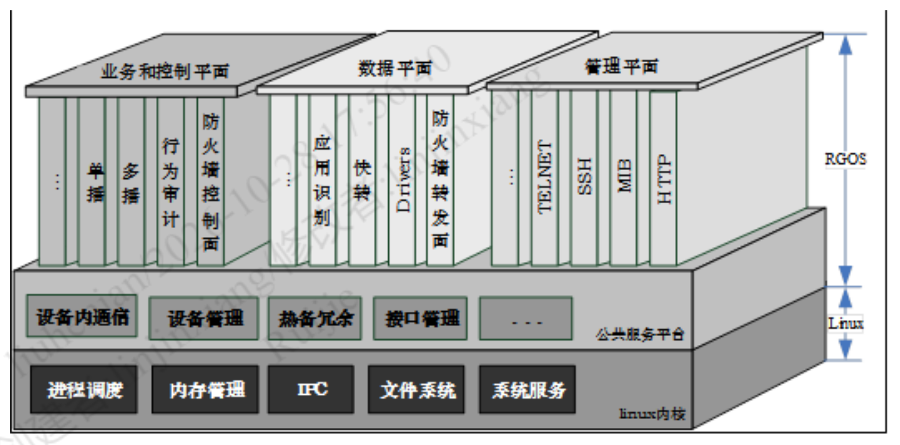
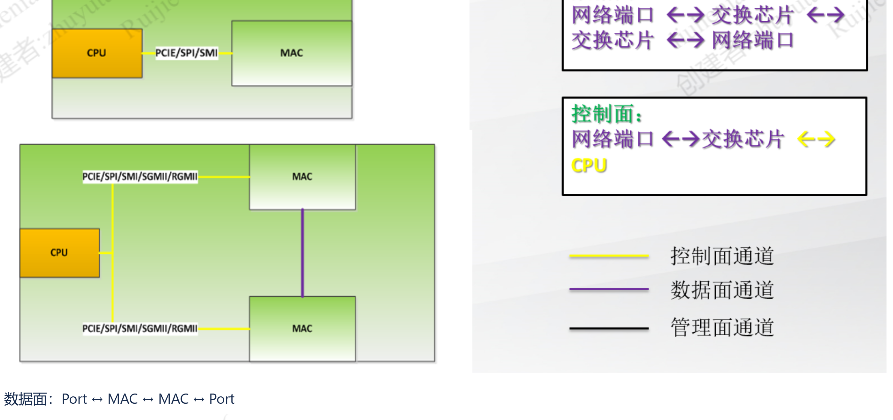
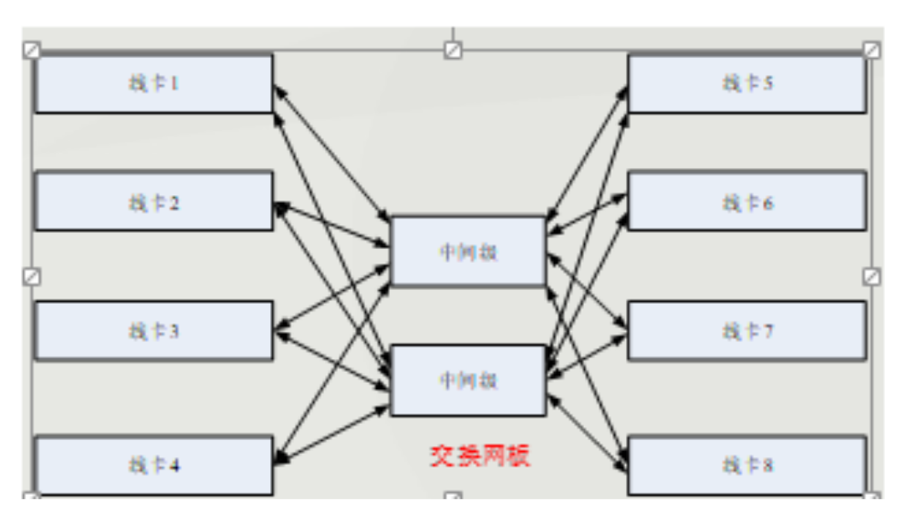
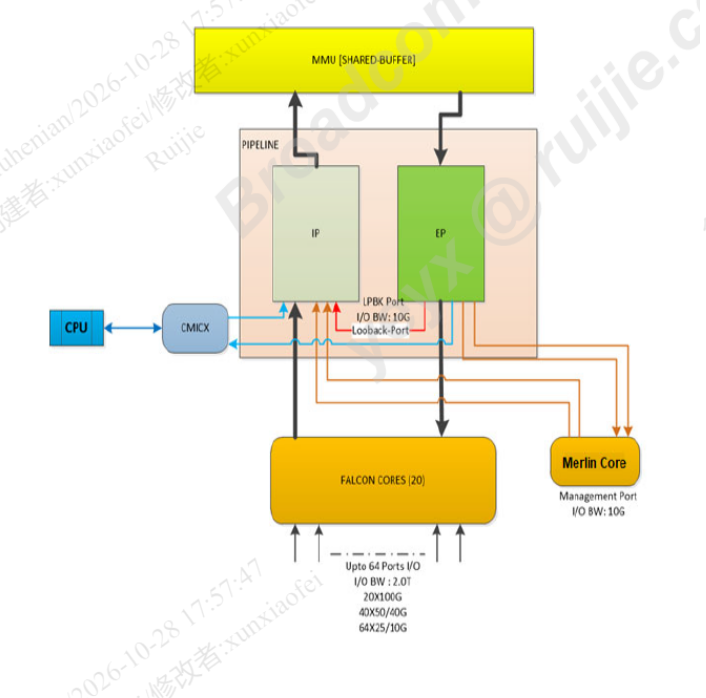
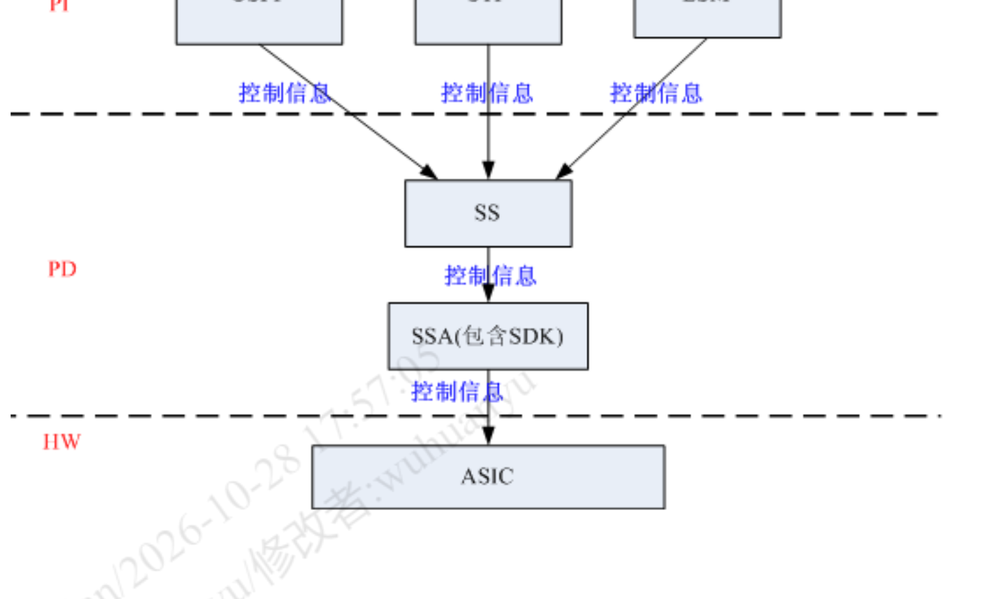
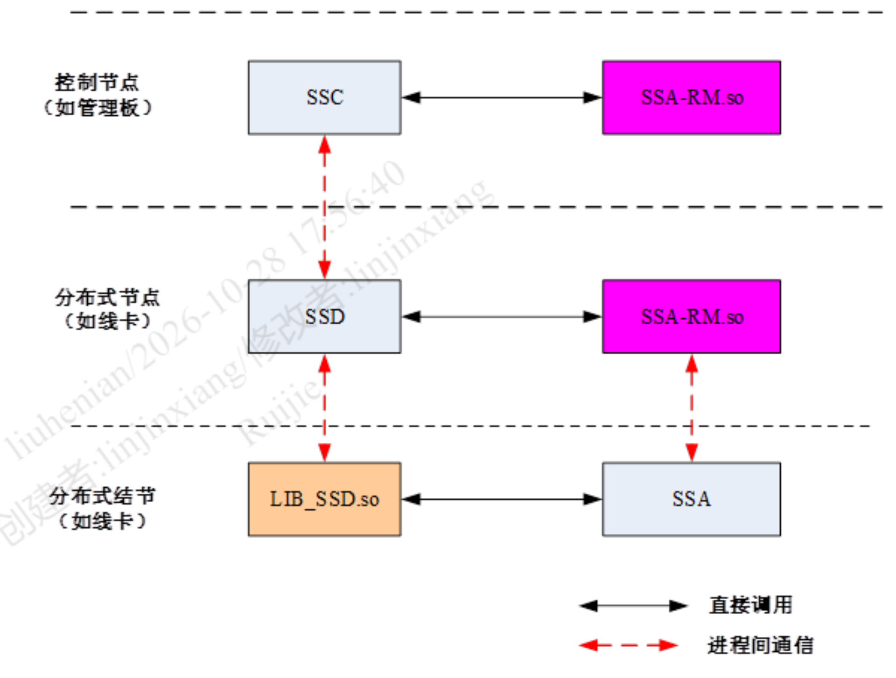
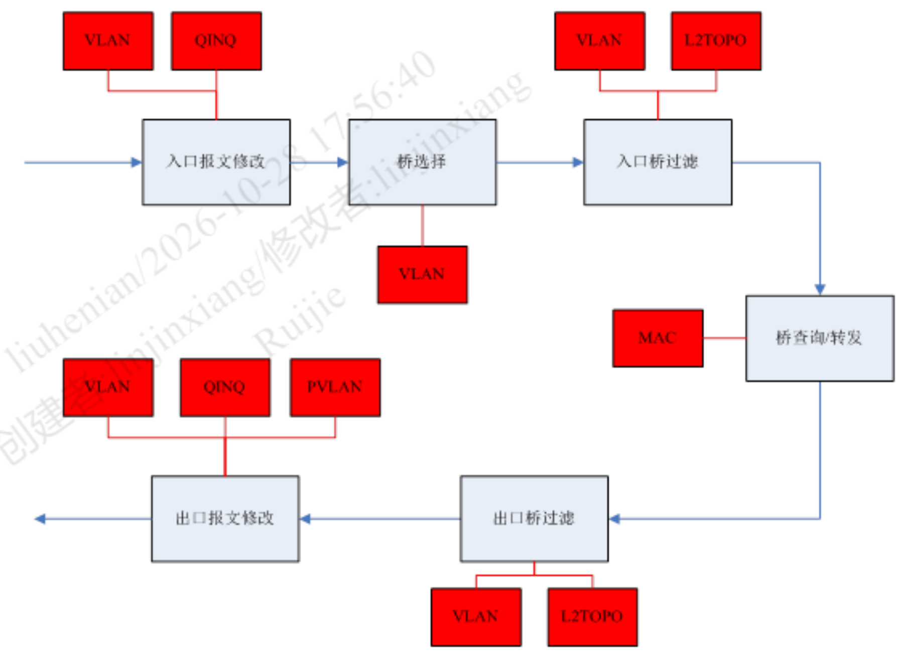

# 交换真机架构与模拟器能力边界

> **本文性质：双机实机取证 + 内部架构建档对账。**
> 真机 `10.104.36.146:23`（S5760C-48GT4XS-X，RGOS 12.6(4)B0706），模拟器 `172.28.15.168:10010`（X86 TESTBENCH，X86_RGOS 12.5(1)B1418S1）。两台都用 `run-system-shell` 进 shell（入口方式见 [[模拟器EFMP转发面现场实测-2026-10-28#9.1 shell 入口|模拟器实测 §9.1]]）。
> 原始命令输出分别在 `attachments/真机实测-2026-10-28/` 与 `attachments/模拟器实测-2026-10-28/`。
> 架构图全部截自公司内网 conf（Confluence，`conf.ruijie.work`），图注给出 pageId 与作者。

## 目录

- [[#0 体例与信源分级|0 体例与信源分级]]
- [[#1 结论先行|1 结论先行]]
- [[#2 两台机器的身份|2 两台机器的身份]]
- [[#3 硬件架构：三平面与帧通路|3 硬件架构：三平面与帧通路]]
- [[#4 芯片架构：IP / MMU / EP 三段流水线|4 芯片架构：IP / MMU / EP 三段流水线]]
- [[#5 软件架构：ForCES 与四层组件|5 软件架构：ForCES 与四层组件]]
- [[#6 二层报文转发：芯片里的六道工序|6 二层报文转发：芯片里的六道工序]]
- [[#7 三层报文转发：从最长匹配到出口封装|7 三层报文转发：从最长匹配到出口封装]]
- [[#8 路由学习：从协议报文到芯片表项|8 路由学习：从协议报文到芯片表项]]
- [[#9 协议报文与流量报文：两条完全不同的路|9 协议报文与流量报文：两条完全不同的路]]
- [[#10 真机与模拟器：同一架构的两个断面|10 真机与模拟器：同一架构的两个断面]]
- [[#11 特性支持差异总表|11 特性支持差异总表]]
- [[#12 未验证与缺口|12 未验证与缺口]]
- [[#附录 A 证据索引|附录 A 证据索引]]

---

## 0 体例与信源分级

| 级别 | 含义 | 本文来源 |
|---|---|---|
| **A** | conf 正式设计文档、部门级培训材料，逐字引用并给链接 | 硬件通路介绍、芯片逻辑结构、EF-REF 设计 |
| **A′** | 本次双机实采的原始命令输出（可复现） | `real_dump/`、`sim_dump/` |
| **B** | conf 个人笔记原文，或由 A/A′ 推出的中等强度结论 | 系统架构学习、一条流的自述 |
| **C** | 纯推论，仅间接依据 | 全文逐条标注 |

**关键术语先对齐**（后文全部沿用，不再重复解释）：

| 缩写 | 全称 | 一句话 |
|---|---|---|
| **CE** | Control Element，控制单元 | 对 FE 进行管理、拓扑计算、控制面功能 |
| **FE** | Forwarding Element，转发单元 | 负责报文处理相关功能 |
| **PI** | Product Independently，产品无关 | 不感知产品差异的组件，如 OSPF。**部署在 CE 端** |
| **PD** | Product Dependently，产品相关 | 屏蔽 ASIC 差异的组件。**CE 和 FE 上都部署** |
| **SS** | Switch Service，交换服务平台 | 对 ASIC 提供的交换服务做逻辑抽象。CE 和 FE 都部署 |
| **SSA** | Switch Service Adapter，交换服务适配层 | 介于 SS 与 HW 之间，**封装对 ASIC 的操作（通过 SDK）**，通常只部署在 FE 端 |

> PI：Product Independently，产品无关，泛指与产品无关的组件，这类组件的实现不感知产品差异，例如 ospf 组件，其并不感知是在交换机产品还是路由器产品上运行。**PI 组件部署在 CE 端。**
> PD：Product Dependently，产品相关，这类组件的实现需要感知不同的产品差异，比如**对 PI 屏蔽不同的 ASIC 差异**。**PD 组件在 CE 和 FE 上都会部署。**
> HW：Hardware，硬件层面，通常指 Asic 层面。**ASIC 只部署在 FE 上。**
> SS：Switch Service，交换服务平台，可认为是对 ASIC 提供的交换服务进行了逻辑抽象。在 CE 和 FE 都会部署。
> SSA：Switch Service Adapter，交换服务适配层，介于 SS 与 HW 之间，封装对 ASIC 的操作（通过 SDK）。**通常只需要部署在 FE 端**（因为 ASIC 是部署在 FE 上）。
> —— `交换机系统架构学习`（吴环宇，2023-05-18，[pageId 466092672](http://conf.ruijie.work/pages/viewpage.action?pageId=466092672)，**B 级**）

**这套定义比之前用的「SDP/SDA」更好用**，因为它把「控制流」和「数据流」分开了：SS/SSA 只传**控制信息**，不搬报文（见 [[#5.3 控制流只有一条，数据流只有一条|§5.3]] 的 A6 截图）。

---

## 1 结论先行

**真机与模拟器是同一套软件架构的两个断面，断点落在 `SSA` 这一层。**

| 层 | 真机 | 模拟器 | 是否相同 |
|---|---|---|---|
| CE / FE 进程 | `ce.*` 57 + `fe.*` 50 = **107 个** | **0 个** | 不同形态 |
| PI 组件（协议） | 有（`ospf.elf` 等） | 有 | **相同** |
| SS / SSA | `cmps.sda.sw`（41.8 MB）+ `cmps.ctc.tcammng` | **无** | 模拟器缺 |
| ASIC + SDK | 博通 XGS（`config.bcm` + `knet.ko` + `dal.ko`） | **无** | 模拟器缺 |
| 报文出口 | 芯片端口 | `uio` → `virtio` 网卡 | 不同 |

**三句话概括能力差距：**

1. **二层、三层转发本身在两台上都能跑通**，但真机是芯片做（纳秒级、全端口线速），模拟器是 `efmp_frame.elf` 单进程做（单核 99%，全机 2 核）。
2. **协议报文两边路径几乎一样**：都上送 CPU、都由 PI 侧协议进程处理。差别在保护环节：真机有 `show cpu-protect`（18835 字符）这一整套硬件 policer；模拟器没有该 CLI，但 `show efmp counter` 的 `RSVD-STAGE` 里仍定义了 `CPP DROP`，说明分类判定在 EFMP 软件里，**只是没有独立 CLI 与硬件限速**（**B 级**）。
3. **特性差异集中在三类**：① 必须由芯片执行的动作（光层诊断、环境监控、PoE、硬件 DDoS、远程镜像、芯片计数）；② 没有对应快转业务库的（sFlow、IPFIX、MLAG）；③ **被 x86 版本裁剪的 PI 特性**（802.1X、Web 认证、ERPS）。前两类是「做不到」，第三类是「没打包」——**性质不同，不能混为一谈**。逐项见 [[#11.5 逐特性双机实测矩阵|§11.5]]。

**最硬的实测证据**（两台同一条命令的对照）：

```
真机  show efmp counter
  RX 12745749  →  FW-STAGE RECEIVE 1911108（全部 RESV）
                   DROP 0    DISP 0    BCAST/MCAST 阶段全空

模拟器 show efmp counter
  RX 82381928  →  FW-STAGE RECEIVE 77402681
                   DROP 65173465   RESV 7032826   LOST 5196161
                   MCAST-RX 223    MCAST-SERV 1624
```

**真机 EFMP 的 `DISP` 和 `DROP` 都是 0**——它收到的每一条报文都是「需要 CPU 的」，转发早就被芯片做完了。模拟器 EFMP 要处理 7740 万条，其中 79% 当场丢弃。**这一组数字就是「谁在做转发」的全部答案。**

---

## 2 两台机器的身份

| 项 | 真机 | 模拟器 |
|---|---|---|
| 型号 | **S5760C-48GT4XS-X**（10G 交换机） | Ruijie (X86 TESTBENCH) |
| 软件版本 | S5760X_RGOS **12.6(4)B0706** | X86_RGOS **12.5(1)B1418S1** |
| CPU | **ARMv8 Processor rev 4 × 2** | Intel Xeon (Cascadelake) × 2 |
| 内存 | **996,168 kB ≈ 973 MB** | 5,566,204 kB ≈ 5.3 GB |
| 内核 | Linux 5.4.241+ | Linux 5.4.241+ |
| 形态 | **双主控**（slot 1/0 master + slot 2/0 backup），每槽 48×GE + 4×10G | 单机，10×GE |
| 端口 | Gi1/0/1–48、Te1/0/50/52、Gi2/0/1–48、Te2/0/50/52 | Gi0-0 ~ Gi0-9 |
| 大页 | **`HugePages_Total 0`** | `HugePages_Total 256`，用 133 页 |
| `ce.*`/`fe.*` 进程 | **107** | **0** |
| `/sbin` 文件 | 105 | 338 |
| `/lib` 文件 | 215 | 547 |
| `ps -ef` 行数 | 300+ | 274 |

**大页那一行是第一个分水岭**：模拟器有 256 个大页（DPDK 用户态收包必须有），真机是 **0**。真机不需要大页，因为转发在芯片里，CPU 侧只处理协议报文，用普通内存就够。

**订正**：`/sbin` 条目数此前记为「真机 105」，是按 `ce.*`/`fe.*` 过滤后的数字，属笔误。原始清单为**模拟器 338 项、真机 527 项**（`ls -1 /sbin`，单列）。**是真机比模拟器多出约 190 项**，多出来的主要是 `ce.*`/`fe.*` 业务进程、芯片驱动与硬件工具；模拟器把业务收进了 `.so` 与 EFMP 单进程里，因此条目反而少。

---

## 3 硬件架构：三平面与帧通路

### 3.1 三平面，界限是「报文在谁和谁之间走」

> 数据面：处理和转发交换机各不同端口上各种类型的数据……可以直观理解为**报文在业务口与业务口之间转发**。数据帧通路负责数据面报文转发。11.X：DPSP（Data packet switch path）；**12.X：DPM（Dataplane Path Management）**
> 控制面：控制和管理所有网络协议的运行，如 ARP 协议、各种路由/组播协议打通等……可以直观理解为**报文在 CPU 口与业务口间转发**。控制帧通路负责控制面报文转发。11.X：CPSP；**12.X：PKT_CTRL**
> 管理面：……可以直观理解为**报文在 CPU 口与 CPU 口间转发**。管理帧通路负责管理面报文转发。11.X：MPSP；**12.X：PKT_MNG**
> —— `3 硬件架构及交换机通路介绍`（朱雨涛，2022-08-25，[pageId 286261516](http://conf.ruijie.work/pages/viewpage.action?pageId=286261516)，**A 级**）

**这个划分标准非常实用：不看协议，只看两端是谁。** 业务口↔业务口是数据面；CPU↔业务口是控制面；CPU↔CPU 是管理面。

**软件里的投影更直观。** 这张图画的是 RGOS 11.X 的逻辑架构，三个平面在软件层是三个并排的"列"：



*图 A1：RGOS 11.X 逻辑架构。顶面三块分别是「业务和控制平面」「数据平面」「管理平面」；中层是公共服务器平台；底层是 Linux 内核。出自 `交换基础软件架构要点`（pageId 36310354，林劲翔）。*

**注意数据平面那一列里同时有「快转」和「Drivers」**——这两个东西在软件上并列，说明在 RGOS 的设计里，软件转发（快转）与硬件驱动是同一层的两个平级选项，不是上下级关系。

**但两台机器对这两个选项的使用方式完全不同：**

| | 主路径 | 快转的角色 |
|---|---|---|
| 真机 | **Drivers → 芯片** | 旁路，只处理芯片送上来的那部分（实测 `DISP 0`） |
| 模拟器 | **快转（EFMP）→ virtio** | 唯一路径，处理全部报文（实测 `FW-STAGE RECEIVE 7740 万`） |

这套「两个平级选项」的设计，正是 [[#10.1 逐层对照|§10.1]] 里两台机器能共用一个 `efmp_frame.elf` 的原因。

### 3.2 盒式设备的帧通路



*图 A9：盒式设备帧通路。图例中黄线=控制面通道、紫线=数据面通道、黑线=管理面通道。出自 `3 硬件架构及交换机通路介绍`（pageId 286261516，朱雨涛）。*

```
数据面：Port ↔ MAC ↔ MAC ↔ Port
控制面：Port ↔ MAC ↔ CPU
```

**S5760C 是盒式双主控**，两个 slot 各有一颗 MAC 芯片，通过 `higig2` 互连（实测 `config.bcm` 第 2 行就是 `higig2_hdr_mode=1`）。所以它的数据面实际是 `Port ↔ MAC(slot1) ↔ MAC(slot2) ↔ Port`，跨槽流量走 higig2。

**注意控制面那条**：`Port ↔ MAC ↔ CPU`。协议报文正是从这条路上到 CPU 的——**而模拟器上这条路的 `MAC` 换成了 virtio 网卡**，这就是两边协议报文路径的差异起点。

### 3.3 机箱式设备的四种交换结构

| 结构 | 数据面路径 | 特点 |
|---|---|---|
| **FullMesh** | `Port ↔ MAC ↔ MAC ↔ Port` | 线卡两两直连，无 Fabric 芯片，成本低、不利扩展 |
| **Crossbar** | `Port ↔ MAC ↔ FE ↔ MAC ↔ Port` | 单级交换，Fabric 在引擎或交换网板上 |
| **Clos** | `Port ↔ MAC ↔ FE ↔ MAC ↔ Port` | 多级，交换管理分离，数据面无阻塞 |



*图 A7：三种交换结构的拓扑对比。出自 `交换机系统架构学习`（pageId 466092672，吴环宇）。*

**这三个结构和模拟器无关**——模拟器只有一颗虚拟 MAC，不存在跨芯片转发。所以凡涉及 higig2、Fabric、跨板卡、**跨机箱背板**的特性，模拟器天然测不了（见 [[#11 特性支持差异总表|§11]]）。

**注意不要把「跨机箱」和「VSU」混为一谈**（此处曾出错，见 [[#11.5 逐特性双机实测矩阵|§11.5]]）：**VSU 本身在模拟器上是支持的**，VSL 只是一条普通链路（x86 默认用 `Gi0/9` 做 VSL 口），不需要背板与 higig2。测不了的是依赖交换网板与 higig2 的多机箱形态。

---

## 4 芯片架构：IP / MMU / EP 三段流水线

### 4.1 芯片的五大逻辑块

> 芯片从逻辑上来说分为如下几个大的逻辑块：管理接口 **CMIC**、网络接口 **SERDES**、流水线 pipeline **IP/EP MMU/TM**
> CMIC 全称是 CPU Management interface controller，CPU 管理接口控制器。主要交互方式：SCHAN message/SBUS message（寄存器访问）、**报文 DMA（收发协议报文）**、SBUS DMA、MAC 地址学习、COUNTER 读取
> 一般与 host CPU 交互的硬件通道是 **PCIE**
> —— `2. 芯片整体逻辑结构`（荀小飞，2023-02-22，[pageId 408291431](http://conf.ruijie.work/pages/viewpage.action?pageId=408291431)，**A 级**）



*图 A12：BCM 芯片逻辑块。左侧 CPU 经 CMICX 与流水线交互，上方 MMU 共享缓存，下方 FALCON CORES 与 Merlin Core（管理口）。出自 `2. 芯片整体逻辑结构`（pageId 408291431，荀小飞）。*

图里可以读出三个关键点：

1. **CPU 只通过 CMICX 一条通道进出芯片**，而且走 PCIE。CMIC 承担两件事：寄存器访问（配置下发）和**报文 DMA（协议报文收发）**。
2. **MMU [SHARED_BUFFER] 是全局共享的**，挂在流水线外侧，所有端口共用。
3. **FALCON CORES (20) + Merlin Core**：前者是转发面处理核（20 个），后者是管理口专用。**这一层是模拟器完全没有的。**

### 4.2 流水线是 match-action

> 流水线概念——引擎：本质上都是 **match-action**，也就是为每个报文查表，从表中取出对应的动作执行……所使用的 KEY 要么从报文头的前 128 字节解析出来的，要么是芯片处理的一些状态信息。
> 举例：针对端口的 VLAN 过滤，使用的是 **VID 查找 VLAN 表**，得到其中的成员表，然后执行端口与成员表的比较；
> 针对 L2 的目的 MAC 查找决定出口时，match 时使用的 **KEY 是 MAC+VID**，action 是对应的出口。这里涉及到的数据结构是哈希。
> 芯片中的数据结构：线性表（端口表、VLAN 表、TCAM 表）、哈希表（地址表、L3 主机路由表）、位图（端口位图等）
> 存储资源：**SRAM**（大部分逻辑，便宜）、**TCAM**（只有 CAP 和网络路由使用，贵，快）
> —— 同上页，**A 级**

**这两条 match-action 就是二层转发的全部本质：**

| 工序 | KEY | 查的表 | 数据结构 | action |
|---|---|---|---|---|
| VLAN 过滤 | `VID` | VLAN 表 → 成员表 | 线性表 + 位图 | 端口与成员表比较，决定丢不丢 |
| L2 目的 MAC 查出口 | **`MAC + VID`** | 地址（MAC）表 | **哈希** | 对应的出口端口 |

**三层转发用 TCAM**（网络路由），这就是为什么 ACL 和路由会抢同一块资源——两者都在 TCAM 里。这也是模拟器上最测不准的一项（见 [[#11 特性支持差异总表|§11]]）。

### 4.3 IP / MMU / EP 的分工

> 流水线包括三部分：**输入流水线**（转发准备以及转发决策）、**MMU**（缓存管理以及队列调度）、**输出流水线**（转发决策的附属动作执行落地）
> 比如 L3 转发的下一跳动作分为 `ING_L3_NEXT_HOP`、`EGR_L3_NEXT_HOP`，其中 `EGR_L3_NEXT_HOP` 的**修改报文的动作是在输出流水线执行的**
> 802.1 桥的输出阶段实现以及 EACL 的支持
> —— 同上页，**A 级**

**这句话解释了三层转发为什么"决策在入、改包在出"**：路由查表在 IP 阶段完成，但重写 MAC 头（下一跳的 MAC）发生在 EP 阶段。二层转发同理，VLAN tag 的增删也在出口侧。

---

## 5 软件架构：ForCES 与四层组件

### 5.1 ForCES 模型：CE 管控制，FE 管报文

> ForCES：Forwarding and Control Element Separation architecture，是一种**控制单元、转发单元相分离**的交换体系模型。
> **CE**：Control Element，控制单元，对 FE 进行管理、拓扑计算、以及控制面功能
> **FE**：Forwarding Element，转发单元，负责对报文处理相关的功能，**FE 受 CE 管理**
> **NE**：Network Element，由一个或多个 CE + 一个或多个 FE 组成的网络单元，对外呈现为单个网络节点
> —— `交换机架构`（陈湫丹，2022-01-28，[pageId 155156544](http://conf.ruijie.work/pages/viewpage.action?pageId=155156544)，**A 级**）

**这一句解开了一直困扰我的 `ce.*` / `fe.*` 命名**：不是"控制引擎/转发引擎"，而是 ForCES 模型里的 **Control Element / Forwarding Element**。

| 进程名 | 拆解 | 含义 |
|---|---|---|
| `ce.ebrg.dp` | CE + Ethernet Bridge + data plane | 控制单元里的以太网桥，数据面侧 |
| `fe.ebrg.sw` | FE + Ethernet Bridge + software | 转发单元里的以太网桥，软件实现 |
| `ce.glb.l3tb.sw` | CE + global + L3 table | 控制单元里的三层全局表 |
| `fe.rt_res.l3tb.sw` | FE + route result + L3 table | 转发单元里的三层路由结果表 |
| `fe.cpp.sw` | FE + CPU Protect Policy | 转发单元里的 CPP |

**后缀 `.sw` 与 `.dp` 的区别**（**B 级推论**，依据是 `ce.*.dp` 与 `fe.*.sw` 成对出现且功能名相同）：`.dp` 偏「数据面语义与表项定义」，`.sw` 偏「软件执行体」。

### 5.2 真机实测的 107 个进程，正好是一张业务地图

`ps -ef` 里提取出的 `ce.*`/`fe.*`（`real_dump/ps_ef.txt`），按业务归类：

| 业务域 | CE 侧进程 | FE 侧进程 |
|---|---|---|
| **二层桥** | `ce.ebrg.dp`、`ce.emac.dp`、`ce.mergevlan.dp`、`ce.qinq.dp`、`ce.proxy.brg.dp` | `fe.ebrg.sw`、`fe.emac.sw`、`fe.mergevlan.sw`、`fe.qinq.sw` |
| **三层接口** | `ce.l3intf.sw`、`ce.cli.rt.sw` | `fe.l3intf.sw`、`fe.cfg.rt.sw` |
| **三层表（5 张）** | `ce.glb.l3tb.sw`、`ce.nh.l3tb.sw` | `fe.glb.l3tb.sw`、`fe.iif.l3tb.sw`、`fe.mac.l3tb.sw`、`fe.nh.l3tb.sw`、`fe.rt_res.l3tb.sw` |
| **单播/组播** | — | `fe.uc.sw`、`fe.mc.sw` |
| **路由引擎** | `ce.ef.sw`、`ce.efm.sw` | `fe.efm.sw` |
| **策略** | `ce.nfpp.dp`、`ce.ddos.sw`、`ce.nacm.sw` | `fe.nfpp.sw`、`fe.pbr.sw` |
| **通路/CPP** | `ce.cpp.dp`、`ce.dpm.dp` | `fe.cpp.sw`、`fe.dpm.sw` |
| **缓存/QoS** | `ce.mmu.dp`、`ce.qos.sw` | `fe.mmu.sw`、`fe.qos.sw` |
| **监控** | `ce.ddm.sw`、`ce.tran.cap.sw`、`ce.cli.pkt.dp`、`ce.trace.pkt.dp` | `fe.ddm.sw`、`fe.ipfix.sw`、`fe.fcnt.sw`、`fe.cap.sw`、`fe.ap.sw`、`fe.fp.sw` |
| **接口管理** | `ce.ptm.sw`、`ce.core.ptm.sw` | `fe.ptm.sw`、`fe.core.ptm.sw`、`fe.virpt.ptm.sw` |
| **PoE** | `ce.mng.poe.sw`、`ce.ui.poe.sw` | `fe.mng.poe.sw` |
| **其他** | `ce.mgmt.sw`、`ce.did.sw` | `fe.did.sw`、`fe.pceinst.sw` |

**三层表被拆成 5 张，是这张表里最有信息量的一行。** `glb`（全局）、`iif`（入接口）、`mac`（MAC）、`nh`（下一跳）、`rt_res`（路由结果）——**因为芯片里本来就是按用途分区存放的多张物理表**，软件必须跟着拆（**B 级推论**，依据见 [[#7.2 三层表的五张分表|§7.2]]）。

### 5.3 控制流只有一条，数据流只有一条



*图 A6：PI → SS → SSA（含 SDK）→ ASIC 的控制信息流向，三条虚线分层为 PI / PD / HW。出自 `交换机系统架构学习`（pageId 466092672，吴环宇）。*



*图 A4：SS/SSA 的逻辑关系。出自 `交换基础软件架构要点`（pageId 36310354，林劲翔）。*

**看这张图最重要的一点：箭头全部标注为「控制信息」，没有一条是报文。** SS/SSA 这条链路只传表项和配置，不搬报文。**报文走的是另一条完全独立的硬件通路**（[[#3.2 盒式设备的帧通路|§3.2]] 那条 `Port ↔ MAC ↔ CPU`）。

**这个分离关系是理解模拟器能力边界的前提**：模拟器缺 SSA 和芯片，等于「控制信息链断了最后一公里」；但报文通路还在（换成了 virtio），所以协议还能跑，只是表项下不到硬件。

---

## 6 二层报文转发：芯片里的六道工序

conf 上有一张图，把二层转发拆成了六步，并标出每一步由哪个模块参与：



*图 A5：二层转发六道工序与模块对应（红色块为参与模块）。出自 `交换基础软件架构要点`（pageId 36310354，林劲翔）。*

原文逐条：

> （1）入口修改报文修改中：**VLAN 模块**需要指定并修改报文 VID；**QINQ** 则需要剥除外 TAG 并修改内外层 TAG 中对应的 VID
> （2）**桥选择**：VLAN 模块需要报文的转发进行决定
> （3）**入口桥过滤**：VLAN 模块需要进行 VLAN 规则检查；**L2TOPO** 需要进行 STP 等协议检查
> （4）**桥查询/转发**：MAC 模块进行 MAC 转发表的设置和通告处理
> （5）**出口桥过滤**：VLAN 模块需要进行 VLAN 规则检查；L2TOPO 需要进行 STP 等协议检查
> （6）**出口报文修改**：VLAN 模块需要根据端口 TAG 规则等对报文进行修改；QINQ 需要进行添加外层 TAG 和修改 TAG 内容等操作；**PVLAN 需要将报文在主从 VLAN 间转换**
> —— `交换基础软件架构要点`（林劲翔，2019-12-13，[pageId 36310354](http://conf.ruijie.work/pages/viewpage.action?pageId=36310354)，**B 级**）

### 6.1 六步对应的芯片动作

| 步 | 阶段 | 谁决定 | 芯片里发生什么 |
|---|---|---|---|
| 1 | 入口报文修改 | VLAN / QINQ | 打上或剥掉 VLAN tag |
| 2 | 桥选择 | VLAN | 确定查哪张桥表（VID 确定） |
| 3 | 入口桥过滤 | VLAN + L2TOPO | **VID 查 VLAN 表 → 成员表 → 端口比较**，STP 状态检查 |
| 4 | **桥查询/转发** | MAC | **`MAC+VID` 哈希查地址表 → 得到出口** |
| 5 | 出口桥过滤 | VLAN + L2TOPO | 出口侧再做一次 VLAN 与 STP 检查 |
| 6 | 出口报文修改 | VLAN / QINQ / PVLAN | 按端口 TAG 规则增删 tag、PVLAN 转换 |

**第 4 步就是「二层转发」的全部**：一个哈希查找，KEY 是 `MAC+VID`，结果是出端口。这件事在芯片里是固定电路完成的，**不经过 CPU**。

### 6.2 MAC 地址学习走的是另一条路

转发和学 MAC 是两件事。转发的 KEY 查表在流水线里做；**学 MAC 的结果要送到 CPU 的软件表**，走的是 CMIC：

> CMIC …… 主要交互方式：SCHAN message/SBUS message（寄存器访问）、报文 DMA（收发协议报文）、SBUS DMA、**MAC 地址学习**、COUNTER 读取
> —— `2. 芯片整体逻辑结构`（pageId 408291431，**A 级**）

**所以二层的完整闭环是：**

```
报文进端口 → 流水线查 MAC+VID 哈希表 → 命中就转发出端口（不惊动 CPU）
                        ↓ 未命中 / 广播 / 上送条件满足
                    CPU（EFMP → CPP → 协议栈）
                        ↓ 学习到新 MAC
                    CE 侧 ebrg/emac 组件更新软件表
                        ↓ SS → SSA → SDK
                    写回芯片地址表（CMIC 通道）
```

**第三段（写回芯片）在模拟器上不存在**，因为没有 SSA 和芯片。模拟器的 MAC 学习结果只留在软件表里，`show mac-address-table` 能看到，但"写进芯片"这一步没有。

### 6.3 两台机器上的二层转发实测状态

| 项 | 真机 | 模拟器 |
|---|---|---|
| 芯片地址表 | 有（`MAC+VID` 哈希，容量受芯片规格限制） | **无芯片** |
| `show mac-address-table` | 空（只有 VLAN 1，未学到） | 空（无 VLAN 配置） |
| VLAN 配置 | VLAN 1，成员含 Gi1/0/2–48、Gi2/0/1–48、Te1/0/50/52、Te2/0/50/52 | 无 |
| 二层转发业务模块 | `ce.ebrg.dp` + `fe.ebrg.sw` + `ce.emac.dp` 等 | `librg_ef_bridge.so`（.so 注册） |
| 实际转发吞吐 | 芯片线速 | `efmp_frame` 单核 99% |

**两边 MAC 表都是空的，所以本轮无法做"二层转发真的转过去了"的端到端验证**（见 [[#12 未验证与缺口|§12]]）。但转发**能力**的有无是清楚的：真机有完整模块 + 芯片表，模拟器有 `.so` 业务库 + 软件表。

---

## 7 三层报文转发：从最长匹配到出口封装

### 7.1 三层转发的本质是三次查表

三层转发比二层多两步：**查路由（最长匹配）→ 查邻接（下一跳 MAC）→ 改包头**。

> UC 为 EF 提供芯片资源的抽象，将 EF 生成的路由表（route entry）以及邻接表（adj entry）转换为芯片相关的 **Route-Entry、ECMP_GRP、ECMP_ENTRY、NH 以及 Encap 表**资源实现。
> UC 组件将 EF 添加路由信息转换成路由的**前缀表**以及**下一跳表**（如果下一跳是多径还有 ecmp 表）进行存储，为前缀分配硬件资源，为下一跳申请相关资源。
> —— `一条流的自述`（陈湫丹，2022-01-27，[pageId 67416925](http://conf.ruijie.work/pages/viewpage.action?pageId=67416925)，**B 级**）

**这七种芯片资源就是三层转发的全部落脚点：**

| 芯片资源 | 作用 | 对应软件概念 |
|---|---|---|
| `Route-Entry` | 路由前缀表项 | 前缀 + 掩码 |
| `ECMP_GRP` | 等价多路径组 | 多下一跳的选择策略 |
| `ECMP_ENTRY` | ECMP 成员 | 单个下一跳 |
| `NH` | 下一跳 | 邻居 + 出接口 |
| `Encap` | 出口封装 | 重写 MAC 头所需信息 |

**三层转发的报文路径：**

```
报文进端口 → 判定目的 MAC 是否为本机（是则继续三层，否则走二层）
   ↓
IP 流水线：目的 IP 查路由表（TCAM，最长匹配）→ 得到下一跳索引
   ↓
按下一跳索引查邻接表 → 得到出接口 + 下一跳 MAC + VLAN
   ↓
EP 流水线：EGR_L3_NEXT_HOP 改写二层头（源 MAC=本机，目的 MAC=下一跳）
   ↓
从出端口发出
```

**注意最后一步的位置**——原文明确说 `EGR_L3_NEXT_HOP` 的改包动作**在输出流水线执行**（[[#4.3 IP / MMU / EP 的分工|§4.3]]）。所以三层转发是"决策在入、改包在出"。

### 7.2 三层表的五张分表

`fe` 侧的三层表进程有五个：`fe.glb.l3tb.sw`、`fe.iif.l3tb.sw`、`fe.mac.l3tb.sw`、`fe.nh.l3tb.sw`、`fe.rt_res.l3tb.sw`。

| 分表 | 含义（**B 级推论**，按命名与芯片表用途对应） | 芯片里的对应 |
|---|---|---|
| `glb` | 全局表（路由前缀） | Route-Entry |
| `iif` | 入接口表 | 源接口合法性检查 |
| `mac` | MAC 表 | 目的 MAC 判定（是否本机） |
| `nh` | 下一跳表 | NH / ECMP_ENTRY |
| `rt_res` | 路由结果表 | 查表结果的汇总索引 |

**为什么要拆五张？因为芯片里就是五块独立的表。** 软件如果在内存里用一张大表，往下发的时候还要再拆一遍，反而更慢。**这正是 PD 层存在的理由——「把业务模型翻译成芯片的表模型」**（见 [[#5.1 ForCES 模型：CE 管控制，FE 管报文|§5.1]] 的 PI/PD 定义）。

**模拟器上这五个进程全部为 0**，取而代之的是 `ref_proxy.elf` + `libref_fib.so`（实测 `/proc/3947/maps` 里有后者）。**一张 FIB 顶五张表**——功能上等效，结构上完全不同。

### 7.3 EF 模块是三层转发的调度中枢

> EF 模块（路由信息管理）：（转发面）输入路由和邻接信息；输出前缀和下一跳和邻接给 UC 模块
> - 依赖 UC 提供芯片单播路由转发服务
> - EF 处理消息，**拆分路由前缀和下一跳，合并同一前缀的下一跳，形成下一跳块**
> - **过滤不具有转发意义的路由类型**，包含出口为管理口的路由以及链路地址路由
> - 路由优先需求：EF 选取路由前缀的所有下一跳中，具有最高转发优先级类型的路由下一跳
> —— `一条流的自述`（pageId 67416925，**B 级**）

真机实测确实有 `ce.ef.sw` 与 `fe.uc.sw` 两个进程，**EF 在前（CE 侧），UC 在后（FE 侧）**，与原文的 `EF → UC` 链路一致。

> **推论（C 级）**：`ce.ef.sw` 在 CE 侧、`fe.uc.sw` 在 FE 侧，正好对应「CE 算表、FE 落表」的分工。依据是进程名里的 `ce`/`fe` 前缀与图 A6 的层次。**但没有找到明确写出这个对应的文档。**

---

## 8 路由学习：从协议报文到芯片表项

### 8.1 完整链路

`一条流的自述` 把整条链写全了，这里逐段对上：

```
① 协议收报文
   OSPF/BGP/RIP 报文经 CPP 分类上送 → 协议进程（.elf）
                    ↓
② 路由计算与优选
   BGP: Adj_In_RIB → 输入策略筛选 → 路由优选 → NSM（IP_RIB）
                    ↓
③ NSM 下发
   NSM（IP 路由管理模块）接收路由 → 下发到转发模块（fwd_db）
   路由 = 路由前缀 + 下一跳块编号 + 地址族 + 掩码
                    ↓
④ fwd_db 分叉（这是关键分叉点）
   ├─ 软件转发：efmp_frame 进程 → kernel
   └─ 硬件转发：
       FIB 由 NSM 下发到 EF 模块；邻接信息由 TCP 模块下发
                    ↓
⑤ EF 处理
   拆分前缀与下一跳 → 合并同前缀多下一跳 → 下一跳块
   过滤无转发意义的路由（管理口出口、链路地址路由）
   按优先级选下一跳
                    ↓
⑥ UC 落芯片
   转成 Route-Entry / ECMP_GRP / ECMP_ENTRY / NH / Encap
                    ↓
⑦ SSA + SDK 写芯片
```

原文对应段落（同上页，**B 级**）：

> **BGP 路由表信息**：前缀 + 下一跳 + metric + local pref + as path
> **ip 路由表**：路由类型 + 前缀 + 出接口
> **FIB**：ip/mask + 接口标识符（index）+ 下一跳 + 出接口 + l2add（mac）
> **邻接表**
> NSM 模块（IP 路由管理模块）：接收路由信息；并将路由下发转发模块（fwd_db）
> fwd_db：建立转发表 （1）efmp_frame（软件转发进程）——kernel （2）硬件转发

**第 ④ 步那个分叉是全文最该记住的一处**：`fwd_db` 同时面向两条执行体。**这句话就是「同一份表项、两种执行体」的原始依据**，比我从进程名反推可靠得多。

### 8.2 PF_FWD 把两条路封在一个接口后面

> **PF_FWD 模块**【功能】PF_FWD 模块是转发模块，为应用层提供转发表项的操作接口，**控制面不需要关心底层的转发实体是软件转发还是硬件转发**。
> —— `一条流的自述`（pageId 67416925，**B 级**）

**这句话解释了为什么模拟器上协议一切正常**：协议只跟 PF_FWD 打交道，它不知道也不关心下面接的是芯片还是 `efmp_frame`。**对它来说，表项下发永远成功。**

**这也解释了为什么「模拟器上协议全通」不能证明 PD 正确**——恰恰相反，正是因为 PD 那段被摘掉了，协议才不会因为 PD 出错而暴露问题。

### 8.3 EF 的六类路由决定了报文的最终去向

> EF 提供的路由类型：
> 1. 出口是本机的主机路由（DIP 为本机的三层接口），报文最终行为是**送本机 TCP/IP 协议栈处理**。
> 2. 下一跳是本机的直连设备的路由（DIP 为本机的直接网络），报文的最终行为是**送本机的指定三层接口邻接主机**。
> 3. 下一跳是本机的直连网络路由，报文最终行为是**送本机协议栈进行路由打通**。
> 4. 下一跳是本机的一个或多个三层接口邻接设备的主机路由（非直连主机）。
> 5. 下一跳是本机的一个或多个三层接口邻接设备的网络路由（非直连网络）。
> 6. tunnel 路由、vxlan 路由、vxlan_tnl 路由、mpls 路由、PBR 路由等。
> —— 同上页，**B 级**

**这六类的分界线是「报文最终交给谁」**：第 1/3 类交协议栈（本机处理），第 2/4/5 类交邻接主机（转发出去），第 6 类是隧道类（要封装）。

### 8.4 两台机器上的路由学习实测

| 项 | 真机 | 模拟器 |
|---|---|---|
| 路由条目 | **3 条**：1 Local + 1 Connected + 1 Static（默认路由 `0.0.0.0/0 via 10.104.0.1`） | **2 条** Connected |
| 三层表进程 | `ce.glb.l3tb.sw` 等 7 个（ce 2 + fe 5） | **0** |
| 路由引擎进程 | `ce.ef.sw`、`ce.efm.sw`、`fe.efm.sw`、`fe.uc.sw` | `ref_proxy.elf` |
| FIB 库 | `libref_fib.so`（实测在 EFMP 的 maps 里） | `libref_fib.so`（同） |
| 芯片路由资源 | `Route-Entry` / `NH` / `Encap` 等 | **无** |

**`libref_fib.so` 两边都有**，这是个有意思的细节——**FIB 这一层的代码是共用的**，差的是它下游接谁。真机下游是 UC → SSA → 芯片；模拟器下游是 `efmp_frame`。

---

## 9 协议报文与流量报文：两条完全不同的路

这是本文最该讲清的一节，因为它决定了两台机器的相似度：**协议报文路径几乎一样，流量报文路径完全不同**。

### 9.1 一张对照表

| 维度 | 流量报文（data traffic） | 协议报文（protocol traffic） |
|---|---|---|
| 谁是发送方 | 用户/终端 | 设备自己（协议栈） |
| 走哪个面 | **数据面**（DPM） | **控制面**（PKT_CTRL） |
| 真机路径 | 端口 → IP 流水线 → MMU → EP 流水线 → 端口 | 端口 → 上送条件命中 → **CMIC 报文 DMA** → CPU |
| 模拟器路径 | virtio → **EFMP 用户态轮询** → 转发决策 → virtio | virtio → EFMP → **`AF_PACKET` 套接字** → 内核协议栈 |
| 是否经 CPU | 真机**否**，模拟器**是** | **两边都是** |
| 决策依据 | 芯片表（MAC+VID / 路由 TCAM） | CPP 分类规则 |
| 速度量级 | 真机线速；模拟器单核 | 每秒几百到几千个，与转发无关 |

### 9.2 实测：真机的协议报文独占 EFMP

```
真机 show efmp counter
  RX 12745749
    ├─ PARSER-STAGE RESV      10834644   ← 直接送进程
    └─ FW-STAGE   RECEIVE      1911108   ← 进转发阶段，但全部 RESV
  RSVD-STAGE  RECEIVE 12745750 / TOPF 12745652
  TOPF-STAGE  AF PACKET 10834644 / TCPIPv4 1911108
  FW-STAGE    DROP 0    DISP 0
  BCAST-STAGE 空    MCAST-STAGE 空    ENCAP-STAGE 空
```

**每一项都能对上**：

- `PARSER RESV 1083 万` + `FW RECEIVE 191 万` = `RX 1274 万`，**一分不差**。
- `TOPF AF PACKET 1083 万` 对应 `PARSER RESV` 那批——**广播报文直接送内核协议栈**，走 `AF_PACKET`。
- `TOPF TCPIPv4 191 万` 对应 `FW-STAGE` 那批——**单播进转发阶段处理后被判定为送进程**。
- **`DROP 0`、`DISP 0`**：EFMP 一条都没转发、一条都没丢。转发在芯片里早就做完了。
- **`BCAST/MCAST` 阶段全空**：广播和组播复制由芯片完成，根本不进 EFMP。

### 9.3 实测：模拟器的 EFMP 承担了全部转发

```
模拟器 show efmp counter
  RX 82381928
  FW-STAGE   RECEIVE 77402681
             DROP 65173465   RESV 7032826   LOST 5196161   DISP 26
  MCAST-STAGE MCAST-RX 223 / MCAST-SERV 1624
  RSVD-STAGE  TOPF 11994205   （占 RX 的 14.6%）
  FRMPF-STAGE FRMPF 2062879 ≈ TX 2064252
```

**每一项都能对上**：

- `DROP 6517 万` 占 RX 的 **79%**——EFMP 在做转发决策并大量丢弃（表项不全、无 VLAN）。
- `RESV 703 万`（8.5%）上送协议栈，**这才是模拟器上真正的"协议报文"占比**。
- `MCAST-RX 223` **非零**——组播在模拟器上也进 EFMP，因为**没有芯片帮它复制**。
- `FRMPF 206 万 ≈ TX 206 万`——进程产生的报文（协议报文应答）走 FRMPF → DISPATCH → virtio 发出。

### 9.4 一句话概括这个差别

**真机的 EFMP 是一个"协议报文旁路"，模拟器的 EFMP 才是真正的转发引擎。**

| | 真机 | 模拟器 |
|---|---|---|
| EFMP 收到的报文占接口总量 | 只有需要 CPU 的那部分 | **100%** |
| EFMP 是否转发 | 否（DISP=0） | 是（DISP 26，DROP 6517 万） |
| 广播/组播是否进 EFMP | 否（阶段全空） | 是（`MCAST-RX 223`） |
| CPP 在哪里生效 | 芯片上送路径 + EFMP `RSVD-STAGE` | 仅 EFMP `RSVD-STAGE` |

**这解释了为什么两台的 `show efmp counter` 长得很像，数字却完全不是一回事**——同一个软件模块，在两种硬件条件下承担的责任差了一个数量级。

---

## 10 真机与模拟器：同一架构的两个断面

### 10.1 逐层对照

| 层 | 真机 S5760C | 模拟器 X86 TESTBENCH | 差异性质 |
|---|---|---|---|
| **芯片** | 博通 XGS（`config.bcm` + `knet.ko` + `dal.ko`） | 无 | **缺失** |
| **SSA + SDK** | `cmps.sda.sw`（41.8 MB）、`cmps.ctc.tcammng`、SDK | 无 | **缺失** |
| **SS** | 含在 `cmps.sda.sw` 内 | 无 | **缺失** |
| **PD 业务进程** | `ce.*` 57 + `fe.*` 50 = 107 | 0（改由 `.so` 注册） | **形态不同** |
| **EFMP 框架** | `efmp_frame.elf`（PID 3178，无绑定参数） | `efmp_frame.elf`（PID 3947，`-c 3 -b 0000:00:03.0`） | **相同，启动参数不同** |
| **EF 业务库** | `librg_ef_bridge/mcast/acl/pbr/tunnelk_ef/urpfk_ef/vxlan_ef/mpls_ref/udph_ef` | 同前六项 + `srp_ref/srv6_ref`，**缺 `mpls_ref/udph_ef`** | 大部分相同 |
| **报文出口** | 芯片端口（CMIC + higig2） | `uio0-9` → virtio（`1AF4:1000`） | **不同** |
| **内核收包模块** | `knet.ko`（86 KB，引用 2）+ `dal.ko`（57 KB，引用 5）+ `eth_drv.ko` | `ef_buff.ko`（引用 19）+ `igb_uio` + `uio_pci_generic` | **不同** |
| **大页** | **0** | 256 页，用 133 页 = 266 MB | **不同** |
| **CPU** | ARMv8 × 2 | Xeon × 2 | 架构不同 |
| **内存** | 973 MB | 5.3 GB | — |

### 10.2 为什么真机不要大页，模拟器必须要

**大页不是 EFMP 的特征，是用户态收包的特征。**

- 真机：报文从芯片出来经 `knet` 驱动递交给 EFMP，**走的是标准内核收包路径**，用普通内存页就够。
- 模拟器：报文从 virtio 出来，EFMP 用 **DPDK 在用户态直接轮询 DMA 环**，必须预先锁一批大页做零拷贝缓冲（`VmPeak 64.8 GB`、`HugePages 133 页`）。

**这一条推翻了我上一轮的说法**——我曾把「大页表」当成 EFMP 的通用设计特征，并引 conf 那句「物理内存采用大页表，类似 ASIC 的转发表和寄存器」。实际上那句话描述的是**路由产品（EFD）**的实现，交换机侧的真机 EFMP 不用大页（**B 级推论**：依据是真机 `HugePages_Total 0` 而 EFMP 在跑）。

### 10.3 为什么模拟器上 `ce.*`/`fe.*` 是 0

真机 107 个进程，模拟器 0 个。**这是承载形态的差别，不是能力的全盘缺席。**

| | 真机 | 模拟器 |
|---|---|---|
| 业务承载 | 每个业务一个独立进程 | 业务 `.so` 注册进同一个 `efmp_frame` |
| 并行 | 进程级，可跨核调度 | 进程内 29 个线程，受单核限制 |
| 隔离 | 单个业务崩溃不影响其他 | 一个业务崩 = 转发面整体崩 |
| 观测 | `ps` 能看每个业务的 CPU/内存 | 只能看一个汇总进程 |
| 为什么这么选 | 线卡多、要跑满多核、要故障隔离 | 虚拟化环境，核数少，优先简化部署 |

**实测印证**：模拟器 `efmp_frame.elf` 占 **99% CPU**（单核跑满），而机器有 2 核。如果业务能跨进程并行，本可以吃到第二核。**这是"单进程形态"的代价**（**B 级推论**）。

---

## 11 特性支持差异总表

按「需不需要芯片配合」分三档，这是最实用的判据。

### 11.1 第一档：不需要芯片，两边等价

| 特性 | 真机实现 | 模拟器实现 | 备注 |
|---|---|---|---|
| VLAN 划分、access/trunk | `ce.ebrg.dp`/`fe.ebrg.sw` | `librg_ef_bridge.so` | 语义一致 |
| MAC 地址学习（软件表） | `ce.emac.dp`/`fe.emac.sw` | `librg_ef_bridge.so` | 都能学，都进软件表 |
| STP / RSTP / MSTP | `mstp.elf` + L2TOPO 检查 | 同（PI 侧） | 协议层一致 |
| 静态路由、直连路由 | `ce.ef.sw` → `fe.uc.sw` | `ref_proxy.elf` + `libref_fib.so` | 功能等效 |
| OSPF / BGP / RIP / ISIS | 对应 `.elf` | 对应 `.elf` | 同一套 PI |
| ACL 匹配 | `ce.nfpp.dp`/`fe.nfpp.sw` | `librg_efacl.so` | 语义一致 |
| LACP / LLDP / BFD | 对应 `.elf` | 对应 `.elf` | 同一套 PI |
| VLAN 间路由（SVI） | `ce.l3intf.sw` | `ref_proxy` + FIB | 功能等效 |

### 11.2 第二档：需要芯片，模拟器近似或降级

| 特性 | 真机 | 模拟器 | 差别 |
|---|---|---|---|
| 二层转发吞吐 | 全端口线速 | 单核 99%，约每秒万级包 | **数量级** |
| 三层转发吞吐 | 线速 | 同上 | **数量级** |
| ECMP | `ECMP_GRP`/`ECMP_ENTRY` 硬件表 | 软件多路径 | 结构不同 |
| QoS（队列/整形） | `fe.mmu.sw` + 芯片 MMU 硬件队列 | `qosd.elf` + Linux `tc` | 队列模型不同 |
| 广播/组播复制 | 芯片硬件复制 | EFMP 自己复制（`MCAST-RX 223`） | 模拟器有开销 |
| 表项容量 | 受芯片 RAM/TCAM 限制 | 受内存限制（**可能更大**） | **方向可能相反** |

**最后一行值得单说：模拟器的表项容量不一定比真机小。** 真机受芯片 RAM 限制（几万到几十万条），模拟器受 5.3 GB 内存限制，某些场景反而能装更多。**所以"模拟器规格低"这个判断在表项容量上是错的。**

### 11.3 第三档：必须有芯片，模拟器没有

| 特性 | 依赖什么 | 模拟器状态 |
|---|---|---|
| **远程镜像（RSPAN / ERSPAN / LSPAN）** | 芯片镜像动作 + 封装隧道 | **无**（`ce.rspan.sw`/`ce.erspan.sw`/`ce.lspan.sw` 只在真机；模拟器只有 `span.elf`） |
| **sFlow / IPFIX 采样** | 芯片采样引擎 | **无**（`fe.sflow.sw`、`fe.ipfix.sw`、`sflow_app`、`ipfix_app` 只在真机；`show sflow` 在模拟器上报 Invalid） |
| **硬件限速（storm-control）** | 芯片 policer | 无，或被 `tc` 近似 |
| **TCAM 精度与并行度** | TCAM 芯片 | **无**（模拟器用软件匹配） |
| **芯片级计数** | COUNTER 读取（CMIC 通道） | **无**（`fe.fcnt.sw` 只在真机） |
| **SerDes / 光模块诊断** | 物理层 | **无**（`show interfaces transceiver` 在模拟器上报 Invalid，真机有 2960 字符输出） |
| **PoE 供电管理** | PoE 控制器 | **无**（`ce.mng.poe.sw`、`fe.mng.poe.sw` 只在真机） |
| **环境监控（风扇/电源/温度）** | 传感器 + I2C | **无**（`show power` / `show fan` / `show temperature` 在模拟器上全部 Invalid） |
| **跨板卡 / Fabric / 跨机箱背板** | 交换网板 + higig2 | **无**（模拟器无背板拓扑） |
| **硬件 DDoS 防护** | 芯片 policer | 无（`ce.ddos.sw` 只在真机） |
| **CPP / NFPP 硬件防护** | `ce.cpp.dp`/`ce.cli.nfpp.dp` | **无**（`show cpu-protect` 在模拟器上 Invalid，真机有 18835 字符输出） |
| **802.1X / Web 认证** | 控制面，但**x86 包内被裁剪** | **无**（`/sbin` 下只有 `aaad`，没有 `dot1x`、`webauth`；`show dot1x` 在模拟器上报 Invalid） |

**这一档的共同点：它们的 action 必须由芯片执行，软件无法替代。**

### 11.4 判据已修订为三问

原先只问一句「动作需不需要 SSA 调 SDK 去动硬件」，**这个判据解释不了 VSU**，必须补两条。任何一问为「是」都会导致不支持：

| 问 | 判的是 | 对应反例 |
|---|---|---|
| ① 动作是否必须由芯片执行，且软件无法替代？ | 硬件动作类 | DDM、PoE、环境监控、CPP |
| ② 该业务是否有 `.so` 形态可注册进 `efmp_frame`？ | 快转业务库覆盖 | `librg_ef_bridge` 有 → 二层通；`span`/`sflow` 无业务库 → 不支持 |
| ③ 该业务是否被 x86 版本裁剪？ | **打包策略，不是能力上限** | `dot1x`、`webauth`、`erps` 属 PI 控制面，却在 x86 包里没有 |

**第③条是本次新增，也是最容易被误判成「能力不足」的一类。** 802.1X 在架构上完全属于 PI，按「PI 全都在」的旧推论应该说支持，但实测 `/sbin` 只有 `aaad`，`dot1x` 与 `webauth` 都不在——**这是裁剪，不是做不到。**

**VSU 正好是三问全为「否」的例子**：主备状态机是控制面代码，VSL 是普通以太链路，不需要芯片动作、不需要业务 `.so`、也没被裁剪 → **支持**。

---

### 11.5 逐特性双机实测矩阵

**方法**：在两台设备上跑**同一条**只读 `show` 命令，再对 `/sbin` 做二进制清单比对。判定口径先修正一次——

> `% Incomplete command` 表示**命令路径存在、只是参数不全**，应判「支持」；只有 `% Invalid input detected at '^' marker` 才是「该特性无 CLI」。第一轮把 Incomplete 也当成不支持，导致 `show qos`、`show mpls`、`show monitor session` 被误判为缺失。

#### 两侧都有（可放心在模拟器上验证）

| 特性 | 模拟器证据 | 真机证据 | 级别 |
|---|---|---|---|
| **VSU / 堆叠** | `/sbin/stack_helper`、`stack_parser`；`show switch virtual config` 含 `switch virtual domain 100`、`port-member interface GigabitEthernet 0/9` | `maccmng_vsu.sh`；`show switch virtual role` 463 字符 | **A（实测）** |
| VLAN | `show vlan` 312 字符 | `show vlan` 2464 字符 | A |
| STP / MSTP | `mstp.elf`；`show spanning-tree summary` 有输出 | 同 | A |
| LACP | `lacp.elf`；`show lacp summary` 187 字符 | 同 | A |
| LLDP / RLDP / GVRP | `lldp.elf` / `rldp.elf` / `gvrpd` | 同 | A |
| OSPF / OSPFv3 / BGP / ISIS / RIP | 对应 `.elf` 全部存在 | 同 | A |
| PBR / uRPF / SAVI / DHCP Snooping | `pbr.elf`、`urpf.elf`、`savi.elf`、`snooping.elf` | 同 | A |
| ACL | `acld` + `librg_efacl.so` | `acld` + `ce.nfpp.dp` | A |
| QoS | `qosd.elf`、`libqos_client.so` | `qosd.elf` + `ce.qos.sw` | A |
| MPLS | `mpls.elf` + `librg_mpls_ref.so` | `ce.mpls.sw`/`fe.mpls.sw` | A |
| VXLAN | `vxlan.elf` + `librg_vxlan_ef.so` | `ce.vxlan.sw` | A |
| AAA | `aaad` | `aaad` | A |
| 本地镜像 SPAN | `span.elf`；`show monitor session 1` 返回空（命令有效） | `ce.rspan.sw` 等一整套 | B（未见完整配置验证） |

#### 仅真机（模拟器上已确认没有）

| 特性 | 模拟器 | 真机 | 缺失原因 |
|---|---|---|---|
| 802.1X / Web 认证 | 无 `dot1x`、`webauth`；`show dot1x` = Invalid | `dot1x`、`webauth`（`show dot1x` 1007 字符） | **版本裁剪（③）** |
| ERPS | 无 `erps.elf` | `erps.elf`（`show erps` 105 字符） | 版本裁剪（③） |
| sFlow | `show sflow` = Invalid | `fe.sflow.sw` + `sflow_app`（537 字符） | 无业务库（②） |
| IPFIX | `show ipfix` = Invalid | `ce.ipfix.sw`/`fe.ipfix.sw` + `ipfix_app` | 无业务库（②） |
| MLAG | `mlag.elf` 不存在；`show mlag` = Invalid | `ce.mlag.sw`/`fe.mlag.sw` + `mlag.elf` | 无业务库（②） |
| 光模块 DDM | `show interfaces transceiver` = Invalid | 2960 字符 + 诊断 2292 字符 | 硬件（①） |
| 环境监控 | `show power`/`fan`/`temperature` 全 Invalid | 598 / 395 / 732 字符 | 硬件（①） |
| PoE | 无 `ce.mng.poe.sw` | 一整套 PoE 进程 | 硬件（①） |
| CPP / NFPP | `show cpu-protect` = Invalid | 18835 字符 | 硬件（①） |
| 远程镜像 RSPAN/ERSPAN | 无 | `ce.rspan.sw`/`ce.erspan.sw`/`ce.lspan.sw` | 硬件（①） |
| 硬件 DDoS | 无 | `ce.ddos.sw` | 硬件（①） |

#### 两侧都没有

| 特性 | 说明 |
|---|---|
| NAT | 真机 `/sbin` 里同样没有 `nat` 相关可执行文件；S5760C 该版本本身不带 NAT，**不是模拟器的问题** |

#### VSU 的三条外部佐证

| 文档 | 内容 | 链接 |
|---|---|---|
| 虚拟机搭建双机VSU | 完整主备配置与 `switch convert mode virtual` 流程，明确「本地虚拟机搭建双机VSU」 | [pageId 243893464](http://conf.ruijie.work/pages/viewpage.action?pageId=243893464) |
| x86链路搭建（单机+VSU） | VSL 默认走 `0/9` 口，需把网络适配器 4 改为 vsl 链路 | [pageId 46892449](http://conf.ruijie.work/pages/viewpage.action?pageId=46892449) |
| x86虚拟机 搭建 双机VSU | 另一份同主题搭建记录 | [pageId 96511220](http://conf.ruijie.work/pages/viewpage.action?pageId=96511220) |

---

## 12 未验证与缺口

### 12.1 二三层转发的端到端实测没做

**两台设备的 MAC 表都是空的**：真机只有 VLAN 1、未学到 MAC；模拟器无 VLAN 配置。`G0/1`~`G0/6`（模拟器）和多数业务口（真机）的 `line protocol` 是 down。

所以本文关于「二层/三层转发怎么走」的结论，**全部来自架构文档 + 代码级设计，没有一条来自"打一个包看它走哪"**。

要补这一步，需要：配 VLAN、两个已接线口划进去、外部打流、看 `show mac-address-table` 学没学到 + `show efmp counter` 的 `DISP` 有没有涨。**两台机器都可以做，但都需要改配置**（见 [[#12.3 两个可执行的下一步|§12.3]]）。

### 12.2 `show efmp class` 的正确语法没找到

模拟器上 `show efmp class` 需要子命令，`show efmp class counter` 仍报 `% Incomplete command`；真机上这条命令**直接不存在**（`% Unrecognized command`）。

**这条命令能直接回答「`librg_ef_bridge.so` 到底注册了没有」**。目前只能证明它被加载（`maps` 里有），不能证明已注册。

### 12.3 两个可执行的下一步

| # | 动作 | 需要什么 | 能补上什么 |
|---|---|---|---|
| 1 | 在模拟器上配 VLAN + 打流 | 两个已接线口，或外部打流仪 | 证明二层转发真的通 + MAC 表学习 |
| 2 | 在真机上抓 `show efmp counter` 前后差值 | 任意一对已接线口做 ping | 证明转发不进 EFMP（`DISP` 不涨） |

**第 2 条尤其值得做**：如果打流后真机的 `FW-STAGE DISP` 仍然为 0，那就是「转发在芯片」最直接的动态证据。

### 12.4 其他未确认项

| 项 | 状态 |
|---|---|
| 真机 S5760C 的具体芯片型号（XGS 哪一颗） | 只知道是博通 XGS（`config.bcm` 有 `higig2`、`xgxs`、`tsce` 配置），具体型号未查到 |
| `cmps.ctc.tcammng` 为何在 XGS 设备上存在 | 未确认，可能为兼容或双芯片预留 |
| 模拟器 `/sbin` 338 项为何比真机 105 项多 | 未逐项对比，可能是镜像打包策略不同 |
| 真机 1080 万广播的来源 | `Gi1/0/1` 收到 10797281 broadcasts，说明所处广播域有大量广播，未追查来源 |

---

## 附录 A 证据索引

### A.1 实测原始输出

| 设备 | 目录 | 文件数 |
|---|---|---|
| 真机 10.104.36.146 | `attachments/真机实测-2026-10-28/` | 33 |
| 模拟器 172.28.15.168 | `attachments/模拟器实测-2026-10-28/` | 75 |

关键文件：

| 用途 | 文件 |
|---|---|
| 真机转发计数 | `real_dump/efmp_counter.txt` |
| 真机进程全量 | `real_dump/ps_ef.txt`（300+ 行，含 107 个 ce/fe） |
| 真机内核模块 | `real_dump/lsmod.txt`（`knet`/`dal`/`eth_drv`） |
| 真机芯片配置 | `real_dump/bcm_cfg.txt`（`config.bcm`：`higig2_hdr_mode`、`portmap_*`） |
| 模拟器转发计数 | `sim_dump/e_counter.txt` |
| 模拟器 EFMP 加载库 | `sim_dump/efmp_sym.txt` |
| 模拟器 UIO 绑定 | `sim_dump/uio_pci.txt`（`1AF4:1000` virtio） |

### A.2 架构图来源

| 图 | 内容 | 来源 |
|---|---|---|
| A1 | RGOS 11.X 逻辑架构图 | `交换基础软件架构要点`（[36310354](http://conf.ruijie.work/pages/viewpage.action?pageId=36310354)，林劲翔） |
| A2 | 框架层次架构 | 同上 |
| A3 | PI 与 PD 交互关系 | 同上 |
| A4 | SS / SSA 逻辑关系 | 同上 |
| **A5** | **交换子系统内部模块与硬件转发对应关系（二层六步）** | 同上 |
| **A6** | **组件层次与控制流数据流向** | `交换机系统架构学习`（[466092672](http://conf.ruijie.work/pages/viewpage.action?pageId=466092672)，吴环宇） |
| A7 | 交换结构 mesh / crossbar / clos | 同上 |
| A8 | 盒式交换机结构 | 同上 |
| **A9** | **单机帧通路（BOX-Fullmesh）** | `3 硬件架构及交换机通路介绍`（[286261516](http://conf.ruijie.work/pages/viewpage.action?pageId=286261516)，朱雨涛） |
| A10 | 单机帧通路（S7808C-Crossbar） | 同上 |
| A11 | S7808C 结构图 | 同上 |
| **A12** | **芯片整体逻辑块（CMIC / IP / MMU / EP / FALCON）** | `2. 芯片整体逻辑结构`（[408291431](http://conf.ruijie.work/pages/viewpage.action?pageId=408291431)，荀小飞） |
| A13 | 芯片流水线 | 同上 |

### A.3 设计文档来源

| 主题 | 文档 | 级别 |
|---|---|---|
| 三平面与帧通路 | `3 硬件架构及交换机通路介绍`（[286261516](http://conf.ruijie.work/pages/viewpage.action?pageId=286261516)，朱雨涛） | A |
| 芯片 match-action 与数据结构 | `2. 芯片整体逻辑结构`（[408291431](http://conf.ruijie.work/pages/viewpage.action?pageId=408291431)，荀小飞） | A |
| ForCES / CE / FE | `交换机架构`（[155156544](http://conf.ruijie.work/pages/viewpage.action?pageId=155156544)，陈湫丹） | A |
| PI/PD/SS/SSA 定义 | `交换机系统架构学习`（[466092672](http://conf.ruijie.work/pages/viewpage.action?pageId=466092672)，吴环宇） | B |
| 二层六步流程 | `交换基础软件架构要点`（[36310354](http://conf.ruijie.work/pages/viewpage.action?pageId=36310354)，林劲翔） | B |
| 路由学习全链路 | `一条流的自述`（[67416925](http://conf.ruijie.work/pages/viewpage.action?pageId=67416925)，陈湫丹） | B |
| EF 计数各阶段定义 | `show efmp count 说明`（[634618868](http://conf.ruijie.work/pages/viewpage.action?pageId=634618868)，孙明阳） | B |
| EFMP 属 PI 侧 | `3 硬件架构及交换机通路介绍`（[286261516](http://conf.ruijie.work/pages/viewpage.action?pageId=286261516)，朱雨涛） | A |
| EFMP 框架与业务分工 | `组件结构`（[555877049](http://conf.ruijie.work/pages/viewpage.action?pageId=555877049)，陈晟桓） | A |
| 路由交换融合 / FPGA 通道 | `103 EF-REF-HLD2`（[409046726](http://conf.ruijie.work/pages/viewpage.action?pageId=409046726)，李海涛1） | A |

---

**配套文档**

| 文档 | 定位 |
|---|---|
| [[模拟器EFMP转发面现场实测-2026-10-28#1 一句话结论\|模拟器 EFMP 转发面现场实测]] | 模拟器单机取证，含 75 份原始输出 |
| [[EFMP是交换软转主体-纠正Linux内核转发误判-2026-10-28#1 结论先行\|EFMP 是交换软转主体]] | 交换侧软转的机理纠正 |
| [[PI-PD三产品线设计与真机模拟器能力边界-2026-10-28#1 结论先行\|PI/PD 三产品线设计]] | PI/PD 在三条产品线上的落法 |
| [[锐捷交换-真机软转触发条件与x86模拟器二三层转发-2026-10-28#2. 问题一：真机上到底什么报文会走软转\|真机软转触发条件]] | 真机什么时候走软转 |
| **本文** | **双机对照 + 架构分层 + 特性边界** |
