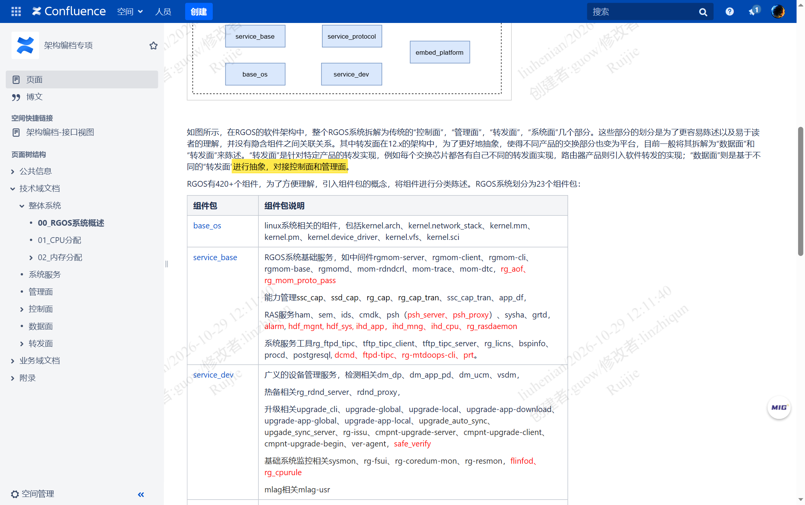
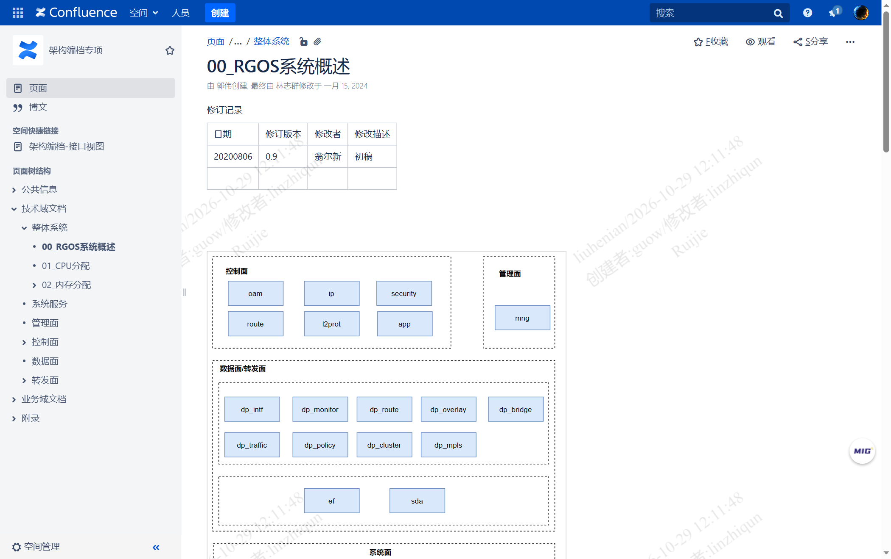
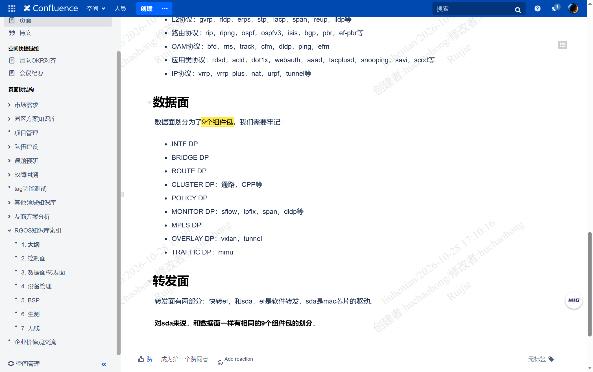
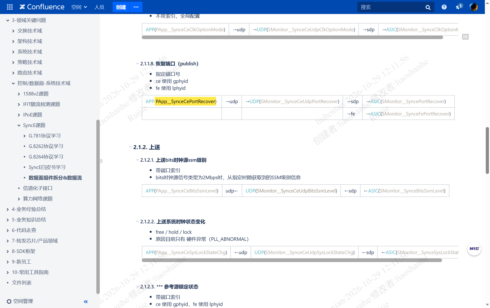
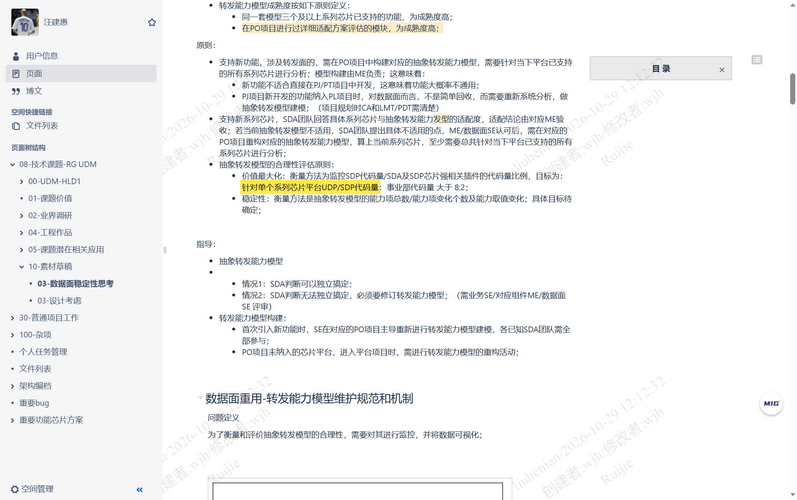

# 数据面（data plane）官方定义与职责——概念澄清

> 本文只回答两个问题：**锐捷架构编档里"数据面"的官方定义原话是什么**、**它被造出来是为了支持什么**。
> 结论全部落在一手页面原文上，推论单独标注并给依据链。

---

## 目录

- [[#0 一句话结论|0 一句话结论]]
- [[#1 官方定义原文|1 官方定义原文]]
- [[#2 这句话里藏着的三件事|2 这句话里藏着的三件事]]
- [[#3 官方架构图把分层直接画出来了|3 官方架构图把分层直接画出来了]]
- [[#4 数据面到底用于支持什么|4 数据面到底用于支持什么]]
- [[#5 三个最常见的误解|5 三个最常见的误解]]
- [[#6 与思科坐标系的差异（推论）|6 与思科坐标系的差异（推论）]]
- [[#7 证据清单|7 证据清单]]
- [[#8 缺口|8 缺口]]

---

## 0 一句话结论

**数据面（data plane）不是"搬包的那一层"，而是"把搬包这件事抽象成与芯片无关的统一语义层"**——向上对接控制面和管理面，向下屏蔽每一颗芯片各不相同的转发实现。搬包的是转发面（forwarding plane），跑协议的是控制面，数据面夹在中间负责"定规则、产表项"。

---

## 1 官方定义原文

**出处**：`架构编档专项 > 技术域文档 > 整体系统 > 00_RGOS系统概述`
作者：翁尔新（初稿 2020-08-06）→ 林志群（现维护），VER 56，最后修改 2024-01-15，[pageId 50304057](http://conf.ruijie.work/pages/viewpage.action?pageId=50304057)，**信源 A 级**（架构编档专项，官方架构基线文档，56 个版本持续维护）

原文（逐字，高亮句为定义本体）：

> 如图所示，在RGOS的软件架构中，整个RGOS系统拆解为传统的"控制面"，"管理面"，"转发面"，"系统面"几个部分。这些部分的划分是为了更容易陈述以及易于读者的理解，并没有隐含组件之间关联关系。其中转发面在12.x的架构中，为了更好地抽象，使得不同产品的交换部分也变为平台，目前一般将其拆解为"数据面"和"转发面"来陈述。"转发面"是针对特定产品的转发实现，例如每个交换芯片都各有自己不同的转发面实现，路由器产品则引入软件转发的实现；**"数据面"则是基于不同的"转发面"进行抽象，对接控制面和管理面**。

这段只有 200 字，但它是全库唯一一处对"数据面"下定义的地方。后面所有关于数据面的说法（9 个组件包、UDP_DB、SDP 翻译、8:2 代码比例）都是这句话的展开。

---

## 2 这句话里藏着的三件事

### 2.1 数据面不是"第五个面"，是从转发面里拆出来的

原文第一句列的是**四个**面：控制面、管理面、转发面、系统面。数据面**不在这个原始清单里**。

> 其中转发面在12.x的架构中……目前一般将其拆解为"数据面"和"转发面"来陈述。

所以"五个面"是 12.x 之后的说法，"四个面"是 11.x 及以前的说法。这解释了为什么老资料里经常只有四面——不是资料不全，是时代不同。

### 2.2 拆分的动因写得很直白：为了让"交换部分也变为平台"

> 为了更好地抽象，使得不同产品的交换部分也变为平台

这句话是数据面存在的全部理由。12.x 之前，交换机的转发逻辑是**和芯片绑死**的：一颗新芯片进来，转发逻辑要重写一遍。12.x 把它拆成两截——上截抽出来做成平台资产（数据面），下截留给具体芯片（转发面）。

### 2.3 "抽象"的下游是谁，原文点了名

> "数据面"则是基于不同的"转发面"进行抽象，**对接控制面和管理面**

数据面的服务对象是**控制面和管理面**，不是报文。控制面（路由协议、STP、ACL 下发）产出的业务意图，经数据面翻译成芯片能懂的东西；芯片发生的事（端口 up/down、表项老化、采样上送）经数据面翻译回控制面能懂的事件。

**推论（标 P1）**：数据面的接口是"南北向"的——北向对控制面/管理面提供与芯片无关的统一语义，南向对转发面提出与芯片无关的能力诉求。依据：定义原文"基于不同转发面抽象 + 对接控制面和管理面"的双向表述。

---

## 3 官方架构图把分层直接画出来了

同一页的架构图（drawio）比文字更直观。「数据面/转发面」被画成**一个大虚线框，里面上下两层**：

| 层 | 框内组件 | 含义 |
|---|---|---|
| 上层（9 个） | `dp_intf`、`dp_monitor`、`dp_route`、`dp_overlay`、`dp_bridge`、`dp_traffic`、`dp_policy`、`dp_cluster`、`dp_mpls` | **数据面**（data plane）九个组件包 |
| 下层（2 个） | `ef`、`sda` | **转发面**（forwarding plane）两条执行体：软件转发、芯片驱动 |

**这张图是"数据面在转发面之上"的最硬证据**：九个 `dp_*` 与 `ef`/`sda` 不是并列关系，是上下堆叠在同一框内。上层的 `dp_*` 输出规则，下层的 `ef`/`sda` 执行规则。

对照页 `1. 大纲`（园区交换-方案组，胡朝红，2023-07-06，VER 12，[pageId 401998832](http://conf.ruijie.work/pages/viewpage.action?pageId=401998832)，**A 级**）把这种上下关系说破了：

> 转发面有两部分：快转ef，和sda，ef是软件转发，sda是mac芯片的驱动。
> **对sda来说，和数据面一样有相同的9个组件包的划分。**

`sda` 内部**照数据面的 9 个包再分一遍**，这就是"同一套业务语义，两种执行体"的字面含义：数据面定义语义，转发面负责执行，两边共用同一套分组。

---

## 4 数据面到底用于支持什么

分四层回答，从"为什么造它"到"它管哪些功能"。

### 4.1 架构目的层：支持"产品平台化"

一句话：**让同一份业务逻辑跨芯片、跨产品形态复用**。

原文说转发面"每个交换芯片都各有自己不同的转发面实现"——不加抽象层，N 颗芯片就是 N 套转发逻辑。数据面把这 N 套收敛成 1 套与芯片无关的模型。

### 4.2 落地载体层：UDP_DB 模型 + SDP 翻译器

`12.x交换框架结构（PD平台软件总体设计）`（DCN安全组，吴添明，2019-11-05，VER 4，[pageId 32230382](http://conf.ruijie.work/pages/viewpage.action?pageId=32230382)，**A 级**）：

> 交换机产品平台的 **ASIC_DB 定义芯片抽象模型**，由 **SDP 组件将 UDP_DB 的统一数据面模型转换为 ASIC_DB 模型**，由 **SDA 组件将抽象芯片模型适配置为具体芯片及相应的 SDK 操作接口**。

三层数据库的归属因此很清楚：

| 数据库 | 归谁 | 内容 | 芯片相关？ |
|---|---|---|---|
| `APP_DB` | 控制面 PI（protocol interface，协议接口） | 业务的原始意图（协议语义） | 否 |
| `UDP_DB` | **数据面** | **统一数据面模型**（unified data plane，统一数据平面） | **否** |
| `ASIC_DB` | 转发面 SDP | 芯片抽象模型（流水线/资源视角） | 是（按芯片族） |
| 芯片寄存器 | 转发面 SDA | 具体寄存器与 SDK 调用 | 是（按芯片型号） |

`SDP`（switch data plane，交换数据面）把"统一模型"翻成"某族芯片的模型"，`SDA`（switch data adapter，交换数据适配）再把模型落成寄存器操作。数据面就活在 `UDP_DB` 这一层。

实测印证：链路形态是 `APP(PApp_*) → udp → UDP(SMonitor_*) → sdp → ASIC(SMonitor_*)`（`数据面组件拆分&数据流`，技术架构部-成都-SDK项目开发知识库，廖山河，2023-12-05，VER 38，[pageId 587007909](http://conf.ruijie.work/pages/viewpage.action?pageId=587007909)，**A 级**）。

### 4.3 价值度量层：芯片无关代码必须 ≥ 80%

这是全库最能量化"数据面有什么用"的一段。`03-数据面稳定性思考`（汪建惠，架构编档体系素材，2022-11-21，VER 72，[pageId 67403853](http://conf.ruijie.work/pages/viewpage.action?pageId=67403853)，**A 级**）：

> 数据面通用性的问题，是业务模型设计问题，也是项目管理问题；
> 转发能力模型成熟度按如下原则定义：同一套模型三个及以上系列芯片已支持的功能，为成熟度高；
> 支持新功能，涉及转发面的，需在 PO 项目中构建对应的抽象转发能力模型，需要针对当下平台已支持的所有系列芯片进行分析；模型构建由 ME 负责；
> 支持新系列芯片，SDA 团队回答具体系列芯片与抽象转发能力模型的适配度……
> **价值最大化：衡量方法为监控 SDP 代码量/SDA及SDP芯片强相关插件的代码量比例，目标为：针对单个系列芯片平台 UDP/SDP代码量：事业部代码量 大于 8:2**

翻译成一句人话：**数据面就是要吃掉"跟芯片无关"的那 80% 代码，让每接一颗新芯片只需要写 20% 以内的芯片相关代码**。这就是数据面存在的经济理由——不是分层好看，是省人力。

配套两条可验证的判断依据：

- 一项功能如果"三个及以上系列芯片的同一套模型都支持"，才算成熟度高；
- 新功能若涉及转发面，**不能在 PJ/PT 项目（小项目/补丁项目）里直接开发**，因为"大概率不通用"，必须在 PO 项目（平台项目）里做抽象建模。

### 4.4 功能域层：九个组件包 = 数据面支持的九个语义域

`1. 大纲`（同一 A 级页）原文列举：

> 数据面划分为了9个组件包，我们需要牢记：INTF DP、BRIDGE DP、ROUTE DP、CLUSTER DP（通路，CPP等）、POLICY DP、MONITOR DP（sflow，ipfix，span，dldp等）、MPLS DP、OVERLAY DP（vxlan，tunnel）、TRAFFIC DP（mmu）

| 组件包 | 中文 | 覆盖的功能语义 |
|---|---|---|
| `INTF DP` | 接口数据面（data plane） | 物理/逻辑接口、拆分口、MLAG 口、POE、DDM 光模块信息 |
| `BRIDGE DP` | 网桥数据面 | 二层转发：MAC 表、QinQ、Super VLAN、MAC VLAN、协议 VLAN |
| `ROUTE DP` | 路由数据面 | 三层转发：L3 接口表、下一跳、ECMP、PBR、FRR、组播路由 |
| `CLUSTER DP` | 机群数据面 | 机群内报文通路、CPP（CPU packet processing，CPU 报文处理）、NFPP |
| `POLICY DP` | 策略数据面 | ACL、QoS、DDoS 防护、NAC、OpenFlow |
| `MONITOR DP` | 监控数据面 | sFlow、IPFIX、SPAN/RSPAN/ERSPAN、DLDP、BFD、PTP/1588 采样 |
| `MPLS DP` | MPLS 数据面 | L2VPN、L3VPN、SR（segment routing，段路由） |
| `OVERLAY DP` | 叠加网数据面 | VXLAN、隧道、olintf/olbridge/olroute |
| `TRAFFIC DP` | 流管数据面 | MMU（memory management unit，缓存管理单元）、队列与整形 |

**这张表就是"数据面支持什么"的直接答案**：凡是"需要在芯片里落一条规则才能生效"的功能，其规则定义都归数据面；凡是"把包搬过去"的动作，归转发面。

---

## 5 三个最常见的误解

### 5.1 误解一：数据面等于转发面

这是英文语境带来的最大坑。在思科/多数厂商的坐标系里，data plane 就是 forwarding plane，是同一个词的两种叫法。**锐捷 12.x 把它们拆成了两个面**，且关系是上下层，不是同义。

判据（三条，任一成立即说明你在看转发面而非数据面）：

1. 它的产物是"表项/规则"→ 数据面；产物是"报文的物理位移"→ 转发面；
2. 它的时间尺度是毫秒级（配置生效）→ 数据面；纳秒到微秒级（单包处理）→ 转发面；
3. 它换芯片要重写 → 转发面；它换芯片不用改 → 数据面。

### 5.2 误解二：数据面是一个部署位置

不是。数据面是**职责分层**，不是一台机器、一个进程、一块板。它落在 PD（platform development，平台开发）的第一段 `APP_DB → UDP_DB`，而这些进程（`ce.*.sw` / `fe.*.sw`）既跑在 CM（control module，主控板）上也跑在 LC（line card，线卡）上，既在 CE（control element，控制单元）侧也在 FE（forwarding element，转发单元）侧。

所以"数据面在哪台设备上"这个问题没有单一答案；能问的是"这个进程属于数据面的哪个组件包"。

### 5.3 误解三：没有 PD 就没有数据面

这是此前一轮踩过的坑。x86 模拟器（CI 环境设备）确实没有 SDA、没有芯片模型，但**数据面的抽象语义仍然在**——`efmp`（Express Forward Management Platform，快转框架）承载了这套语义，只是执行体从 `sda`+芯片换成了 `ef`+DPDK。VLAN 表和路由表照样存在，只是换了个载体。

判据修正为三问：① 这项能力是否必须由芯片完成且软件不可替代？② 是否有 `.so` 可注册进 `efmp_frame`？③ 是否被 x86 版本裁剪？

---

## 6 与思科坐标系的差异（推论）

**推论（标 P2）**：思科没有"数据面"这个独立概念，它把 data plane 直接等同 forwarding plane；锐捷单列一个面，是因为要解决"一份代码跨三种芯片族 + 两种执行体"的问题。

依据链：

1. 定义原文明确写"基于不同的转发面进行抽象"——如果 data plane = forwarding plane，这句话逻辑上不成立；
2. `SDA` 按芯片族分三支（XGS SDK 6.x / DNX SDK 6.x / XGS SDKLT），且 `ef` 与 `sda` 是两条不同的执行体——存在"多个转发面"这个前提，才需要抽象层；
3. 8:2 的代码比例目标——只有在"抽象层独立存在"的组织里才会被定成 KPI。

反过来看思科的 HAL（hardware abstraction layer，硬件抽象层）切法：HAL 是**库/接口边界**，不是**独立的一个面**，也不承载业务语义（HAL 只管"怎么读寄存器"，不管"VLAN 该怎么转"）。所以思科砍 HAL 等于砍执行能力，但不改变转发逻辑定义本身；锐捷的数据面如果被裁，砍的是业务规则定义，性质不同。

> 这条差异对 APM 的直接影响：锐捷设备上"表项算错"（数据面 bug）和"包没搬对"（转发面 bug）是两类不同故障，指标要分开采。数据面异常看 `UDP_DB`/`ASIC_DB` 的表项内容与老化，转发面异常看 `ef`/`sda` 的 DROP/TOPF 计数。

---

## 7 证据清单

| # | 页面 | 空间 | 作者 | 最后修改 | 级别 | 链接 | 截图 |
|---|---|---|---|---|---|---|---|
| 1 | 00_RGOS系统概述 | 架构编档专项 | 翁尔新→林志群 | 2024-01-15（VER 56） | **A** | [pageId 50304057](http://conf.ruijie.work/pages/viewpage.action?pageId=50304057) | `DP1-数据面是转发面的抽象.png`、`DP2-RGOS五面拆分与23组件包.png` |
| 2 | 1. 大纲 | 园区交换-方案组 | 胡朝红 | 2023-07-06（VER 12） | **A** | [pageId 401998832](http://conf.ruijie.work/pages/viewpage.action?pageId=401998832) | `P5-数据面九个组件包.png` |
| 3 | 12.x交换框架结构（PD平台软件总体设计） | DCN安全组 | 吴添明 | 2019-11-05（VER 4） | **A** | [pageId 32230382](http://conf.ruijie.work/pages/viewpage.action?pageId=32230382) | `P1-交换PD平台总体设计.png` |
| 4 | 03-数据面稳定性思考 | 汪建惠 | 汪建惠 | 2022-11-21（VER 72） | **A** | [pageId 67403853](http://conf.ruijie.work/pages/viewpage.action?pageId=67403853) | `DP3-数据面价值指标芯片无关代码8比2.png` |
| 5 | 数据面组件拆分&数据流 | 技术架构部-成都-SDK项目开发知识库 | 廖山河 | 2023-12-05（VER 38） | **A** | [pageId 587007909](http://conf.ruijie.work/pages/viewpage.action?pageId=587007909) | `DP4-数据面在报文链路中的位置.png` |
| 6 | 3. 数据面/转发面 | 园区交换-方案组 | 胡朝红 | 2023-07-30（VER 17） | **A** | [pageId 401999160](http://conf.ruijie.work/pages/viewpage.action?pageId=401999160) | 文字引用（索引页，无定义） |
| 7 | 管理面/控制面/数据面以及通路关系 | Demonstration Space | 张振兴 | 2022-12-27（VER 2） | **C** | [pageId 372376388](http://conf.ruijie.work/pages/viewpage.action?pageId=372376388) | 未截图（培训演示性质，非官方基线） |

分级说明：A = 架构编档/官方基线或方案组定稿；C = 个人演示页、培训材料。第 7 条虽然是唯一给出"数据平面：处理和转发交换机各不同端口上各种类型的数据……主要通过 ASIC 芯片实现"这种教科书式定义的页面，但它把数据面等同于"ASIC 实现"，在锐捷 12.x 坐标系里是**过时口径**（数据面恰恰是芯片无关的那层），故仅作沿革参考，不作定义依据。

---

## 8 缺口

| # | 缺什么 | 为什么缺 | 影响 |
|---|---|---|---|
| 1 | `控制面`（[pageId 50303712](http://conf.ruijie.work/pages/viewpage.action?pageId=50303712)）、`转发面`（[pageId 51642770](http://conf.ruijie.work/pages/viewpage.action?pageId=51642770)）、`数据面`（[pageId 50300061](http://conf.ruijie.work/pages/viewpage.action?pageId=50300061)）三个面各自的独立定义页 | 三页都是**空壳目录页**（只有子页宏，正文长度为 0） | 目前全库对"数据面"的唯一定义只有 `00_RGOS系统概述` 一段话；三个面没有各自展开的定义文档 |
| 2 | 数据面九个组件包各自的"职责一句话定义" | `1. 大纲` 只列了包名和括号举例，`数据面/转发面` 页只是文档索引 | 表 4.4 的"覆盖的功能语义"列，是我基于组件名 + 版本内组件清单（`00_RGOS系统概述` 23 组件包表）+ 实测进程名归纳的，**属推论（P3）**，逐包职责待各专业组 LLD 确认 |
| 3 | "转发能力模型"的正式规范文档 | `03-数据面稳定性思考` 提到的 proto 规范、能力文件规范以《》占位，链接未填 | 无法验证 8:2 这个指标当前实际达成度 |
| 4 | 11.x 及以前四面的原始划分文档 | 未检索到独立页面 | "数据面是 12.x 新增"这一结论仅靠 `00_RGOS系统概述` 一句话，无第二信源 |
