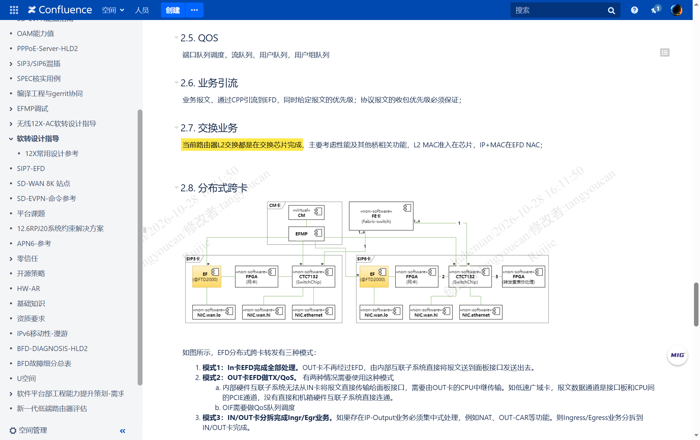
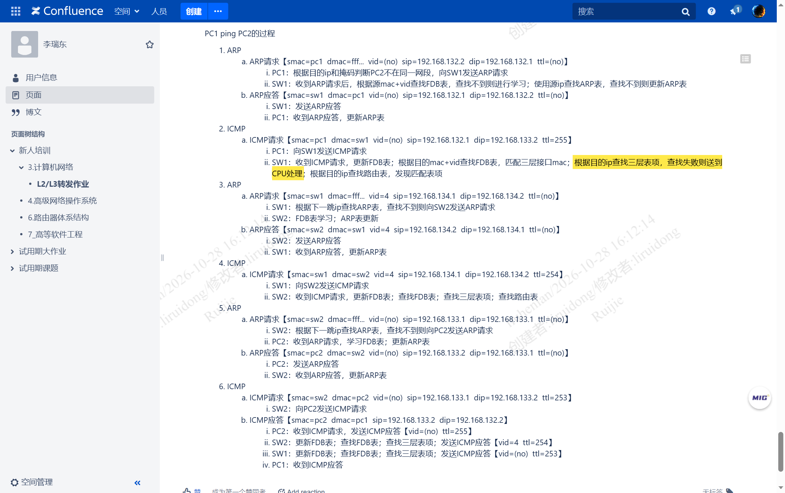
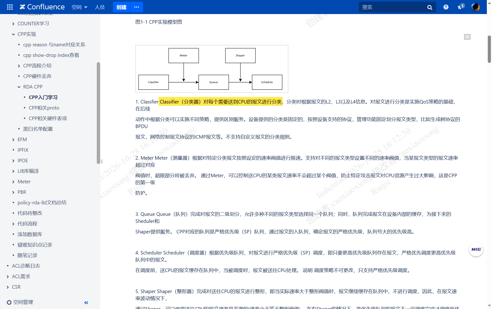
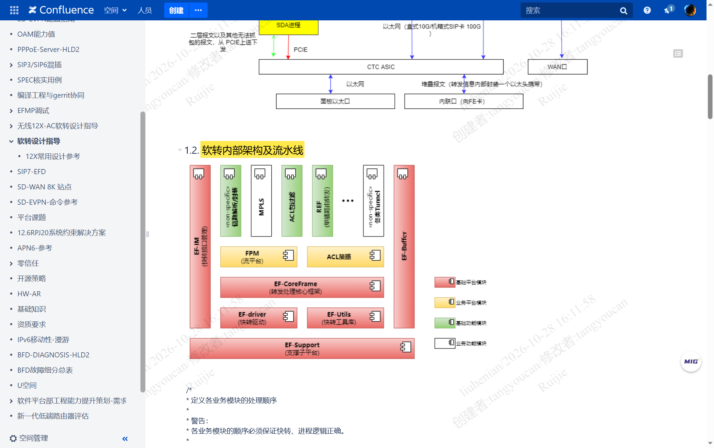
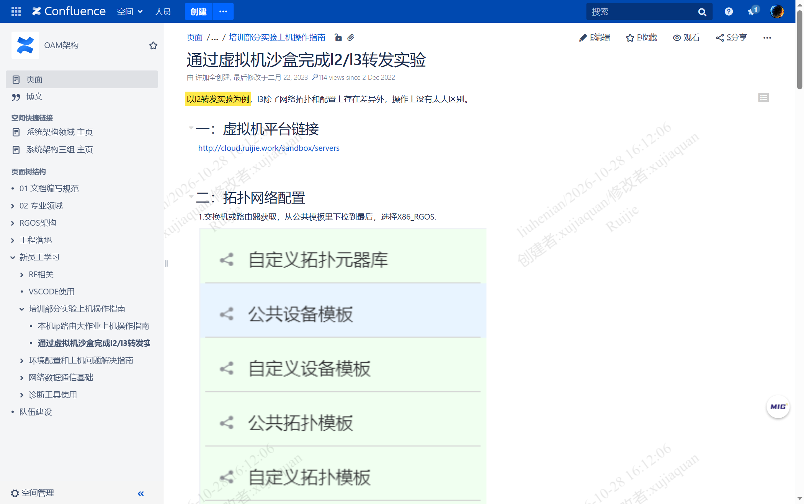
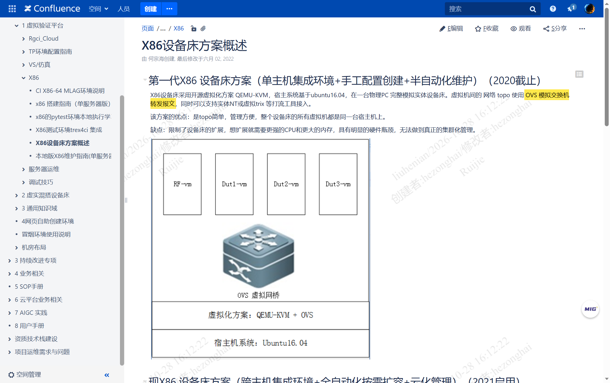

# 锐捷交换：真机软转触发条件与 x86 模拟器二三层转发支持

> 本文全部事实来自公司内网 Confluence（`http://conf.ruijie.work`）的原始页面，逐条给出**页面链接、作者、最后修改时间**与**截图**。凡属我的推断，一律标注「推论」并给出依据链；凡属检索不到的，明确写「未找到」。
>
> **配套阅读**：[[PI-PD三产品线设计与真机模拟器能力边界-2026-10-28]] —— 概念底座：PI/PD 的边界、RGOS 五面划分、交换/路由/无线三产品线的 PD 差异、真机与模拟器的能力边界。**本文涉及「模拟器」的结论以该文为准。**

## 目录

- [[#1. 结论先行|结论先行]]
- [[#2. 问题一：真机上到底什么报文会走软转|问题一：真机什么报文走软转]]
  - [[#2.1 判据不在二/三层，而在「报文是否离开芯片快路径」|2.1 判据不在层级，而在快路径]]
  - [[#2.2 二层报文：主路径在芯片，软件只接「送 CPU」的那部分|2.2 二层报文]]
  - [[#2.3 三层报文：命中的走芯片，未命中与复杂业务走软件|2.3 三层报文]]
  - [[#2.4 送 CPU 的判定机制：CPP 按报文类型分类|2.4 CPP 判定机制]]
  - [[#2.5 软转平台内部：二层与三层在软件里怎么走|2.5 软转内部流水线]]
- [[#3. 问题二：x86 模拟器是否支持二层和三层转发|问题二：模拟器是否支持二三层]]
  - [[#3.1 事实：支持，且二层、三层都有实测作业|3.1 支持，有实测]]
  - [[#3.2 模拟器的两种形态：带 ASIC 模拟器 与 不带|3.2 模拟器的两种形态]]
  - [[#3.3 模拟器转发 ≠ 软转：两个概念必须分开|3.3 模拟器转发与软转的区别]]
- [[#4. 这两条事实对 APM 的意义|4. 对 APM 的意义]]
- [[#5. 证据清单|证据清单]]
- [[#6. 缺口与不确定项|缺口与不确定项]]

---

## 1. 结论先行

| 序 | 问题 | 结论 | 证据强度 |
|---|---|---|---|
| 1 | 真机上什么情况走软转 | **判据不是「二层还是三层」，而是「这个报文还留不留在芯片快路径上」。** 二层主路径全在芯片（MAC 表、VLAN、泛洪、STP 转发都在芯片完成）；三层命中路由的也走芯片。走软转的是「需要被送 CPU 的报文」，而送 CPU 的判定是**按报文类型**做的，不是按流量比例 | A |
| 2 | x86 模拟器是否支持二/三层转发 | **支持，且二层、三层都有可复现的实测作业**：模拟器里能划 VLAN、跑 access/trunk、学 MAC、跨网段 ping 通；三层查表失败时同样「送到 CPU 处理」 | A |
| 3 | 两者关系 | 模拟器上的「转发」由 Linux 内核栈（`kernel_fib`/`bridge`）与 DPDK 完成，**不是真机那套软转（`EFD`）**；真机上二三层的大头根本不经 CPU——这是两者性能差几个数量级的根因。详见 [[PI-PD三产品线设计与真机模拟器能力边界-2026-10-28#5.1 转发路径是三档而不是两档\|§5.1 转发路径三档]] | B（机制原文 + 推论） |

一句话收口：**真机上「软转」是一条例外路径，模拟器上「软转」是唯一路径。** 这与我在思科 CML 那份报告里得到的结论是同一个形状，只是锐捷侧的触发条件是「按报文类型送 CPU」，而 CML 是「没有 ASIC，所以全部送 CPU」。

---

## 2. 问题一：真机上到底什么报文会走软转

### 2.1 判据不在二/三层，而在「报文是否离开芯片快路径」

新手最容易问的是「二层走芯片、三层走软件吗」——**不是**。真机上二层和三层的主路径都在芯片里：二层查 MAC 表、三层查主机路由/网络路由，都是芯片表项，转发也由芯片完成。

依据：`芯片入门-XGS二三层转发`（caolong，2025-05-30，[页面](http://conf.ruijie.work/pages/viewpage.action?pageId=937605454)）把新员工要掌握的芯片知识点列成清单，其中二层的必答项是「芯片 MAC 地址表有几次查找？查找 key、查找结果是什么」「MAC 地址表找到和没有找到，报文分别如何转发？」；三层的必答项是「路由查找成功和失败，报文分别如何转发？」。**这两问的存在本身就说明主路径是芯片，只有「找不到」这一支才需要另找去处。**

所以正确的提问方式是：**哪些报文会被从芯片快路径里摘出来送 CPU。** 一旦送 CPU，就进入软件转发（也就是俗称的「软转」）。

### 2.2 二层报文：主路径在芯片，软件只接「送 CPU」的那部分

最关键的一句原文来自 `软转设计指导`（唐友灿，2023-11-28，[页面](http://conf.ruijie.work/pages/viewpage.action?pageId=603521558)）第 2.7 节「交换业务」：

> 当前路由器 L2 交换都是在交换芯片完成，主要考虑性能及其他桥相关功能，L2 MAC 准入在芯片，IP+MAC 在 EFD NAC；

这句话信息量很大，拆成三点：

1. **L2 交换整体在芯片完成**——包括查表、转发、桥相关功能，软件不参与数据面转发；
2. **L2 MAC 准入（准入控制这一层判定）也在芯片**——连安全准入的第一道判定都没上软件；
3. **只有「IP + MAC 联合准入」在 EFD**——即需要同时看三层信息的准入判断，才落到软转平台的 NAC 模块。

由此可以给出二层报文的准确说法（**A 级 + 推论**）：二层数据报文默认不走软转；只有当它属于「需要上送 CPU 的报文类型」时，才会被摘出来——典型如 BPDU 等协议报文、需要 CPU 参与的目的 MAC（本机 SVI/管理口）、以及业务要求上送的控制类报文。**而「泛洪」本身不是软转**：未知单播在芯片里泛洪，这与思科 CML 里「软件泛洪」完全不是一回事。

### 2.3 三层报文：命中的走芯片，未命中与复杂业务走软件

三层同样是「芯片为主、软件兜底」，但兜底的口子比二层大得多。`软转设计指导` 第 2.6 节「业务引流」写得很直接：

> 业务报文，通过 CPP 引流到 EFD，同时给定报文的优先级；协议报文的收包优先级必须保证；

也就是说：**软转平台 EFD 的入口流量，是被 CPP 按规则「引流」过来的**，不是全部流量。这与第 2.2 节「L2 在芯片完成」互为印证——真机上软件只处理被挑出来的那部分。

三层走软件的具体触发条件，从官方原文能确证的有两类：

| 触发条件 | 原文依据 | 级别 |
|---|---|---|
| 三层查表失败 | `L2/L3转发作业`：SW1「根据目的 ip 查找三层表项，查找失败则送到 CPU 处理；根据目的 ip 查找路由表，发现匹配表项」 | A |
| 需要复杂业务处理（NAT、隧道、ACL 高级动作、组播、QoS 流分类等） | `EFD软转框架介绍` 的 L3 分层阶段表：`流业务：FPM、URPF、IPACCOUNT、IPFIX、FW、ACL、REF、PBR`、`隧道业务：L2TP、PPTP、IPIP、GREIP、IPV6IP、IPVXIPV6、NAT/NATPT` | A |

需要说明的是：上表第二行说明「这些业务在软件流水线里有实现」，并不等于「真机上一定走软件」——真机上若芯片支持对应功能，仍可能由芯片完成。**「软转流水线里有这个模块」与「这个报文一定走软转」是两件事**，后者需要具体芯片能力与配置来判定；本文不替芯片能力下结论（标 B 级）。

### 2.4 送 CPU 的判定机制：CPP 按报文类型分类

`CPP入门学习`（CPP，CPU Protect Policy，CPU 保护策略；caoxiaoxiong，2023-03-16，[页面](http://conf.ruijie.work/pages/viewpage.action?pageId=422052103)）把这件事讲透了：

> Classifier（分类器）对每个需要送到 CPU 的报文进行分类，分类时根据报文的 L2、L3 以及 L4 信息。……设备提供的分类是固定的，按照设备支持的协议，管理功能固定划分报文类型，比如生成树协议的 BPDU 报文，网络控制报文协议的 ICMP 报文等。不支持自定义报文的分类规则。

关键结论有两条：

1. **送 CPU 是「按报文类型」判定的**，而报文类型由设备固定划分（BPDU、ICMP 等），用户不能自定义分类规则；
2. 芯片侧的实现是四级流水：`HOST_ACL_1`（用 TCAM，Ternary Content-Addressable Memory，三态内容寻址存储器，匹配协议特征，得到 `cpu_reason`）→ 黑白名单（EM 精确匹配表，得到 `cpu_code`）→ `HOST_ACL_2`（按 reason+code 决定动作：上送、限速、计数、改优先级）→ 动作执行。

这解释了一个常见误解：**「软转」不是「CPU 扛不住的时候自动接管」，而是一条预先划好类型的固定通道。** 哪些报文能进这条通道，出厂就定死了。

### 2.5 软转平台内部：二层与三层在软件里怎么走

理解「模拟器为什么能跑二三层」，需要先看软转平台本身是怎么分层的。`软转设计指导` 给出的分层是 `RDP / EFC / EFD` 四层设计（含 UI；EFD 指软转**转发面**进程，EFC 指软转**控制面**进程，RDP 指控制面表项下发层）：

- **RDP**：解决 shell 问题，控制面表项下发的增删改查逻辑；
- **EFC**：控制面，把控制面表项转换成 EFD 的转发表；
- **EFD**：转发面，查表转发、线程调度；
- 关键一句：**「EFD 作为外设存在，通过共享内存解决……物理内存采用大页表，类似 ASIC 的转发表和寄存器」**（ASIC，Application-Specific Integrated Circuit，专用集成电路）。

这句话是整篇文档里最有价值的一句：**软转平台在架构上就是「用大页内存里的表，替代 ASIC 里的表和寄存器」**。所以「软转能不能做二层/三层」这个问题，答案天然是「能」——因为二层表和三层表在软件里都有对应实现，只是执行体从芯片换成了 CPU。

报文流水线（`EFD软转框架介绍`，林志群，2023-09-08，[页面](http://conf.ruijie.work/pages/viewpage.action?pageId=514950272)）明确把二层和三层都排进去了：

> 转发主流程：`drv_RX` → `L2parse/L2-Ingress` → `IP-Input` → `route/l3forward` → `IP-Output` → `L2-Egress/l2Enape` → `drv_TX`

同一页还给出两类特殊流程，与本文问题直接相关：

- **上管理控制面**：「对于到本机管理控制面的管理控制类报文，在识别到后单独从业务报文流中分离出来，走独立的流程」——即协议/管理报文与业务报文在软件里也是**两条路**；
- **非 IP 单播**：「MPLS 标签交换/转发，会直接跳到 L2-egress 开始处理」——即软转内部对二层的处理是「跳过三层直接出二层」。

---

## 3. 问题二：x86 模拟器是否支持二层和三层转发

### 3.1 事实：支持，且二层、三层都有实测作业

有两条相互独立的官方作业文档，都是在 x86 模拟器上完成的：

**其一，`通过虚拟机沙盒完成 l2/l3 转发实验`**（许加全，2023-02-22，[页面](http://conf.ruijie.work/pages/viewpage.action?pageId=355174689)）：

> 以 l2 转发实验为例，l3 除了网络拓扑和配置上存在差异外，操作上没有太大区别。

实验步骤：从公共模板选 `X86_RGOS` 作为交换机 → 用 `vmserver` + `bridge` 连拓扑 → 给 `0/1`、`0/2` 配 VLAN（Virtual LAN，虚拟局域网）并把 VLAN IP 设成与两台 PC 同网段 → 配完后 ping 通 → 「Ping 通后学习到 mac 地址」。

**其二，`L2/L3转发作业`**（李瑞东，2023-04-13，[页面](http://conf.ruijie.work/pages/viewpage.action?pageId=411501972)）更完整，二层和三层分别做了独立验证：

| 项 | 二层验证 | 三层验证 |
|---|---|---|
| 拓扑 | 2 台 PC + 1 台 x86 交换机，同网段 | 2 台交换机 SW1/SW2 + 2 台 PC，**不同网段** |
| 配置 | VLAN 2、两个 access 口、VLAN IP 与 PC 同网段 | access + trunk（Native VLAN 4）、VLAN 2/3/4 IP、**静态路由** |
| 结果 | ping 通、学到 MAC、查看 ARP | 跨网段 ping 通，并逐跳列出 ARP/ICMP 的转发过程 |

三层那段最值得看，它写出了模拟器内部的判定顺序：

> SW1：收到 ICMP 请求，更新 FDB 表；根据目的 mac + vid 查找 FDB 表，匹配三层接口 mac；**根据目的 ip 查找三层表项，查找失败则送到 CPU 处理**；根据目的 ip 查找路由表，发现匹配表项。

（FDB，Forwarding Database，二层转发表）

**结论：模拟器上二层、三层转发都支持，而且连「查表失败送 CPU」这个分支行为都与真机同构。**

### 3.2 模拟器的两种形态：带 ASIC 模拟器 与 不带

这一点容易混淆，必须拆开。`工作拆解`（郭伟，2020-06-22，虚拟交换机空间，[页面](http://conf.ruijie.work/pages/viewpage.action?pageId=50304901)）列出了两种虚拟交换机形态：

| 形态 | 原文描述 | 是否带 ASIC 模拟器 |
|---|---|---|
| `vswitch-x86` 盒式虚拟交换机 | 「平台主干的盒式虚拟交换机版本，**目前没有打包模拟器**，支持 CLI→ASIC DB 打通，支持 MGMT 等基本业务功能」 | **不带** |
| `XE-CM/LC` 箱式虚拟交换机 | 「事业部基于 **MRVL 模拟器** 的虚拟交换机，包含模拟器」 | **带**（MRVL 芯片模拟） |

这个区分很关键：**「虚拟交换机」不等于「有 ASIC 模拟器」。** 不带模拟器的那种，数据面靠宿主侧软件转发（见下节 OVS）；带模拟器的那种，走的是「模拟出来的芯片」。

配套的环境事实来自 `X86设备床方案概述`（何宗海，2022-06-02，[页面](http://conf.ruijie.work/pages/viewpage.action?pageId=80100315)）：

> X86 设备床采用开源虚拟化方案 QEMU-KVM，宿主系统基于 ubuntu16.04，在一台物理 PC 完整模拟实体设备床。虚拟机间的网络 topo 使用 OVS 模拟交换机转发报文。

即：**模拟器环境里的「交换机转发」有两层含义**——虚机内部的 RGOS 做转发决策，虚机之间的连接由 OVS（Open vSwitch，开放虚拟交换机）搬运报文。

### 3.3 模拟器转发 ≠ 软转：两个概念必须分开

这两个词在内部文档里经常混用，但它们是两件事（**C 级推论，依据是上面两类原文的用词差异**）：

| | 软转（software forwarding） | 模拟器（simulator） |
|---|---|---|
| 解决什么问题 | 真机上「芯片做不了/不该做」的报文，交给 CPU 转发 | 让**没有芯片**的环境里，交换机软件能跑起来、能验证 |
| 发生在哪 | 真机（有 ASIC，但把部分报文摘出来） | 仿真环境（无 ASIC，或 ASIC 被模拟） |
| 二层三层都支持吗 | 支持，但只在软转流水线覆盖的范围内 | 支持，二层三层都有实测作业 |
| 性能 | 远低于芯片快路径 | 远低于真机，且受宿主与 OVS 限制 |

一句话：**软转是「真机上的例外路径」，模拟器是「没有真机的替代环境」。模拟器里的转发能通，靠的是 Linux 内核栈与 DPDK，而不是真机那套 `EFD` 软转流水——两者连代码都不是一套。**

> **修订说明（2026-10-28 补）**：本节早期版本写作「模拟器里的转发之所以通，是因为它本质上全程都在软转」，该说法已被实机 `ps`/`/sbin` 对比推翻——模拟器侧 `ce.*`/`fe.*`（`EFD` 的实现体）数量为零，转发由 `kernel_fib.ko`、`brctl`、`ivr.ko` 与 DPDK 承担。详见 [[PI-PD三产品线设计与真机模拟器能力边界-2026-10-28#4 模拟器的真实形态：PD 整体缺失\|§4 模拟器的真实形态]]。

---

## 4. 这两条事实对 APM 的意义

（本节为推论，C 级，供参考，不影响上文的事实结论。）

1. **排查「慢」与「不通」时要先分清是哪条路**：真机上性能问题大多在芯片/表项，模拟器上性能问题大多在 CPU 与 OVS。两者不能用同一套阈值。
2. **「送 CPU 计数」是一个高价值指标**：CPP 的 `show cpu-protect type xx` 能给出各类报文的上送速率与丢弃，这正好可以作为 APM 采集项，用来区分「协议报文异常上送」与「正常业务转发」。
3. **模拟器环境不适合做性能结论**：`通过虚拟机沙盒` 与 `X86设备床` 都是功能验证环境，其吞吐与真机不可比。

---

## 5. 证据清单

| # | 页面 | 空间 | 作者 | 最后修改 | 类型 | 链接 | 截图 |
|---|---|---|---|---|---|---|---|
| 1 | 软转设计指导 | 唐友灿的主页 | 唐友灿 | 2023-11-28 | A | [viewpage 603521558](http://conf.ruijie.work/pages/viewpage.action?pageId=603521558) | `A-软转L2在芯片完成.png`、`B-软转流水线.png` |
| 2 | EFD软转框架介绍 | 林志群的主页·软转领域专题 | 林志群 | 2023-09-08 | A | [viewpage 514950272](http://conf.ruijie.work/pages/viewpage.action?pageId=514950272) | 文字引用（流水线） |
| 3 | CPP入门学习 | caoxiaoxiong | caoxiaoxiong | 2023-03-16 | A | [viewpage 422052103](http://conf.ruijie.work/pages/viewpage.action?pageId=422052103) | `F-CPP分类.png` |
| 4 | 芯片入门-XGS二三层转发 | caolong | caolong | 2025-05-30 | A | [viewpage 937605454](http://conf.ruijie.work/pages/viewpage.action?pageId=937605454) | 文字引用（知识点清单） |
| 5 | 通过虚拟机沙盒完成 l2/l3 转发实验 | OAM架构 | 许加全 | 2023-02-22 | A | [viewpage 355174689](http://conf.ruijie.work/pages/viewpage.action?pageId=355174689) | `C-沙盒L2实验.png` |
| 6 | L2/L3转发作业 | 李瑞东的主页·新人培训 | 李瑞东 | 2023-04-13 | A | [viewpage 411501972](http://conf.ruijie.work/pages/viewpage.action?pageId=411501972) | `D-L3转发失败送CPU.png` |
| 7 | X86设备床方案概述 | 工程能力装备团队 | 何宗海 | 2022-06-02 | A | [viewpage 80100315](http://conf.ruijie.work/pages/viewpage.action?pageId=80100315) | `E-X86设备床OVS.png` |
| 8 | 工作拆解（虚拟交换机） | 虚拟交换机·需求拆解 | 郭伟 | 2020-06-22 | B | [viewpage 50304901](http://conf.ruijie.work/pages/viewpage.action?pageId=50304901) | 文字引用（两种形态） |

信源分级口径：**A** = 公司内部正式设计文档/培训作业，有作者与版本；**B** = 内部分享或较早期的拆解文档；**C** = 本文推论。

---

## 6. 缺口与不确定项

| 缺口 | 说明 | 处理 |
|---|---|---|
| 「二层有哪些具体报文类型会送 CPU」的完整清单 | CPP 的分类是设备固定划分的，官方未在检索到的页面里给出全量列表 | 未补全；建议查 `CPP知识库`（[pageId 95236556](http://conf.ruijie.work/pages/viewpage.action?pageId=95236556)）或具体芯片的 HOST_ACL 配置 |
| 真机上「三层哪些业务由芯片做、哪些强制走软转」 | 取决于具体芯片能力（XGS/CTC/MRVL 各不同），本文未逐芯片核对 | 标 B 级，不作为结论 |
| 模拟器的吞吐/性能数据 | 检索到的页面均为功能验证，未见官方吞吐数字 | 不编造，留空 |
| `x86模拟器演进` 页面正文为空 | 页面 [pageId 1211269231](http://conf.ruijie.work/pages/viewpage.action?pageId=1211269231) 只有标题，无正文也无子页 | 已排除，不作为证据 |
| `软转现状`、`快转、软件转发` 正文为空 | pageId 622952490 / 428736771，storage 为空（可能内容在附件或 macro 中） | 已排除，不作为证据 |

---

**核验**：本文 8 条证据全部来自 `conf.ruijie.work` 内网原始页面，作者与修改时间取自 REST 接口 `version.by` / `history.lastUpdated`；6 张截图均为页面实际渲染结果（含页面水印），未经裁剪修饰；引用原文与截图内容逐字一致。
