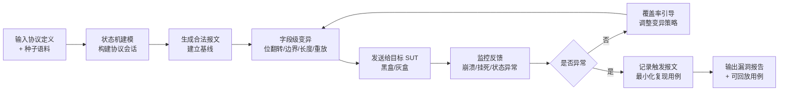
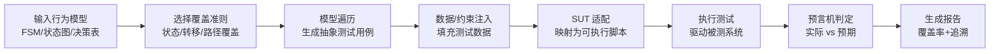
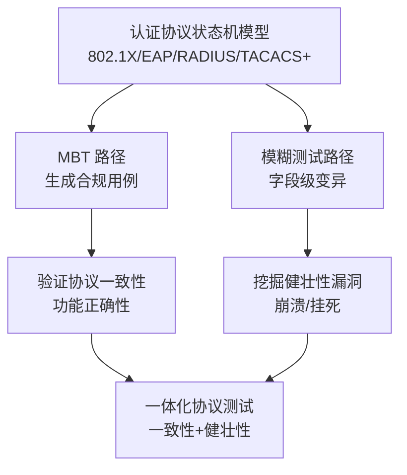

# 协议模糊测试 vs 基于模型的测试（MBT）

> **一句话定位**：这是两条**互补而非替代**的黑盒测试技术路线——协议模糊测试（Fuzzing）负责"用畸形/异常输入找崩溃、挖健壮性漏洞"；基于模型的测试（Model-Based Testing, MBT）负责"用行为模型生成合规用例、验证功能正确性"。两者常被混为一谈，但解决的痛点、机制、产出截然不同，且在"协议/状态机"场景下可以统一到同一个模型上。

**本报告聚焦三件事**：① 各自解决用户的什么问题；② 如何解决；③ 技术原理（输入 → 实现链条 → 输出）。

---

## 0. 一句话总览

| 维度 | 协议模糊测试（Fuzzing） | 基于模型的测试（MBT） |
|---|---|---|
| 核心目标 | 找**健壮性/安全性缺陷**（崩溃、挂死、可被利用） | 验证**功能正确性/协议合规性** |
| 本质动作 | 生成**异常、畸形**输入 | 生成**合规、正确**输入 |
| 关注面 | 攻击面、边界外的行为 | 规格符合性、边界内的行为 |
| 预言机（判定对错） | 崩溃/挂死/状态异常 = 失败 | 模型预期行为 = 判定标准 |
| 主要产出 | 漏洞、最小复现报文 | 覆盖率达标的测试用例集 |
| 代表工具 | Defensics、boofuzz、AFLNet | Conformiq、Tricentis Tosca、GraphWalker |
| 典型行业 | 安全、网络设备、工控、车联网 | 电信、汽车、航空、金融（强合规） |

---

# 第一部分：协议模糊测试（Protocol Fuzzing）

## 1. 解决用户的什么问题（痛点）

### 1.1 从客户（用户）角度

| 编号 | 痛点 | 具体描述 |
|---|---|---|
| **P1** | **未知漏洞的隐性风险** | 设备/软件在正常测试下表现良好，但攻击者一旦发来畸形报文，是否会崩溃、是否可被利用，客户自己不知道。Heartbleed 潜伏 2 年、影响 50 万网站，就是没人系统性地发"恶意输入"去试探。 |
| **P2** | **合规交付的举证压力** | 电信/金融/汽车/工控等强监管行业，设备入网/上市前必须证明"做过健壮性测试"，且要能拿出可审计报告。手工测试无法系统覆盖，也拿不出量化证据。 |
| **P3** | **协议专家稀缺、测试成本高** | 协议测试高度依赖懂协议的专家手写脚本，而 BGP/OSPF/802.1X/EAP/TACACS+ 等协议专家稀缺、人力贵，脚本难以覆盖协议边角情况。 |
| **P4** | **漏洞定位与跨组织修复慢** | 即便发现崩溃，也难以定位是哪个字段、哪条报文触发的，无法稳定复现，导致修复周期长、供应商响应慢。 |

### 1.2 从产品（厂商）角度

| 编号 | 痛点 | 具体描述 |
|---|---|---|
| **P5** | **产品线缺少"协议层"能力** | 通用安全测试产品只测应用层，无法覆盖客户的管理面/控制面协议（SNMP/SSH/TACACS+/BGP/OSPF）测试需求。 |
| **P6** | **同质化竞争需要差异化** | 安全测试工具高度同质化，需要"协议覆盖广度 + 零误报 + 自动复现"作为差异化卖点。 |

---

## 2. 如何解决用户的痛点

| 痛点 | 解决机制 | 对应能力 |
|---|---|---|
| P1 隐性风险 | 系统性、自动化发送变异/畸形报文，主动触发崩溃、挂死、状态异常，把"未知漏洞"变"已知问题" | 变异引擎 + 崩溃监控器 |
| P2 举证压力 | 生成可审计、可量化的测试报告（覆盖率、崩溃数、用例数） | 报告生成 + 覆盖率统计 |
| P3 人力稀缺 | 用"协议模板/测试套件 + 状态机建模"替代专家手写脚本 | 预建协议套件（如 Defensics 300+ 套件） |
| P4 定位修复慢 | 自动记录"哪条报文触发崩溃"，输出最小可复现用例，供应商拿到即定位 | 崩溃复现 + 最小化 + 可回放 |
| P5/P6 产品差异化 | 以"协议广度 + 零误报 + 自动复现"补齐产品线短板 | 协议知识库 + 监控器（SafeGuard 等） |

**关键洞察**：最能解决客户痛点的**不是变异算法本身**，而是三个落地能力——① 协议模板/套件（把专家知识固化成可复用资产）；② 崩溃监控器（能否零误报发现崩溃，决定工具是否被信任）；③ 最小化复现 + 可回放（把"发现问题"推进到"可被供应商消费"）。

---

## 3. 技术原理

### 3.1 输入（Input）

| 输入项 | 说明 | 缺失后果 |
|---|---|---|
| **I1 协议定义/测试套件** | 协议的数据结构、字段类型、长度约束（如 TACACS+ 12 字节头、RADIUS AVP、EAP 消息格式） | 无法生成合法种子报文，变异无从谈起 |
| **I2 目标（SUT）** | 被测设备/软件（交换机、认证服务器、协议栈实现）及其可达地址/端口 | 无对象可测 |
| **I3 种子语料** | 一组合法/典型的协议报文（corpus），作为变异的起点 | 变异空间无锚点，效率低 |
| **I4 变异策略配置** | 字段级变异规则（位翻转、边界值、长度溢出、重放、乱序等） | 变异盲目，覆盖率低 |
| **I5 监控方式** | 如何判定"失败"（崩溃、挂死、内存异常、状态机异常、响应超时） | 发现了问题却无法识别 |

### 3.2 实现链条（Processing Chain）

**步骤说明**：

| 步骤 | 动作 | 关键点 |
|---|---|---|
| 1 状态机建模 | 把协议会话抽象为状态机（如 802.1X 的认证前/认证中/认证后），确定"哪些报文需先握手才能到达" | 黑盒 fuzzer 靠人工建模；AFLNet 可自动推断状态机 |
| 2 生成合法报文 | 用协议定义生成合规报文，建立"目标正常响应"的基线 | 认证协议的标准做法：登录/握手阶段固定不变异，只变异认证后的报文 |
| 3 字段级变异 | 对报文头/体各字段做位翻转、边界值、超长长度、重放、乱序 | 这是"发畸形报文"的核心动作 |
| 4 发送与监控 | 将变异报文发给目标，监控崩溃/挂死/状态异常 | 黑盒靠外部监控；灰盒靠插桩（覆盖率） |
| 5 覆盖率引导 | 用代码覆盖率/状态覆盖率反馈，调整变异方向，走向更深代码区 | 灰盒（AFLNet）的核心能力 |
| 6 复现最小化 | 对触发崩溃的报文做 delta-debugging，缩到最小可复现用例 | 决定"能否被供应商消费" |

### 3.3 输出（Output）

**UI/用户可见产物**：

| 输出物 | 说明 | 消费者 |
|---|---|---|
| **漏洞报告** | 崩溃类型、触发报文、严重性（CVSS）、影响范围 | 研发/安全团队 |
| **最小可复现用例**（如 Defensics 的 Remediation Package） | 能稳定触发崩溃的最小报文/脚本 | 供应商（用于定位修复） |
| **测试报告/覆盖率报告** | 用例数、变异数、崩溃数、协议覆盖范围 | 合规审计方 |
| **崩溃样本库** | 历史缺陷的报文样本沉淀 | 回归测试 |

**内部接口/中间产物**（非用户直接可见）：

| 接口/产物 | 说明 |
|---|---|
| 变异后的报文流 | 发送给 SUT 的中间数据，不直接呈现给用户 |
| 覆盖率反馈数据 | 引导变异策略的内部信号 |
| 状态机模型 | 建模的中间资产，可能复用但不对外 |

**核心可交付物 = 最小可复现用例**：这是"发现问题"与"可被供应链协同修复"之间的桥梁，也是商业产品（Defensics）区别于开源框架（boofuzz）的溢价所在。

---

# 第二部分：基于模型的测试（Model-Based Testing, MBT）

## 4. 解决用户的什么问题（痛点）

### 4.1 从客户（用户）角度

| 编号     | 痛点                    | 具体描述                                                  |
| ------ | --------------------- | ----------------------------------------------------- |
| **Q1** | **测试用例设计靠人工、覆盖不充分**   | 手工设计测试用例依赖个人经验，容易遗漏边界状态和异常路径，无法证明"测全了"。               |
| **Q2** | **需求变更导致测试脚本大量返工**    | 需求/协议规格一变，手写测试脚本要成片重写，维护成本高、跟不上迭代。                    |
| **Q3** | **功能正确性/协议一致性无法系统验证** | 尤其协议实现（如 ETCS 列车信号、IMS 通信），需证明"实现符合规格"，手工测试难穷举状态组合。   |
| **Q4** | **合规认证需要可追溯的测试证据**    | 安全关键行业（EN 50128、ISO 26262、DO-178C）要求"需求→用例→结果"全链路可追溯。 |

### 4.2 从产品（厂商）角度

| 编号 | 痛点 | 具体描述 |
|---|---|---|
| **Q5** | **测试资产无法复用、难以维护** | 脚本化测试资产与需求脱钩，团队换人/项目迁移即失效，需要"模型驱动"来提升可维护性。 |
| **Q6** | **传统测试工具难以支撑复杂状态业务** | 简单 CRUD 测试工具无法应对"多状态流转、多条件分支"的业务逻辑。 |

---

## 5. 如何解决用户的痛点

| 痛点 | 解决机制 | 对应能力 |
|---|---|---|
| Q1 覆盖不充分 | 从行为模型自动生成测试用例，用"状态覆盖/转移覆盖/路径覆盖"量化保证覆盖率 | 模型遍历 + 覆盖准则 |
| Q2 需求变更返工 | 改模型而非改脚本，模型是单一事实源（Single Source of Truth），用例自动重新生成 | 模型与用例解耦 |
| Q3 功能正确性验证 | 模型即预言机（oracle），用"预期行为"判定实现是否符合规格 | 一致性检查 |
| Q4 可追溯证据 | 模型节点关联需求，生成"需求→用例→结果"全链路追踪报告 | 需求可追溯性 |
| Q5 资产复用 | 模型是抽象资产，跨项目/跨团队复用 | 模型复用 |
| Q6 复杂状态业务 | 状态机/流程图天然表达多状态流转，自动生成覆盖所有路径的用例 | 状态机建模 |

**关键洞察**：MBT 的核心价值是**"模型即单一事实源 + 模型即预言机"**——一次建模，既生成测试用例，又作为判定对错的依据。但这也带来最大风险：**模型错了，测试全错**（oracle problem），因此建模质量与模型评审是 MBT 落地的关键成本。

---

## 6. 技术原理

### 6.1 输入（Input）

| 输入项 | 说明 | 缺失后果 |
|---|---|---|
| **I1 行为模型** | 系统的预期行为描述：有限状态机（FSM）/状态图（statechart）/决策表/流程图/Petri 网 | 无模型则无法生成用例，MBT 不存在 |
| **I2 覆盖准则** | 状态覆盖、转移覆盖、切换对覆盖（switch coverage）、路径覆盖 | 无准则则无法量化"测全了" |
| **I3 测试数据/约束** | 输入数据域、边界值、前置条件、业务规则 | 生成的用例数据不真实，无效 |
| **I4 SUT 适配层** | 把抽象用例映射到具体被测系统（接口/协议/UI）的适配器 | 模型用例无法落地执行 |
| **I5 需求映射** | 模型节点与需求条目（traceability）的关联关系 | 无法生成可追溯报告，合规不达标 |

### 6.2 实现链条（Processing Chain）

**步骤说明**：

| 步骤 | 动作 | 关键点 |
|---|---|---|
| 1 模型遍历 | 用图遍历/路径搜索算法，从模型生成覆盖指定准则的测试路径 | 如状态机从初始态走到各转移 |
| 2 数据注入 | 为抽象用例填充具体输入数据、边界值 | 数据质量决定用例有效性 |
| 3 SUT 适配 | 把抽象动作映射为对被测系统的真实调用（协议报文/API/UI） | 离线（先验生成）与在线（边执行边生成）两种模式 |
| 4 执行与判定 | 运行用例，用模型作为预言机比对实际行为与预期行为 | 不一致即判定失败 |
| 5 报告生成 | 汇总覆盖率、通过率、需求追溯链 | 合规交付的核心证据 |

### 6.3 输出（Output）

**UI/用户可见产物**：

| 输出物 | 说明 | 消费者 |
|---|---|---|
| **测试用例集** | 覆盖指定准则的可执行用例（脚本/抽象用例） | 测试团队 |
| **覆盖率报告** | 状态/转移/路径覆盖率、通过率 | 测试/项目管理 |
| **需求追溯矩阵** | 需求→用例→结果的完整映射 | 合规审计方 |
| **缺陷报告** | 实际行为与预期不符的差异 | 研发团队 |

**内部接口/中间产物**（非用户直接可见）：

| 接口/产物 | 说明 |
|---|---|
| 抽象测试用例 | 未绑定 SUT 的中间表示，经适配层转换后才可执行 |
| 模型到脚本的映射规则 | 适配层内部逻辑 |
| 遍历路径集 | 模型遍历的中间结果 |

**核心可交付物 = 覆盖率达标的用例集 + 需求追溯矩阵**：这是 MBT 区别于手工测试的核心价值——用模型证明"测全了"，用追溯链证明"测对了"。

---

# 第三部分：两种方法的对比与结合

## 7. 核心差异

| 对比维度 | 协议模糊测试 | MBT |
|---|---|---|
| **测试哲学** | 输入**错误**找崩溃（负面测试） | 输入**正确**验合规（正面测试） |
| **预言机** | 崩溃/挂死/异常 | 模型预期行为 |
| **对源码依赖** | 黑盒（无需源码）或灰盒（需插桩） | 黑盒为主，但需行为模型 |
| **覆盖率含义** | 代码覆盖率/状态覆盖率（挖深） | 状态/转移/路径覆盖率（挖全） |
| **最大成本** | 协议建模 + 监控器 | 模型建模 + 模型维护 |
| **最大风险** | 误报、漏报 | 模型错误（oracle problem） |

## 8. 结合点：一个模型、两条测试流

对**协议/状态机场景**（如认证协议、通信协议），两者可以统一到**同一个行为模型**上：

- **MBT 路径**：从状态机生成一致性测试用例（验证正确行为、协议合规、状态转移正确）；
- **模糊测试路径**：对同一状态机做畸形报文变异（验证健壮性、找崩溃）。

**这个"一个模型、两条测试流"的一体化思路，业界尚未在"认证协议"垂直场景上做出成熟产品**——是明确的差异化空白点。

---

## 附：信源与局限

- **A 级信源**（官方/可核查）：Defensics 官方 Data Sheet（AAA 套件、Remediation Package）、RFC 8907（TACACS+）、boofuzz/AFLNet/GraphWalker 官方文档与 GitHub、Conformiq/Vector 官方 case study（Avaya、Ericsson、Thales ETCS）。
- **B 级信源**（官方新闻稿/博客）：Synopsys《State of Fuzzing》报告（48 亿次测试、TTFF 数据）、Claroty Team82 研究博客（OPC UA 模糊器）、Daniel Stenberg 博客（curl+OSS-Fuzz）。
- **C 级信源**（第三方/推导）：市场数据（P Market Research：模型驱动测试市场约 10.5 亿美元）标注为量级参考；"变异策略细节""监控器内部机制"因官方未公开字段级细节，属本报告推导，已明确区分。

**局限声明**：① 商用产品（Defensics 等）的内部机制多为黑盒，本文按"机制推导"而非"实证"处理；② 不同厂商对"覆盖率""误报率"口径不一，数值仅作量级参考；③ 开源工具（dot1x-peachpits、pyfuzz）已停更，相关结论反映 2026 年现状。
