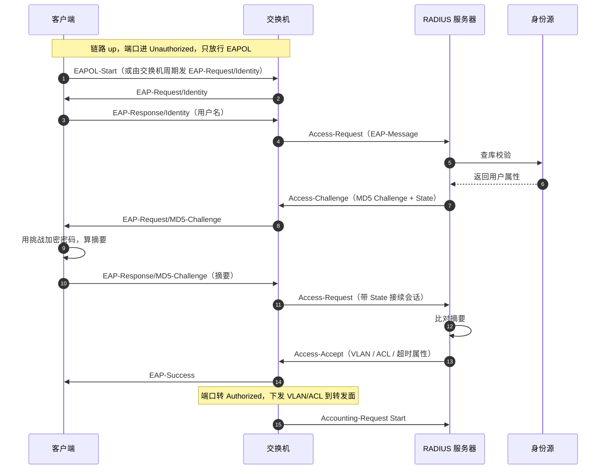
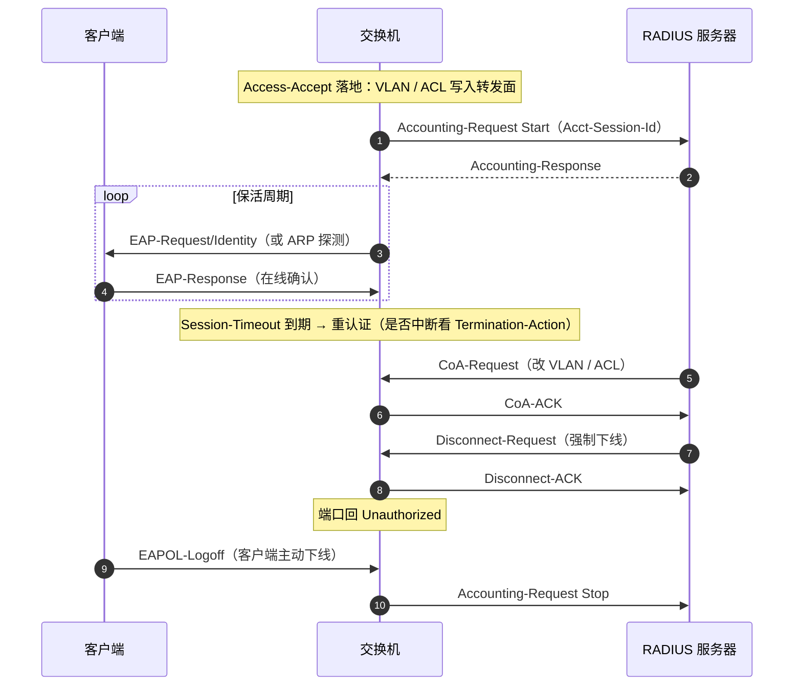

# 802.1X 认证全景：从前端到后端的完整流程与报文交互

> 依据标准：IEEE 802.1X-2020（合并 802.1X-2010 / bx-2014 / ck-2018）、IEEE 802.1AE（MACsec）、
> RFC 2865/2866（RADIUS）、RFC 3579（EAP over RADIUS）、RFC 3580（802.1X RADIUS 用法）、RFC 5176（CoA / Disconnect）
> 编写日期：2026-09-23
> 说明：本文的命令部分**未经实机验证**，凡不确定处均标注「（待实机核对）」，请勿直接下发现场。

---

## 0. 一页速览

| 阶段 | 报文 | 谁在动 | 关键动作 |
|---|---|---|---|
| ① 接入 | 链路 up | 交换机 | 端口进 Unauthorized，只放行 EAPOL |
| ② 触发 | EAPOL-Start 或 EAP-Request/Identity | 客户端 / 交换机 | 双方都可发起 |
| ③ 取身份 | EAP-Request/Response-Identity | 交换机↔客户端 | 拿到用户名 |
| ④ 转封装 | RADIUS Access-Request | 交换机 | EAP 报文塞进属性 #79 |
| ⑤ 挑战 | RADIUS Access-Challenge | 服务器 | 下发挑战 + State |
| ⑥ 应答 | EAP-Response（摘要） | 客户端 | 用挑战加密凭据 |
| ⑦ 判定 | RADIUS Access-Accept / Reject | 服务器 | 带上授权属性 |
| ⑧ 放行 | EAP-Success | 交换机 | 端口转 Authorized + 落实 VLAN/ACL |
| ⑨ 计费 | Accounting-Request Start | 交换机 | 会话开始记账 |
| ⑩ 保活 | EAP-Request/Identity 握手 | 交换机 | 周期探测在线 |
| ⑪ 变更 | CoA-Request / Disconnect-Request | 服务器 | 改 VLAN 或强制下线 |
| ⑫ 结束 | EAPOL-Logoff 或 Accounting Stop | 客户端 / 交换机 | 端口回 Unauthorized |

**一句话**：EAP 是主角，EAPOL 和 RADIUS 是它的两个轿子；交换机全程只是**抬轿子的人**，不决定谁能过。

---

## 1. 三方角色

| 角色 | 标准术语 | 业界别名 | 职责 | 有无 IP 地址 |
|---|---|---|---|---|
| 客户端 | Supplicant（PAE） | 认证客户端、802.1X 客户端 | 发起认证、响应挑战、计算凭据 | 认证前**没有** |
| 交换机 | Authenticator（PAE） | NAS、接入设备、设备端 | 控制端口通断、拆装报文、代客户端问服务器 | 有 |
| 服务器 | Authentication Server | RADIUS 服务器、AAA 服务器 | 校验凭据、下发授权策略 | 有 |
| 身份源 | Identity Store | AD、LDAP、本地库 | 提供账号与属性 | 有 |

两个关键设计：

1. **802.1X 跑在二层，不需要 IP。** 这正是它的价值——终端在拿到 IP 之前就能被鉴别，因此能防住"先拿到地址再混进来"的问题。
2. **PAE**（Port Access Entity，端口访问实体）是指"参与 802.1X 状态机的那一侧"。客户端和交换机各有一个 PAE，服务器没有——**服务器不参与 802.1X 状态机，它只认 RADIUS**。

---

## 2. 两段协议：分界点就在交换机

```
客户端 ──── EAPOL（二层，EtherType 0x888E）──── 交换机 ──── RADIUS（三层，UDP 1812/1813）──── 服务器
         ↑ 这一段叫 802.1X                    ↑ 这一段叫 EAP over RADIUS / EAPoR
```

| 对比项 | 客户端 ↔ 交换机 | 交换机 ↔ 服务器 |
|---|---|---|
| 协议名 | EAPOL（EAP over LAN） | EAP over RADIUS（EAPoR） |
| 标准归属 | IEEE 802.1X | RFC 3579 |
| 承载层 | 二层以太网（无 IP） | UDP/IP，目的端口 1812（认证）/ 1813（计费） |
| 标识字 | EtherType `0x888E` | UDP 端口号 |
| 目的地址 | 组播 `01-80-C2-00-00-03`（也可广播） | RADIUS 服务器单播地址 |
| 承载能力 | 单帧上限受限 | EAP 报文 > 253 字节需**分片到多个 EAP-Message 属性** |
| 完整性保护 | 无（裸 EAP） | Message-Authenticator（属性 #80，16 字节 HMAC-MD5） |

**唯一不变的东西是 EAP 报文本身。** 交换机把 EAP 从 EAPOL 里掏出来，塞进 RADIUS 的 EAP-Message 属性，内容一个字节不改——这就是 **EAP 中继**。

---

## 3. 报文族谱

### 3.1 EAPOL 帧类型

| Type 值 | 名称 | 方向 | 用途 |
|---|---|---|---|
| `0x00` | EAP-Packet | 双向 | 承载 EAP 报文（真正干活的那种） |
| `0x01` | EAPOL-Start | 客户端 → 交换机 | 客户端主动发起认证 |
| `0x02` | EAPOL-Logoff | 客户端 → 交换机 | 客户端主动下线 |
| `0x03` | EAPOL-Key | 交换机 → 客户端 | 密钥分发（无线、MACsec 场景） |
| `0x04` | Encapsulated ASF-Alert | 双向 | 告警转发 |
| `0x05` | EAPOL-MKA | 双向 | MACsec 密钥协商（802.1X-2010 引入） |

注意：`EAPOL-Start` / `EAPOL-Logoff` 的 Length 字段为 0，**不带 Packet body**。

### 3.2 EAP 报文

EAP 头 5 字节：Code(1) + Identifier(1) + Length(2)，有 Type 时再加 Type(1)。

**Code 取值**（只有 4 个）：

| 值 | 名称 | 含义 |
|---|---|---|
| 1 | Request | 服务器/交换机发出，要求对方响应 |
| 2 | Response | 客户端发出，回应 Request |
| 3 | Success | 认证通过（无 Type，无数据） |
| 4 | Failure | 认证失败（无 Type，无数据） |

**Type 取值**（EAP 方法标识，常用部分）：

| 值 | 方法 | 说明 |
|---|---|---|
| 1 | Identity | 取身份，永远第一步 |
| 3 | NAK | 只在 Response 中出现，用于"我不支持你要求的那个方法" |
| 4 | MD5-Challenge | 就密码做挑战应答，**无相互认证，易离线爆破** |
| 13 | EAP-TLS | 双向证书，安全性最高，要 PKI |
| 21 | EAP-TTLS | 服务器证书 + 隧道内任意内层方法 |
| 25 | EAP-PEAP | 服务器证书 + MSCHAPv2 内层，Windows 默认 |
| 43 | EAP-FAST | 用 PAC 替代证书，部署轻 |
| 55 | EAP-TEAP | 较新的隧道方法，支持多内层 |

### 3.3 RADIUS 报文

| Code | 名称 | 方向 | 说明 |
|---|---|---|---|
| 1 | Access-Request | NAS → 服务器 | 送身份 / 送 EAP 应答 |
| 11 | Access-Challenge | 服务器 → NAS | 下发挑战，**必须带 State 属性**，否则会话无法接续 |
| 2 | Access-Accept | 服务器 → NAS | 通过，携带授权属性 |
| 3 | Access-Reject | 服务器 → NAS | 拒绝 |
| 4 / 5 | Accounting-Request / Response | 双向 | 计费开始 / 中间 / 结束 |
| 40 / 41 / 42 | Disconnect-Request / ACK / NAK | 服务器 → NAS | RFC 5176 强制下线 |
| 43 / 44 / 45 | CoA-Request / ACK / NAK | 服务器 → NAS | RFC 5176 动态改授权 |

CoA 端口：标准是 **UDP 3799**，部分厂商（Cisco 等）用 **UDP 1700**。上线前务必和服务器侧对齐。

---

## 4. 封装结构：同一个 EAP，换两次外壳

```
客户端 ←→ 交换机段：
┌──────────────┬────────────┬─────────────────────────────────────────────────┐
│  以太网头     │  EAPOL 头   │              EAP 报文（Packet body）             │
│  0x888E      │ Ver/Type/  │  ┌──────┬────────────┬────────┬──────┬────────┐  │
│              │ Len        │  │ Code │ Identifier │ Length │ Type │  Data  │  │
│              │            │  │ 1B   │    1B      │  2B    │  1B  │  变长   │  │
└──────────────┴────────────┴──┴──────┴────────────┴────────┴──────┴────────┘

交换机 ←→ 服务器段：
┌────────┬──────────┬──────────────┬──────────────────────────┬──────────────────┐
│ IP 头  │ UDP 1812 │  RADIUS 头   │   EAP-Message 属性 #79   │ Message-Auth #80 │
│        │          │ Code/ID/Len/ │   同一份 EAP 报文原样     │ 16B HMAC-MD5     │
│        │          │ Authenticator│   ≤253B，超长则分片       │                  │
└────────┴──────────┴──────────────┴──────────────────────────┴──────────────────┘
```

**三个容易踩的细节**：

- **分片有额外开销**：EAP-TLS 的证书报文经常上千字节，会被拆成多个 EAP-Message 属性重新编号。抓包时如果只看单帧会误判"报文不完整"。
- **State 属性是会话胶水**：Access-Challenge 不带 State，后续的 Access-Request 就无法和同一会话关联，多轮交互会断。
- **Message-Authenticator 是防篡改的**：带 EAP-Message 的包必须带它，接收方校验失败就**静默丢包**——这是"看起来两边都正常但认证就是不过"的经典原因之一。

---

## 5. 认证由谁发起：三种触发方式

| 触发方式 | 谁发起 | 具体动作 | 典型场景 |
|---|---|---|---|
| **客户端主动** | 客户端 | 发 EAPOL-Start | 装了厂商客户端（锐捷 SUG 等）；Windows 也可配 |
| **设备主动** | 交换机 | 周期组播 EAP-Request/Identity | Windows 内置客户端常不发 Start，靠这个唤醒 |
| **报文触发** | 交换机 | 学到未知源 MAC / 收到 DHCP、ARP 等报文后主动发 EAP-Request/Identity | 哑终端、无客户端场景，用来**尽快判定该走 MAB** |

设备主动模式下有两个子模式：

- **组播触发**：周期向组播地址发（默认 30 秒一次）
- **单播触发**：收到源 MAC 不在 MAC 表里的帧时，针对该 MAC 单播发 EAP-Request/Identity，无响应则重传

**为什么这一节对故障排查重要**：如果设备侧被配成了只有客户端主动触发，而终端又不发 EAPOL-Start，那么认证**永远不会开始**——现象是"插上网线一点反应都没有"。这时看的是交换机有没有发出 EAP-Request/Identity。

---

## 6. 完整成功时序（以 EAP-MD5 + EAP 中继为例）



**交换机在这一串里做的全部事情**：拆 EAPOL、装 RADIUS、收 RADIUS、拆、装 EAPOL。**它不参与判定**——这是理解后续所有故障定位的基石。

### 认证失败时序

```
Access-Reject → 交换机发 EAP-Failure → 端口保持 Unauthorized（或进 Auth-Fail VLAN）
```

**注意**：EAP-Failure 报文里 **没有失败原因**。这是 802.1X 的一个设计缺陷——客户端只知道"失败"，不知道"为什么失败"（密码错？账号锁？服务器用不了？）。定位必须靠 RADIUS 服务器日志 + 交换机侧日志联合看。

---

## 7. 端口状态与三条降级路径

端口只有两个业务状态，但**降级出口有三个**，这是现场最容易混淆的地方：

| 降级出口 | 触发条件 | 业务含义 | 危害等级 |
|---|---|---|---|
| **Guest VLAN** | 连发 EAP-Request/Identity 无响应（说明**没有客户端**） | 没有 802.1X 能力的设备，给受限放行（通常只能上互联网/修复页） | 低（设备确实没有鉴别能力） |
| **Auth-Fail VLAN** | RADIUS 返回 **Access-Reject**（说明有客户端但**凭据错**） | 有鉴别能力但没过，给受限网络（通常只能找 IT） | 中（可能是密码错，也可能是攻击尝试） |
| **Critical VLAN** | RADIUS **完全不可达**（服务器宕机或链路不通） | 认证系统故障时的兜底放行，避免全楼断网 | 高（这期间**等于没有准入控制**） |

再加一条**优先级问题**：MAB 与 802.1X 谁先试，各厂商可配，且不同顺序行为差异很大：

- `legacy`：收到什么先处理什么，802.1X 有绝对优先（老行为）
- `dot1x-mab`：先试 802.1X，超时/失败再试 MAB
- `mab-dot1x`：先试 MAB，失败再试 802.1X
- `concurrent`（部分厂商）：两条通道**并行**发，谁先回用谁；**后到的 802.1X 结果会覆盖 MAB 结果**

**MAB 的两个身份细节**：用户名和密码都用 MAC 地址，但**格式各厂商不同**（`aabbccddeeff` / `aa-bb-cc-dd-ee-ff` / `aa:bb:cc:dd:ee:ff`）。服务器侧的 MAC 账号格式必须与交换机发出的格式完全一致，否则必然 Reject——这是 MAB 最高频的配置错误。

---

## 8. 授权：Access-Accept 到底带什么回来

RADIUS 在 Access-Accept 里下发的属性，决定终端"进哪个网、能干什么、能呆多久"。

| 属性 | 号 | 作用 | 常见取值 |
|---|---|---|---|
| `Tunnel-Type` | 64 | 隧道类型（**必须与下面两个同时出现**） | `VLAN`（值 13） |
| `Tunnel-Medium-Type` | 65 | 隧道介质 | `IEEE-802`（值 6） |
| `Tunnel-Private-Group-ID` | 81 | **目标 VLAN** | `20` 或 `Engineering` |
| `Filter-Id` | 11 | **ACL 名称**，指向设备上预配的 ACL | `EMPLOYEE_ACL` |
| `Session-Timeout` | 27 | 会话最大时长，到期触发重认证 | `3600` |
| `Idle-Timeout` | 28 | 空闲超时 | `300` |
| `Termination-Action` | 29 | 重认证时是否中断会话 | `DEFAULT`（中断）/ `RADIUS-Request`（不中断） |
| `Vendor-Specific` | 26 | 厂商私有属性（dACL、限速、URL 重定向等） | 视厂商 |

**动态 VLAN 的生效条件**：属性 64 + 65 + 81 **三个必须同时出现**，缺一个就退回端口静态配置的 VLAN。这个"三缺一就静默失效"的行为，是"认证明明通过了但 VLAN 不对"的头号原因。

**dACL（可下载 ACL）**：厂商私有属性里下发具体 ACL 规则，交换机动态生成会话级 ACL 并绑定到端口。相比 VLAN 隔离，粒度更细（可到 IP、端口级）。常见依赖：需要设备侧开启 IP-MAC-端口绑定跟踪功能，否则 ACL 无法绑定到正确会话。

**CoA 改 VLAN 的一个坑**：用 `CoA-Request` 只改 VLAN 时，终端**不会重新获取 IP**，会出现"VLAN 变了但地址还是旧的"。需要终端换地址的场景要用 `Disconnect-Request` 让它重认证。

---

## 9. 会话生命周期



| 机制 | 由谁驱动 | 作用 | 没有会怎样 |
|---|---|---|---|
| **保活握手** | 交换机周期发 | 探测终端是否还在（拔线、关机、休眠） | 终端已离线但会话仍在，**端口占着不放** |
| **重认证** | Session-Timeout 到期 | 强制重新证明身份 | 离职/过期证书长期挂着，权限永不回收 |
| **CoA** | 服务器主动下发 | 在线改 VLAN/ACL（如合规状态变化） | 只能等下次重认证，策略变更不实时 |
| **Disconnect** | 服务器主动下发 | 立即踢下线 | 无法即时隔离已失陷主机 |
| **计费 Accounting** | 交换机上报 | 审计与在线时长统计 | 无审计记录，出问题无法追溯 |

**保活探测的两种实现**：一是周期性重发 EAP-Request/Identity 让其应答；二是 ARP 探测（发 ARP 看终端是否应答）。前者依赖客户端配合，后者对哑终端也有效。**如果探测方式配错，会把正常终端误判为离线而下线**——这是"用户反映每隔几分钟掉一次线"的典型根因。

---

## 10. EAP 方法对比

| 方法 | 相互认证 | 客户端要证书 | 服务器要证书 | 凭据暴露风险 | 适用场景 |
|---|---|---|---|---|---|
| EAP-MD5 | ✗ | ✗ | ✗ | **高**（可离线爆破） | 仅测试；生产不建议 |
| EAP-TLS | ✓ | **要** | 要 | 极低 | 受管终端、零信任环境 |
| EAP-TTLS | ✓ | ✗ | 要 | 低（隧道内传凭据） | 混合终端、需兼容旧认证 |
| EAP-PEAP | ✓ | ✗ | 要 | 低 | Windows 域环境（**最常见**） |
| EAP-FAST | ✓ | ✗ | 要 | 低 | 不便发证书的场景 |

**PEAP 的一个真实风险**：如果客户端**不校验服务器证书**，攻击者可以架个假 AP/假 RADIUS 骗出内层 MSCHAPv2 凭据（俗称"PEAP 降级攻击"）。所以"客户端侧是否勾选校验服务器证书"是安全审计必查项。

**EAP-MD5 为什么还在用**：因为交换机侧 EAP 终结模式**只支持它**（见下一节）。很多老局点之所以只见 MD5，不是选型偏好，是被模式限制死的。

---

## 11. EAP 中继 vs EAP 终结

| 对比项 | EAP 中继（relay） | EAP 终结（termination） |
|---|---|---|
| 交换机角色 | 透明搬运工 | EAP 会话的终结者（自己扮演 EAP Server） |
| 对服务器的要求 | 服务器必须支持对应 EAP 方法 | 服务器只需支持 PAP / CHAP |
| 支持的 EAP 方法 | TLS / TTLS / PEAP / FAST 等**全部** | **只有 MD5-Challenge** |
| 交换机负载 | 低（只拆装） | 高（要解析 EAP、算挑战） |
| 兼容性 | 依赖服务器能力 | **最好**，老服务器无需改造 |
| 安全性 | 高（可用强方法） | 低（MD5 可爆破；EAP 终结模式下也无相互认证） |
| 选型建议 | **新部署优先** | 仅用于服务器无法升级的存量局点 |

**一句话**：中继是把判断权交给服务器，终结是把判断权部分收回到交换机。**选错模式，直接决定你能不能用 EAP-TLS/PEAP**——这也是"为什么我们局点只能用 MD5"这类问题的答案。

---

## 12. 定时器与重传参数

| 参数 | 含义 | 典型默认 | 配错的后果 |
|---|---|---|---|
| `tx-period` | 向客户端发 EAP-Request/Identity 的间隔 | 30 秒 | 太短→风暴；太长→插线后久无反应 |
| `supplicant-timeout` | 等客户端响应的时间 | 30 秒 | 太短→正常终端被判为无客户端→误进 Guest VLAN |
| `server-timeout` | 等服务器响应的时间 | 30 秒 | 太短→误判服务器不可达→误进 Critical VLAN |
| `max-req` | 最大重传次数 | 3 | 太少→弱网下误失败 |
| `quiet-period` | 失败后静默期（期间不重新认证） | 60 秒 | 太短→反复试错；太长→用户改完密码仍要等 |
| `reauth-period` | 重认证周期 | 视配置 | 太短→频繁扰动；太长→权限回收不及时 |
| `reauthenticate` | 是否启用周期重认证 | 多为关闭 | 关闭则权限永不回收 |

**参数之间有耦合**：`supplicant-timeout` 与 `tx-period` 的乘积决定"多久判定为哑终端并转向 MAB"。这两个值配得激进，会把慢启动的终端（如刚开机的 PC）误判成哑终端，让它走去 MAB，出现"电脑第一次插网线认证不过，重启一次就好"的怪现象。

---

## 13. 端口模式与主机模式

**端口控制模式**（3 种）：

| 模式 | 行为 |
|---|---|
| `auto` | 启用认证，初始 Unauthorized，认证通过才放行 |
| `force-authorized` | 强制放行，**不做认证**（等于关闭 802.1X） |
| `force-unauthorized` | 强制不放行，忽略一切认证尝试 |

**主机模式**（同端口挂多个设备时怎么算）：

| 模式 | 规则 | 适用 |
|---|---|---|
| **单主机** | 只允许 1 个终端，第二个进来即违规处理 | 办公桌面 |
| **多主机** | 首个终端认证通过后，**后面所有终端一并放行**（不再单独认证） | 下挂小交换机/AP |
| **多域** | 数据域与语音域**分别认证**（PC + IP 电话各走一套） | 桌面话机 + PC |
| **多认证** | 每个终端**各自独立认证**，各自一套授权 | 高安全场景 |

**多主机模式是安全黑洞**：第一个终端认证成功后，后面接的任何设备都自动获得同样的网络权限。**如果这是采集场景/接入场景，必须确认配的是哪种模式**，否则"认证通过率 100%"可能只是因为没有真正逐台鉴别。行业参考量级：单端口多认证支持的设备数上限定在 10~20 台量级（视厂商与型号）。

---

## 14. 标准演进

| 版本 | 年份 | 主要变化 |
|---|---|---|
| 802.1X-2001 | 2001 | 初版，仅端口级访问控制 |
| 802.1X-2004 | 2004 | 修正与澄清，增加 MIB |
| **802.1X-2010** | 2010 | **重大扩展**：引入 MACsec（802.1AE）密钥分发、MKA 协议、DevID（802.1AR）设备身份、EAPOL-Key/MKA 帧、支持共享介质上多实体各自建安全通道 |
| 802.1Xbx-2014 | 2014 | 扩展 MKA，支持不停机升级（MKA 临时挂起） |
| 802.1Xck-2018 | 2018 | 增加 YANG 数据模型（可被网管建模） |
| **802.1X-2020** | 2020 | 合并历次修订，增强对零信任（持续重认证、细粒度控制）的支持 |

**MACsec 的意义**（如果你的产品要接这块）：802.1X 本身**不加密数据**，只控制门开不开；MACsec（802.1AE）才是把链路加密。802.1X-2010 让二者联动——认证通过后自动协商链路密钥。**带外管理口或跨楼宇链路**用 MACsec 的价值最大。

---

## 15. 分阶段故障定位速查

按"故障停在哪个阶段"来定位，比从现象猜根因快得多。

| 阶段 | 现象 | 首要观测点 | 常见原因 |
|---|---|---|---|
| **① 触发** | 插线无任何反应，认证不开始 | 交换机是否发出 EAP-Request/Identity；客户端是否发 EAPOL-Start | 触发方式配错；端口未 `auto`；EAPOL 被中间设备丢弃 |
| **② 链路** | 端口物理 UP 但完全不通 | 端口 PVID、放行 VLAN | Guest VLAN 未配；端口静默期未过 |
| **③ 帧层** | EAPOL 发出但被丢弃 | EAPOL 收发计数 | 中间设备/网卡过滤了 `0x888E`；组播地址被禁 |
| **④ 服务器可达** | 认证一直无结果 | RADIUS 是否可达、共享密钥是否一致 | 密钥错→服务器静默丢包；UDP 1812 被 ACL 拦；NAS-IP 配错 |
| **⑤ 会话接续** | 多轮交互中断 | State 属性是否带；Message-Authenticator 校验 | 属性丢失；HMAC 不一致被静默丢 |
| **⑥ 判定** | 有应答但 Reject | 服务器日志的失败原因码 | 凭据错；MAC 格式不匹配（MAB）；账号锁定 |
| **⑦ 授权落地** | 认证通过但网络不对 | 属性 64/65/81 是否三件套齐；端口实际 VLAN | 三缺一静默失效；VLAN 未在设备上创建；上行口未放行该 VLAN |
| **⑧ 保活** | 周期性掉线 | 保活方式与周期；是否有下线日志 | ARP 探测误判；quiet-period 与重连间隔冲突 |

**"认证通过但上不了网"这一类，绝大多数落在 ⑦**：认证流程本身没问题，问题在授权属性落地或 VLAN 通达性。排查顺序应该是：**先看 RADIUS 有没有回属性 → 再看交换机有没有落实 → 最后看网络有没有放行**。

---

## 16. APM 可观测点映射

这是给 APM 产品用的采集清单。**命令名称一律标注「（待实机核对）」**——本项目的既定纪律：未经真机验证的设备命令不得作为交付内容。

| 阶段 | 观测点 | 数据源 | 现有技术栈 | 缺口 |
|---|---|---|---|---|
| 触发 | EAPOL-Start 计数、EAP-Request/Identity 发送计数 | 端口统计 | VictoriaMetrics | 未采集 |
| 帧层 | EAPOL 收发计数、丢弃计数 | 端口统计 / 表项 | VictoriaMetrics | 未采集 |
| 交互 | **各 EAP 方法交互轮次与耗时** | 日志（Loki） | Loki | **未聚合** |
| 交互 | EAP 交互中断点（停在哪个 Code/Type） | 日志 | Loki | 未聚合 |
| 服务器 | `Access-Request / Challenge / Accept / Reject` **四类报文比例** | 日志 / 计数器 | Loki | **全缺（最关键）** |
| 服务器 | RADIUS 请求响应耗时 | 日志时间戳差 | Loki | 未聚合 |
| 判定 | 认证失败原因码分布 | 服务器日志 | 无 | 需对接服务器 |
| 授权 | 属性下发记录（VLAN/ACL/超时） | 日志 | Loki | 未聚合 |
| 授权 | **配置 VLAN vs 转发面实际 VLAN** 的 diff | 配置 + 表项快照 | 无 | 全缺 |
| 会话 | 在线用户数、认证成功率（分钟级） | 聚合指标 | 无 | **需新建（业务 KPI）** |
| 保活 | 下线原因分布（主动/保活超时/CoA） | 日志 | Loki | 未聚合 |
| 进程 | 802.1X / AAA 相关进程存活与重启 | 进程监控 | 无（或部分） | 待确认 |

**优先级建议（按"能闭合多少证据缺口"排序）**：

1. **P0 · RADIUS 四类报文比例 + 认证成功率分钟级指标** —— 这是唯一能同时看见 NAS 侧与服务器侧的观测点。没有它，认证类故障只能靠人肉登录设备看日志。
2. **P0 · 属性下发记录与"配置 VLAN vs 实际 VLAN"的 diff** —— 直击"认证通过但网络不对"这一大类（该类在认证故障中占比很高）。
3. **P1 · EAP 交互中断点** —— 把"认证失败"细化到"停在第几轮"，能把排查范围缩小一个数量级。
4. **P1 · 下线原因分布** —— 区分"用户主动""保活超时""被 CoA 踢"，直接对应不同的根因。

**一条重要的概率判断**：基于本项目对认证类故障的实际统计，**认证故障的主战场在交换机本机侧（软件机制、表项、放行策略、能力缺失），服务器侧问题占比很小**。而 NAS 侧恰恰是 APM 能采到数据的部分。所以**采集重心应压在本机侧**，不要一开始就去接服务器监控。

---

## 附：术语速查

| 缩写 | 全称 | 说明 |
|---|---|---|
| PAE | Port Access Entity | 端口访问实体，参与状态机的那一侧 |
| NAS | Network Access Server | 网络接入服务器，即交换机/AP 侧 |
| EAPOL | EAP over LAN | 二层承载格式 |
| EAPoR | EAP over RADIUS | 三层承载格式 |
| MAB | MAC Authentication Bypass | 用 MAC 地址做认证，哑终端降级方案 |
| CoA | Change of Authorization | 服务器主动改在线会话授权 |
| dACL | downloadable ACL | 服务器下发的会话级 ACL |
| MKA | MACsec Key Agreement | MACsec 密钥协商协议 |
| Supplicant | — | 客户端侧的 802.1X 实现 |
| Authenticator | — | 交换机/AP 侧的 802.1X 实现 |
