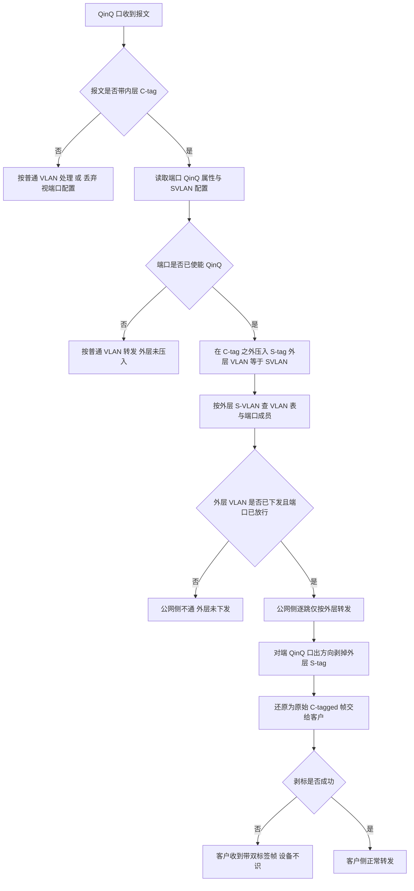
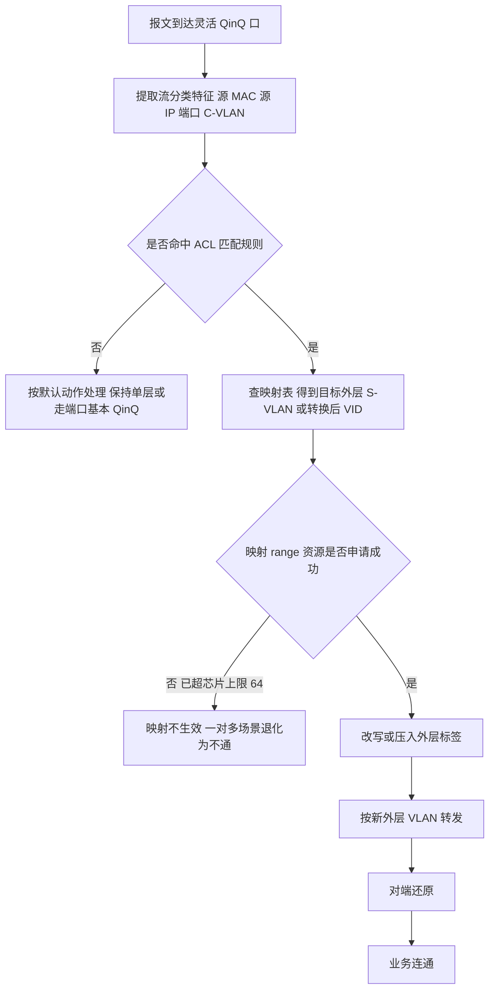
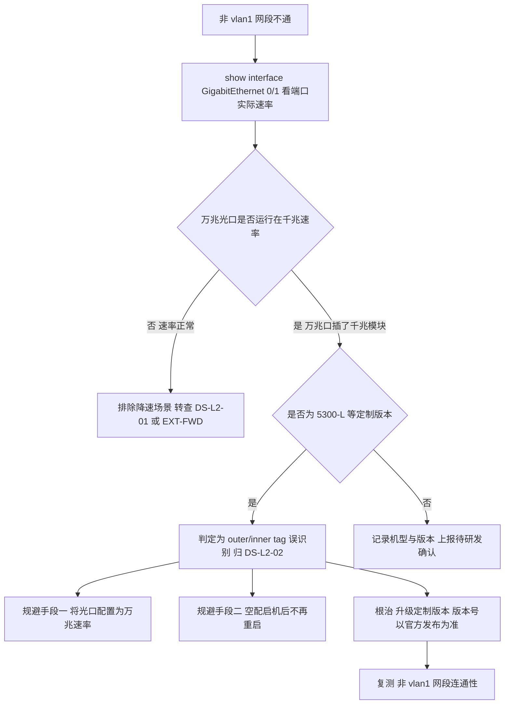
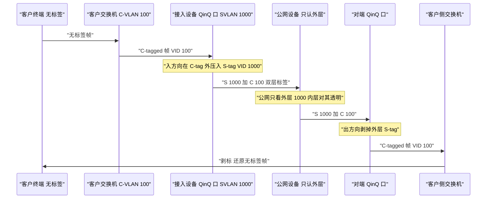
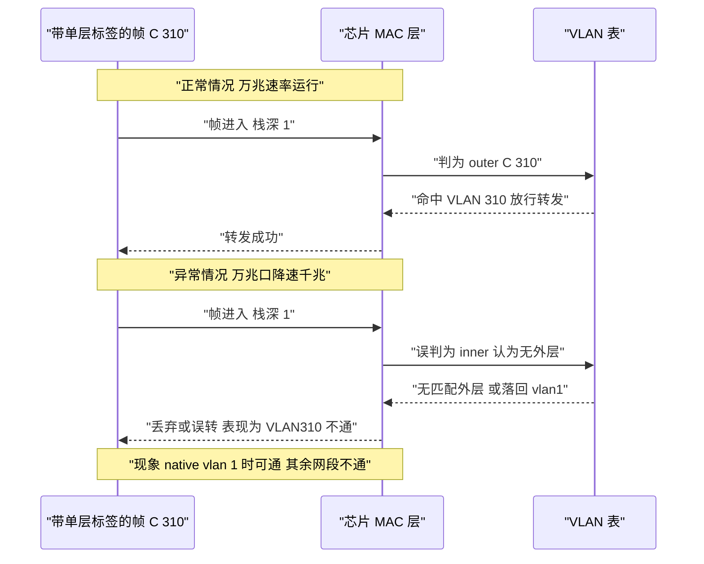

# QinQ 与 VLAN 标签解析 场景全景：描述 · 流程 · 涉及模块 · 监控点

> **大场景**：DS-L2（二层与环网）
> **文档版本**：v1.0（新增，尚未走两轮 AI 专家评审）
> **编制日期**：2026-09-24
> **上游依据**：`../03_二层与环网_场景拆解与RCA做法.md`（`DS-L2-02` `DS-L2-10`）
> **说明**：设备命令凡未经真机验证，一律标注「（待实机核对）」；本文不含未经证实的版本号、补丁号与品控 ID。

---

## 0. 一页速览

| 阶段/环节 | 关键动作 | 执行者 | 失败后的现象 |
|---|---|---|---|
| ① 定外层标识 | 指定 SVLAN 与 TPID（0x8100 或 0x88A8） | 配置层 | TPID 两端不一致→整条链路不通 |
| ② 入方向打外层 | 在原有 C-tag 之外再压入一层 S-tag | 芯片转发面 | 未压入→公网侧学到大量客户 MAC |
| ③ 外层解析 | 芯片按 TPID 与标签栈深度判定哪层是 outer | 芯片 MAC 层 | **误判→非 vlan1 网段不通（`DS-L2-02`）** |
| ④ 公网侧转发 | 仅按外层 S-VLAN 转发，内层对公网透明 | 芯片转发面 | 按内层转发→跨客户串 VLAN |
| ⑤ 出方向剥外层 | 剥掉 S-tag 还原客户原始帧 | 芯片转发面 | 未剥→客户设备不识标签 |
| ⑥ 灵活 QinQ 匹配 | 按流分类决定外层或做 VLAN 转换 | ACL + 芯片 | range 资源超 64→转换不生效（`DS-L2-10`） |

**一句话本质**：QinQ 的本质是**在客户的 802.1Q 标签外面再套一层运营商标签**，让公网设备只认外层、对客户的 VLAN 规划完全无感——一层壳换来解决"客户 VLAN 空间不够用、不同客户 VLAN 会撞车"两个问题。**它把"报文里有几层标签、哪层算外层"变成了芯片必须正确解析的前提**；一旦芯片的标签层数判定出错，就会退化成"非 vlan1 网段全不通"这类看着像 VLAN 配置问题、实则是解析问题的故障。

---

## 1. 定位与边界

### 1.1 一句话定义

- **QinQ（802.1ad / 堆叠 VLAN）**：在报文原有的 C-tag（Customer VLAN，客户内层标签）之外，由接入设备再压入一层 S-tag（Service VLAN，服务外层标签）。公网侧设备只按 S-tag 转发，C-tag 对公网透明，从而**把可用的 VLAN 空间从 4094 扩展到 4094 × 4094**，并天然隔离不同客户。
- **基本 QinQ**：**端口级**——一个端口配成 QinQ 口后，该口收到的所有 C-tagged 帧统一压入同一个 S-tag（外层 VLAN = 该端口的 SVLAN / PVID）。
- **灵活 QinQ / VLAN 映射（vlan mapping）**：**流分类级**——按 ACL 匹配结果决定压入哪层外层，或做 VLAN 转换（1:1、N:1、1:N），实现按客户/按业务区分外层。
- **outer / inner VLAN tag 识别**：芯片在解析报文时，需要判定标签栈的**层级与归属**（哪一层是外层、哪一层是内层）。这个判定是数据面一切 QinQ 行为的前提，也是 `DS-L2-02` 的机理所在。

### 1.2 在本大场景中的位置

- **承接**：依赖《二层-VLAN与superVLAN-…》的 VLAN 与端口标签模型——QinQ 是 VLAN 标签模型的**双层扩展**。
- **被触发**：外层 VLAN 与映射关系经 `VLAN 管理 → SSA → SDK` 下发芯片的 VLAN 表与映射 range 资源；资源耗尽归 `DS-L2-10`；芯片标签解析出错归 `DS-L2-02`。
- **本篇对应子场景**：`DS-L2-02`（万兆光口降速千兆 VLAN 标签解析错误）为主，`DS-L2-10`（QINQ 一对多不生效 / range 资源耗尽）为辅。

### 1.3 边界判据

**属于本篇：**

- 基本 QinQ 的端口级压入/剥离行为、SVLAN 与 TPID 配置一致性。
- 灵活 QinQ / vlan mapping 的 1:1、N:1、1:N 转换语义与 range 资源占用。
- 芯片对**标签栈层级（outer / inner）的识别**，以及识别错误导致的现象（非 vlan1 网段不通、收包单层标签被快转打印为双层）。
- QINQ 一对多不生效、VLAN 映射 range 资源超过芯片上限。

**不属于本篇、易误入（含典型反例）：**

- **典型反例·现象像 QinQ、根因不在 QinQ 配置**：`DS-L2-02` 的一批工单（行 530、685、831、878、296）中，**设备往往并未配置 QinQ**——它是 5300-L 系列在**万兆光口降速为千兆**工作时，芯片把单层报文的 outer tag 当成 inner tag 解析。归类依据必须是**"根因定位为 outer/inner 识别错误"**，而不是"客户配了 QinQ"。排查时若客户明确没配 QinQ，不要因为"看着像双层标签问题"就归到配置错误。
- 纯单层 VLAN 的标签问题（PVID、放行列表、Access/Trunk 规则）→ 归 `DS-L2-01`，见《二层-VLAN与superVLAN-…》。
- 二层 ACL / VLAN CLASS 的 classid 冲突与残留 → 归 `DS-L2-05`（灵活 QinQ 复用 ACL 匹配，但残留机理不属本篇）。
- 芯片 MMU / 队头阻塞 / 内存泄漏等非 range 类资源问题 → 归 `DS-L2-10` 的其它机型，本篇只取"VLAN 映射 range 超 64"这一条。
- 光模块本身不发光等硬件故障 → 归 `EXT-PHY`（接口与物理层）。

---

## 2. 涉及模块

| 模块名 | 所属层 | 职责 | 与本技术的交互点 | 该模块失效时的典型现象 |
|---|---|---|---|---|
| QinQ 配置与端口属性管理 | 设备侧控制面 | 维护 QinQ 端口、SVLAN、TPID | 决定入方向压入哪层外层 | 端口未配 QinQ→外层未压入 |
| 灵活 QinQ / vlan mapping 引擎 | 设备侧控制面 | 维护映射规则与 range 资源分配 | 按流分类决定外层或做 VLAN 转换 | 映射不生效、一对多失效（行 395） |
| VLAN 映射 range 资源池 | 设备侧转发面资源 | 管理芯片可用的映射 range 数量 | 每条映射规则占用一个 range | **超过芯片上限 64→映射不生效（`DS-L2-10`）** |
| ACL 匹配（灵活 QinQ 的 match 来源） | 设备侧控制面 | 提供流分类匹配键 | 灵活 QinQ 的匹配复用 ACL | ACL 未命中→走默认外层或保持单层 |
| 芯片 MAC 层标签解析 | 硬件 | 按 TPID 与标签栈深度判定 outer / inner | **`DS-L2-02` 的失效点** | 层数误判→非 vlan1 网段不通 |
| VLAN 表与端口 bitmap 下发 | 设备侧转发面软件 | 下发外层 VLAN 与端口成员 | 外层 VLAN 能否转发 | 外层 VLAN 未下发→公网侧不通 |
| 快转路径（快速转发打印） | 设备侧转发面软件 | 报文快转时的标签呈现 | 诊断时的标签显示 | 单层标签被打印为双层，误导定位 |
| SSA / SDK 适配层 | 设备侧转发面软件 | 上下层状态转换与下发 | 配置到芯片的落地 | 上下层不一致→配置对但功能不生效 |
| APM 采集侧 | 平台侧 | 采集速率、VLAN、映射资源占用 | 监控数据源 | 缺采集→降速与资源耗尽无告警（第 8 节） |

**模块清单来源与置信度：**

- 来自本项目实证（高置信）：万兆光口降速千兆导致 outer/inner vlan tag 误识别（`DS-L2-02`，行 530、685、831、878、296）；单层标签被快转打印为双层；VLAN 映射 range 资源超过芯片总数 64 致 QINQ 一对多不生效（`DS-L2-10`，行 395）。
- 通用命名推断（中置信）：QinQ 端口属性管理、灵活 QinQ 引擎、`SSA / SDK` 为通用架构推断，具体进程名与命令以真机为准（待实机核对）。
- 不引入未经证实的进程名、版本号与补丁号。

---

## 3. 协议栈、标签结构与配置模型

### 3.1 双层标签结构

在普通以太帧上，QinQ 后最多出现两层标签：

| 位置 | 名称 | 典型 TPID | 归属 | 说明 |
|---|---|---|---|---|
| 外层（靠前） | S-tag / S-VLAN | `0x88A8`（802.1ad）或 `0x8100` | 运营商/公网侧 | 公网设备**只认这一层** |
| 内层（靠后） | C-tag / C-VLAN | `0x8100` | 客户 | 公网侧完全透明 |

- **两层的 TPID 可以相同（都用 0x8100）也可以不同**，取决于设备配置。TPID 是芯片判定"这层标签属不属于我"的第一判据。
- **报文进入 QinQ 系统的前提是有内层标签**：基本 QinQ 处理的是 C-tagged 帧；不带标的帧是否也压入外层，取决于设备实现与端口配置（待实机核对）。

### 3.2 基本 QinQ 与灵活 QinQ 的差异

| 维度 | 基本 QinQ | 灵活 QinQ / vlan mapping |
|---|---|---|
| 划分粒度 | 端口级 | 流分类级（按 ACL 匹配） |
| 外层来源 | 端口对应的 SVLAN / PVID，全口统一 | 按匹配结果逐流决定 |
| 是否需要资源 | 只需外层 VLAN 与端口成员 | **需要 VLAN 映射 range 资源（每条占一个）** |
| 典型用途 | 简单客户接入 | 多客户共用端口、按业务区分外层 |
| 失效模式 | 外层未压入/未下发 | range 资源超上限→规则不生效 |

### 3.3 VLAN 映射（vlan mapping）的三种语义

| 类型 | 含义 | 说明 |
|---|---|---|
| 1:1 | 一个 C-VLAN 映射为一个 S-VLAN | 最直观，一对一转换 |
| N:1 | 多个 C-VLAN 映射为同一个 S-VLAN | 常见于"多客户共用一个外层" |
| 1:N | 一个 C-VLAN 按不同条件映射为不同 S-VLAN | 需依赖流分类，**range 资源占用较多** |

> "QINQ 一对多不生效"（行 395）中的"一对多"即 1:N 语义——**这是 range 资源占用最高的一类**，也是最先触到芯片上限 64 的一类。

### 3.4 标签解析：outer / inner 的判定依据

芯片在收包时，对标签栈的判定链大致为：

```
收包
  → 定位以太类型字段
    → 是否为 0x8100 / 0x88A8（TPID 命中）
      → 是 → 记录为一层标签，继续向帧内推进
        → 内层以太类型是否又是 0x8100 / 0x88A8
          → 是 → 记为第二层标签（栈深 2）
  → 依据「栈深 + 端口 QinQ 属性 + TPID 白名单」判定
    → 最外层 = outer，次层 = inner
```

**正常情况**：栈深 1 时唯一那层就是 outer；栈深 2 时靠前的是 outer。
**异常情况**（`DS-L2-02`）：芯片在特定条件下**把栈深 1 的唯一一层误判为 inner**，于是系统认为"这个报文没有外层"→ 按内层 VLAN 处理 → 非 vlan1 网段因找不到对应的外层/内层映射关系而被丢弃或不转发。**native vlan 1 之所以"看起来正常"，是因为 vlan1 作为默认 VLAN 在各处都默认存在，误判后仍能落到一个合法 VLAN 上**。

### 3.5 表项与资源下发链

```
QinQ 配置（端口 QinQ / 灵活 QinQ 规则）
  → 配置库
  → VLAN 管理模块（外层 VLAN 表 + 端口成员 + 映射规则）
  → 映射 range 资源分配（每条规则占 1 个，芯片总量 64）
  → SSA → SDK
  → 芯片（VLAN 表 / 映射表 / 标签解析配置）
```

---

## 4. 流程图

### 4.1 基本 QinQ 入/出方向处理流程



### 4.2 灵活 QinQ / vlan mapping 处理流程



### 4.3 outer / inner 识别错误判定树



---

## 5. 数据流图

### 5.1 报文标签栈逐跳变化



**对应标签栈状态表：**

| 位置 | 标签层数 | 内容 | 说明 |
|---|---|---|---|
| 客户终端 | 0 | 无 | 终端不打标 |
| 客户接入交换机上行 | 1 | C=100 | 客户侧 VLAN |
| QinQ 口入方向之后 | 2 | S=1000, C=100 | 压入外层 |
| 公网传输 | 2 | S=1000, C=100 | 内层透明 |
| QinQ 口出方向之后 | 1 | C=100 | 剥离外层 |
| 对端客户侧 | 0–1 | — | 按客户自身规划处理 |

### 5.2 正常解析 vs 异常解析（`DS-L2-02` 核心对比）



**现象对照表：**

| 场景 | 栈深 | 芯片判定 | 结果 |
|---|---|---|---|
| 正常速率 | 1 | outer = 该层 | 按 VID 正常转发 |
| 正常速率 | 2 | outer = 外层 | 按外层转发 |
| 降速千兆（异常） | 1 | 误判为 inner | 非 vlan1 网段不通 |
| 降速千兆（异常） | 1（快转诊断） | 打印为双层 | 诊断输出误导定位 |

---

## 6. 关键参数与配置项

| 参数/配置项 | 默认值/范围 | 配错的后果 |
|---|---|---|
| 外层 TPID | 0x88A8 或 0x8100 | 两端不一致→对端不识别外层，链路不通 |
| SVLAN | 需为已创建的外层 VLAN | 未创建→压入后无处转发 |
| VLAN 映射 range 资源 | **芯片资源总数 64** | 超过 64→映射规则不生效（行 395） |
| 端口 QinQ 使能 | 默认关闭 | 未使能→外层未压入，公网侧学到客户 MAC |
| 映射规则类型 | 1:1 / N:1 / 1:N | 1:N 占用最多 range，最先触上限 |
| 端口实际速率 | 万兆口应为万兆 | **降速千兆→触发 `DS-L2-02` 标签误判** |
| native VLAN | 默认 1 | native vlan≠1 时降速场景直接不通 |
| 千兆模块使用 | 万兆口应配万兆模块 | 降速使用是 `DS-L2-02` 与 `DS-L2-10` 的共同触发条件 |

---

## 7. 常见故障模式与分阶段定位

| 故障模式 | 现象 | 定位阶段 | 关键判据 |
|---|---|---|---|
| outer/inner tag 误识别 | 非 vlan1 网段不通、native vlan1 时可通 | ③ 解析环节 | 端口降速 + 5300-L 机型 + 非 vlan1 不通（行 530、685、831、878、296） |
| 标签解析打印错误 | 收包单层标签被快转打印为双层 | ③ 解析环节 | 诊断输出与抓包不一致 |
| QINQ 一对多不生效 | 1:N 映射配置后业务不通 | ⑥ 资源环节 | range 资源占用是否超 64（行 395） |
| 外层未下发 | 公网侧完全不通 | ④ 表项环节 | 外层 VLAN 与端口成员是否下发芯片 |
| TPID 不一致 | 链路整体不通 | ① 配置环节 | 两端 TPID 配置比对 |
| 剥标失败 | 客户收到双标签帧 | ⑤ 出方向环节 | 对端抓包看标签层数 |

**成功 vs 失败对比要点**：`DS-L2-02` 的成功定位依赖**两个硬证据**——① 端口实际速率确为降速；② 非 vlan1 不通且 native vlan 1 时正常。缺任一证据就容易误归到 VLAN 配置问题。`DS-L2-10` 的成功定位依赖 **range 资源计数**这一条硬证据。

---

## 8. 监控点（APM 可观测性映射）

| 观测点 | 观测对象 | 数据源 | 采集方式 | 阈值 / 触发条件 | 现状 | 优先级 |
|---|---|---|---|---|---|---|
| 端口实际速率与模块类型 | 端口速率 / 模块速率 | VictoriaMetrics | SNMP 轮询 | 万兆口运行于千兆速率即告警 | 部分（命令可得但缺持续采集） | P0 |
| 降速机型与业务 VLAN 组合 | 机型 + 端口速率 + 非 vlan1 连通性 | VictoriaMetrics + MySQL | SNMP 轮询 + CLI 定时采集 | 5300-L 且降速且非 vlan1 网段不通，即命中 `DS-L2-02` 模式 | 缺失 | P0 |
| VLAN 映射 range 资源占用 | range 资源计数 | VictoriaMetrics | CLI 定时采集 | 占用接近或超过 64 即告警 | 缺失 | P0 |
| QinQ 外层 VLAN 下发态 | 外层 VLAN 表项与端口成员 | MySQL | CLI 定时采集 | 表项缺失即告警 | 缺失 | P1 |
| TPID 一致性 | 链路两端 TPID 配置 | MySQL | CLI 定时采集 | 同一链路两端 TPID 不一致即告警 | 缺失 | P1 |
| 已知 BUG 命中 | 机型 + 版本 | MySQL | CLI 定时采集 | 版本早于修复版本即提醒 | 缺失 | P1 |
| 标签层数异常日志 | 快转/收包解析异常 | Loki | Syslog-Trap 订阅 | 出现标签解析异常关键字即告警 | 缺失 | P2 |

> **落地口径**：加密通道之上的语义不可经镜像抓包获得，本表全部观测点走 SNMP、CLI 与日志。

---

## 9. 排查动作步骤（按序执行）

| 步 | 动作 | 命令 / 观测点 | 判读 |
|---:|---|---|---|
| 1 | 确认端口速率与模块 | `show interface GigabitEthernet 0/1` | 是否为万兆口跑千兆——**先排除这一步再看其它** |
| 2 | 确认机型与版本 | `show version` | 是否 5300-L / 53-L 等命中 `DS-L2-02` 的机型 |
| 3 | 确认业务 VLAN 与 native VLAN | `show vlan` | 不通网段是否为非 vlan1；native vlan 是否为 1 |
| 4 | 确认客户是否真的配了 QinQ | `show running-config` 中 QinQ / vlan mapping 相关配置（待实机核对） | 未配 QinQ 则根因**不在配置**，直接按 ③ 判定 |
| 5 | 查映射 range 资源占用 | 相关 range 资源计数（待实机核对） | 是否接近或超过 64 |
| 6 | 查外层 VLAN 下发态 | `show l2-table`（待实机核对） | 外层是否下发、端口成员是否齐 |
| 7 | 对端抓包核对标签层数 | 镜像抓包（非加密流量） | 单标签是否被误处理为双标签 |
| 8 | 规避 | 光口改万兆速率 / 空配启机后不再重启 | 规避是否让业务恢复，用于反证机理 |
| 9 | 升级根治 | 官方发布的最新正式版本 | 以官方发布为准，不臆测版本号 |

---

## 10. 与本项目已知故障的对应

| 子场景 | 现象 | 典型记录（Sheet8 行） |
|---|---|---|
| `DS-L2-02` | native vlan 1 时 VLAN310 管理地址不通，打 VLAN310 标签才通 | 530（RG-S5300-48GT4XS-P-L） |
| `DS-L2-02` | 53-L 设备直连核心无法通信 | 685 |
| `DS-L2-02` | 核心交换机串接不通 | 831 |
| `DS-L2-02` | 同因反复出现（同机理） | 878、296 |
| `DS-L2-10` | S7620 QINQ 一对多不生效 | 395 |
| `DS-L2-10` | 万兆口用千兆模块重启触发 MMU 异常 | 141、637 |
| 未归类（缺机理） | QINQ 内层 vlan 封装错误，根因与方案为空 | 700 |

---

## 11. 待确认事项

| 编号 | 问题 | 建议问谁 |
|---|---|---|
| `Q-L2-01` | 5300-L 降速千兆 outer/inner tag 识别错误是否已在通用版本彻底修复，还是仍依赖规避手段（万兆速率 / 空配启机）？ | 交换机产品线 / 版本负责人 |
| `Q-L2-04` | 千兆模块插万兆口触发 MMU holdrop 是否仅限特定机型与版本，是否有硬件兼容清单？ | 硬件兼容 / 驱动团队 |
| `Q-L2-QINQ-01` | VLAN 映射 range「芯片资源总数 64」的计数命令与回显字段名？（待实机核对） | L2 表项 / 驱动团队 |
| `Q-L2-QINQ-02` | 基本 QinQ 对"不带内层标签的报文"的默认行为是压入外层还是直接丢弃？ | L2 转发模块研发 |

---

## 12. AI 专家评审记录摘要

本篇为二层系列**新增文档（v1.0）**，尚未走两轮 AI 专家评审流程。待与《二层-VLAN与superVLAN-…》《二层-ACL与VLANCLASS-…》《二层-STP与RLDP-…》三篇一并送审。

---

## 附：术语速查

| 缩写 | 全称 | 说明 |
|---|---|---|
| QinQ | 802.1ad 堆叠 VLAN | 在客户标签外再压一层服务标签 |
| S-tag / S-VLAN | Service VLAN | 外层标签，公网侧可见 |
| C-tag / C-VLAN | Customer VLAN | 内层标签，公网侧透明 |
| TPID | Tag Protocol Identifier | 标签协议标识，0x8100 或 0x88A8 |
| vlan mapping | VLAN 映射 | 入方向做 VLAN 转换，支持 1:1 / N:1 / 1:N |
| range 资源 | 芯片映射资源 | 每条映射规则占用一个，总量上限 64 |
| outer / inner | 外层 / 内层标签 | 芯片解析时必须正确判定的两个层级 |
| SVLAN | Service VLAN ID | 端口 QinQ 场景下的外层 VLAN 标识 |
