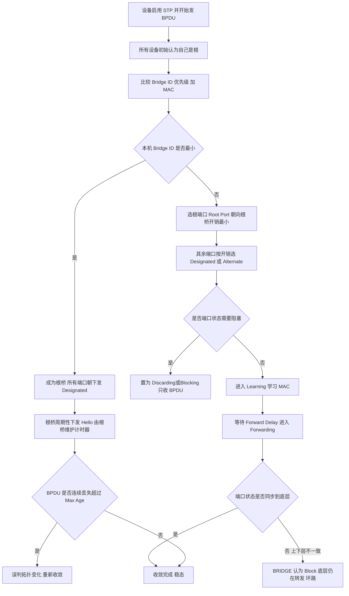
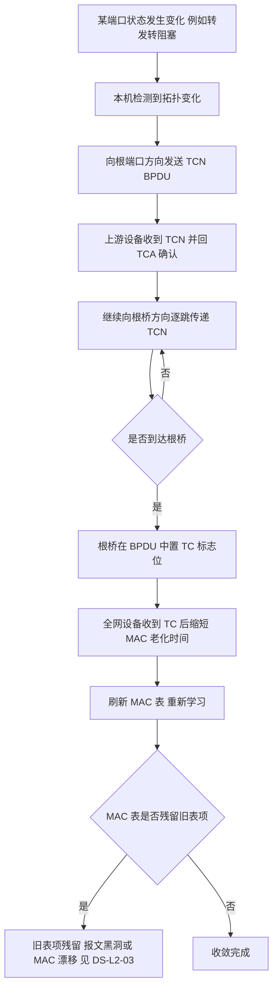
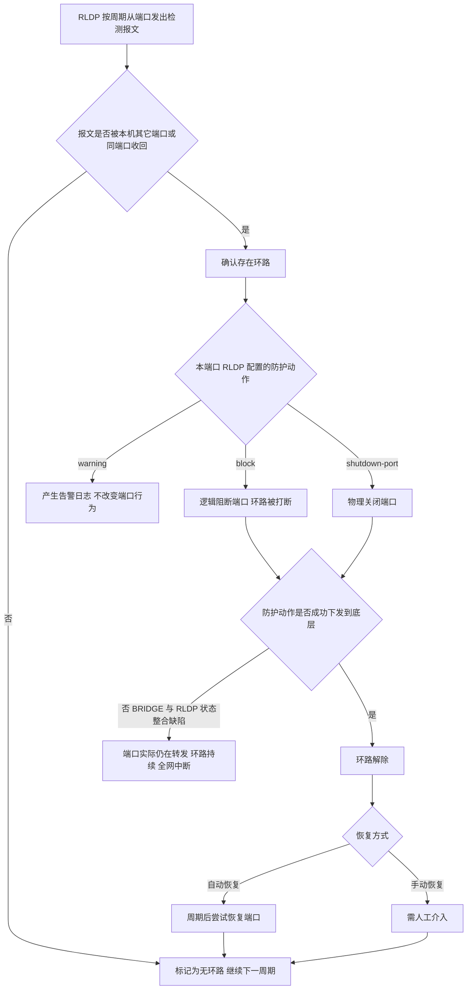
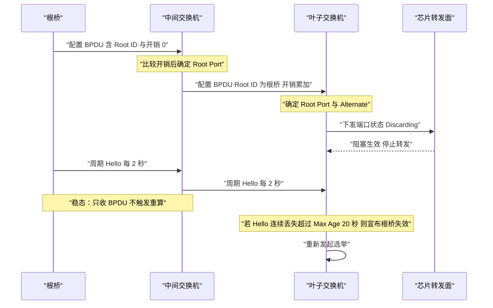
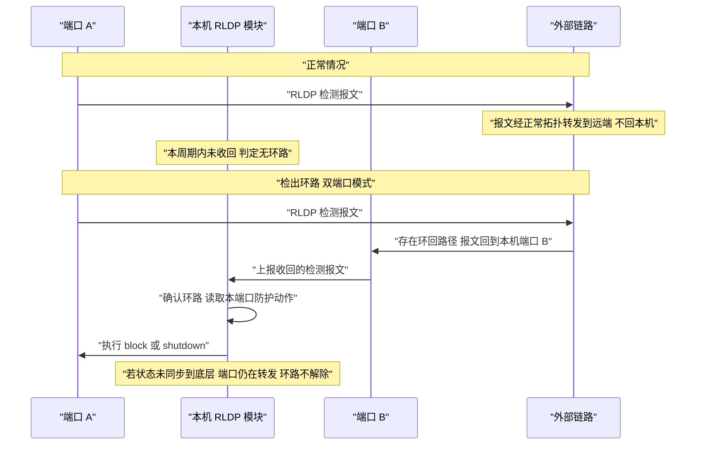
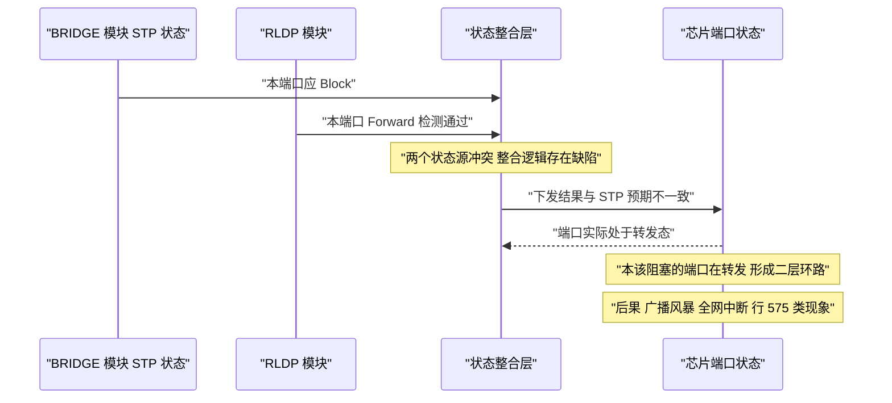

# STP / MSTP 与 RLDP 场景全景：描述 · 流程 · 涉及模块 · 监控点

> **大场景**：DS-L2（二层与环网）
> **文档版本**：v1.0（新增，尚未走两轮 AI 专家评审）
> **编制日期**：2026-09-24
> **上游依据**：`../03_二层与环网_场景拆解与RCA做法.md`（`DS-L2-04` `DS-L2-07`）
> **交叉引用**：`../../04_堆叠与虚拟化_场景拆解与RCA做法.md`（`DS-STACK`，分裂/切换触发的二层状态异常）
> **说明**：设备命令凡未经真机验证，一律标注「（待实机核对）」；本文不含未经证实的版本号、补丁号与品控 ID。

---

## 0. 一页速览

| 阶段/环节 | 关键动作 | 执行者 | 失败后的现象 |
|---|---|---|---|
| ① 选根桥 | 比较 Bridge ID（优先级 + MAC），最小者为根 | 控制面（BPDU 交互） | 根桥落在接入层→流量绕行、次优路径 |
| ② 定端口角色 | 按根路径开销选出 Root / Designated，其余 Alternate | 控制面 | 角色错→本该阻塞的端口在转发 |
| ③ 端口状态推进 | Discarding → Learning → Forwarding | BRIDGE 模块 + 芯片 | 状态未同步到底层→环路 |
| ④ 稳态维持 | 周期收发 BPDU（Hello 2s） | 控制面 | BPDU 中断→误判拓扑变化 |
| ⑤ 拓扑变化 | 发 TCN 上溯根桥，下发 TC 通知全网刷新 MAC 表 | 控制面 | 刷新失败→MAC 表残留、黑洞 |
| ⑥ RLDP 检测 | 周期发检测报文，看是否从本机其它端口回收 | RLDP 模块 | 检测报文被吞→环路检测不到 |
| ⑦ RLDP 防护 | 按配置执行 warning / block / shutdown | RLDP 模块 + 芯片 | 保护动作未下发→环路持续 |

**一句话本质**：STP 是"**用 BPDU 打一场选举，把拓扑剪成一棵无环树**"，它靠**收敛后的稳态**活着；RLDP 是"**主动发探测报文看信号会不会绕回来**"，它靠**检测周期**活着。两者不是替代关系而是互补：STP 管稳态、RLDP 管突发——**这也正是它们会互相打架的原因**：当 BRIDGE 模块同时维护 STP 的 Block 状态与 RLDP 的 Forward 状态，两个状态源一旦不一致，就会出现"STP 认为该阻塞、RLDP 认为可转发"或反过来的缝隙，环路就从这条缝隙里钻出来。

---

## 1. 定位与边界

### 1.1 一句话定义

- **STP（802.1D）**：通过在网桥间交换 **BPDU**，选举唯一根桥，并将非最优路径端口置为阻塞，从而把带环的物理拓扑逻辑上裁剪成一棵**无环的生成树**。
- **RSTP（802.1w）**：通过 **Proposal / Agreement 握手机制**与边缘端口概念，把收敛从"秒级等待计时器"压缩到"亚秒级协商"。
- **MSTP（802.1s）**：把 VLAN 映射到多个**实例（Instance）**，每个实例独立算一棵树，实现**按 VLAN 分流的多路径转发**；对外呈现为一棵公共树（CIST）。
- **RLDP（Rapid Link Detection Protocol）**：锐捷的**快速环路检测**机制。周期性地从端口发出检测报文，若报文从本机其它端口（或同端口）被收回，说明存在环路，随即按配置执行告警、阻断或关闭端口。**它不参与选树，只做检测与防护。**

### 1.2 在本大场景中的位置

- **承接**：STP 的阻塞决策最终体现为**端口状态**，而端口状态必须同步到芯片——这与《二层-VLAN与superVLAN-…》的表项下发链是同一个链路。
- **被触发**：STP/RLDP 状态由 `BRIDGE 模块`维护，同步到底层；状态不一致归 `DS-L2-07`（上下层 STP 状态不一致致 RS 报文未转发）；环路保护失效本身归 `DS-L2-04`。
- **与相邻大场景的咬合**：堆叠/VSU 分裂或主从切换会**触发**二层状态异常（如聚合下连口未收到 BPDU 被 block、RLDP 配置变化），这些记录归 `DS-L2-04`；而**分裂/切换本身**归 `DS-STACK`。
- **本篇对应子场景**：`DS-L2-04`（生成树/环路检测/环网保护异常）为主。

### 1.3 边界判据

**属于本篇：**

- 配置 DAD 未关闭 LLDP 导致环路日志误报。
- BRIDGE 模块整合 STP Block 与 RLDP Forward 状态逻辑缺陷，形成环路。
- RLDP 接口加入 AP（聚合口）被强制 shutdown，导致主从切换与配置变化。
- 堆叠分裂后，聚合下连口未收到 BPDU 被 block。
- ERPS 启机向 BRIDGE 申请 VLAN 超时，导致配置丢失。
- 描述符为"环路"，且能给出 STP / RLDP 状态证据的记录。

**不属于本篇、易误入（含典型反例）：**

- **典型反例·现象是环路、根因不在 STP/RLDP**：工单只写"环路引发全网中断"而**没有 STP / RLDP 状态证据**（既没 `show spanning-tree` 也没 `show rldp` 输出），根因与方案为空——这类**留作未归类待补诊断**，不要因为"现象是环路"就硬塞进本篇。本项目未归类清单中的行 596、845、846、859、794 均属此列。
- **典型反例·MAC 漂移**：上联口出现 MAC 漂移并"怀疑环路"，但若无 STP / RLDP 状态证据，失效点落在 MAC 学习机制，归 **`DS-L2-03`**。
- 分裂 / 主备切换**本身**的切换逻辑缺陷 → 归 `DS-STACK`（行 793、582 的二层状态部分才归本篇）。
- 纯聚合口 LACP 协商/显示异常 → 归 `DS-L2-06`；但"RLDP 接口加入 AP 被强制 shutdown"归本篇。
- ERPS 的**环网保护协议报文交互本身** → 本篇只收纳"启机向 BRIDGE 申请 VLAN 超时致配置丢失"这一条；其余 ERPS 机制本篇不展开。

---

## 2. 涉及模块

| 模块名 | 所属层 | 职责 | 与本技术的交互点 | 该模块失效时的典型现象 |
|---|---|---|---|---|
| BRIDGE 模块 | 设备侧控制面 | 维护 STP 实例、端口角色与状态 | STP 与 RLDP 状态的**整合点** | **状态整合缺陷→环路（`DS-L2-04`）** |
| BPDU 收发与上送 CPU | 控制面 + 转发面 | 收发 BPDU 并上送 CPU 处理 | 拓扑信息的载体 | BPDU 未收到→误 block / 分裂未察觉 |
| 端口状态同步（BRIDGE → SSA → SDK） | 控制面 → 转发面 | 把 Block/Learning/Forward 下发芯片 | 状态落地的唯一通道 | 上下层不一致→RS 未转发、仍转发（`DS-L2-07`） |
| RLDP 模块 | 设备侧控制面 | 周期发检测报文、判定环路、执行防护动作 | 与 BRIDGE 共管端口状态 | 检测不到环路、保护动作未生效 |
| 聚合（AP）模块 | 设备侧控制面 | 维护聚合口状态 | RLDP 接口加入 AP 后的交互 | 加入 AP 后被强制 shutdown（`DS-L2-04`） |
| DAD / LLDP | 设备侧控制面 | 防止双归接入成环 | 与 RLDP 的告警判定耦合 | DAD 未关 LLDP→环路日志误报（行 46） |
| ERPS 模块 | 设备侧控制面 | 环网保护 | 启机向 BRIDGE 申请 VLAN | 申请超时→配置丢失 |
| 堆叠 / VSU 模块 | 设备侧控制面 | 主备切换与分裂处理 | 切换后触发二层状态重算 | 分裂后下连口未收 BPDU 被 block |
| 芯片转发面 | 硬件 | 按端口状态执行转发与丢弃 | STP 状态的最终执行者 | 状态与表项不一致→环路 |
| APM 采集侧 | 平台侧 | 采集端口角色/状态、BPDU 计数、RLDP 状态 | 监控数据源 | 缺采集→环路无告警（第 8 节） |

**模块清单来源与置信度：**

- 来自本项目实证（高置信）：BRIDGE 模块整合 STP Block 与 RLDP Forward 状态逻辑缺陷（`DS-L2-04`）；DAD 未关闭 LLDP 致环路日志误报（行 46）；RLDP 接口加入 AP 被强制 shutdown 致主从切换配置变化（行 582）；堆叠分裂后聚合下连口未收到 BPDU 被 block（行 793）；ERPS 启机向 BRIDGE 申请 VLAN 超时致配置丢失。
- 通用命名推断（中置信）：`BPDU 上送 CPU`、`SSA / SDK` 的端口状态同步链为通用架构推断，具体命令以真机为准（待实机核对）。
- 不引入未经证实的进程名、版本号与补丁号。

---

## 3. 协议模型、报文与状态机

### 3.1 STP / RSTP / MSTP 差异

| 维度 | STP（802.1D） | RSTP（802.1w） | MSTP（802.1s） |
|---|---|---|---|
| 收敛方式 | 依赖计时器逐状态等待 | Proposal / Agreement 握手 | 握手 + 多实例并行 |
| 端口状态 | 5 态（Disabled/Blocking/Listening/Learning/Forwarding） | 3 态（Discarding/Learning/Forwarding） | 3 态（同 RSTP） |
| 端口角色 | Root / Designated | 增加 Alternate / Backup | 增加 Master 端口 |
| 多路径 | 不支持 | 不支持 | **支持（按实例分流）** |
| 边缘端口 | 无 | 有（PortFast 语义） | 有 |

### 3.2 BPDU 结构要点

| 字段 | 说明 | 为什么重要 |
|---|---|---|
| Root ID | 根桥的 Bridge ID | 直接决定谁是根，越小越优 |
| Root Path Cost | 到根桥的累计开销 | 决定端口角色 |
| Bridge ID | 本桥的优先级 + MAC | 优先级相同则比 MAC |
| Port ID | 发送端口标识 | 用于打破平局 |
| Timer 字段 | Hello / Max Age / Forward Delay | 由根桥下发，全网跟随根桥 |
| Flags / 类型 | 配置 BPDU 或 TCN BPDU | TCN 用于通知拓扑变化 |

> **BPDU 与 VLAN 的关系**：STP 的 BPDU 是**带 VLAN 标签**的（MSTP 下走 IST 实例）。因此"BPDU 收不到"既可能是 STP 配置问题，也可能是 **VLAN 未放行 / 标签解析异常**——这是"看似 STP 故障实为二层基础问题"的常见误判点。

### 3.3 端口状态机与角色

```
Disabled
  → Blocking（只收 BPDU，不学 MAC、不转发）
    → Listening（参与选举，仍不学 MAC、不转发）
      → Learning（开始学 MAC，仍不转发）
        → Forwarding（学习 + 转发）
```

**角色判定：** Root（朝向根桥）→ Designated（本段唯一转发口）→ Alternate / Backup（阻塞备用）。
**RSTP 简化后**：Discarding ←→ Learning ←→ Forwarding，Discarding 态下直接通过握手决定是否可进入转发。

### 3.4 MSTP 实例与 region

- 一个 MST region 由**三要素**唯一确定：**region name + revision level + VLAN 到实例的映射表**。
- 三要素中**任意一项不同**，两台设备就分属不同 region——跨 region 时 MSTP 退化为 CST，**"我配了 MSTP 但没按预期分流"多数出在这里**。
- **IST（实例 0）**总是存在，承载 CIST；其余实例按需配置。

### 3.5 RLDP 的两种检测模式与防护动作

| 模式 | 检测对象 | 原理 |
|---|---|---|
| **单端口环路检测** | 端口自身自环（本口发本口收） | 从端口发出检测报文，若从**同一端口**收回即为环路 |
| **双端口环路检测** | 两个端口之间成环 | 从端口 A 发出，若从**本机端口 B** 收回即为环路 |

| 防护动作 | 行为 | 适用场景 |
|---|---|---|
| warning | 仅告警，不改变端口行为 | 观察期、避免误伤 |
| block | 逻辑阻断该端口（不物理 down） | 常规防环 |
| shutdown-port | 物理关闭端口 | 强防护，需人工或自动恢复 |

- 检测周期、恢复方式（自动恢复 / 手动恢复）均为可配项（具体默认值**待实机核对**）。

### 3.6 STP 与 RLDP 的协同与冲突（本篇核心）

| 冲突点 | 机理 | 现象 |
|---|---|---|
| DAD 与 LLDP 耦合 | DAD 未关闭 LLDP 时，LLDP 报文被判为环路特征 | 环路日志**误报**（行 46） |
| BRIDGE 状态整合 | STP 的 Block 与 RLDP 的 Forward 两个状态源整合有缺陷 | **形成环路**（保护形同虚设） |
| RLDP 与聚合 | RLDP 接口加入 AP 后被强制 shutdown | 主从切换、配置变化（行 582） |
| STP 与堆叠分裂 | 分裂后聚合下连口收不到 BPDU | 端口被 block，业务中断（行 793） |
| ERPS 与 BRIDGE | 启机向 BRIDGE 申请 VLAN 超时 | ERPS 配置丢失 |

---

## 4. 流程图

### 4.1 STP 收敛流程（含失败分支）



### 4.2 拓扑变化（TCN）传播流程



### 4.3 RLDP 环路检测与防护流程



---

## 5. 数据流图

### 5.1 BPDU 交换与端口状态推进



### 5.2 RLDP 检测报文时序（正常 vs 检出环路）



### 5.3 STP 与 RLDP 状态整合异常致环路（`DS-L2-04` 核心）



---

## 6. 关键参数与定时器

| 参数 | 默认值 | 配错的后果 |
|---|---|---|
| Hello Time | 2 秒 | 调大→故障发现变慢；调小→报文开销上升 |
| Max Age | 20 秒 | 小于 2×Hello→BPDU 抖动即误判拓扑变化 |
| Forward Delay | 15 秒 | 调小→未学完 MAC 就转发，瞬时泛洪 |
| Bridge Priority | 32768（视机型） | 未规划→根桥落在接入层，流量绕行 |
| 端口开销（Cost） | 按速率自动 | 手工配错→选错路径 |
| 端口优先级 | 128 | 平局时选错转发口 |
| MST region 三要素 | name + revision + VLAN 映射 | 任一不同→跨 region 退化，MSTP 分流失效 |
| RLDP 检测周期 | （待实机核对） | 周期过长→环路持续更久 |
| RLDP 防护动作 | （待实机核对） | 配 warning→只告警不阻断，环路仍在 |
| DAD 与 LLDP | DAD 需关闭 LLDP 联检 | 未关闭→环路日志误报（行 46） |

> **计时器纪律**：Hello / Max Age / Forward Delay 是**由根桥统一下发**的，非根桥上的配置不起作用——调优必须调在根桥。

---

## 7. 常见故障模式与分阶段定位

| 故障模式 | 现象 | 定位阶段 | 关键判据 |
|---|---|---|---|
| 环路日志误报 | LLDP 告警 DAD 端口存在环路 | ⑥ 检测环节 | DAD 是否与 LLDP 联检（行 46） |
| 状态整合缺陷致环路 | 环路引发全网中断 | ⑦ 防护环节 | STP 状态与 RLDP 状态是否冲突（行 575） |
| 主从切换后 RLDP 异常 | RLDP 配置变化 | 触发环节 | 切换前后配置比对（行 582） |
| 分裂后端口被 block | 聚合下连口未收到 BPDU 被 block | ④ 稳态环节 | 分裂后 BPDU 收发是否中断（行 793） |
| ERPS 配置丢失 | 启机后 ERPS 配置消失 | 启动环节 | 向 BRIDGE 申请 VLAN 是否超时 |
| 上下层状态不一致 | RS 报文未转发 | 端口状态同步 | CLI 与底层状态比对（`DS-L2-07`） |
| MSTP 分流不生效 | 配了 MSTP 但流量未按实例分流 | 配置环节 | region 三要素是否一致 |
| 环路无状态证据 | 仅描述"环路引发全网中断" | — | **缺诊断证据，留未归类待补** |

**成功 vs 失败对比要点**：本篇的成功定位**必须同时拿出 `show spanning-tree` 的端口角色/状态 与 `show rldp` 的检测结果**，两者一致才能排除"状态整合缺陷"。只有症状描述（"环路"、"全网中断"）而无这两份输出的工单，本项目统一留在未归类清单——这是本场景**未归类率偏高（11 条中环路/生成树类占多数）**的直接原因。

---

## 8. 监控点（APM 可观测性映射）

| 观测点 | 观测对象 | 数据源 | 采集方式 | 阈值 / 触发条件 | 现状 | 优先级 |
|---|---|---|---|---|---|---|
| 端口角色与状态 | 每个实例下各端口的角色/状态 | VictoriaMetrics | CLI 定时采集 | 端口角色发生非预期变化即告警 | 部分（命令可得但缺持续采集） | P0 |
| Block 端口转发异常 | Block 端口的实际转发状态 | Loki + MySQL | CLI 定时采集 | 判定为 Block 但仍有转发流量即告警（环路直接前兆） | 缺失 | P0 |
| BPDU 收发计数 | 各端口 BPDU 收发计数 | VictoriaMetrics | SNMP 轮询 | 收发计数长期为 0 或突降即告警 | 缺失 | P0 |
| 拓扑变化次数 | TCN 触发次数 | VictoriaMetrics | CLI 定时采集 | 单位时间内 TCN 次数突增即告警 | 缺失 | P0 |
| RLDP 检测结果 | RLDP 环路检出与防护动作 | Loki | Syslog-Trap 订阅 | 出现环路检出日志即告警（按防护动作分级） | 部分 | P0 |
| STP 与 RLDP 状态一致性 | 两模块对同一端口的判定 | MySQL | CLI 定时采集 | 同一端口两模块判定冲突即告警 | 缺失 | P1 |
| 根桥归属 | 当前根桥与本机优先级 | MySQL | CLI 定时采集 | 根桥落在非预期设备即告警 | 缺失 | P1 |
| MST region 一致性 | name / revision / VLAN 映射 | MySQL | CLI 定时采集 | 同一域内三要素不一致即告警 | 缺失 | P1 |
| 环路告警风暴 | 环路类日志数量 | Loki | Syslog-Trap 订阅 | 单位时间环路告警数突增即告警 | 部分 | P1 |

> **落地口径**：BPDU 收发**计数**可由设备命令获得，但"命中的是哪条 BPDU、哪个字段导致判定"镜像与芯片内部均不可得；本表全部观测点走 CLI、SNMP 与日志。加密通道之上的语义不依赖镜像抓包。

---

## 9. 排查动作步骤（按序执行）

| 步 | 动作 | 命令 / 观测点 | 判读 |
|---:|---|---|---|
| 1 | 看端口角色与状态 | `show spanning-tree` | 是否有端口处于 Block；角色分配是否合理 |
| 2 | 看拓扑变化与 BPDU 日志 | `show logging`（过滤 BPDU / 环路关键字） | 是否有持续 TCN、BPDU 是否中断 |
| 3 | 看 RLDP 状态与防护动作 | `show rldp` | 是否检出环路、防护动作是否已生效 |
| 4 | 核对 DAD 与 LLDP 配置 | `show running-config` 中 DAD / LLDP 相关 | 是否因未关闭 LLDP 造成误报（行 46） |
| 5 | 比对 STP 与 RLDP 对同一端口的判定 | 两份输出交叉比对 | **两者冲突即命中状态整合缺陷（行 575）** |
| 6 | 比对 CLI 与底层端口状态 | 诊断命令比对上下层 | 是否上下层不一致（`DS-L2-07`） |
| 7 | 检查堆叠 / VSU 分裂与切换记录 | 切换日志、成员状态 | 分裂后下连口是否丢失 BPDU（行 793、582） |
| 8 | 检查 ERPS | `show erps` | 启机申请 VLAN 是否超时、配置是否丢失 |
| 9 | 核对 MST region | `show spanning-tree mst configuration`（待实机核对） | 三要素是否一致 |
| 10 | 升级 / 规避 | 官方发布的最新正式版 | 命中已知缺陷则升级 |

---

## 10. 与本项目已知故障的对应

| 子场景 | 现象 | 典型记录（Sheet8 行） |
|---|---|---|
| `DS-L2-04` | LLDP 告警 DAD 端口存在环路（S5700V2-l） | 46 |
| `DS-L2-04` | 顺丰 572W 场地 S5310E 环路引发全网中断 | 575 |
| `DS-L2-04` | 建行四川省分行 S7808C-X 主从切换后 RLDP 配置变化 | 582 |
| `DS-L2-04` | 分裂/切换触发的 STP / LACP / RLDP 二层状态异常 | 793 |
| `DS-L2-04` | 协议状态不一致类 | 885、888 |
| `DS-L2-07` | 上下层 STP 状态不一致致 RS 报文未转发 | 相关行见该子场景 |
| 未归类（缺机理） | 核心环路引发全网中断，根因与方案为空 | 596 |
| 未归类（缺机理） | 生成树超时与 VSU 异常主备切换 | 845 |
| 未归类（缺机理） | 设备报 RLDP 环路但无配置（仅提版本升级） | 846 |
| 未归类（缺机理） | MSTP 接口被阻塞仍转发数据流量导致环路 | 859 |
| 未归类（缺机理） | 彩光 S2920U 当前版本无法防止环路需升级 | 794 |

---

## 11. 待确认事项

| 编号 | 问题 | 建议问谁 |
|---|---|---|
| `Q-L2-05` | 未归类 11 条（环路 / DHCP / 生成树无机理）中，哪些其实可归结为已知表项或 STP 根因但需要现场补诊断？现场必须采集哪几条命令？ | TAC / 二线定位团队 |
| `Q-L2-STP-01` | BRIDGE 模块整合 STP Block 与 RLDP Forward 状态的缺陷，修复版本是哪个？（行 575 类是否已根治） | BRIDGE / L2 转发模块研发 |
| `Q-L2-STP-02` | RLDP 的默认检测周期、防护动作默认值、恢复方式的出厂配置？（待实机核对） | RLDP 模块研发 / TAC |
| `Q-L2-STP-03` | RLDP 接口加入聚合（AP）后被强制 shutdown 是设计行为还是缺陷？（行 582） | L2 转发 / 聚合模块研发 |

---

## 12. AI 专家评审记录摘要

本篇为二层系列**新增文档（v1.0）**，尚未走两轮 AI 专家评审流程。待与《二层-VLAN与superVLAN-…》《二层-QinQ与VLAN标签解析-…》《二层-ACL与VLANCLASS-…》三篇一并送审。

---

## 附：术语速查

| 缩写 | 全称 | 说明 |
|---|---|---|
| STP | Spanning Tree Protocol | 802.1D 生成树 |
| RSTP | Rapid STP | 802.1w 快速生成树 |
| MSTP | Multiple STP | 802.1s 多实例生成树 |
| BPDU | Bridge Protocol Data Unit | 网桥协议数据单元，STP 的报文载体 |
| TCN | Topology Change Notification | 拓扑变化通知 |
| IST / CIST | Internal / Common Spanning Tree | MSTP 的实例 0 与公共树 |
| RLDP | Rapid Link Detection Protocol | 锐捷快速环路检测 |
| DAD | 双归接入检测机制 | 防止双归接入成环，与 LLDP 耦合 |
| ERPS | Ethernet Ring Protection Switching | 以太环网保护 |
| Block | 阻塞状态 | 只收 BPDU，不学习不转发 |
| Forwarding | 转发状态 | 学习 + 转发 |
