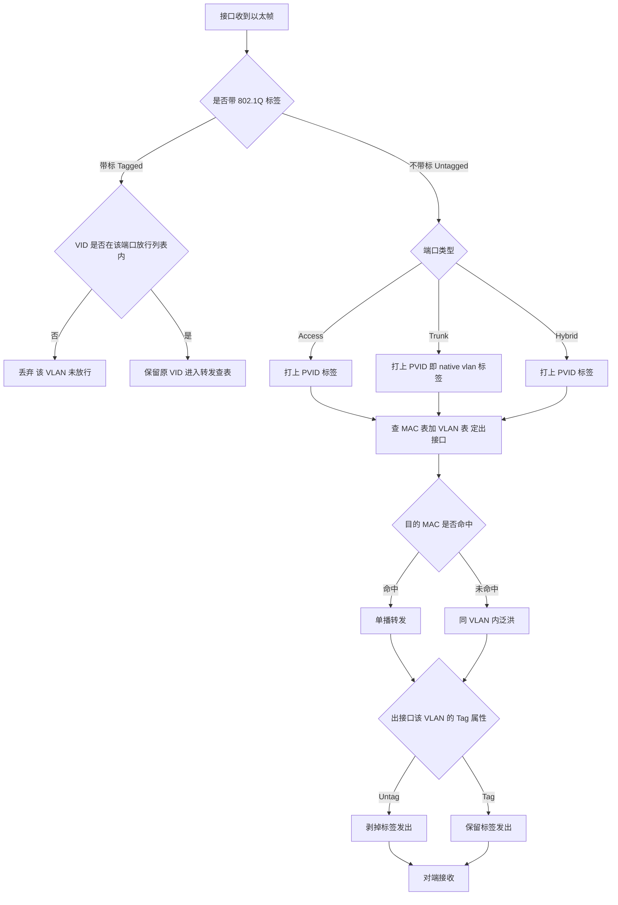
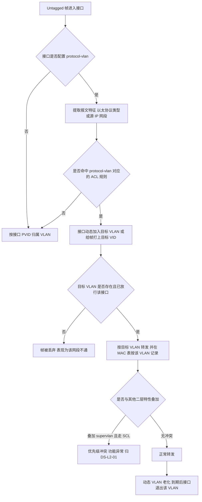
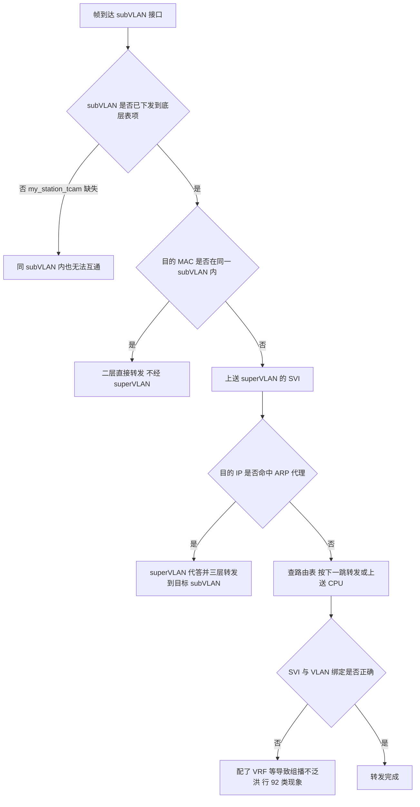
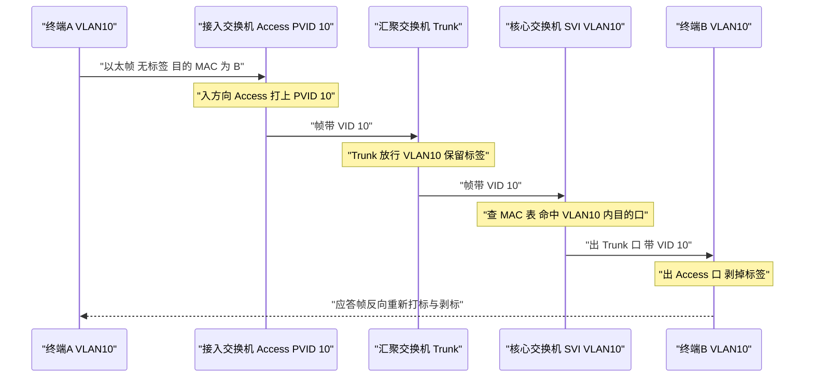
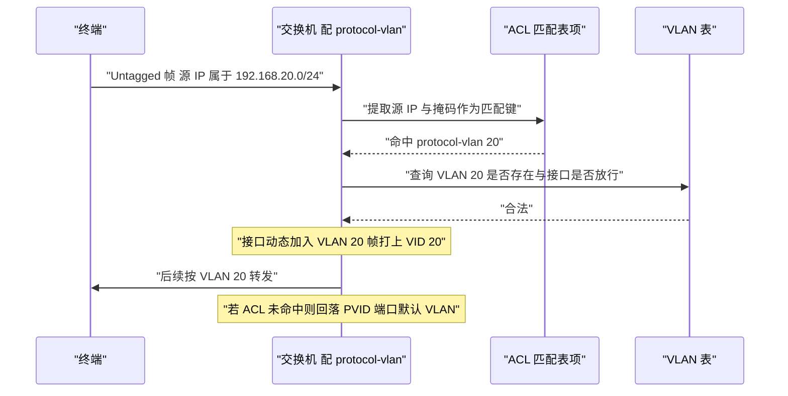
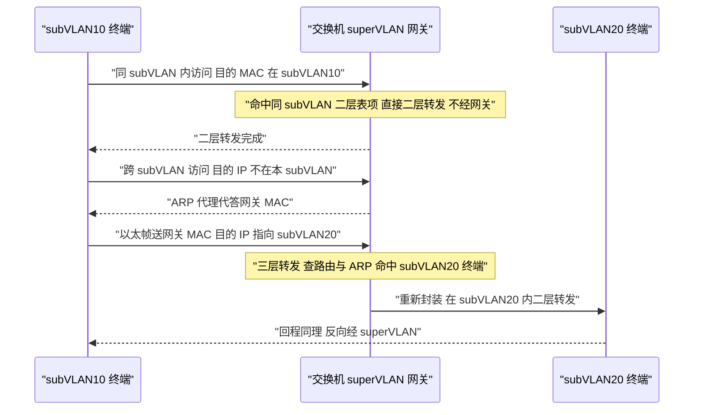

# VLAN 与 superVLAN 场景全景：描述 · 流程 · 涉及模块 · 监控点

> **大场景**：DS-L2（二层与环网）
> **文档版本**：v1.0（新增，尚未走两轮 AI 专家评审）
> **编制日期**：2026-09-24
> **上游依据**：`../03_二层与环网_场景拆解与RCA做法.md`（`DS-L2-01` `DS-L2-07` `DS-L2-09`）
> **说明**：设备命令凡未经真机验证，一律标注「（待实机核对）」；本文不含未经证实的版本号、补丁号与品控 ID。

---

## 0. 一页速览

| 阶段/环节 | 关键动作 | 执行者 | 失败后的现象 |
|---|---|---|---|
| ① 建 VLAN | 分配 VID、命名、确定是普通 VLAN 还是协议/super VLAN | 配置层 | VID 未创建→接口放行也无效 |
| ② 定端口属性 | 设 Access/Trunk/Hybrid 与 PVID（native vlan） | 端口层 | PVID 配错→终端进错 VLAN |
| ③ 入方向打标 | Untagged 打 PVID；Tagged 按放行表校验 | 芯片转发面 | 标签解析错→非 vlan1 网段不通 |
| ④ 表项下发 | VLAN 表 / 端口 bitmap / my_station_tcam 下发芯片 | VLAN 管理 → SSA → SDK | 表项未下发或残留→同 VLAN 内也不通 |
| ⑤ 转发决策 | 查 MAC 表 + VLAN 表定出接口 | 芯片转发面 | MAC/VLAN 不一致→泛洪或丢弃 |
| ⑥ 出方向剥标 | 按出接口 Tag/Untag 属性处理 | 芯片转发面 | 剥标规则错→对端收不到 |
| ⑦ 三层（super VLAN） | 跨 subVLAN 走 superVLAN 的 SVI + ARP 代理 | 控制面 + 转发面 | ARP 代理失效→跨 subVLAN 不通 |

**一句话本质**：VLAN 的本质是**在共享的二层介质上，用 12 bit 的 VID 把一个物理拓扑切成若干互不可见的广播域**；端口属性（PVID / Tag / Untag）决定**谁在进出的哪一侧被贴上或撕掉标签**。superVLAN 则是在这之上加一层"公共网关"——**subVLAN 之间二层隔离，靠 superVLAN 的 SVI 做三层互通**。这条链上任何一环（配置、标签、表项、代理）断掉，表现都是"不通"，但排查入口完全不同——这是本技术最容易误判的地方。

---

## 1. 定位与边界

### 1.1 一句话定义

- **VLAN（Virtual LAN）**：基于 IEEE 802.1Q 的虚拟局域网，用报文内的 VID 字段把交换机端口逻辑分组，同 VLAN 内二层互通、跨 VLAN 必须经三层。端口的收发行为由**端口类型（Access / Trunk / Hybrid）+ PVID + 放行列表**共同决定。
- **协议 VLAN（protocol-vlan）**：不按端口静态划分，而是**按报文特征（以太协议类型 / IP 子网）动态把接口划入 VLAN**，匹配依赖 ACL。
- **superVLAN / subVLAN**：superVLAN 是只提供**三层网关**的逻辑 VLAN，其下挂若干 subVLAN；**subVLAN 之间二层隔离，跨 subVLAN 通信必须经 superVLAN 的 SVI 转发**（同 subVLAN 内仍走二层）。匹配走 SCL，与 protocol-vlan 的 ACL 路径不同。

### 1.2 在本大场景中的位置

- **承接**：本篇是 DS-L2 的入口技术。VLAN 是 MAC 表、ACL/VLAN CLASS、QinQ、STP 的**公共载体**——其它二层特性都挂在 VLAN 上生效。
- **被触发**：VLAN 表项经 `VLAN 管理 → SSA → SDK` 下发芯片；异常时归 `DS-L2-07`（表项未下发/残留）；配置在重启/EMB 操作下丢失归 `DS-L2-09`；功能叠加冲突（protocol-vlan vs superVLAN）归 `DS-L2-01`。
- **本篇对应子场景**：`DS-L2-01`（协议VLAN / IP 子网 VLAN / superVLAN 功能不生效）为主，交叉 `DS-L2-07`、`DS-L2-09`。

### 1.3 边界判据

**属于本篇：**

- 802.1Q 标签结构、端口类型（Access / Trunk / Hybrid）收发规则、PVID / native VLAN 行为。
- 普通业务 VLAN 建了不生效、只有 vlan1 通、VLAN 接口 IPv6 掩码配置报错。
- 协议 VLAN / IP 子网 VLAN 配置后不按预期打标或不通信；协议 VLAN 与友商设备不互通。
- superVLAN / subVLAN 互通异常、与 protocol-vlan 的优先级冲突（ACL 匹配 vs SCL 匹配）。
- VLAN / CE-VLAN 配置在重启、模块混用、ZCM 场景下丢失或未下发。

**不属于本篇、易误入（含典型反例）：**

- **典型反例·现象像 VLAN、根因不在 VLAN**：非 vlan1 网段不通，排查发现设备是 5300-L 系列、万兆光口插千兆模块降速工作，根因是**芯片把 outer tag 当成 inner tag 解析**——机理是标签解析而非 VLAN 配置，**归 `DS-L2-02` 而非本篇**。正确动作：先 `show interface GigabitEthernet 0/1` 看实际速率是否降速，再去查 VLAN 配置。
- 灵活 QINQ / vlan mapping 的资源耗尽（芯片 range 资源总数 64）→ 归 `DS-L2-10`。
- 二层 ACL / VLAN CLASS 的匹配与残留（classid 冲突、acl_label mask）→ 归 `DS-L2-05`（见《二层-ACL与VLANCLASS-…》）。
- 三层路由不通、VRF、静态路由 → 归 `DS-L3`；本篇只收纳"VLAN/SVI 引发的二层表象"。
- DHCP 地址分配协议交互本身（DORA / lease）→ 归 `EXT-DHCP`；本篇只收纳"VLAN/表项导致 DHCP 不通的表象"。
- MAC 学习/老化/漂移本身 → 归 `DS-L2-03`。

---

## 2. 涉及模块

| 模块名 | 所属层 | 职责 | 与本技术的交互点 | 该模块失效时的典型现象 |
|---|---|---|---|---|
| VLAN 管理模块 | 设备侧控制面 | 维护 VLAN 表、端口成员关系、super/sub 关系 | VLAN 创建、增删、成员变更的唯一权威 | VLAN 建了不生效、supervlan/subvlan 关系错乱 |
| 端口属性与 PVID 管理 | 设备侧控制面 | 维护端口类型、PVID、Tag/Untag 属性 | 决定入方向打标与出方向剥标 | PVID 配错→终端进错 VLAN；剥标错→对端收不到 |
| 协议 VLAN 匹配引擎 | 设备侧控制面 | 按以太类型/IP 子网匹配，动态划接口入 VLAN | 复用 ACL 表项做匹配 | 协议 VLAN 不生效（`DS-L2-01`，行 173、252） |
| superVLAN / subVLAN 与 ARP 代理 | 设备侧控制面 | superVLAN 的 SVI、subVLAN 归属、ARP 代理 | 跨 subVLAN 三层互通 | 跨 subVLAN 不通、ARP 学不到（行 94） |
| 二层表项下发（my_station_tcam / VLAN 表） | 设备侧转发面软件 | 把 VLAN 与端口 bitmap 写入芯片 | 配置→表项的落地环节 | subVLAN 未下发→同 subVLAN 内也不通（`DS-L2-07`） |
| SSA / SDK 适配层 | 设备侧转发面软件 | 上承 CLI/配置库，下承芯片驱动 | 上下层状态一致性 | CLI/SSA/SDK 三层不一致→配置显示对但不通 |
| 芯片转发面（VLAN 表 / MAC 表 / TCAM） | 硬件 | 打标、查表、转发、剥标 | 实际数据面执行 | 标签解析错、表项残留、转发丢包 |
| EMB / Web（eWeb）配置通道 | 设备侧管理面 | 页面下发 VLAN 与模板 | 配置下发路径 | 模板缺 native vlan→下发卡住；配置被清空（`DS-L2-09`，行 619、762、772） |
| CLI / SNMP / sFlow | 设备侧管理面 | 配置与观测入口 | 排查与采集 | OID 不支持、sFlow 缺 vlan_id（`DS-L2-09`） |
| APM 采集侧（Telemetry / 轮询） | 平台侧 | 采集 VLAN 与表项状态 | 监控数据源 | 缺采集→VLAN 表项不一致无告警（第 8 节） |

**模块清单来源与置信度：**

- 来自本项目实证（高置信）：`my_station_tcam` 为 supervlan subvlan 未下发底层的观测对象（`DS-L2-07`，行 94）；EMB 模板缺 native vlan 致下发卡住、WEB/EMB 创建地址池清空接口配置（`DS-L2-09`，行 619、762、772）；协议 VLAN 不生效（行 173、252）、只有 vlan1 通（行 655）。
- 通用命名推断（中置信）：`VLAN 管理模块`、`协议 VLAN 匹配引擎`、`SSA / SDK` 为二层通用架构推断，具体进程名与命令以真机为准（待实机核对）。
- 不引入未经证实的进程名、版本号与补丁号。

---

## 3. 协议栈、标签结构与配置模型

### 3.1 802.1Q 标签结构（字段级）

插入在以太帧源 MAC 之后的 4 字节：

| 字段 | 长度 | 含义 | 与本项目的关系 |
|---|---|---|---|
| TPID | 16 bit | 标签协议标识，普通 802.1Q 为 `0x8100`，QinQ 外层常用 `0x88A8` | TPID 配错→对端不识标签（见《二层-QinQ与VLAN标签解析-…》） |
| PCP | 3 bit | 优先级，用于 QoS | 与本篇无强关联 |
| DEI / CFI | 1 bit | 丢弃资格 | 与本篇无强关联 |
| VID | 12 bit | 取值 0–4095；0 表优先级标签，4095 保留 | 业务 VLAN 范围与 vlan1 的特殊地位即由此而来 |

> **vlan1 的特殊性**：vlan1 是默认 VLAN，几乎所有端口默认放行。这解释了为什么"**只有 vlan1 能通、其他 VLAN 都不通**"是一个高频现象——它通常不是 vlan1 特别，而是**其它 VLAN 的标签在链路某处被误处理或未下发**（行 655、530）。

### 3.2 端口类型与收发规则（Access / Trunk / Hybrid）

| 端口类型 | 入方向·Untagged 帧 | 入方向·Tagged 帧 | 出方向 | 典型用途 |
|---|---|---|---|---|
| **Access** | 打上 PVID 标签 | **丢弃**（不接收带标帧） | 若 VID 等于 PVID 则剥标发出，否则丢弃 | 接终端 |
| **Trunk** | 打上 PVID（native vlan）标签 | 校验 VID 是否在放行列表，不在则丢弃 | 放行列表内除 native vlan 外**带标发出**；native vlan 剥标 | 交换机级联 |
| **Hybrid** | 打上 PVID 标签 | 校验 VID 是否在放行列表 | **按每个 VLAN 的 Tag/Untag 属性逐 VLAN 决定**是否剥标 | 一端口多用途 |

> 关键区分：**Trunk 的剥标规则是"native vlan 剥、其余带标"这一条固定规则；Hybrid 是"逐 VLAN 可配"**。Hybrid 灵活性高，也更容易配出自相矛盾的 Tag/Untag 组合。

### 3.3 PVID 与 native VLAN

- **PVID** 是端口的"默认 VLAN"，只作用于**入方向的 Untagged 帧**；Trunk 口上 PVID 对应的 VLAN 即 native VLAN。
- 两端 Trunk 互联时，**若两侧 native VLAN 不一致**，带标流量不受影响，但不带标流量会落到不同 VLAN ——这是"部分网段通、部分网段不通"的经典成因。
- 在 5300-L 降速场景中，native vlan 1 时 VLAN 310 不通（行 530）的现象，机制上归 `DS-L2-02` 标签解析，但**排查入口仍在 native VLAN 配置与端口速率**，故本篇保留该判据入口。

### 3.4 协议 VLAN 的匹配模型

- 匹配**不是**按端口，而是按**报文特征**：以太协议类型（如 IP / IPX / AppleTalk）或 **IP 子网（源 IP + 掩码）**。
- 匹配动作依赖 **ACL** 表项：配置协议 VLAN 后，系统把"特征匹配"编译为 ACL 规则下发芯片；命中后把接口**动态加入**目标 VLAN（或对报文打上目标 VID，视实现而定）。
- 因此协议 VLAN 的生效**强耦合 ACL 表项资源与下发路径**，与《二层-ACL与VLANCLASS-…》是交叉关系。

### 3.5 superVLAN / subVLAN 模型

- **superVLAN**：只有一个逻辑三层接口（SVI），作为下属所有 subVLAN 的**公共网关**。
- **subVLAN**：真正的二层隔离域。**同 subVLAN 内二层直接互通；跨 subVLAN 必须经 superVLAN 的三层转发。**
- **ARP 代理**是 superVLAN 的关键机制：终端对网关发 ARP，由 superVLAN 代答；终端之间跨 subVLAN 通信时，superVLAN 做三层转发。
- **匹配走 SCL**，与 protocol-vlan 走 ACL 是两条不同路径——**两者叠加时优先级冲突**是本篇最典型的疑难场景。

### 3.6 表项下发链（必须画进流程图）

```
CLI / EMB / Web 配置
  → 配置库（running-config）
  → VLAN 管理模块（VLAN 表 + 端口成员关系 + super/sub 关系）
  → SSA（上下层状态转换）
  → SDK（芯片驱动适配）
  → 芯片（VLAN 表 / 端口 bitmap / my_station_tcam）
```

- **任一层断裂**：CLI 显示配置正确，但业务不通——这是 `DS-L2-07` 的核心机理（表项未下发/残留）。
- 排查纪律：**不能只看 `show running-config`**，必须比对底层表项（`show l2-table`，待实机核对）。

---

## 4. 流程图

### 4.1 VLAN 入方向处理流程（含失败分支）



### 4.2 协议 VLAN 动态划分流程



### 4.3 superVLAN 转发判定流程



---

## 5. 数据流图

### 5.1 普通 VLAN：终端到终端的标签状态流转



**对应报文标签状态表：**

| 位置 | 报文形态 | 说明 |
|---|---|---|
| 终端→接入口 | 无标签 | 终端通常不打标 |
| 接入口→汇聚口 | VID=10 | 入方向打 PVID |
| 汇聚→核心 | VID=10 | Trunk 保留标签 |
| 核心→终端侧接入口 | VID=10 | 核心不剥标，由最后一跳处理 |
| 出 Access 口→终端 | 无标签 | 出方向剥标 |

### 5.2 协议 VLAN 数据流



### 5.3 superVLAN 数据流：同 subVLAN 与跨 subVLAN 对比



---

## 6. 关键参数与配置项

| 参数/配置项 | 默认值/范围 | 配错的后果 |
|---|---|---|
| VID 范围 | 1–4094（0 与 4095 保留） | 越界或占用保留值→配置报错 |
| vlan1 | 默认存在、默认放行 | 表现为"只有 vlan1 通"的假象 |
| 端口 PVID | 默认 1 | 配错→终端整体进错 VLAN，全网症状一致 |
| 端口类型 | 默认 Access（视机型） | 级联口误配 Access→带标帧被丢 |
| Trunk 放行列表 | 需显式添加 | 漏放行→该 VLAN 在链路上静默丢弃 |
| native VLAN 一致性 | 链路两端需一致 | 不一致→不带标流量落到不同 VLAN |
| protocol-vlan 匹配特征 | 以太协议类型 / IP+掩码 | 掩码写错→匹配范围过大或命中不到 |
| supervlan 与 protocol-vlan 叠加 | 匹配路径不同（SCL vs ACL） | 优先级冲突→subVLAN 间不通（`DS-L2-01`） |
| VLAN 接口 IPv6 掩码 | 需与规范一致 | 配置直接报错（`DS-L2-01` 典型现象之一） |

---

## 7. 常见故障模式与分阶段定位

| 故障模式 | 现象 | 定位阶段 | 关键判据 |
|---|---|---|---|
| 协议 VLAN 不生效 | 配了协议 VLAN 但终端不进该 VLAN | ③ 匹配环节 | ACL 表项是否下发、匹配特征是否命中（行 173、252） |
| 只有 vlan1 通 | 其他业务 VLAN 全不通 | ③ 标签环节 | 先排除降速标签解析（`DS-L2-02`）再查放行列表与表项 |
| supervlan/subvlan 不通 | subVLAN 下设备与 superVLAN 不互通 | ④ 表项环节 | `my_station_tcam` 是否下发（行 94） |
| 配置丢失 | 重启或 WEB 操作后 VLAN 配置消失 | ⑤ 持久化环节 | running-config 与 startup-config 比对（行 153） |
| 下发卡住 | 设备持续停留在"下发配置中" | ⑤ 下发通道 | EMB 模板是否缺 native vlan（行 369 类） |
| 表项上下层不一致 | CLI 显示正确但业务不通 | ④ 表项环节 | CLI / SSA / SDK 三层比对 |

**成功 vs 失败对比要点**：成功定位的工单都能给出**表项级证据**（`my_station_tcam` 未下发 / ACL 未命中）或**版本缺陷对照**；失败的多为只描述"不通"而没做上下层一致性比对。

---

## 8. 监控点（APM 可观测性映射）

| 观测点 | 观测对象 | 数据源 | 采集方式 | 阈值 / 触发条件 | 现状 | 优先级 |
|---|---|---|---|---|---|---|
| VLAN 配置与运行态一致 | VLAN 表 / 端口成员 / PVID | MySQL | CLI 定时采集 | running-config 与 `show vlan` 存在差异即告警 | 部分（命令可得但缺持续采集） | P0 |
| 二层表项上下层一致性 | VLAN 表项与 my_station_tcam | Loki + MySQL | CLI 定时采集 | 表项缺失/残留即告警 | 缺失 | P0 |
| 配置持久化 | running-config 快照 | MySQL | CLI 定时采集 | 重启/升级前后快照存在差异即告警 | 缺失 | P1 |
| 协议 VLAN 匹配命中 | protocol-vlan 配置与 ACL 计数 | VictoriaMetrics | CLI 定时采集 | 配置存在但命中计数长期为 0 即告警 | 缺失 | P1 |
| super/sub VLAN 关系完整性 | superVLAN 与 subVLAN 归属 | MySQL | CLI 定时采集 | 存在 subVLAN 未下发即告警 | 缺失 | P1 |
| 端口降速与 native VLAN 组合 | 端口实际速率 + native vlan | VictoriaMetrics | SNMP 轮询 | 万兆口运行于千兆且 native vlan 非 1 即告警 | 缺失 | P0 |
| 配置下发失败事件 | EMB 下发日志 | Loki | Syslog-Trap 订阅 | 出现下发超时/模板缺失关键字即告警 | 部分 | P1 |

> **落地口径**：加密通道（HTTPS/SSH）之上的业务语义不可经镜像抓包获得；上表全部观测点均走设备侧命令、SNMP 与日志，不依赖镜像。

---

## 9. 排查动作步骤（按序执行）

| 步 | 动作 | 命令 / 观测点 | 判读 |
|---:|---|---|---|
| 1 | 确认故障范围与 VLAN 归属 | `show vlan` / `show vlan brief` | 是单 VLAN 还是全 VLAN；是否"只有 vlan1 通" |
| 2 | 确认端口类型与 PVID | `show interface GigabitEthernet 0/1 switchport`（待实机核对） | 端口类型、PVID、放行列表是否符合设计 |
| 3 | 确认端口实际速率 | `show interface GigabitEthernet 0/1` | **先排除降速标签解析**（万兆口跑千兆） |
| 4 | 比对配置与运行态 | `show running-config` vs `show vlan` | 配置是否存在、是否丢失 |
| 5 | 查底层表项 | `show l2-table`（待实机核对）/ `diagnose` 查 my_station_tcam | 表项是否下发、是否残留 |
| 6 | 查协议 VLAN 匹配 | `show protocol-vlan` / `show running-config \| include protocol-vlan` | 绑定是否存在、特征是否命中 |
| 7 | 查 super/sub 关系 | `show vlan private-map` / `show vlan` | subVLAN 是否齐全、与 protocol-vlan 是否叠加冲突 |
| 8 | 查配置下发通道 | EMB 数据库 native vlan / 模板完整性 | 是否卡在下发 |
| 9 | 升级或规避 | 已知 BUG 列表 / `show version` | 命中已知缺陷则升级；降速场景改万兆速率或空配启机 |

---

## 10. 与本项目已知故障的对应

| 子场景 | 现象 | 典型记录（Sheet8 行） |
|---|---|---|
| `DS-L2-01` | 协议 VLAN 不生效 | 173（RG-S2910V2-24GT4XS-L）、252（RG-S5310-48GT4XS-E） |
| `DS-L2-01` | 只有 vlan1 通，其他 VLAN 都不通 | 655（RG-S5300-48GT4XS-P-L） |
| `DS-L2-07` | subVLAN 下设备不能与 superVLAN 互通 | 94（RG-N18012） |
| `DS-L2-09` | VLAN 配置丢失 | 153（晋兴职院 S5760X） |
| `DS-L2-09` | option43 默认 vlan1 下发异常 | 369 |
| `DS-L2-02`（边界样例） | native vlan 1 时 VLAN310 不通 | 530（RG-S5300-48GT4XS-P-L） |

---

## 11. 待确认事项

| 编号 | 问题 | 建议问谁 |
|---|---|---|
| `Q-L2-VLAN-01` | 协议 VLAN 与 superVLAN 叠加时的优先级判定规则，是"ACL 优先"还是"SCL 优先"，有无比对命令可直接观测？ | L2 转发模块研发 |
| `Q-L2-VLAN-02` | `my_station_tcam` 在 subVLAN 场景下的下发时机与失败回执，是否有命令可直接读到"未下发"状态？ | L2 表项 / SDK 团队 |
| `Q-L2-VLAN-03` | EMB 模板缺 native vlan 导致下发卡住，是否在新版 EMB 修复？修复版本号？ | EMS/EMB 管理面研发 |

---

## 12. AI 专家评审记录摘要

本篇为二层系列**新增文档（v1.0）**，尚未走两轮 AI 专家评审流程。待与《二层-QinQ与VLAN标签解析-…》《二层-ACL与VLANCLASS-…》《二层-STP与RLDP-…》三篇一并送审（第 1 轮协议技术正确性与边界判据、第 2 轮可观测性可落地性与跨文档一致性）。

---

## 附：术语速查

| 缩写 | 全称 | 说明 |
|---|---|---|
| VLAN | Virtual LAN | 虚拟局域网 |
| VID | VLAN Identifier | 12 bit 的 VLAN 标识 |
| PVID | Port VLAN ID | 端口默认 VLAN，作用于入方向不带标帧 |
| TPID | Tag Protocol Identifier | 标签协议标识，普通 802.1Q 为 0x8100 |
| SVI | Switch Virtual Interface | VLAN 的三层虚拟接口 |
| SCL | 内部匹配机制（厂商实现） | superVLAN 的匹配路径，与 ACL 路径不同 |
| my_station_tcam | 芯片表项 | 与 VLAN/终站点相关的底层表项，supervlan 场景的关键观测对象 |
| SSA / SDK | 上下层适配 | 配置到芯片之间的中间层 |
