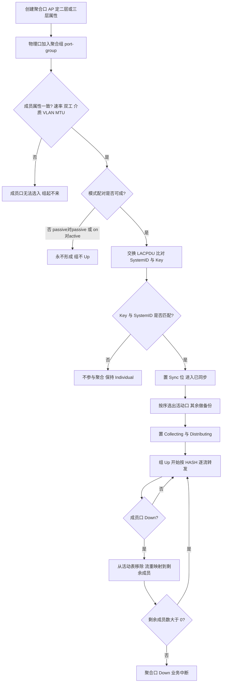
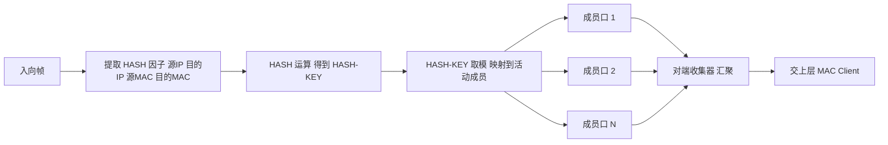
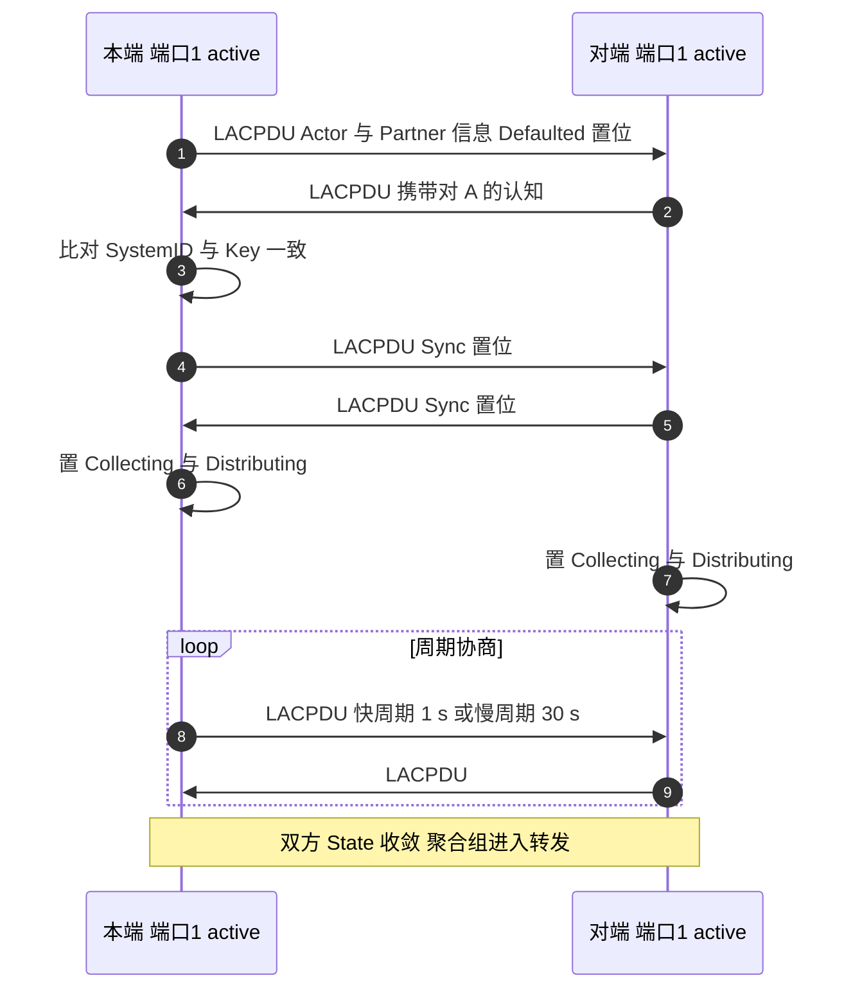
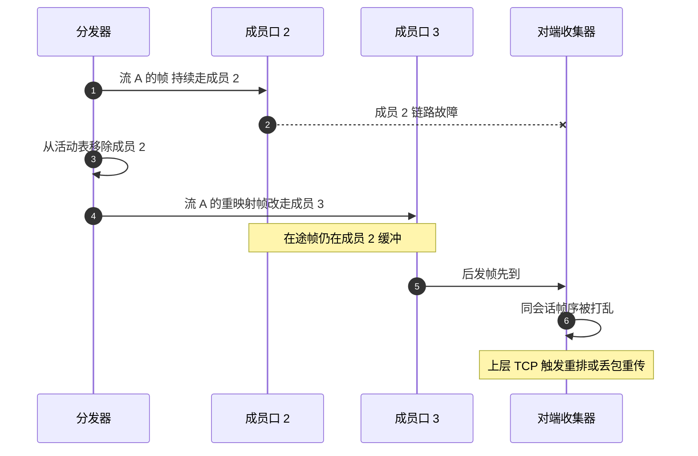
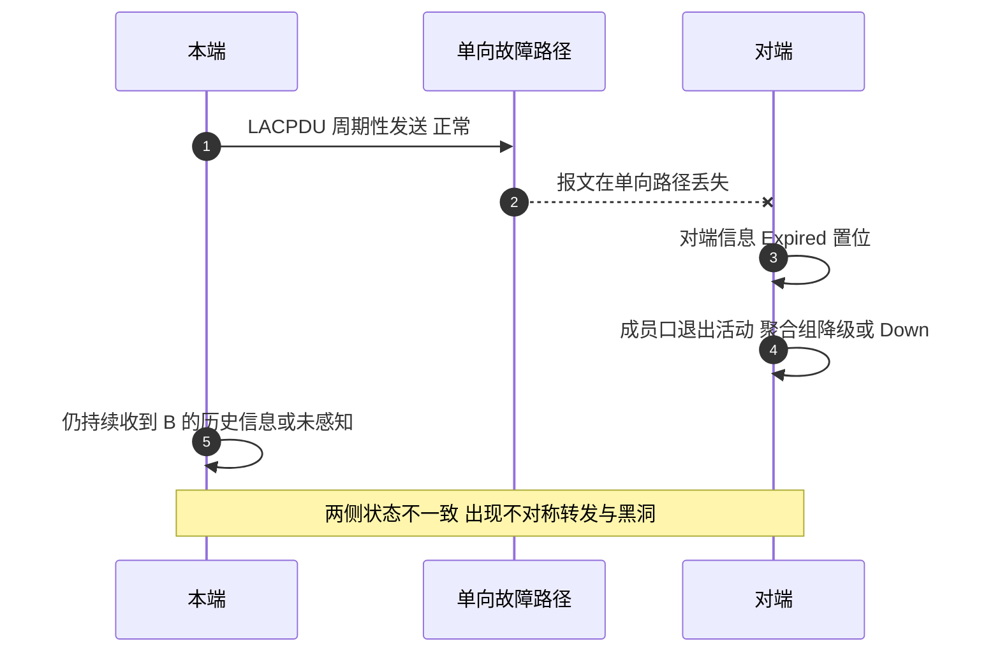

# 链路聚合（聚合口 / AP / LAG）场景全景：描述 · 流程 · 涉及模块 · 监控点

> **大场景**：DS-STACK（堆叠与虚拟化）——**相邻支撑技术**（04 文档未单列聚合口子场景，本文与 `DS-STACK-02` VSL 负载均衡同机理并列）
> **文档版本**：v1.0（精简篇，**未经两轮评审**）
> **编制日期**：2026-09-24
> **标准依据**：`IEEE 802.1AX-2020`（原 802.3ad）；微 BFD 见 `RFC 7130`；跨设备聚合（M-LAG）为厂商实现，无统一标准
> **说明**：命令凡未经真机验证一律标「（待实机核对）」；设备命令以 RGOS 为准（**RGOS 只有 `show`，无华为 `display`、无 Cisco 系命令**）。

---

## 0. 一页速览

| 阶段/环节 | 关键动作 | 执行者 | 失败后的现象 |
|---|---|---|---|
| ① 建逻辑口 | 创建聚合口（AP / AggregatePort），定二层或三层 | 本端 | 属性（二层/三层）不匹配 → 成员口加不进去或行为异常 |
| ② 加成员口 | 把物理口加入聚合组；校验速率/双工/介质/VLAN/MTU 一致 | 本端 | 属性不一致 → 成员口无法 UP，聚合组起不来 |
| ③ 协商 | 动态：两侧交换 LACPDU，比对 System ID / Key / 状态位；静态：不协商直接聚合 | LACP 状态机 | active+passive 可成；**passive+passive 永不形成**；`on` 对 `active` 永不形成 |
| ④ 选活动口 | 按系统优先级 → 系统 MAC → 端口优先级 → 端口号 排出选择序列 | LACP / 管理逻辑 | 排序结果与预期相反 → 期望的"主口"落选 |
| ⑤ 收敛收发 | Sync 置位后 Collecting（收）/ Distributing（发）依次置位 | LACP + 分发器 | 只 Sync 不 Collecting → 组 Up 但不通；单向报文丢失 → 一端 Up 一端 Down |
| ⑥ 转发 | 按 HASH 因子逐流分发到活动成员 | 分发器（Distributor） | 流数少 / HASH 极化 → 单链路占满、其余空闲（"负载不均"） |
| ⑦ 故障切换 | 成员 Down → 从活动表移除 → 该成员承载的流重映射 | 分发器 + LACP | 重映射瞬间乱序；若为静态模式且误接 → 静默黑洞或环路 |

**一句话本质**：聚合口是"**把 N 条物理链路伪装成 1 条逻辑链路**"的二层子层设备。它带来的是**带宽叠加 + 链路级冗余**，但带宽不是"无损叠加"——**同一条流只走一条成员**，所以聚合带宽的收益取决于并发流数量，而不是单条 TCP 连接的速度。

---

## 1. 协议/对象定位与边界

### 1.1 一句话定义

链路聚合（Link Aggregation）是把多条物理链路捆绑为一条逻辑链路（LAG）的 **IEEE 802.1AX** 机制：在 MAC 客户端与 MAC 之间插入**分发器（Distributor）/ 收集器（Collector）**子层，用 HASH 把帧按"会话（conversation）"分配到不同成员链路，同时保持**同一会话的帧序**。控制面可选 **LACP**（动态协商）或**静态手工模式**（不协商）。

- 控制报文：**LACPDU**，承载于**慢协议（Slow Protocols）**，EtherType **0x8809**，Subtype **0x01**，目的 MAC **01:80:C2:00:00:02**。
- 成员上限：标准允许**每聚合组最多 16 个成员，其中最多 8 个活动**（其余做备份），实际规格依平台（待实机核对）。
- RGOS 接口名：**`AggregatePort`**（简称 AP），成员加入命令为 `port-group`（待实机核对）。

### 1.2 在本大场景中的位置

- **同机理并列**：`DS-STACK-02` 中「VSL 负载均衡算法缺陷导致流量集中少数链路占满带宽」（Sheet8 行 183）与聚合口的 HASH 分发是**同一类机理**——都是"哈希因子与流量特征不匹配导致的偏载"。区别在 VSL 是**堆叠内部链路**，聚合口是**业务链路**。
- **VSU 叠加**：VSU 之上的跨框聚合（及 M-LAG 跨设备聚合）是"设备级冗余"的另一种做法，与 VSU 是**替代/互补**关系（见 §3.6）。
- **边界关联**：`DS-STACK-09` 的"INC 接口无法选择（VSL 端口被占用）"与成员口占用/释放逻辑同源。

### 1.3 边界判据（**这里最容易误判**）

**属于本篇：**

- 聚合组起不来 / 成员口加不进去 / 成员属性不一致。
- LACP 模式不匹配（passive 对 passive、`on` 对 `active`）导致组不 Up。
- 负载不均（HASH 因子与流量特征不匹配、HASH 极化、流数过少）。
- 成员口故障切换、活动口选择结果与预期不符、M:N 备份口不接管。
- 微 BFD（BFD for LAG）联动导致成员口被排除。

**不属于本篇、易误入：**

- **「端口主备模式」（端口级 1:1 冗余，非聚合）残留导致转发异常** → 归**端口冗余与转发大场景**。这是 04 文档登记的待外归记录 **row=118**，它的机理是"接口曾配置端口主备模式、删除后未就绪"，**与聚合口的"主端口/备份端口"是完全不同的东西**，不要混算。
- **纯物理层问题**（光衰、光模块、协商不上）→ 归物理层大场景；只有"因物理异常导致成员口被剔除聚合组"这一层才归本篇。
- **STP/MSTP 与聚合口交互导致的环路** → 归二层与环网大场景（聚合口本身不跑 STP 选举，成员口不参与 STP）。
- **VSL 链路负载不均** → 归 `DS-STACK-02`，本篇只做机理并列引用。

---

## 2. 涉及模块

| 模块名 | 所属层 | 职责 | 与聚合口的交互点 | 该模块失效时的典型现象 |
|---|---|---|---|---|
| 聚合管理（LAG 管理） | 设备侧控制面 | 维护聚合组、成员列表、二层/三层属性、主端口 | 全部聚合逻辑中枢 | 组起不来、成员属性冲突 |
| LACP 状态机（每端口一实例） | 设备侧控制面 | 收发 LACPDU、维护 MUX/PTX/RX 子状态机与 8 个状态位 | 决定成员口是否被选为活动 | Sync/Collecting/Distributing 不置位 → 组 Up 但不通 |
| 分发器（Distributor） | 转发面（MAC 子层） | 按 HASH 把出向帧映射到活动成员 | 负载均衡算法在此生效 | 偏载、单链路拥塞 |
| 收集器（Collector） | 转发面（MAC 子层） | 汇聚各成员入向帧，交给 MAC 客户端 | 保证同会话帧序 | 乱序、丢帧 |
| 硬件成员表（成员活动状态） | 芯片 | 承载"哪些成员可参与转发" | 活动状态变化触发硬件表更新 | 硬件未同步 → 组 Up 但流量仍走旧路径 |
| STP/MSTP | 设备侧控制面 | 与聚合口交互（聚合口按一个逻辑口参与） | 成员口不参与 STP，聚合口参与 | 配置不当 → 环路或链路被阻塞 |
| 跨设备聚合（M-LAG）/ VSU | 设备侧控制面 | 提供设备级冗余（Peer Link、Domain ID、虚拟 AP 组） | 跨框成员口协商与同步 | Peer Link 断开 → 双主、MAC 漂移 |
| 微 BFD（BFD for LAG） | 转发/控制面 | 每个成员链路一条独立 BFD 会话，快速剔除故障成员 | 会话 Down → 成员被排除 | 误剔除 → 带宽骤降 |
| 平台对接（SNMP/Syslog/Telemetry） | 平台侧 | 采集成员状态、活动口、HASH 分布 | APM 数据源 | 无采集 → 偏载无告警（§8） |

---

## 3. 协议栈、报文与配置模型

### 3.1 协议栈位置（聚合子层在 MAC 与 LLC 之间）

```
┌──────────────────────────────────────────────┐
│ MAC Client（LLC / 上层协议 / VLAN 子接口）    │
├──────────────────────────────────────────────┤
│ 链路聚合子层                                  │
│   ┌──────────────┐      ┌──────────────┐     │
│   │ Distributor  │      │  Collector   │     │
│   │ HASH 选路 ↓  │      │ 汇聚入向帧 ↑ │     │
│   └──────┬───────┘      └──────┬───────┘     │
│          │ MUX 受 LACP 控制     │             │
├──────────┼──────────────────────┼────────────┤
│  成员口1 │      成员口2         │   成员口N   │
└──────────┴──────────────────────┴────────────┘
```

### 3.2 LACPDU 结构（IEEE 802.1AX）

| 部分 | 长度 | 内容 |
|---|---|---|
| `Subtype` | 1 B | **0x01** = LACP（0x02 = Marker） |
| `Version` | 1 B | 固定 1 |
| **Actor TLV** | 20 B | 发送方描述**自己**：System Priority(2) + System MAC(6) + Key(2) + Port Priority(2) + Port Number(2) + State(1) + Reserved(3) |
| **Partner TLV** | 20 B | 发送方描述**它认为的对端**：字段同上 |
| **Collector TLV** | 16 B | Max Delay(2) + Reserved(14)：帧在收集器最多可被延迟多久 |
| `Terminator` | 1 B | 结束 TLV 链（Type=0 / Length=0） |

**两个关键标识**

- **System ID = System Priority（2 B）+ System MAC（6 B）**：数值小者获胜，决定谁是"聚合主控（Aggregator Master）"。跨设备聚合时两端配置**相同的 System ID** 才能让对端看成一台设备。
- **Operational Key（操作键）**：**同一台设备上只有 Key 相同的端口才允许被聚合到一起**——Key 不匹配，物理线接对了也进不了同一个组。

### 3.3 LACPDU 的 8 个状态位（State 字段，bit 0 = LSB）

| bit | 名称 | =1 的含义 | =0 的含义 |
|---|---|---|---|
| 0 | `LACP_Activity` | **Active**（主动发 LACPDU） | Passive（只应答） |
| 1 | `LACP_Timeout` | **Short**（快周期：1 s，超时 3 s） | Long（慢周期：30 s，超时 90 s） |
| 2 | `Aggregation` | 该链路**可**被聚合 | 只能作为独立链路（Individual） |
| 3 | `Synchronization` | 与对端**已同步**（In Sync） | 未同步（Out of Sync） |
| 4 | `Collecting` | 可以**收**（入向已就绪） | 不可收 |
| 5 | `Distributing` | 可以**发**（出向已就绪） | 不可发 |
| 6 | `Defaulted` | 用的是**管理默认值**（未收到对端信息） | 用的是收到对端 LACPDU 里的信息 |
| 7 | `Expired` | 对端信息**已老化**（current_while 定时器超时） | 未老化 |

**读法**：`Defaulted=1` 或 `Expired=1` 是"协商还没成 / 已失联"的强信号；正常活动口应为 `Sync=Aggregation=Collecting=Distributing=1`、`Defaulted=Expired=0`。

### 3.4 两种模式与"模式配对的失败矩阵"

| 本端 | 对端 | 结果 |
|---|---|---|
| `active`（LACP 主动） | `passive`（LACP 被动） | ✅ 可形成（一方主动即可） |
| `active` | `active` | ✅ 可形成 |
| `passive` | `passive` | ❌ **永不形成**（双方都不发起） |
| `on`（静态） | `on` | ✅ 形成（无协商，**风险最高**） |
| `on`（静态） | `active` / `passive` | ❌ 永不形成（协商方一直等 LACPDU，静态方不发） |

> **静态 `on` 的真实风险**：不跑协议就没有一致性校验。配错 VLAN、误接一根线（比如一端接入对端同一台设备的两个口）时**没有任何机制发现**，直接得到**环路**或**静默黑洞**。

### 3.5 活动口选择与备份（M:N）

选择顺序（数值小者优先）：

1. **System Priority**（本端）→ 2. **System MAC** → 3. **端口优先级（Port Priority）** → 4. **端口号（Port Number）**

排在前面且通过同步校验的端口进入**活动（Selected / Active）**，超过活动上限的进入**备用（Standby / 非活动）**，活动口故障时按序列接管。这就是**主端口 / 备份端口**概念的来源——注意它与"端口主备模式"（§1.3 误入项）**不是同一机制**。

### 3.6 VSU / M-LAG 的叠加关系（易混点）

| 维度 | VSU（堆叠虚拟化） | M-LAG（跨设备链路聚合） |
|---|---|---|
| 虚拟化范围 | 控制面 + 转发面**整机合一** | **仅二层**虚拟化，两台设备仍独立 |
| 设备间链路 | VSL | Peer Link（需配 SVI 做三层可达以同步数据，同步走 TCP） |
| 标识 | VSU 域 / 成员 ID | Domain ID（同域才能成组）+ 虚拟 AP 组（VAP，仅二层聚合） |
| 对端看到 | 一台设备 | 一台设备（因两端配相同 LACP System ID/优先级） |
| 优势 | 统一管理、单点配置 | 去堆叠化、**可独立升级**，避免堆叠带来的整机连带故障 |

> 别把这两者当同一件事：**M-LAG 就是"两台设备用同一套 LACP System ID 骗对端"**，而 VSU 是真正的设备合一。

### 3.7 负载分担算法（RGOS）

- 命令形态：`aggregateport load-balance {dst-mac | src-mac | src-dst-mac | dst-ip | src-ip | src-dst-ip}`（待实机核对）。
- **默认值依平台/版本**（公开资料中既有 `src-dst-mac`，也有老平台默认 `src-mac`），**必须以设备实际回显为准（待实机核对）**。
- 选型原则：**流量中哪个字段变化越频繁，就用基于该字段的算法**。
  - 网关到服务器、IP 变化频繁 → 用 `src-dst-ip`（锐捷公开文档亦推荐此为常用值）。
  - 纯二层、MAC 变化频繁而 IP 固定 → 用 `src-dst-mac`。
- **逐流 vs 逐包**：标准要求保持**同一会话的帧序**，因此工程上一律**逐流**。逐包理论上利用率更高，但会因成员间时延差导致乱序，TCP 层被迫重排，**净收益通常为负**。
- **Marker Protocol**（802.1AX 可选，慢协议 Subtype 0x02）：用于流迁移前"排空"老链路在途帧，避免重映射乱序。**实际部署中很少启用**，这也是成员故障瞬间容易抖动的制度性原因。

---

## 4. 流程图

### 4.1 聚合组建立与成员选入流程



### 4.2 转发数据流（HASH 逐流分发）



---

## 5. 时序图

### 5.1 正常：LACP 协商建立



### 5.2 异常一：成员口故障切换与乱序



### 5.3 异常二：单侧收到 LACPDU 导致一端 Up 一端 Down



---

## 6. 关键参数与定时器

| 参数 | 含义 | 典型默认值 | 配错的后果 |
|---|---|---|---|
| 聚合模式 `on/active/passive` | 静态 / LACP 主动 / LACP 被动 | 依平台 | `passive`+`passive`、`on`+`active` → **组永不 Up**；`on`+`on` → 无校验，**环路或黑洞** |
| 成员属性（速率/双工/介质/VLAN/MTU） | 参与聚合的前置条件 | — | 光口电口混绑、千兆万兆混绑 → 成员无法选入 |
| `aggregateport load-balance` | HASH 因子 | **依平台（待实机核对）**，常见 `src-dst-mac` | 与流量特征不匹配 → **偏载**（一条满、其余空） |
| `LACP_Timeout` | 快/慢周期 | 慢 30 s（超时 90 s） | 业务要求快收敛却用慢周期 → 故障发现要 90 s |
| 系统优先级 / 端口优先级 | 选主与选活动口 | 依平台 | 期望的主口落选 → 流量走非预期链路 |
| Operational Key | 允许聚合的分组键 | 由配置推导 | Key 不匹配 → 线接对了也聚合不了 |
| 活动成员上限 | 每聚合组活动口数 | 标准 8 / 16（含备份） | 超上限成员进备份，带宽未叠加，易被误判为"聚合失败" |
| Marker 协议 | 流迁移前排空 | **默认不启用** | 不启用 → 成员切换瞬间乱序 |
| 微 BFD（RFC 7130） | 每成员独立 BFD，UDP 目的端口 **6784**，目的 MAC **01-00-5E-90-00-01** | 默认关闭 | 开启后误剔除成员 → 带宽骤降；未开启 → 成员级故障只能靠 LACP 慢周期发现 |
| VLAN 配置（含 `qinq`） | 微 BFD 报文打不打 Tag | — | 微 BFD 在 802.1q 环境下通路不对 → 会话不 Up |

---

## 7. 常见故障模式与分阶段定位

| 阶段 | 现象 | 首要观测点 | 常见原因 |
|---|---|---|---|
| 建立 | 聚合组不 Up | `show aggregateport summary`（待实机核对） | 模式不配对、成员属性不一致、Key 不匹配 |
| 建立 | 部分成员未被选入 | 成员状态查询（待实机核对） | 达到活动上限（进备份）；属性差异；Key 不同 |
| 建立 | 一端 Up 一端 Down | 两端同时查询成员状态 | 单向 LACPDU 丢失、单向光路故障 |
| 转发 | 带宽不叠加（单流慢） | 成员流量分布 | 逐流机制决定了**单条流只能走一条链路**——属正常预期，非故障 |
| 转发 | 负载严重不均 | 各成员收发包计数 | HASH 因子与流量特征不匹配、HASH 极化、并发流过少 |
| 转发 | 切换瞬间业务抖动/丢包 | 成员变化事件时间戳 + 丢包计数 | 流重映射、无 Marker 排空 |
| 静态 | 出现环路或黑洞 | 拓扑/STP 状态 + 转发路径 | `on`+`on` 无校验，误接或属性不一致时无机制发现 |
| 跨设备 | MAC 漂移、双主 | Peer Link 状态、Domain ID | M-LAG Peer Link 断开、两端 System ID/配置不一致 |
| 微 BFD | 成员被异常剔除 | 微 BFD 会话状态 | 误剔除（参数/通路问题，含 802.1q Tag 问题） |

**成功 vs 失败对比要点**

- 成功：两端成员 State 各位置位正确（`Sync/Collecting/Distributing=1`、`Defaulted/Expired=0`）、各成员流量分布与流的分布相符、成员切换后剩余口流量按比例上升、无 STP 异常阻塞。
- 失败：`Defaulted=1` 长期不消、`passive` 对 `passive`、成员被"假选入"（组 Up 但不通）、单成员收发包计数为 0、切换瞬间大量乱序/重传。

---

## 8. 监控点（APM 可观测性映射）

固定列：`观测点 | 观测对象 | 数据源 | 采集方式 | 阈值/触发条件 | 现状 | 优先级`。

| 观测点 | 观测对象 | 数据源 | 采集方式 | 阈值/触发条件 | 现状 | 优先级 |
|---|---|---|---|---|---|---|
| 聚合组与成员状态 | 组成员列表、活动/备份身份、每个成员 8 个状态位 | VictoriaMetrics + MySQL | CLI 定时采集（`show aggregateport summary`、LACP 成员详情，待实机核对） | `Defaulted=1` 或 `Expired=1` 持续超过 1 个超时周期；活动成员数由 N 降为 N-1 | 部分（命令可得但缺持续采集） | **P0** |
| 成员流量分布与偏载度 | 各成员收发包/字节计数 | VictoriaMetrics | SNMP 轮询 / gRPC Telemetry（接口计数） | 成员间字节数极差 > 3 倍且持续 ≥5 min（推断值，需现场标定） | 缺失 | **P0** |
| 负载均衡算法与流量特征匹配预检 | 当前 `load-balance` 配置 + 业务流特征 | MySQL + VictoriaMetrics | 平台 API 拉取 / CLI 定时采集 | 配置为 MAC 类算法但业务以 IP 变化为主 → 提示偏载风险 | 缺失 | **P1** |
| 成员切换与状态翻转事件 | 成员加入/退出活动表的时间戳与原因 | Loki | Syslog/Trap 订阅 | 10 分钟内成员状态翻转 ≥3 次 | 缺失 | **P0** |
| 配置一致性预检（两端） | 成员属性、模式、Key、系统优先级 | MySQL | 平台 API 拉取 / CLI 定时采集 | 两端模式配对不可成（passive/passive、on/active）、成员属性不一致即告警 | 缺失 | **P0** |
| 微 BFD 会话状态（若启用） | 每成员微 BFD 会话状态与 Up/Down 计数 | VictoriaMetrics + Loki | gRPC Telemetry + Syslog 订阅 | 会话 Down 导致成员被剔除 | 缺失 | **P2** |
| M-LAG / 跨设备聚合健康 | Peer Link 状态、Domain ID、双主标志 | VictoriaMetrics + Loki | SNMP 轮询 + Syslog 订阅 | Peer Link Down 或出现双主标志 | 缺失 | **P1** |
| 丢包与乱序（切换窗口） | 成员切换窗口内的乱序/重传计数 | VictoriaMetrics | SNMP 轮询 / gRPC Telemetry | 切换窗口内重传/乱序计数突增（推断值，需现场标定） | 缺失 | **P2** |
| 静态模式风险扫描 | 配置为 `on` 的聚合口占比与其成员属性一致性 | MySQL | 平台 API 拉取 / CLI 定时采集 | 存在 `on` 模式且两端属性不一致 → 高风险告警 | 缺失 | **P1** |

> **数据源口径**：只落 `VictoriaMetrics / Loki / MySQL / Pyroscope / Redis` 五类载体。
> **不可观测说明**：芯片内部**具体选了哪个成员**（分发器的实际映射结果）无法直接读取，只能用"各成员计数分布"反推；**偏载是否为 HASH 极化**需要结合业务流特征推断。

---

## 9. 排查动作步骤

| 步 | 动作 | 命令 / 观测点 | 判读 |
|---:|---|---|---|
| 1 | 看聚合组与成员 | `show aggregateport summary`（待实机核对） | 组是否 Up、成员是否全部选入、是否有成员进备份 |
| 2 | 看 LACP 细节与状态位 | LACP 端口/邻居详情（待实机核对） | `Defaulted=1`/`Expired=1` 说明未协商成；`Sync=1` 但 `Collecting/Distributing=0` 说明组 Up 但不可收发 |
| 3 | 核对两端模式配对 | 两端聚合口配置（待实机核对） | 排除 passive/passive、on/active 的"永不形成"组合 |
| 4 | 核对成员属性 | 成员口速率/双工/介质/VLAN/MTU（待实机核对） | 光口电口混绑、速率混绑是最常见的"加不进去" |
| 5 | 核对 Key 与系统优先级 | 聚合配置（待实机核对） | Key 不匹配 → 线接对了也不聚合 |
| 6 | 看流量分布 | 各成员接口计数 | 判断是"偏载"还是"单流瓶颈"（后者是逐流机制的预期行为） |
| 7 | 看负载均衡算法 | `load-balance` 当前取值 | 与业务流量特征比对，必要时改为 `src-dst-ip` 类 |
| 8 | 看切换与丢包 | 成员变化日志 + 接口丢包/乱序计数 | 切换瞬间抖动属无 Marker 排空的固有代价 |
| 9 | 跨设备场景查 Peer Link | Peer Link / Domain 状态（待实机核对） | MAC 漂移、双主 → 查 Peer Link 与两端配置一致性 |

---

## 10. 与本项目已知故障的对应

| 关联 | 典型现象 | 本篇覆盖点 | 实证记录（Sheet8 行） |
|---|---|---|---|
| `DS-STACK-02`（**机理并列**） | VSL 链路负载不均衡（4 条 VSL 仅 2 条承载流量） | §3.7 逐流与 HASH 因子选型、§4.2 数据流、§8 偏载观测点 | 183 |
| `DS-STACK-02` 相邻 | VSL 接口 UP/DOWN 震荡致业务震荡 | §7 成员切换与乱序 | 151 / 179 |
| **待外归（row=118）** | 终端跨网段 ping 不通，机理为"接口曾配置**端口主备模式**（非 VSU 端口冗余）删除后未就绪" | §1.3 边界判据：**端口主备模式 ≠ 链路聚合** | 118（04 文档登记为待外归，建议归端口冗余与转发大场景） |

> 说明：04 文档未单列聚合口子场景，本篇不新造子场景编号；row=183 的原始归属是 `DS-STACK-02`（VSL 负载均衡），本篇仅作**同机理并列引用**，不改变其归属。

---

## 11. 待确认事项

- **Q-LAG-01**：RGOS 各平台聚合口的**默认负载均衡算法**与支持的算法集合？公开资料存在 `src-dst-mac` 与 `src-mac` 两种说法，需以设备回显为准（待实机核对）。
- **Q-LAG-02**：`show aggregateport summary` / LACP 成员详情在 RGOS 各版本的确切命令与字段名？均标（待实机核对）。
- **Q-LAG-03**：各平台**活动成员上限与总成员上限**（标准为 8 活动 / 16 总，本实现规格待确认）？影响 §8 的"成员被挤入备份"判据。
- **Q-LAG-04**：本实现是否支持 **Marker Protocol**？若不支持，成员切换时的乱序是否有其他抑制手段？
- **Q-LAG-05**：微 BFD（RFC 7130）在本实现的**支持平台与命令**，以及 802.1q / qinq 环境下微 BFD 报文的 Tag 处理策略？
- **Q-LAG-06**：VSU 之上的**跨框聚合**与 M-LAG 在本实现中的定位关系（二选一还是可叠加）？影响 §3.6 对照表与 §8 跨设备观测点。
- **Q-LAG-07**：row=118 的"端口主备模式"与本篇聚合口的**主端口/备份端口**在配置命令上如何区分？需在核对清单中固化判据，避免归类再误。

---

## 附：术语速查

| 缩写 | 全称 | 说明 |
|---|---|---|
| LAG | Link Aggregation Group | 链路聚合组 |
| AP / AggregatePort | — | RGOS 中聚合口的接口名 |
| LACP | Link Aggregation Control Protocol | 链路聚合控制协议，802.1AX |
| LACPDU | LACP Data Unit | LACP 控制报文，EtherType 0x8809 / Subtype 0x01 |
| System ID | — | 系统优先级 + 系统 MAC，决定聚合主控 |
| Operational Key | — | 操作键，Key 相同才允许聚到一起 |
| Distributor / Collector | — | 分发器 / 收集器，聚合子层核心 |
| Conversation | — | 会话（同源同宿同属性的帧集合），分发的基本单位 |
| HASH 极化 | Hash Polarization | 哈希结果集中，导致固定成员被压满 |
| Marker Protocol | — | 流迁移前排空在途帧的可选机制 |
| M-LAG | Multichassis LAG | 跨设备链路聚合（去堆叠的双活方案） |
| micro-BFD | — | RFC 7130，每成员链路一条 BFD 会话，UDP 6784 |
| Peer Link | — | M-LAG 两台设备间链路，承载同步与部分流量 |
