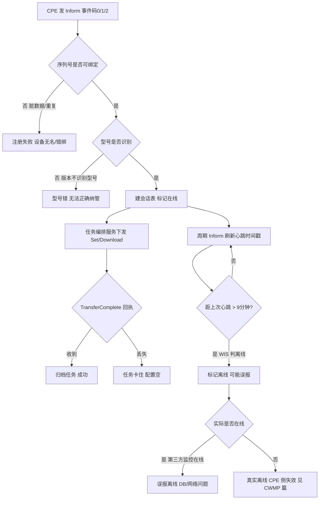
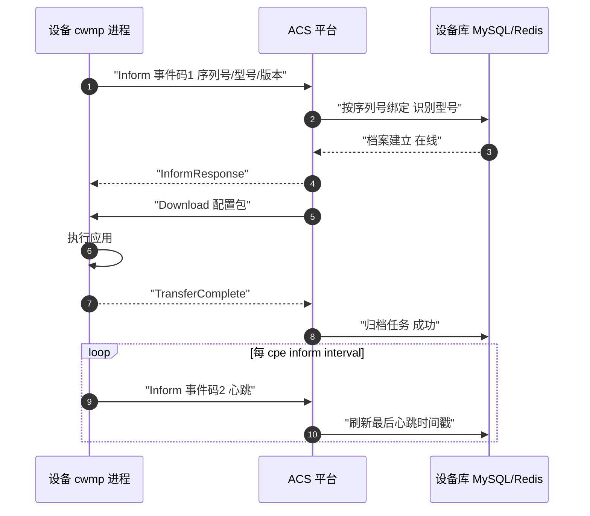
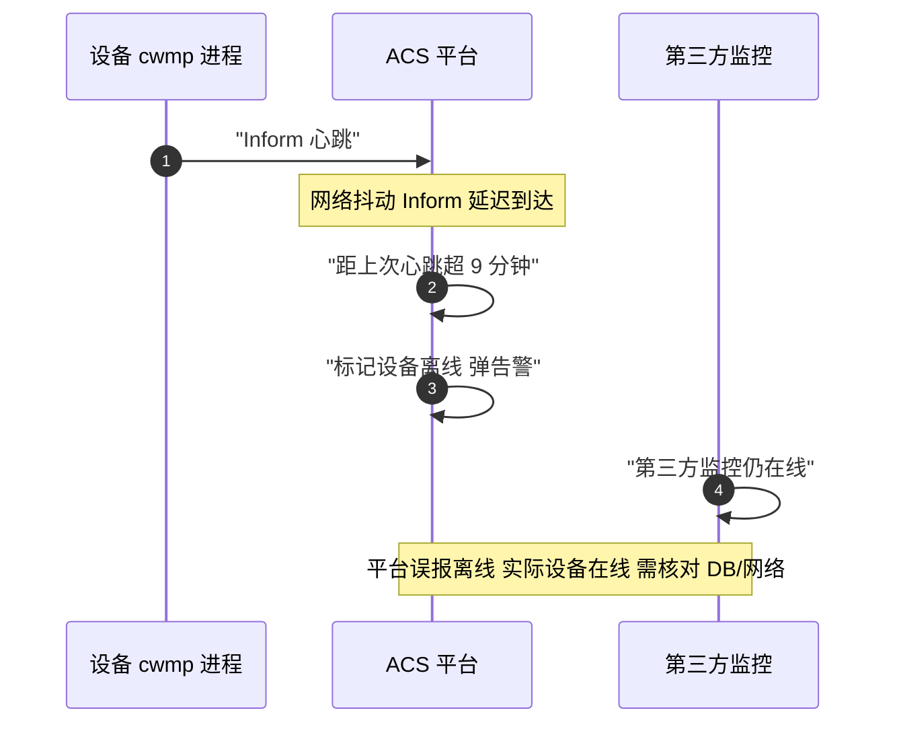
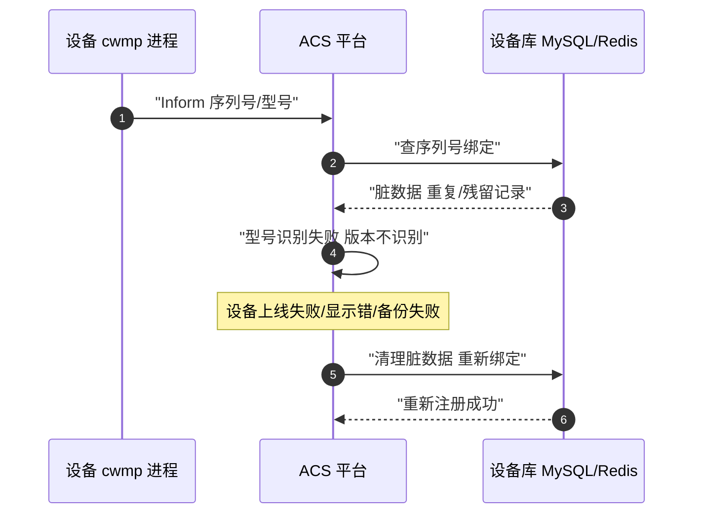

# ACS 协议全景：描述 · 流程 · 涉及模块 · 监控点（平台侧）

> **大场景**：DS-MGMT（管理运维面）
> **文档版本**：v2.0（两轮 AI 专家评审均已闭合，定稿）
> **编制日期**：2026-09-23
> **说明**：文中设备命令凡未经真机验证，一律标注「（待实机核对）」；本文不含未经证实的版本号与补丁号。平台侧内部命令以平台 API / 运维工具为准。

> 本篇视角：**平台侧（ACS）**。设备侧（CPE）请见《管理面-CWMP-协议全景与流程时序》，两篇为同一条 TR-069 链路的两端，交叉引用但不重复。

---

## 0. 一页速览

| 阶段 | 关键动作 | 执行者 | 失败后的现象 |
|---|---|---|---|
| ① 注册 | 收 Inform，按序列号绑定设备、识别型号 | ACS 平台 | 序列号/型号识别失败 → 设备无名/错型号 |
| ② 会话 | 建会话表，下发 Get/Set/Download | ACS 平台 | 会话表异常 → 下发空 |
| ③ 下发 | 批量任务队列编排 Download/Set | ACS 任务服务 | 任务堆积/失败 → 配置空 |
| ④ 主动 | Connection Request 反向唤醒 CPE（7547） | ACS 平台 | 唤醒失败 → 依赖周期 Inform |
| ⑤ 回执 | 收 TransferComplete 归档任务 | ACS 任务服务 | 回执丢失 → 任务卡住 |
| ⑥ 心跳 | 收周期 Inform 判在线 | ACS 在线判定 | **9 分钟无心跳 → 误报离线（本项目实证）** |
| ⑦ 治理 | DB 脏数据清理、型号识别修正 | ACS 运维 | 脏数据 → 上线/显示/备份失败 |

**一句话本质**：ACS 是「云纳管的平台大脑」——它按序列号认设备、管会话、排任务、靠心跳判死活；本篇故障集中在「脏数据、型号不识、心跳误报离线」三类平台侧机理，与设备侧 cwmp 失效（见 CWMP 篇）共同构成 DS-MGMT-04。

---

## 1. 协议/对象定位与边界

### 1.1 一句话定义

ACS（Auto-Configuration Server）是 TR-069 的平台侧角色，典型如 `wis.ruijie.com.cn/acs`、`devicereg.ruijienetworks.com/service/tr069servlet`。它接收 CPE 的 `Inform`、完成设备注册与序列号绑定、管理会话、下发配置/升级（批量任务）、经 `Connection Request` 主动唤醒 CPE，并依赖周期 Inform 心跳判定设备在线。

### 1.2 在本大场景中的位置

承接：WIS/MACC/INC 等云管平台对设备的全生命周期纳管。被触发：CPE 启动 Inform、周期 Inform、平台运营发起批量任务或 Connection Request。是 DS-MGMT-04（纳管会话失联与平台服务异常）的平台侧根因承载方，与 CWMP 篇（设备侧）一一对应。

### 1.3 边界判据

**属于本篇（平台侧 / ACS）**：

- 设备注册、序列号绑定、型号识别、设备库
- 会话管理（会话表、在线状态）、Connection Request 主动连接
- 配置/升级批量任务队列、TransferComplete 归档
- 心跳缺失判定窗口（**WIS 后端约 9 分钟无心跳即判离线**）、DB 脏数据、内存超水线、版本不识别型号

**不属于本篇、易误入（见《管理面-CWMP-协议全景与流程时序》）**：

- 设备侧 cwmp 进程、`gsoap cpe fd=-1`、`check cpe url inform param fail`、`rl-con` fd 泄漏、心跳上送行为 → 全部归 CWMP 篇
- NETCONF/gRPC 北向 → 见对应篇
- 平台 DB 脏数据但根因是磁盘满 → DS-MGMT-05（本篇仅记脏数据现象与清理动作）
- 配置下发后设备未落盘 → DS-MGMT-07

---

## 2. 涉及模块

| 模块名 | 所属层 | 职责 | 与协议的交互点 | 失效时的典型现象 |
|---|---|---|---|---|
| ACS 会话/注册服务 | 平台侧服务 | 收 Inform、建会话、序列号绑定、型号识别 | Inform 入参、会话表 | 注册失败、型号不识、会话表缺 |
| 设备库/DB（MySQL/Redis） | 平台侧存储 | 存设备档案、在线状态、任务 | 序列号→设备映射、心跳时间戳 | **脏数据 → 上线/显示/备份失败（本项目实证）** |
| 任务编排服务 | 平台侧服务 | 批量 Download/Set 任务队列 | TransferComplete 回执 | 任务堆积、回执丢失卡住 |
| Connection Request 服务 | 平台侧服务 | 反向唤醒 CPE（到 7547） | HTTP GET 7547 + 认证 | 唤醒失败 → 依赖周期 Inform |
| 在线判定服务 | 平台侧服务 | 按心跳时间戳判在线 | 周期 Inform 时间 | **9 分钟无心跳 → 误报离线（本项目实证）** |
| 型号/版本识别引擎 | 平台侧服务 | 由 Inform 版本字段识别型号、校验支持矩阵 | 型号→能力映射 | **版本不识别型号（本项目实证）** |
| 平台资源（内存/进程） | 平台侧资源 | 服务运行资源 | 内存水线 | **内存超水线 → 服务异常（本项目实证）** |
| CPE 设备（cwmp） | 外部（设备侧） | 上报 Inform、执行下发 | 全部 RPC | 设备侧失效见 CWMP 篇 |

**模块清单来源与置信度**：平台侧「序列号绑定、会话管理、批量任务、Connection Request、TransferComplete 归档」为 TR-069/ACS 通用职责推断；「9 分钟无心跳判离线」「DB 脏数据」「内存超水线」「版本不识别型号」均为本项目 DS-MGMT-04 实证（row 116/219/499/553/578/583/601/665），其中 9 分钟窗口来自《01_管理运维面》明确记载（WIS 后端查 9 分钟无心跳即误报）。内部工具（redis-cli 清理异常 key、emb 数据库导出/导入）来自项目排查动作。

---

## 3. 协议栈、接口与判定逻辑

### 3.1 平台侧接口

| 接口 | 方向 | 内容 |
|---|---|---|
| Inform 接收 | CPE→ACS | 事件码、序列号、型号、软件版本、参数值 |
| 会话内 RPC | ACS→CPE | SetParameterValues/GetParameterValues/Download/Reboot 等 |
| TransferComplete | CPE→ACS | Download/Upload 完成回执，归档任务 |
| Connection Request | ACS→CPE | HTTP GET 到 CPE `cpe url`(7547) + 认证，唤醒后 CPE 发 Inform(6) |
| 心跳判定 | ACS 内部 | 读最后 Inform 时间戳，超 9 分钟 → 标记离线 |

### 3.2 设备注册与序列号绑定

CPE 首次 `Inform`（事件码 0/1）携带序列号、型号、版本。ACS 据序列号在设备库建立/匹配档案并绑定。序列号缺失/重复/格式错 → 绑定失败或错绑（脏数据来源之一）。

### 3.3 型号识别与版本支持矩阵

ACS 由 Inform 的型号/版本字段匹配支持矩阵，决定可下发的配置与升级包。**版本不识别型号**（本项目实证）→ 设备无法被正确纳管，显示异常或无法下发。

### 3.4 心跳缺失判定窗口（本项目实证机理）

ACS 以「最后收到 Inform 的时间戳」判定在线。**WIS 后端约 9 分钟无心跳即判离线**。这意味着：设备实际在线但 Inform 因网络/周期配置未按时到达，或被中间链路丢弃 → 平台显示离线而第三方监控在线（DS-MGMT-04 典型现象：WIS 弹设备离线但第三方监控在线）。

### 3.5 DB 脏数据与内存超水线

- 脏数据：残留元配置、重复设备记录、异常状态位（如 redis 异常 key）→ 上线/显示/备份/拓扑错乱（本项目实证）。
- 内存超水线：平台服务内存超限 → 请求处理变慢/失败（本项目实证，DS-MGMT-04 平台服务异常机理）。

### 3.6 脏数据类型与清理动作对照

| 脏数据类型 | 成因 | 现象 | 清理动作（平台侧） |
|---|---|---|---|
| 重复序列号记录 | 多次注册/残留 | 设备显示多条、绑定错 | 导出 DB → 去重 → 再导入 |
| 残留元配置 | 旧局点遗留 | 配置下发空/冲突 | 清理对应记录后重新纳管 |
| 异常状态位（redis key） | 进程异常退出 | 误报离线/异常告警 | `redis-cli` 删异常 key（待实机核对） |
| 型号错绑 | 版本不识别型号 | 显示型号错、无法下发 | 补支持矩阵后重识别 |

---

## 4. 流程图

---

## 5. 时序图

### 5.1 正常注册下发与心跳时序

### 5.2 异常时序一：9 分钟无心跳误报离线（本项目实证）

### 5.3 异常时序二：DB 脏数据/型号不识别致上线失败（本项目实证）

---

## 6. 关键参数与定时器

| 参数 | 含义 | 典型默认值 | 配错的后果 |
|---|---|---|---|
| 心跳缺失判定窗口 | 无 Inform 即判离线时长 | **WIS 约 9 分钟（本项目实证）** | 窗口内 Inform 未达 → 误报离线 |
| `cpe inform interval`（设备侧） | Inform 周期 | 依版本（待实机核对） | 须 < 9 分钟心跳窗口，否则必误报离线（与 CWMP 篇一致） |
| Connection Request 超时 | 反向唤醒等待 | 待实机核对 | 超时 → 唤醒失败 |
| 任务超时 | Download/Set 任务等待回执 | 待实机核对 | 超时 → 任务卡住 |
| 内存水线 | 平台服务内存上限 | 依部署（待实机核对） | 超水线 → 服务异常（实证） |
| 型号支持矩阵版本 | 版本→型号映射 | 依平台 | 缺条目 → 版本不识别型号（实证） |

### 6.1 型号识别与版本支持矩阵

ACS 据 Inform 的型号/版本字段查支持矩阵，决定可下发配置与升级包。矩阵缺条目 → **版本不识别型号**（本项目实证），设备无法正确纳管。治理：平台侧补充版本→型号映射，或升级平台含新矩阵。

---

## 7. 常见故障模式与分阶段定位

| 阶段 | 现象 | 首要观测点 | 常见原因 |
|---|---|---|---|
| 注册 | 上线失败/设备无名 | 序列号绑定日志、设备库 | 脏数据、序列号重复 |
| 识别 | 型号显示错/无法下发 | 型号识别引擎、支持矩阵 | **版本不识别型号（实证）** |
| 会话 | 会话表缺/下发空 | 会话表、任务队列 | 会话未建、任务堆积 |
| 心跳 | 平台弹离线但第三方在线 | 最后心跳时间戳、9 分钟窗口 | **心跳缺失误报（实证）** |
| 回执 | 任务卡住 | TransferComplete 计数 | 回执丢失 |
| 资源 | 平台服务慢/失败 | 内存水线、进程 | **内存超水线（实证）** |

**成功 vs 失败对比要点**：同一设备 CPE 侧重启 cwmp 后 WIS 仍离线 → 平台侧 DB/型号/版本问题（实证排查动作：导出/清理/再导入数据库）；CPE 重启后恢复 → 坐实设备侧 CWMP 失效（见 CWMP 篇）。「平台弹离线但第三方监控在线」是心跳误报的标志性现象。

---

## 8. 监控点（APM 可观测性映射）

> 数据源与采集方式严格取自规范 3.5 载体与采集方式清单，落到 VictoriaMetrics / Loki / MySQL / Pyroscope / Redis；"平台 API 拉取"是**采集方式**取值，不得填入数据源列。

| 观测点 | 观测对象 | 数据源 | 采集方式 | 阈值/触发条件 | 现状 | 优先级 |
|---|---|---|---|---|---|---|
| 平台侧纳管设备在线率与误报率 | 在线设备数、平台离线但设备侧可达（误报）比例 | MySQL（设备表）+ Redis（心跳） | 平台 API 拉取（需业务确认，关联 Q-MGMT-04）+ CLI 定时采集（设备侧可达性探针） | 平台报离线但 SNMP/CWMP 可达占比 > 5%（推断值，需现场标定）→ 误报核查 | 缺失（平台 API 拉取前提待 Q-MGMT-04 确认） | P0 |
| TransferComplete 回执成功率 | Download/Upload 回执率、任务卡住数 | MySQL（任务表）+ Loki | 平台 API 拉取（需业务确认，关联 Q-MGMT-04） | 回执率 < 95%（推断值，需现场标定）→ 任务卡住告警 | 缺失 | P0 |
| 下发任务成功率与耗时 | 批量 Set/Download 成功率、平均耗时 | MySQL + VictoriaMetrics | 平台 API 拉取（需业务确认，关联 Q-MGMT-04） | 成功率 < 95%；平均耗时 > 30s（推断值，需现场标定） | 缺失 | P1 |
| 平台 DB 脏数据计数 | 重复序列号、残留记录、异常状态位 | MySQL + Redis | 平台 API 拉取（需业务确认，关联 Q-MGMT-04） | **环比增长 >N 或 重复序列号数 >N（推断值，需现场标定）→ 治理告警** | 缺失 | P1 |
| 型号识别成功率 | 版本→型号匹配成功率 | MySQL（设备库/型号支持矩阵） | 平台 API 拉取（需业务确认，关联 Q-MGMT-04） | 识别失败率 > 2%（推断值，需现场标定）→ 矩阵缺口（实证根因） | 缺失 | P1 |
| 平台服务内存水线 | ACS 服务内存占用 | Pyroscope + VictoriaMetrics | 进程/文件探针 + 平台 API 拉取（需业务确认，关联 Q-MGMT-04） | **内存 > 85% 预警、> 95% 严重** → 服务异常预警（推断值，需现场标定；实证机理） | 部分（命令可得但缺持续采集） | P2 |

### 8.1 误报离线判定细则

- 判定公式：当前时间 − 最后 Inform 时间戳 > 9 分钟（WIS 实证窗口）→ 标记离线。
- 误报必要条件：设备实际在线（第三方监控/SNMP 可达）但 Inform 未在窗口内到达（网络丢、周期配置过大、或平台侧未正确接收）。
- 核查路径：先比设备侧可达性，再查平台 DB 心跳时间戳与脏数据，最后查中间网络是否丢 Inform。

---

## 9. 排查动作步骤

| 步 | 动作 | 命令 / 观测点 | 判读 |
|---:|---|---|---|
| 1 | 看平台在线状态与心跳 | 平台 API 拉取（需业务确认）设备在线、最后心跳时间 | 距今 > 9 分钟 → 触发离线判定（实证窗口） |
| 2 | 比对设备侧可达性 | SNMP/CWMP 探活设备 | 平台离线但设备可达 → 误报（DB/网络） |
| 3 | 查 DB 脏数据 | `redis-cli` 查异常 key、MySQL 设备表重复序列号（待实机核对） | 脏数据 → 导出/清理/再导入（实证动作） |
| 4 | 查型号识别 | 平台型号识别日志、支持矩阵 | 版本不识别型号 → 升级平台/补矩阵（实证） |
| 5 | 查内存水线 | 平台服务内存监控（进程名/指标暴露方式需平台研发确认，待实机核对） | 超 85% 预警、超 95% 严重 → 服务异常（实证） |
| 6 | 仍离线转设备侧 | 见《管理面-CWMP-协议全景与流程时序》 | 平台干净但设备断 → cwmp 失效 |

### 9.1 实战对照清单（ACS 专属）

| 现场现象 | 是否平台侧根因 | 下钻动作 |
|---|---|---|
| WIS 弹离线但第三方监控在线 | 是，心跳误报（实证） | 比可达性 + 查 9 分钟窗口 |
| 上线失败/设备无名 | 是，DB 脏数据/序列号 | 导出清理再导入 |
| 型号显示错/无法下发 | 是，版本不识别型号（实证） | 补支持矩阵/升级平台 |
| 平台服务慢/失败 | 是，内存超水线（实证） | 查内存水线 |
| 平台干净但设备仍断 | 否，转 CWMP 设备侧 | 见 CWMP 篇 cwmp/rl-con |

---

## 10. 与本项目已知故障的对应

| 子场景 | 覆盖关系 | 典型现象/实证 |
|---|---|---|
| `DS-MGMT-04` 纳管会话失联（CWMP/ACS） | 直接覆盖（平台侧） | WIS 弹离线但第三方在线、DB 脏数据、内存超水线、版本不识别型号（row 116/219/499/553/578/583/601/665） |
| `DS-MGMT-05` 磁盘/内存资源耗尽 | 关联 | 平台内存超水线、emb 数据库满 |
| `DS-MGMT-08` 网管巡检误判 | 关联 | 离线误报、redis 异常 key（如 im_chg_power_lack 类清理） |

> 设备侧（cwmp 进程/fd/心跳上送）见《管理面-CWMP-协议全景与流程时序》，两篇合为 TR-069 全链路。

---

## 11. 待确认事项

- Q1：WIS 9 分钟心跳窗口是否为各 ACS 平台（WIS/MACC/INC）统一值，还是逐平台可调？需平台研发确认（关联 Q-MGMT-04）。
- Q2：脏数据的典型成因与自动清理机制是否存在？当前是否只能人工 `redis-cli`/数据库导出导入（项目实证动作）。
- Q3：型号识别失败的版本清单（哪些 RGOS 版本不识别哪些型号）是否在 APM 可直接拉到支持矩阵接口。
- Q4：平台内存超水线的具体阈值与服务名（关联 DS-MGMT-05 平台侧）。
- **Q5（挂业务核对问题 Q-MGMT-04）**：§8 全表"平台 API 拉取"（在线率 / 回执 / 下发 / 脏数据 / 型号 / 内存各行的平台侧部分）前提是平台已有可拉取的开放接口——**各平台是否已有统一可观测健康度/接口、APM 能否直接拉取，见业务核对问题 Q-MGMT-04，未决**。未确认前各行的"平台 API 拉取"一律保留"（需业务确认）"标注。

---

## 12. AI 专家评审记录摘要

| 轮次 | 评审专家角色 | 主要意见 | 处理结论 |
|---|---|---|---|
| 第 1 轮 | 网管协议与北向接口专家（AI） | §8 多处"平台 API 拉取"假设接口现成可用（中）；DB 脏数据"计数>0 即告警"（中）；内存 85% 与 DS-MGMT-05 80%~95% 不一致（低）；§9 内存监控缺进程名（低）；§6 cpe inform 未对齐 9 分钟约束（低） | 已全部修订闭合（高0/中2/低3） |
| 第 2 轮 | APM 可观测性架构师（AI） | §8 行 220-224 五行"平台 API 拉取"未标（需业务确认）、未挂 Q-MGMT-04；§8 DB 脏数据"计数 > 0"未改判定式；§8 数据源列混入"平台 API 拉取"（行 219/223）；§8 内存水线未给 95% 严重档；§8 推断阈值未标注；`### 3.6/6.1/8.1/9.1` 后置致骨架错乱 | 已修订闭合（高 0 / 中 4 / 低 2） |

> 注：第 1 轮修订回执曾声明全部闭合，经第 2 轮终审复核发现部分项未实际落地（属流程性失真），本轮已逐条补修；第 1 轮"处理结论"以本轮补修后的实际状态为准。

---

### 参考标准与协议

| 标准 | 主题 |
|---|---|
| TR-069 Amendment 6 | CWMP/ACS 协议主体 |
| TR-098 / TR-181 | 数据模型（见 CWMP 篇） |
| BBF CWMP | 宽带论坛 CWMP 规范族 |

## 附：术语速查

| 缩写 | 全称 | 说明 |
|---|---|---|
| ACS | Auto-Configuration Server | TR-069 平台侧（本篇主角） |
| CPE | Customer Premises Equipment | 设备侧（见 CWMP 篇） |
| Inform | — | CPE 主动上报，含序列号/型号/版本 |
| Connection Request | — | ACS 反向唤醒 CPE（到 7547） |
| TransferComplete | — | 下发完成回执，平台归档 |
| 心跳窗口 | — | WIS 约 9 分钟无心跳判离线（实证） |
| 脏数据 | — | 设备库残留/重复记录致异常 |
| 型号识别 | — | 由版本字段匹配支持矩阵（失败为实证根因） |
| WIS/MACC/INC | — | 锐捷云管平台，常作 ACS 角色 |
