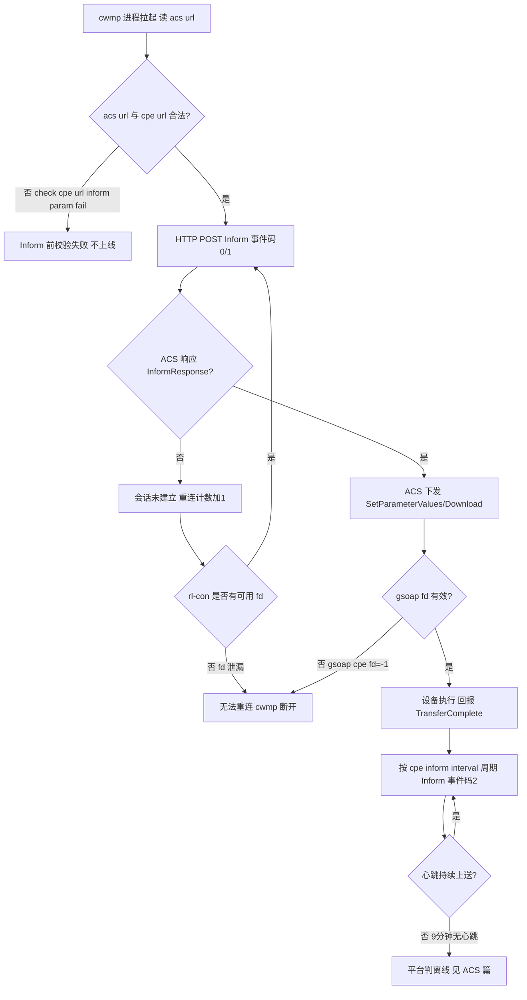
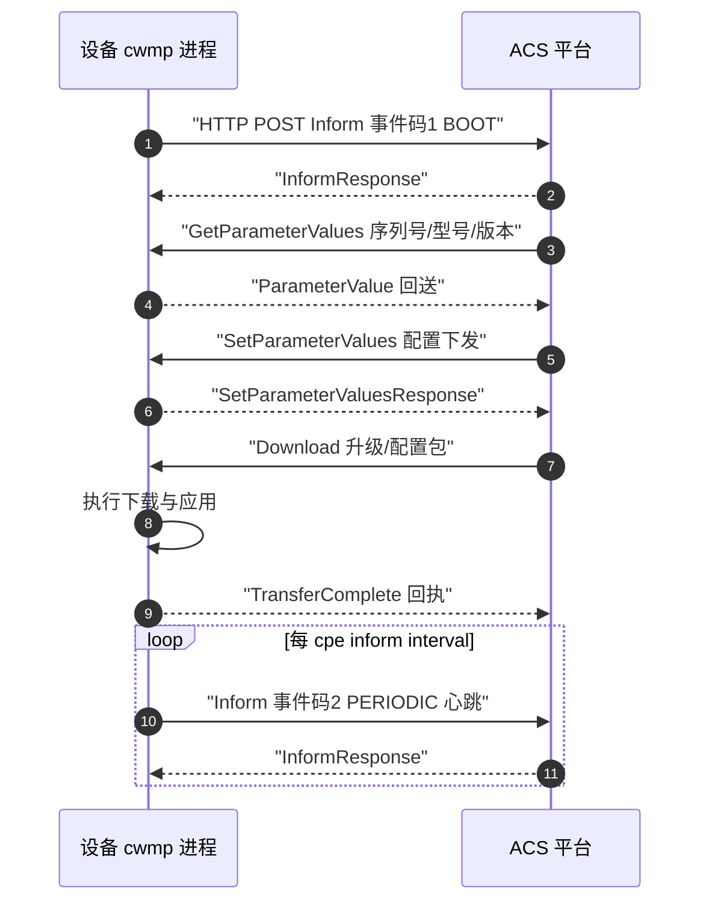
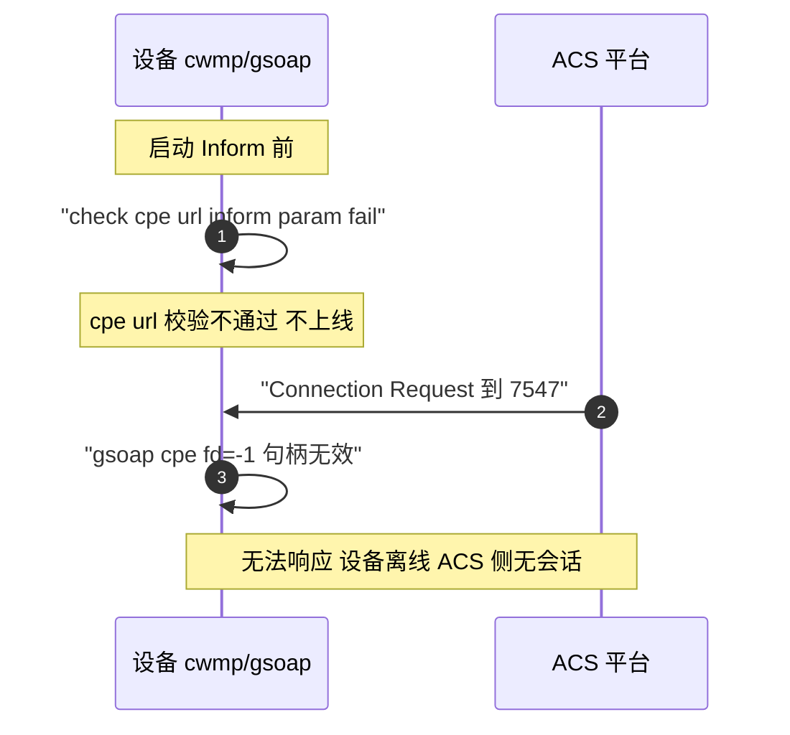
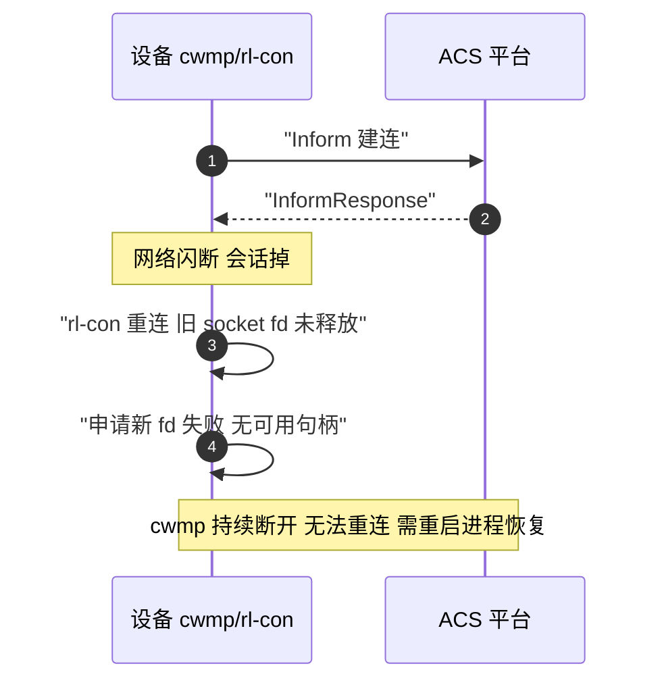

# CWMP 协议全景：描述 · 流程 · 涉及模块 · 监控点（CPE 设备侧）

> **大场景**：DS-MGMT（管理运维面）
> **文档版本**：v2.0（两轮 AI 专家评审均已闭合，定稿）
> **编制日期**：2026-09-23
> **说明**：文中设备命令凡未经真机验证，一律标注「（待实机核对）」；本文不含未经证实的版本号与补丁号。CWMP 侧已实证命令依规范 3.2 直接引用。

> 本篇视角：**设备侧（CPE）**。平台侧（ACS）请见《管理面-ACS-协议全景与流程时序》，两篇为同一条 TR-069 链路的两端，交叉引用但不重复。

---

## 0. 一页速览

| 阶段 | 关键动作 | 执行者 | 失败后的现象 |
|---|---|---|---|
| ① 启动 | CPE 进程（cwmp/gsoap）拉起，读 `acs url` | 设备 cwmp 进程 | 进程未起 → 不上线 |
| ② 首联 | HTTP POST `Inform`（事件码 0/1）到 ACS | 设备 | ACS 收不到 → 设备离线 |
| ③ 会话 | ACS 下发 Get/Set/Download，CPE 回 TransferComplete | 双方 | 下发失败、回执丢失 |
| ④ 周期 | 按 `cpe inform interval` 周期 Inform（事件码 2） | 设备 | 心跳缺失 → 平台误报离线 |
| ⑤ 重连 | 断链后重连；rl-con 占用 fd 不释放致无法重连 | 设备 cwmp/rl-con | **cwmp 断开、fd=-1、无法重连（本项目实证）** |
| ⑥ 心跳 | 持续上送心跳，平台据此判在线 | 设备 | 9 分钟无心跳 → 平台判离线（见 ACS 篇） |

**一句话本质**：CWMP 是「CPE 用 HTTP POST 主动找 ACS 的云纳管协议」——设备侧 cwmp 进程负责 Inform、接收下发、回报 TransferComplete、并靠心跳与重连维持会话；本篇所有故障都落在「进程/连接/fd/心跳」四件事上。

---

## 1. 协议/对象定位与边界

### 1.1 一句话定义

CWMP（TR-069）是 CPE 广域网管理协议：CPE 通过 HTTP POST 主动向 ACS 发起 `Inform`，ACS 经同一连接下发 `SetParameterValues`/`Download` 等 RPC，CPE 以 `InformResponse`/`TransferComplete` 回执。设备侧即 CWMP 客户端（CPE），锐捷实现为 `cwmp`/`cwmp.elf`/`gsoap` 进程。

### 1.2 在本大场景中的位置

承接：设备零配置上线（ZTP）、云纳管（WIS/MACC/INC 经 ACS 纳管）、远程配置下发与备份。被触发：设备启动、周期定时器、`Connection Request` 由 ACS 反向触发、配置变更（事件码 4）。是 DS-MGMT-04（纳管会话失联）在设备侧的根因承载方。

### 1.3 边界判据

**属于本篇（设备侧 / CPE）**：

- `cwmp`/`cwmp.elf`/`gsoap` 进程、`rl-con` 子进程、socket fd 占用
- 设备配置：`acs url`、`cpe inform interval`、`cpe url`、option 43 下发
- 事件码 0/1/2/4/6/8/M、RPC 收发、`check cpe url inform param fail`、`gsoap cpe fd=-1`、心跳与重连

**不属于本篇、易误入（见《管理面-ACS-协议全景与流程时序》）**：

- ACS 平台侧的设备注册、序列号绑定、会话表、批量任务队列、Connection Request 主动连接、TransferComplete 归档、DB 脏数据、型号识别、9 分钟心跳误报 → 全部归 ACS 篇
- NETCONF/gRPC 北向配置下发 → 见对应篇
- 配置下发后未落盘（持久化）→ DS-MGMT-07
- 磁盘/内存资源耗尽致 cwmp 进程内存涨（属 DS-MGMT-05，本篇仅记 cwmp.elf 内存泄漏现象，根因归 05）

---

## 2. 涉及模块

| 模块名 | 所属层 | 职责 | 与协议的交互点 | 失效时的典型现象 |
|---|---|---|---|---|
| `cwmp` / `cwmp.elf` | 设备侧进程 | CWMP 客户端主进程，建连、Inform、收发 RPC | HTTP POST 到 `acs url`、读 `cpe inform interval` | 进程未起/崩溃 → 不上线、离线 |
| `gsoap`（SOAP 引擎） | 设备侧组件 | 构造/解析 SOAP/XML 报文 | `Inform`/`SetParameterValues` 报文 | **`gsoap cpe fd=-1` → 连接句柄无效无法收发** |
| `rl-con` 子进程 | 设备侧子进程 | 连接管理/重连 | socket fd 申请与释放 | **占用 socket fd 不释放 → 无法重连（本项目实证）** |
| ACS URL 配置（`acs url`） | 设备侧配置 | 指定 ACS 地址 | Inform 目标 | 配错 → 找错/找不到 ACS |
| `cpe inform interval` | 设备侧配置 | 周期 Inform 间隔（心跳周期） | 事件码 2 周期触发 | 配错 → 心跳过疏/过频 |
| `cpe url`（默认 7547） | 设备侧配置 | ACS 反向 Connection Request 目标 | 7547 端口监听 | 配错/校验失败 → `check cpe url inform param fail` |
| option 43（DHCP） | 外部依赖 | ZTP 下发 `acs url` | 设备启动获取 ACS 地址 | option 43 错 → 上线失败 |
| 心跳上送 | 设备侧行为 | 持续 Inform 维持在线 | ACS 侧在线判定（见 ACS 篇 9 分钟窗口） | 心跳缺失 → 平台误报离线 |

**模块清单来源与置信度**：`cwmp`/`cwmp.elf`/`gsoap`/`rl-con` 来自规范 3.1 项目实证专有名词；`acs url`/`cpe inform interval`/`cpe url`/`show cwmp configuration` 来自规范 3.2 已实证命令，可直接引用；`check cpe url inform param fail`、`gsoap cpe fd=-1`、rl-con fd 不释放均为本项目 DS-MGMT-04 实证日志关键字（row 116/219/236/502）。

---

## 3. 协议栈、报文与接口

### 3.1 承载与端口

```
CPE(cwmp 进程) ──HTTP POST(SOAP/XML)── ACS URL ── ACS 平台
ACS ──HTTP GET Connection Request── CPE cpe url(默认端口 7547)
```

- 承载：HTTP（SOAP/XML），CPE 主动 POST。
- CPE 反向接收端口：`cpe url` 默认 **7547**（Connection Request 用）。
- Connection Request 认证：ACS 发 HTTP GET 到 CPE 7547，带认证（用户名/口令），CPE 校验后回 `Inform`（事件码 6）。

### 3.2 事件码（Event Code）

| 事件码 | 含义 | 触发 |
|---|---|---|
| `0 BOOTSTRAP` | 首次获得 ACS 地址后启动 | 零配置首次上线 |
| `1 BOOT` | 设备重启后启动 | 重启 |
| `2 PERIODIC` | 周期 Inform | `cpe inform interval` 到点 |
| `4 VALUE CHANGE` | 参数变更 | 配置变化 |
| `6 CONNECTION REQUEST` | 被 ACS 反向唤醒 | 收到 Connection Request |
| `8 DIAGNOSTICS COMPLETE` | 诊断完成 | 诊断结束 |
| `M Reboot` | 被 ACS 命令重启 | Reboot RPC |

### 3.3 RPC 方法族

- ACS→CPE：`SetParameterValues` / `GetParameterValues` / `GetParameterNames` / `Download` / `Upload` / `Reboot` / `FactoryReset` / `AddObject` / `DeleteObject` / `InformResponse`（对 CPE `Inform` 的应答）。
- CPE→ACS：`Inform` / `TransferComplete`（Download/Upload 完成回执）/ `Fault`。

### 3.4 数据模型

TR-098（IGD）/TR-181（Device:2）。设备序列号、型号、软件版本在 Inform 中上送，供 ACS 注册绑定（见 ACS 篇）。

### 3.5 本项目实证失败点

- `check cpe url inform param fail`：CPE 在 Inform 前校验 `cpe url` 参数不通过 → 不上线/不响应 Connection Request。
- `gsoap cpe fd=-1`：gSOAP 取出的连接 fd 为 -1（无效）→ 无法收发，会话失效。
- `rl-con` 占用 socket fd 不释放：重连时新 fd 申请不到（旧 fd 泄漏）→ **无法重连**，cwmp 长期断开。

### 3.6 事件码组合与典型场景

| 组合 | 含义 | 现场含义 |
|---|---|---|
| 0 → 后续 2 | 首次上线后进入周期维护 | ZTP 成功，转入常态心跳 |
| 1 → 4 | 重启后发生参数变更 | 远端改配置触发上报 |
| 6 | 仅被 ACS 反向唤醒 | Connection Request 生效，CPE 响应 |
| 8 | 诊断完成上报 | 平台发起诊断任务后回执 |
| M | 被命令重启 | 平台 Reboot 已执行 |
| 2 长期缺失 | 周期 Inform 未达 | 心跳缺失 → 平台误报离线（见 ACS 篇 9 分钟） |

---

## 4. 流程图



---

## 5. 时序图

### 5.1 正常上线与会话时序



### 5.2 异常时序一：cpe url 校验失败 + gsoap fd=-1（本项目实证）



### 5.3 异常时序二：rl-con fd 泄漏致无法重连（本项目实证）



---

## 6. 关键参数与定时器

| 参数 | 含义 | 典型默认值 | 配错的后果 |
|---|---|---|---|
| `acs url` | ACS 地址 | 依局点（如 wis.ruijie.com.cn/acs） | 错 → 找错 ACS / 不上线 |
| `cpe inform interval` | 周期 Inform（心跳）间隔（秒） | 依版本（待实机核对） | 过疏 → 心跳缺失误报离线；过频 → 平台压力大 |
| `cpe url` | CPE 反向接收地址（默认 7547） | `http://ip:7547` | 校验失败 → `check cpe url inform param fail` |
| Connection Request 认证 | ACS 反向唤醒凭证 | 依局点（待实机核对） | 错 → CPE 拒 Connection Request |
| 重连退避 | 断链后重连间隔 | 待实机核对 | 过激 → fd 消耗放大 |
| 心跳缺失判定窗口 | 平台判离线阈值 | **WIS 后端约 9 分钟**（见 ACS 篇） | 窗口内无心跳 → 误报离线 |

### 6.1 重连退避与 fd 消耗

每次断链 `rl-con` 重连会申请新 socket fd；若旧 fd 未释放（本项目实证泄漏），fd 表逐步耗尽，新重连申请失败 → cwmp 长期断开且无法自愈，只能 `process cwmp restart` 释放。监控应以「fd 占用持续上涨不回落」为 rl-con 泄漏特征信号。

---

## 7. 常见故障模式与分阶段定位

| 阶段 | 现象 | 首要观测点 | 常见原因 |
|---|---|---|---|
| 启动 | 不上线 | `show cwmp configuration`、`cwmp` 进程 | `acs url` 错、进程未起 |
| 校验 | Inform 前失败 | `check cpe url inform param fail` 日志 | `cpe url` 非法（本项目实证） |
| 连接 | 建连即断 | `gsoap cpe fd=-1`、fd 数 | gSOAP 句柄无效（本项目实证） |
| 重连 | 长期断开无法恢复 | `rl-con` 是否释放 fd、socket 占用 | **rl-con fd 泄漏（本项目实证）** |
| 心跳 | 平台误报离线 | 心跳时间戳、最后 Inform 时间 | 心跳缺失达 9 分钟窗口（见 ACS 篇） |
| 回执 | 下发不回填 | `TransferComplete` 计数 | 回执丢失 → 平台任务卡住 |

**成功 vs 失败对比要点**：同一设备执行 `execute diagnose-cmd process cwmp restart`（**待实机核对**；命令源自 01_管理运维面 `DS-MGMT-04` 实证排查动作）后 WIS 恢复在线 → 坐实 CWMP 会话失效；重启后仍离线 → 转向 ACS 平台侧（DB/型号/版本，见 ACS 篇）。

---

## 8. 监控点（APM 可观测性映射）

| 观测点 | 观测对象 | 数据源 | 采集方式 | 阈值/触发条件 | 现状 | 优先级 |
|---|---|---|---|---|---|---|
| cwmp 会话在线状态与心跳间隔 | CPE 最后 Inform 时间、Inform 周期偏差 | Loki（设备侧 Inform 日志）+ VictoriaMetrics（最后 Inform 时间/周期偏差）；平台侧心跳时间戳载体为 Redis，转 ACS 篇 | 进程/文件探针（设备侧为主）+ 平台 API 拉取（需业务确认，关联 Q-MGMT-04，平台侧部分转 ACS 篇） | 连续无 Inform 达 9 分钟 → 离线告警（与 ACS 篇口径一致） | 缺失（设备侧探测能力缺失，平台侧心跳接口待 Q-MGMT-04 确认） | P0 |
| cwmp 重连次数与 fd/socket 占用 | `cwmp`/`rl-con` 重连计数、socket fd 占用数 | VictoriaMetrics（fd 数/重连）+ Pyroscope（泄漏热点） | 进程/文件探针 + CLI 定时采集 | 重连次数 > 10/5min；fd 占用持续上涨不回落 → rl-con 泄漏（推断值，需现场标定） | 缺失 | P0 |
| 下发任务成功率与耗时 | `SetParameterValues`/`Download` 成功率、耗时 | VictoriaMetrics + Loki | 平台 API 拉取**（需业务确认，关联 Q-MGMT-04）** | 成功率 < 95%；平均耗时 > 30s（推断值，需现场标定） | 缺失 | P1 |
| TransferComplete 回执成功率 | Download/Upload 回执率 | Loki + MySQL（任务表） | 平台 API 拉取**（需业务确认，关联 Q-MGMT-04）** | 回执率 < 95% → 任务卡住（推断值，需现场标定） | 缺失 | P1 |
| 校验/编码类错误计数 | `check cpe url inform param fail`、`gsoap cpe fd=-1` 计数 | Loki | 进程/文件探针 | **5 分钟内任一类 >N 次（N 推断值，需现场标定）** | 缺失 | P1 |
| cwmp.elf 内存趋势 | 进程常驻内存 | Pyroscope + VictoriaMetrics | 进程/文件探针 | 3 天环比增长 > 30%（推断值，需现场标定；关联 DS-MGMT-05） | 部分（命令可得但缺持续采集） | P2 |

### 8.1 设备侧 fd 与心跳监控细则

- fd 监控：`cwmp.elf`/`rl-con` 的 socket fd 占用数应由进程/文件探针周期采集，连续 3 个采集周期仍上涨即告警（关联 Pyroscope 看泄漏热点）。
- 心跳：以最后成功 Inform 时间距当前时间计，达 9 分钟（与 ACS 篇窗口一致）即判设备侧心跳缺失；但需注意设备侧「发了但平台没收到」属 ACS 篇网络/DB 问题，不在本篇根因。

---

## 9. 排查动作步骤

| 步 | 动作 | 命令 / 观测点 | 判读 |
|---:|---|---|---|
| 1 | 看 cwmp 配置 | `show cwmp configuration` | `acs url`/`cpe url`/`cpe inform interval` 是否合法 |
| 2 | 看进程存活 | `ps`（待实机核对）看 `cwmp.elf`/`rl-con` | 进程不在 → 未起/崩溃 |
| 3 | 开 debug 看关键字 | `debug session` 看 `check cpe url inform param fail` / `gsoap cpe fd=-1` | 命中 → CPE 侧校验/fd 根因（实证） |
| 4 | 查 fd 泄漏 | `ps`/fd 计数（待实机核对） | rl-con 占 fd 不释放 → 无法重连 |
| 5 | 临时恢复 | `debug support` → `execute diagnose-cmd process cwmp restart`（**待实机核对**；命令源自 01_管理运维面 `DS-MGMT-04` 实证排查动作） | 重启后 WIS 恢复在线 → 确认 CWMP 根因 |
| 6 | 仍离线转平台 | 查 ACS 侧 DB/型号/版本（见 ACS 篇） | 重启无效 → 平台侧问题 |

---

### 9.1 实战对照清单（CWMP 专属）

| 现场现象 | 是否设备侧根因 | 下钻动作 |
|---|---|---|
| `check cpe url inform param fail` | 是，cpe url 校验失败（实证） | 查 cpe url 合法性 |
| `gsoap cpe fd=-1` | 是，句柄无效（实证） | 重启 cwmp 恢复 |
| 长期断开无法重连 | 是，rl-con fd 泄漏（实证） | 重启进程释放 fd |
| 重启 cwmp 后 WIS 恢复在线 | 坐实设备侧 CWMP 失效 | 转日常运维 |
| 重启后仍离线 | 否，转 ACS 平台侧 | 见 ACS 篇 DB/型号/版本 |

### 9.2 调用链与依赖收敛

CWMP 设备侧依赖：cwmp 进程拉起 → 读 acs url → gsoap 构造 Inform → rl-con 维持连接 → 周期 Inform 维持心跳。fd 泄漏会使 rl-con 无法重连，是设备侧最顽固的失联根因，需进程重启才能释放。与 ACS 篇的 9 分钟心跳窗口共同决定「设备实际在线但平台误报离线」的判定边界。

## 10. 与本项目已知故障的对应

| 子场景 | 覆盖关系 | 典型现象/实证 |
|---|---|---|
| `DS-MGMT-04` 纳管会话失联（CWMP/ACS） | 直接覆盖（设备侧） | cwmp 断开、check cpe url inform param fail、gsoap cpe fd=-1、rl-con 占 fd 不释放（row 116/219/236/502） |
| `DS-MGMT-05` 磁盘/内存资源耗尽 | 关联 | cwmp.elf 内存泄漏现象 |
| `DS-MGMT-07` 配置未生效 | 下游 | Download 后未落盘 |

> 平台侧（注册/会话表/DB 脏数据/型号识别/9 分钟心跳误报）见《管理面-ACS-协议全景与流程时序》。

### 10.1 子场景覆盖矩阵

| 子场景ID | 是否直接覆盖 | 关联点 |
|---|---|---|
| DS-MGMT-04 | 是（设备侧） | cwmp 断开、fd 泄漏、cpe url 校验 |
| DS-MGMT-05 | 关联 | cwmp.elf 内存泄漏 |
| DS-MGMT-07 | 下游 | Download 后未落盘 |
| DS-MGMT-08 | 邻 | 平台侧离线误报。**对照验证方法：在设备侧心跳/进程均正常的前提下，重启 `cwmp`（`execute diagnose-cmd process cwmp restart`，待实机核对）后观察平台是否恢复在线——恢复即坐实设备侧会话失效；仍未恢复则判为平台侧误报，转 ACS 篇** |

---

## 11. 待确认事项

- Q1：`rl-con` 子进程与 `cwmp.elf` 的 fd 生命周期：泄漏触发条件是网络闪断还是特定版本缺陷？需版本矩阵（关联 3.1 专有名词）。
- Q2：`cpe inform interval` 与平台 9 分钟心跳窗口的关系：设备侧周期是否必须小于 9 分钟，否则必误报？需与 ACS 篇对齐。
- Q3：`check cpe url inform param fail` 的具体校验规则（格式/可达性/端口）是什么（待实机核对）。
- Q4：ZTP 经 option 43 下发 `acs url` 失败时的回退路径（待实机核对）。
- **Q-MGMT-04（关联）**：§8 中"下发任务成功率与耗时""TransferComplete 回执成功率"两行的采集方式为**平台 API 拉取（需业务确认）**；各平台是否已有统一可观测健康度/接口、APM 能否直接拉取，见业务核对问题 Q-MGMT-04，未决。本 P0 行原拟以平台侧 Redis 心跳时间戳 + 平台 API 拉取为数据源，现以设备侧进程/文件探针（最后 Inform 时间）为主，平台侧部分转 ACS 篇。

---

## 12. AI 专家评审记录摘要

| 轮次 | 评审专家角色 | 主要意见 | 处理结论 |
|---|---|---|---|
| 第 1 轮 | 网管协议与北向接口专家（AI） | §8 P0 心跳以平台 Redis+平台 API 拉取为数据源（中）；校验/编码类错误"计数>0 即告警"（中）；cwmp restart 命令未标待核（低）；ACS→CPE Inform(响应) 应为 InformResponse（低）；§10.1 DS-MGMT-08 关联不具体（低） | 已全部修订闭合（高0/中2/低3） |
| 第 2 轮 | APM 可观测性架构师（AI） | §8 P1 两行"平台 API 拉取"裸用未标、§11 未挂 Q-MGMT-04；§8 校验/编码类"计数 > 0 即告警"未改带窗；§8 数据源列混入"进程/文件探针"等采集手段；`### 3.6/6.1/8.1/9.1/10.1/9.2` 后置致骨架错乱；§3.3 ACS→CPE 仍写 `Inform`(响应)；§7/§9 `cwmp restart` 未标待核；§10.1 DS-MGMT-08 行缺对照验证 | 已修订闭合（高 0 / 中 3 / 低 3） |

> 注：第 1 轮修订回执曾声明全部闭合，经第 2 轮终审复核发现部分项未实际落地（属流程性失真），本轮已逐条补修；第 1 轮"处理结论"以本轮补修后的实际状态为准。

---

## 附：术语速查

| 缩写 | 全称 | 说明 |
|---|---|---|
| CWMP | CPE WAN Management Protocol | TR-069 CPE 广域网管理 |
| CPE | Customer Premises Equipment | 此处指交换机设备侧 |
| ACS | Auto-Configuration Server | 自动配置服务器（平台侧，见 ACS 篇） |
| gSOAP | — | SOAP 引擎，CPE 报文构造/解析 |
| rl-con | — | CWMP 连接管理子进程（fd 泄漏实证） |
| Inform | — | CPE 主动上报会话建立报文 |
| Connection Request | — | ACS 反向唤醒 CPE（到 7547） |
| TransferComplete | — | Download/Upload 完成回执 |
| ZTP | Zero Touch Provisioning | 零配置上线 |
