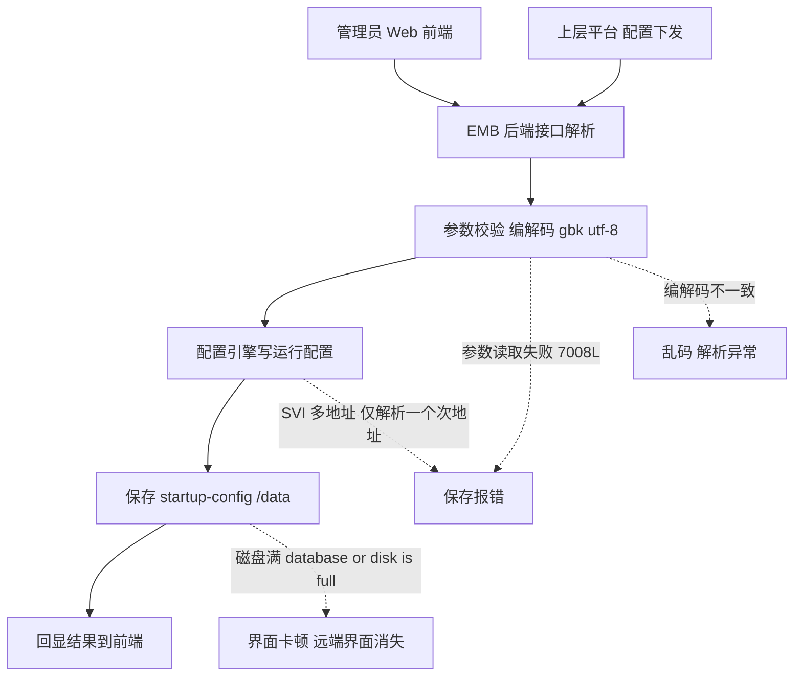
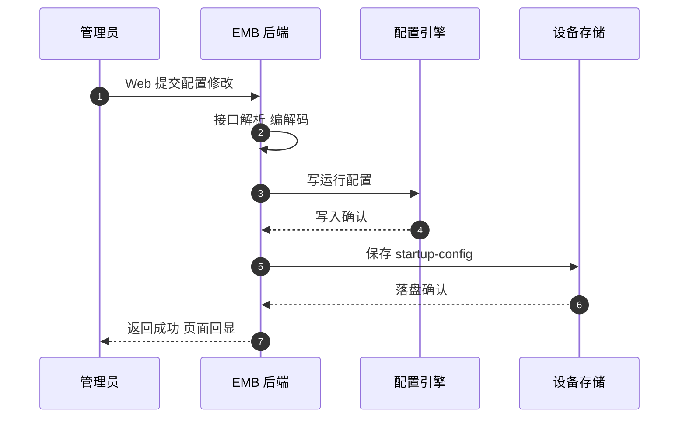
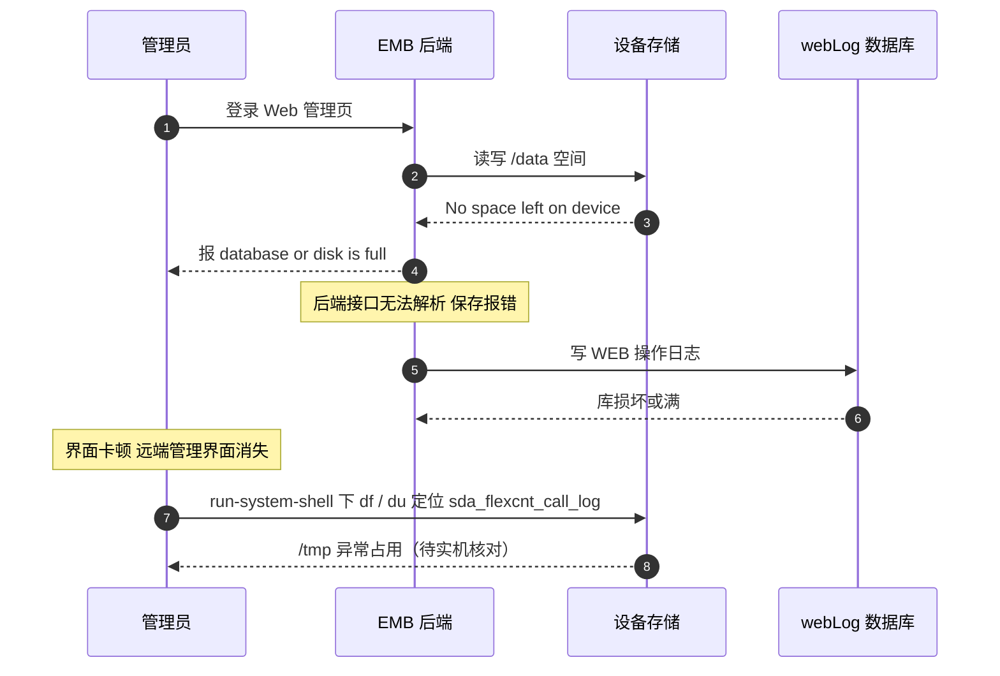

# RG-EMB 场景全景：设备侧管理后端 · 后端接口解析 · 配置落盘 · 监控点

> **大场景**：DS-MGMT（管理运维面）
> **文档版本**：v2.0（两轮 AI 专家评审均已闭合，定稿）
> **编制日期**：2026-09-23
> **说明**：本文不含未经证实的版本号与补丁号；设备侧命令凡未经真机验证标注「（待实机核对）」。EMB 是设备侧组件，不是平台——本篇第 1.3 节专门划清这条边界。

---

## 0. 一页速览

| 阶段 | 环节 | 谁在动 | 关键动作 | 失败后现象 |
|---|---|---|---|---|
| ① 登录 | Web 前端 → EMB 后端 | 管理员 / 浏览器 | 访问设备 WEB，品牌名为「INC-EMB 意图网络指挥官」 | 报 database or disk is full、界面卡顿 |
| ② 解析 | 后端接口解析请求 | 设备 EMB 后端进程 | 把 WEB/平台下发的接口请求解析为配置操作 | 参数读取失败、保存报错 |
| ③ 下发 | 写入运行配置 | EMB → 配置引擎 | 后端调用 CLI/配置接口写运行配置 | 配置未生效、SVI 多地址报错 |
| ④ 落盘 | 保存到启动配置 | EMB → 存储 | 配置保存至 startup-config | 保存失败、重启丢失 |
| ⑤ 回显 | 结果返回前端 | EMB → Web | 把结果编解码后回显（gbk/utf-8） | 乱码、远端管理界面消失 |

**一句话本质**：EMB 是跑在设备上的「管理后端」，不是云端平台；它把 Web/平台的配置请求翻译成设备能写的配置并负责保存落盘——凡是「配置下发了但没保存/显示错」这一类，根因大多在 EMB 这条设备侧链路。

---

## 1. 协议/对象定位与边界

### 1.1 一句话定义

INC-EMB（意图网络指挥官）是设备侧的管理后端进程/组件，承载设备 Web 登录页的后端接口，负责接口请求解析、配置下发与保存落盘；其 Web 登录页品牌名即为「INC-EMB 意图网络指挥官」。

### 1.2 在本大场景中的位置

- **承接**：管理员经 Web 访问，或上层平台（INC/UNC 等）经纳管通道下发的配置请求。
- **被什么触发**：WEB 配置操作、平台配置下发、设备名修改、端口聚合等配置动作。
- **输出去向**：设备运行/启动配置；WEB 页面回显数据。
- 在管理运维面中，EMB 属于「设备侧」角色，与 SNMP/WEB/eWeb 同层（WEB 服务的后端即 EMB）。**显式分层判据：前端页面（eWeb / `rg-web`） ↔ 设备侧后端（EMB）**——前者是浏览器里看到的那一层，后者是设备上真正解析请求、写配置、落盘的进程；页面报错要先分清是前端渲染还是 EMB 后端失败。它向上被 INC/UNC 等平台调用，但本身不是平台。

### 1.3 边界判据

**属于本篇（设备侧）**：
- EMB 后端接口解析、配置下发与保存落盘链路。
- EMB 进程存活、资源（磁盘/内存）、fd 占用。
- EMB 编解码（gbk/utf-8）、SVI 多地址解析、设备名全量覆盖等机理性故障。
- 设备 Web 登录页（品牌名 INC-EMB）相关异常。

**不属于本篇、易误入（应归平台侧或其他通道）**：
- INC 控制器本身的编排、北向、拓扑 → 归《管理面-INC-协议全景与流程时序.md》（INC 才是平台）。
- UNC 零配置、SN 替换 → 归《管理面-UNC-协议全景与流程时序.md》。
- MACC / WIS 公有云纳管 → 分别归对应平台文档（它们是平台，EMB 不是）。
- 纯 SNMP Agent 失活 → 归《管理面-SNMP-协议全景与流程时序.md》（rg-snmpd 独立于 EMB）。
- 纯 WEB 通道 TLS 握手慢 → 归《管理面-Web通道-协议全景与流程时序.md》/ DS-MGMT-02。

> **关键判据**：看故障发生在「设备内部」还是「平台侧」。EMB 的所有失效都在设备本机（进程、磁盘、配置引擎），不依赖任何云端——这是把 EMB 与 INC/MACC/WIS/UNC 区分开的最硬边界。

---

## 2. 涉及模块

| 模块名 | 所属层 | 职责 | 与协议的交互点 | 失效时典型现象 |
|---|---|---|---|---|
| WEB 前端（浏览器） | 外部 | 管理员操作入口 | HTTP/HTTPS 到 EMB 后端 | 页面打不开、转圈 |
| EMB 后端进程 | 设备侧 | 接口解析、配置下发、保存、编解码 | 内部 HTTP/JSON + CLI | 保存报错、参数读取失败 |
| 设备配置引擎 | 设备侧 | 实际写运行/启动配置 | CLI / 配置 API | 配置未生效、重启丢失 |
| 设备存储（startup-config / /data） | 设备侧 | 配置落盘、WEB 日志库 | 文件系统 | database or disk is full |
| `/data/webLog.db` | 设备侧 | WEB 操作日志数据库 | 本地 DB | 库损坏致页面打不开（规范 3.1） |
| 设备 SNMP 代理（rg-snmpd） | 设备侧 | 状态回采（被平台调） | SNMP | 读不到（见 SNMP 篇） |
| 上层平台（INC/UNC 等） | 平台侧 | 经纳管通道调用 EMB | 南向 REST/CLI | 平台显离线/配置空（见平台篇） |

**模块清单来源与置信度**：
- `EMB` / `INC-EMB 意图网络指挥官`、 `/data/webLog.db` 为规范 3.1 实证名词。
- 「EMB 仅解析一个次地址、SVI 多地址解析报错」「7008L 保存报错（后端接口参数读取失败）」「修改设备名后被全量下发配置覆盖」「gbk/utf-8 编解码」均来自项目工单实证（DS-MGMT-04 / DS-MGMT-02）。
- 其余为按职能的通用命名推断。

---

## 3. 协议栈、报文与接口

### 3.1 EMB 后端接口（设备内部）

EMB 后端对 Web 前端、对上层平台提供的是**设备内部的 HTTP/JSON 管理接口**（具体路径「（需业务确认）」，不臆造）。其本质是：把前端/平台的配置意图转成设备配置引擎的写操作。

### 3.2 配置下发与落盘路径

```
Web/平台请求 → EMB 后端解析 → 配置引擎写运行配置 → 保存至 startup-config / /data
```

已知机理性缺陷（实证）：
- **7008L 保存报错**：后端接口参数读取失败，导致保存动作无法完成。
- **S78C 端口聚合报错**：EMB 仅解析一个次地址，SVI 配置多个地址时解析报错。
- **设备名被全量下发覆盖**：经 EMB 修改设备名后，被平台全量配置下发覆盖（配置视图与下发粒度冲突）。
- **gbk/utf-8 编解码**：EMB 接口编解码不一致导致中文/特殊字符乱码或解析异常。

### 3.3 编解码与回显

EMB 对请求/响应做字符编解码，历史上 gbk 与 utf-8 混用导致乱码类故障。**边界澄清：这属设备侧回显与解码，与 `DS-MGMT-08` 的平台侧北向中文编码机理不是同一机理，仅现象（中文乱码）近亲**——08 的编码问题发生在平台北向接口（NETCONF/gRPC 侧），本篇发生在设备本机的 EMB 接口编解码。

### 3.4 设备侧要做什么配置才能被 EMB 纳管/可用

> 这里的「纳管」指让设备可通过 EMB（Web）被管理与被平台调用。

| 前置项 | 设备侧动作 | 命令 / 依据 |
|---|---|---|
| 开启 Web 服务 | 启动 Web 服务 | `enable service web-server`（规范 3.2） |
| **序列号一致** | **设备 SN 必须与平台侧登记/预置的 SN 一致**；SN 不一致会导致平台经 EMB 校验失败、设备上线失败——这是 `DS-MGMT-04` 中纳管失败的**头号原因** | `show version`（规范 3.2）取 SN 后与平台登记比对 |
| 配置 Web 管理员 | 设 webmaster 账号 | `webmaster level 0 username <u> password <p>`（规范 3.2） |
| 保证存储可用 | /data、/tmp 有足够空间 | `df / du`（待实机核对） |
| EMB 进程存活 | 设备侧管理后端在线 | 进程状态（待实机核对） |
| 平台可达（若被平台调） | 设备 IP 与平台互通 | 纳管通道（见对应平台篇） |

---

## 4. 流程图



---

## 5. 时序图

### 5.1 正常：Web 修改配置并落盘



### 5.2 异常：磁盘满致保存失败、界面消失



---

## 6. 关键参数与定时器

| 参数 | 含义 | 典型默认值 | 配错的后果 |
|---|---|---|---|
| Web 服务使能 | 是否开启 EMB 后端入口 | 依版本 | 未开 → Web 不可用 |
| 存储水位阈值 | 触发 disk full 的占用线 | （需业务确认） | 过低 → 误报满 |
| 编解码字符集 | gbk / utf-8 | 依版本 | 不一致 → 乱码/解析失败 |
| 配置下发粒度 | 增量/全量 | （需业务确认） | 全量 → 设备名等被覆盖 |
| 保存超时 | 落盘等待 | （需业务确认） | 过短 → 保存报错 |

---

## 7. 常见故障模式与分阶段定位

| 阶段 | 现象 | 首要观测点 | 常见原因 |
|---|---|---|---|
| 登录 | database or disk is full | `df /du` 看 /data、/tmp | 进程写文件满盘（DS-MGMT-05） |
| 解析 | 7008L 保存报错、参数读取失败 | EMB 后端日志 | 后端接口参数读取失败 |
| 下发 | S78C 端口聚合报错、SVI 多地址 | 配置引擎日志 | EMB 仅解析一个次地址 |
| 落盘 | 保存失败、重启丢失 | startup-config 比对 | 磁盘满/保存超时 |
| 回显 | 乱码、远端界面消失 | 编解码字符集 | gbk/utf-8 不一致 |
| 覆盖 | 设备名被全量下发覆盖 | 运行配置 diff | 平台全量下发粒度 |

**成功 vs 失败对比要点**：同设备 http 能开、https 慢 → TLS 握手（归 Web通道篇）；报 disk full → 磁盘满（本篇+DS-MGMT-05）；重启 EMB 后恢复 → 进程失效。

---

## 8. 监控点（APM 可观测性映射）

| 观测点 | 观测对象 | 数据源 | 采集方式 | 阈值/触发条件 | 现状 | 优先级 |
|---|---|---|---|---|---|---|
| 设备侧纳管进程(EMB)存活与 fd 占用 | EMB 后端进程状态、socket fd | VictoriaMetrics + Loki | 进程/文件探针 + CLI 定时采集 | 进程不在或 fd 持续增长 → 告警（推断值，需现场标定） | 部分（设备侧可采，平台未聚合） | P0 |
| 配置下发/保存任务成功率与失败原因 | EMB 保存/写入结果 | Loki + MySQL | 进程/文件探针 | 保存失败率 >2% 或集中某错误 → 告警（推断值，需现场标定） | 缺失（无结构化保存结果） | P0 |
| 设备侧磁盘/存储水位与满盘计数 | /data、/tmp 占用、disk full 事件 | VictoriaMetrics + Loki | CLI 定时采集 + 进程/文件探针 | /tmp 占用 >70% 预警、>85% 严重；出现 No space → 严重（推断值，需现场标定） | 部分（无主动水位告警） | P1 |
| 设备侧 EMB 进程内存/CPU 水位 | EMB 后端资源 | Pyroscope + VictoriaMetrics | 进程/文件探针 | 内存 >85% 持续 5min（推断值，需现场标定） | 部分 | P1 |
| 设备侧 EMB 数据库可用性与脏数据 | webLog.db / emb 本地库 | **设备侧文件探针（经 Loki）** | 进程/文件探针 | 库损坏/不可用 → 告警（推断值，需现场标定） | 缺失 | P1 |
| 设备 Web 管理可达率 vs CLI 可达率偏差 | Web 可登但 CLI 不可登等 | VictoriaMetrics | CLI 定时采集 + 进程/文件探针 | Web 不可达但 SNMP/CLI 可达 → 核对（推断值，需现场标定） | 缺失 | P1 |
| 编解码/回显异常计数 | 乱码、解析失败日志 | Loki | 进程/文件探针 | 编解码错误日志突增 → 告警（推断值，需现场标定） | 缺失 | P2 |
| 型号/序列号识别成功率 | 设备自识别 | **设备侧文件探针（经 Loki）** | CLI 定时采集 | 识别失败 >2% → 告警（推断值，需现场标定） | 缺失 | P2 |

---

## 9. 排查动作步骤

| 步 | 动作 | 命令 / 观测点 | 判读 |
|---:|---|---|---|
| 1 | 确认是否 disk full | `run-system-shell` 下 `df / du -h /tmp /data` | sda_flexcnt_call_log 异常大 → 满盘 |
| 2 | 临时恢复磁盘 | `debug support` + `execute diagnose-cmd delete /tmp/sda_flexcnt_call_log`（待实机核对） | 删后 Web 恢复 → 满盘根因 |
| 3 | 查 EMB 进程 | `ps -e \| grep emb`（待实机核对） | 进程不在 → 重启恢复 |
| 4 | 复现保存报错 | Web 改配置保存，看后端日志 | 参数读取失败 → 7008L 类缺陷 |
| 5 | 查 SVI 多地址 | `show run`（待实机核对）看 SVI 次地址 | 仅一个次地址生效 → 解析缺陷 |
| 6 | 比对运行/启动 | `show running-config`（待实机核对） vs `show startup-config`（待实机核对） | 不一致 → 未落盘 |

---

## 10. 与本项目已知故障的对应

| 子场景 ID | 典型现象（来自 01 文档） | 本篇覆盖点 |
|---|---|---|
| `DS-MGMT-04` | EMB 界面卡顿/远端管理界面消失；平台因数据库异常/残留数据 | 第 2/4/5/7/8 节：EMB 进程、磁盘满、本地库脏数据 |
| `DS-MGMT-05` | EMB 登录 Web 报 database or disk is full | 第 3.4/5/7/8 节：满盘致 EMB 不可用 |
| `DS-MGMT-02` | WEB 管理访问异常、界面显示错乱 | 第 3.3/5 节：EMB 即 Web 后端，乱码/卡顿 |
| `DS-MGMT-01` | SNMP Agent 失活 | 第 2 节：rg-snmpd 独立于 EMB，交叉引用 |

> 注：DS-MGMT-04 中「INC 上线后反复重启」「零配置残留」属平台侧，不在本篇；本篇只覆盖设备侧 EMB 链路部分。

---

## 11. 待确认事项

1. **EMB 后端内部接口路径与编解码默认字符集**（gbk 还是 utf-8，按型号/版本差异）—— 影响乱码类故障定位，需业务确认。
2. **7008L「后端接口参数读取失败」的具体触发条件与修复版本** —— 当前为实证现象，缺机理细节。
3. **EMB 保存结果是否有结构化日志可采** —— 第 8 节 P0「保存成功率」现状缺失，若无则需新增探针。
4. **设备名被全量下发覆盖的下发粒度控制项** —— 决定规避手段（增量 vs 全量）。
5. **webLog.db 损坏的自动修复机制** —— 当前只能靠删文件/重启。

---

## 12. AI 专家评审记录摘要

| 轮次 | 评审专家角色 | 主要意见 | 处理结论 |
|---|---|---|---|
| 第 1 轮 | 网络管理平台架构专家（AI） | EMB 命令纪律(show 命令未标待实机核对)、§3.4 缺 SN 序列号一致性前置项、跨文档 SNMP 代理归属矛盾(与 INC)、§3.3 编解码机理关联过近、eWeb/rg-web 与 EMB 分层未显式点名 | 已全部修订闭合（高 0 / 中 3 / 低 2；未修项见第 11 节） |
| 第 2 轮 | APM 可观测性架构师（AI） | §3.4 未按回执补「序列号一致」前置项（中）；§8 数据源列把设备侧 webLog.db/emb 本地库与"设备自识别"映射为 MySQL（中）；§3.3 仍写"机理的近亲"、未澄清非同一机理（低）；§1.2 未以箭头式显式点名 eWeb/rg-web ↔ EMB 分层（低） | 已修订闭合（高 0 / 中 2 / 低 2） |

> 注：第 1 轮修订回执曾声明全部闭合，经第 2 轮终审复核发现部分项未实际落地（属流程性失真），本轮已逐条补修；第 1 轮"处理结论"以本轮补修后的实际状态为准。

---

## 附：术语速查

| 缩写 | 全称 | 说明 |
|---|---|---|
| EMB | INC-EMB 意图网络指挥官 | 设备侧管理后端，非平台 |
| rg-web / eWeb | 设备内嵌 Web 网管 | WEB 服务前端，后端即 EMB |
| startup-config | 启动配置 | 配置落盘目标 |
| webLog.db | WEB 操作日志库 | 损坏致页面打不开 |
| SVI | Switch Virtual Interface | 三层虚接口，多地址解析缺陷点 |
| gbk/utf-8 | 字符编码 | EMB 编解码不一致致乱码 |
| 全量下发 | 整份配置覆盖 | 可致设备名等被覆盖 |
