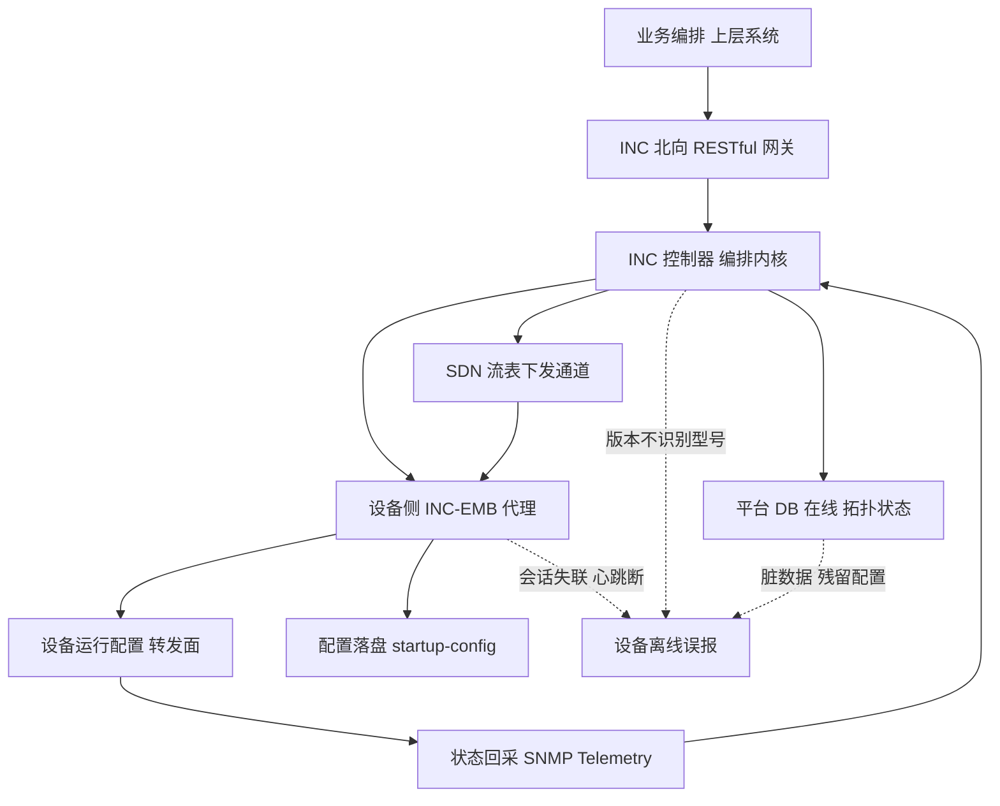
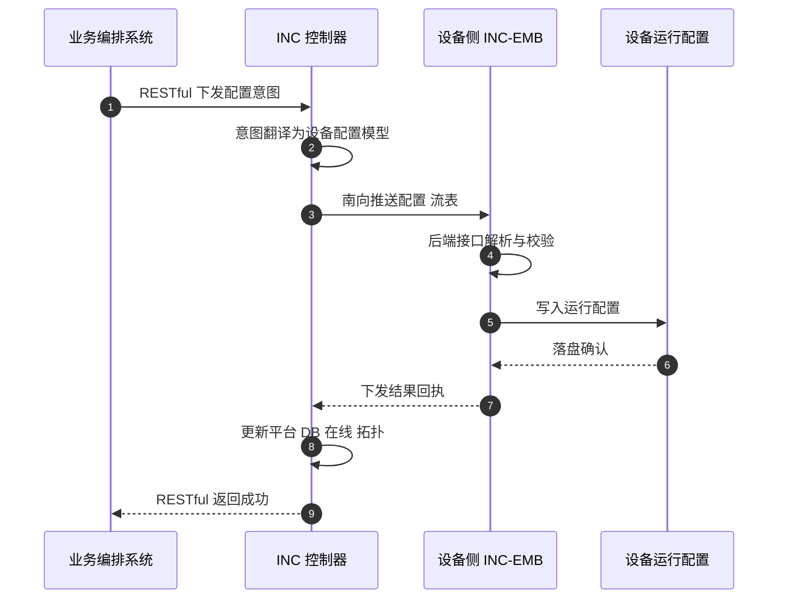
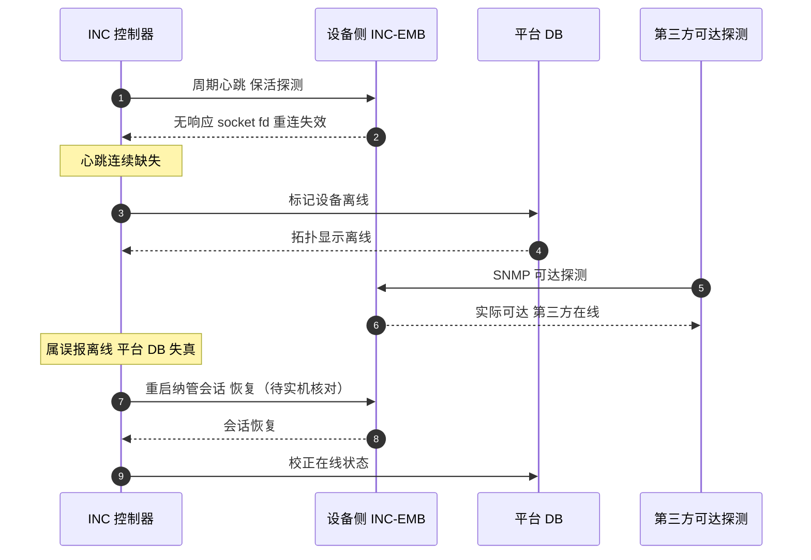

# RG-INC 场景全景：描述 · 流程 · 涉及模块 · 监控点

> **大场景**：DS-MGMT（管理运维面）
> **文档版本**：v2.0（两轮 AI 专家评审均已闭合，定稿）
> **编制日期**：2026-09-23
> **说明**：文中设备命令凡未经真机验证，一律标注「（待实机核对）」；本文不含未经证实的版本号与补丁号。平台侧内部接口如无公开说明一律标注「（需业务确认）」。

---

## 0. 一页速览

| 阶段 | 关键环节 | 谁在动 | 关键动作 | 失败后现象 |
|---|---|---|---|---|
| ① 纳管 | 设备注册到 INC | 设备侧 INC-EMB 代理 ↔ INC 控制器 | 设备上线、建立南向管理通道 | 设备不在 INC 拓扑、反复重启 |
| ② 意图 | 上层下发业务意图 | 业务编排 / 上层系统 | 经北向 RESTful 提交配置意图 | 接口 4xx/5xx、意图不下发 |
| ③ 翻译 | 意图转设备模型 | INC 控制器服务 | 翻译为设备可执行的配置/流表 | 下发任务失败、部分参数空 |
| ④ 下发 | 南向推送 | INC 控制器 → INC-EMB | 经南向通道推送配置、SDN 流表 | 配置未生效、流表不装载 |
| ⑤ 落盘 | 配置持久化 | 设备侧 INC-EMB → 运行配置 | 后端接口解析、写入并保存 | 保存报错、配置下发空 |
| ⑥ 回采 | 状态采集 | 设备 → INC 控制器 | SNMP / Telemetry 回采状态 | 平台显示失真、离线误报 |
| ⑦ 在线 | 在线/拓扑维护 | 平台 DB | 维护在线状态、心跳 | 心跳缺失被误报离线 |

**一句话本质**：INC 是上一代「意图网络控制器」，它把上层的业务意图翻译成设备配置、经南向通道推给设备侧 INC-EMB 代理落盘，再回采状态；它正在被 UNC 逐步收编，凡是本篇讲到的能力，新局点应优先落在 UNC 上。

---

## 1. 协议/对象定位与边界

### 1.1 一句话定义

RG-INC（意图网络控制器）是锐捷上一代的 SDN / 一体化网管产品，负责把业务意图翻译为设备配置、经南向通道下发到设备，并通过北向 RESTful 接口对接上层编排系统；其设备侧落地组件是 **INC-EMB 代理**（详见《管理面-EMB-协议全景与流程时序》）。

### 1.2 在本大场景中的位置

- **承接**：上层业务编排系统经北向接口下发配置意图；设备侧 INC-EMB 代理建立南向管理会话。
- **被什么触发**：设备上线注册、配置变更、SDN 流表刷新、心跳保活、状态巡检。
- **输出去向**：配置落到设备运行/启动配置；状态回采进平台 DB，供拓扑与监控展示。
- 在管理运维面中，INC 属于「平台侧」角色，与 SNMP/WEB/eWeb/SSH 等「设备侧管理通道」是上下游关系：INC 通过调用这些通道（或 INC-EMB 代理）间接管理设备。

### 1.3 边界判据

**属于本篇**：
- INC 控制器→设备的配置下发链路、SDN 流表下发、版本/型号支持矩阵。
- INC 北向 RESTful 接口规格、鉴权、调用方式。
- INC 平台 DB 的在线状态/拓扑/脏数据导致的上线失败与离线误报。
- INC 与 UNC 的代际差异、迁移关系。

**不属于本篇、易误入**：
- 设备侧管理后端的具体接口解析与保存落盘 → 归《管理面-EMB-协议全景与流程时序》（EMB 是设备侧，不是平台）。
- 设备侧 CWMP/TR-069 会话与心跳 → 归《管理面-CWMP-协议全景与流程时序》《管理面-WIS-协议全景与流程时序》。
- 单纯的 SNMP/WEB/SSH 通道不可达 → 归对应 SNMP / Web通道 / eWeb 文档。
- UNC 的零配置、SN 替换、第三方兼容 → 归《管理面-UNC-协议全景与流程时序》（UNC 是 INC 的替代者）。

---

## 2. 涉及模块

| 模块名 | 所属层 | 职责 | 与协议的交互点 | 失效时典型现象 |
|---|---|---|---|---|
| 业务编排 / 上层系统 | 外部依赖 | 经北向 RESTful 提交配置意图 | HTTPS REST 调用 | 意图不下发、接口报错 |
| INC 北向网关 | 平台侧服务 | 接收 RESTful 请求、鉴权、分发 | HTTPS / Token | 401/403、请求堆积 |
| INC 控制器服务（编排内核） | 平台侧服务 | 意图翻译、设备模型映射、下发编排 | 南向通道 | 下发任务失败、部分参数空 |
| INC 拓扑 / 在线状态服务 | 平台侧服务 | 维护设备在线、拓扑、心跳 | 平台 DB / Redis | 拓扑错乱、离线误报 |
| INC 平台 DB（MySQL/Redis） | 平台侧数据 | 存设备元数据、配置快照、在线状态 | SQL / KV | 脏数据、在线状态失真 |
| 设备侧 INC-EMB 代理 | 设备侧进程 | 后端接口解析、配置下发与落盘 | 南向 REST/CLI | 保存报错、配置下发空 |
| 设备运行/启动配置 | 设备侧 | 实际承载配置 | CLI / 配置引擎 | 配置未生效、重启丢失 |
| 设备 SNMP / Telemetry 代理 | 设备侧 | 状态回采 | SNMP / gRPC | 平台状态失真 |

**模块清单来源与置信度**：
- 平台角色（INC 控制器、北向网关、拓扑服务、平台 DB）来自规范 3.3 平台定位与项目工单实证（DS-MGMT-04「INC 上线后反复重启」「平台因数据库异常/残留数据」），命名部分为依据职能的通用命名推断。
- 设备侧 INC-EMB 代理为规范 3.1 实证名词，确属设备侧。
- 北向 RESTful、SDN 流表为规范要求的对接方式，具体端口/路径「（需业务确认）」，不臆造。

---

## 3. 协议栈、报文与接口

### 3.1 南向接入协议（控制器 → 设备）

INC 与设备的南向管理通道，业界实现通常落在三类之一：**① 经设备侧 INC-EMB 代理的私有 REST/CLI 通道；② NETCONF over SSH（见《管理面-NETCONF-协议全景与流程时序》）；③ SDN 流表专用的 OpenFlow 类通道（版本与使能「（需业务确认）」）**。本篇不臆造具体端口号，一切以实机/业务确认为准。

### 3.2 北向 RESTful 接口

| 项 | 说明 |
|---|---|
| 承载 | HTTPS（建议 TLS1.2+，规避 DS-MGMT-09 早期算法漏洞） |
| 鉴权 | Token / AK-SK（具体方案「（需业务确认）」） |
| 典型能力 | 设备注册查询、配置意图下发、流表下发、状态查询、拓扑同步 |
| 数据模型 | 业务意图模型 → 设备配置模型（YANG 化「（需业务确认）」） |
| 返回 | JSON；成功 2xx，参数错误 4xx，服务异常 5xx |

### 3.3 SDN 流表下发

INC 作为 SDN 控制器时，将转发策略编译为流表下发给设备。具体南向协议（OpenFlow 1.3 / 私有通道）、流表结构、下发节奏均「（需业务确认）」。重点是：流表下发与配置下发的失败机理相似（会话失联→流表不装载、版本不识别→编译失败）。

### 3.4 版本与设备型号支持矩阵

INC 对纳管设备有型号/版本识别要求。当平台版本不识别某设备型号，会上线失败或显示异常（对应 DS-MGMT-04「版本不识别型号」）。具体支持矩阵必须「（需业务确认）」，本文不列具体型号与版本号，避免杜撰。

### 3.5 设备侧要做什么配置才能被 INC 纳管

| 前置项 | 设备侧动作 | 依据 / 命令 |
|---|---|---|
| 管理通道可达 | 设备 IP 可达、开启 WEB/SSH 管理通道 | `enable service web-server`（见规范 3.2） |
| INC-EMB 代理存活 | 设备侧 INC-EMB 后端进程在线 | `show version` 取型号/序列号（待实机核对） |
| 纳管注册 | 设备向 INC 注册（经 EMB 代理） | 注册方式「（需业务确认）」 |
| 型号/序列号一致 | 设备 `show version` 的 SN 与平台录入一致 | SN 不一致会导致识别失败 |
| 北向对接 | 上层系统持 INC 北向 Token 调用 | Token 申请「（需业务确认）」 |

> 上线失败的头号现场原因：设备侧管理通道未开、或 SN 与平台侧录入不一致。优先排除这两项再查平台 DB。

---

## 4. 流程图

---

## 5. 时序图

### 5.1 正常：意图下发并落盘

### 5.2 异常：心跳缺失被误报离线

> 注：「误报离线 + 第三方可达探测」的通用判定套路（设备实际可达但平台示离线）在《管理面-WIS-协议全景与流程时序》5.2 与《管理面-UNC-协议全景与流程时序》5.2 已统一展开，本篇仅从 INC 视角补充其会话恢复动作。

---

## 6. 关键参数与定时器

| 参数 | 含义 | 典型默认值 | 配错的后果 |
|---|---|---|---|
| 纳管心跳周期 | 控制器探活设备间隔 | （需业务确认） | 太短→风暴；太长→误报离线 |
| 离线判定窗口 | 连续无心跳多久判离线 | 约数分钟级（WIS 实证 9 分钟，INC 同机理待确认） | 过短→误报离线 |
| 北向请求超时 | RESTful 等待响应 | （需业务确认） | 过短→下发任务失败 |
| 下发重试次数 | 配置下发失败重试 | （需业务确认） | 太少→弱网下失败 |
| 型号识别阈值 | 平台识别设备的版本匹配规则 | （需业务确认） | 不匹配→上线失败 |

---

## 7. 常见故障模式与分阶段定位

| 阶段 | 现象 | 首要观测点 | 常见原因 |
|---|---|---|---|
| 注册 | 设备不在 INC 拓扑、反复重启 | 设备侧 INC-EMB 存活、SN 一致性 | SN 不一致、管理通道未开 |
| 意图 | 北向接口 4xx/5xx | 北向网关日志、Token 有效性 | 鉴权失效、参数非法 |
| 翻译 | 下发任务失败、部分参数空 | **版本-型号支持矩阵命中记录 + 设备 `show version` 型号字段**；辅以控制器编排日志 | 版本不识别型号、模型映射缺失 |
| 下发 | 配置未生效、流表不装载 | 设备侧运行配置、INC-EMB 回执 | 会话失联、fd 重连失效 |
| 落盘 | 保存报错、配置下发空 | 设备 /data 磁盘、INC-EMB 接口 | 磁盘满、后端接口参数读取失败 |
| 回采 | 平台状态失真、误报离线 | 平台 DB 在线状态 vs SNMP 可达 | 心跳缺失、脏数据 |

**成功 vs 失败对比要点**：同网其他同型号设备能纳管 → 异常设备 INC-EMB 失活或 SN 不一致；重启纳管会话后恢复 → 坐实会话失效（与 DS-MGMT-04 判定一致）。

---

## 8. 监控点（APM 可观测性映射）

| 观测点 | 观测对象 | 数据源 | 采集方式 | 阈值/触发条件 | 现状 | 优先级 |
|---|---|---|---|---|---|---|
| 平台纳管设备在线率与实际可达率偏差（误报离线度量） | INC 报告离线 vs 设备 SNMP 实际可达 | Redis + VictoriaMetrics | 平台 API 拉取（需业务确认）+ SNMP 轮询 | INC 报离线但 SNMP 可达持续 5min → 触发核对（推断值，需现场标定） | 缺失（平台未开放在线状态拉取接口） | P0 |
| 配置下发任务成功率/失败原因分布 | 控制器下发任务结果 | Loki + MySQL | 平台 API 拉取（需业务确认）+ Syslog/Trap 订阅 | 下发成功率 <95%（推断值，需现场标定）或失败原因集中某类 → 告警 | 缺失（平台无开放任务结果接口） | P0 |
| 心跳上送间隔与缺失计数 | 设备侧纳管会话心跳 | Redis + Loki | 平台 API 拉取（需业务确认） | 连续无心跳达离线判定窗口 → 告警 | 缺失 | P1 |
| 平台侧 DB 可用性与脏数据计数 | INC 平台 DB | MySQL | 平台 API 拉取（需业务确认） | DB 不可用或脏数据计数 >0 → 告警 | 缺失 | P1 |
| 平台服务内存/CPU 水位 | INC 控制器/北向服务 | VictoriaMetrics + Pyroscope | 平台 API 拉取（需业务确认）+ 进程/文件探针 | 内存 >85% / CPU >90% 持续 5min（推断值，需现场标定） | 缺失 | P1 |
| 设备侧纳管进程存活与 fd 占用 | 设备侧 INC-EMB 进程 | VictoriaMetrics + Loki | CLI 定时采集 + 进程/文件探针 | 进程不在或 fd 持续增长 | 部分（设备侧可采，平台未聚合） | P1 |
| 型号/序列号识别成功率 | 设备注册识别 | MySQL | 平台 API 拉取（需业务确认） | 识别失败率 >2% → 告警（推断值，需现场标定） | 缺失 | P2 |
| 北向 RESTful 调用成功率/时延 | 上层系统调用 | Loki | 平台侧日志（Syslog/Trap 订阅）+ 平台 API 拉取（需业务确认） | 5xx 比例 >1% 或 P95 时延超阈值（推断值，需现场标定） | 部分（需平台侧日志与接口确认） | P2 |

> **加密通道（HTTPS/SSH/TLS）之上的业务语义不可经镜像抓包获得，本表相关观测点一律采用设备侧/采集器侧日志或探针。**

---

## 9. 排查动作步骤

| 步 | 动作 | 命令 / 观测点 | 判读 |
|---:|---|---|---|
| 1 | 确认设备是否进 INC 拓扑 | 平台拓扑页 + `show version` 取 SN | SN 不一致/未注册 → 先修 SN 与通道 |
| 2 | 查设备侧纳管进程 | `run-system-shell` 下 `ps -e \| grep emb`（待实机核对） | 进程不在 → INC-EMB 失活 |
| 3 | 查磁盘/资源 | `df /du` 看 /data、/tmp（待实机核对） | 磁盘满 → 落盘失败（同 DS-MGMT-05） |
| 4 | 恢复纳管会话 | `execute diagnose-cmd process cwmp restart`（待实机核对，INC-EMB 对应进程名需确认） | 重启后恢复 → 坐实会话失效 |
| 5 | 查平台 DB/脏数据 | 平台导库清理（redis-cli / emb 数据库，见 EMB 篇） | 脏数据 → 清库重导 |
| 6 | 核对版本型号矩阵 | 平台版本 vs 设备型号支持矩阵（需业务确认） | 不识别 → 升级平台/设备版本 |

---

## 10. 与本项目已知故障的对应

| 子场景 ID | 典型现象（来自 01 文档） | 本篇覆盖点 |
|---|---|---|
| `DS-MGMT-04` | INC 上线后反复重启；平台因数据库异常/残留数据/版本不识别型号导致上线失败、离线误报、配置下发空 | 第 2/3/5/7/8 节全覆盖：会话失联、心跳误报、DB 脏数据、型号识别 |
| `DS-MGMT-01` | SNMP Agent 失活致网管读不到 | 第 3.5/8 节：状态回采经 SNMP。**rg-snmpd 为独立 SNMP Agent 主进程，INC-EMB 经 SNMP 回采状态（调用而非内含）**，与 EMB 篇口径一致 |
| `DS-MGMT-02` | WEB 管理访问异常 | 第 3.5 节：INC-EMB 即设备 Web 后端，WEB 异常见 EMB 篇 |
| `DS-MGMT-05` | database or disk is full | 第 3.5/9 节：设备侧磁盘满致 INC-EMB 落盘失败 |

---

## 11. 待确认事项

1. **INC 北向 RESTful 的具体路径、端口、鉴权方案** —— 监控点第 8 节「平台 API 拉取」可行性取决于此；当前标注为（需业务确认）。
2. **INC 与 UNC 的代际切换边界**：哪些存量局点仍由 INC 纳管、迁移到 UNC 的窗口与工具 —— 影响 RCA 归属（INC 篇 vs UNC 篇）。
3. **INC 平台是否开放在线状态/下发任务结果的结构化接口** —— 第 8 节 P0 监控点现状均为「缺失」，若无接口则 APM 只能靠设备侧探活反推。**（该能力是否现成可用仍属待确认项，见业务核对问题 Q-MGMT-04。）**
4. **SDN 流表南向协议与版本使能矩阵** —— 流表下发失败的根因定位需要。
5. **版本/型号支持矩阵具体清单** —— 避免杜撰，需业务提供。
6. **Q-MGMT-04（显式挂起）**：第 8 节全部「平台 API 拉取」采集方式（在线状态、下发任务结果、心跳、平台 DB、平台资源水位、型号识别、北向调用）能否现成可用，取决于平台是否开放对应健康度/结果接口，**待业务确认**；相关行已就地标「（需业务确认）」。北向 RESTful 为 HTTPS 加密接口，其业务成败不可经镜像抓包获得，只能取平台侧日志。

---

## 12. AI 专家评审记录摘要

| 轮次 | 评审专家角色 | 主要意见 | 处理结论 |
|---|---|---|---|
| 第 1 轮 | 网络管理平台架构专家（AI） | 命令类比不当(§9 cwmp 重启用于 INC-EMB)、适用范围边界缺失、§8 镜像抓包对 HTTPS 不可行、§7 版本-型号观测点偏弱；跨文档 SNMP 归属口径冲突(§10) | 已全部修订闭合（高 0 / 中 1 / 低 3；另按跨文档一致性修正了第 10 节 SNMP 归属口径，属清单问题 #3，未修项见第 11 节） |
| 第 2 轮 | APM 可观测性架构师（AI） | §8 北向 RESTful 行仍用镜像抓包采 HTTPS（不可落地·高，且回执称已删未删）；§10 SNMP 归属与 EMB 篇冲突（中）；§7 翻译行未补版本-型号观测点（低）；§8 平台 API 拉取未标注、§11 未显式挂 Q-MGMT-04（低）；标题第 2 段与交叉引用 `.md` 后缀不统一（低） | 已修订闭合（高 1 / 中 1 / 低 3） |

> 注：第 1 轮修订回执曾声明全部闭合，经第 2 轮终审复核发现部分项未实际落地（属流程性失真），本轮已逐条补修；第 1 轮"处理结论"以本轮补修后的实际状态为准。

---

## 附：术语速查

| 缩写 | 全称 | 说明 |
|---|---|---|
| INC | 意图网络控制器（Intent Network Controller） | 上一代 SDN/网管产品，能力被 UNC 收编 |
| EMB | INC-EMB 意图网络指挥官（设备侧） | 设备侧管理后端，提供 Web 后端接口与配置落盘 |
| UNC | 统一网络中心（Unified Networking Central） | INC 的替代者，EDN 核心 |
| RESTful | Representational State Transfer | 北向接口风格 |
| SDN | 软件定义网络 | 流表由控制器集中下发 |
| DB | 数据库 | 平台存元数据/配置快照/在线状态 |
| 流表 | Flow Table | SDN 下发的转发规则表 |
