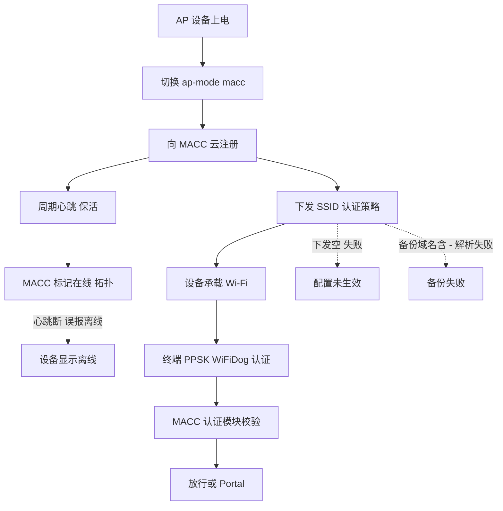
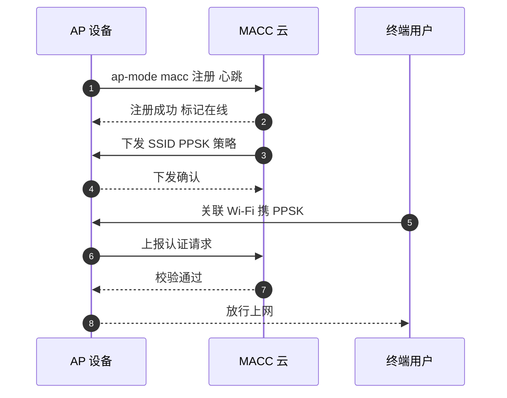
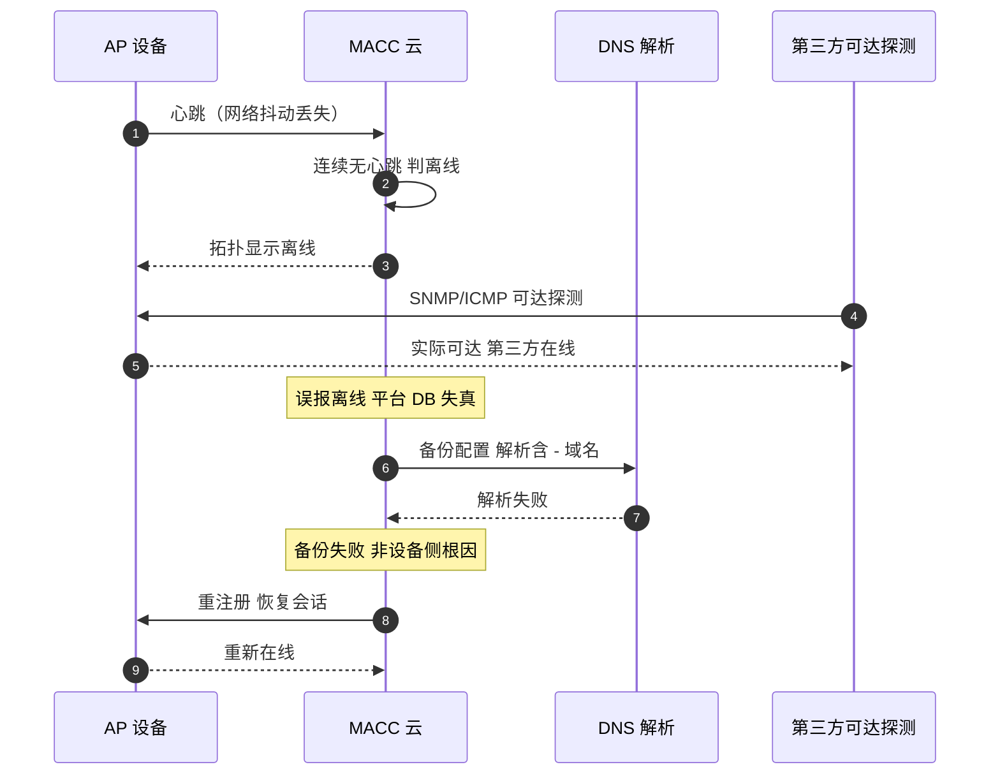

# RG-MACC 场景全景：诺客云 Wi-Fi 管理 · 公有云纳管 · 认证对接 · 监控点

> **大场景**：DS-MGMT（管理运维面）
> **文档版本**：v2.0（两轮 AI 专家评审均已闭合，定稿）
> **编制日期**：2026-09-23
> **说明**：本文不含未经证实的版本号与补丁号；设备侧命令凡未经真机验证标注「（待实机核对）」。平台侧内部接口如无公开说明标注「（需业务确认）」。

---

## 0. 一页速览

| 阶段 | 环节 | 谁在动 | 关键动作 | 失败后现象 |
|---|---|---|---|---|
| ① 注册 | AP/设备上线 MACC | 设备（`ap-mode macc`（待实机核对））↔ MACC 云 | 设备以 macc 工作模式注册到公有云 | 设备不在 MACC、无法纳管 |
| ② 保活 | 心跳上送 | 设备 ↔ MACC 云 | 周期心跳维持在线 | 心跳断 → 误报离线 |
| ③ 配置 | Wi-Fi/策略下发 | MACC 云 → 设备 | 下发 SSID、PPSK、WiFiDog 等 | 配置下发空、认证不生效 |
| ④ 认证 | 用户接入认证 | 终端 ↔ 设备 ↔ MACC/认证 | PPSK / WiFiDog Portal 认证 | 用户上不了网、Portal 弹不出 |
| ⑤ 备份 | 配置备份 | MACC 云 → 设备/存储 | 云端备份设备配置 | 备份失败（域名含『-』解析失败） |

**一句话本质**：MACC 是面向睿易/中小微与分支连锁的公有云 Wi-Fi 管理平台；设备侧多以 `ap-mode macc`（待实机核对）工作模式上云，平台侧重点在认证（PPSK/WiFiDog）与配置/备份——它与 WIS 同是公有云，但定位在「睿易/中小微 Wi-Fi」，对接重心不同。

---

## 1. 协议/对象定位与边界

### 1.1 一句话定义

RG-MACC（诺客云 Wi-Fi 管理系统平台）是锐捷面向睿易/中小微网络与分支连锁的公有云 Wi-Fi 管理平台，设备侧多以 `ap-mode macc`（待实机核对）工作模式接入，平台侧重 Wi-Fi 认证（PPSK、WiFiDog（需业务确认））与配置/备份管理。

### 1.2 在本大场景中的位置

- **承接**：分支门店/中小微网络的 AP 与网关设备上云；上层运营经 MACC 做认证与策略。
- **被什么触发**：设备上电注册、心跳保活、配置/认证策略变更、配置备份。
- **输出去向**：设备 Wi-Fi 配置与认证策略；云端配置备份。
- 在管理运维面中，MACC 属「平台侧（公有云）」角色，与 WIS 同组（见分篇定位纪律），区别在于面向设备定位（睿易/中小微 vs 行业设备）与对接协议（认证/PPSK/WiFiDog vs CWMP/无线网优）。**同一设备能否同时被两个云平台纳管，待确认**（见第 11 节项 5）。

### 1.3 边界判据

**属于本篇**：
- MACC 云对设备的注册/心跳/配置下发链路。
- `ap-mode macc` 工作模式相关。
- PPSK / WiFiDog 等 Wi-Fi 认证对接。
- MACC 配置备份失败（如域名含『-』解析失败）。

**不属于本篇、易误入**：
- WIS 的 CWMP/TR-069 接入与无线网优 → 归《管理面-WIS-协议全景与流程时序.md》。
- INC/UNC 的园区网管与零配置 → 分别归对应平台篇。
- 设备侧 EMB 后端 → 归《管理面-EMB-协议全景与流程时序.md》（EMB 不是平台）。
- 纯 RADIUS/802.1X 认证（非 PPSK/WiFiDog）→ 归认证大场景（DS-AUTH）/《802.1X 认证流程与报文交互全景.md》。

---

## 2. 涉及模块

| 模块名 | 所属层 | 职责 | 与协议的交互点 | 失效时典型现象 |
|---|---|---|---|---|
| 终端设备（AP/网关） | 设备侧 | `ap-mode macc` 注册、保活、承载 Wi-Fi | 云管理通道 HTTPS | 不在 MACC、心跳断 |
| 设备 macc 工作模式进程 | 设备侧 | 云通道客户端、认证转接 | 内部进程 | 模式未切、注册失败 |
| MACC 公有云服务 | 平台侧 | 注册、配置、认证、备份 | HTTPS / 云 API | 误报离线、下发空 |
| MACC 认证模块（PPSK/WiFiDog） | 平台侧 | 用户接入认证 | Portal / 认证协议 | 上不了网、Portal 弹不出 |
| MACC 配置/备份存储 | 平台侧 | 存配置快照、备份 | 对象存储/DB | 备份失败（域名解析） |
| 域名/DNS 依赖 | 外部 | 解析 MACC 域名 | DNS | 含『-』域名解析失败致备份失败 |
| 终端用户 | 外部 | Wi-Fi 接入认证 | PPSK/WiFiDog | 认证失败 |

**模块清单来源与置信度**：
- `ap-mode macc` 工作模式、PPSK/WiFiDog、MACC 备份因域名含『-』解析失败来自项目工单实证（DS-MGMT-04）。
- 平台服务/认证模块为按职能的通用命名推断。

---

## 3. 协议栈、报文与接口

### 3.1 云管理通道（设备 ↔ MACC）

设备以 `ap-mode macc` 工作模式，经 HTTPS 向 MACC 公有云注册并保活。具体注册端口、路径、心跳字段「（需业务确认）」，不臆造。

### 3.2 Wi-Fi 认证对接

| 认证方式 | 说明 | 适用 |
|---|---|---|
| PPSK | 每用户/每终端独立预共享密钥，由 MACC 下发与管理 | 中小微/分支连锁的分 role 接入 |
| WiFiDog（需业务确认） |  portal 型认证，终端重定向到 MACC Portal 做认证 | 访客/Portal 场景 |

两者均经 MACC 平台侧认证模块完成，与 802.1X/RADIUS 是不同体系（见边界 1.3）。WiFiDog 命名与协议细节须业务确认，避免臆测。

### 3.3 配置与备份

MACC 向设备下发 SSID、认证策略等；并周期性把设备配置备份到云端。实证故障：备份因目标域名含『-』导致解析失败（DNS 侧限制），需规避或改用可达域名。

### 3.4 设备侧要做什么配置才能被 MACC 纳管

| 前置项 | 设备侧动作 | 命令 / 依据 |
|---|---|---|
| 切换工作模式 | AP 切到 macc 云模式 | `ap-mode macc`（待实机核对，依型号） |
| 互联网可达 | 设备能解析并访问 MACC 云域名 | `ping` MACC 域名（待实机核对） |
| 时间/NTP | 设备时间正确（证书/心跳校验） | NTP 配置（待实机核对） |
| 序列号一致 | `show version` SN 与 MACC 录入一致 | SN 不一致 → 识别失败 |
| 认证前置 | PPSK/WiFiDog 在 MACC 侧建策略 | 平台侧配置（需业务确认） |

> **纳管通道说明**：MACC 经**独立 HTTPS 云管理通道**纳管（非 CWMP/TR-069），**无需配置 `acs url` / `option 43`**（与 WIS 篇的 CWMP 通道不同）。设备侧关键前置仅为：工作模式切到 `macc`、域名可达、SN 一致——不要参照 WIS 篇去配 ACS URL/Option 43。
>
> 上线失败头号现场原因：工作模式未切到 `macc`、或设备无法解析 MACC 域名（含『-』类域名尤需核对 DNS）。

---

## 4. 流程图

---

## 5. 时序图

### 5.1 正常：AP 注册 + 用户 PPSK 认证

### 5.2 异常：心跳断误报离线 + 备份域名解析失败

> 注：「误报离线 + 第三方可达探测」的通用判定套路在《管理面-WIS-协议全景与流程时序.md》5.2 与《管理面-UNC-协议全景与流程时序.md》5.2 已统一展开，本篇仅从 MACC 视角补充其备份域名解析失败分支。

---

## 6. 关键参数与定时器

| 参数 | 含义 | 典型默认值 | 配错的后果 |
|---|---|---|---|
| 工作模式 | macc / 其他 | （需业务确认） | 非 macc → 无法上云 |
| 心跳周期 | 设备保活间隔 | （需业务确认） | 过长 → 误报离线 |
| 离线判定窗口 | 连续无心跳判离线条 | （需业务确认） | 过短 → 误报 |
| 认证超时 | PPSK/WiFiDog 校验等待 | （需业务确认） | 过短 → 认证失败 |
| 备份域名 | 备份目标地址 | （需业务确认） | 含『-』解析失败 |

---

## 7. 常见故障模式与分阶段定位

| 阶段 | 现象 | 首要观测点 | 常见原因 |
|---|---|---|---|
| 注册 | 设备不在 MACC | 工作模式、域名解析 | 未切 macc、DNS 不可达 |
| 保活 | 误报离线 | 心跳日志 vs 第三方可达 | 网络抖动、窗口过短 |
| 配置 | 下发空、认证不生效 | MACC 下发任务结果 | 下发失败、策略未建 |
| 认证 | 上不了网、Portal 不出 | 认证模块日志 | PPSK/WiFiDog 配置错 |
| 备份 | 备份失败 | 备份域名解析 | 含『-』域名解析失败 |

**成功 vs 失败对比要点**：同型号其他设备能上云 → 异常设备模式/网络问题；第三方监控在线但 MACC 显示离线 → 平台误报（同 DS-MGMT-04 判定）。

---

## 8. 监控点（APM 可观测性映射）

> 数据源与采集方式严格取自规范 3.5 载体与采集方式清单；"平台 API 拉取"是**采集方式**取值，不得填入数据源列。

| 观测点 | 观测对象 | 数据源 | 采集方式 | 阈值/触发条件 | 现状 | 优先级 |
|---|---|---|---|---|---|---|
| 平台纳管设备在线率与实际可达率偏差（误报离线度量） | MACC 报离线 vs 设备实际可达 | Redis + VictoriaMetrics | 平台 API 拉取（需业务确认）+ SNMP 轮询 | MACC 报离线但可达持续 5min → 核对（推断值，需现场标定） | 缺失（平台未开放接口） | P0 |
| 心跳上送间隔与缺失计数 | macc 模式设备心跳 | Redis + Loki | 平台 API 拉取（需业务确认） | 连续无心跳达判定窗口 → 告警（推断值，需现场标定） | 缺失 | P0 |
| 配置下发任务成功率/失败原因分布 | SSID/认证策略下发 | Loki + MySQL | 平台 API 拉取（需业务确认） | 下发成功率 <95% → 告警（推断值，需现场标定） | 缺失 | P1 |
| 平台侧 DB 可用性与脏数据计数 | MACC 平台 DB | MySQL | 平台 API 拉取（需业务确认） | **DB 不可用 或 脏数据计数环比增长 >N（推断值，需现场标定）→ 告警** | 缺失 | P1 |
| 平台服务内存/CPU 水位 | MACC 云服务 | VictoriaMetrics + Pyroscope | 平台 API 拉取（需业务确认）+ 进程/文件探针 | 内存 >85% / CPU >90%（推断值，需现场标定） | 缺失 | P1 |
| 设备侧纳管进程存活与 fd 占用 | macc 模式进程 | VictoriaMetrics + Loki | CLI 定时采集 + 进程/文件探针 | 进程不在/fd 增长（推断值，需现场标定） | 部分（命令可得但缺持续采集） | P1 |
| 认证成功率（PPSK/WiFiDog（需业务确认）） | 用户接入认证 | Loki + MySQL | 平台 API 拉取（需业务确认） | 认证失败率突增（如 5 分钟环比 >50%，推断值，需现场标定）→ 告警 | 缺失 | P1 |
| 型号/序列号识别成功率 | 设备注册识别 | MySQL | 平台 API 拉取（需业务确认） | 识别失败 >2% → 告警（推断值，需现场标定） | 缺失 | P2 |
| 备份成功率 | 配置备份任务 | MySQL + Loki | 平台 API 拉取（需业务确认） | 备份失败（含域名解析）→ 告警（推断值，需现场标定） | 缺失 | P2 |

---

## 9. 排查动作步骤

| 步 | 动作 | 命令 / 观测点 | 判读 |
|---:|---|---|---|
| 1 | 确认工作模式 | `show ap-mode`（待实机核对） | 非 macc → 切模式 |
| 2 | 测域名解析 | `ping` MACC 域名 / DNS 查 | 含『-』解析失败 → 备份根因 |
| 3 | 查 SN 一致 | `show version` | SN 不一致 → 识别失败 |
| 4 | 看平台在线 | MACC 拓扑页 | 第三方可达但显示离线 → 误报 |
| 5 | 查认证策略 | MACC 认证模块日志 | PPSK/WiFiDog 未建 → 用户上不了 |
| 6 | 看下发任务 | MACC 下发结果 | 下发空 → 平台侧失败 |

---

## 10. 与本项目已知故障的对应

| 子场景 ID | 典型现象（来自 01 文档） | 本篇覆盖点 |
|---|---|---|
| `DS-MGMT-04` | MACC 备份因域名含『-』解析失败；平台因数据库异常/残留数据导致上线失败、离线误报 | 第 2/3.3/4/5/7/8 节：注册、心跳误报、备份域名 |
| `DS-MGMT-01` | SNMP Agent 失活致网管读不到 | 第 8 节：设备可达率反推，交叉引用 |
| `DS-MGMT-02` | WEB 管理访问异常 | MACC 为云 Web，交叉引用 Web通道篇 |
| `DS-MGMT-05` | 磁盘/内存资源耗尽 | 第 8 节：设备侧 macc 进程资源（次要） |

---

## 11. 待确认事项

1. **MACC 是否开放设备在线状态/下发结果/认证结果的结构化接口** —— 第 8 节 P0/P1 多为「缺失」，且全表"平台 API 拉取"均标「（需业务确认）」；若无接口 APM 只能靠设备侧探活反推。各平台是否已有统一可观测健康度/接口、APM 能否直接拉取，见业务核对问题 **Q-MGMT-04**，未决。
2. **`ap-mode macc` 的切换命令与型号适用范围** —— 不同型号命令可能不同，需业务确认（本篇 §0/§1.1 已标「（待实机核对）」）。
3. **PPSK/WiFiDog 的协议细节与失败码** —— 认证类定位需要（WiFiDog 已标「（需业务确认）」）。
4. **含『-』域名解析失败的永久规避方案** —— 当前为实证现象，需平台侧处理。
5. **MACC 与 WIS 的重叠边界**（**同一设备能否同时被两个云平台纳管，待确认**） —— 影响 RCA 归属。

---

## 12. AI 专家评审记录摘要

| 轮次 | 评审专家角色 | 主要意见 | 处理结论 |
|---|---|---|---|
| 第 1 轮 | 网络管理平台架构专家（AI） | `ap-mode macc`/WiFiDog 未标待核对、§3.4 缺 CWMP/纳管地址配置说明（与 WIS 不对称）、§1.2 设备重叠边界未交代、平台监控 API 待确认未引 Q-MGMT-04 | 已全部修订闭合（高 0 / 中 1 / 低 4；未修项见第 11 节） |
| 第 2 轮 | APM 可观测性架构师（AI） | §8 全表"平台 API 拉取"未标（需业务确认）、§11 未挂 Q-MGMT-04（中）；§0 表/§0 本质/§1.1 的 `ap-mode macc` 三处未标待实机核对（低）；§1.2 未加"同设备双云纳管待确认"（低）；§1.1/§8 的 WiFiDog 未标（需业务确认）（低）；§8 阈值未标注（低） | 已修订闭合（高 0 / 中 1 / 低 4） |

> 注：第 1 轮修订回执曾声明全部闭合，经第 2 轮终审复核发现部分项未实际落地（属流程性失真），本轮已逐条补修；第 1 轮"处理结论"以本轮补修后的实际状态为准。

---

## 附：术语速查

| 缩写 | 全称 | 说明 |
|---|---|---|
| MACC | 诺客云 Wi-Fi 管理系统 | 面向睿易/中小微的公有云管平台 |
| macc 模式 | ap-mode macc | 设备云管理工作模式 |
| PPSK | Private Pre-Shared Key | 每用户独立预共享密钥认证 |
| WiFiDog（需业务确认） | — | Portal 型认证协议，命名与细节待业务确认 |
| Portal | 认证门户 | 重定向认证页 |
| 误报离线 | false offline | 平台示离线但设备实际可达 |
