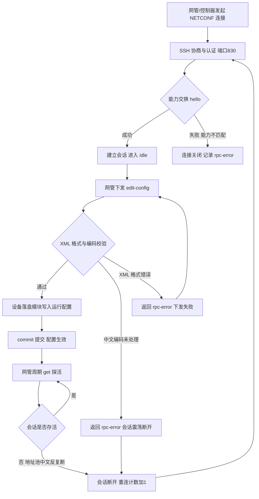
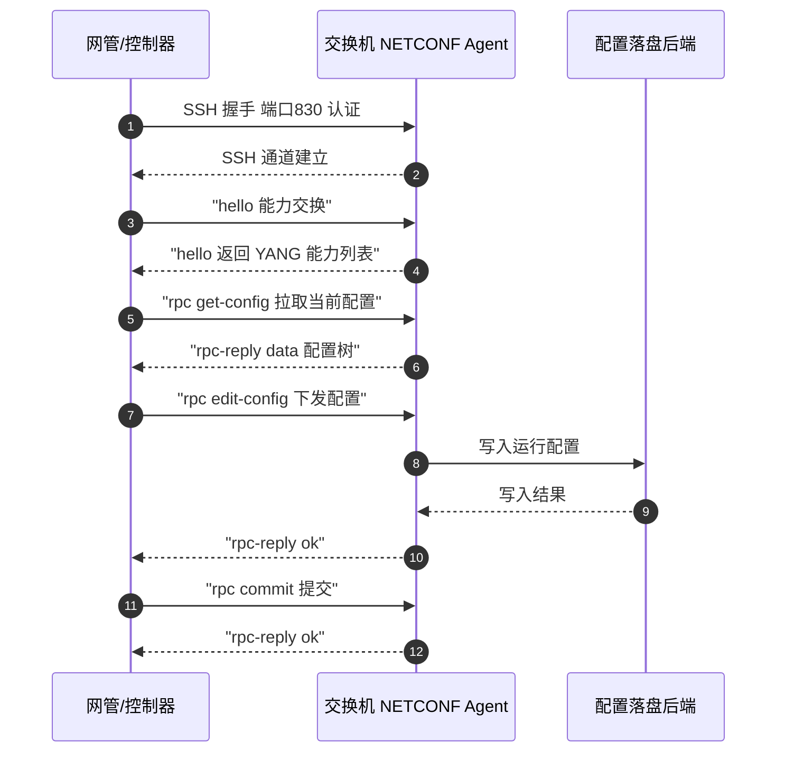
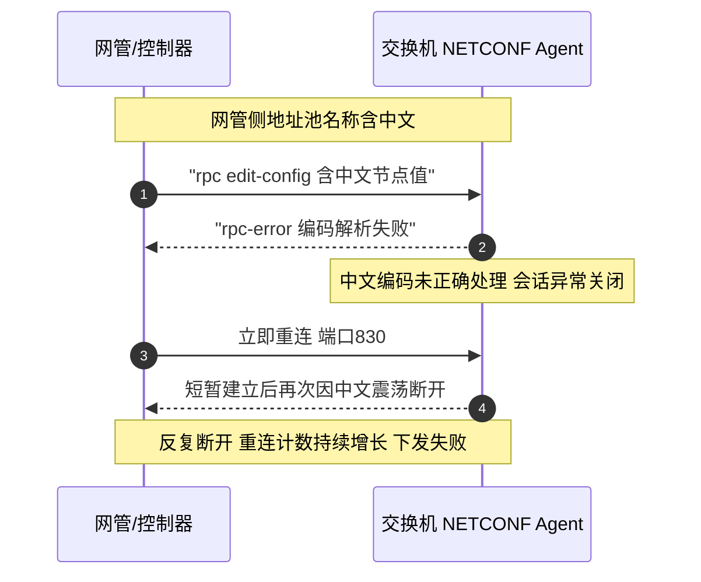
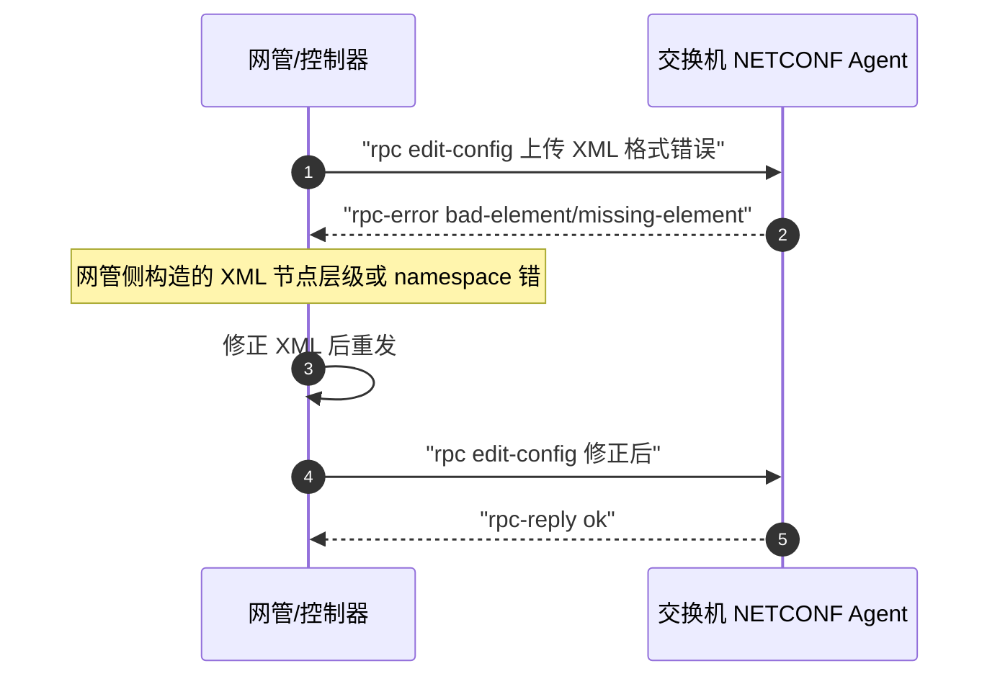

# NETCONF 协议全景：描述 · 流程 · 涉及模块 · 监控点

> **大场景**：DS-MGMT（管理运维面）
> **文档版本**：v2.0（两轮 AI 专家评审均已闭合，定稿）
> **编制日期**：2026-09-23
> **说明**：文中设备命令凡未经真机验证，一律标注「（待实机核对）」；本文不含未经证实的版本号与补丁号。

---

## 0. 一页速览

| 阶段 | 关键动作 | 执行者 | 失败后的现象 |
|---|---|---|---|
| ① 建链 | 网管经 SSH 端口 830 发起 NETCONF 连接 | 网管/控制器 | 连不上，提示 connection refused / timeout |
| ② 认证 | SSH 用户/密钥认证 | 设备 SSH 服务 | 认证失败，会话未建立 |
| ③ 能力交换 | `<hello>` 交换 YANG 能力清单 | 设备 Agent | 能力不匹配，部分节点不可读写 |
| ④ 读取 | `get` / `get-config` 拉配置与状态 | 网管 | 读到空树 / 节点缺失 |
| ⑤ 下发 | `edit-config` 写运行配置 | 网管→设备落盘 | 返回 `<rpc-error>`，下发失败 |
| ⑥ 提交 | `commit` / `copy-config` 落盘 | 设备 | 未持久化，重启丢失（DS-MGMT-07） |
| ⑦ 保活 | 网管侧探活（发 RPC / 依赖 SSH keepalive，非 NETCONF 协议内置保活） | 网管 | 会话静默断开，重连震荡 |

**一句话本质**：NETCONF 是「跑在 SSH 上的 XML 配置总线」——网管用一套标准化 RPC 对设备的 YANG 数据树做增删改查，设备用 `<ok>`/`<rpc-error>` 回执；震荡与下发失败绝大多数落在「编码/格式」与「能力不匹配」两端。

---

## 1. 协议/对象定位与边界

### 1.1 一句话定义

NETCONF（RFC 6241）是基于 SSH 传输、以 XML 编码、以 YANG 建模的网管配置协议，提供能力协商、配置读取（`<get-config>`）、配置修改（`<edit-config>`）、候选/运行/启动数据存储（datastore）区分与提交（`<commit>`）能力，是北向自动化下发的主干协议之一。

### 1.2 在本大场景中的位置

承接：网管/控制器（INC/UNC/第三方采集器）欲对设备做「可读、可写、可控」的配置与状态操作。被触发：由网管侧主动连接（dial-in 模式，区别于 gRPC Telemetry 的 dial-out）或设备侧零配置阶段由平台拉起。与同大场景的 SNMP（只读/弱写）、Web/eWeb（人肉界面）、CWMP/ACS（TR-069 云纳管）、gRPC/gNMI（流式 Telemetry 与 Set）并列，是本场景「配置下发」链路的核心协议之一。

### 1.3 边界判据

**属于本篇**：

- NETCONF over SSH 的建链、能力交换、`<get>`/`<get-config>`/`<edit-config>`/`<commit>`/`<lock>`/`<unlock>`/`<copy-config>`/`<discard-changes>` 操作
- NETCONF 会话的 XML 编码、节点路径、YANG 模型、`<rpc-error>` 返回结构
- 因地址池中文、XML 格式错误、能力缺失导致的下发失败与会话震荡

**不属于本篇、易误入**：

- SNMP 只读采集与 Trap 误报 → 见《管理面-SNMP-协议全景与流程时序》
- Web/eWeb 页面配置与界面错乱 → 见《管理面-Web通道-协议全景与流程时序》《管理面-eWeb-协议全景与流程时序》
- gRPC/gNMI 流式 Telemetry 订阅与 Set（HTTP/2+Protobuf，非 SSH+XML）→ 见《管理面-gRPC-协议全景与流程时序》
- CWMP/TR-069 云纳管（HTTP POST Inform，非 SSH）→ 见《管理面-CWMP-协议全景与流程时序》《管理面-ACS-协议全景与流程时序》
- SSH 登录本身的密钥交互崩溃（use-after-free 致重启）→ 见《01_管理运维面》DS-MGMT-03/06；本文仅涉及 SSH 作为 NETCONF 承载的认证层，不展开 SSH 协议栈
- 配置下发后未落盘/重启丢失（持久化机理）→ 见 DS-MGMT-07，本文只负责「下发动作是否成功」

---

## 2. 涉及模块

| 模块名 | 所属层 | 职责 | 与协议的交互点 | 失效时的典型现象 |
|---|---|---|---|---|
| NETCONF Agent（`netconfd`，设备侧常驻） | 设备侧进程 | 监听 SSH 子系统的 `netconf` 通道，处理 `<hello>` 与全部 `<rpc>` | SSH 830 端口、YANG 能力清单、RPC 分发 | 进程卡死/未起 → 网管连不上、下发挂起无回执 |
| SSH 服务（`sshd`，设备侧） | 设备侧进程 | 提供 SSH 传输与登录认证，承载 NETCONF | TCP 830/22、用户认证 | 认证失败/密钥交互崩溃 → 连接建立即断（易混 DS-MGMT-03/06） |
| 配置后端/CLI 落盘模块 | 设备侧组件 | 将 `edit-config` 转换为运行配置并写入，受 `commit` 提交 | datastore 运行/候选/启动、回执 `<ok>` | 落盘失败 → 配置不生效、重启丢失（DS-MGMT-07） |
| YANG 模型加载器 | 设备侧组件 | 启动时加载 YANG 模块，供 `<hello>` 能力交换 | `<hello>` 能力列表、节点路径解析 | YANG 不全 → `get`/`set` 节点缺失、能力不匹配 |
| 网管/控制器 NETCONF 客户端（INC/UNC/第三方） | 平台侧服务 | 发起连接、编排下发、周期采集 | 客户端 RPC 构造、任务队列 | 采集过激/编码错 → 会话震荡、下发失败 |
| 网管任务编排队列 | 平台侧服务 | 将批量配置拆为 RPC 并跟踪回执 | 下发任务状态、耗时统计 | 队列堆积 → 下发超时、回执丢失 |
| AAA/账号体系 | 外部依赖 | SSH 登录的账号/密码/密钥认证 | 认证拒绝日志 | 强密码策略误拒 → 会话未建立 |
| DNS/NTP/地址规划 | 外部依赖 | 地址解析、时间、地址池命名 | 地址池名称经 NETCONF 下发 | **地址池含中文 → 编码解析失败、会话反复断开（本项目实证）** |

**模块清单来源与置信度**：`netconfd`/`sshd`/配置后端/YANG 加载器为通用 NETCONF 实现命名推断，本项目工单（DS-MGMT-08 row 210、row 217）实证了「netconf 协议震荡」「地址池中文导致反复断开」「上传 XML 格式错致下发失败」等现象，但设备侧具体进程名以真机 `ps` 为准（待实机核对）。平台侧「网管 NETCONF 客户端 / 任务队列」来自本项目对 INC/UNC/小锐云服的描述。外部依赖中「地址池中文」为本项目明确实证。

---

## 3. 协议栈、报文与接口

### 3.1 协议栈与端口

```
网管/控制器 ──SSH(TCP 830 或 22)── 设备 SSH 服务 ──netconf 子系统── NETCONF Agent
            ↑ 承载层                               ↑ 应用层：XML over SSH
```

- 传输：SSH（RFC 6242 规定 NETCONF 走 SSH 的 `netconf` 子系统），默认端口 **830**，部分实现也用 **22**（待实机核对）。
- 编码：XML 1.0，`<rpc>` / `<rpc-reply>` 信封，`message-id` 关联请求与应答。
- 数据建模：YANG（RFC 7950）；NMDA（RFC 8342）引入 `<running>`/`<intended>`/`<operational>` 区分。

### 3.2 能力交换 `<hello>`

会话建立后首包互发 `<hello>`，携带 `<capabilities>` 列表，例如：

- `urn:ietf:params:netconf:base:1.1`（chunked 编码）
- `urn:ietf:params:xml:ns:yang:ietf-netconf-monitoring`
- 各厂商 YANG 模块命名空间

能力不匹配时，网管请求的节点在设备侧 YANG 中不存在 → 返回 `<rpc-error>`（error-tag `unknown-element` / `unknown-namespace`）。

### 3.3 基础操作（RFC 6241）

| 操作 | 作用 | 典型回执 |
|---|---|---|
| `<get>` | 读运行态数据（含 state） | `<rpc-reply><data>...</data></rpc-reply>` |
| `<get-config>` | 读指定 datastore（running/candidate/startup） | `<data>` 配置树 |
| `<edit-config>` | 对 datastore 增删改（merge/replace/delete/create） | `<ok>` 或 `<rpc-error>` |
| `<copy-config>` | 整库拷贝（如 candidate→running） | `<ok>` |
| `<commit>` | 提交候选到运行 | `<ok>` |
| `<lock>`/`<unlock>` | 排他锁，防并发写 | `<ok>` |
| `<discard-changes>` | 丢弃候选未提交改动 | `<ok>` |

### 3.4 返回结构

成功：`<rpc-reply message-id="x"><ok/></rpc-reply>`。

失败：`<rpc-error>` 内含 `<error-type>`（transport/rpc/protocol/application）、`<error-tag>`（如 `missing-element`/`bad-element`/`unknown-element`/`lock-denied`）、`<error-severity>`（error）、`<error-message>`（可读原因）、`<error-info>`。

**本项目实证的两个返回失败来源**：

1. **地址池中文**：网管下发的节点值含中文（如地址池名称），设备 XML 解析/编码处理异常 → 会话异常关闭并反复重连（row 210 协议震荡）。
2. **XML 格式错误**：网管构造的 XML 节点层级/属性/namespace 错（如上传的 `onc` 配置 XML 格式不对）→ `<rpc-error>` 下发失败。

### 3.5 通知（RFC 5277）

`<create-subscription>` 订阅设备事件通知（非 Telemetry 流式，区别于 gRPC）。本项目以配置下发为主，通知非重点。

### 3.6 与 SNMP/gRPC 的能力边界速查

| 维度 | NETCONF | SNMP | gRPC/gNMI |
|---|---|---|---|
| 传输 | SSH + XML | UDP + BER | HTTP/2 + Protobuf |
| 写能力 | 强（`edit-config`） | 弱（少数 writable 节点） | 强（`Set`） |
| 流式 | 否（通知非持续流） | Trap 非流式 | 是（`Subscribe`） |
| 数据建模 | YANG | MIB | YANG/OpenConfig |
| 本项目实证故障 | 地址池中文 / XML 格式错 | 会话被 bulkget 占满 | 版本能力缺失 |
| 适用 | 配置下发、存量网管 | 只读采集、告警 | 高频遥测、北向 Set |

---

## 4. 流程图



---

## 5. 时序图

### 5.1 正常下发时序



### 5.2 异常时序一：地址池中文导致反复断开（本项目实证）



### 5.3 异常时序二：XML 格式错误致下发失败（本项目实证）



---

## 6. 关键参数与定时器

| 参数 | 含义 | 典型默认值 | 配错的后果 |
|---|---|---|---|
| NETCONF 端口 | SSH 承载端口 | 830（或 22） | 端口错 → 连接 refused |
| `<hello>` 超时 | 能力交换等待 | 视实现（待实机核对） | 超时 → 会话未建立即断 |
| `message-id` | 请求/应答关联 | 网管自增 | 错乱 → 回执无法对应 |
| `edit-config` `operation` | merge/replace/delete/create | merge | 用错 → 误删/误覆盖配置 |
| `default-operation` | 默认节点行为 | merge | 设 none 时未显式节点不处理 |
| 锁超时（`<lock>`） | 排他锁持有 | 视实现（待实机核对） | 死锁 → 后续 edit-config 失败 |
| 网管采集周期 | 周期 `get` 探活 | 视网管（待实机核对） | 过短 → 会话占满/震荡 |
| 重连退避 | 断开后重连间隔 | 视网管（待实机核对） | 过激 → 地址池中文类反复震荡放大 |

### 6.1 并发写与锁竞争

`edit-config` 前建议 `<lock>` 排他锁，避免网管多任务并发写同一 datastore 相互覆盖。`lock-denied` 错误多因上一次会话未释放锁（异常断开后锁残留）。排查：查设备侧 netconfd 协议日志中 `<lock>`/`<unlock>` 的配对记录（镜像抓包不可解析 SSH 内 XML），确认异常断开后是否有锁回收机制（待实机核对）。

---

## 7. 常见故障模式与分阶段定位

| 阶段 | 现象 | 首要观测点 | 常见原因 |
|---|---|---|---|
| 建链 | 网管连不上 830 | `show ssh server status`（待实机核对）、830 端口监听、netconfd 进程 | Agent 未起/端口错/账号认证失败 |
| 能力 | 部分节点不可读写 | `<hello>` 能力列表、YANG 模块 | YANG 不全、版本能力缺失 |
| 编码 | 会话反复断开 | `<rpc-error>` 日志、节点值是否含中文 | **地址池中文编码异常（本项目实证）** |
| 格式 | 下发返回 rpc-error | XML 节点层级/namespace | **XML 格式错误（本项目实证）** |
| 落盘 | 下发 ok 但配置不生效 | `show running-config` vs `show startup-config` | 未 commit/未保存（DS-MGMT-07） |
| 保活 | 周期探活超时 | 网管探活成功率、重连计数 | 采集过激、地址池中文震荡 |

**成功 vs 失败对比要点**：同一网管下其它同型号设备能正常 NETCONF 下发 → 异常设备 Agent 失效或 YANG 缺失；异常设备把含中文/错格式 XML 改成英文数字、修正层级后即成功 → 坐实「编码/格式」根因，而非设备缺陷。

### 7.1 配置落盘与 commit 链路

`edit-config` 写入候选/运行后必须 `commit` 才会进入运行态；是否同时写启动配置取决于设备实现与 `copy-config` 调用。本项目「下发 ok 但重启丢失」归 DS-MGMT-07，本篇仅校验「下发动作成功」，落盘连续性需在 07 篇用 `show running-config` vs `show startup-config` 比对。

---

## 8. 监控点（APM 可观测性映射）

| 观测点 | 观测对象 | 数据源 | 采集方式 | 阈值/触发条件 | 现状 | 优先级 |
|---|---|---|---|---|---|---|
| NETCONF 会话在线状态与重连次数 | 设备 NETCONF 会话存活、单位时间重连次数 | VictoriaMetrics（状态值）+ Loki（重连日志） | CLI 定时采集 + Syslog/Trap 订阅（设备侧 netconfd 协议日志）+ 镜像抓包（仅限 SSH 握手与报文长度统计，**不可解析会话内 XML**） | 5 分钟内重连次数 > 10 次 → 震荡告警（推断值，需现场标定）；会话连续不可达 > 3 分钟 → 离线（推断值，需现场标定） | 缺失 | P0 |
| 下发任务成功率与耗时 + 编码类错误计数（中文/XML格式） | `edit-config` 成功率、平均耗时、`<rpc-error>` 中中文/XML 格式类错误计数 | Loki（rpc-error）+ VictoriaMetrics（计数/耗时） | Syslog/Trap 订阅（设备侧 netconfd 协议日志）+ 平台 API 拉取（网管侧 RPC 日志）（需业务确认） | 下发成功率 < 95%（推断值，需现场标定）；编码类错误 5 分钟内 > N 次 或 占 rpc-error > X%（N/X 为推断值，需现场标定；挂 Q1） | 缺失 | P0 |
| 北向接口请求量/错误码分布 | `get`/`edit-config` 等 RPC 量、各 `<error-tag>` 占比 | VictoriaMetrics | Syslog/Trap 订阅（设备侧 netconfd 协议日志） | 单设备每分钟 RPC 超网管实际编排基线 2 倍（基线待实机核对，推断值，需现场标定）或 error-tag 占比 > 20%（推断值，需现场标定） | 缺失 | P1 |
| 会话心跳/探活间隔 | 网管周期 `get` 探活间隔与响应时延 | VictoriaMetrics | CLI 定时采集 | 探活响应时延 > 2s 或探活丢失（推断值，需现场标定） | 部分 | P1 |
| 能力不匹配告警 | `<hello>` 后网管请求节点在 YANG 中缺失次数 | Loki | Syslog/Trap 订阅（设备侧 netconfd 协议日志） | 未知节点 error-tag 比例 > 5%（推断值，需现场标定） | 缺失 | P2 |

> **加密通道（HTTPS/SSH/TLS）之上的业务语义不可经镜像抓包获得，本表相关观测点一律采用设备侧/采集器侧日志或探针。**

### 8.1 监控点采集落地的技术约束

- NETCONF 承载于 SSH（830/22），**整条会话负载加密**：镜像抓包只能看到 SSH 握手报文与报文长度，**无法解析会话内的 `<hello>`/`<rpc>`/`<rpc-reply>` XML**。因此主采集一律改为设备侧 netconfd 协议日志（经 Syslog 订阅落 Loki）与网管侧 RPC 日志（平台 API 拉取，需业务确认）；镜像抓包仅保留用于 SSH 握手与报文长度统计，不得用于解析会话内容。
- 编码类错误计数依赖 `<rpc-error>` 的 `error-message` 文本匹配（中文/格式关键字），需 Loki 提取打标后聚到 VictoriaMetrics。
- 会话重连次数以设备侧 netconfd 日志或网管侧连接事件为准，需统一时间戳对齐后再算速率。

---

## 9. 排查动作步骤

| 步 | 动作 | 命令 / 观测点 | 判读 |
|---:|---|---|---|
| 1 | 确认 NETCONF 通道可达 | `show ssh server status`（待实机核对）；网管 telnet 830；`ps`（待实机核对）看 netconfd | 830 不通=Agent 未起或端口错；认证失败=账号策略 |
| 2 | 读设备侧协议日志看 RPC 与回执 | 设备侧 netconfd 协议日志（经 Syslog 订阅落 Loki）中的 `<rpc>`/`<rpc-reply>`/`<rpc-error>` 记录；镜像抓包仅能看 SSH 握手与报文长度，**不可解析会话内 XML** | rpc-error 含中文/格式错 → 编码类根因 |
| 3 | 核对 YANG 能力 | 比对 `<hello>` 能力列表与网管请求节点 | 未知节点 → 能力缺失/版本不匹配 |
| 4 | 验证中文/格式根因 | 把含中文地址池改英文数字、修正 XML 层级后重发 | 改后成功 → 坐实编码/格式根因（本项目实证） |
| 5 | 校验落盘 | `show running-config` vs `show startup-config` | 不一致 → 未 commit/保存（DS-MGMT-07） |
| 6 | 临时恢复 | 重启 NETCONF Agent（命令待实机核对） | 重启后网管能下发 → 确认 Agent 失效 |

### 9.1 实战对照清单（NETCONF 专属）

| 现场现象 | 是否 NETCONF 根因 | 下钻动作 |
|---|---|---|
| 网管能 SNMP 读但 NETCONF 连不上 | 是，Agent/端口问题 | 查 830 监听、netconfd 进程 |
| 同型号其它设备正常、仅此台震荡 | 是，本机编码/格式 | 查设备侧 netconfd 协议日志中的 rpc-error 中文/XML 关键字（镜像抓包不可解析） |
| 改英文地址池后立即稳定 | 坐实地址池中文（实证） | 固化命名规范，避免中文 |
| 配置下发 ok 但重启丢失 | 否，转 DS-MGMT-07 | 查 commit / 保存策略 |
| SSH 登录即崩致设备重启 | 否，转 DS-MGMT-03/06 | 查密钥交互 use-after-free |

---

## 10. 与本项目已知故障的对应

| 子场景 | 覆盖关系 | 典型现象/实证 |
|---|---|---|
| `DS-MGMT-08` 北向协议（NETCONF/XML/gRPC）异常与网管巡检误判 | 直接覆盖 | netconf 反复断开（地址池中文，row 210）；row 217（小锐扫描预警）经复核为**网管巡检逻辑误判**，非"上传 XML 格式错致下发失败" |
| `DS-MGMT-04` 纳管会话失联 | 部分覆盖 | NETCONF 作为北向下发通道，其会话震荡计入纳管失联大类 |
| `DS-MGMT-07` 配置未生效/持久化 | 下游关联 | `edit-config` 成功但 `commit`/保存缺失导致重启丢失；本篇仅校验下发动作，落盘行号以 `01_管理运维面` DS-MGMT-07 为准（本篇不再重复引用） |

---

## 11. 待确认事项

- Q1：本项目「地址池中文导致 netconf 反复断开」的根因是设备 XML 解析器未处理 UTF-8 中文，还是网管构造 XML 时编码声明缺失？决定修设备还是修网管（关联 row 210；row 217 经复核为巡检逻辑误判，见 §10）。
- Q2：NETCONF Agent 在锐捷各 RGOS 版本中的进程名与启动命令是否统一？当前以 `netconfd` 推断（待实机核对）。
- Q3：830 与 22 端口在现网设备上的实际开启情况，是否受 `ip ssh`/ACL 策略影响（待实机核对）。
- Q4：是否存在 NMDA（running/intended/operational）区分，影响 `get` 读到的状态是否为实时值（待实机核对）。
- **Q-MGMT-04（显式挂起）**：本篇 §8「下发任务成功率与耗时」「北向接口请求量/错误码分布」若走**平台 API 拉取**（网管侧 RPC 日志、任务队列状态），该接口是否现成可用待业务确认；相关采集方式已就地标「（需业务确认）」，主采集改为设备侧 netconfd 协议日志（经 Syslog 订阅落 Loki）。加密通道上的 XML 业务语义不可经镜像抓包获得，镜像抓包仅保留用于 SSH 握手与报文长度统计。

---

## 12. AI 专家评审记录摘要

| 轮次 | 评审专家角色 | 主要意见 | 处理结论 |
|---|---|---|---|
| 第 1 轮 | 网管协议与北向接口专家（AI） | §3.4/§10 row217 误归"XML 格式错"实为巡检误判（中）；§0⑦ 把网管探活写成协议保活（中）；编码类阈值"计数>0 即告警"（中）；§10 缺 DS-MGMT-07 抽样（低）；RPC>500 阈值缺实证（低） | 已全部修订闭合（高0/中3/低2） |
| 第 2 轮 | APM 可观测性架构师（AI） | §8 全部行 + §9 步2 + §8.1 用镜像抓包解析 SSH 内 XML（不可落地·高）；3.6/6.1/7.1/8.1/9.1 子节后置致骨架错乱（中）；§10 row217 仍绑"XML 格式错"（中）；编码类阈值仍">0"（中）；§8 平台 API 拉取未标注、§11 未真正挂 Q-MGMT-04（中）；RPC>500 与 §10 DS-MGMT-07 行号（低） | 已修订闭合（高 1 / 中 4 / 低 2） |

> 注：第 1 轮修订回执曾声明全部闭合，经第 2 轮终审复核发现部分项未实际落地（属流程性失真），本轮已逐条补修；第 1 轮"处理结论"以本轮补修后的实际状态为准。

---

### 参考标准与协议

| 标准 | 主题 |
|---|---|
| RFC 6241 | NETCONF 基础协议 |
| RFC 6242 | NETCONF over SSH |
| RFC 5277 | NETCONF 事件通知 |
| RFC 8342 | NMDA 数据存储架构 |
| RFC 7950 | YANG 1.1 |
| RFC 8341 | NETCONF 访问控制 |

## 附：术语速查

| 缩写 | 全称 | 说明 |
|---|---|---|
| NETCONF | Network Configuration Protocol | 基于 SSH 的 XML 配置协议（RFC 6241） |
| YANG | Yet Another Next Generation | 数据建模语言（RFC 7950） |
| NMDA | Network Management Datastore Architecture | datastore 架构（RFC 8342） |
| datastore | — | running/candidate/startup/operational 数据存储 |
| rpc-error | — | NETCONF 错误回执信封 |
| SSH | Secure Shell | NETCONF 承载传输 |
| INC/UNC | 意图网络控制器/统一网络中心 | 锐捷网管平台，常作 NETCONF 客户端 |
