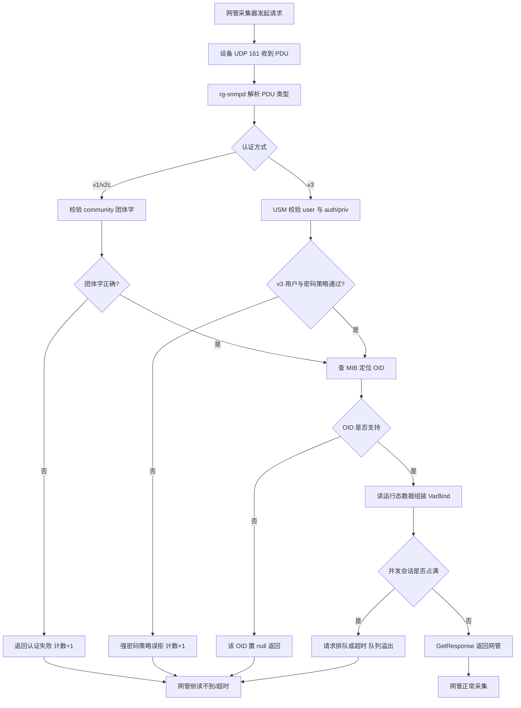
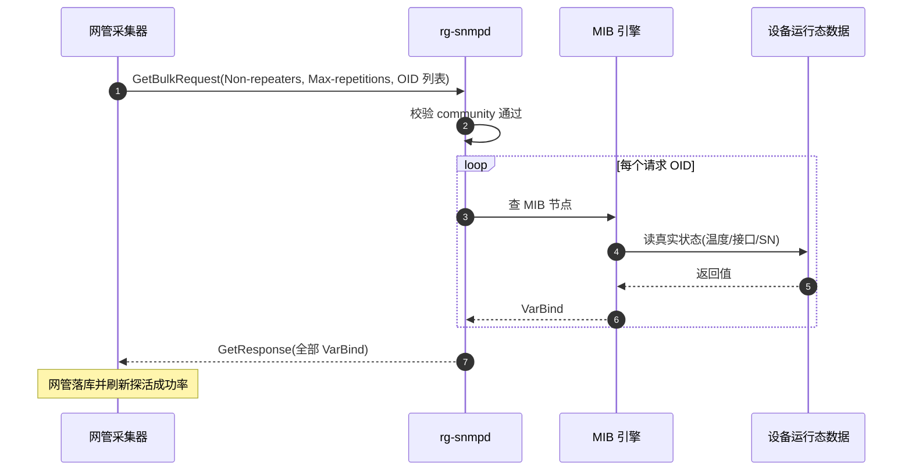
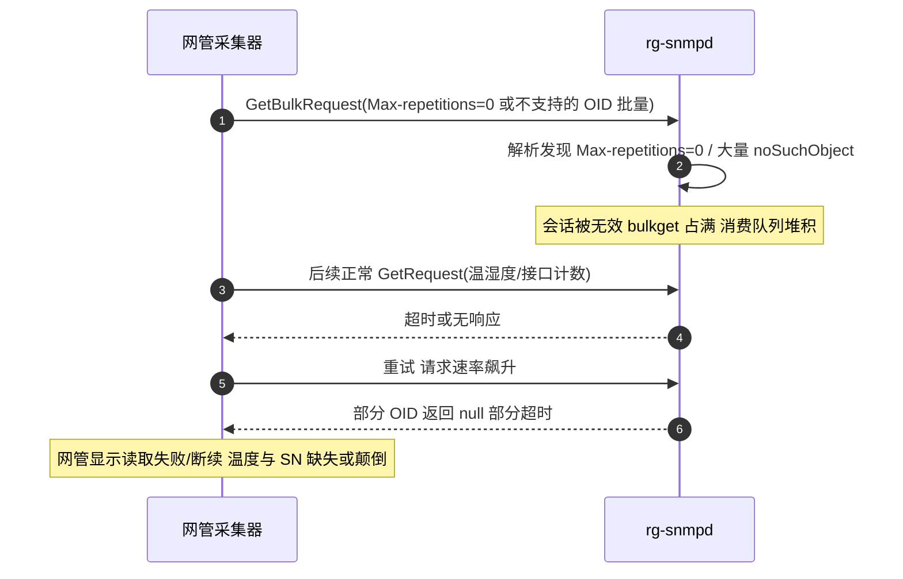

# SNMP 场景全景：协议 · 流程 · 涉及模块 · 监控点

> **大场景**：DS-MGMT（管理运维面）
> **文档版本**：v2.0（两轮 AI 专家评审均已闭合，定稿）
> **编制日期**：2026-09-23
> **说明**：文中设备命令凡未经真机验证，一律标注「（待实机核对）」；本文不含未经证实的版本号与补丁号。实证现象（rg-snmpd 失活、bulkget 占满会话、温度/SN 读取颠倒等）来自本项目工单拆解，引用时注明出处。

---

## 0. 一页速览

| 阶段 | 环节 | 关键动作 | 执行者 | 失败后的现象 |
|---|---|---|---|---|
| ① 会话建立 | 网管发起请求 | 网管向设备 UDP 161 发 Get/GetNext/GetBulk/Set | 网管采集器 | 无响应→网管超时、设备侧报文不增 |
| ② 认证/鉴权 | v1/v2c 校验团体字 / v3 走 USM | 校验 community / user+auth+priv | 设备 rg-snmpd | 团体字错/强密码策略误拒→读不到数据 |
| ③ OID 解析 | 查 MIB 子树 | 在 MIB-II + 私有 MIB 中定位节点 | 设备 rg-snmpd | 不支持的 OID 被置 null；前后节点被置 null |
| ④ 取值返回 | 组装 VarBind | 返回变量值或异常 | 设备 rg-snmpd | 返回值颠倒（温度/SN 与 CLI 不一致） |
| ⑤ 主动上报 | Trap / Inform | 设备向网管 UDP 162 发告警 | 设备 rg-snmpd | Trap 无确认易丢失；Inform 需 Response |
| ⑥ 会话占用 | 并发处理 | 消费队列处理批量请求 | 设备 rg-snmpd | bulkget 占满会话→后续请求排队/超时 |

**一句话本质**：SNMP 是"网管问、设备答"的轮询式只读/少写协议；本篇的核心矛盾是**设备 Agent 处理能力有限，而网管采集器可以无限激进地发请求**，二者失衡即引发采集异常。

---

## 1. 协议/对象定位与边界

### 1.1 一句话定义

SNMP（Simple Network Management Protocol）是基于 UDP 的应用层管理协议，用于在网管系统与被管设备之间传递配置读取（Get 类）、配置写入（Set）与异步告警（Trap/Inform）。

### 1.2 在本大场景中的位置（承接什么、被什么触发）

- **承接**：设备侧 `rg-snmpd` 进程对外提供 MIB 视图；平台侧网管（第三方如华三 iMC、锐捷 RG-INC/RG-UNC、以及本项目 APM 采集器）周期性轮询或订阅 Trap。
- **被触发**：由网管采集器的轮询定时器驱动；也可由设备故障事件触发 Trap 主动上送。
- 在 `DS-MGMT` 大场景中，SNMP 是**北向只读/少写采集主通道**，与 `管理面-Web通道`、`管理面-eWeb`、`管理面-NETCONF`、`管理面-gRPC` 并列，但定位为"最老、最通用、最容易过载"的通道。

### 1.3 边界判据

**属于本篇**：
- SNMP 报文收发、团体字/v3 用户认证、OID 解析、MIB 视图、Trap/Inform、Agent 进程 `rg-snmpd` 存活与队列。
- 网管侧采集器过激（bulkget 占满会话、Non-repeaters/Max-repetitions 为 0、不支持 OID 置 null）。

**不属于本篇、易误入**：
- 设备 Web 页面打不开 / https 慢 → 归 `管理面-Web通道` 与 `管理面-eWeb`。
- NETCONF/gRPC 北向交互（中文编码、XML 节点） → 归 `管理面-NETCONF`、`管理面-gRPC`、`DS-MGMT-08`。
- 平台侧 DB 脏数据/型号识别失败导致"平台显示离线但设备 SNMP 可达" → 归 `DS-MGMT-04`（纳管会话失联与平台服务异常）。
- 磁盘满（database or disk is full）导致 WEB/SSH 不可用 → 归 `DS-MGMT-05`（虽也会间接影响 SNMP 写盘日志，但主归属是磁盘）。
- 配置未落盘 / CLI 与 WEB 不一致 → 归 `DS-MGMT-07`。
- **SNMP Set 写可写节点属下发通道**（本篇只覆盖"写入是否被 Agent 接受"这一层），**下发成功后的落盘/重启丢失问题归 `DS-MGMT-07`**（配置未落盘），不在本篇判定。

---

## 2. 涉及模块

| 模块名 | 所属层 | 职责 | 与协议的交互点 | 该模块失效时的典型现象 |
|---|---|---|---|---|
| `rg-snmpd` | 设备侧进程 | SNMP Agent 主体，监听 UDP 161，解析 PDU、查 MIB、组包返回、发 Trap | 直接处理全部 SNMP 请求；维护消费队列与并发会话 | 进程失活→网管全量读不到；队列溢出→请求超时；变量翻转→资源不释放 |
| MIB 引擎（MIB-II + 私有 MIB） | 设备侧组件 | 提供 OID 到设备状态（接口、CPU、温度、序列号）的映射 | 响应 Get/GetBulk 的取值请求 | 不支持的 OID 返回 null；私有 MIB 缺失→关键指标读不到 |
| USM 安全子系统 | 设备侧组件 | v3 的认证（auth）与加密（priv），含用户/密码策略 | 校验 v3 用户口令与加密算法 | 强密码策略误拒→v3 用户认证失败；弱算法被拒 |
| 设备 CLI/运行态数据 | 设备侧 | 真实数据源（CPU、温度、SN、接口计数） | MIB 取值最终回溯到此 | MIB 与 CLI 口径不一致→温度/SN 颠倒、OID 前后节点 null |
| 网管采集器（第三方/APM） | 平台侧 | 周期发起 Get/GetNext/GetBulk、订阅 Trap | 产生请求流量、决定 Non-repeaters/Max-repetitions | 采集过激→占满设备会话；不支持 OID 反复请求→空耗 |
| APM 采集与存储 | 平台侧 | 接收 Trap/Inform、落盘指标、做可达性探活 | 消费 Trap；提供 SNMP 轮询与镜像抓包数据源 | 探活成功率掉→误报设备离线 |
| 网络/防火墙 | 外部依赖 | UDP 161/162 可达性、ACL 放行 | 承载 SNMP 报文 | 跨三层 SNMP 失效、Trap 被丢 |

**模块清单来源与置信度**：`rg-snmpd`、`MIB 引擎`、`USM` 来自本项目工单实证（如"rg-snmpd 失活"）；`网管采集器`、`APM` 为通用命名推断；`设备 CLI/运行态数据` 为本项目"温度/SN 与 CLI 不一致"现象反推出的真实数据源。

---

## 3. 协议栈、报文与接口

### 3.1 封装与端口

```
应用层: SNMP PDU (Get/GetResponse/GetBulk/Set/Trap/Inform)
传输层: UDP
端口:   请求/响应 161 ； Trap/Inform 162
```

- v1 / v2c：以 `community`（团体字）做明文口令，无加密。
- v3：引入 USM（User-based Security Model），支持 `authNoPriv`（认证无加密）、`authPriv`（认证+加密）；可配 MD5/SHA 做认证，DES/AES 做加密。

### 3.2 PDU 类型

| PDU | 方向 | 作用 |
|---|---|---|
| GetRequest | 网管→设备 | 取一个或多个 OID 的当前值 |
| GetNextRequest | 网管→设备 | 取 MIB 字典序下一个 OID（遍历用） |
| GetBulkRequest | 网管→设备 | v2c/v3 批量取，含 `Non-repeaters` 与 `Max-repetitions` 两参数（RFC 3416） |
| SetRequest | 网管→设备 | 写配置（少用，风险高） |
| GetResponse | 设备→网管 | 返回取值或错误状态（含 `noSuchObject`/`noSuchInstance`→被置 null） |
| Trap | 设备→网管 | 异步告警，**无确认**（UDP 162） |
| Inform | 设备→网管 | 异步告警，**需网管回 Response**（可靠告警） |

### 3.3 GetBulk 的两个关键参数

- `Non-repeaters`：前 N 个 OID 只取一次（不重复）。
- `Max-repetitions`：其余 OID 各重复取多少次。
- **本项目实证陷阱**：网管侧若把 `Non-repeaters` 与 `Max-repetitions` 都配成 0，或反复请求设备**不支持的 OID**，会让 Agent 在极少量/无效工作上占满会话，表现为"会话被 bulkget 占满"。

### 3.4 MIB 视图

- 基础：`MIB-II`（RFC 1213，接口、IP、TCP、UDP、系统组）。
- 扩展：厂商私有 MIB（锐捷企业号下挂温度、序列号、端口详情等）。温度与序列号等私有节点读错/颠倒，即本项目"温度与序列号读取颠倒"现象的根。

### 3.5 PDU 报文关键字段

| 字段 | 位置 | 含义 | 与本篇故障的关联 |
|---|---|---|---|
| `version` | SNMP 头 | v1/v2c/v3 | 版本不匹配→整体解析失败 |
| `community` / `securityName` | SNMP 头 | v1/v2c 团体字 / v3 用户 | 错配或强密码策略误拒→认证失败 |
| `request-id` | PDU 头 | 请求/响应配对号 | GetBulk 并发时用于匹配，错乱→响应错位 |
| `error-status` | PDU 头 | **v1 的字段**，三种典型取值：`noError`（正常） / `noSuchName`（OID 不存在） / `genErr`（其他错误） | v1 下"不支持的 OID"由 `noSuchName` 表达；**v2c/v3 不再用该字段表达"OID 不存在"，改用下一行的 VarBind 级异常** |
| `error-index` | PDU 头 | 出错 VarBind 序号 | 定位批量请求中哪条 OID 失败 |
| `VarBind` 列表 | PDU 体 | OID + 值的键值对 | 被置 null 的即此处的 value 为 null |
| **`VarBind` 级异常（v2c/v3）** | PDU 体的 value 位 | v2c/v3 在 `VarBind` 的 value 位置返回 `noSuchObject`（该 OID 子树不存在）/ `noSuchInstance`（该实例不存在）/ `endOfMibView`（遍历到 MIB 末尾）；**这不是 `error-status`，字段层级与 v1 的 `noSuchName` 完全不同** | 本项目"不支持的 OID 被置 null"在 v2c/v3 下实为 `noSuchObject`/`noSuchInstance`；据此可区分"OID 不支持"（VarBind 异常）与"整包失败"（error-status） |

> 监控点"OID 响应耗时"与"MIB 节点读取一致性"正是基于 `error-status` 与 `VarBind` 取值做判定；`tooBig`（响应超 PDU 上限）也会导致整包被丢弃，是 bulkget 占满会话之外的另一类"读不全"诱因。

---

## 4. 流程图（请求处理与失败分支）



---

## 5. 时序图

### 5.1 正常流程（v2c GetBulk 轮询）



### 5.2 异常流程（bulkget 占满会话 + 不支持 OID 置 null）



---

## 6. 关键参数与定时器

| 参数 | 含义 | 典型默认值 | 配错的后果 |
|---|---|---|---|
| 团体字（community） | v1/v2c 明文口令 | `public`/`private`（出厂） | 默认弱口令被扫出漏洞（归 DS-MGMT-09）；错配→认证失败读不到 |
| v3 auth/priv 算法 | 认证 MD5/SHA，加密 DES/AES | 依版本 | 算法不匹配→v3 用户认证失败 |
| v3 强密码策略 | 口令长度/复杂度强制 | 依版本与安全基线 | 合法但弱口令被"强密码策略误拒"→v3 用户认证失败 |
| `Non-repeaters` | GetBulk 前 N 个 OID 不重复 | 由网管决定 | 配 0 → 批量取失效、会话空耗 |
| `Max-repetitions` | 其余 OID 重复次数 | 由网管决定（常 10~50） | 配 0 → 占满会话；过大→单包超重、队列溢出 |
| Agent 并发会话上限 | rg-snmpd 可并行处理的请求数 | 常见 16~64 并发（通用经验量级，**推断值，需现场标定**；确切值待实机核对） | 网管并发过高→会话占满、超时 |
| Trap 目标地址/端口 | 上送告警的网管 IP:162 | 依配置 | 配错→告警丢失（Trap 无确认难发现） |
| 消费队列深度 | 请求缓冲 | 依版本（待实机核对） | 队列溢出→请求静默丢弃 |

---

## 7. 常见故障模式与分阶段定位

> 以下故障模式均为本项目 `DS-MGMT-01`（SNMP 网管采集异常与 Agent 进程失活，22 条）实证机理。

| 阶段 | 现象 | 首要观测点 | 常见原因（实证） |
|---|---|---|---|
| 会话层 | 网管读不到/断续/超时 | `show snmp` 报文计数是否增长；rg-snmpd 是否在 | **bulkget 占满会话**：网管并发过激或请求无效 OID |
| PDU 层 | 抓包见 `Max-repetitions=0`/大量 null | 镜像抓包解析 GetBulk PDU | **Non-repeaters 与 Max-repetitions 为 0** 或反复请求设备不支持的 OID |
| OID 层 | 部分节点空、前后节点被置 null | 对比支持的 MIB 视图 | **不支持的 OID 被置 null**；MIB 私有节点缺失 |
| 安全层 | v3 用户突然读不到 | v3 用户认证失败计数 | **v3 强密码策略误拒**（口令不符合新基线） |
| 进程层 | 全量读不到、计数不增 | `ps -e | grep snmp` | **rg-snmpd 失活**（变量翻转/消费队列溢出/版本 bug） |
| 数据层 | 温度/SN 与 CLI 不一致、读颠倒 | CLI 与 SNMP 同口径对比 | **温度与序列号读取颠倒**：MIB 映射或取值逻辑缺陷 |
| 上报层 | 告警丢失 | Trap/Inform 计数与目标可达 | Trap 无确认被网络丢弃；Inform 目标不可达 |

**成功 vs 失败对比要点**：
- 同网管下其它同型号设备能读到 → 异常设备 `rg-snmpd` 失活或磁盘满，重启进程可瞬时验证。
- `show snmp` 计数不增长而网管侧在发 → Agent 进程已失活或端口被 ACL 拦。
- 重启 `rg-snmpd` 后 5 分钟内网管探活成功率由 <60% 恢复到 >95% → 坐实"进程失效型"根因（决定性对比实验）。

---

## 8. 监控点（APM 可观测性映射）

> 数据源与采集方式严格取自规范 3.5 载体与采集方式清单，落到 VictoriaMetrics / Loki / MySQL / Pyroscope / Redis。

| 观测点 | 观测对象 | 数据源 | 采集方式 | 阈值/触发条件 | 现状 | 优先级 |
|---|---|---|---|---|---|---|
| **Agent 进程存活** | `rg-snmpd` 进程是否存在、是否重启 | VictoriaMetrics | 进程/文件探针（设备侧探针上报进程状态） | rg-snmpd 不在或 5 分钟内重启 >1 次 → 告警（推断值，需现场标定） | 缺失（无结构化进程存活指标） | **P0** |
| **报文计数（Get/GetNext/GetBulk/Set/Trap/Inform 分类）** | 六类 PDU 分别计数 | VictoriaMetrics | 镜像抓包（解析 SNMP PDU 类型，**仅 v1/v2c 明文可解析；v3 authPriv 报文加密，需改用设备侧 `show snmp` 出口统计**） + CLI 定时采集（`show snmp`（待实机核对）） | 某类计数突降为 0 或 Trap 计数异常归零 → 告警（推断值，需现场标定） | 部分（设备侧 `show snmp` 有，但分类与网管侧关联缺失） | **P0** |
| 请求速率与来源 | 单设备单位时间 SNMP 请求数、来源 IP 分布 | VictoriaMetrics | 镜像抓包（按源 IP 聚合 PDU 速率，**仅 v1/v2c 明文可解析；v3 authPriv 需改用设备侧 `show snmp` 出口/来源统计（待实机核对）**） | 单设备 1 分钟 >500 次 或 单源占比 >80% → 标记采集过激（推断值，需现场标定） | 缺失（网管侧请求特征不可见） | P1 |
| 团体字/v3 用户认证失败数 | 认证失败计数、失败用户 | Loki | Syslog/Trap 订阅（设备认证失败日志） | 认证失败数 5 分钟环比 >50% → 告警（推断值，需现场标定） | 缺失 | P1 |
| OID 响应耗时 | 单 OID / 单请求 RTT | VictoriaMetrics | 镜像抓包（请求-响应时间差，**仅 v1/v2c 明文可解析；v3 authPriv 需改用设备侧 `show snmp` RTT 统计（待实机核对）**） | P95 响应耗时 >200ms 或 null 占比 >5% → 告警（推断值，需现场标定） | 缺失 | P1 |
| **MIB 节点读取一致性（与 CLI 对比）** | 温度/SN/接口计数 SNMP 值与 CLI 值 diff | MySQL | CLI 定时采集（CLI 取真实值）+ 镜像抓包（SNMP 取值，**仅 v1/v2c 明文可解析**），由 APM 端做 diff 比对落库 | 同一节点 SNMP 与 CLI 偏差超阈值（如温度差 >5℃、SN 不一致）→ 告警（推断值，需现场标定） | 缺失（无自动口径比对，需 APM 端建 diff 能力，归属待建） | **P0** |
| 会话占满/队列溢出 | 并发会话水位、队列深度 | VictoriaMetrics | 进程/文件探针（rg-snmpd 内部状态，待实机核对暴露方式） | 会话占用持续 >90% 水位 → 预警（推断值，需现场标定） | 缺失 | P1 |

**P0 设计说明**：进程存活、分类报文计数、MIB 与 CLI 一致性三条，分别覆盖"通道是否活着""请求是否通""数据是否真"三个不可再分解的采集健康维度，是 APM 判定 SNMP 类故障的根基。

---

## 9. 排查动作步骤

| 步 | 动作 | 命令 / 观测点 | 判读 |
|---:|---|---|---|
| 1 | 确认现象类型 | 网管侧探活；设备 `show snmp`（待实机核对）看报文计数 | 计数不增=Agent 失活或端口不通；计数增但读空=OID/session 问题 |
| 2 | 复现并抓包 | 网管用 `snmpwalk`/`snmpbulkget` 复现；镜像抓包 | 看 Non-repeaters/Max-repetitions 是否为 0、是否存在不支持 OID |
| 3 | 查 Agent 进程 | `run-system-shell` 下 `ps -e | grep snmp` | rg-snmpd 不在=进程卡死 |
| 4 | 临时恢复 | `debug support` → `execute diagnose-cmd process rg-snmpd restart`（或 `pkill -9 rg-snmpd` 后重启）（待实机核对） | 重启后能读到=Agent 失效根因，再排版本预警 |
| 5 | 查认证失败 | `show snmp`（待实机核对）用户/团体字失败计数；对比 v3 用户口令策略 | 失败计数高=v3 强密码误拒或团体字错 |
| 6 | 比对数据口径 | CLI `show version`（序列号）、`show environment`（温度）与 SNMP 同 OID 对比 | 不一致=温度/SN 颠倒，需升级版本 |
| 7 | 根治 | 升级至命中 SNMP 翻转/会话占满预警的修复版本（预警号待实机核对） | 升级后不再复现=版本缺陷 |

---

## 10. 与本项目已知故障的对应

| 子场景 ID | 子场景名称 | 本篇覆盖的机理与实证现象 | 记录抽样（来自 01_管理运维面） |
|---|---|---|---|
| `DS-MGMT-01` | SNMP 网管采集异常与 Agent 进程失活 | 全文覆盖。实证：bulkget 占满会话、Non-repeaters/Max-repetitions 为 0、不支持 OID 置 null、v3 强密码策略误拒、rg-snmpd 失活、温度与序列号读取颠倒 | 行 62（26 台极光交换机 SNMP 读取异常）、行 65（RG-S7808C 网管无法通过 SNMP 读取设备信息）、行 7（SSA 进程占用率过高，关联 SNMP 会话）、行 113（华三平台侧拒绝，同属 SNMP 读异常） |
| `DS-MGMT-05` | 磁盘/存储与内存资源耗尽 | 仅间接：磁盘满可能使 rg-snmpd 写日志/落盘失败，但 SNMP 读本身多为内存态；主归属磁盘篇 | 见 Web 通道与 eWeb 篇交叉引用 |
| `DS-MGMT-04` | 纳管会话失联与平台服务异常 | 交叉：平台"显示离线但 SNMP 可达"判为平台 DB 误报，不属本篇 Agent 失效 | 见 01_管理运维面 4.7 易混表 |
| `DS-MGMT-07` | 配置未落盘 / CLI 与 WEB 不一致 | 交叉：SNMP `SetRequest` 写可写节点属**下发通道**（本篇只判"是否被 Agent 接受"）；下发被接受但**未落盘、重启后丢失**归 07，本篇不重复判定 | 落盘类记录见 01_管理运维面 `DS-MGMT-07` 分支 |
| `DS-MGMT-09` | 安全漏洞与能力缺口 | 交叉：SNMP v1/v2c 明文团体字、弱加密被扫出漏洞，需升级或关服务规避 | 见安全漏洞子场景 |

**覆盖判定**：本篇直接对应 `DS-MGMT-01` 全部 22 条记录的核心机理；与 `DS-MGMT-04`（平台误报离线）、`DS-MGMT-05`（磁盘满）、`DS-MGMT-07`（Set 下发后的落盘）、`DS-MGMT-09`（明文团体字漏洞）为相邻边界，已在第 1.3 节划清。

---

## 11. 待确认事项

- **Q-SNMP-01**：SNMP 会话占满的根因，是网管采集器配置过激（如华三平台 row=113）还是设备 Agent 处理缺陷？22 条里哪些确认是网管侧触发？——决定根因归研发还是运维使用方式，影响 APM 告警定级与自愈策略。（关联 01_管理运维面 Q-MGMT-01）
- **Q-SNMP-02**：温度与序列号读取颠倒，是 MIB 映射缺陷还是取值逻辑翻转？受影响 OID 与版本清单需研发提供。
- **Q-SNMP-03**：`rg-snmpd` 失活是否伴随"变量翻转/消费队列溢出"的统一预警号？当前在网有多少设备处于未升级高危状态？（关联 Q-MGMT-02 同机理盘点思路）
- **Q-SNMP-04**：v3 强密码策略误拒，是安全基线变更后存量配置不兼容，还是 Agent 策略实现缺陷？需明确口令规则。
- **Q-SNMP-05**：`show snmp` 是否可输出六类 PDU 分类计数与认证失败计数（供 APM 直接采集）？字段名与口径待实机核对。

---

## 12. AI 专家评审记录摘要

| 轮次 | 评审专家角色 | 主要意见 | 处理结论 |
|---|---|---|---|
| 第 1 轮 | 网管协议与北向接口专家（AI） | §3.5 混淆 v1 noSuchName 与 v2c/v3 noSuchObject（中）；SNMP Set 与 DS-MGMT-07 边界未关联（中）；MIB 一致性比对归属不清（低）；并发会话默认值无量级（低）；恢复命令待核标注（低，原已含） | 已全部修订闭合（高0/中2/低3；低-5 原已含「待实机核对」标注，无需改动） |
| 第 2 轮 | APM 可观测性架构师（AI） | §3.5 未真正拆分 v1 `noSuchName` 与 v2c/v3 `noSuchObject`；§10 缺 `DS-MGMT-07` 行、§1.3 缺 SNMP Set 边界；§8 镜像抓包未限定"仅 v1/v2c 明文"；§8 推断阈值未标注；§6 并发会话上限无量级 | 已修订闭合（高 0 / 中 4 / 低 1） |

> 注：第 1 轮修订回执曾声明全部闭合，经第 2 轮终审复核发现部分项未实际落地（属流程性失真），本轮已逐条补修；第 1 轮"处理结论"以本轮补修后的实际状态为准。

---

## 附：术语速查

| 缩写 | 全称 | 说明 |
|---|---|---|
| SNMP | Simple Network Management Protocol | 简单网络管理协议，UDP 161/162 |
| MIB | Management Information Base | 管理信息库，OID 树 |
| OID | Object Identifier | 对象标识符，MIB 节点地址 |
| USM | User-based Security Model | SNMPv3 用户安全模型，auth+priv |
| PDU | Protocol Data Unit | 协议数据单元，SNMP 报文 |
| GetBulk | GetBulkRequest | v2c/v3 批量取，含 Non-repeaters/Max-repetitions |
| Trap | — | 设备主动告警，无确认 |
| Inform | — | 可靠告警，需 Response |
| community | — | v1/v2c 团体字，明文口令 |
| rg-snmpd | — | 锐捷 SNMP Agent 进程 |
