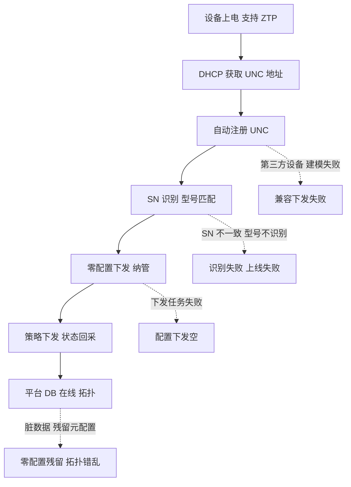
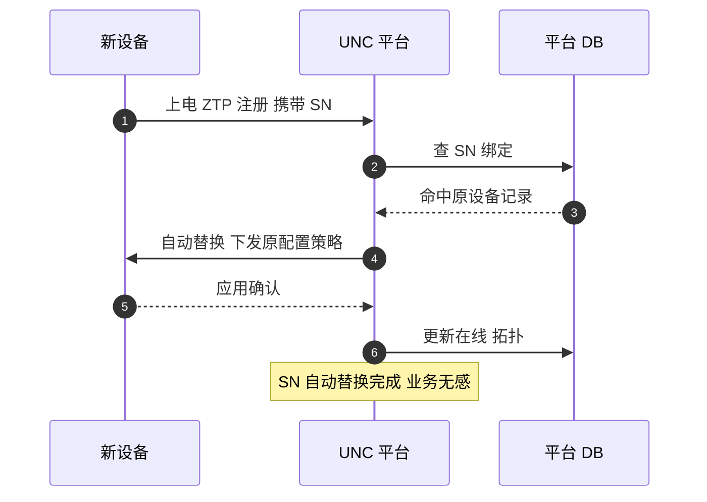
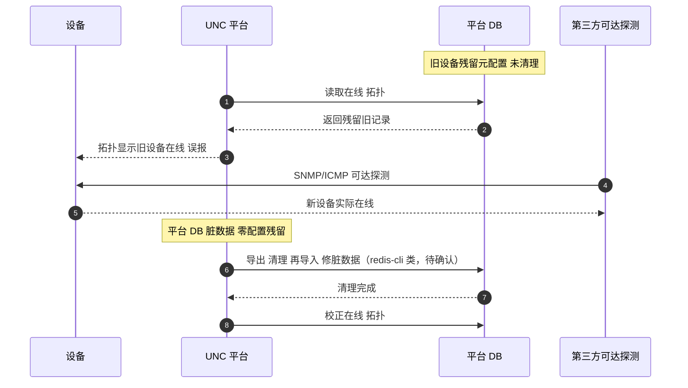

# RG-UNC 场景全景：统一网络中心 · 零配置上线 · 策略下发 · 监控点

> **大场景**：DS-MGMT（管理运维面）
> **文档版本**：v2.0（两轮 AI 专家评审均已闭合，定稿）
> **编制日期**：2026-09-23
> **说明**：本文不含未经证实的版本号与补丁号；设备侧命令凡未经真机验证标注「（待实机核对）」。平台侧内部接口如无公开说明标注「（需业务确认）」。INC 的替代者，代际关系见第 1.2/1.3 节。

---

## 0. 一页速览

| 阶段 | 环节 | 谁在动 | 关键动作 | 失败后现象 |
|---|---|---|---|---|
| ① 上线 | 零配置 ZTP | 设备（支持 ZTP）↔ UNC | 设备上电自动注册、按 SN 纳管 | ZTP 失败、零配置残留 |
| ② 识别 | SN/型号识别 | UNC 平台 | 用 SN 自动识别、绑定设备 | SN 不一致、型号不识别 |
| ③ 替换 | SN 自动替换 | UNC 平台 | 故障设备换 SN 自动接管 | 替换失败、配置错位 |
| ④ 兼容 | 第三方设备纳管 | UNC 平台 | 内置 38 款第三方设备兼容 | 第三方设备识别/下发失败 |
| ⑤ 下发 | 策略下发 | UNC → 设备 | 网络策略/配置批量下发 | 下发空、部分失败 |
| ⑥ 脏数据 | 平台 DB 残留 | UNC 平台 DB | 残留元配置未清理 | 零配置残留、拓扑错乱 |

**一句话本质**：UNC 是 EDN 的核心大脑（INC 的替代者），靠零配置上线、SN 自动替换、内置第三方兼容把大批设备纳管进来；它最大的现场坑是「平台 DB 脏数据导致零配置残留」——设备换了/下线了，平台里还挂着旧配置和旧在线状态。

---

## 1. 协议/对象定位与边界

### 1.1 一句话定义

RG-UNC（统一网络中心，Unified Networking Central）是锐捷 EDN 的统一网络核心管理平台，提供零配置上线（ZTP）、SN 自动替换、内置第三方异构设备兼容（规范载内置 38 款）、策略下发与全生命周期管理；部署形态含 UNC-CS 集群版与 UNC-AS 主备版。

### 1.2 在本大场景中的位置（与 INC 的代际关系）

- **代际**：INC 是上一代 SDN/网管产品，能力**逐步被 UNC 收编**；新局点、EDN 场景统一落在 UNC 上。凡 INC 篇讲到的北向/编排/纳管能力，UNC 是其演进替代者（详见《管理面-INC-协议全景与流程时序.md》）。
- **承接**：设备零配置上线、SN 替换、第三方兼容、策略下发。
- **被什么触发**：设备上电（ZTP）、设备替换（SN 变更）、策略变更、平台巡检。
- **输出去向**：设备配置与状态、平台 DB 在线/拓扑/策略。
- 在管理运维面中，UNC 属「平台侧」角色，是 DS-MGMT-04 纳管类故障的主战场之一（零配置脏数据、型号识别、策略下发空）。

### 1.3 边界判据

**属于本篇**：
- UNC 零配置上线（ZTP）、SN 自动替换、第三方设备兼容。
- UNC 策略下发、平台 DB 脏数据致零配置残留。
- UNC-CS / UNC-AS 部署形态与平台服务健康。

**不属于本篇、易误入**：
- INC 的 SDN 流表/北向（上一代）→ 归《管理面-INC-协议全景与流程时序.md》（UNC 是其替代者，但存量 INC 局点仍属 INC 篇）。
- 设备侧 EMB 后端 → 归《管理面-EMB-协议全景与流程时序.md》（EMB 不是平台）。
- WIS/MACC 公有云纳管 → 分别归对应平台篇（CWMP / macc 模式，非 UNC 园区零配置）。
- 设备侧 CWMP 会话 fd 泄漏 → 归 CWMP/WIS 篇（UNC 走 ZTP/私有纳管，非 CWMP）。

> **同类归属注**：**UNC 与 WIS 同属 `DS-MGMT-04`（纳管失联与平台服务异常）子类，仅纳管通道不同**——UNC 走私有纳管/ZTP，WIS 走 CWMP/TR-069；因此两者的"误报离线、DB 脏数据、型号识别失败"现象可互为参照，但设备侧机理与定位入口不同（UNC 看 ZTP/SN，WIS 看 cwmp 会话/心跳）。

---

## 2. 涉及模块

| 模块名 | 所属层 | 职责 | 与协议的交互点 | 失效时典型现象 |
|---|---|---|---|---|
| 设备 ZTP 客户端 | 设备侧 | 上电自动注册 UNC | DHCP/私有纳管通道 | ZTP 失败 |
| 设备纳管代理 | 设备侧 | 接收策略、回报状态 | 南向通道 | 下发空、状态失真 |
| UNC-CS 集群服务 | 平台侧 | 集群版控制面 | 内部集群协议 | 集群分裂、服务不可用 |
| UNC-AS 主备服务 | 平台侧 | 主备版控制面 | 主备同步 | 主备切换异常 |
| UNC 零配置/上线服务 | 平台侧 | ZTP、SN 替换、识别 | 平台 DB | 零配置残留、识别失败 |
| UNC 第三方兼容模块 | 平台侧 | 38 款第三方设备建模 | 设备模型 | 第三方下发失败 |
| UNC 平台 DB | 平台侧 | 元数据/在线/拓扑/策略 | MySQL/Redis | 脏数据、残留配置 |
| 上层业务系统 | 外部 | 经北向调 UNC | RESTful（待确认） | 意图不下发 |

**模块清单来源与置信度**：
- UNC-CS 集群版 / UNC-AS 主备版、零配置上线、SN 自动替换、内置 38 款第三方兼容、DB 脏数据致零配置残留均来自规范 3.3 与 DS-MGMT-04 工单实证。
- 设备侧 ZTP 客户端/纳管代理为按职能的通用命名推断（具体进程名「（需业务确认）」）。

---

## 3. 协议栈、报文与接口

### 3.1 零配置上线（ZTP）通道

设备支持 ZTP 时，上电经 DHCP 获取 UNC 地址——**不沿用 DHCP Option 43/148，而采用 UNC 专用发现方式（具体机制需业务确认）**；随后自动注册并按 SN 纳管。具体南向协议/端口与发现选项号均不臆造。

### 3.2 SN 自动替换

UNC 以 SN 为设备唯一标识。设备更换后新 SN 自动接管原配置与策略。前提是 SN 录入与设备 `show version` 一致；SN 错位会导致配置绑定错误。

### 3.3 第三方设备兼容

UNC 内置 38 款第三方异构设备兼容（规范 3.3 实证）。具体型号清单「（需业务确认）」，不列具体型号避免杜撰。兼容设备走统一建模纳管与下发。

### 3.4 策略下发

UNC 向设备批量下发网络策略/配置。下发失败原因分布需平台侧任务结果（见第 8 节）。与 INC 的下发链路为代际演进关系。

### 3.5 设备侧要做什么配置才能被 UNC 纳管

| 前置项 | 设备侧动作 | 命令 / 依据 |
|---|---|---|
| 支持 ZTP | 设备启用零配置（依型号） | ZTP 使能（待实机核对） |
| DHCP 指向 UNC | 获取 UNC 地址（**不沿用 DHCP Option 43/148，而采用 UNC 专用发现方式，具体机制需业务确认**） | 专用发现方式模板（待业务确认）；**不得照抄 WIS 的 `ip dhcp pool` + `option 43 ascii <acs url>`**（那是 CWMP 通道） |
| 网络可达 | 设备与 UNC 互通 | 管理通道（待实机核对） |
| SN 一致 | `show version` SN 与 UNC 录入一致 | SN 错位 → 识别/替换失败 |
| 型号在兼容矩阵 | 设备在 UNC 支持/兼容清单 | 不在 → 识别失败 |

> 上线失败头号现场原因：ZTP 未启用/UNC 地址不可达、或 SN 与平台录入不一致（SN 替换场景尤甚）。

---

## 4. 流程图

---

## 5. 时序图

### 5.1 正常：零配置上线 + SN 自动替换

### 5.2 异常：平台 DB 脏数据致零配置残留 + 误报

> 注：「误报离线 + 第三方可达探测」的通用判定套路本篇与《管理面-WIS-协议全景与流程时序.md》5.2 互为参照，其余平台篇（INC/MACC）仅在各自 5.2 补充平台特有分支，不重复展开。

---

## 6. 关键参数与定时器

| 参数 | 含义 | 典型默认值 | 配错的后果 |
|---|---|---|---|
| ZTP 使能 | 设备是否零配置上线 | （需业务确认） | 未开 → 需手动纳管 |
| UNC 地址 | UNC 专用发现方式指向（**不沿用 DHCP Option 43/148**，具体机制需业务确认） | （需业务确认） | 错/不可达 → ZTP 失败 |
| SN 绑定规则 | 以 SN 为唯一标识 | （需业务确认） | 错位 → 替换/识别失败 |
| 第三方兼容开关 | 38 款兼容是否启用 | （需业务确认） | 关 → 第三方不下发 |
| 下发重试 | 策略下发重试 | （需业务确认） | 少 → 弱网下失败 |
| DB 清理周期 | 残留配置清理 | （需业务确认） | 不清理 → 脏数据累积 |

---

## 7. 常见故障模式与分阶段定位

| 阶段 | 现象 | 首要观测点 | 常见原因 |
|---|---|---|---|
| 上线 | ZTP 失败、突然离线 | ZTP 使能、UNC 地址 | 未启用/地址不可达 |
| 识别 | SN/型号识别失败 | `show version` SN、兼容矩阵 | SN 不一致、型号不在矩阵 |
| 替换 | SN 替换失败、配置错位 | 平台 SN 绑定 | SN 录入错 |
| 兼容 | 第三方设备下发失败 | 第三方兼容模块 | 建模失败、不在 38 款 |
| 下发 | 策略下发空/失败 | 下发任务结果 | 会话失效、模型不匹配 |
| 脏数据 | 零配置残留、拓扑错乱 | 平台 DB | 残留元配置未清理 |

**成功 vs 失败对比要点**：同型号其他设备能 ZTP → 异常设备 ZTP/SN 问题；清理平台 DB 后恢复 → 坐实脏数据（DS-MGMT-04 判定）。

---

## 8. 监控点（APM 可观测性映射）

> 数据源与采集方式严格取自规范 3.5 载体与采集方式清单；"平台 API 拉取"是**采集方式**取值，不得填入数据源列。

| 观测点 | 观测对象 | 数据源 | 采集方式 | 阈值/触发条件 | 现状 | 优先级 |
|---|---|---|---|---|---|---|
| 零配置/ZTP 上线成功率与耗时 | 设备注册结果、耗时分布 | MySQL + Loki | 平台 API 拉取（需业务确认） | 上线成功率 <98% 或 P95 耗时超阈值 → 告警（推断值，需现场标定） | 缺失（平台无开放接口） | P0 |
| 平台侧 DB 可用性与脏数据计数 | UNC 平台 DB、残留记录数 | MySQL | 平台 API 拉取（需业务确认）+ 进程/文件探针 | **连续 2 个采集周期脏数据计数增长 >N 或 重复序列号数 >N（推断值，需现场标定）→ 告警** | 缺失 | P0 |
| 平台纳管设备在线率与实际可达率偏差（误报离线度量） | UNC 报离线 vs 设备实际可达 | Redis + VictoriaMetrics | 平台 API 拉取（需业务确认）+ SNMP 轮询 | UNC 报离线但可达持续 5min → 核对（推断值，需现场标定） | 缺失 | P0 |
| 心跳上送间隔与缺失计数 | 设备纳管会话心跳 | Redis + Loki | 平台 API 拉取（需业务确认） | 连续无心跳达判定窗口 → 告警（推断值，需现场标定） | 缺失 | P1 |
| 配置下发任务成功率/失败原因分布 | 策略下发结果 | Loki + MySQL | 平台 API 拉取（需业务确认）+ Syslog/Trap 订阅 | 下发成功率 <95% 或失败集中 → 告警（推断值，需现场标定） | 缺失 | P1 |
| 平台服务内存/CPU 水位 | UNC-CS/AS 服务 | VictoriaMetrics + Pyroscope | 平台 API 拉取（需业务确认）+ 进程/文件探针 | 内存 >85% / CPU >90%（推断值，需现场标定） | 缺失 | P1 |
| 设备侧纳管进程存活与 fd 占用 | 设备侧 UNC 代理 | VictoriaMetrics + Loki | CLI 定时采集 + 进程/文件探针 | 进程不在/fd 增长（推断值，需现场标定） | 部分（命令可得但缺持续采集） | P1 |
| 型号/序列号识别成功率 | SN/型号识别 | MySQL | 平台 API 拉取（需业务确认） | 识别失败 >2% → 告警（推断值，需现场标定） | 缺失 | P2 |
| 第三方设备兼容成功率 | 38 款兼容纳管 | MySQL + Loki | 平台 API 拉取（需业务确认） | 兼容失败率突增 → 告警（推断值，需现场标定） | 缺失 | P2 |

---

## 9. 排查动作步骤

| 步 | 动作 | 命令 / 观测点 | 判读 |
|---:|---|---|---|
| 1 | 确认 ZTP 与地址 | 设备 ZTP 状态、DHCP Option | 未启用/地址错 → ZTP 失败 |
| 2 | 核 SN | `show version` vs 平台录入 | 不一致 → 识别/替换失败 |
| 3 | 看平台在线 | UNC 拓扑页 | 第三方可达但显示离线 → 误报 |
| 4 | 查脏数据 | **在 UNC 平台侧执行**导库清理（redis-cli/DB，待确认；非设备上敲） | 残留 → 零配置残留根因 |
| 5 | 查兼容 | 第三方兼容模块日志 | 不在 38 款 → 下发失败 |
| 6 | 看下发任务 | UNC 下发结果 | 下发空 → 平台侧失败 |

---

## 10. 与本项目已知故障的对应

| 子场景 ID | 典型现象（来自 01 文档） | 本篇覆盖点 |
|---|---|---|
| `DS-MGMT-04` | UNC 零配置脏数据残留；平台因数据库异常/残留数据/版本不识别型号导致上线失败、离线误报、配置下发空；S6510 ZTP 失败、TD3 ZTP 重启冷补丁不生效 | 第 2/3/4/5/7/8 节全覆盖：ZTP、SN 替换、DB 脏数据、型号识别 |
| `DS-MGMT-01` | SNMP Agent 失活 | 第 8 节：SNMP 可达率反推误报，交叉引用 |
| `DS-MGMT-02` | WEB 管理访问异常 | UNC 为 Web 平台，交叉引用 Web通道篇 |
| `DS-MGMT-05` | 磁盘/内存资源耗尽 | 第 8 节：平台服务水位（UNC-CS/AS） |

---

## 11. 待确认事项

1. **UNC 是否开放上线结果/在线状态/脏数据计数/下发结果的结构化接口** —— 第 8 节 P0/P1 多为「缺失」，且全表"平台 API 拉取"均标「（需业务确认）」；若无接口 APM 只能靠设备侧探活反推。各平台是否已有统一可观测健康度/接口、APM 能否直接拉取，见业务核对问题 **Q-MGMT-04**，未决。
2. **零配置 ZTP 的 DHCP Option 号与设备使能命令** —— 上线失败头号原因，需业务提供标准模板；**明确不沿用 DHCP Option 43/148，采用 UNC 专用发现方式（具体机制需业务确认）**。
3. **SN 自动替换的绑定规则与错位规避** —— 影响替换成功率与配置安全。
4. **内置 38 款第三方设备的具体清单与建模方式** —— 兼容失败定位需要，不臆造清单；接口可得性同样**见业务核对问题 Q-MGMT-04，未决**。
5. **平台 DB 脏数据的自动清理机制与导出/清理/再导入工具** —— 当前靠人工导库（redis-cli 类），需标准化。
6. **UNC-CS 集群 / UNC-AS 主备的健康探测与告警接口** —— 集群分裂/主备切换的可见性。

---

## 12. AI 专家评审记录摘要

| 轮次 | 评审专家角色 | 主要意见 | 处理结论 |
|---|---|---|---|
| 第 1 轮 | 网络管理平台架构专家（AI） | §3.5 缺 DHCP Option 号候选/模板（与 WIS 不对称）、§8 第三方兼容未引 Q-MGMT-04、§1.3 未点明 UNC/WIS 同为 DS-MGMT-04 子类、§9 redis-cli 未注明平台侧、§3.1 类比 Option 148 易误导 | 已全部修订闭合（高 0 / 中 1 / 低 5；未修项见第 11 节） |
| 第 2 轮 | APM 可观测性架构师（AI） | §8 平台侧 DB 脏数据"计数 > 0"未改带窗/数量式（中）；§8 全表"平台 API 拉取"未标（需业务确认）、§11 项1/项4 未挂 Q-MGMT-04（低）；§3.1 仍写"类比 Option 43/148"、§3.5 未给专用发现模板（低）；§1.3 未补"UNC 与 WIS 同属 DS-MGMT-04 子类，仅通道不同"（低）；§8 阈值未标注（低） | 已修订闭合（高 0 / 中 1 / 低 4） |

> 注：第 1 轮修订回执曾声明全部闭合，经第 2 轮终审复核发现部分项未实际落地（属流程性失真），本轮已逐条补修；第 1 轮"处理结论"以本轮补修后的实际状态为准。

---

## 附：术语速查

| 缩写 | 全称 | 说明 |
|---|---|---|
| UNC | 统一网络中心（Unified Networking Central） | EDN 核心，INC 的替代者 |
| INC | 意图网络控制器 | 上一代，能力被 UNC 收编 |
| ZTP | Zero Touch Provisioning | 零配置上线 |
| SN | Serial Number | 设备序列号，UNC 唯一标识 |
| UNC-CS | UNC 集群版 | Cluster 部署形态 |
| UNC-AS | UNC 主备版 | Active-Standby 部署形态 |
| 脏数据 | dirty data | 平台 DB 残留元配置，致零配置残留 |
| 38 款兼容 | 第三方设备兼容 | UNC 内置第三方异构设备建模 |
