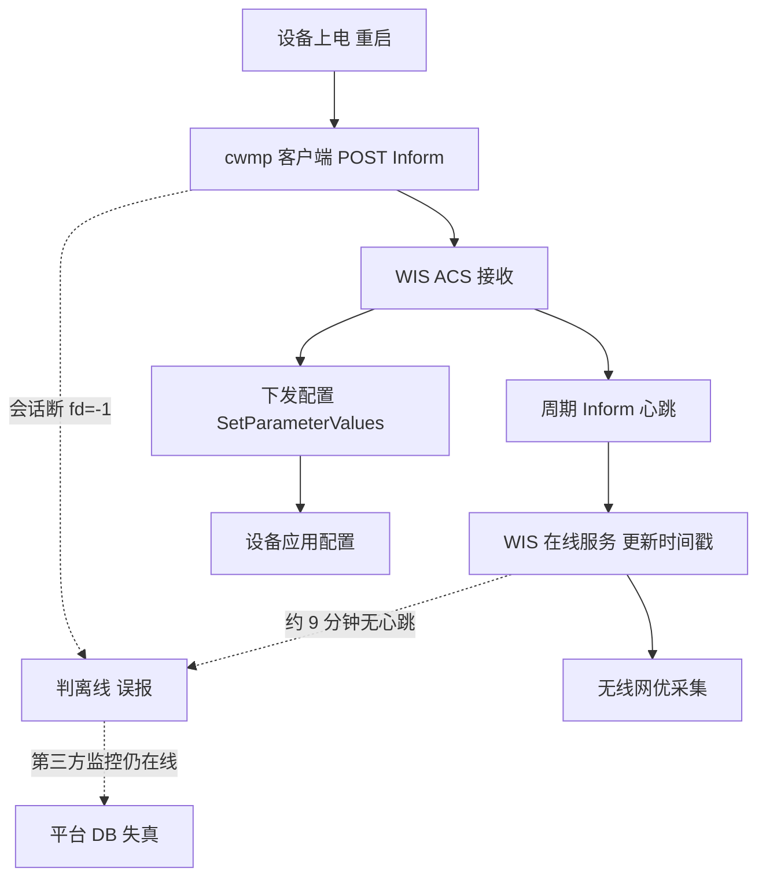
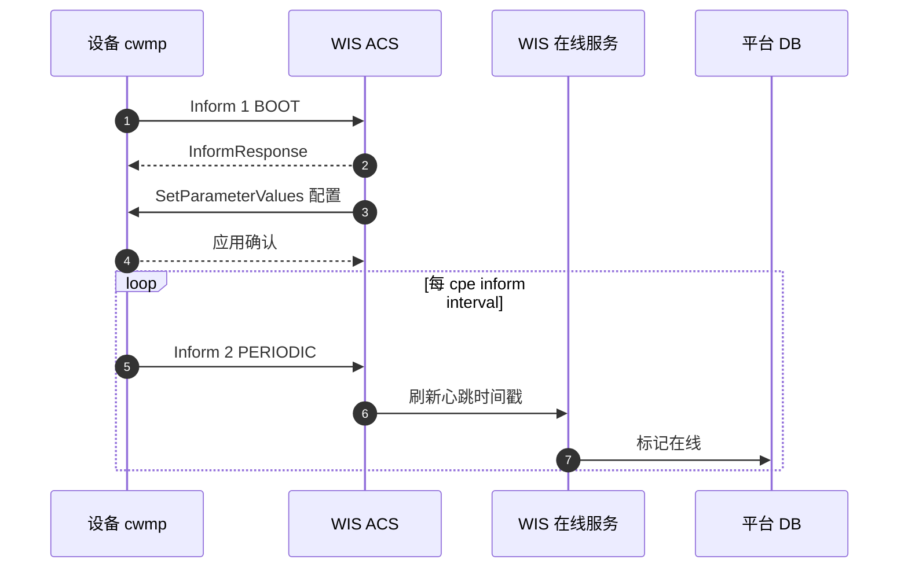
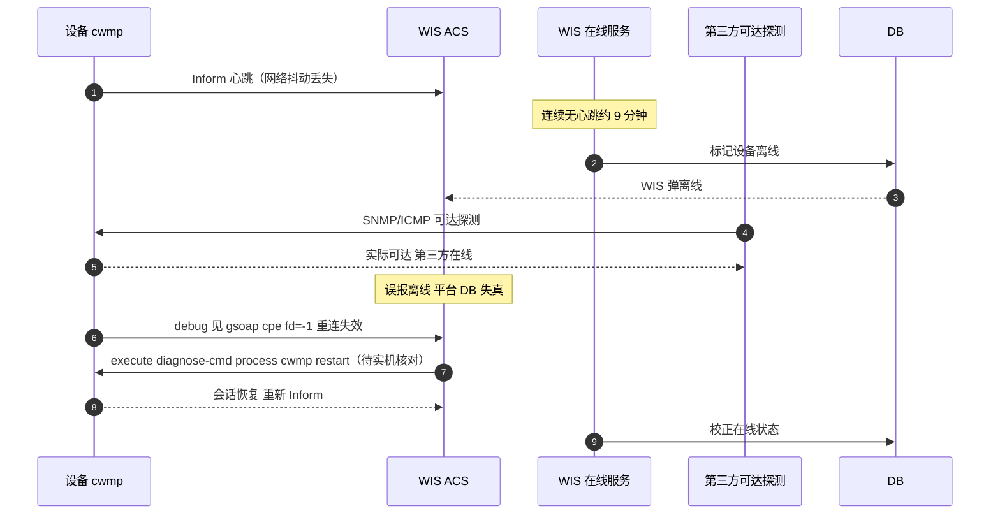

# RG-WIS 场景全景：云管理网络平台 · CWMP 接入 · 心跳误报 · 监控点

> **大场景**：DS-MGMT（管理运维面）
> **文档版本**：v2.0（两轮 AI 专家评审均已闭合，定稿）
> **编制日期**：2026-09-23
> **说明**：本文不含未经证实的版本号与补丁号；设备侧命令凡未经真机验证标注「（待实机核对）」。平台侧内部接口如无公开说明标注「（需业务确认）」。

---

## 0. 一页速览

| 阶段 | 环节 | 谁在动 | 关键动作 | 失败后现象 |
|---|---|---|---|---|
| ① 接入 | 设备注册 WIS | 设备 cwmp 客户端 ↔ WIS ACS | CPE 主动 POST Inform 到 ACS URL | 不在 WIS、突然离线 |
| ② 心跳 | 周期 Inform 保活 | 设备 ↔ WIS | 按 `cpe inform interval` 上送 | 后端约 9 分钟无心跳即误报离线 |
| ③ 下发 | 配置/策略下发 | WIS ACS → 设备 | SetParameterValues/Download 等 | 配置下发空、失败 |
| ④ 网优 | 无线网优采集 | WIS ↔ 设备 | 采集射频/终端数据 | 网优数据缺失 |
| ⑤ 误报 | 离线判定失真 | WIS 后端 | 心跳缺失判离线 | 弹离线但第三方监控在线 |

**一句话本质**：WIS 是面向行业设备的全生命周期云管理平台，设备经 CWMP/TR-069 接入；它最大的现场坑是「后端约 9 分钟无心跳就误报离线」——设备其实还在，只是心跳没上来，于是 WIS 弹离线、第三方监控却显示在线。

---

## 1. 协议/对象定位与边界

### 1.1 一句话定义

RG-WIS（云管理网络平台）是锐捷面向行业设备（交换机/AP/AC）的全生命周期云管理平台，设备通过 CWMP/TR-069 协议接入，平台侧提供纳管、配置下发与无线网优。

### 1.2 在本大场景中的位置

- **承接**：行业设备的 CWMP 注册、心跳、配置下发、无线网优。
- **被什么触发**：设备上电/重启（Inform 0 BOOTSTRAP/1 BOOT）、周期上报（2 PERIODIC）、配置变更（4 VALUE CHANGE）、连接请求（6 CONNECTION REQUEST）。
- **输出去向**：设备配置与状态、网优数据、平台 DB 在线/拓扑。
- 在管理运维面中，WIS 属「平台侧（公有云）」角色，与 MACC 同组；区别在于面向设备定位（行业设备 vs 睿易/中小微）与对接协议（CWMP/TR-069 + 无线网优 vs 认证/PPSK/WiFiDog）。

### 1.3 边界判据

**属于本篇**：
- WIS 经 CWMP/TR-069 的设备接入、心跳、配置下发。
- 「9 分钟无心跳误报离线」「弹离线但第三方在线」。
- WIS 无线网优数据采集。

**不属于本篇、易误入**：
- CWMP/TR-069 协议本身（CPE 侧机制、事件码、字段） → 归《管理面-CWMP-协议全景与流程时序.md》《管理面-ACS-协议全景与流程时序.md》（本篇只从平台纳管视角引用）。
- MACC 的 macc 模式与 PPSK/WiFiDog → 归《管理面-MACC-协议全景与流程时序.md》。
- 设备侧 cwmp 进程本身的 fd 泄漏（rl-con 占 fd 不释放）→ 设备侧机理见 CWMP 篇，本篇从平台误报视角覆盖。
- INC/UNC 园区网管 → 分别归对应平台篇。

---

## 2. 涉及模块

| 模块名 | 所属层 | 职责 | 与协议的交互点 | 失效时典型现象 |
|---|---|---|---|---|
| 设备 cwmp 客户端（cwmp.elf/gsoap） | 设备侧 | TR-069 CPE，主动 POST Inform | HTTP 到 ACS URL | 会话断、fd=-1 |
| rl-con 子进程 | 设备侧 | CWMP 连接子进程 | socket fd | 占 fd 不释放致重连失效（**设备侧机理详见《管理面-CWMP-协议全景与流程时序》，本篇仅引用其平台侧误报后果**） |
| WIS ACS（自动配置服务器） | 平台侧 | 接收 Inform、下发配置 | HTTPS / TR-069 | 下发空、识别失败 |
| WIS 心跳/在线服务 | 平台侧 | 维护在线状态、判离线 | 平台 DB / Redis | 9 分钟无心跳误报离线 |
| WIS 平台 DB | 平台侧 | 存元数据、在线、拓扑 | MySQL/Redis | 脏数据、离线失真 |
| WIS 网优模块 | 平台侧 | 采集射频/终端数据 | 私有采集 | 网优数据缺 |
| 第三方监控 | 外部 | 交叉验证设备可达 | SNMP/ICMP | 显示在线 vs WIS 离线 |

**模块清单来源与置信度**：
- `cwmp`/`cwmp.elf`/`gsoap`、`rl-con` 占 socket fd 不释放来自规范 3.1 实证。
- 「约 9 分钟无心跳即误报离线」「弹离线但第三方在线」来自 DS-MGMT-04 工单实证。
- WIS ACS 域名 `wis.ruijie.com.cn/acs`、`devicereg.ruijienetworks.com/service/tr069servlet` 来自规范 3.3。

---

## 3. 协议栈、报文与接口

### 3.1 CWMP/TR-069 接入（设备 ↔ WIS ACS）

依据规范 3.4：CPE 主动 HTTP POST 到 ACS URL；首个 `Inform`，`InformResponse` 回应；事件码 `0 BOOTSTRAP`/`1 BOOT`/`2 PERIODIC`/`4 VALUE CHANGE`/`6 CONNECTION REQUEST`/`8 DIAGNOSTICS COMPLETE`/`M Reboot`；ACS 下发 `SetParameterValues/GetParameterValues/Download/Upload/Reboot/FactoryReset/AddObject/DeleteObject`；ACS 主动连接用 **Connection Request**（HTTP GET 到 CPE `cpe url`，默认端口 **7547**）。数据模型 TR-098/TR-181。

### 3.2 心跳与离线判定

设备按 `cpe inform interval` 周期上送 Inform（即心跳）。WIS 后端维护最近心跳时间戳；实证：**约 9 分钟无心跳即判定离线误报**。判定窗口与具体值「（需业务确认）」，但 9 分钟为工单实证量级。

### 3.3 配置下发与无线网优

WIS 经 ACS 下发配置，并采集无线网优数据。下发失败原因分布需平台侧任务结果（见第 8 节）。

### 3.4 设备侧要做什么配置才能被 WIS 纳管

| 前置项 | 设备侧动作 | 命令 / 依据 |
|---|---|---|
| 进入 cwmp 视图 | 配置 CWMP | `cwmp`（规范 3.2） |
| 配置 ACS URL | 指向 WIS ACS | `acs url <url>`（如 `wis.ruijie.com.cn/acs`，待实机核对） |
| 配置心跳间隔 | 周期 Inform | `cpe inform interval <秒>`（规范 3.2） |
| 配置 CPE URL | Connection Request 地址 | `cpe url <http://ip:7547>`（规范 3.2） |
| DHCP Option 43 | 自动下发 ACS 地址 | `ip dhcp pool <name>` + `option 43 ascii <acs url>`（规范 3.2） |
| 序列号一致 | `show version` SN 与 WIS 录入一致 | SN 不一致 → 识别失败 |
| AP 云模式切换 | 若 AP 类设备需切云模式方经 CWMP 上 WIS | 切换命令（待实机核对） | 未切云模式 → 不经 CWMP 注册、不上线 |

> 上线失败头号现场原因：ACS URL 配错/不可达、或 DHCP Option 43 未下发；其次 SN 与平台不一致。

---

## 4. 流程图

---

## 5. 时序图

### 5.1 正常：设备注册 + 周期心跳 + 配置下发

### 5.2 异常：9 分钟无心跳误报离线 + cwmp fd 失效

> 注：「误报离线 + 第三方可达探测」的通用判定套路本篇与《管理面-UNC-协议全景与流程时序.md》5.2 互为参照，其余平台篇（INC/MACC）仅在各自 5.2 补充平台特有分支，不重复展开。

---

## 6. 关键参数与定时器

| 参数 | 含义 | 典型默认值 | 配错的后果 |
|---|---|---|---|
| `cpe inform interval` | 周期心跳间隔（秒） | （需业务确认） | 过长 → 离线判定滞后/误报 |
| 离线判定窗口 | 连续无心跳判离线 | **WIS 后端约 9 分钟**（工单实证；精确判定窗口待业务确认，与 CWMP/ACS 两篇口径一致） | 过短 → 误报离线 |
| ACS URL | WIS ACS 地址 | `wis.ruijie.com.cn/acs`（待实机核对） | 错/不可达 → 不上线 |
| CPE URL 端口 | Connection Request 端口 | 7547（规范 3.4） | 错 → 平台主动连接失败 |
| Connection Request 认证 | 主动连接鉴权 | （需业务确认） | 失败 → 被动下发受阻 |

---

## 7. 常见故障模式与分阶段定位

| 阶段 | 现象 | 首要观测点 | 常见原因 |
|---|---|---|---|
| 接入 | 设备不在 WIS、突然离线 | ACS URL、Option 43 | URL 错/不可达、SN 不一致 |
| 心跳 | 弹离线但第三方在线 | 心跳时间戳 vs 第三方可达 | 9 分钟窗口误报、网络抖动 |
| 会话 | cwmp 断、fd=-1 | debug gsoap cpe fd | rl-con 占 fd 不释放 |
| 下发 | 配置下发空/失败 | ACS 下发任务结果 | 会话失效、模型不匹配 |
| 网优 | 网优数据缺 | 采集日志 | 会话断致采集中断 |

**成功 vs 失败对比要点**：重启 cwmp 后 WIS 恢复在线 → 坐实 CWMP 会话失效（DS-MGMT-04 判定）；第三方在线但 WIS 离线 → 平台误报，根因在心跳窗口/网络。

---

## 8. 监控点（APM 可观测性映射）

> 数据源与采集方式严格取自规范 3.5 载体与采集方式清单；"平台 API 拉取"是**采集方式**取值，不得填入数据源列。

| 观测点 | 观测对象 | 数据源 | 采集方式 | 阈值/触发条件 | 现状 | 优先级 |
|---|---|---|---|---|---|---|
| 平台纳管设备在线率与实际可达率偏差（误报离线度量） | WIS 报离线 vs 设备 SNMP/ICMP 实际可达 | Redis + VictoriaMetrics | 平台 API 拉取（需业务确认）+ SNMP 轮询 | WIS 报离线但可达持续 5min → 触发核对（推断值，需现场标定） | 缺失（平台未开放在线状态接口） | P0 |
| 心跳上送间隔与缺失计数 | cwmp Inform 周期、最近心跳时间戳 | Redis + Loki | 平台 API 拉取（需业务确认）+ 进程/文件探针 | 连续无心跳达约 9 分钟窗口 → 告警（9 分钟为工单实证量级，精确窗口待业务确认） | 缺失（依赖后端日志反查） | P0 |
| 配置下发任务成功率/失败原因分布 | WIS→设备下发结果 | Loki + MySQL | 平台 API 拉取（需业务确认）+ Syslog/Trap 订阅 | 下发成功率 <95% 或失败集中 → 告警（推断值，需现场标定） | 缺失 | P1 |
| 平台侧 DB 可用性与脏数据计数 | WIS 平台 DB | MySQL | 平台 API 拉取（需业务确认） | **DB 不可用 或 脏数据计数环比增长 >N（推断值，需现场标定）→ 告警** | 缺失 | P1 |
| 平台服务内存/CPU 水位 | WIS ACS/在线服务 | VictoriaMetrics + Pyroscope | 平台 API 拉取（需业务确认）+ 进程/文件探针 | 内存 >85% / CPU >90%（推断值，需现场标定） | 缺失 | P1 |
| 设备侧纳管进程(cwmp)存活与 fd 占用 | cwmp.elf / rl-con fd | VictoriaMetrics + Loki | 进程/文件探针 + CLI 定时采集 | 进程不在或 fd 持续增长（推断值，需现场标定） | 部分（命令可得但缺持续采集） | P1 |
| CWMP 自动注册上线成功率与耗时（注：ZTP/零配置为 UNC 能力，非 WIS） | 设备经 CWMP 上云注册 | MySQL + Loki | 平台 API 拉取（需业务确认） | 上线成功率 <98% 或耗时超阈值（推断值，需现场标定） | 缺失 | P2 |
| 型号/序列号识别成功率 | 设备注册识别 | MySQL | 平台 API 拉取（需业务确认） | 识别失败 >2% → 告警（推断值，需现场标定） | 缺失 | P2 |

---

## 9. 排查动作步骤

| 步 | 动作 | 命令 / 观测点 | 判读 |
|---:|---|---|---|
| 1 | 看是否误报离线 | WIS 拓扑 vs 第三方 SNMP/ICMP | 第三方在线 → 平台误报 |
| 2 | 查 cwmp 会话 | `show cwmp configuration`（规范 3.2） | ACS URL 错 → 不上线 |
| 3 | 看心跳日志 | WIS 后端查最近心跳时间戳 | 超约 9 分钟 → 误报窗口 |
| 4 | 查 fd 失效 | debug session 看 `gsoap cpe fd=-1`（待实机核对） | fd=-1 → 会话失效 |
| 5 | 恢复会话 | `execute diagnose-cmd process cwmp restart`（待实机核对） | 重启后恢复 → 坐实 CWMP 根因 |
| 6 | 核 SN | `show version` | SN 不一致 → 识别失败 |

---

## 10. 与本项目已知故障的对应

| 子场景 ID | 典型现象（来自 01 文档） | 本篇覆盖点 |
|---|---|---|
| `DS-MGMT-04` | 设备突然在 WIS 上线/离线；WIS 弹设备离线但第三方监控在线；后端约 9 分钟无心跳即误报离线；CWMP/ACS 会话 fd 泄漏重连失效 | 第 2/3.2/4/5/7/8 节全覆盖：误报离线、心跳、fd 失效 |
| `DS-MGMT-01` | SNMP Agent 失活 | 第 8 节：用 SNMP 可达率反推误报，交叉引用 |
| `DS-MGMT-05` | 磁盘/内存资源耗尽 | 第 8 节：设备侧 cwmp 进程资源（次要） |
| `DS-MGMT-02` | WEB 管理访问异常 | WIS 为云 Web，交叉引用 Web通道篇 |

---

## 11. 待确认事项

1. **WIS 是否开放设备在线状态/心跳时间戳/下发结果的结构化接口** —— 第 8 节 P0/P1 多为「缺失」，且全表"平台 API 拉取"均标「（需业务确认）」；若无接口 APM 只能靠设备侧探活反推（而设备侧也仅能看 cwmp 日志）。各平台是否已有统一可观测健康度/接口、APM 能否直接拉取，见业务核对问题 **Q-MGMT-04**，未决。
2. **「约 9 分钟无心跳误报离线」的精确判定窗口与可调参数** —— 影响误报率与阈值设定，需业务确认。
3. **cwmp fd=-1 / rl-con 占 fd 的修复版本与在网敞口** —— 属 CWMP 设备侧缺陷，本篇仅平台视角，需联合 CWMP 篇。
4. **ACS URL 与 Option 43 的推荐模板** —— 避免上线失败，需业务提供标准地址。
5. **WIS 与 MACC 的设备重叠边界** —— 同设备双云归属问题。

---

## 12. AI 专家评审记录摘要

| 轮次 | 评审专家角色 | 主要意见 | 处理结论 |
|---|---|---|---|
| 第 1 轮 | 网络管理平台架构专家（AI） | §3.4 缺 AP 云模式切换、§2 rl-con 与「仅平台视角」边界张力、§8 误称 ZTP 上线成功率（与 UNC 混淆）、§6/§8 9 分钟表述不统一、平台监控 API 待确认未引 Q-MGMT-04 | 已全部修订闭合（高 0 / 中 1 / 低 4；未修项见第 11 节） |
| 第 2 轮 | APM 可观测性架构师（AI） | §8 全表"平台 API 拉取"未标（需业务确认）、§11 项1 未挂 Q-MGMT-04（中）；§2 rl-con 行未加"设备侧机理详见 CWMP 篇，本篇仅引用平台误报后果"边界注（低）；§6 9 分钟窗口表述与 CWMP/ACS 未统一（低） | 已修订闭合（高 0 / 中 1 / 低 2） |

> 注：第 1 轮修订回执曾声明全部闭合，经第 2 轮终审复核发现部分项未实际落地（属流程性失真），本轮已逐条补修；第 1 轮"处理结论"以本轮补修后的实际状态为准。

---

## 附：术语速查

| 缩写 | 全称 | 说明 |
|---|---|---|
| WIS | 云管理网络平台 | 面向行业设备的云管平台 |
| CWMP | CPE WAN Management Protocol | TR-069，设备经其接入 WIS |
| ACS | Auto Configuration Server | 自动配置服务器，即 WIS 侧角色 |
| Inform | TR-069 首报文 | 设备主动上报，兼作心跳 |
| CPE URL | 设备连接请求地址 | 默认端口 7547 |
| fd | file descriptor | rl-con 占 fd 不释放致重连失效 |
| 误报离线 | false offline | 9 分钟无心跳被判离线，实际可达 |
