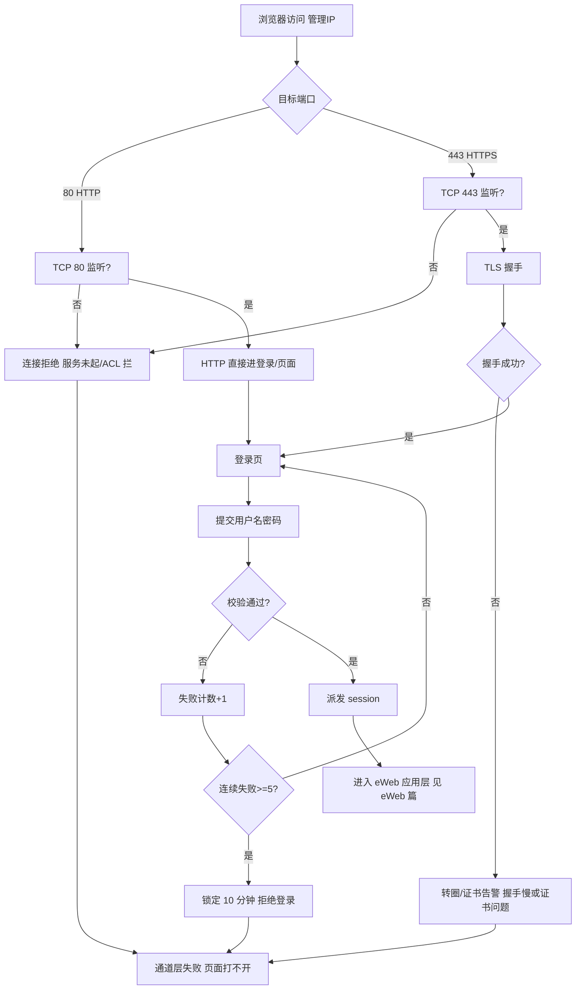
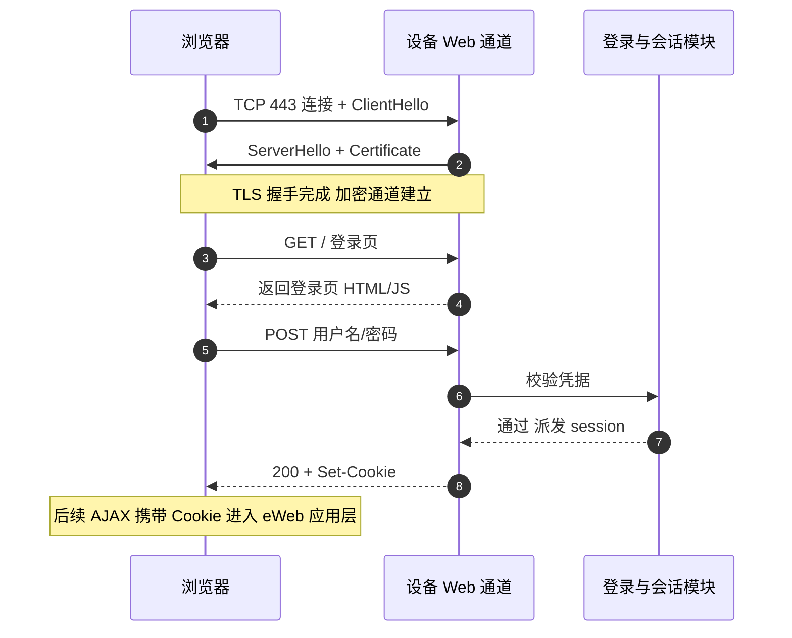
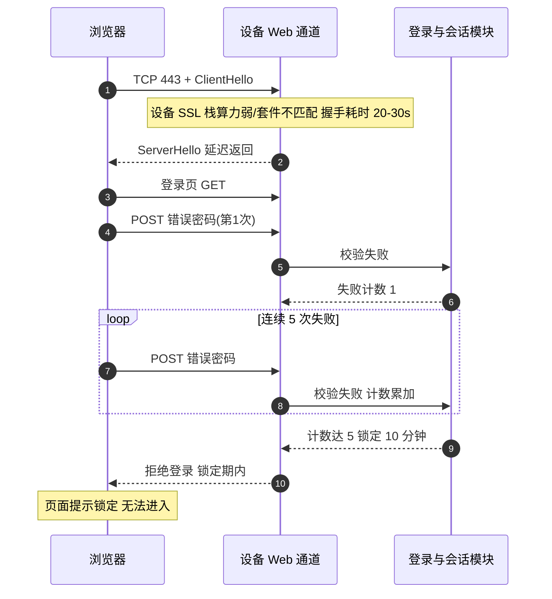

# Web 管理通道 场景全景：通道层 · 流程 · 涉及模块 · 监控点

> **大场景**：DS-MGMT（管理运维面）
> **文档版本**：v2.0（两轮 AI 专家评审均已闭合，定稿）
> **编制日期**：2026-09-23
> **说明**：本篇只讲「通道层」——TCP 80/443 服务、TLS 握手与版本/算法、证书、登录与会话、HTTP/HTTPS 行为差异、访问慢/打不开。应用层现象（页面渲染、配置读写、WEB 与 CLI 口径）见《管理面-eWeb-协议全景与流程时序》。凡未经真机验证命令一律标注「（待实机核对）」；不含未经证实的版本号与补丁号。

---

## 0. 一页速览

| 阶段 | 环节 | 关键动作 | 执行者 | 失败后的现象 |
|---|---|---|---|---|
| ① TCP 接入 | 浏览器建连 | 向设备 TCP 80（HTTP）/443（HTTPS）发起连接 | 浏览器 / 设备 `web-server` 监听 | 端口被 ACL 拦→连接拒绝；服务未起→无法连接 |
| ② TLS 握手 | HTTPS 专属 | 协商 TLS 版本/加密套件、校验证书 | 设备 SSL 栈 | 握手慢→页面转圈 20~30s；证书过期→浏览器告警 |
| ③ 登录认证 | 提交凭据 | 用户名/密码经 HTTPS POST 到登录接口 | 设备登录模块 | 连续失败触发锁定（现场口径「5 次失败锁 10 分钟」，**待实机核对**；锁定对象是账号还是源 IP 待核） |
| ④ 会话维持 | 派发 session | 返回 Cookie/session，后续请求携带 | 设备会话管理 | session 失效→反复跳登录；锁定期内拒绝登录 |
| ⑤ 资源请求 | 页面/接口 | 浏览器拉 HTML/JS、发 AJAX 请求 | 设备 web 后端 | 后端无空间/进程异常→打不开或 500（此现象已溢出通道层，根因归 eWeb/DS-MGMT-05） |

**一句话本质**：Web 通道层是"浏览器到设备 443 端口之间那条加密隧道 + 登录门禁"；本篇管"门开不开、门禁锁不锁、隧道快不快"，不管门后面页面显示什么（那归 eWeb 篇）。

---

## 1. 协议/对象定位与边界

### 1.1 一句话定义

Web 管理通道层指设备通过 TCP 80/443 对外提供 HTTP/HTTPS 管理服务所涉及的全部「通道」机制：端口监听、TLS 握手与证书、登录与会话门禁。它不包含页面渲染与配置业务（归 eWeb）。

### 1.2 在本大场景中的位置（承接什么、被什么触发）

- **承接**：`enable service web-server` 拉起设备 Web 服务进程；浏览器/网管平台发起访问。
- **被触发**：运维人员打开管理 IP、或网管平台通过 Web 做配置/采集时触发。
- 在 `DS-MGMT` 中，Web 通道是 eWeb 应用层的**传输底座**；通道不通，eWeb 任何页面都打不开。

### 1.3 边界判据

**属于本篇**：
- TCP 80/443 监听、端口可达性、ACL 放行。
- TLS 版本/加密套件协商、证书有效期与信任、握手耗时。
- 登录认证、会话/Cookie、暴力破解锁定（现场口径「5 次失败锁 10 分钟」，阈值与锁定对象**待实机核对**：锁定对象是账号还是源 IP 待核）。
- HTTP 与 HTTPS 的行为差异（如 https 慢 http 快）。

**不属于本篇、易误入**：
- 页面打不开的根因是 `database or disk is full` 或 `/data/webLog.db` 损坏 → 归 `管理面-eWeb`（应用数据损坏）与 `DS-MGMT-05`（磁盘满）。
- 页面显示配置与 CLI 不一致、端口聚合页面报错、7008L 保存报错 → 归 `管理面-eWeb`。
- SNMP 读不到、SSH 登不上 → 分别归 SNMP 篇、`DS-MGMT-03`。
- 纯 QoS DSCP 重标记导致特定终端页面弹出异常（row=256）→ 已外归 QoS 场景。

### 1.4 前端与后端接口的分界（本篇与 eWeb 篇的切分线）

Web 管理的"通道层"与"应用层"以**浏览器到设备的 TCP 443 隧道终点**为界，具体判据如下：

| 维度 | 归本篇（通道层） | 归 eWeb 篇（应用层） |
|---|---|---|
| 关注对象 | 端口 80/443 监听、TLS 握手、证书、登录门禁、session | rg-web 组件、页面渲染、AJAX 拼 CLI、配置读写、webLog.db |
| 失败判据 | 连不上 / 握手慢 / 证书告警 / 登录被锁 | 页面报错 / 显示错乱 / 保存失败 / db 损坏 |
| 定位命令（待实机核对） | `show web`、`show crypto certificate` | `run-system-shell` 查 `/data/webLog.db`、`ps` 查 rg-web |

**交叉引用纪律**：凡机理落在"隧道快不快、门禁锁不锁"的，一律在本篇；凡现象落在"页面显示对不对、下发成不成、日志库坏没坏"的，一律在 eWeb 篇。两边不互相大段重复——例如"https 慢 http 快"的机理在 3.4 节，eWeb 篇只引用结论、不重述握手细节。

---

## 2. 涉及模块

| 模块名 | 所属层 | 职责 | 与协议的交互点 | 该模块失效时的典型现象 |
|---|---|---|---|---|
| `web-server` 监听进程 | 设备侧 | 监听 TCP 80/443，接受连接 | 提供 HTTP/HTTPS 接入点 | 服务未起→无法连接；端口被 ACL 拦→拒绝 |
| 设备 SSL/TLS 栈 | 设备侧 | HTTPS 握手、证书校验、密钥协商 | 处理 ClientHello/ServerHello、证书链 | 握手慢/失败→页面转圈或证书告警 |
| 登录与会话模块 | 设备侧 | 校验用户名密码、派发 session、暴力破解锁定 | 处理登录 POST、校验失败计数 | 连续失败触发锁定（现场口径 5 次/10 分钟，**待实机核对**）；session 失效跳登录 |
| eWeb 后端（rg-web） | 设备侧 | 处理页面与 AJAX 请求（应用层，见 eWeb 篇） | 接收通道层转发的 HTTP 请求 | 后端异常→通道通但页面 500/打不开 |
| 浏览器 | 端侧 | 发起连接、TLS 握手客户端、渲染 | 与设备 443 完成握手 | 浏览器不信任证书→拦截；旧浏览器不支持新 TLS |
| 网络/ACL | 外部依赖 | TCP 80/443 可达性 | 承载 Web 流量 | 跨网段/ACL 拦→无法访问 |
| 网管平台 Web 接入 | 平台侧 | 经 Web 做配置/采集 | 复用同一通道 | 平台侧采集因通道慢而超时 |

**模块清单来源与置信度**：`web-server`/`rg-web`、`enable service web-server` 来自规范 3.2 实证命令；`SSL/TLS 栈`、`登录与会话模块` 为本篇通道层机理推断；`5 次失败锁 10 分钟` 为现场口径，**非项目实证值（待实机核对）**，锁定对象是账号还是源 IP 待核。

---

## 3. 协议栈、报文与接口

### 3.1 端口与服务

| 协议 | 端口 | 加密 | 用途 |
|---|---|---|---|
| HTTP | TCP 80 | 明文 | 管理页面（部分版本默认关闭或重定向到 HTTPS） |
| HTTPS | TCP 443 | TLS | 管理页面主流通道（本项目默认推荐） |

- 开启命令（实证可直接用）：`enable service web-server`。
- 登录账号命令（实证）：`webmaster level 0 username <u> password <p>`。

### 3.2 TLS 握手关键要素

```
ClientHello(支持的 TLS 版本/加密套件) →
ServerHello(选定版本/套件) + Certificate(设备证书) →
KeyExchange →
Finished(加密通道建立)
```

- **TLS 版本**：早期版本支持 TLS1.0/1.1（存在漏洞，归 DS-MGMT-09）；现代要求 TLS1.2+。
- **加密套件**：如 RSA/AES、ECDHE 等；算法不匹配或设备算力弱→握手慢。
- **证书**：设备自带自签名证书，浏览器默认不信任→需在浏览器侧例外或换可信证书。证书过期/域名不匹配→浏览器拦截。

### 3.3 登录与会话

- 登录：浏览器 POST 用户名/密码到登录接口，设备校验。
- **暴力破解锁定（阈值待实机核对）**：现场口径为连续 **5 次**登录失败即锁定 **10 分钟**；**该阈值与锁定对象（账号还是源 IP）待实机核对**。这是通道层门禁机制。
- 会话：成功后派发 session/Cookie，后续 AJAX 请求携带；session 有效期到期需重新登录。

### 3.4 HTTP 与 HTTPS 行为差异

| 维度 | HTTP(80) | HTTPS(443) |
|---|---|---|
| 握手开销 | 无 | 一次 TLS 握手（CPU 密集，设备侧尤甚） |
| 本项目实测 | 打开快 | 浏览器转圈 20~30s（row=21 实证，多为 TLS 握手慢） |
| 安全性 | 明文口令 | 加密 |

---

## 4. 流程图（访问与失败分支）



---

## 5. 时序图

### 5.1 正常流程（HTTPS 登录）



### 5.2 异常流程（TLS 握手慢 + 登录锁定）



---

## 6. 关键参数与定时器

| 参数 | 含义 | 典型默认值 | 配错的后果 |
|---|---|---|---|
| Web 服务开关 | `enable service web-server` | 依版本（常默认开） | 未开启→通道完全不可用 |
| HTTP/HTTPS 端口 | 80 / 443 | 标准 | 改非标→浏览器访问需显式带端口 |
| TLS 最低版本 | 允许的最低 TLS | 依版本与安全基线 | 过低→漏洞（DS-MGMT-09）；过高→老浏览器连不上 |
| 加密套件 | 协商的 cipher | 依版本 | 不支持→握手失败 |
| 证书有效期 | 自签名证书过期日 | 依版本 | 过期→浏览器拦截 |
| 登录失败锁定阈值 | 连续失败次数 | 现场口径 5 次（**待实机核对**；锁定对象是账号还是源 IP 待核） | 误配过低→正常手滑即锁；过高→暴力破解敞口 |
| 锁定时长 | 锁定时长 | 现场口径 10 分钟（**待实机核对**） | 过长→运维被困；过短→防护失效 |
| session 有效期 | 登录态保持 | 依版本（待实机核对） | 过短→频繁跳登录 |

---

## 7. 常见故障模式与分阶段定位

| 阶段 | 现象 | 首要观测点 | 常见原因（含实证） |
|---|---|---|---|
| 接入层 | 无法连接/连接拒绝 | TCP 80/443 是否在监听；ACL | 服务未起、端口被 ACL 拦、跨网段不通 |
| TLS 层 | 页面转圈 20~30s、证书告警 | https 与 http 对比访问速度 | **https 慢 http 快**：TLS 握手慢（设备算力/套件/证书）；证书过期/不信任 |
| 登录层 | 登录失败、锁死 | 失败计数、是否进入锁定期 | 密码错；**连续 5 次失败锁 10 分钟（阈值与锁定对象待实机核对）**；账号被策略禁用 |
| 会话层 | 反复跳登录 | session 有效期、Cookie | session 过期；多标签冲突 |
| 后端层 | 通道通但页面 500/打不开 | 后端进程与磁盘空间 | 归 eWeb 篇（webLog.db 损坏、磁盘满） |
| 差异层 | http 能开 https 不能/慢 | 双协议对比 | TLS 配置问题为主 |

**成功 vs 失败对比要点**：
- 同一设备 **http 能开、https 慢** → 确认 TLS 握手机理，临时开 http 即恢复（DS-MGMT-02 实证）。
- 三通道（HTTP/HTTPS/SSH）皆不通 → 考虑 `DS-MGMT-06` 控制面崩溃，非本篇。
- 报 `database or disk is full` → 磁盘满，归 `DS-MGMT-05` / eWeb 篇，不在通道层根因。

---

## 8. 监控点（APM 可观测性映射）

> 数据源与采集方式取自规范 3.5 清单，落到 VictoriaMetrics / Loki / MySQL / Pyroscope / Redis。

| 观测点 | 观测对象 | 数据源 | 采集方式 | 阈值/触发条件 | 现状 | 优先级 |
|---|---|---|---|---|---|---|
| **Web 服务端口监听存活** | TCP 80/443 是否在监听、`web-server` 进程状态 | VictoriaMetrics | 进程/文件探针（设备侧探针上报监听端口与进程） | 443 端口不在监听或 web 进程 5 分钟重启 >1 次 → 告警（推断值，需现场标定） | 缺失（无结构化端口/进程存活指标） | **P0** |
| **TLS 握手成功率与耗时** | HTTPS 握手是否完成、握手 RTT | VictoriaMetrics | **APM 主动探针（发起真实 HTTPS 请求，测握手与响应时延）** | 握手 P95 耗时 >5s 或握手失败率 >10% → 告警（推断值，需现场标定；直击"https 慢"） | 缺失（设备侧无握手指标上送，改由探针采集） | **P0** |
| 登录失败与锁定事件 | 连续失败计数、是否触发 10 分钟锁定 | Loki | Syslog/Trap 订阅（设备登录失败/锁定日志） | 单源 5 分钟内失败 >=5 次或触发锁定 → 告警（暴力破解防护；阈值与锁定对象待实机核对，推断值，需现场标定） | 缺失 | P1 |
| HTTP vs HTTPS 访问成功率对比 | 双协议可达性差异 | VictoriaMetrics | **APM 主动探针（分别发起 HTTP/HTTPS 请求，统计 80/443 可达与成功响应）** | https 成功率显著低于 http → 提示 TLS 问题（基线待现场标定） | 缺失（改由探针采集） | P1 |
| 证书有效期 | 设备证书到期日、签发者 | MySQL | CLI 定时采集（`show crypto certificate`（待实机核对）） | 证书距过期 <30 天 → 预警（推断值，需现场标定） | 缺失 | P1 |
| 会话异常 | session 失效/跳登录频率 | Loki | Syslog/Trap 订阅（设备侧登录失败/session 失效/跳登录日志）+ 平台 API 拉取（网管平台登录态日志）（需业务确认） | 单位时间内跳登录次数突增 → 告警 | 缺失（设备侧日志可订阅；平台 API 拉取需业务确认） | P2 |

> **加密通道（HTTPS/SSH/TLS）之上的业务语义不可经镜像抓包获得，本表相关观测点一律采用设备侧/采集器侧日志或探针。**

**P0 设计说明**：端口监听存活与 TLS 握手指标，分别覆盖"通道在不在"与"加密隧道快不快"两个通道层不可再分解的健康维度，直接对应"打不开"与"转圈慢"两类最高频现象。

---

## 9. 排查动作步骤

| 步 | 动作 | 命令 / 观测点 | 判读 |
|---:|---|---|---|
| 1 | 确认服务与端口 | `enable service web-server` 是否已配；`show web`（待实机核对）服务状态 | 未开启→开启；端口不在监听→服务/ACL 问题 |
| 2 | 对比 http/https | 同设备分别用 http 与 https 访问测速 | https 慢 http 快=TLS 握手机理，临时开 http 规避 |
| 3 | 查证书与 TLS | 浏览器查看证书；`show crypto certificate`（待实机核对） | 证书过期/不信任→换证书或浏览器例外 |
| 4 | 查登录锁定 | 登录失败日志、是否处于 10 分钟锁定 | 被锁→等待或清锁定状态（命令待实机核对） |
| 5 | 查后端与磁盘 | 交叉参考 eWeb 篇：`/data/webLog.db`、磁盘占用 | 报 disk full 或 db 损坏→归 eWeb/DS-MGMT-05 |
| 6 | 临时恢复 | `run-system-shell` 重启 web 进程（待实机核对） | 重启后通道恢复=确认通道层进程失效 |

---

## 10. 与本项目已知故障的对应

| 子场景 ID | 子场景名称 | 本篇覆盖的机理与实证现象 | 记录抽样（来自 01_管理运维面） |
|---|---|---|---|
| `DS-MGMT-02` | WEB/eWeb 管理访问异常与界面显示错乱 | 通道层部分：https/TLS 握手慢（row=21 浏览器转圈 20-30s）、https 登录管理页面失败（row=44 RG-S5750V2 https 失败）、WEB 服务开启状态下通道行为 | 行 21、行 44（待核：属 TLS 握手层还是应用层）、行 5（若致 Web 不可用转 DS-MGMT-06） |
| `DS-MGMT-09` | 安全漏洞与能力缺口 | 早期 TLS/SSL 版本、弱加密算法被扫出漏洞；需升级或关服务规避 | 见安全漏洞子场景（如 TLS1.0 漏洞） |
| `DS-MGMT-05` | 磁盘/存储与内存资源耗尽 | 交叉：磁盘满致 WEB 打不开，但通道层只负责"无空间"这一表象，根因归磁盘篇与 eWeb 篇 | 行 8（S7620 EMB 登录提示 database or disk is full） |
| `DS-MGMT-03` | SSH/Console 登录异常 | 交叉：Web 登录锁定与 SSH 账号策略同为"门禁"类，但协议不同，本篇只覆盖 Web 通道登录锁定 | — |

**覆盖判定**：本篇直接对应 `DS-MGMT-02` 的"通道层"子集（TLS/端口/登录门禁），与 `DS-MGMT-09`（TLS 漏洞）、`DS-MGMT-05`（磁盘满表象）为相邻边界；应用层现象在 eWeb 篇。

---

## 11. 待确认事项

- **Q-WEBCH-01**："5 次失败锁 10 分钟"的锁定对象是账号还是源 IP？锁定状态如何查看与手工解除？（命令待实机核对）
- **Q-WEBCH-02**：TLS 握手慢是否主要集中在特定机型/版本（设备 SSL 栈算力）？是否有握手耗时基线数据可采？
- **Q-WEBCH-03**：HTTPS 默认是否强制、HTTP 是否默认重定向/关闭？不同版本行为差异需核对。
- **Q-WEBCH-04**：设备证书能否由 APM 通过 CLI 定时采集到期日？字段名与暴露方式待实机核对。
- **Q-WEBCH-05**：Web 通道层是否有结构化"握手失败/登录失败"日志可上送 Loki？当前是否缺失。
- **Q-MGMT-04（关联）**：本篇"会话异常"采集原假设平台 API 可直接拉取 Web 登录态，但 Q-MGMT-04 明确平台侧健康度接口能否拉取待确认；已将该采集降级为（需业务确认），主采集改为设备侧 Syslog/Trap 订阅（设备登录失败日志）。

---

## 12. AI 专家评审记录摘要

| 轮次 | 评审专家角色 | 主要意见 | 处理结论 |
|---|---|---|---|
| 第 1 轮 | 网管协议与北向接口专家（AI） | "5 次失败锁 10 分钟"无出处却标"本项目实证"（中）；会话异常采集假设平台 API 现成可用（中）；row44/row5 子场景归属待核（低）；§0⑤ 溢出边界未说明（低）；§10 缺现象→机理对应（低） | 已全部修订闭合（高0/中2/低3） |
| 第 2 轮 | APM 可观测性架构师（AI） | §8 用镜像抓包采 HTTPS 握手成功率/成功率（不可落地·高）；6 处"本项目实证 5 次锁 10 分钟"仍在（中项假闭合）；§8「会话异常」仍单一"平台 API 拉取"（中）；§8 阈值无标注（中）；§10 row44/row5 未加注（低） | 已修订闭合（高 1 / 中 3 / 低 1） |

> 注：第 1 轮修订回执曾声明全部闭合，经第 2 轮终审复核发现部分项未实际落地（属流程性失真），本轮已逐条补修；第 1 轮"处理结论"以本轮补修后的实际状态为准。

---

## 附：术语速查

| 缩写 | 全称 | 说明 |
|---|---|---|
| HTTP | HyperText Transfer Protocol | 明文 Web 协议，TCP 80 |
| HTTPS | HTTP over TLS | 加密 Web 协议，TCP 443 |
| TLS | Transport Layer Security | 传输层安全，握手协商加密 |
| SSL | Secure Sockets Layer | TLS 前身 |
| Cipher Suite | — | 加密套件，版本+算法组合 |
| session | — | 登录后派发的会话态 |
| web-server | — | 设备 Web 服务进程（由 `enable service web-server` 拉起） |
| rg-web | — | 设备内嵌 Web 网管组件（应用层，见 eWeb 篇） |
