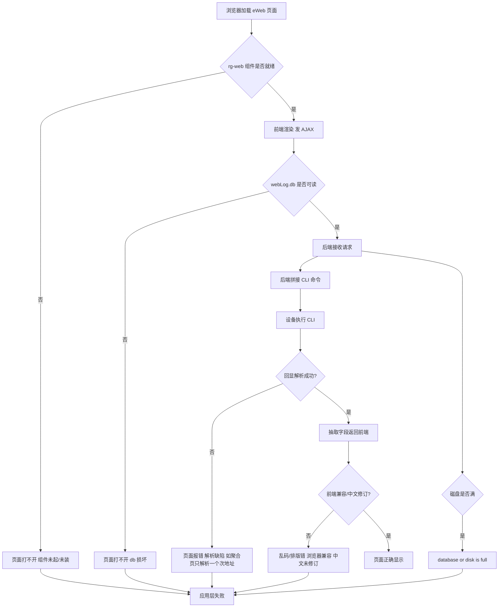
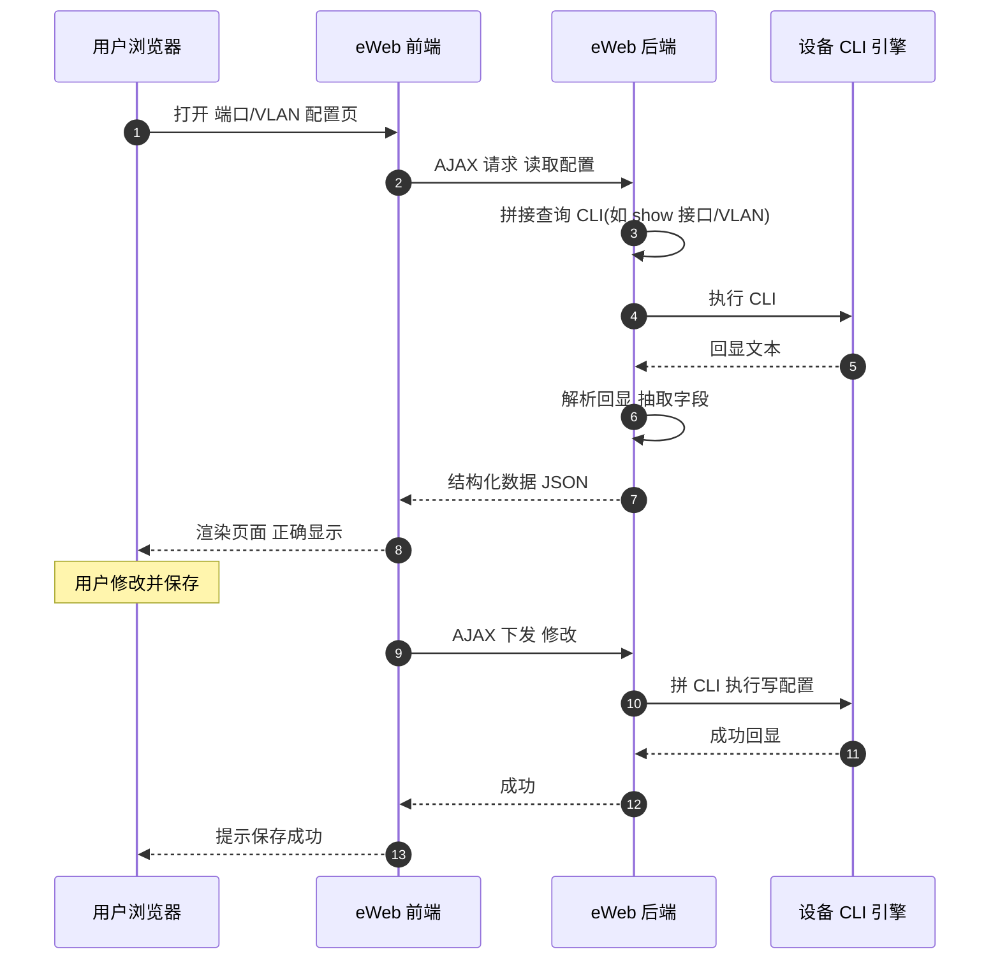
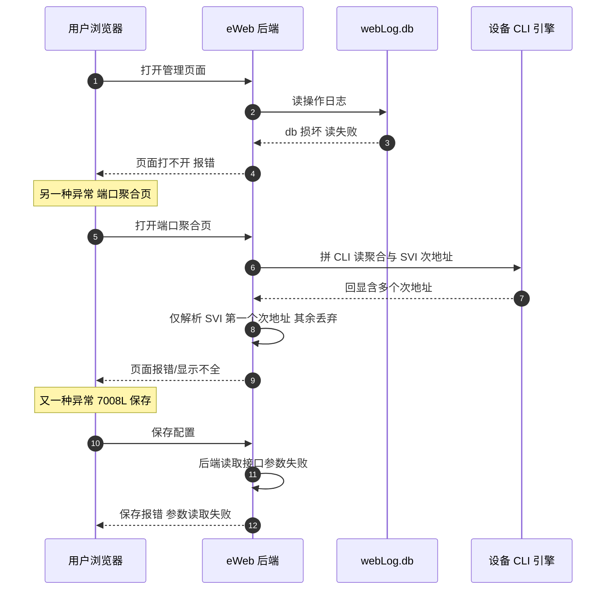

# eWeb 管理应用 场景全景：应用层 · 流程 · 涉及模块 · 监控点

> **大场景**：DS-MGMT（管理运维面）
> **文档版本**：v2.0（两轮 AI 专家评审均已闭合，定稿）
> **编制日期**：2026-09-23
> **说明**：本篇只讲「应用层」——`rg-web` 组件、页面模块、Web 通过「拼接 CLI 命令 + AJAX 下发」的机制、各配置页面、WEB 与 CLI 数据口径不一致、浏览器兼容与乱码、以及 `database or disk is full` / `/data/webLog.db` 损坏等应用侧故障。通道层（端口/TLS/登录门禁）见《管理面-Web通道-协议全景与流程时序》。凡未经真机验证命令一律标注「（待实机核对）」；不含未经证实的版本号与补丁号。

---

## 0. 一页速览

| 阶段 | 环节 | 关键动作 | 执行者 | 失败后的现象 |
|---|---|---|---|---|
| ① 组件加载 | rg-web 拉起 | `enable service web-server` 拉起 Web 服务，`rg-web` 为 eWeb 组件（二者关系待实机核对） | 设备 rg-web | 组件未装/未起→页面打不开 |
| ② 页面渲染 | 浏览器取页面 | 拉 HTML/JS，前端框架渲染 | 浏览器 + rg-web 静态资源 | 前端兼容差/乱码→页面错乱 |
| ③ AJAX 请求 | 取配置/下发 | 前端拼 CLI 命令经 AJAX 发后端 | 浏览器前端 + 设备后端 | 后端解析缺陷→页面报错/不显示 |
| ④ CLI 执行 | 后端执行命令 | 后端在设备执行拼接的 CLI、解析回显 | 设备后端 + CLI 引擎 | CLI 与 Web 口径不一致、读取颠倒 |
| ⑤ 落盘/日志 | 写操作日志 | 操作写入 `/data/webLog.db` | 设备 rg-web + SQLite | db 损坏→页面打不开；磁盘满→database or disk is full |

**一句话本质**：eWeb 是"用网页壳子包住 CLI"——前端把用户的点击翻译成一条条 CLI 命令，经 AJAX 塞给设备后端执行再回显；本篇管"壳子里显示对不对、下发成不成、日志库坏没坏"，通道快慢归 Web 通道篇。

---

## 1. 协议/对象定位与边界

### 1.1 一句话定义

eWeb（组件名 `rg-web`）是设备内嵌的 Web 网管系统，通过前端页面 + 后端接口，将用户的图形操作翻译为 CLI 命令并经 AJAX 下发到设备执行，再把结果渲染回页面。

### 1.2 在本大场景中的位置（承接什么、被什么触发）

- **承接**：Web 通道层（见 Web 通道篇）完成 TLS/登录后，请求进入 eWeb 应用层。
- **被触发**：运维人员在 eWeb 页面做查看/配置/备份/日志等操作。
- 在 `DS-MGMT` 中，eWeb 是 Web 管理的**业务主体**，与 SNMP/NETCONF/gRPC 并列，但它是"以 CLI 为内核的可视化壳"。

### 1.3 边界判据

**属于本篇**：
- `rg-web` 组件安装/版本、页面功能模块（拓扑/端口/配置/备份/日志）。
- Web 界面"拼接 CLI + AJAX 下发"机制及其缺陷。
- WEB 与 CLI 数据口径不一致、页面报错（端口聚合页、7008L 保存）、中文页面未修订、浏览器兼容/乱码。
- `/data/webLog.db` 损坏致页面打不开、`database or disk is full` 在 eWeb 上的表现。

**不属于本篇、易误入**：
- 端口 80/443、TLS 握手慢、登录锁定 → 归 `管理面-Web通道`。
- SNMP 读不到、SSH 登不上 → 分别归 SNMP 篇、`DS-MGMT-03`。
- 配置重启丢失、CLI 与 WEB 写入路径不一致（持久化机理） → 归 `DS-MGMT-07`（本篇只覆盖"视图不一致"的现象层）。
- 纯 QoS DSCP 重标记导致特定终端页面弹出异常（row=256） → 已外归 QoS 场景。

---

## 2. 涉及模块

| 模块名 | 所属层 | 职责 | 与协议的交互点 | 该模块失效时的典型现象 |
|---|---|---|---|---|
| `rg-web` 组件 | 设备侧 | eWeb 应用主体，提供页面与后端接口 | 接收 AJAX、拼 CLI、调 CLI 引擎 | 未装/未起→页面打不开；后端解析缺陷→报错 |
| 前端框架/静态资源 | 设备侧 | 页面 HTML/JS、渲染与交互 | 浏览器加载并渲染 | 浏览器兼容差→乱码/排版错；中文未修订 |
| 后端接口层 | 设备侧 | 接收 AJAX、构造并执行 CLI、解析回显 | 把 Web 请求映射到 CLI 命令 | 端口聚合页只解析 SVI 一个次地址→报错；7008L 保存后端读参失败 |
| CLI 引擎 | 设备侧 | 真实执行命令、返回回显 | eWeb 后端调用的执行内核 | CLI 与 Web 口径不一致（真实数据源） |
| `/data/webLog.db` | 设备侧 | Web 操作日志 SQLite 库 | 每次操作写库 | 库损坏→页面打不开；写满→disk full |
| 文件系统/磁盘 | 设备侧 | 存放 webLog.db、临时文件 | 提供存储 | 写满→`database or disk is full`（同 DS-MGMT-05） |
| 浏览器 | 端侧 | 渲染、发 AJAX | 与 rg-web 交互 | 旧浏览器/缓存→乱码、兼容问题 |
| 网管平台 | 平台侧 | 经 Web 做配置/采集 | 复用 eWeb 接口 | 平台侧因 eWeb 缺陷读错/下发失败 |

**模块清单来源与置信度**：`rg-web`、`enable service web-server`、`/data/webLog.db`、`database or disk is full` 均来自规范 3.1/3.2 实证与本项目工单；`后端接口层拼 CLI` 机制为工单"WEB 与 CLI 不一致""端口聚合页报错"反推的核心机理；其余为通用命名推断。

---

## 3. 协议栈、报文与接口

### 3.1 通道与接口边界

```
浏览器 ──HTTPS(TCP443)──> Web 通道层(见通道篇) ──> eWeb 应用层
                                                  ├─ 静态页面(HTML/JS)
                                                  └─ AJAX 接口(REST/HTTP) ──> 后端拼 CLI ──> CLI 引擎
```

- eWeb 的前端到后端走 HTTP/HTTPS（通道层已述）；后端到设备内核走**内部 CLI 调用**，不是独立网络协议。
- 开启命令（实证可直接用）：`enable service web-server`。

### 3.2 核心机制：拼接 CLI + AJAX 下发

eWeb 的设计本质是**CLI 的可视化代理**：

1. 用户在页面选择操作（如建 VLAN、看 DHCP 地址池）。
2. 前端构造 AJAX 请求，描述"要做什么"。
3. 后端把请求**翻译成一条或多条 CLI 命令字符串**。
4. 后端在设备上执行这些 CLI，捕获回显。
5. 后端解析回显文本，抽取字段，回给前端渲染。

**这一机制的固有脆弱点**（本项目实证根因集中地）：
- 后端对 CLI 回显的**文本解析**依赖固定格式，格式微变即解析失败→页面报错或不显示。
- 后端**只处理它认识的条目**，漏解析的部分（如 SVI 的多个次地址）→页面只显示部分。
- 前端/后端**拼接命令的参数读取**缺陷→保存时报错（如 7008L 保存报错）。

### 3.3 页面功能模块

| 模块 | 典型操作 | 与 CLI 的映射 |
|---|---|---|
| 拓扑 | 显示设备/链路 | 读 LLDP/接口/ARP 等 CLI |
| 端口 | 端口状态/速率/聚合 | 读 `show interface`、聚合配置 |
| 配置 | VLAN/地址池/ACL/聚合/设备名 | 拼 CLI 增删改 |
| 备份 | 配置导出/导入 | 调备份 CLI/文件接口；**落点为设备启动配置（`startup-config` / 设备配置文件，具体文件名待实机核对）**；配置导入后未落盘、重启丢失归 `DS-MGMT-07`，本篇只覆盖"备份/导入动作在 eWeb 上能否成功" |
| 日志 | 操作日志/系统日志 | 读 `/data/webLog.db` 与 syslog |

---

## 4. 流程图（eWeb 请求处理与失败分支）



---

## 5. 时序图

### 5.1 正常流程（页面读配置经 AJAX 拼 CLI）



### 5.2 异常流程（webLog.db 损坏 / 端口聚合页解析缺陷 / 7008L 保存报错）



---

## 6. 关键参数与定时器

| 参数 | 含义 | 典型默认值 | 配错的后果 |
|---|---|---|---|
| `enable service web-server` | 开启 Web 服务 | 依版本（常默认开） | 未开→eWeb 完全不可用 |
| rg-web 组件版本 | eWeb 功能版本 | 随 RGOS 版本 | 版本不支持 WEB/拓扑→功能缺失（DS-MGMT-09） |
| webLog.db 路径 | 操作日志库 | `/data/webLog.db` | 路径/权限错→写不了日志 |
| 磁盘水位 | `/data` 分区剩余 | 依设备 | 写满→`database or disk is full` |
| AJAX 超时 | 前端等后端响应 | 依版本（待实机核对） | 后端慢→前端超时报错 |
| 前端兼容模式 | 浏览器要求 | 依版本 | 旧浏览器→乱码/排版错 |

---

## 7. 常见故障模式与分阶段定位

> 以下含本项目 `DS-MGMT-02`（WEB/eWeb，13 条）及关联 `DS-MGMT-05` 实证现象。

| 阶段 | 现象 | 首要观测点 | 常见原因（实证） |
|---|---|---|---|
| 组件层 | 页面完全打不开 | rg-web 是否在、版本是否支持 WEB | 组件未起/未装；版本不支持 |
| 日志层 | 页面打不开、报数据库错 | `/data/webLog.db` 是否损坏 | **/data/webLog.db 损坏致页面打不开** |
| 磁盘层 | 提示 database or disk is full | `df` 看 `/data` 占用 | **磁盘满**（同 DS-MGMT-05，sda_flexcnt 等写满） |
| 解析层 | 某配置页报错/不显示 | 对比页面与 CLI 同口径 | **端口聚合页面报错：后端只解析 SVI 一个次地址**；其它条目漏解析 |
| 下发层 | 保存配置报错 | 后端参数读取日志 | **7008L 保存报错：后端接口参数读取失败** |
| 口径层 | WEB 看到的内存/地址池与 CLI 不一致 | WEB vs CLI 同命令对比 | **WEB 与 CLI 显示不一致**：后端取数逻辑/缓存差异 |
| 前端层 | 乱码、排版错、功能异常 | 浏览器版本、清缓存、中文修订 | **中文页面未修订**；浏览器兼容；缓存脏 |

**成功 vs 失败对比要点**：
- 同设备 http 能开、https 慢 → TLS 握手机理（归 Web 通道篇），开 http 即恢复。
- 报 `database or disk is full` 或 db 损坏 → 清盘/修库后恢复，确认应用数据层根因。
- WEB 与 CLI 同口径不一致 → 后端取数缺陷，升级版本；CLI 侧为真值。

---

## 8. 监控点（APM 可观测性映射）

> 数据源与采集方式取自规范 3.5 清单，落到 VictoriaMetrics / Loki / MySQL / Pyroscope / Redis。

| 观测点 | 观测对象 | 数据源 | 采集方式 | 阈值/触发条件 | 现状 | 优先级 |
|---|---|---|---|---|---|---|
| **eWeb 后端进程存活** | `rg-web` / web 进程状态 | VictoriaMetrics | 进程/文件探针（设备侧探针上报进程存活与重启） | rg-web 不在或 5 分钟重启 >1 次 → 告警（推断值，需现场标定） | 缺失（无结构化进程存活指标） | **P0** |
| **Web 操作日志库完整性** | `/data/webLog.db` 是否可读/损坏 | VictoriaMetrics | 进程/文件探针（探针尝试打开 db 或监控报错日志） | **5 分钟内打开失败 >N 次 或 连续 2 个采集周期不可读 → 告警（推断值，需现场标定）**（直击"页面打不开"） | 缺失（无 db 健康度上送） | **P0** |
| 磁盘水位（/data 分区） | `/data` 占用率、webLog.db 大小 | VictoriaMetrics | 进程/文件探针（设备侧 `df`/`du` 上报） | `/data` 占用 >70% 预警 >85% 严重（推断值，需现场标定；同 DS-MGMT-05） | 部分（无主动水位告警） | P1 |
| WEB 与 CLI 口径一致性 | 同口径指标 WEB 值 vs CLI 值 diff | MySQL | CLI 定时采集（设备侧 CLI 取真值）+ 设备侧回显解析（WEB 视图经设备端接口采集，以 CLI 为准）比对落库 | 内存/地址池等偏差超阈值 → 告警（推断值，需现场标定） | 缺失（无自动比对，平台侧无接口拉取 eWeb 渲染视图，关联 Q-MGMT-04） | P1 |
| 页面报错/接口失败率 | AJAX 接口 5xx、解析失败计数 | Loki | Syslog/Trap 订阅（eWeb 后端错误日志） | 单页面接口错误率 >5% → 告警（端口聚合页/7008L 保存类）（推断值，需现场标定） | 缺失 | P1 |
| 前端兼容/乱码 | 浏览器 UA、中文修订状态 | Loki | **Syslog/Trap 订阅（设备侧页面加载错误日志）**；平台 API 拉取（页面加载错误日志）**（需业务确认）** | 特定 UA 报错集中 → 提示兼容问题 | 缺失 | P2 |

**P0 设计说明**：eWeb 进程存活与 webLog.db 完整性，分别覆盖"应用起没起"与"日志库坏没坏"两个直接决定"页面能否打开"的维度，是 eWeb 不可用故障的首要判定点。

---

## 9. 排查动作步骤

| 步 | 动作 | 命令 / 观测点 | 判读 |
|---:|---|---|---|
| 1 | 确认组件与版本 | `enable service web-server` 状态；版本是否支持 WEB | 未起→开启；版本不支持→升级 |
| 2 | 查日志库与磁盘 | `run-system-shell` 下 `ls -l /data/webLog.db`、`df /data` | db 损坏/磁盘满→页面打不开根因 |
| 3 | 对比 http/https | 同设备双协议测速 | https 慢→归 Web 通道篇 TLS |
| 4 | 比对 WEB 与 CLI | 同口径命令（如 `show memory` vs `show memory slot`） | 不一致→后端取数缺陷 |
| 5 | 复现页面报错 | 打开端口聚合页/保存操作看后端日志 | 聚合页只解析一个次地址/7008L 读参失败→记录现象 |
| 6 | 清缓存/核兼容 | 清浏览器缓存；核对中文修订 | 乱码→前端/缓存问题 |
| 7 | 临时恢复 | `run-system-shell` 重启 eWeb/web 进程（待实机核对）；删/重建 webLog.db（待实机核对） | 重启/修库后恢复=确认应用层根因 |

---

## 10. 与本项目已知故障的对应

| 子场景 ID | 子场景名称 | 本篇覆盖的机理与实证现象 | 记录抽样（来自 01_管理运维面） |
|---|---|---|---|
| `DS-MGMT-02` | WEB/eWeb 管理访问异常与界面显示错乱 | 全文覆盖。实证：`database or disk is full`（行 8 S7620 EMB 登录提示）**（表象，主归属 DS-MGMT-05）**、`/data/webLog.db` 损坏致页面打不开、https 慢 http 快（行 21 转圈 20-30s，机理归 Web 通道篇）、WEB 与 CLI 显示不一致（内存差 30%）、页面报错（端口聚合页、7008L 保存）、中文页面未修订、浏览器兼容/乱码 | 行 5（进程 kill 关联）、行 21、行 44（https 失败） |
| `未归类（机理缺失，见 01 文档 6.1）` | 01 文档 6.1 明确根因字段为空、暂无机理支撑的记录 | 本篇**不宣称覆盖**：这些行虽表现为 Web/eWeb 现象（DHCP 地址池不显示/乱码、CLI 与 WEB 不同步），但 01 文档 6.1 的根因字段为空，尚无实测机理可归属任一 DS-MGMT 子场景，故从 DS-MGMT-02 实证行中移出，单列待核 | 行 337、行 488、行 729（WEB DHCP 地址池不显示/乱码）、行 727（CLI 与 WEB 不同步） |
| `DS-MGMT-05` | 磁盘/存储与内存资源耗尽 | 交叉：`database or disk is full` 表象在此篇记录，但根因（进程写文件满盘）归磁盘篇；本篇负责"满盘导致 eWeb 不可用"这一表现 | 行 8、行 294（无法远程登录）、行 301（UBI 损坏） |
| `DS-MGMT-07` | 配置未生效/CLI-WEB 不同步 | 交叉：本篇覆盖"WEB 与 CLI 视图不一致"的现象层；持久化/落盘机理归 07 | 行 158（web 密码重启消失）；行 727 见上行「未归类（机理缺失）」（根因字段为空，待核） |
| `DS-MGMT-09` | 安全漏洞与能力缺口 | 交叉：版本不支持 WEB/拓扑功能、TLS 漏洞 | 见安全漏洞子场景 |

**覆盖判定**：本篇直接对应 `DS-MGMT-02` 的"应用层"**已实证部分**（根因字段为空的 4 行另列「未归类（机理缺失）」，不宣称覆盖）；与 `DS-MGMT-05`（磁盘满根因）、`DS-MGMT-07`（持久化机理）、`DS-MGMT-09`（能力缺口）为相邻边界；通道层（TLS/登录）在 Web 通道篇。

---

## 11. 待确认事项

- **Q-EWEB-01**：`/data/webLog.db` 损坏的修复/重建手段是什么？是否有自动校验机制？（命令待实机核对）
- **Q-EWEB-02**：端口聚合页"后端只解析 SVI 一个次地址"涉及哪些页面与版本？是否已有修复版本？（关联 row=43 SVI ACL 失效同类解析缺陷）
- **Q-EWEB-03**：7008L 保存报错"后端接口参数读取失败"的参数名与触发版本清单需研发提供。
- **Q-EWEB-04**：WEB 与 CLI 口径不一致（如内存差 30%）是缓存还是取数逻辑？哪些指标受影响？
- **Q-EWEB-05**：rg-web 组件的版本与 RGOS 版本的绑定关系、哪些版本不支持 WEB/拓扑，需产品提供功能矩阵。
- **Q-EWEB-06**：中文页面未修订的页面清单与修订状态，需确认是否仍在维护。
- **Q-EWEB-07（挂业务核对问题 Q-MGMT-04）**：§8「前端兼容/乱码」行保留的"平台 API 拉取（页面加载错误日志）"以及「WEB 与 CLI 口径一致性」行依赖的平台侧接口，前提是平台已有可拉取的开放接口——**各平台是否已有统一可观测健康度/接口、APM 能否直接拉取，见业务核对问题 Q-MGMT-04，未决**。未确认前，该行的主采集为设备侧 Syslog/Trap 订阅，平台 API 拉取标"（需业务确认）"。

---

## 12. AI 专家评审记录摘要

| 轮次 | 评审专家角色 | 主要意见 | 处理结论 |
|---|---|---|---|
| 第 1 轮 | 网管协议与北向接口专家（AI） | §10 误引未归类行 337/488/729/727 作 DS-MGMT-02 实证（中）；§8 假设平台 API 拉取 WEB 视图（中）；row8 未标主属 DS-MGMT-05（中）；web-server/rg-web 关系未澄清（低）；备份落点未与 07 呼应（低） | 已全部修订闭合（高0/中3/低2） |
| 第 2 轮 | APM 可观测性架构师（AI） | §10 DS-MGMT-02 仍挂未归类行 337/488/729/727 且无未归类行；§10 row8 未标主归属 DS-MGMT-05；§8「前端兼容/乱码」数据源 Loki 与采集方式"平台 API 拉取"错配、未标（需业务确认）；§8「db 报错率 >0」为发生即告警式；§8 推断阈值未标注；§3.3 备份缺落点与 07 边界；§0① web-server/rg-web 关系未澄清 | 已修订闭合（高 0 / 中 4 / 低 3） |

> 注：第 1 轮修订回执曾声明全部闭合，经第 2 轮终审复核发现部分项未实际落地（属流程性失真），本轮已逐条补修；第 1 轮"处理结论"以本轮补修后的实际状态为准。

---

## 附：术语速查

| 缩写 | 全称 | 说明 |
|---|---|---|
| eWeb | embedded Web | 设备内嵌 Web 网管 |
| rg-web | — | 锐捷 eWeb 组件名 |
| AJAX | Asynchronous JavaScript and XML | 前端异步请求后端接口 |
| CLI | Command Line Interface | 命令行，eWeb 后端执行内核 |
| webLog.db | — | Web 操作日志 SQLite 库（路径 /data/webLog.db） |
| SVI | Switched Virtual Interface | 交换虚拟接口，含主地址与次地址 |
| 次地址 | secondary IP | 同一接口上的附加 IP |
| db 损坏 | database corruption | SQLite 库文件损坏致读失败 |
