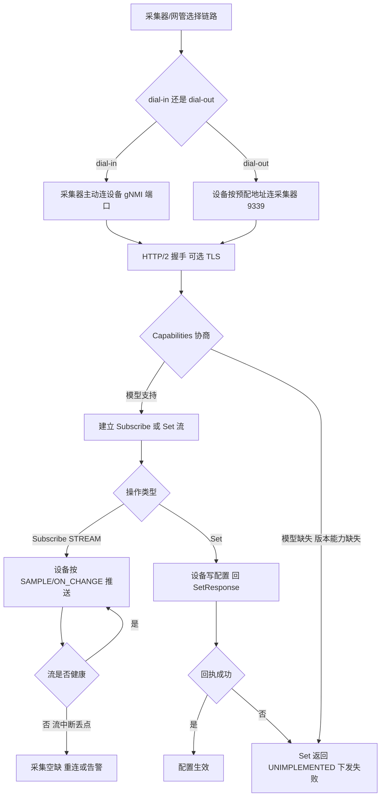
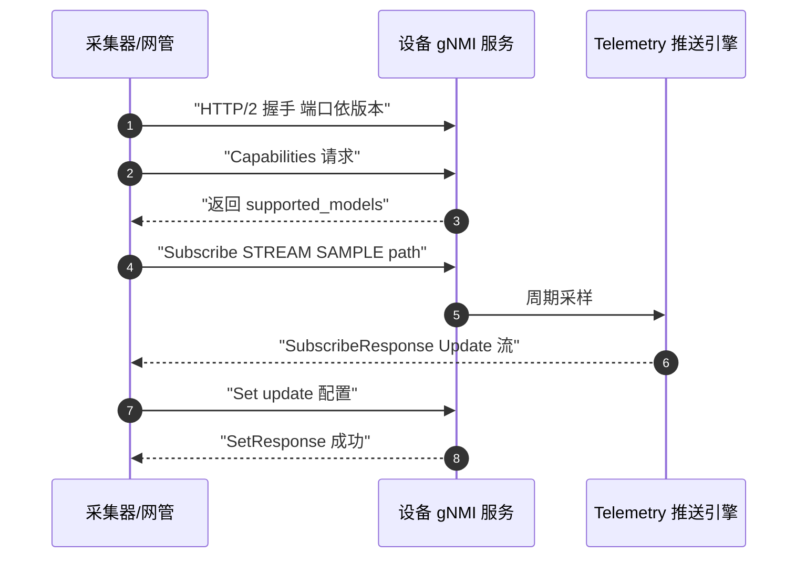
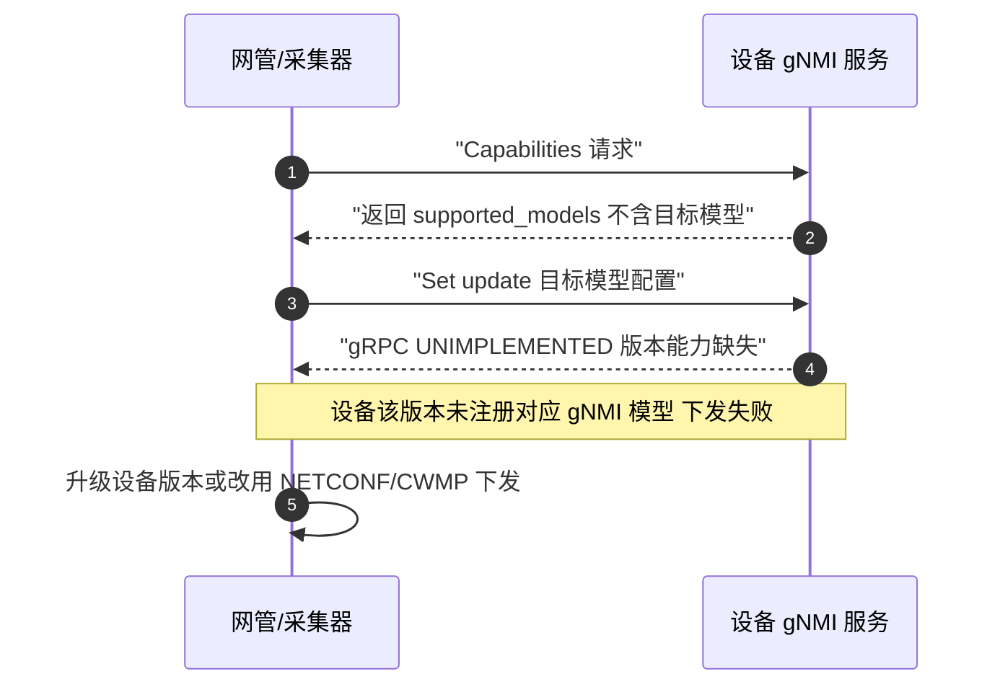
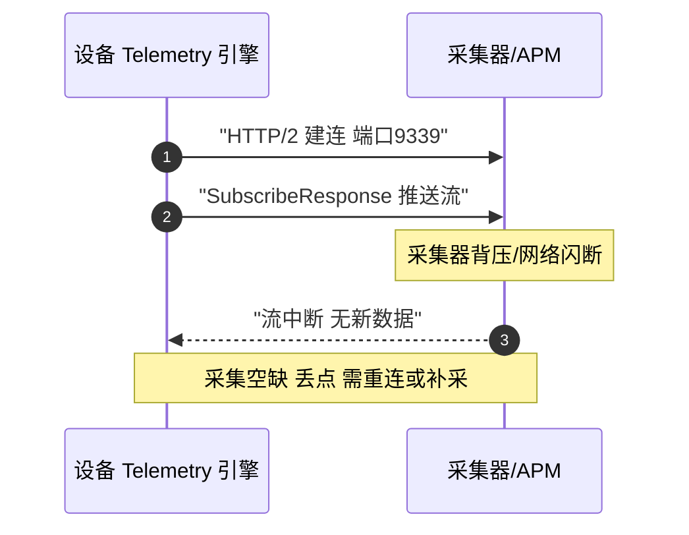

# gRPC 协议全景：描述 · 流程 · 涉及模块 · 监控点

> **大场景**：DS-MGMT（管理运维面）
> **文档版本**：v2.0（两轮 AI 专家评审均已闭合，定稿）
> **编制日期**：2026-09-23
> **说明**：文中设备命令凡未经真机验证，一律标注「（待实机核对）」；本文不含未经证实的版本号与补丁号。

---

## 0. 一页速览

| 阶段 | 关键动作 | 执行者 | 失败后的现象 |
|---|---|---|---|
| ① 链路建立 | HTTP/2 握手（dial-in 采集器连设备 / dial-out 设备连采集器） | 设备 gRPC 服务 / 采集器 | 握手失败，流未建立 |
| ② 能力协商 | gNMI `Capabilities` 交换支持模型 | 设备 | 不支持模型 → Set 失败（本项目实证） |
| ③ 配置操作 | gNMI `Set` 下发（dial-in） | 网管 | 版本能力缺失 → 下发失败 |
| ④ 订阅 | gNMI `Subscribe` 拉实时指标（ONCE/STREAM） | 采集器 | 订阅流中断、丢点 |
| ⑤ 推送 | 设备按 SAMPLE/ON_CHANGE 推送 | 设备 | 数据断流、采集空缺 |
| ⑥ 健康 | 流保活（HTTP/2 ping） | 双方 | 流僵死，无新数据 |

**一句话本质**：gRPC/gNMI 是「跑在 HTTP/2 上的 Protobuf 遥测与配置总线」——`Capabilities/Get/Set/Subscribe` 四操作，靠 `origin/path/target` 三元定位；下发失败多因「版本能力缺失」，采集断流多因「订阅流不健康」。

---

## 1. 协议/对象定位与边界

### 1.1 一句话定义

gRPC 是基于 HTTP/2 + Protobuf 的 RPC 框架；gNMI（OpenConfig）在其上定义网络设备管理接口：`Capabilities`、`Get`、`Set`、`Subscribe` 四操作，用于配置下发与实时遥测（Telemetry）。Telemetry 有 **dial-in**（采集器主动连设备）与 **dial-out**（设备主动连采集器）两条链路。

### 1.2 在本大场景中的位置

承接：APM/网管要做高频状态采集（Telemetry）或北向自动化 `Set` 下发。被触发：采集器周期连接（dial-in）或设备按预配采集器地址主动推送（dial-out）。与 NETCONF（SSH+XML 配置总线）、CWMP/ACS（HTTP POST 云纳管）、SNMP（轮询）并列，是「流式可观测性 + 北向 Set」的现代主干。

### 1.3 边界判据

**属于本篇**：

- gRPC 传输层 HTTP/2 + Protobuf、gNMI 四操作、Subscribe 模式/子模式、`origin/path/target` 定位
- dial-in 与 dial-out 两条链路、端口、证书/认证
- gNMI `Set` 下发失败（版本能力缺失）、`Subscribe` 流健康度与丢点

**不属于本篇、易误入**：

- NETCONF over SSH（XML 配置总线，非 HTTP/2+Protobuf）→ 见《管理面-NETCONF-协议全景与流程时序》
- CWMP/TR-069（HTTP POST Inform 云纳管）→ 见《管理面-CWMP-协议全景与流程时序》《管理面-ACS-协议全景与流程时序》
- SNMP 轮询与 Trap → 见《管理面-SNMP-协议全景与流程时序》
- gRPC `Set` 下发后配置未落盘（持久化）→ 见 DS-MGMT-07

---

## 2. 涉及模块

| 模块名 | 所属层 | 职责 | 与协议的交互点 | 失效时的典型现象 |
|---|---|---|---|---|
| 设备 gRPC/gNMI 服务（gnmi server） | 设备侧进程 | 提供 HTTP/2 端点，处理 Capabilities/Get/Set/Subscribe | dial-in 端口（依版本，常配 57400/50051 一类，待实机核对）、dial-out 推送 | 服务未起 → 采集器连不上；模型未注册 → Set 失败 |
| gNMI 模型注册器 | 设备侧组件 | 注册 OpenConfig/YANG 模型供 Capabilities | Capabilities 响应 | 模型缺失 → 版本能力缺失（本项目实证下发失败） |
| Telemetry 推送引擎（dial-out） | 设备侧组件 | 按预配采集器地址主动建连并周期推送 | 采集器 9339 一类端口、Protobuf 流 | 推送流中断 → 采集空缺、丢点 |
| 采集器/APM 接收端（dial-in 客户端 / dial-out 服务端） | 平台侧服务 | 发起 dial-in 或接收 dial-out，解析 Protobuf | 订阅流、指标落 VictoriaMetrics | 接收端满 → 背压、丢点 |
| 配置下发编排（网管/INC/UNC） | 平台侧服务 | 经 gNMI `Set` 下发配置并跟踪回执 | Set RPC、回执状态 | 下发失败 → 配置空 |
| 证书/认证服务 | 外部依赖 | gRPC TLS 双向认证、token | HTTP/2 TLS 握手 | 证书过期/不匹配 → 握手失败 |
| 时间源 NTP | 外部依赖 | 推送数据时间戳对齐 | 时间戳 | 时间漂移 → 指标乱序 |

**模块清单来源与置信度**：gNMI 四操作、`origin/path/target`、dial-in/dial-out、端口取值（57400/50051/9339 一类）来自规范 3.4 通用技术事实；本项目实证「gRPC 下发失败（版本能力缺失）」（DS-MGMT-08/09）指明 `Set` 失败源于设备侧模型/能力未注册。设备侧具体进程名与端口以真机为准（待实机核对）。

---

## 3. 协议栈、报文与接口

### 3.1 协议栈与端口

```
dial-in：采集器 ──HTTP/2(TCP 端口依版本,常配 57400/50051 一类,待实机核对)── 设备 gNMI 服务
dial-out：设备 Telemetry 引擎 ──HTTP/2(TCP 采集器端口 9339 一类)── 采集器/APM
```

- 传输：HTTP/2（多路复用流、头部压缩、ping 保活）。
- 编码：Protobuf（强类型、体积小、解析快）。
- `origin`：数据源命名空间（如 `openconfig`/`ietf`）；`path`：数据树路径（如 `/interfaces/interface[name=Gi0/1]`）；`target`：指定设备（集群场景）。三元定位一个叶子/容器。

### 3.2 gNMI 四操作

| 操作 | 作用 | 请求/响应 |
|---|---|---|
| `Capabilities` | 交换支持的数据模型与编码 | 返回 `supported_models`、`gNMI_version` |
| `Get` | 读指定 path 的当前值 | `Notification` 携带 `Update` |
| `Set` | 增删改（update/replace/delete） | `SetResponse` 含 `response` 状态 |
| `Subscribe` | 订阅遥测（见下） | `SubscribeResponse` 流 |

### 3.3 Subscribe 模式与子模式

- 模式：`ONCE`（一次性回采后关闭）、`STREAM`（持续流）。
- 子模式：`SAMPLE`（周期采样）、`ON_CHANGE`（变化才推）、`TARGET_DEFINED`（设备决定）。
- 订阅请求含 `path`、`sample_interval`、`mode`、`encoding`（多 Protobuf）。

### 3.4 返回与错误

`SetResponse` 的每个 `response` 含 `op` 结果与 `timestamp`；失败在 gRPC 状态码（如 `UNIMPLEMENTED` 模型未实现、`INVALID_ARGUMENT` 路径错、`UNAUTHENTICATED` 认证失败）体现。各状态码的语义与排查映射详见 §3.5。

**本项目实证**：gRPC `Set` 下发失败，根因为「版本能力缺失」——设备 gNMI 服务未注册对应模型，`Capabilities` 不包含目标 `supported_models`，`Set` 返回 `UNIMPLEMENTED`（见 DS-MGMT-08/09 row 与「grpc 下发失败」现象）。

### 3.5 gRPC 状态码与排查映射

| gRPC 状态码 | 含义 | 在 gNMI 中的典型触发 |
|---|---|---|
| `UNIMPLEMENTED` | 模型/方法未实现 | `Capabilities` 不含目标模型 → `Set` 失败（本项目实证） |
| `INVALID_ARGUMENT` | 参数非法 | `path`/`origin` 写错、节点不存在 |
| `NOT_FOUND` | 路径不存在 | 订阅/读取的 path 越界 |
| `UNAUTHENTICATED` | 认证失败 | TLS/Token 不匹配 |
| `DEADLINE_EXCEEDED` | 超时 | 设备处理慢、网络拥塞 |
| `UNAVAILABLE` | 服务不可用 | gNMI 服务未起、流中断 |

### 3.6 dial-in 与 dial-out 选择建议

| 维度 | dial-in | dial-out |
|---|---|---|
| 建连发起方 | 采集器主动连设备 | 设备主动连采集器 |
| 设备侧开销 | 被动监听端口 | 维护目标地址与重连 |
| 适用 | 采集器集中、设备地址稳定 | 设备 NAT/动态地址、需主动上报 |
| 端口 | 设备常配 57400/50051 一类（待实机核对） | 采集器 9339 一类 |
| 本项目关注 | Set 下发、订阅拉取 | 推送流健康度与丢点 |

---

## 4. 流程图



---

## 5. 时序图

### 5.1 正常 dial-in 订阅 + Set 时序



### 5.2 异常时序：版本能力缺失致 Set 下发失败（本项目实证）



### 5.3 异常时序：dial-out 订阅流中断丢点



---

## 6. 关键参数与定时器

| 参数 | 含义 | 典型默认值 | 配错的后果 |
|---|---|---|---|
| dial-in 端口 | 设备 gNMI 监听端口 | 常配 57400/50051 一类（待实机核对） | 端口错 → 采集器连不上 |
| dial-out 采集器端口 | 设备推送目标端口 | 9339 一类 | 错 → 推送流建不起来 |
| `sample_interval` | STREAM SAMPLE 采样周期 | 视模型（如 10s） | 过短 → 设备/采集器压力大；过长 → 分辨率低 |
| HTTP/2 ping 间隔 | 流保活 | 视实现（待实机核对） | 过长 → 僵死流不及时发现 |
| TLS/证书 | 双向认证 | 依部署 | 证书错 → 握手失败 |
| `mode` | ONCE/STREAM | STREAM | ONCE 仅一次，误配 → 采不到持续数据 |
| `submode` | SAMPLE/ON_CHANGE/TARGET_DEFINED | SAMPLE | ON_CHANGE 无变化则静默，误判为断流 |

---

## 7. 常见故障模式与分阶段定位

| 阶段 | 现象 | 首要观测点 | 常见原因 |
|---|---|---|---|
| 建链 | 采集器连不上 / 握手失败 | 端口监听、TLS 日志、HTTP/2 状态 | 端口错、证书不匹配、服务未起 |
| 能力 | Set 失败 UNIMPLEMENTED | `Capabilities` 的 `supported_models` | **版本能力缺失（本项目实证）** |
| 路径 | Set/Get 返回 INVALID_ARGUMENT | `path` 写法、`origin` 命名空间 | path 错、origin 不匹配 |
| 订阅 | 流中断、采集空缺 | 订阅流健康度、丢点计数 | 网络闪断、采集器背压 |
| 推送 | 数据乱序/时间戳异常 | NTP、Protobuf 解码 | 时间漂移、编码不一致 |
| 保活 | 流僵死无新数据 | HTTP/2 ping、最后推送时间 | ping 间隔过长 |

**成功 vs 失败对比要点**：同网管下其它同型号设备 gNMI `Set` 成功 → 异常设备为该版本未注册模型（能力缺失）；切换 NETCONF 下发同配置成功 → 进一步坐实 gNMI 模型缺口而非配置本身问题。

---

## 8. 监控点（APM 可观测性映射）

| 观测点 | 观测对象 | 数据源 | 采集方式 | 阈值/触发条件 | 现状 | 优先级 |
|---|---|---|---|---|---|---|
| gRPC 订阅流健康度与丢点 | 订阅流存活、单位时间推送点数、断流次数 | VictoriaMetrics（点数/断流）+ Loki（流日志） | gRPC Telemetry（采集器侧订阅流指标）+ 平台 API 拉取（采集器任务状态）（需业务确认） | 推送点数为 0 持续 > 2 个 sample_interval → 断流（推断值，需现场标定）；断流次数 > 3/小时 → 告警（推断值，需现场标定） | 缺失 | P0 |
| gNMI Set 下发成功率与耗时 + 版本能力缺失计数 | `Set` 成功率、平均耗时、UNIMPLEMENTED 计数 | Loki（gRPC 状态）+ VictoriaMetrics | **采集器侧 gRPC/RPC 指标（gRPC Telemetry）+ 设备侧 gNMI 服务日志（Syslog/Trap 订阅）** + 平台 API 拉取（需业务确认） | Set 成功率 < 95%（推断值，需现场标定）；UNIMPLEMENTED 5 分钟内 > N 次 或 占错误码 > X%（N/X 为推断值，需现场标定；挂 Q1） | 缺失 | P0 |
| 北向接口请求量/错误码分布 | `Capabilities/Get/Set/Subscribe` 量、gRPC 状态码分布 | VictoriaMetrics | **采集器侧 gRPC/RPC 指标（gRPC Telemetry）+ 设备侧 gNMI 服务日志（Syslog/Trap 订阅）** | UNIMPLEMENTED/INVALID_ARGUMENT 占比 > 10%（推断值，需现场标定） | 缺失 | P1 |
| dial-in/dial-out 链路在线率 | 设备 gNMI 端口可达、采集器 9339 接收状态 | VictoriaMetrics | CLI 定时采集 + 平台 API 拉取（需业务确认） | 链路不可达 > 3 分钟 → 告警（推断值，需现场标定） | 部分 | P1 |
| 推送数据时间戳一致性 | NTP 偏差、Protobuf 解码失败率 | VictoriaMetrics | gRPC Telemetry | 时间戳乱序率 > 5%（推断值，需现场标定） | 缺失 | P2 |

> **加密通道（HTTPS/SSH/TLS）之上的业务语义不可经镜像抓包获得，本表相关观测点一律采用设备侧/采集器侧日志或探针。**

### 8.1 订阅流丢点判定细则

- 丢点判定以「期望推送点数 = 采样周期 / 实际收到点数」为基准；STREAM+SAMPLE 下连续 2 个 `sample_interval` 无数据即视为断流。
- ON_CHANGE 模式静默属正常，不能据此判断流，需结合 HTTP/2 ping 最后到达时间。
- 采集器背压（接收缓冲满）会表现为设备侧发送成功但平台入库缺失，需平台侧落库计数与设备侧发送计数对账。

---

## 9. 排查动作步骤

| 步 | 动作 | 命令 / 观测点 | 判读 |
|---:|---|---|---|
| 1 | 确认 gNMI 端口与可达 | `show`（待实机核对）gNMI 状态、telnet 端口 | 端口不通=服务未起/端口错 |
| 2 | 抓 Capabilities | gNMI `Capabilities` 请求 | `supported_models` 不含目标 → 能力缺失（实证根因） |
| 3 | 核对 Set 错误码 | `Set` 返回 gRPC 状态码 | UNIMPLEMENTED=版本能力缺失；INVALID_ARGUMENT=path 错 |
| 4 | 切换下发通道验证 | 同一配置走 NETCONF/CWMP 下发 | 成功 → 坐实 gNMI 模型缺口 |
| 5 | 查订阅流健康 | 推送点数、最后推送时间、HTTP/2 ping | 静默 → 流中断/采集器背压 |
| 6 | 升级/补模型 | 升级设备版本或加载模型 | 能力齐后 Set 成功 → 确认根因 |

### 9.1 实战对照清单（gRPC 专属）

| 现场现象 | 是否 gNMI 根因 | 下钻动作 |
|---|---|---|
| `Set` 返回 UNIMPLEMENTED | 是，版本能力缺失（实证） | 查 Capabilities supported_models |
| 同型号其它设备 Set 成功 | 是，本机模型未注册 | 升级版本或改用 NETCONF/CWMP |
| 订阅流断、采集空缺 | 是，流不健康 | 看 HTTP/2 ping、最后推送时间 |
| 切换 NETCONF 同配置成功 | 坐实 gNMI 缺口 | 固化规避通道 |
| 配置下发 ok 但重启丢失 | 否，转 DS-MGMT-07 | 查落盘 |

---

## 10. 与本项目已知故障的对应

| 子场景 | 覆盖关系 | 典型现象/实证 |
|---|---|---|
| `DS-MGMT-08` 北向协议（NETCONF/XML/gRPC）异常 | 直接覆盖 | gRPC 下发失败（版本能力缺失，01_管理运维面 DS-MGMT-09 典型现象"grpc 下发失败"，无独立 Sheet8 行号，属能力缺口类） |
| `DS-MGMT-09` 安全漏洞与能力缺口 | 部分覆盖 | 版本不支持 gRPC 下发，需升级（grpc 下发失败列为其典型现象） |
| `DS-MGMT-04` 纳管会话失联 | 关联 | gNMI 订阅流断流计入纳管不可观测 |

---

## 11. 待确认事项

- Q1：本项目「gRPC 下发失败（版本能力缺失）」具体是哪些 RGOS 版本、缺哪些 OpenConfig 模型？需版本功能矩阵（关联 DS-MGMT-09）。
- Q2：dial-in 端口在现网设备的实际取值（57400/50051 还是其它）与开启命令（待实机核对）。
- Q3：dial-out 采集器地址在设备侧的配置命令与重连退避策略（待实机核对）。
- Q4：gNMI `Subscribe` 流中断后设备侧是否有自动重连，还是依赖采集器重连（待实机核对）。
- **Q-MGMT-04（显式挂起）**：本篇 §8 中所有「平台 API 拉取」（采集器任务状态、Set 结果汇总、链路在线率）是否现成可用待业务确认；相关采集方式已就地标「（需业务确认）」，主采集改为采集器侧 gRPC/RPC 指标与设备侧 gNMI 服务日志。gRPC 走 TLS 双向认证，加密通道内的 Protobuf/状态码不可经镜像抓包获得，镜像仅可用于 TLS 握手层面。

---

## 12. AI 专家评审记录摘要

| 轮次 | 评审专家角色 | 主要意见 | 处理结论 |
|---|---|---|---|
| 第 1 轮 | 网管协议与北向接口专家（AI） | §8 多处"平台 API 拉取"假设接口现成可用（中）；UNIMPLEMENTED 阈值"计数>0 即告警"（中）；§10 gRPC 下发失败无行号（低）；INVALID/NOT_FOUND 语义未区分（低）；P0/P1 口径不一致（低） | 已全部修订闭合（高0/中2/低3） |
| 第 2 轮 | APM 可观测性架构师（AI） | §8 用镜像抓包采 gRPC(TLS) 状态码/Set 成功率（不可落地·高）；§8 多处"平台 API 拉取"未标注、§11 无 Q-MGMT-04 条目（中项假闭合）；§8 UNIMPLEMENTED 阈值仍"计数>0"（中）；§8 阈值无标注（低）；§3.4 未与 §3.5 交叉引用（低） | 已修订闭合（高 1 / 中 2 / 低 2） |

> 注：第 1 轮修订回执曾声明全部闭合，经第 2 轮终审复核发现部分项未实际落地（属流程性失真），本轮已逐条补修；第 1 轮"处理结论"以本轮补修后的实际状态为准。

---

### 参考标准与协议

| 标准/规范 | 主题 |
|---|---|
| gNMI Specification | OpenConfig gNMI 接口 |
| RFC 7540 | HTTP/2 传输 |
| Protobuf | 二进制序列化编码 |
| OpenConfig YANG | 数据模型 |
| RFC 6241（对照） | NETCONF 类比参考 |

## 附：术语速查

| 缩写 | 全称 | 说明 |
|---|---|---|
| gRPC | gRPC Remote Procedure Call | HTTP/2 + Protobuf RPC 框架 |
| gNMI | gRPC Network Management Interface | OpenConfig 网络设备管理接口 |
| Telemetry | — | 流式实时遥测 |
| dial-in | — | 采集器主动连设备 |
| dial-out | — | 设备主动连采集器 |
| Protobuf | Protocol Buffers | 二进制序列化编码 |
| origin/path/target | — | gNMI 三元数据定位 |
| SAMPLE/ON_CHANGE | — | Subscribe 子模式 |
| UNIMPLEMENTED | — | gRPC 状态码：模型未实现 |
