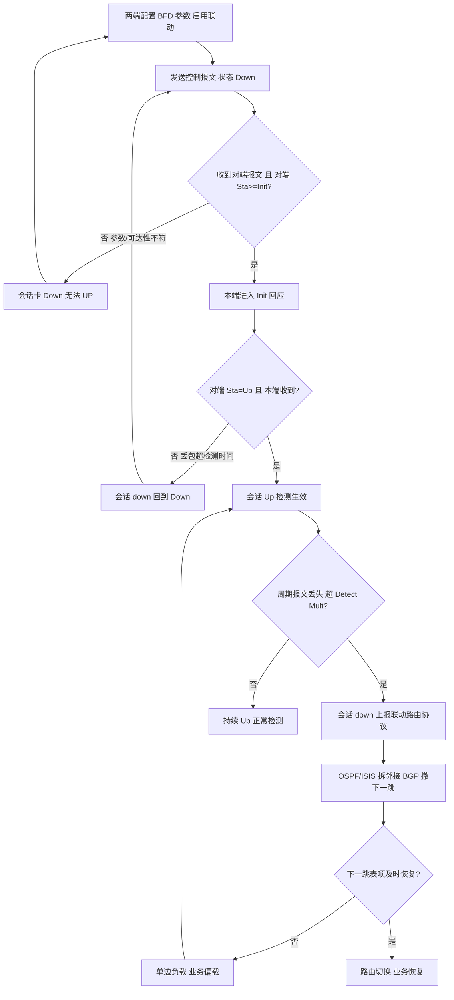
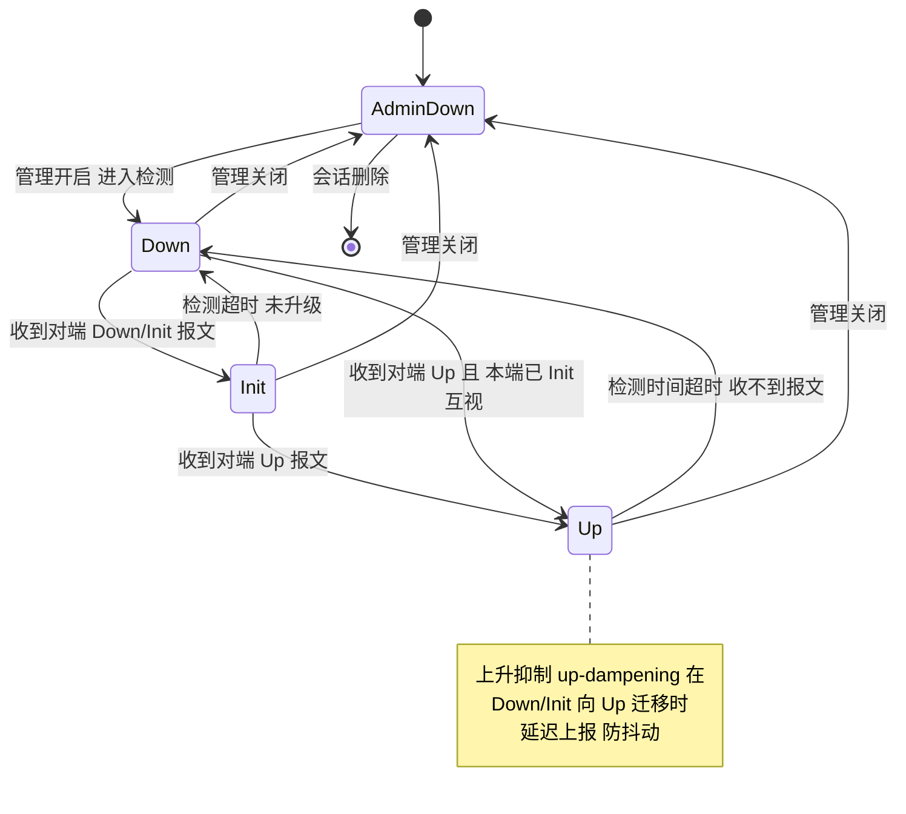
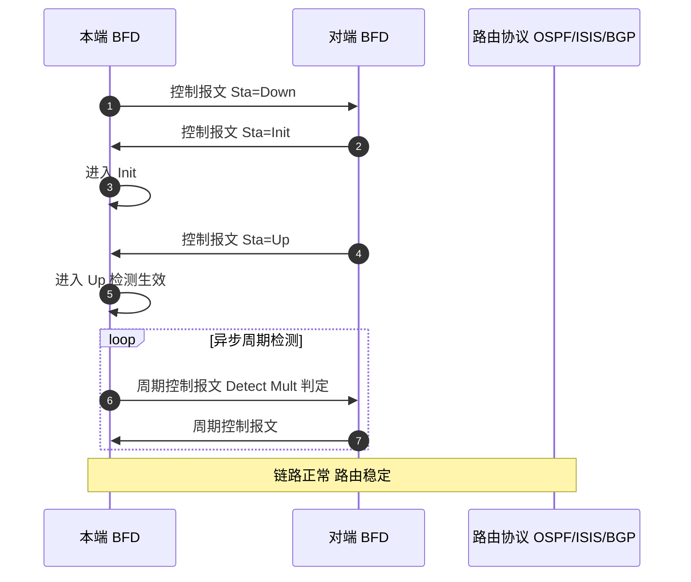
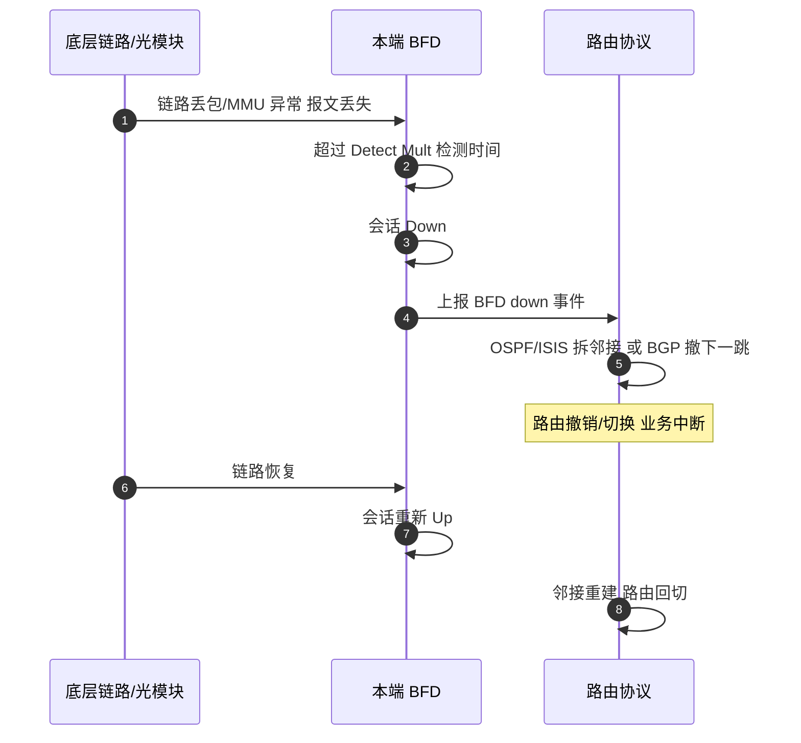
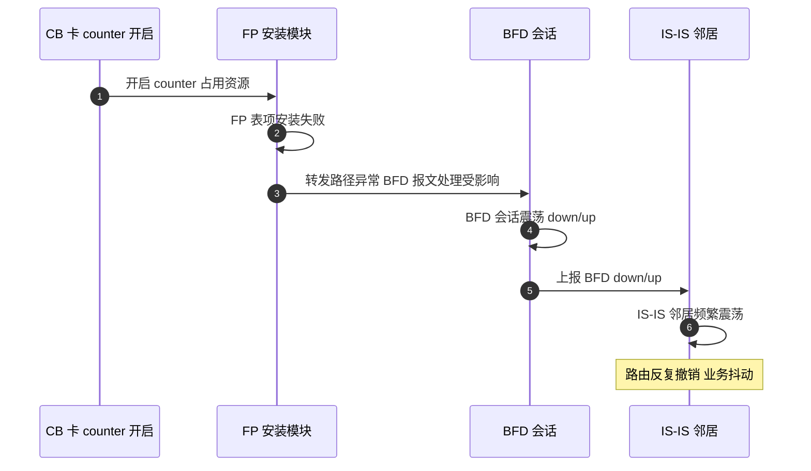
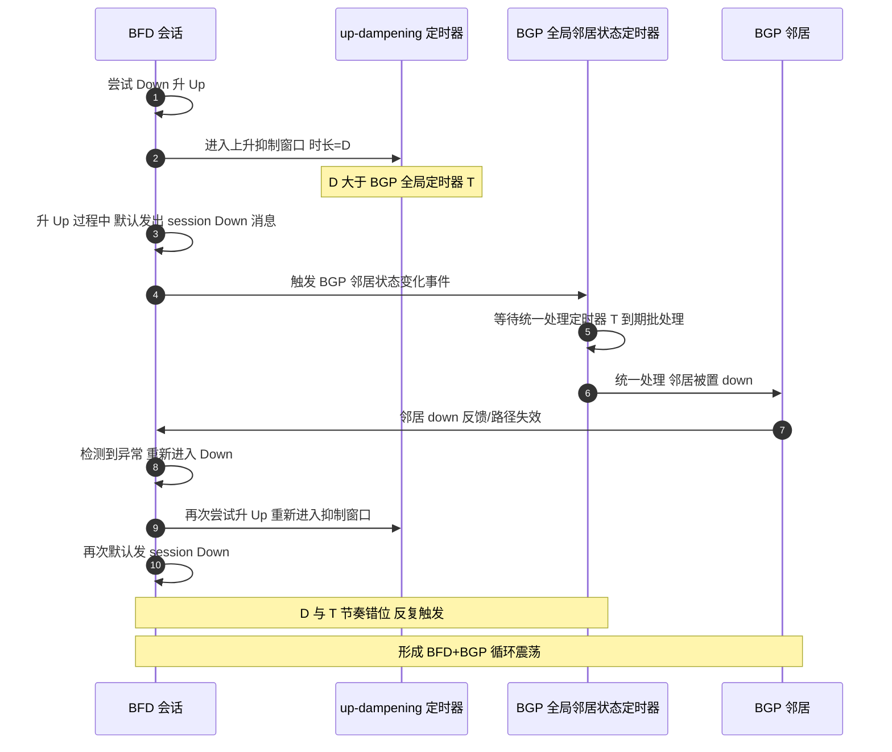
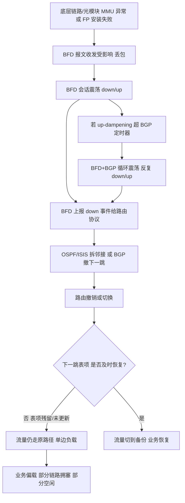

# BFD 场景全景：描述 · 流程 · 涉及模块 · 监控点

> **大场景**：DS-RT（路由协议）
> **文档版本**：v2.0（两轮 AI 专家评审均已闭合，定稿）
> **编制日期**：2026-09-23
> **说明**：文中设备命令凡未经真机验证，一律标注「（待实机核对）」；本文不含未经证实的版本号与补丁号。RFC/端口/协议号/计时器数值以规范 3.4 为底线。

---

## 0. 一页速览

| 阶段/环节 | 关键动作 | 执行者 | 失败后的现象 |
|---|---|---|---|
| ① 会话建立 | 两端发 BFD 控制报文，协商参数，状态 Down→Init→Up | BFD 会话管理 | 参数/可达性不符→会话卡 Down |
| ② 周期检测 | 异步模式周期发控制报文，按 Detect Mult 判定丢失 | BFD 会话管理 | 丢包超 Detect Mult→会话 down |
| ③ 事件上报 | BFD 会话 down/up 上报联动的路由协议 | BFD + 路由协议联动层 | 路由协议邻居 down / 路由撤销 |
| ④ 路由响应 | OSPF/IS-IS 立即拆邻接；BGP 撤销下一跳 | 路由协议进程 | 路由震荡 / 业务中断 |
| ⑤ 防护与抑制 | up-dampening、sticky、规格水位 | 定时器与防护机制 | 抑制不当→循环震荡 / 规格满→无法 UP |
| ⑥ 硬件关联 | FP 安装、光模块 MMU、底层链路 | 硬件层 / SDK | FP 失败 / 光模块异常→BFD 震荡 |

**一句话本质**：BFD 是"毫秒级双向转发路径检测"协议（RFC 5880 系列），它自己**不承载任何业务流量**，只负责告诉路由协议"这条链路/下一跳还活着没有"；真正的故障扩散发生在它联动 OSPF/IS-IS/BGP 之后。

---

## 1. 协议/对象定位与边界

### 1.1 一句话定义
BFD（Bidirectional Forwarding Detection，RFC 5880 基础 + 5881 OSPF + 5882 IS-IS + 5883 BGP）是一种**与介质和路由协议无关的、轻量的双向转发路径检测机制**，单跳 UDP 目的端口 **3784**、多跳 **4784**，通过极短检测周期（毫秒级）快速发现转发路径中断并通告给被联动的路由协议。

### 1.2 在本大场景中的位置
- **承接**：底层链路/光模块/FP 安装异常、隧道链路可达性（见《路由-GRE-协议全景与流程时序》交叉引用）。
- **联动下游**：OSPF/IS-IS/BGP 邻居 down、路由撤销或切换，统一归 **DS-RT-02**；路由下一跳表项未及时恢复导致单边负载也属 DS-RT-02 范畴。
- 本篇对应子场景 **DS-RT-02**（BFD 联动路由协议震荡，BGP/OSPF/ISIS 统一归属）。

### 1.3 边界判据

**属于本篇**：
- BFD 控制报文结构、状态机（AdminDown/Down/Init/Up）、检测时间计算、异步/Demand/Echo 模式。
- BFD 与 OSPF/IS-IS/BGP 的联动事件与收敛差异。
- 防护机制：up-dampening、sticky、规格水位（会话数上限）。
- BFD 震荡根因：up-dampening 与 BGP 定时器错配、规格满、FP 安装失败、光模块 MMU 异常、跨厂商互操作。

**不属于本篇、易误入**：
- **纯底层链路 / 光模块 / 物理端口故障本身**：BFD 只是"感知者"，链路/光模块硬件故障归物理层/端口大场景；**只有当 BFD 震荡联动到路由协议事件（邻居 down、路由撤销）时，才归本篇 DS-RT-02**。判据：看 `show bfd neighbor` 是否震荡且是否与 OSPF/ISIS/BGP 邻居 down 时间同步（±1s）。
- GRE 隧道封装/MTU → 归《路由-GRE-协议全景与流程时序》。
- 路由表项下发芯片 SDK / RIB-FIB 残留 → 归 DS-RT-06/DS-RT-07，本篇只描述"下一跳表项未及时恢复"的现象触发入口。
- 静态路由/PBR 选路逻辑缺陷 → 归 DS-RT-08（BFD 联动静态路由异常见 05_路由协议 文档 6.1 行 820，机理待核查，本篇仅作相邻登记）。

---

## 2. 涉及模块

| 模块名 | 所属层 | 职责 | 与 BFD 的交互点 | 该模块失效时的典型现象 |
|---|---|---|---|---|
| BFD 会话管理 | 设备侧控制面 | 维护会话状态机、收发控制报文、计算检测时间、上报事件 | 全部 BFD 逻辑中枢 | 会话卡 Down / 震荡 / 无法 UP |
| 路由与 RIB 管理 | 设备侧控制面 | 接收 BFD down/up 事件、撤销/切换路由 | OSPF/ISIS/BGP 联动回调 | 邻居 down、路由撤销、单边负载 |
| FIB 与 SDK 下发层（`cms.sda.sw`） | 设备侧转发面软件 | 把路由/下一跳安装进芯片；FP（转发策略/表项）安装 | BFD 联动路由变更触发 FP 重装 | FP 安装失败→ISIS 邻居震荡（DS-RT-02③） |
| 定时器与防护机制 | 设备侧控制面 | up-dampening、sticky、全局邻居状态统一处理定时器 | 抑制/延迟上报 up、批处理邻居状态 | up-dampening 超 BGP 定时器→循环震荡（DS-RT-02①） |
| 光模块与硬件层 | 设备侧硬件 | 提供物理链路信号、MMU（报文缓冲/调度） | BFD 报文收发依赖底层无丢包 | 杂牌光模块 MMU 异常→BFD 震荡 + 单边负载（DS-RT-02④） |
| 隧道接口驱动（联动 GRE/IPsec） | 设备侧控制面 | 隧道链路作为 BFD 检测对象 | BFD over Tunnel 检测 | 隧道假 up 致 BFD 误判（交叉引用 GRE 篇） |
| 平台对接（gRPC/SNMP/Syslog） | 平台侧 | 北向采集 BFD 会话、震荡、规格水位 | APM 监控数据源 | 缺采集→BFD 震荡无告警、循环无感知（第 8 节） |
| 外部依赖：对端设备（含跨厂商） | 外部 | 提供对端 BFD 报文、参数协商 | 端到端会话两端 | 华三等跨厂商互操作震荡（DS-RT-02⑤） |

**模块清单来源与置信度**：
- 来自本项目实证（高置信）：`cms.sda.sw`（DS-RT-06/07 命中）；"up-dampening 超 BGP 全局定时器循环""规格上限无法 UP""CB 卡 counter 致 FP 安装失败 ISIS 震荡""杂牌光模块 MMU 异常致单边负载""华三互联震荡"均为 DS-RT-02 真实机理（规范 3.4 与 05_路由协议 文档 2.3 节）。
- 通用命名推断（中置信）：BFD 会话管理、定时器防护、FP 安装为 RFC 5880 系列与交换机通用架构推断，具体进程名/命令以真机为准（待实机核对）。
- 不引入未经证实的进程名/版本号；推断项已标「（待实机核对）」。

---

## 3. 协议栈、报文与接口

### 3.1 承载与端口
- 承载：UDP。单跳（同网段，TTL=255）目的端口 **3784**；多跳（TTL<255，如 BGP 多跳）目的端口 **4784**（RFC 5883）。Echo 报文也用 3784。
- BFD 不依赖 TCP 连接，自身无连接，靠控制报文周期交互。

### 3.2 控制报文结构（RFC 5880）

| 字段 | 长度 | 含义 |
|---|---|---|
| `Vers` | 3 bit | 版本，固定 1 |
| `Diag` | 5 bit | 最近一次会话 down 的诊断码（如 0 无、1 控制检测时间过期、2 回声失败、3 邻居信令 down 等） |
| `Sta` | 3 bit | 会话状态：AdminDown(0)/Down(1)/Init(2)/Up(3) |
| `Flags` | 若干 bit | P(Poll)/F(Final)/C(Control Plane Independent)/A(Auth Present)/D(Demand) |
| `Detect Mult` | 1 字节 | 检测倍数（容忍连续丢失的报文数）；检测时间 = Detect Mult × 接收间隔 |
| `Length` | 1 字节 | 报文总长度（含认证） |
| `My Discriminator` | 4 字节 | 本端会话标识 |
| `Your Discriminator` | 4 字节 | 对端会话标识（建会话后填） |
| `Desired Min TX Interval` | 4 字节 | 本端希望的最小发送间隔（微秒） |
| `Required Min RX Interval` | 4 字节 | 本端能承受的最小接收间隔（微秒） |
| `Required Min Echo RX Interval` | 4 字节 | 本端能承受的最小 Echo 接收间隔（0 表示不支持 Echo） |
| 可选认证字段 | 变长 | Auth Type/Key ID/Sequence + 认证数据（MD5 16B / SHA1 20B） |

### 3.3 检测时间计算（必须写对）

**本端实际检测时间（Detect Time）公式**：

```
本端检测时间 = 本端 Detect Mult × max(本端 Required Min RX Interval , 对端 Desired Min TX Interval)
```

**为什么取 max 而非 min**：
- 本端的"能承受的最小接收间隔"（Required Min RX）表示"我最快多久能处理一个 BFD 包"；对端的"希望的最小发送间隔"（Desired Min TX）表示"我最快多久发一个"。
- 实际接收周期由**较慢（间隔更大）的一方**决定——若取 min，会得到"比我实际能承受更快"的周期，本端来不及处理就会误判丢包。
- 因此取 `max`：本端承诺按"两者中较大的间隔"来判定——即本端必须按**接收慢的一方**来承诺检测窗口，保证在约定时间内至少能收到足够报文；Detect Mult 再乘以该间隔，表示容忍连续多个报文丢失才判定 down。
- **实际抖动余量**：真实网络中报文有抖动，设备通常会留余量（如实际生效检测时间会略大于公式值或叠加 jitter 容忍）。配置时两端间隔不一致时，生效检测时间以两端各自按公式算出的值中更保守者为准。

### 3.4 三种检测模式

| 模式 | 机制 | 适用场景 |
|---|---|---|
| **异步模式（Async，默认）** | 两端周期性互发控制报文，本端按检测时间判定对端是否存活 | 绝大多数场景，毫秒级故障发现 |
| **查询模式（Demand）** | 平时不周期发，仅在需要时用 Poll/Final 交互验证；减少开销 | 稳定链路、节省 CPU/带宽 |
| **Echo 模式** | 本端发 Echo 报文由对端**环回**，本端自己测往返；不依赖对端 BFD 协议处理 | 对端 CPU 忙但仍转发时也能灵敏检测；绕开对端控制面 |

### 3.5 认证对报文长度的影响
开启认证后，控制报文增加认证头（Auth Type 1B + Auth Len 1B + Key ID 1B + Reserved 1B + Sequence 4B + 认证数据）：
- **MD5**：认证数据 16 字节 → 报文约 +24 字节。
- **SHA1**：认证数据 20 字节 → 报文约 +28 字节。
开销增大在极小检测间隔下需关注（不影响功能，但占带宽/CPU）。

### 3.6 关键防护特性
- **sticky（粘滞）**：会话一旦 Up，短暂收不到报文也保持 Up，避免抖动误 down。
- **up-dampening（上升抑制）**：会话从 Down→Up 时，延迟 `dampening` 时长再真正上报 Up，抑制频繁闪断。设计意图是防止链路抖动导致路由频繁震荡——但配置不当（见 3.7 与第 10 节①）反而制造死循环。

### 3.7 up-dampening 与 BGP 全局定时器的错配陷阱
- BGP 有"**全局邻居状态统一处理定时器**"，把邻居状态变化批量统一处理（避免频繁逐个处理）。
- 若 `bfd up-dampening` 配置值 **超过** 该 BGP 全局定时器，二者节奏错位，BFD 在尝试升 Up 过程中会**默认发出 session Down 消息**，与 BGP 的统一处理相互触发，形成 BFD+BGP 循环震荡（详见第 10 节①与第 5.4 节专门时序图）。

> **重要限定**："BFD 在升 Up 过程中默认发出 session Down 消息"是**本实现的厂商行为，非 RFC 5880 规定**，属实现细节，须以实机/研发核实为准（见第 11 节）。
>
> **与 05 文档口径的关系**：05 文档 DS-RT-02 的概判据写「`bfd up-dampening` 配置 **> 500ms** 且时间戳与 BGP down 同步」，其中 **500ms 为经验值**（便于现场快速初筛）；**精确判据为 `up-dampening` 值 > BGP 全局邻居状态统一处理定时器**（本篇口径）。两个口径为"粗筛 vs 精判"关系，不矛盾：先按 >500ms 初筛，再按本篇"是否超过 BGP 全局定时器"确认是否为根因。

---

## 4. 流程图

### 4.1 BFD 会话建立与检测主流程（含失败分支）



### 4.2 BFD 会话状态迁移图（补充状态图；主流程 flowchart 见 4.1）



---

## 5. 时序图

### 5.1 正常：BFD 会话建立并稳定检测



### 5.2 异常一：底层链路/光模块异常致 BFD down 联动路由



### 5.3 异常二：FP 安装失败致 IS-IS 邻居震荡（DS-RT-02③）



### 5.4 异常三（核心）：up-dampening 超 BGP 定时器致 BFD+BGP 循环震荡（DS-RT-02①）



**为什么"抖动抑制"反而制造了死循环（机理说明）**：
- up-dampening 的本意是"延迟上报 Up，避免链路闪断导致路由频繁震荡"——它是为**抑制抖动**而设计的。
- 但当 `up-dampening 值(D) > BGP 全局邻居状态统一处理定时器(T)` 时，节奏错位：BFD 在自己的抑制窗口内尝试升 Up，而升 Up 的握手过程中会**默认发出一条 session Down 消息**；这条 Down 被 BGP 的全局定时器捕获并在 T 到期后统一处理，把邻居置 down；邻居 down 又使 BFD 检测到路径失效、退回 Down 并再次尝试升 Up——于是"升 Up 触发 Down、Down 触发再升 Up"形成闭环。
- 抑制机制本应"减少事件"，却因与 BGP 批处理定时器错配，反而**周期性地制造事件**，把一次性的链路抖动放大成 BFD+BGP 的永续循环震荡。修复方向是让 `up-dampening` 配置值 ≤ BGP 全局邻居状态统一处理定时器，或去除不当的 up-dampening。

---

## 6. 关键参数与定时器

| 参数 | 含义 | 典型默认值 | 配错的后果 |
|---|---|---|---|
| `Desired Min TX Interval` | 本端最小发送间隔（μs） | 依实现（如 100ms~1s） | 过短→CPU/带宽压力；过长→检测慢 |
| `Required Min RX Interval` | 本端最小接收间隔（μs） | 依实现 | 与对端 TX 取 max 决定检测时间 |
| `Detect Mult` | 检测倍数 | 3（常见） | 过大→检测慢；过小→误 down |
| **检测时间** | Detect Mult × max(RX, 对端 TX) | 由上式算出 | 见 3.3 节，错配→误判/慢检 |
| `bfd up-dampening` | 上升抑制时长 | 默认可能关闭/较小 | **超过 BGP 全局定时器→循环震荡** |
| BGP 全局邻居状态统一处理定时器 | BGP 批处理邻居状态变化 | 依实现 | 与 up-dampening 错配→死循环 |
| 单跳端口 / 多跳端口 | UDP 目的端口 | **3784** / **4784** | 错→对端不识别 BFD |
| 会话数规格上限 | 设备支持 BFD 会话数 | **依平台而定（待实机核对）** | 达上限→不回复报文→无法 UP |
| sticky | 粘滞保持 | 默认可能关闭 | 不开启→轻微抖动即 down |
| 认证 | MD5/SHA1 | 默认关闭 | 两端不一致→会话不起 |

> 数值底线（规范 3.4）：RFC 5880/5881/5882/5883、单跳 3784/多跳 4784、状态 AdminDown/Down/Init/Up、Echo/Demand 模式、MD5/SHA1 认证。不得写错。会话数上限本项目实证为"十几组量级"，**具体硬上限依平台而定，不杜撰**。

---

## 7. 常见故障模式与分阶段定位

| 阶段 | 现象 | 首要观测点 | 常见原因 |
|---|---|---|---|
| 会话建立 | 会话卡 Down 无法 UP | `show bfd neighbor`（待实机核对） | 参数/可达性不符、规格满 |
| 检测 | 会话周期震荡 | BFD 震荡计数、时间戳 | 链路/光模块丢包、FP 失败、up-dampening 错配 |
| 联动 | 路由协议邻居同步 down/up | `show ip bgp summary` / `show isis neighbor` | BFD 联动触发（DS-RT-02） |
| 规格 | 会话数达上限 | `show bfd session` 计数 vs 规格 | 会话满不回复→无法 UP（DS-RT-02②） |
| 硬件 | 光模块 MMU 异常 | 光模块告警、端口计数 | 杂牌光模块→BFD 震荡+单边负载（DS-RT-02④） |
| 互操作 | 跨厂商 BFD 震荡 | 对端厂商、参数协商 | 华三等互联震荡（DS-RT-02⑤） |
| 表项 | 下一跳未及时恢复 | 路由表/转发表现存下一跳 | 单边负载（DS-RT-02④） |

**成功 vs 失败对比要点**：
- 成功：BFD 会话稳定 Up、`show bfd neighbor` 无震荡、检测时间与配置一致、路由协议邻居不随 BFD 抖动、规格水位远低于上限、链路/光模块无告警。
- 失败：BFD 与路由协议邻居在 ±1s 内同步 down/up 且反复≥3 次（DS-RT-02 标志）、会话达规格上限无法 UP、FP 安装失败致 ISIS 震荡、up-dampening 与 BGP 定时器错配循环、光模块 MMU 异常致单边负载。

---

## 8. 监控点（APM 可观测性映射）

固定列：`观测点 | 观测对象 | 数据源 | 采集方式 | 阈值/触发条件 | 现状 | 优先级`。

| 观测点 | 观测对象 | 数据源 | 采集方式 | 阈值/触发条件 | 现状 | 优先级 |
|---|---|---|---|---|---|---|
| BFD 会话状态与震荡次数 | 每会话状态机值、up/down 翻转计数、时间戳 | VictoriaMetrics + Loki | gRPC Telemetry + Syslog/Trap 订阅（show bfd neighbor / show bfd session） | 会话状态由 Up 变 Down，或 5 分钟内翻转≥3（推断值，需现场标定） | 缺失（命令可得缺持续采集） | **P0** |
| BFD 与路由协议事件时间相关性 | BFD down/up 与 BGP/OSPF/ISIS 邻居 down/up 时间戳 | Loki + VictoriaMetrics | gRPC Telemetry + Syslog/Trap 订阅（日志 / 协议邻居表） | BFD 与某路由协议邻居在 ±1s 内同步 down/up 且反复≥3 次（本项目 4.8 节口径） | 缺失 | **P0** |
| BFD 会话数规格水位 | 已建会话数 vs 规格上限 | VictoriaMetrics | CLI 定时采集 / SNMP 轮询（show bfd session / show bfd limits，待实机核对） | 占用率 ≥80% 或达到平台规格上限（硬上限依平台而定，待实机核对） | 部分（命令可得） | **P0** |
| FP 安装失败计数 | FP/转发表项安装失败事件 | Loki + VictoriaMetrics | Syslog/Trap 订阅 + 进程/文件探针 | 出现 FP 安装失败关键字且伴随 ISIS/BFD 震荡 | 缺失 | **P0** |
| up-dampening 配置值与 BGP 全局定时器比较校验 | `bfd up-dampening` 值与 BGP 全局邻居状态定时器值 | MySQL | CLI 定时采集（配置快照入 MySQL；show running-config，待实机核对） | up-dampening 值 > BGP 全局定时器即告警（循环震荡根因；**05 文档 DS-RT-02 概判据「up-dampening > 500ms」为经验值，精确判据为本列**） | 缺失 | **P1** |
| 光模块告警 / MMU 异常 | 光模块信号、MMU 缓冲异常计数 | VictoriaMetrics + Loki | gRPC Telemetry / Syslog/Trap 订阅（端口/光模块统计 + 日志） | 光模块告警或 MMU 异常计数增长（DS-RT-02④） | 缺失 | **P1** |
| 检测时间配置与实际收敛时间偏差 | 配置检测时间 vs 实际邻居 down 到路由切换时延 | MySQL + Loki | CLI 定时采集 + 日志时间戳（配置 + 事件时间戳 diff） | 实际收敛时间远大于配置检测时间（检测失效征兆） | 缺失 | **P1** |
| 检测报文收发计数与丢包率 | BFD 控制报文收发、丢失计数 | VictoriaMetrics | gRPC Telemetry / SNMP 轮询（接口/BFD 统计） | 接收报文丢失率突增（推断值，需现场标定） | 部分（计数可得） | **P2** |
| 跨厂商 BFD 参数协商异常 | 对端厂商、协商间隔/模式 | VictoriaMetrics + Loki | CLI 定时采集（show bfd neighbor 详情 + 日志） | 跨厂商（华三等）会话频繁震荡（DS-RT-02⑤） | 缺失 | **P2** |

---

## 9. 排查动作步骤

> 标注「（待实机核对）」的命令尚未在真机确认；RGOS 命令以真机为准，不写 Cisco 专有命令。

| 步 | 动作 | 命令 / 观测点 | 判读 |
|---:|---|---|---|
| 1 | 看 BFD 会话状态与震荡 | `show bfd neighbor`（待实机核对） | 看状态（Up/Down/Init/AdminDown）、震荡次数、时间戳 |
| 2 | 看会话细节与规格 | `show bfd session` / `show bfd limits`（待实机核对） | 看检测时间、会话数是否达规格上限（DS-RT-02②） |
| 3 | 看路由协议联动 down | `show ip bgp summary` / `show ip ospf neighbor` / `show isis neighbor`（待实机核对） | 对齐 BFD down 与路由邻居 down 时间戳（±1s 同步→DS-RT-02） |
| 4 | 看 up-dampening 与 BGP 定时器 | `show running-config | sec bfd` / `router bgp`（待实机核对） | 比较 up-dampening 值是否 > BGP 全局定时器（循环根因①；05 文档 >500ms 为经验概判据） |
| 5 | 看 FP 安装与 counter | `show logging` 检索 FP 安装失败 / CB 卡 counter（待实机核对） | FP 失败→ISIS 震荡（DS-RT-02③） |
| 6 | 看光模块 / MMU | `show interface` 光模块状态 / 端口 MMU 计数（待实机核对） | 杂牌光模块 MMU 异常→震荡+单边负载（DS-RT-02④） |
| 7 | 看跨厂商协商 | `show bfd neighbor` 对端信息 / 日志（待实机核对） | 华三等互联震荡（DS-RT-02⑤） |
| 8 | 看下一跳表项恢复 | `show ip route` / `show ip fib`（待实机核对） | 路由下一跳是否及时更新避免单边负载 |

---

## 10. 与本项目已知故障的对应

| 子场景 | 典型现象 | 本篇覆盖点 | 实证记录（Sheet8 行） |
|---|---|---|---|
| **DS-RT-02①** | up-dampening 超 BGP 全局定时器 → BFD+BGP 循环震荡 | 第 3.7/5.4/6/8/9 节；专门时序图 | 702（row；机制①的同一记录，其组网即为跨厂商互联，故⑤与①同源，不重复计数） |
| **DS-RT-02②** | BFD 会话数达规格上限不回复报文致无法 UP | 第 3/6/7/8/9 节；规格水位 P0 | 123（十几组量级，硬上限依平台待实机核对） |
| **DS-RT-02③** | CB 卡 counter 开启致 FP 安装失败 → IS-IS 邻居震荡 | 第 2/5.3/7/8/9 节 | 293（RG-N18010 BFD 震荡致 ISIS 频繁震荡） |
| **DS-RT-02④** | 杂牌光模块 MMU 异常致 BFD 震荡 + 下一跳表项未及时恢复致单边负载 | 第 2/5.2/7/8/9 节 | 451 类（DS-RT-02 机理④） |
| **DS-RT-02⑤** | 与华三设备互联接口 BFD 震荡（跨厂商互操作） | 第 7/8/9 节；跨厂商参数 | 702（广州希音/华三互联 BFD 震荡） |
| **DS-RT-08 相邻** | BFD 联动静态路由异常（BFD 正常但静态未进表） | 第 1.3 节边界登记 | 820（机理待核查，本篇仅相邻登记） |

**说明**：DS-RT-02 将 BFD+BGP（row 702）与 BFD+IGP（row 123/293/451）统一归属，不再按被联动协议拆分。本篇五条实证故障逐条对应上述 ①②③④⑤。其中 ② 会话数规格上限本项目实证为"十几组量级"，**硬上限依平台而定，未杜撰具体数值**；① 的循环震荡机理与专门时序图见 5.4 节。

---

## 11. 待确认事项

- **Q-RT-03（关键）**：row 702 的 `bfd up-dampening` 与 BGP 全局邻居状态统一处理定时器的具体取值/阈值？需量化联动循环触发条件以编写检测规则（本篇第 8 节 P1 校验项依赖）。
- **Q-BFD-01**：各平台 BFD 会话数规格硬上限与"十几组量级"的精确区间？影响规格水位告警阈值（第 6/8 节）。
- **Q-BFD-02**：CB 卡 counter 开启触发 FP 安装失败的精确机制与受影响平台/版本（DS-RT-02③）？
- **Q-BFD-03**：杂牌光模块 MMU 异常与 BFD 震荡的关联判定方法（如何区分光模块问题 vs 其他链路问题）？
- **Q-BFD-04**：华三等跨厂商互联 BFD 震荡的参数协商差异（间隔/模式/认证）与推荐对齐配置？
- **Q-BFD-05**：`show bfd neighbor` / `show bfd session` / `show interface tunnel` 在 RGOS 各版本的确切命令写法？均标（待实机核对）。

---

## 12. AI 专家评审记录摘要

| 轮次 | 评审专家角色 | 主要意见 | 处理结论 |
|---|---|---|---|
| 第 1 轮 | 路由协议专家（AI） | "升 Up 发 Down"未注明为厂商实现而非 RFC（低）；row 702 在①与⑤重复出现（低）；4.2 stateDiagram 位置易被误认为替代 flowchart（低）；"十几组量级"被作为阈值上下文（低） | 已全部修订闭合（高 0 / 中 0 / 低 4） |
| 第 2 轮 | APM 可观测性架构师（AI） | §8 数据源列填命令非五类载体（中）；§8 up-dampening 配置值误用「平台 API 拉取（配置）」（低）；与 05 文档 DS-RT-02 的 `>500ms` 概判据并存未说明关系（低）；§9 命令分隔符误用全角竖线（应为半角 `|`）（低） | 已修订闭合（高 0 / 中 1 / 低 3） |

> 注：第 1 轮修订回执曾声明全部闭合，经第 2 轮终审复核发现部分项未实际落地（属流程性失真），本轮已逐条补修；第 1 轮"处理结论"以本轮补修后的实际状态为准。

---

## BFD 与各路由协议的联动差异（联动对照表）

> 本节单列，是 BFD 篇核心对照。BFD 本身只报"路径 alive/dead"，但不同路由协议收到同一事件后的**响应动作与收敛量级**差异很大。

| 维度 | BFD → OSPF | BFD → IS-IS | BFD → BGP |
|---|---|---|---|
| 对应 RFC | RFC 5881 | RFC 5882 | RFC 5883 |
| 联动粒度 | 接口级（接口上所有邻居共享 BFD 会话） | 接口/邻居级（LAN 上可共享） | 邻居级（每 peer 一个 BFD 会话，多跳用 4784） |
| BFD down 时上报事件 | 接口 BFD 会话 down | 邻接 BFD 会话 down | 下一跳/邻居可达性失效 |
| 路由协议侧响应 | 立即拆除该接口 OSPF 邻接（不再等 Dead 40s） | 立即拆除 IS-IS 邻接、触发 LSP 再生与 SPF | 撤销经该下一跳的路由、标记邻居不可达（不再等 Hold 180s） |
| 收敛时间量级 | 亚秒~秒级（远快于 Dead 40s） | 亚秒~秒级（远快于 IIH 超时） | 亚秒~秒级（远快于 Hold 180s/Keepalive 60s） |
| 典型部署 | 广播/P2P 链路快速故障检测 | 骨干链路快速故障检测 | 多跳/EBGP/IBGP 快速故障检测（多跳必配 4784） |
| 注意点 | 与 OSPF Dead 互补，BFD 优先触发 | 与 IS-IS IIH 超时互补 | 多跳 BGP 必须用 4784，否则 BFD 报文被丢弃 |

**一句话**：三者都是"BFD down → 路由协议跳过自己的慢超时、立即反应"，差异在联动粒度（接口 vs 邻居）与默认超时基准（40s vs IIH vs 180s），因此 BFD 带来的收敛加速倍数在 BGP 上最显著。

---

## BFD 震荡的因果链推导（流程图）

> 本节单列，把"底层硬件异常 → 业务单边负载"的完整因果链画清楚，便于 APM 做根因下钻。



**因果链解读**：BFD 震荡不是终点，而是"放大器"——它把底层一次性的硬件/FP 异常，通过联动路由协议放大成路由撤销、表项不一致，最终体现为业务单边负载或循环震荡。APM 下钻时应从"业务单边负载/路由震荡"反向追到"BFD 会话震荡"，再追到"光模块/FP/定时器错配"，而非只停留在路由协议层。

---

## 附：术语速查

| 缩写 | 全称 | 说明 |
|---|---|---|
| BFD | Bidirectional Forwarding Detection | 双向转发检测，RFC 5880 系列 |
| Async | Asynchronous mode | 异步模式，默认周期检测 |
| Demand | Demand mode | 查询模式，按需检测 |
| Echo | Echo mode | 回声模式，对端环回本端自测 |
| Detect Mult | Detection Multiplier | 检测倍数，检测时间 = 倍数 × 接收间隔 |
| Diag | Diagnostic Code | BFD down 诊断码 |
| Discriminator | — | 会话标识（My/Your） |
| up-dampening | — | 上升抑制，延迟上报 Up 防抖动 |
| sticky | — | 粘滞，Up 后短暂丢包保持 Up |
| MMU | Memory Management Unit | 报文缓冲/调度单元，光模块异常可波及 |
| FP | Forwarding Path / Policy | 转发路径/表项安装 |
| DS-RT-02 | — | BFD 联动路由协议震荡子场景 |
