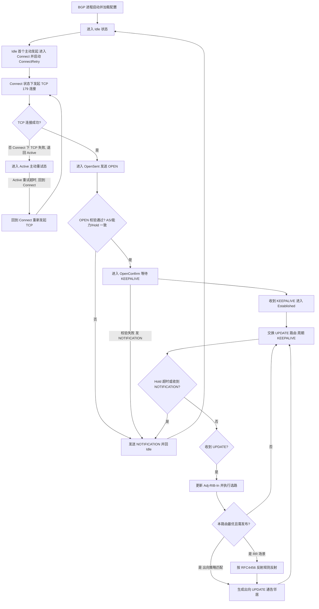
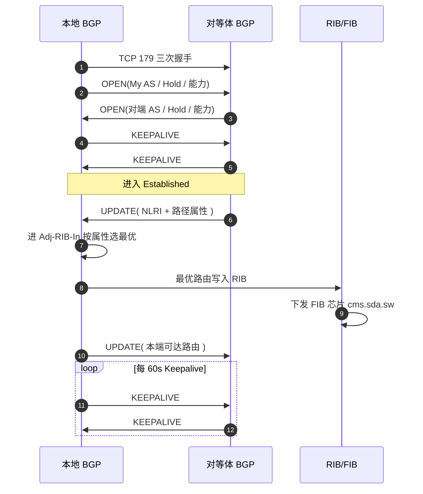
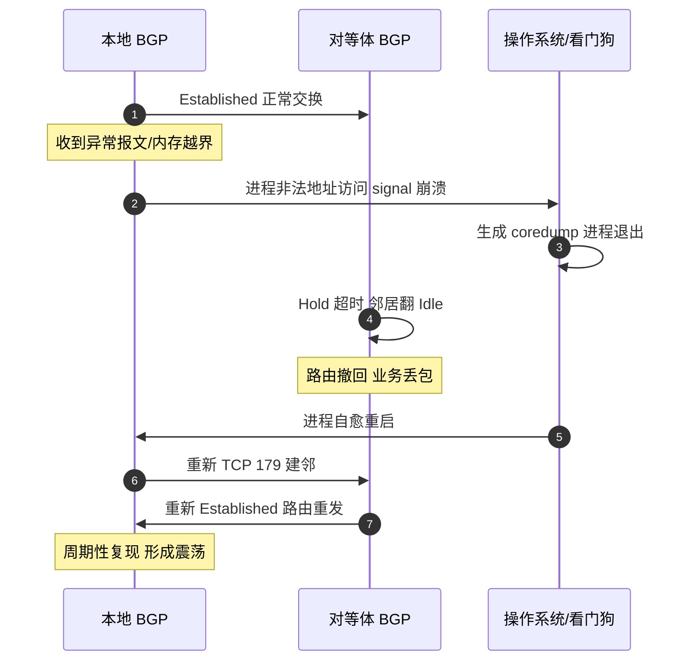
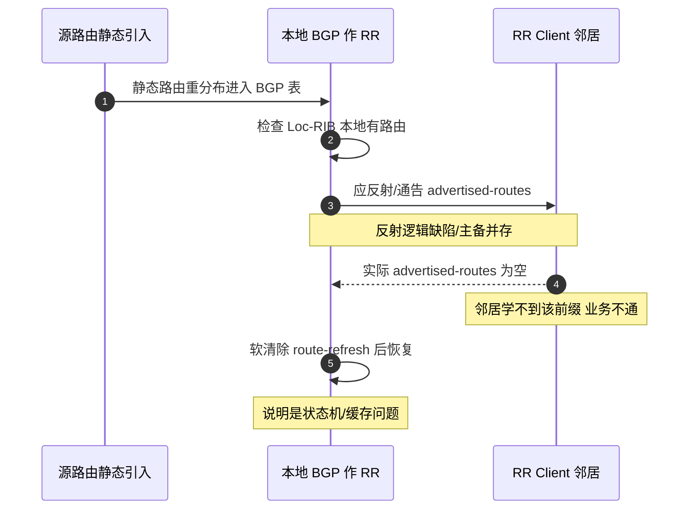

# BGP 场景全景：描述 · 流程 · 涉及模块 · 监控点

> **大场景**：DS-RT（路由协议）
> **文档版本**：v2.0（两轮 AI 专家评审均已闭合，定稿）
> **编制日期**：2026-09-23
> **说明**：文中设备命令凡未经真机验证，一律标注「（待实机核对）」；本文不含未经证实的版本号与补丁号。RFC/端口/协议号/计时器数值以规范 3.4 为底线。

---

## 0. 一页速览

| 阶段/环节 | 关键动作 | 执行者 | 失败后的现象 |
|---|---|---|---|
| ① 进程启动/配置加载 | BGP 进程加载邻居、AS、地址族配置 | BGP 进程（bgpd） | 配置错误→邻居不启动、无对等体 |
| ② TCP 179 建连 | 与对等体建立 TCP 长连接（Connect/Active） | TCP/套接字层 | TCP 不可达/被 ACL 拦→卡 Connect/Active |
| ③ OPEN 协商 | 交换 OPEN，校验 AS/版本/Hold/能力（OpenSent/OpenConfirm） | BGP 进程 | AS 不匹配/能力不一致→NOTIFICATION 断链 |
| ④ Established 维持 | 周期 KEEPALIVE 保活，超时进 Idle | BGP 进程 | Hold 超时→邻居翻 Idle，路由撤回 |
| ⑤ 路由计算与选路 | 收 UPDATE→进 Adj-RIB-In→按属性选最优→Loc-RIB | BGP 进程 + RIB | 选路异常/属性错误→路由不优/不进表 |
| ⑥ 路由发布/反射 | 策略处理后生成 UPDATE 出向；RR 场景反射（Established 后按 RFC4456 发出） | BGP 进程 | RR 反射缺陷/引入失败→邻居收不到路由 |
| ⑦ 表项下发芯片 | 最优路由经 RIB 下发 FIB（SDK 层） | RIB + cms.sda.sw | SDK 空指针/进程被 kill→设备重启 |

**一句话本质**：BGP 是"路径矢量 + 策略"的域间路由协议，靠 TCP 179 长连接维护邻居，靠路径属性与选路规则决定"走哪条路"，本质是对全局可达性地图的增量同步。

---

## 1. 协议/对象定位与边界

### 1.1 一句话定义
BGP-4（RFC 4271）是一种**路径矢量（Path-Vector）**外部网关协议，运行于 TCP 179，用于在 AS 之间（eBGP）和 AS 内部（iBGP）交换可达性信息，并通过丰富的路径属性与选路规则实现策略化路由控制；MP-BGP（RFC 4760）扩展其在 IPv6 等多地址族上的承载。

### 1.2 在本大场景中的位置
- **承接**：设备启动/配置加载后协议进程拉起；被静态路由重分布、IGP 引入、RR 反射触发路由生成；被 BFD 联动（DS-RT-02）触发邻居震荡。
- **被触发/下发**：选路结果经 RIB 进入 FIB 下发芯片（SDK 层 `cms.sda.sw`），一旦下发踩空指针即进 DS-RT-06（设备重启）；RIB/FIB 不一致进 DS-RT-07。
- 本篇是 DS-RT 大场景的"BGP 协议机理"支点，对应子场景 **DS-RT-01**（BGP 进程重启与发布/反射失败）、**DS-RT-02**（BFD 联动）、**DS-RT-06**（SDK 下发重启，BGP 收敛触发）、**DS-RT-07**（RIB/FIB 不符，由 BGP 路由下发触发时归本场景）。

### 1.3 边界判据

**属于本篇**：
- BGP 状态机、TCP 179 建连、OPEN/UPDATE/KEEPALIVE/NOTIFICATION 四类报文。
- 路径属性（AS_PATH/NEXT_HOP/LOCAL_PREF/MED/ORIGIN/Community）、iBGP/eBGP 选路。
- 路由反射（RR，RFC 4456）、路由刷新（RFC 2918）、GR（RFC 4724）、MP-BGP（RFC 4760）。
- BGP 进程 coredump/非法地址访问致 peer 周期性闪断（DS-RT-01）。
- 静态/其他协议路由重分布引入 BGP 后发布失败、RR 主备路由不反射（DS-RT-01）。

**不属于本篇、易误入**：
- 纯转发面 TCAM/ASIC 表项（与路由协议无关）不一致 → 归表项与转发大场景 `EXT-FWD`。
- OSPF/OSPFv3/RIP/ISIS 邻居与路由计算 → 各自独立协议篇（OSPF 篇等）。
- BFD 与路由协议联动震荡本身 → 统一归 `DS-RT-02`（见《路由-BFD-协议全景与流程时序》）。
- 路由下发芯片 SDK 空指针致设备重启 → 根因在 SDK 安装层，归 `DS-RT-06`；本篇仅描述"BGP 收敛触发该路径"的入口。
- 静态路由/PBR/GRE 选路逻辑缺陷 → 归 `DS-RT-08`；本篇仅在"重分布引入 BGP 发布"环节涉及。
- RIB/FIB 一致性中"芯片 LPM/快转算法 bug" → 归 `DS-RT-07`（EXT-FWD 交叉），本篇只在"由 BGP 路由下发触发"时挂接。

### 1.4 与相关子场景/协议的触发与调用关系
- **BGP 收敛 → 下发芯片**：BGP 大路由收敛触发 RIB→FIB 下发，若 SDK 层踩空指针/进程被 kill 即进 `DS-RT-06`（设备重启）。
- **BFD 联动**：BGP peer 被 BFD 联动 down 统一归 `DS-RT-02`，本篇不重复展开 BFD 机理（见《路由-BFD-协议全景与流程时序》）。
- **静态/重分布引入**：静态路由或其他协议重分布引入 BGP 是 DS-RT-01 发布/反射失败的常见触发源；纯静态选路逻辑缺陷归 `DS-RT-08`。
- **RIB/FIB 一致性**：由 BGP 路由下发触发的 RIB/FIB 不一致归 `DS-RT-07`；与路由协议无关的纯转发面表项归 `EXT-FWD`。
- **IPv6 地址族**：MP-BGP 的 IPv6 AFI 与 OSPFv3 同为 IPv6 路由承载，交叉参考《路由-OSPFv3-协议全景与流程时序》。

---

## 2. 涉及模块

分层表格：端侧/设备侧进程与组件 → 平台侧服务 → 外部依赖。

| 模块名 | 所属层 | 职责 | 与 BGP 的交互点 | 该模块失效时的典型现象 |
|---|---|---|---|---|
| BGP 协议进程（bgpd） | 设备侧控制面 | 维护邻居状态机、收发 UPDATE、路径选路、生成 Loc-RIB | 全部 BGP 逻辑的中枢 | 进程 coredump/非法地址访问→peer 周期性闪断重建、路由震荡（DS-RT-01） |
| RIB / 路由表管理 | 设备侧控制面 | 汇总各协议路由、按 AD 选最优、向 FIB 下发 | BGP 最优路由写入 RIB 并参与全局选路 | BGP 路由不进 RIB→业务不通；多协议 AD 竞争异常 |
| FIB 下发与 SDK 层（`cms.sda.sw`） | 设备侧转发面软件 | 将 RIB 路由安装到芯片转发表 | 接收 RIB 下发的 BGP 最优路由并写 SDK | SDK 踩空指针/进程被 kill→设备自愈重启（DS-RT-06） |
| 邻居与 TCP/套接字层 | 设备侧系统 | 提供 TCP 179 长连接、套接字收发缓冲 | BGP 建连依赖该层端口 179 可用性 | TCP 不可达/ACL 拦截→卡 Connect/Active；套接字缓存溢出→KEEPALIVE 丢失 |
| 配置管理（running-config / EMB） | 设备侧 / 平台侧 | 落盘 BGP 配置、版本回滚 | 邻居/地址族/路由策略配置来源 | 配置未落盘/主备同步异常→邻居起不来或配置丢失 |
| 平台对接（gRPC Telemetry / SNMP / Syslog） | 平台侧 | 北向采集邻居状态、前缀、日志、Trap | APM 监控数据源 | 缺采集→邻居震荡/前缀抖动无告警（见第 8 节缺口） |
| 外部依赖：对等体设备 / RR / 品控库 | 外部 | 提供对端 BGP 邻居、反射器、已知问题映射 | 邻居交互、反射、版本匹配 | 对端 AS 配错/第三方 RR 行为差异→建邻失败或反射不全 |

**模块清单来源与置信度**：
- 来自本项目实证（高置信）：`bgpd`、`cms.sda.sw`（规范 3.1/3.4、DS-RT-01/06 工单命中）；"BGP 进程非法地址访问/coredump"为 DS-RT-01 真实机理。
- 通用命名推断（中置信）：RIB/FIB 分层、TCP/套接字层、平台对接（gRPC/SNMP/Syslog）为 RFC 4271 与交换机通用架构推断，具体进程名以真机为准（待实机核对）。
- 说明：本文不引入未经证实的进程名/版本号；凡推断项在命令表中已标「（待实机核对）」。

---

## 3. 协议栈、报文与接口

### 3.1 封装与端口
- 承载：TCP，目的端口 **179**（RFC 4271）。BGP 是**可靠、面向连接**的协议，自身不重传，依赖 TCP。
- 报文头固定 **19 字节**：`Marker(16B, 全 1 或认证) + Length(2B) + Type(1B)`。

### 3.2 四种报文（Type 字段）

| Type | 名称 | 作用 | 是否带数据 |
|---|---|---|---|
| 1 | OPEN | 建立邻居时协商版本/AS/Hold/能力 | 是（能力参数） |
| 2 | UPDATE | 通告/撤销可达路由（NLRI + 路径属性） | 是 |
| 3 | NOTIFICATION | 报错并关闭连接（致命） | 是（错误码/子码） |
| 4 | KEEPALIVE | 保活（Hold 计时器期内的心跳） | 否（仅 19B 头） |

### 3.3 OPEN 报文关键字段
`Version(1) / My AS(2) / Hold Time(2) / BGP Identifier(4, 路由器 ID) / Opt Parm Len(1) / Opt Params(变长)`。
能力参数（Capabilities）含：MP-BGP 地址族（AFI/SAFI）、Route Refresh（RFC 2918）、4 字节 AS、GR（RFC 4724）、ORF 等。AS 号或能力不一致→对端回 NOTIFICATION 并断链。

### 3.4 UPDATE 报文结构
- `Withdrawn Routes`（撤销路由，IPv4 前缀列表）。
- `Path Attributes`（路径属性，决定选路）。
- `NLRI`（可达路由前缀，Network Layer Reachability Information）。

### 3.5 路径属性（选路核心）

| 属性 | 类别 | 含义 | 选路影响 |
|---|---|---|---|
| ORIGIN | 公认必遵 | 路由来源（i<e<?） | 优 i |
| AS_PATH | 公认必遵 | 经过的 AS 序列 | eBGP 防环；AS 路径短者优 |
| NEXT_HOP | 公认必遵 | 下一跳地址 | 影响可达性与递归 |
| LOCAL_PREF | 公认自决 | 本 AS 内偏好（仅 iBGP） | 值大者优（iBGP 选路第一关） |
| MED | 可选非过渡 | 相邻 AS 入口度量 | 默认仅同 AS 间比较 |
| Community | 可选过渡 | 路由标记（如 no-export） | 供策略匹配，不直接选路 |

**iBGP 与 eBGP 差异**：
- eBGP：缺省 TTL=1，下一跳改写为对端接口地址；AS_PATH 追加本 AS；缺省不改 LOCAL_PREF。
- iBGP：下一跳**不改写**（需 `next-hop-self` 或 IGP 可达），需全互联或 RR；LOCAL_PREF/MED 在 AS 内保持；要求 IGP 已通（原"同步规则"现已普遍关闭，属机制差异，非本篇必查）。

### 3.6 路由反射 RFC 4456
- RR（Route Reflector）打破 iBGP 全互联：Client→RR→其他 Client/Non-Client。
- 防环属性：`ORIGINATOR_ID`（始发者 Router-ID）、`CLUSTER_LIST`（簇 ID 列表，含 `cluster-id`）。
- 反射规则：从 Client 学的不向该 Client 反射；从 Non-Client 学的不向其他 Non-Client 反射。
- 本项目实证（row 409）：18K 11X 作为 RR 且主备路由并存时无法反射，12X 已解决——属 RR 反射逻辑缺陷（DS-RT-01）。

### 3.7 路由刷新 RFC 2918 / GR RFC 4724 / MP-BGP RFC 4760
- **Route Refresh**：在不重置邻居的前提下请求对端重发 UPDATE（软清除），用于策略变更后生效。本项目"软清除后恢复"说明是状态机/缓存问题而非配置缺失（DS-RT-01 判据）。
- **GR（Graceful Restart）**：控制面重启时转发面保持转发，重启后平滑恢复邻接，避免路由黑洞。
- **MP-BGP（RFC 4760）**：通过 AFI/SAFI 扩展，在 BGP 上承载 IPv6（AFI=2）、VPNv4 等；IPv6 单播 AFI=2/SAFI=1。UNICAST 与 Multicast 分离。

### 3.8 BGP 选路决策顺序（Decision Process）
当到达同一目的地的多条路径都在 Loc-RIB 中时，BGP 按固定优先级逐一比较，第一个分胜负者即决出最优（RFC 4271 第 9.1.2 节）。顺序如下：

| 序 | 比较项 | 优选方向 | 说明 |
|---:|---|---|---|
| 1 | 权重（Weight，厂商私有，本地有效） | 大 | 仅本地生效，Cisco/RGOS 常见 |
| 2 | LOCAL_PREF | 大 | AS 内统一偏好（iBGP 第一关） |
| 3 | 本地始发（network/重分布/聚合） | 本机始发 | 优于从邻居学来 |
| 4 | AS_PATH 长度 | 短 | eBGP 防环与选路核心 |
| 5 | ORIGIN 类型 | i < e < ? | IGP 优于 EGP 优于 Incomplete |
| 6 | MED | 小 | 默认仅同相邻 AS 间比较 |
| 7 | eBGP 优于 iBGP | eBGP 优先 | 同目的不同来源时 |
| 8 | 到下一跳 IGP 度量 | 小 | 下一跳可达性代价 |
| 9 | 最旧 eBGP 邻居（存量实现） | 旧 | 部分实现用"最老"打破平局 |
| 10 | Router-ID / 邻居地址 | 小 | 最后平局裁决 |

> 本项目 DS-RT-01 的"RR 主备路由无法反射"本质是在反射环节未把次优（主备并存）路径按预期递出；若本地选路已因上述顺序把某路径判为次优，RR 默认不反射次优路由，需结合 `best-external`/`add-path` 等行为确认（具体命令待实机核对）。

---

## 4. 流程图

---

## 5. 时序图

### 5.1 正常建邻 + 路由交换

### 5.2 异常一：BGP 进程 coredump 致邻居周期性闪断（DS-RT-01）

### 5.3 异常二：RR 反射/引入失败致邻居收不到路由（DS-RT-01）

---

## 6. 关键参数与定时器

| 参数 | 含义 | 典型默认值 | 配错的后果 |
|---|---|---|---|
| `Hold Time` | 邻居保持存活的超时 | **180s**（RFC 4271） | 过短→偶发丢包即断邻；过长→故障发现慢 |
| `Keepalive` | 心跳间隔（≤Hold/3） | **60s** | 与 Hold 不匹配→协商取较小值；过大→ Hold 内无保活断链 |
| `ConnectRetry` | TCP 建连重试间隔 | **120s** | 过短→频繁建连风暴；过长→故障恢复慢 |
| `MinRouteAdvertisementInterval` | 同一前缀最小通告间隔 | 通常 0~30s（依实现） | 过小→UPDATE 风暴；过大→路由收敛慢 |
| `Local AS / Remote AS` | 本端/对端 AS 号 | 依规划 | AS 不一致→OPEN 校验失败 NOTIFICATION |
| `eBGP Multi-hop` | eBGP 多跳 TTL | 默认 1 | 非直连未配→TTL=1 被丢弃建邻失败 |
| `next-hop-self` | iBGP 下一跳改写 | 默认不改写 | 未配且 IGP 不可达下一跳→路由不优不进表 |
| `cluster-id` | RR 簇标识 | 默认 Router-ID | 多 RR 同簇未统一→CLUSTER_LIST 防环误伤 |
| `address-family` | 地址族（IPv4/v6） | IPv4 unicast | 未激活对端地址族→该 AFI 无路由交换 |

> 数值底线（规范 3.4）：Hold 180s / Keepalive 60s / ConnectRetry 120s，TCP 179，不得写错。

---

## 7. 常见故障模式与分阶段定位

| 阶段 | 现象 | 首要观测点 | 常见原因 |
|---|---|---|---|
| 建连（Connect/Active） | 邻居卡 Connect/Active | TCP 179 可达性、ACL、eBGP multi-hop | 对端不可达/被 ACL 拦/TTL=1 丢弃 |
| OPEN（OpenSent/OpenConfirm） | 邻居翻 Idle | last error / NOTIFICATION 码 | AS 配错、Hold 协商失败、能力不一致 |
| 保活（Established） | 周期性闪断 | Hold/Keepalive、coredump | 进程 coredump（DS-RT-01）、Hold 超时 |
| 选路（Loc-RIB） | 路由不优/不进表 | show ip bgp 属性 | NEXT_HOP 不可达、MED/LOCAL_PREF 策略 |
| 发布/反射 | 邻居收不到路由 | advertised-routes vs 本地表 | RR 反射缺陷、引入失败、community 过滤 |
| 下发（RIB→FIB） | 路由表有但转发不符 | show ip route vs show ip fib | SDK 空指针/进程 kill（DS-RT-06）、RIB/FIB 不一致（DS-RT-07） |

**成功 vs 失败对比要点**：
- 成功：邻居稳定 Established、`show ip bgp summary` 重置次数为 0、`show ip bgp` 本地有路由且 `advertised-routes` 非空、无 coredump。
- 失败：邻居周期 Idle/Active（DS-RT-01 coredump）、本地有路由但 `advertised-routes` 为空（发布/反射失败）、`show ip fib` 与 `show ip route` 不一致（下发/表项问题）、`show logging` 命中 coredump/signal。

---

## 8. 监控点（APM 可观测性映射）

固定列：`观测点 | 观测对象 | 数据源 | 采集方式 | 阈值/触发条件 | 现状 | 优先级`。

| 观测点 | 观测对象 | 数据源 | 采集方式 | 阈值/触发条件 | 现状 | 优先级 |
|---|---|---|---|---|---|---|
| BGP 邻居状态与 Up-Down 事件及重置次数 | 每邻居状态机值、Up/Down 时间戳、重置计数 | VictoriaMetrics + Loki | gRPC Telemetry（BGP neighbor 路径） + Syslog/Trap 订阅 | 状态由 Established 变 Idle/Active，或 5 分钟内重置≥3（推断值，需现场标定） | 缺失（命令可得但缺持续采集） | **P0** |
| BGP 协议进程存活与 coredump/被 kill | bgpd 进程存在性、signal 关键字、coredump 文件 | VictoriaMetrics + Loki | 进程/文件探针 + Syslog/Trap 订阅 | 出现 "BGP 进程重启"/"signal"/"coredump" 关键字即触发；同一进程 1 小时内 >3 次升为重（推断值，需现场标定） | 缺失（需手工取） | **P0** |
| 路由前缀数变化速率（路由震荡） | BGP 前缀（IPv4/v6）增删计数 | VictoriaMetrics | gRPC Telemetry（prefix count 路径） / CLI 定时采集 | 1 分钟内前缀增删≥50 条 或 变化率 >3 倍基线（推断值，需现场标定） | 缺失 | **P0** |
| 路由发布/反射缺失（本地有而邻居收不到） | 本地 Loc-RIB 前缀 vs 对端 advertised-routes | VictoriaMetrics | CLI 定时采集（show ip bgp / advertised-routes 比对 diff） | 本地有前缀但 advertised-routes 为空，持续≥1 轮采集 | 缺失 | **P0** |
| RIB 与 FIB 一致性 diff | 路由表条目 vs 芯片转发表条目 | VictoriaMetrics | CLI 定时采集（5 分钟 diff；show ip route / show ip fib / show forwarding-table） | 同前缀 RIB 存在而 FIB 缺失/出接口不一致 | 部分（缺自动比对） | P1 |
| BGP 协议报文收发速率与错误计数 | OPEN/UPDATE/KEEPALIVE/NOTIFICATION 计数、NOTIFICATION 错误码 | VictoriaMetrics + Loki | gRPC Telemetry / 镜像抓包（BGP 报文计数；BGP 承载于明文 TCP 179，报文头可解析） | NOTIFICATION 速率突增、UPDATE 错误码非 0 | 缺失 | P1 |
| 规格水位（邻居数/前缀数） | BGP 邻居数、IPv4/v6 前缀数占用率 | VictoriaMetrics | CLI 定时采集 / SNMP 轮询（show ip bgp summary） | 邻居数≥规格 80% 或前缀数接近规格上限（推断值，需现场标定） | 部分 | P1 |
| 版本-已知问题命中 | 运行版本 vs 已知质量补丁/品控 ID | MySQL | 平台 API 拉取（品控系统；观测对象含 `show version` 版本/型号字段） | 版本命中已知 BGP 问题库且无解决补丁即告警 | 缺失（APM 未接品控） | P1 |
| 路由计算/UPDATE 处理耗时 | 选路与 UPDATE 生成延迟 | VictoriaMetrics + Pyroscope | 进程/文件探针 + Pyroscope（进程 CPU/内存热点） | 单次 UPDATE 处理耗时超基线 2 倍（推断值，需现场标定） | 缺失 | P2 |

---

## 9. 排查动作步骤

> 标注「（待实机核对）」的命令尚未在真机确认，使用前先验证；RGOS 无 Cisco 风格 CEF 命令，统一用 `show ip fib` / `show forwarding-table`。

| 步 | 动作 | 命令 / 观测点 | 判读 |
|---:|---|---|---|
| 1 | 看 peer 状态与重置次数 | `show ip bgp summary`（待实机核对） | 看邻居状态（Idle/Active/Established）、重置次数、Up/Down 计时；周期性重置→DS-RT-01 |
| 2 | 看邻居细节与断链原因 | `show ip bgp neighbors <ip>`（待实机核对） | 看 `last error`、reset 原因、Hold/Keepalive；NOTIFICATION 码定位 OPEN/协商失败 |
| 3 | 看本地 BGP 表 | `show ip bgp`（待实机核对） | 确认本地 Loc-RIB 有目标路由、属性（NEXT_HOP/LOCAL_PREF/AS_PATH）是否正常 |
| 4 | 看实际通告 | `show ip bgp neighbors <ip> advertised-routes`（待实机核对） | 本地有而 advertised 为空→发布/反射失败（DS-RT-01）；对比定位"本地有邻居收不到" |
| 5 | 看进程与 coredump | `show logging`（待实机核对） | 检索 BGP/coredump/signal（如非法地址访问 0x8b）；命中即 DS-RT-01 进程崩溃 |
| 6 | 看 RIB/FIB 一致性 | `show ip route` / `show ip fib` / `show forwarding-table`（待实机核对） | 路由表对但 FIB 错→下发/表项问题（DS-RT-06/07） |
| 7 | 软清除验证 | `clear ip bgp <ip> soft`（待实机核对） | 软清除/route-refresh 后恢复→状态机/缓存问题而非配置缺失（DS-RT-01 判据） |

---

## 10. 与本项目已知故障的对应

| 子场景 | 典型现象 | 本篇覆盖点 | 实证记录（Sheet8 行） |
|---|---|---|---|
| **DS-RT-01** | BGP 进程非法内存地址访问/coredump 致 peer 周期性闪断重建、路由震荡、设备 coredump | 第 2/5/7/9 节：状态机、coredump 监测、软清除判据 | 20、34、156（进程重启）；409（RR 主备不反射） |
| **DS-RT-01（发布/反射分支）** | RR 场景主备路由无法反射；静态路由引入 BGP 后邻居 advertised-routes 为空 | 第 3.6 节 RR、第 5.3 节异常、第 9 步 4 | 409（row 409，18K 11X→12X 解决） |
| **DS-RT-02** | BFD 联动 BGP 周期 down/up（up-dampening 超 BGP 全局邻居状态定时器） | 第 1.3/7 节边界与联动说明 | 702（BFD+BGP 循环震荡） |
| **DS-RT-06** | 路由收敛时 SDK 空指针、cms.sda.sw 被 kill 致设备重启 | 第 2 节 SDK 层、第 4 图、第 6/7 节下发 | 311、434、522（SDK 下发通用机理，05 文档未区分协议，**协议归属待定**） |
| **DS-RT-07** | 由 BGP 路由下发触发的 RIB/FIB 不一致/跨 VRF 软转 | 第 8 节 RIB/FIB 监控、第 9 步 6 | 552（跨 VRF 经 BGP 互导） |

**本项目实证故障（必须写入 RCA 知识库）**：
1. BGP 进程非法内存地址访问/coredump → peer 周期性闪断重建、路由震荡、设备 coredump（row 20/34/156）。
2. RR 场景下主备路由无法反射（row 409，18K 11X→12X 修复）。
3. 静态路由引入 BGP 后邻居 `advertised-routes` 为空（发布失败分支）。
4. 软清除（soft reset / route-refresh）后恢复 → 说明是状态机/缓存问题，非配置缺失（DS-RT-01 核心判据）。

---

## 11. 待确认事项

- **Q-RT-01**：row 20/34/156 的 BGP 进程崩溃具体命中哪个品控 ID/质量补丁？影响版本结论与自动匹配（问路由研发/TAC 二线）。
- **Q-RT-02**：row 409 在 18K 11X 作 RR 且主备并存时无法反射，触发该缺陷的精确版本区间与组网条件？支撑 RR 场景预警规则。
- **Q-BGP-03**：`MinRouteAdvertisementInterval` 在本项目各平台的默认值与可调范围？（命令层面待实机核对）。
- **Q-BGP-04**：RR `cluster-id` 在多 RR 同簇部署中的统一要求与误配后果，是否已在现网巡检覆盖？
- **Q-BGP-05**：BGP 进程名在 RGOS 各版本是否均为 `bgpd`？异常重启时 `show logging` 的确切关键字模板需真机确认。

---

## 12. AI 专家评审记录摘要

| 轮次 | 评审专家角色 | 主要意见 | 处理结论 |
|---|---|---|---|
| 第 1 轮 | 路由协议专家（AI） | 流程图 Connect/Active 迁移标签误导（中）；第0节 RR 反射"OpenConfirm→已发"措辞不当（低）；流程图缺 OpenConfirm 失败分支（低）；P0 前缀速率阈值拍定未标待实机核对（低） | 已全部修订闭合（高0/中1/低3；未修项见第11节） |
| 第 2 轮 | APM 可观测性架构师（AI） | §4 流程图 Connect/Active 迁移方向仍误导（中）；§8 数据源列填命令非五类载体（中）；§10 DS-RT-06 的 311/434/522 协议归属与本篇不符（中）；coredump 与规格阈值未标（低） | 已修订闭合（高 0 / 中 3 / 低 2） |

> 注：第 1 轮修订回执曾声明全部闭合，经第 2 轮终审复核发现部分项未实际落地（属流程性失真），本轮已逐条补修；第 1 轮"处理结论"以本轮补修后的实际状态为准。

---

## 附：术语速查

| 缩写 | 全称 | 说明 |
|---|---|---|
| BGP | Border Gateway Protocol | 边界网关协议，域间路径矢量路由 |
| eBGP/iBGP | external/internal BGP | AS 间 / AS 内 BGP 会话 |
| AS_PATH | AS Path | 路径属性，经过的 AS 序列，用于防环与选路 |
| LOCAL_PREF | Local Preference | iBGP 内部偏好，值大者优 |
| MED | Multi-Exit Disc | 相邻 AS 入口度量 |
| RR | Route Reflector | 路由反射器（RFC 4456），打破 iBGP 全互联 |
| ORIGINATOR_ID | Originator ID | RR 防环属性，始发者 Router-ID |
| CLUSTER_LIST | Cluster List | RR 防环属性，簇 ID 列表 |
| MP-BGP | Multiprotocol BGP | RFC 4760，多地址族扩展（含 IPv6） |
| GR | Graceful Restart | RFC 4724，控制面重启平滑恢复 |
| Adj-RIB-In | Adjacent RIB Inbound | 从邻居收到的路由 |
| Loc-RIB | Local RIB | 本机选路后的最优路由 |
| NLRI | Network Layer Reachability Information | UPDATE 中的可达前缀 |
| SDK | Software Development Kit | 芯片软件层，`cms.sda.sw` 负责表项下发 |
