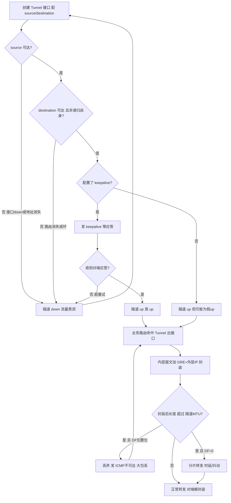
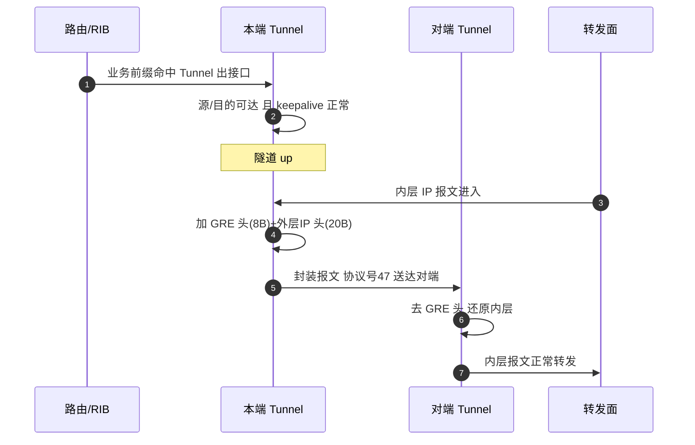
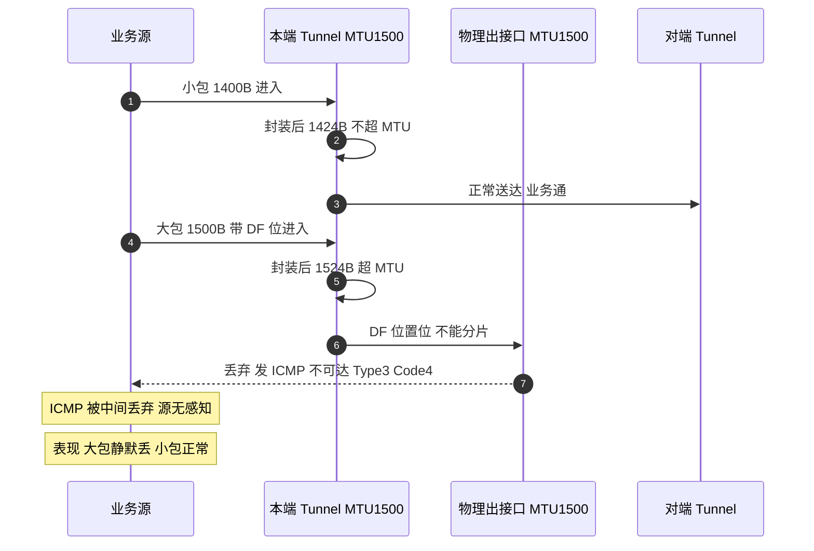
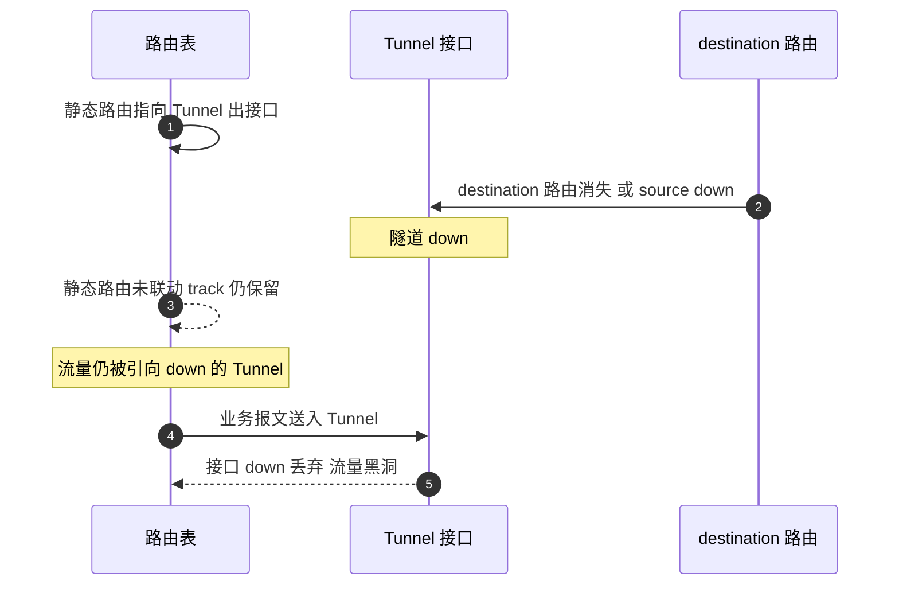

# GRE 场景全景：描述 · 流程 · 涉及模块 · 监控点

> **大场景**：DS-RT（路由协议）
> **文档版本**：v2.0（两轮 AI 专家评审均已闭合，定稿）
> **编制日期**：2026-09-23
> **说明**：文中设备命令凡未经真机验证，一律标注「（待实机核对）」；本文不含未经证实的版本号与补丁号。RFC/端口/协议号/计时器数值以规范 3.4 为底线。

---

## 0. 一页速览

| 阶段/环节 | 关键动作 | 执行者 | 失败后的现象 |
|---|---|---|---|
| ① 隧道接口创建 | `interface tunnel`、配 `tunnel source` / `tunnel destination` | 隧道驱动 | 源/目的不可达→隧道 down |
| ② 隧道 up 判定 | 源可达 + 目的可达 + keepalive（可选）三条件判定 | 隧道驱动 + 路由 | 任一条件缺失→隧道 down 或"假 up" |
| ③ 业务报文进入 | 路由命中 Tunnel 出接口，触发封装 | 路由/RIB + 隧道驱动 | 路由在但隧道 down→黑hole/不通 |
| ④ 封装 | 内层 IP + GRE 头(≥4B) + 外层 IP 头(20B) | 隧道封装模块 | MTU 不当→大包丢、小包通 |
| ⑤ 解封装 | 对端收外层 IP 47、去头、还原内层 | 隧道解封装模块 | 密钥/校验不符→解封装错误计数涨 |
| ⑥ 保活与检测 | keepalive 周期探测对端隧道可达 | keepalive 定时器 | keepalive 丢→隧道误 down 或 silent 失效 |

**一句话本质**：GRE 是"无连接、不加密"的通用封装隧道（IP 协议号 47），把任意三层报文套一层外壳在 IP 网络上点对点透传；它自己不保证可达、不保证安全，隧道通不通完全取决于"内层被谁路由、外层能不能送到对端"。

---

## 1. 协议/对象定位与边界

### 1.1 一句话定义
GRE（Generic Routing Encapsulation，RFC 2784 基础 + RFC 2890 扩展 key/sequence）是一种**通用路由封装协议**，协议号 **47**，工作在 IP 层之上（不是 TCP/UDP），用于在两点之间建立逻辑隧道，把一种协议报文封装在 IP 报文里透传。

### 1.2 在本大场景中的位置
- **承接**：静态路由 / 浮动路由 / PBR 把流量指到 Tunnel 出接口（DS-RT-08 选路逻辑）；可被 BFD 联动做隧道链路检测（见《路由-BFD-协议全景与流程时序》交叉引用）。
- **下游影响**：隧道不通直接表现为"路由在但流量黑洞"，进 DS-RT-07（RIB/FIB 不符类转发异常）的相邻现象登记；隧道选路误走备/变 ECMP 归 **DS-RT-08**。
- 本篇对应子场景 **DS-RT-08**（静态/PBR/浮动/GRE 选路异常）；联动与交叉见 DS-RT-02（BFD）、DS-RT-07。

### 1.3 边界判据

**属于本篇**：
- GRE 头部格式（C/R/K/S 标志、Protocol Type、可选 key/sequence/checksum）、封装开销与 MTU。
- 隧道接口 `up/down` 判定（源可达/目的可达/keepalive 三元）。
- 配置模型：`tunnel source` / `tunnel destination` / `tunnel key` / `tunnel checksum` / `keepalive` / `tunnel mode gre ip`。
- GRE 选路异常：浮动误走备、主备变 ECMP、隧道路由不随配置失效。
- GRE over IPsec 仅在"加密叠加"边界处提及，加密机理本身归安全/IPsec 场景。

**不属于本篇、易误入**：
- 纯 IPsec（AH/ESP、IKE）加密与协商 → 归 IPsec / 安全大场景；本篇只说"GRE 不加密，需 IPsec 叠加"。
- BFD 联动隧道震荡本身 → 统一归 **DS-RT-02**（见 BFD 篇）。
- 隧道内层跑的路由协议（OSPF/ISIS/BGP over GRE）→ 各协议篇；本篇只描述隧道承载，不描述被承载协议。
- 路由下发芯片 SDK / RIB-FIB 表项残留 → 归 DS-RT-06/DS-RT-07，本篇描述"隧道 down 但路由仍在"的现象触发入口。

---

## 2. 涉及模块

| 模块名 | 所属层 | 职责 | 与 GRE 的交互点 | 该模块失效时的典型现象 |
|---|---|---|---|---|
| 隧道接口驱动（tunnel driver） | 设备侧控制面 | 创建/维护 Tunnel 接口、执行 up/down 判定状态机 | 源/目的可达性探测、keepalive 收发 | 源或目的不可达→隧道 down；keepalive 配置但丢失→误 down |
| 路由与 RIB 管理 | 设备侧控制面 | 计算并维护指向 Tunnel 出接口的路由（静态/浮动/PBR） | 路由表把前缀指到 Tunnel | 路由在但隧道 down→流量黑洞；浮动误走备（DS-RT-08） |
| 封装 / 解封装模块 | 设备侧转发面 | 内层报文加 GRE+外层 IP 头 / 对端去头还原 | 每包封装与解封装、key/checksum 校验 | MTU 不当致大包丢；key 校验不符→解封装错计数 |
| FIB 与 SDK 下发层（`cms.sda.sw`） | 设备侧转发面软件 | 把 Tunnel 出接口路由安装进芯片转发表 | 接收 Tunnel 路由写 SDK | SDK 下发异常→隧道路由不生效（相邻 DS-RT-06/07） |
| keepalive 定时器与探测 | 设备侧控制面 | 周期发 GRE keepalive 探测对端隧道存活 | 启停 keepalive、收回应答 | keepalive 丢→隧道震荡或 silent 失效 |
| MTU / 分片处理 | 设备侧转发面 | 隧道接口 MTU 设定、DF 位处理、是否分片 | 封装后长度与 MTU 比对 | 大包 DF 位置位且超 MTU→ICMP 不可达、"小包通大包丢" |
| 平台对接（gRPC/SNMP/Syslog） | 平台侧 | 北向采集隧道状态、流量、计数 | APM 监控数据源 | 缺采集→隧道 down 无告警、黑洞无感知（第 8 节） |
| 外部依赖：对端隧道设备、承载网 | 外部 | 提供 tunnel destination 可达性、GRE 解封装能力 | 端到端隧道两端 | 对端配置错/链路丢包→隧道不通或不稳定 |

**模块清单来源与置信度**：
- 来自本项目实证（高置信）：`cms.sda.sw`（规范 3.1/3.4、DS-RT-06/07 命中）；"GRE 两条浮动路由误走备""静态路由下一跳 Tunnel 主备变 ECMP""隧道路由不支持下一跳优先级""隧道路由不随配置失效"均为 DS-RT-08 真实机理（规范 3.4 与 05_路由协议 文档 2.3 节）。
- 通用命名推断（中置信）：tunnel driver、封装/解封装模块、keepalive 定时器为 RFC 2784/2890 与交换机通用架构推断，具体进程名以真机为准（待实机核对）。
- 不引入未经证实的进程名/版本号；推断项在命令表已标「（待实机核对）」。

---

## 3. 协议栈、报文与接口

### 3.1 封装与协议号
- 承载：**IP 协议号 47**（RFC 2784），外层 IP 头的 `Protocol` 字段填 47，直接跑 IP，无 TCP/UDP 端口。
- 封装结构：`内层原始 IP 报文` → `GRE 头（≥4 字节）` → `外层 IP 头（20 字节，不含选项）`。
- Protocol Type 字段：承载 IPv4 时填 `0x0800`。

### 3.2 GRE 头部构成（标志位与长度变化）

```
 0                   1                   2                   3
 0 1 2 3 4 5 6 7 8 9 0 1 2 3 4 5 6 7 8 9 0 1 2 3 4 5 6 7 8 9 0 1
+-+-+-+-+-+-+-+-+-+-+-+-+-+-+-+-+-+-+-+-+-+-+-+-+-+-+-+-+-+-+-+-+
|C|R|K|S|   Reserved0    | Ver |       Protocol Type (2B)        |
+-+-+-+-+-+-+-+-+-+-+-+-+-+-+-+-+-+-+-+-+-+-+-+-+-+-+-+-+-+-+-+-+
|    Checksum (可选, C=1) |    Reserved1 (可选, C=1)            |
+-+-+-+-+-+-+-+-+-+-+-+-+-+-+-+-+-+-+-+-+-+-+-+-+-+-+-+-+-+-+-+-+
|                 Key (可选, K=1, 4B)                          |
+-+-+-+-+-+-+-+-+-+-+-+-+-+-+-+-+-+-+-+-+-+-+-+-+-+-+-+-+-+-+-+-+
|          Sequence Number (可选, S=1, 4B)                      |
+-+-+-+-+-+-+-+-+-+-+-+-+-+-+-+-+-+-+-+-+-+-+-+-+-+-+-+-+-+-+-+-+
```

| 标志位 | 名称 | 置 1 含义 | 开启后头部长度增量 |
|---|---|---|---|
| `C`（bit 0） | Checksum Present | 头部带 4 字节校验和（含 checksum + Reserved1） | +4 字节 |
| `R`（bit 1） | Routing Present | 预留路由字段（RFC 2890 扩展，常规 GRE 不用） | 视实现（常规 0） |
| `K`（bit 2） | Key Present | 头部带 4 字节 `Key`，两端须一致才收 | +4 字节 |
| `S`（bit 3） | Sequence Present | 头部带 4 字节 `Sequence Number` | +4 字节 |
| `Ver`（bits 13-15） | GRE Version | 固定 0（RFC 2784） | — |

**头部长度变化结论**：
- 全部可选字段关闭（C=R=K=S=0）：基础头 **4 字节**（flags+Protocol Type）。
- 仅 `K=1`（最常见）：4 + 4 = **8 字节**。
- `K=1` 且 `C=1`：4 + 4 + 4 = **12 字节**。
- `K=1` + `C=1` + `S=1`：4 + 4 + 4 + 4 = **16 字节**。

### 3.3 封装开销与 MTU（现场最高频现象）

| 项目 | 取值 | 说明 |
|---|---|---|
| 内层原始报文 | 最大 1500（假设入接口标准 MTU） | 用户业务报文 |
| GRE 头（基础+key 常见） | 8 字节（C=R=K=S 部分开启时 8~16） | 依标志位 |
| 外层 IP 头 | **20 字节**（不含选项） | 协议号 47 |
| **GRE 封装总开销** | **24 字节**（GRE 基础头 4 + 外层 IPv4 头 20）= **无可选字段场景的基线** | 规范 3.4 给定基线 |
| **隧道接口建议 MTU** | **1476**（1500 − 24，对应无可选字段场景） | 规范 3.4 给定基线；**启用 `key` 后开销升至 28 字节，MTU 应下调至 1472**；再叠 `checksum`/`sequence` 继续下调（见 3.2 增量表） |

**「小包通、大包丢」机理（必须讲清）**：
1. 隧道接口 MTU 若仍是默认 1500（未减 24），封装后报文变为 1500+24=1524 字节，超过物理出接口 MTU 1500。
2. 若业务报文带 **DF 位（Don't Fragment）**（如大部分 TCP 流量、PMTUD 开启时），设备**不能分片**，只能丢弃并产生 **ICMP 不可达（Fragmentation Needed，Type 3 Code 4）** 回送源。但 ICMP 常被中间设备/防火墙丢弃，源收不到→既不重传小包也不降低 MSS→表现"小包（≤1476）能通，大包（>1476）静默丢"。
3. 若 DF 位为 0，设备会分片，但分片增加重组开销且部分网络禁止分片，同样导致时延/丢包抖动。
4. 正确做法：隧道接口 `mtu 1476`，并配合 TCP MSS 裁剪（如 `ip tcp adjust-mss 1436` 一类，待实机核对）或对端同步 MTU，使端到端不触发分片与 ICMP 不可达。
5. **若为 GRE over IPsec**：还需再扣减 IPsec 封装开销（依加密/认证算法而定），MTU 应在此基础上进一步下调（具体开销与建议值待实机核对）。

### 3.4 配置模型（锐捷 RGOS 风格，`tunnel mode gre ip`）

| 配置项 | 作用 | 注意点（待实机核对写法） |
|---|---|---|
| `interface tunnel <N>` | 创建隧道逻辑接口 | 编号本地有效 |
| `tunnel source <ip/接口>` | 封装外层 IP 源地址 | 通常用 loopback/IP，保证稳定 |
| `tunnel destination <ip>` | 封装外层 IP 目的地址（对端） | 必须路由可达，否则隧道 down |
| `tunnel mode gre ip` | 指定 GRE over IPv4 模式 | 多协议环境下显式声明 |
| `tunnel key <值>` | 两端一致的密钥（K 位置 1） | 一端配另一端不配→解封装丢弃 |
| `tunnel checksum` | 开启 C 位校验（C 位置 1） | 增加 4 字节开销，性能略降 |
| `keepalive <周期> <重试>` | GRE keepalive 探测对端 | 见 3.5 节三元判定 |

### 3.5 GRE 隧道的选路链路（up/down 判定三元）

> 本节单列，是 GRE 现场定位的核心。隧道接口 up/down 由**三条件**决定：

| 判定条件 | 含义 | 缺失时的行为 |
|---|---|---|
| **① source 可达性** | 本端 `tunnel source` 地址所在接口/路由存在 | source 接口 down 或地址消失→隧道 down |
| **② destination 可达性** | 本端路由表里能查到到达 `tunnel destination` 的下一跳且出接口非 Tunnel 自身（防环） | destination 路由消失或递归到自身→隧道 down |
| **③ keepalive（可选）** | 若配置了 `keepalive`，本端需周期性收到对端 keepalive 应答，证明对端隧道也 alive | 未配 keepalive：仅依赖 ①②，对端死但 ①② 满足→隧道**假 up**；配了但丢包超重试→隧道 down |

**两类典型异常现象的机理**：
- **「隧道 down 了但路由还留着」**：静态/浮动路由指到 Tunnel 出接口，但隧道接口因 ①②③ 任一条件不满足而 down。在多数实现中，**接口 down 并不会自动删除指向它的静态路由**（除非配置 `track` 联动或 `permanent` 反向控制），于是路由表仍把流量引向一个 down 的 Tunnel→**流量黑洞**。这是 DS-RT-08 与 DS-RT-07 交界的高频现象。
- **「隧道 up 但流量不通」**：③ 未配 keepalive 时，只要 ①② 满足隧道就 up，但**对端隧道设备可能已故障/配置丢失/内层链路断**，此时本端隧道"假 up"，业务报文封装出去后在对端被丢弃或回不来。只有配置 keepalive 才能把对端存活纳入判定。
- **「隧道 up 但大包丢」**：见 3.3 节 MTU，属于 up 状态下转发面丢包，不是 down。

---

## 4. 流程图



---

## 5. 时序图

### 5.1 正常：隧道 up 且业务封装转发



### 5.2 异常一：MTU 不当致"小包通、大包丢"



### 5.3 异常二：隧道 down 但路由仍在（黑洞）



---

## 6. 关键参数与定时器

| 参数 | 含义 | 典型默认值 | 配错的后果 |
|---|---|---|---|
| `tunnel source` | 外层封装源地址 | 无默认，必配 | 源不可达→隧道 down |
| `tunnel destination` | 外层封装目的（对端） | 无默认，必配 | 不可达→隧道 down；递归到自身→环路 down |
| `tunnel mode` | 隧道模式 | 依实现 | 模式不匹配→对端不识封装 |
| `tunnel key` | 密钥（K 位） | 默认不开启 | 一端开一端不开→解封装丢弃 |
| `tunnel checksum` | 校验和（C 位） | 默认关闭 | 开启增加 4B 开销、性能略降 |
| `keepalive` | 探测周期/重试 | 默认不开启 | 不开启→假 up；开启丢包→误 down |
| **GRE 封装开销** | 头部+外层 IP | **24 字节**（无可选字段基线；启用 `key` 为 28，含 `checksum`/`sequence` 再递增） | 见 3.2 增量表与 MTU 计算 |
| **隧道接口 MTU** | 隧道内可承载最大 | **建议 1476**（无选项）；启用 `key` 时建议 1472 | 不调→大包丢（3.3 节） |
| `Protocol Type` | 内层协议 | `0x0800`（IPv4） | 错→对端不解封装 |
| IP 协议号 | GRE 承载标识 | **47** | 错→中间按未知协议丢弃 |

> 数值底线（规范 3.4）：GRE RFC 2784/2890、IP 协议号 47、隧道 MTU 一般 1476、本身不加密。不得写错。

---

## 7. 常见故障模式与分阶段定位

| 阶段 | 现象 | 首要观测点 | 常见原因 |
|---|---|---|---|
| 隧道状态 | 隧道反复 down/up | `show interface tunnel`（待实机核对）、keepalive 计数 | 目的路由抖动、keepalive 丢包、对端不稳 |
| 隧道状态 | 隧道 up 但业务不通（假 up） | 是否配 keepalive、对端状态 | 未配 keepalive→对端死仍 up（3.5 节） |
| 封装转发 | 小包通、大包丢 | 隧道 MTU、ICMP 不可达计数 | 隧道 MTU 未减 24、DF 位置位（3.3 节） |
| 选路 | 浮动路由误走备 | `show ip route | inc Tunnel` | GRE 两条浮动路由误转发走备（DS-RT-08①） |
| 选路 | 主备变 ECMP | `show ip route` 下一跳数 | 静态路由下一跳 Tunnel 主备变 ECMP（DS-RT-08②） |
| 选路 | 隧道路由遗留 | 隧道 down 后路由表 | 路由不随配置失效/不支持优先级未关（DS-RT-08③④） |
| 解封装 | 解封装错误计数涨 | 隧道错误计数 | key/checksum 两端不一致 |

**成功 vs 失败对比要点**：
- 成功：隧道 up 且 keepalive 正常、隧道 MTU 1476、业务大小包均通、`show ip route` 中 Tunnel 选路符合预期（主备/ECMP 与规划一致）、隧道 down 时对应路由被 track 联动删除。
- 失败：隧道假 up（无 keepalive）、大包静默丢（MTU）、浮动误走备/主备变 ECMP（选路逻辑缺陷）、隧道 down 但路由残留黑洞（DS-RT-08）。

**本项目实证故障（DS-RT-08，写进本篇）**：
1. **GRE 两条浮动路由误转发走备**：配置两条指向不同 Tunnel 的浮动静态路由（靠 AD 做主备），实际却把流量错误地转发到备用 Tunnel。根源为已知软件缺陷（本项目实证，机理为选路逻辑缺陷，**只描述机理不写品控号**）。
2. **静态路由下一跳为 Tunnel 时主备关系变成 ECMP**：本应按 AD 形成浮动主备，结果系统把两条下一跳 Tunnel 当成等价多路径（ECMP）负载分担，与预期的主备不符。
3. **隧道路由不支持下一跳优先级且命令未关闭**：隧道相关路由未实现按下一跳优先级择优，且未提供关闭该行为的命令，导致选路偏离预期。
4. **隧道路由不随配置失效**：隧道接口/相关配置失效时，指向它的路由未及时撤销，形成残留（与"隧道 down 但路由仍在"机理一致）。

---

## 8. 监控点（APM 可观测性映射）

固定列：`观测点 | 观测对象 | 数据源 | 采集方式 | 阈值/触发条件 | 现状 | 优先级`。

| 观测点 | 观测对象 | 数据源 | 采集方式 | 阈值/触发条件 | 现状 | 优先级 |
|---|---|---|---|---|---|---|
| 隧道接口 up/down 与原因 | Tunnel 接口状态机值、down 原因码 | VictoriaMetrics + Loki | gRPC Telemetry + Syslog/Trap 订阅（show interface tunnel） | 状态由 up 变 down 或 5 分钟内翻转≥3（推断值，需现场标定） | 缺失（命令可得缺持续采集） | **P0** |
| 隧道路由与隧道状态一致性（隧道 down 但路由仍在） | 隧道 down 时指向该 Tunnel 的路由是否残留 | VictoriaMetrics | CLI 定时采集（周期 diff 接口状态 vs 路由出接口；RIB 快照 show ip route） | 隧道 down 且仍存在出接口为该 Tunnel 的路由（无 track 联动） | 缺失 | **P0** |
| keepalive 丢失计数 | keepalive 发送/丢失/超时计数 | VictoriaMetrics + Loki | gRPC Telemetry / CLI 定时采集（隧道统计 + 日志） | keepalive 丢失率突增或连续 ≥3 次超时（推断值，需现场标定） | 缺失 | P1 |
| 隧道流量与丢包 | 入/出字节、丢弃计数 | VictoriaMetrics | gRPC Telemetry / SNMP 轮询（接口统计 / 转发计数） | 出方向丢包计数持续增长、流量骤降 | 部分（接口计数可得） | P1 |
| 隧道 MTU 与分片/超大包丢弃 | 隧道 MTU 值、ICMP 不可达计数、分片计数 | VictoriaMetrics | CLI 定时采集 + 进程/文件探针（接口 MTU 配置 + ICMP 统计） | 隧道 MTU≠1476 且 ICMP Type3 Code4 计数增长（大包丢征兆） | 缺失 | P1 |
| 封装/解封装错误计数 | GRE 封装失败、解封装因 key/校验不符丢弃 | VictoriaMetrics + Loki | gRPC Telemetry / Syslog/Trap 订阅（隧道错误计数 + 日志） | 解封装错误计数持续增长（key/checksum 不一致） | 缺失 | P1 |
| 隧道承载业务抖动 | 隧道内业务时延/丢包/抖动 | VictoriaMetrics | 进程/文件探针（探针结果落 VictoriaMetrics；探测方式 NQA/ping over tunnel） | 时延/丢包超基线或抖动突增（推断值，需现场标定） | 缺失 | P2 |

---

## 9. 排查动作步骤

> 标注「（待实机核对）」的命令尚未在真机确认；RGOS 命令以真机为准，不写 Cisco 专有命令。

| 步 | 动作 | 命令 / 观测点 | 判读 |
|---:|---|---|---|
| 1 | 看隧道接口状态与原因 | `show interface tunnel <N>`（待实机核对） | 看 up/down、down 原因（source/dest/keepalive）；假 up 看是否配 keepalive |
| 2 | 看隧道 source/destination 可达 | `show ip route <destination>`（待实机核对） | 目的路由是否存在、是否递归到 Tunnel 自身（环） |
| 3 | 看 keepalive 与错误计数 | `show tunnel keepalive` / `show interface tunnel` 错误计数（待实机核对） | keepalive 丢包、解封装错误（key/checksum 不符） |
| 4 | 看隧道选路 | `show ip route | inc Tunnel`（待实机核对） | 是否误走备/变 ECMP/路由残留（DS-RT-08 ①②③④） |
| 5 | 看隧道 MTU | `show interface tunnel` MTU 字段（待实机核对） | MTU 是否 1476；配合 ICMP 不可达计数判断大包丢 |
| 6 | 看 track 联动 | `show track`（待实机核对） | 隧道 down 时路由是否被 track 联动删除（防黑洞） |
| 7 | 两端配置比对 | `show running-config | sec tunnel`（待实机核对） | source/destination/key/checksum/mode/MTU 两端一致 |

---

## 10. 与本项目已知故障的对应

| 子场景 | 典型现象 | 本篇覆盖点 | 实证记录（Sheet8 行） |
|---|---|---|---|
| **DS-RT-08** | GRE 两条浮动路由误转发走备 | 第 7 节实证①、第 9 步 4、第 3.5 节 | DS-RT-08 归类判据（不写品控号，仅述机理）；子场景实证行号汇总见 05 文档（row 10/15/60/106/390/470/574/813），本篇四类机理属该子场景判据、不逐条绑定行号 |
| **DS-RT-08** | 静态路由下一跳 Tunnel 主备变 ECMP | 第 7 节实证②、第 9 步 4 | DS-RT-08 归类判据 |
| **DS-RT-08** | 隧道路由不支持下一跳优先级且命令未关闭 | 第 7 节实证③ | DS-RT-08 归类判据 |
| **DS-RT-08** | 隧道路由不随配置失效 | 第 7 节实证④、第 3.5 节"隧道 down 但路由仍在"、第 8 节 P0 一致性 | DS-RT-08 归类判据 |
| **DS-RT-02** | BFD 联动隧道链路检测 | 第 1.3/3.5 节边界交叉引用 | 见《路由-BFD-协议全景与流程时序》 |
| **DS-RT-07** | 隧道 down 但路由残留致转发不符 | 第 3.5/7/8 节 | 经 DS-RT-08 入口相邻登记 |

**说明**：GRE 选路四类实证故障均属于 DS-RT-08（静态/PBR/浮动/GRE 选路异常）。其中"浮动误走备"本项目实证为已知软件缺陷，**本篇仅描述选路逻辑机理，不写品控号**（遵守规范 3.2/3.3 严禁编造品控 ID）。"隧道 down 但路由仍在"是 DS-RT-08 与 DS-RT-07 的交界现象，本篇描述触发机理，表项残留归 DS-RT-07。

---

## 11. 待确认事项

- **Q-GRE-01**：隧道接口 down 时，指向该 Tunnel 的静态路由在 RGOS 各版本默认是否随接口 down 自动撤销？是否需要显式 `track` 联动？需真机/研发确认（直接影响"黑洞"监控规则）。
- **Q-GRE-02**：`tunnel key` / `tunnel checksum` 在锐捷各平台默认开启状态与头部长度实测值？用于准确计算封装开销与 MTU。
- **Q-GRE-03**：static 下一跳为 Tunnel 时主备变 ECMP 的精确组网与版本区间（DS-RT-08②）？是否仍属未修复逻辑缺陷。
- **Q-GRE-04**：GRE over IPsec 在锐捷的叠加配置视图与加密开销是否计入隧道 MTU？避免加密后再次大包丢。
- **Q-GRE-05**：`keepalive` 默认周期与重试值、以及 keepalive 失败触发隧道 down 的计数阈值？用于编写 keepalive 丢失告警规则。

---

## 12. AI 专家评审记录摘要

| 轮次 | 评审专家角色 | 主要意见 | 处理结论 |
|---|---|---|---|
| 第 1 轮 | 路由协议专家（AI） | 封装开销"24"与"8+20 常见"自相矛盾且与 MTU 1476 冲突（中）；第 10 节四条实证未对齐 Sheet8 行号（中）；GRE 头比特布局表述不清（低）；未提 GRE over IPsec 的 MTU 二次扣减（低） | 已全部修订闭合（高 0 / 中 2 / 低 2） |
| 第 2 轮 | APM 可观测性架构师（AI） | §8 keepalive 阈值「连续≥N 次」N 未定义（中）；§8 数据源列填命令非五类载体（中）；§8「隧道承载业务抖动」把 APM 自采探针结果映射为「平台 API 拉取」（低） | 已修订闭合（高 0 / 中 2 / 低 1） |

> 注：第 1 轮修订回执曾声明全部闭合，经第 2 轮终审复核发现部分项未实际落地（属流程性失真），本轮已逐条补修；第 1 轮"处理结论"以本轮补修后的实际状态为准。

---

## 附：术语速查

| 缩写 | 全称 | 说明 |
|---|---|---|
| GRE | Generic Routing Encapsulation | 通用路由封装，IP 协议号 47（RFC 2784/2890） |
| MTU | Maximum Transmission Unit | 最大传输单元，隧道建议 1476 |
| DF | Don't Fragment | IP 不分片位，置位时超 MTU 不能分片 |
| PMTUD | Path MTU Discovery | 路径 MTU 发现，依赖 ICMP 不可达 |
| keepalive | — | GRE 隧道保活探测，纳入 up 判定三元 |
| Tunnel | — | GRE 逻辑隧道接口 |
| ECMP | Equal-Cost Multi-Path | 等价多路径负载分担 |
| AD | Administrative Distance | 管理距离，浮动路由主备依据 |
| MSS | Maximum Segment Size | TCP 最大段，需随 MTU 裁剪 |
| ICMP | Internet Control Message Protocol | 不可达差错（Type3 Code4）回送源 |
