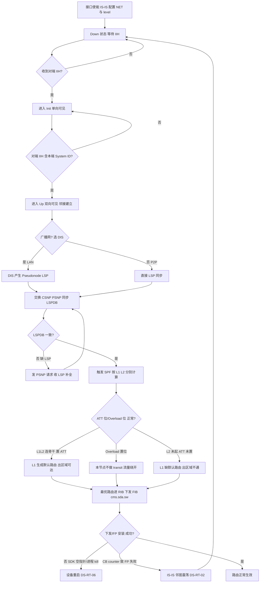
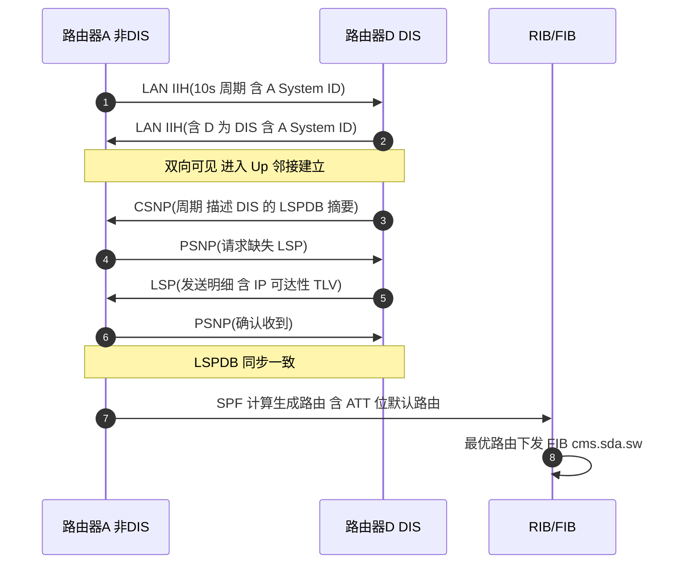
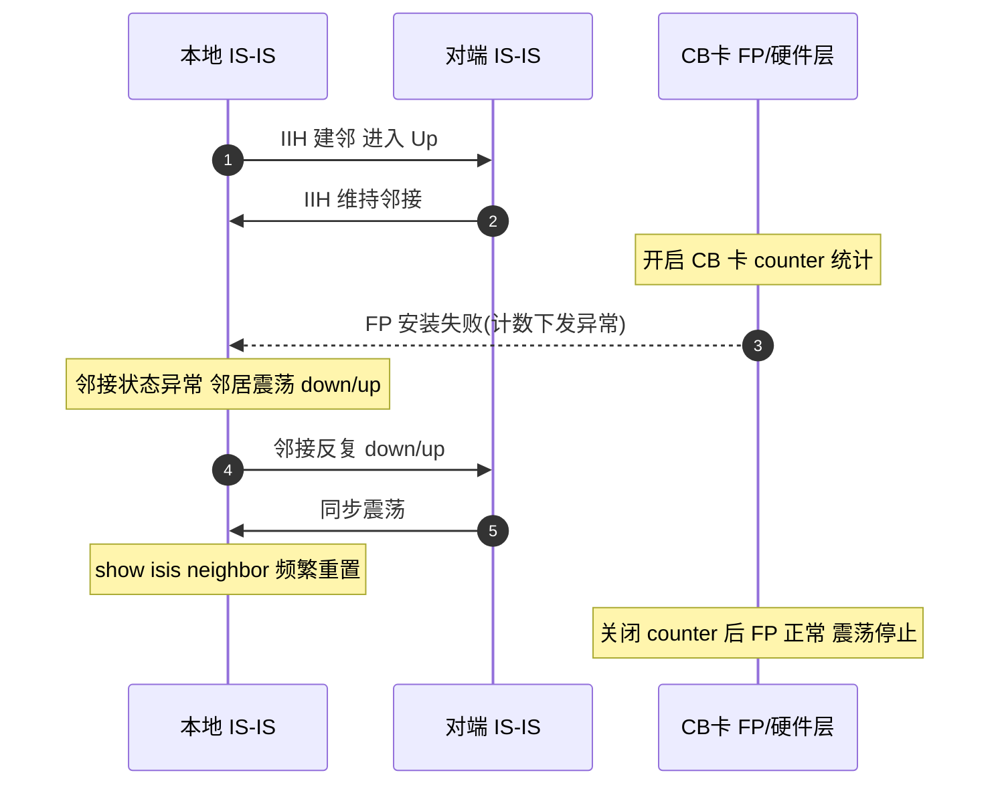
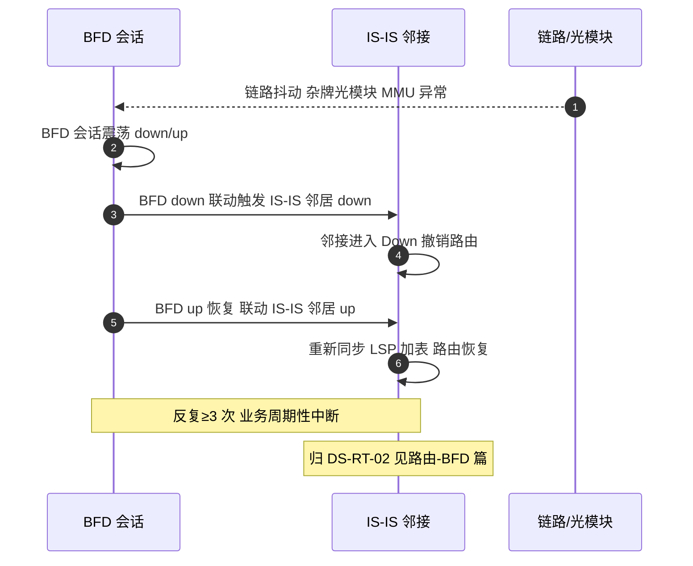
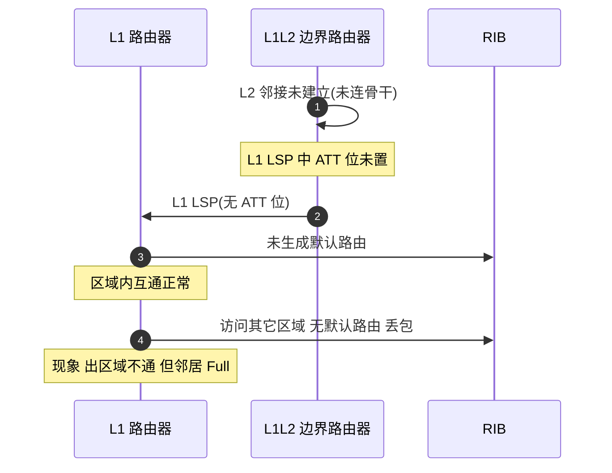

# IS-IS 场景全景：描述 · 流程 · 涉及模块 · 监控点

> **大场景**：DS-RT（路由协议）
> **文档版本**：v2.0（两轮 AI 专家评审均已闭合，定稿）
> **编制日期**：2026-09-23
> **说明**：文中设备命令凡未经真机验证，一律标注「（待实机核对）」；本文不含未经证实的版本号与补丁号。RFC/协议号/端口/计时器数值以规范 3.4 为底线。

---

## 0. 一页速览

| 阶段/环节 | 关键动作 | 执行者 | 失败后的现象 |
|---|---|---|---|
| ① 接口使能与 NET 配置 | 配置 NET 地址、使能 IS-IS 进程与接口 level | IS-IS 进程 | NET 区域/System ID 错配→邻接起不来 |
| ② 邻接发现 | 发 IIH（广播 10s / 点到点 30s 量级）发现邻居 | IS-IS 进程 | 认证/区域不匹配→卡 Init 或反复震荡 |
| ③ 邻接建立 | Down→Init→Up 三态迁移、DIS 选举 | IS-IS 进程 | Hello 间隔错配→邻接不稳定 |
| ④ LSP 同步 | 通过 CSNP/PSNP 同步 LSPDB | IS-IS 进程 | LSP 分片/序号错→数据库不一致 |
| ⑤ SPF 计算 | 按 L1/L2 分别算最短路径 | IS-IS 进程 + RIB | ATT 位/Overload 位异常→缺默认路由/被绕开 |
| ⑥ 路由加表与下发 | 最优路由进 RIB→FIB（SDK 层） | RIB + `cms.sda.sw` | 下发失败→业务不通/设备重启 |
| ⑦ 持续保活 | IIH 维持邻接、LSP 周期刷新 | IS-IS 进程 | BFD/FP 异常→邻居频繁震荡（DS-RT-02） |

**一句话本质**：IS-IS 是"链路状态"IGP，但与 OSPF 不同——它原生跑在 CLNS/二层（不依赖 IP 承载），靠 IIH/LSP/CSNP/PSNP 四类 PDU 把全网拓扑收敛成一致 LSP 数据库，再各自跑 SPF（Dijkstra）算出无环路由；其分层（L1/L2）、ATT 位默认路由注入、可抢占的 DIS 是 IS-IS 最鲜明的三处工程特征。

---

## 1. 协议/对象定位与边界

### 1.1 一句话定义
IS-IS（Intermediate System to Intermediate System，ISO 10589 + RFC 1195 集成 IS-IS 承载 IP）是**链路状态（Link-State）内部网关协议**，运行在 CLNS/数据链路层之上（IP 仅作为"被承载的可达性"之一），通过四类 PDU 在区域内/间同步链路状态数据库（LSPDB），各路由器独立执行 SPF 计算生成无环路由。它原生支持 CLNP 与 IP 双栈（集成 IS-IS），且采用 **L1/L2 两层路由**与**ATT 位默认路由注入**机制。

### 1.2 在本大场景中的位置
- **承接**：接口使能、NET 配置、与 BFD（DS-RT-02）联动、被静态/直连引入触发 LSP 生成。
- **被触发/下发**：SPF 结果进 RIB→FIB（SDK 层 `cms.sda.sw`）；异常时进 DS-RT-06（SDK 下发重启）、DS-RT-07（RIB/FIB 不符）。
- 本篇对应子场景：**DS-RT-02**（BFD 联动 IS-IS 邻居震荡，含 CB 卡 counter 致 FP 安装失败致 IS-IS 邻居震荡这一实证条目）；其余 IS-IS 邻居/计算机理在本数据集中**样本极少**，相关通用机理作为工程推断列于第 11 节待确认。

### 1.3 边界判据

**属于本篇**：
- IS-IS 邻接三态（Down/Init/Up）、四类 PDU（IIH/LSP/CSNP/PSNP）、TLV 编码、NSAP/NET 地址。
- L1/L2 分层、Level-1-2 路由器、ATT 位默认路由注入、Overload 位、DIS 选举（可抢占）。
- 窄度量（narrow metric）与宽度量（wide metric）差异及选路影响、IPv4/IPv6 可达性 TLV（RFC 5308）、多拓扑（RFC 5120）。
- 认证 TLV 10/133、LSP 生存期与刷新、CSNP 周期、IIH 间隔（广播 10s / 点到点 30s 量级）。
- CB 卡 counter 开启致 FP 安装失败→IS-IS 邻居震荡（DS-RT-02 实证）。

**不属于本篇、易误入**：
- BFD 与 IS-IS 联动震荡本身的 BFD 机理 → 统一归 `DS-RT-02`，但 BFD 详细机制见《路由-BFD-协议全景与流程时序》，本篇只描述"IS-IS 邻居随 BFD 同步 down/up"现象与入口。
- 纯转发面 TCAM/ASIC 表项（与路由协议无关）不一致 → 归 `EXT-FWD`。
- 静态路由/PBR/GRE 选路 → 归 `DS-RT-08`（PBR 见《路由-PBR-协议全景与流程时序》）。
- OSPF/OSPFv3/RIP 邻居与计算 → 各自协议篇。
- 路由下发芯片 SDK 空指针致重启 → 根因在 SDK 安装层，归 `DS-RT-06`；本篇描述"IS-IS 收敛触发该路径"入口。

---

## 2. 涉及模块

| 模块名 | 所属层 | 职责 | 与 IS-IS 的交互点 | 该模块失效时的典型现象 |
|---|---|---|---|---|
| IS-IS 协议进程（isisd） | 设备侧控制面 | 维护邻接三态、收发四类 PDU、LSPDB、SPF 计算 | 全部 IS-IS 逻辑中枢 | 进程 coredump/重启→邻接全 down（DS-RT-02 类） |
| LSPDB 管理 | 设备侧控制面 | 存储/老化/刷新 LSP（生存期/刷新）、分片管理 | LSP/CSNP/PSNP 收发与数据库同步 | LSP 分片序号错→数据库不一致、路由缺失 |
| SPF 计算引擎 | 设备侧控制面 | 按 L1/L2 分别执行 Dijkstra | 拓扑变化触发计算 | ATT 位/Overload 位处理错→缺默认路由/被绕开 |
| RIB / 路由表管理 | 设备侧控制面 | 汇总各协议、按 AD/metric 选最优、下发 FIB | IS-IS 路由写入 RIB | 窄/宽度量换算错→选路不符 |
| FIB 下发与 SDK 层（`cms.sda.sw`） | 设备侧转发面软件 | 将 RIB 路由安装芯片转发表 | 接收 IS-IS 最优路由写 SDK | SDK 踩空指针/进程被 kill→设备重启（DS-RT-06） |
| 接口/网络类型/MTU 层 | 设备侧 | 提供接口使能、LAN/P2P 类型、MTU | IIH 发送、DIS 选举上下文 | 网络类型错→IIH 不匹配/邻接异常 |
| 邻接与套接字层（CLNS/二层） | 设备侧系统 | 承载 IS-IS 组播 PDU（LAN）、P2P 单播、认证 TLV 校验 | IIH/LSP/CSNP/PSNP 收发 | 认证 TLV 不匹配→邻接起不来；FP 安装失败→震荡 |
| FP / 硬件层（CB 卡） | 设备侧转发面硬件 | 表项/计数下发、转发流水线 | counter 开启影响 FP 安装 | CB 卡 counter 开启致 FP 安装失败→IS-IS 邻居震荡（DS-RT-02 实证） |
| BFD 联动层 | 设备侧控制面 | 提供毫秒级链路检测并联动 IS-IS 邻接 | BFD down 触发 IS-IS 邻居 down | BFD 震荡→IS-IS 邻居频繁 down/up（DS-RT-02） |
| 平台对接（gRPC/SNMP/Syslog） | 平台侧 | 北向采集邻接、LSPDB、日志、Trap | APM 监控数据源 | 缺采集→邻接卡点/LSP 异常无告警（第 8 节） |
| 外部依赖：对端/第三方设备、光模块 | 外部 | 提供邻居、底层链路质量 | 邻接交互、BFD 联动 | 杂牌光模块 MMU 异常→BFD/IS-IS 震荡（DS-RT-02） |

**模块清单来源与置信度**：
- 来自本项目实证（高置信）：`cms.sda.sw`（规范 3.1/3.4、DS-RT-06 命中）；"CB 卡 counter 开启致 FP 安装失败→IS-IS 邻居震荡""BFD 震荡联动 IS-IS 邻居频繁 down/up"为 DS-RT-02 真实机理（row 293、123 类）。
- 通用命名推断（中置信）：`isisd`、LSPDB、SPF 引擎、接口/网络类型为 ISO 10589 + RFC 1195 与交换机通用架构推断，具体进程名以真机为准（待实机核对）。
- 不引入未经证实的进程名/版本号；推断项在命令表已标「（待实机核对）」。

---

## 3. 协议栈、报文与接口

### 3.1 承载与地址模型
- IS-IS **不依赖 IP 承载**：PDU 直接在数据链路层发送（以太上以 802.2 LLC 承载，DSAP/SSAP 为 `0xFE`；常见呈现为 EtherType `0x00FE`。具体呈现依实现，待实机核对），与 OSPF（IP 89）根本不同。它先服务于 CLNS，RFC 1195 扩展后通过 TLV 携带 IP 可达性，实现"集成 IS-IS 承载 IP"。
- **NSAP / NET 地址构成**（长度可变，典型 20 字节）：

| 段 | 名称 | 长度 | 含义 |
|---|---|---|---|
| 区域 ID（Area ID） | Area ID | 可变（1~13B） | 标识所属区域；Level-1 路由在区域内、Level-2 跨区域 |
| System ID | System ID | 固定 6 字节 | 区域内唯一标识一台路由器（常以 MAC 或环回地址变形） |
| SEL（N-Selector） | 选择符 | 1 字节 | NET 中固定为 `00`（表示"本机系统"） |

- 例：`49.0001.0000.0000.0001.00` —— `49.0001` 为区域 ID，`0000.0000.0001` 为 System ID，`00` 为 SEL。Area ID 不同即跨 Level-2。

### 3.2 四类 PDU 作用与发送时机

| PDU | 名称 | 作用 | 发送时机 / 对象 |
|---|---|---|---|
| **IIH** | IS-to-IS Hello | 发现邻居、建立/维持邻接、选举 DIS（LAN） | 周期发送：广播网 10s 量级、点到点 30s 量级（依实现）；LAN IIH 与 P2P IIH 两类，含 Priority 与 DIS 标识 |
| **LSP** | Link-State PDU | 通告链路状态（邻居、度量、可达前缀，通过 TLV） | 拓扑变化时生成；含分片（LSP ID 中 `Fragment Number` 区分）；有生存期（默认 1200s 量级，刷新约一半时重发） |
| **CSNP** | Complete SNP | 描述发送方 LSPDB 全部 LSP 摘要（头部），用于数据库同步 | 广播网由 **DIS 周期**（默认 10s 量级）发送；P2P 在邻接建立时及周期发送 |
| **PSNP** | Partial SNP | 请求缺失 LSP 或确认收到的 LSP（部分摘要） | 收到未知/过期 LSP 时请求；收到 LSP 后确认（P2P 网必用，广播网可选） |

- **LSP ID 结构**：`System ID + Pseudonode ID(1B) + Fragment Number(1B)`；Pseudonode ID 非 0 表示 DIS 产生的伪节点 LSP。LSP 分片由 `Fragment Number` 从 0 递增承载超大的链路信息。
- **LAN IIH vs P2P IIH**：LAN IIH 携带 Priority 与 DIS 地址（用于选举）；P2P IIH 不选举 DIS、无 Priority 字段，邻接靠双向 IIH 即可 Up。

### 3.3 邻接状态机（仅三态，对照 OSPF 八态）

| 状态 | 含义 | 迁移触发 |
|---|---|---|
| **Down** | 未收到任何 IIH | 初始态；无邻居或链路 down |
| **Init** | 收到对方 IIH，但对方尚未在 IIH 中看到自己 | 单向可见 |
| **Up** | 对方 IIH 中已包含本端 System ID（双向可见），邻接建立 | 双向可见，开始 LSP 同步 |

- **为什么只有三态**：IS-IS 没有 OSPF 的 ExStart/Exchange/Loading 主从与数据库交换阶段——数据库同步靠 CSNP/PSNP 的"摘要比对+按需拉取"完成，不占用独立邻接状态；也不区分 DR/BDR 的 2-Way 半邻接终点（IS-IS 所有邻接都到 Up，DIS 只是伪节点代表，不改变邻接状态机）。因此 IS-IS 邻接状态机只有 Down/Init/Up，比 OSPF（Down/Attempt/Init/2-Way/ExStart/Exchange/Loading/Full）简洁得多。

### 3.4 分层、Level-1-2 与 ATT 位（IS-IS 特有，重点）

| 概念 | 含义 | 工程要点 |
|---|---|---|
| **Level-1 (L1)** | 区域内路由 | 只维护本区域 LSPDB，不学跨区域明细 |
| **Level-2 (L2)** | 区域间/骨干路由 | 维护全 AS 骨干拓扑，跨区域流量走 L2 |
| **Level-1-2 (L1L2)** | 同时参与 L1 与 L2 | 区域边界路由器，既在区域内也在骨干 |
| **ATT 位（Attach）** | L2 路由器（或 L1L2）在 LSP 中置位的标志位 | **L1L2 路由器若同时连到 L2 骨干，会在其 L1 LSP 中置 ATT 位** |
| **ATT 位→默认路由** | L1 路由器看到 ATT 位后，自动生成一条指向该 L1L2 的 **缺省路由（0.0.0.0/0）** | 这是 IS-IS 的"区域出口默认路由"机制，无需手工配 default-information originate |
| **Overload 位（OL）** | 路由器在 LSP 中置位表示"我过载/不可做 transit" | 邻居不会把该节点作为中间节点转发流量（仍可达其自身直连），用于维护窗口或保护弱设备 |

**ATT 位机制讲透（IS-IS 区别于 OSPF 的核心之一）**：
1. 在 L1/L2 分层网络中，L1 路由器只知道自己区域内的拓扑，无法直接算出到其它区域的路径。
2. L1L2 边界路由器同时接入 L1 区域与 L2 骨干；当它确认自己连到了 L2 骨干（即参与了 L2），会在向本 L1 区域通告的 **L1 LSP** 中**置 ATT 位**。
3. 区域内的 L1 路由器收到带 ATT 位的 L1 LSP 后，**自动产生一条指向该 L1L2 的默认路由**（等价多路径下可有多条）。
4. 于是 L1 区域去往其它区域的流量，统一先送给最近的带 ATT 位的 L1L2，由它在 L2 骨干继续转发——这等价于"ABR 下发 3 类默认"，但 IS-IS 是**自动的、基于 ATT 位的**，不像 OSPF Stub 那样要配 area stub。
5. **常见坑**：若 L1L2 的 L2 邻接没起来（没真正连到骨干），它不会置 ATT 位→区域里没有默认路由→"区域内通、出区域不通"。这正是 ATT 位机制下最典型的故障现象。

### 3.5 DIS 选举（与 OSPF DR 的关键差异）

| 对比项 | IS-IS DIS | OSPF DR/BDR |
|---|---|---|
| 是否可抢占 | **可抢占**：优先级高/System ID 大者随时取代 | **不可抢占**：一旦选出，除非失效否则不变 |
| Hello 间隔 | DIS 选举相关 Hello 周期更短（广播网 IIH 10s 量级） | Hello 10s/Dead 40s |
| 是否建伪节点 | DIS 产生 Pseudonode LSP（Pseudonode ID≠0）描述广播网 | DR 产生 Network-LSA（Type 2） |
| 备份 | **无 Backup DIS**（不像 OSPF 有 BDR） | 有 BDR |
| 邻接数量 | 与所有邻居都建立 Up 邻接（DIS 不减少邻接数） | DR/BDR 与所有邻接；DROther 间仅 2-Way |
| 优先级 0 | 仍可能参与（仅表示不优先） | 0 表示绝对不参选 |

- 关键差异落地：**IS-IS DIS 可抢占**意味着网络变更/重启后 DIS 可能频繁切换，导致 Pseudonode LSP 重新生成、数据库短暂震荡；OSPF DR 不可抢占则更稳定但倒换慢。DIS Hello 间隔更短则对链路故障感知更快但 Hello 风暴风险略高。

### 3.6 TLV 编码与可达性 TLV

- IS-IS 采用 **TLV（Type-Length-Value）** 可变扩展编码，所有信息（邻居、度量、前缀、认证、协议支持）都塞进 TLV，这是它比 OSPF 固定 LSA 格式更易扩展的根本原因。
- **IPv4 可达性 TLV**：`IP Internal Reachability`（TLV 128，窄度量）、`Extended IP Reachability`（TLV 135，宽度量，支持前缀+tag+sub-TLV）。
- **IPv6 可达性 TLV**：RFC 5308 `IPv6 Reachability`（TLV 236，宽度量）；多拓扑见 RFC 5120（`Multi-Topology` TLV 229 等）。

### 3.7 窄度量与宽度量（选路影响）

| 度量类型 | 承载 TLV | 每链路度量范围 | 总路径度量上限 | 选路影响 |
|---|---|---|---|---|
| **窄度量（narrow）** | TLV 128/22 等 | 0~63（6 bit） | 1023（10 bit） | 度量上限小，大网络易"封顶"，无法区分细微链路差异；只支持单 metric |
| **宽度量（wide）** | TLV 135/236 等 | 0~16777215（24 bit） | 极大 | 支持 TE sub-TLV、灵活度量、更大范围；推荐现代部署 |

- **选路影响**：窄度量下度量总和可能触达 1023 上限而被截断，导致不同路径度量"相等"或无法体现真实代价差，造成次优选路；宽度量避免该问题，且支持多拓扑/TE 扩展。两端口迁移（一边窄一边宽）会导致度量解释不一致，是跨厂商对接的常见坑。

### 3.8 认证 TLV（TLV 10 / TLV 133）

- **TLV 10**：`Authentication`（用于 LSP/ICS/CSNP/PSNP 等 PDU 的认证，含认证类型与认证数据）。
- **TLV 133**：`IS-IS Shared Secret Authentication`（RFC 3567 提出的明文共享密钥认证，为 TLV 10 的补充/替代）。
- 认证类型含 Null、明文、HMAC-MD5 等；两端不一致或密钥错→邻接起不来（卡 Init/Down）。

### 3.9 计时器

| 计时器 | 典型量级 | 说明 |
|---|---|---|
| IIH 间隔（广播 LAN） | **10s** 量级 | 周期发送 LAN IIH；DIS 选举相关 |
| IIH 间隔（点到点） | **30s** 量级 | P2P IIH 周期 |
| IIH Hold / 失效判定 | 通常为 IIH 间隔倍数（依实现） | 超时未收 IIH→邻接 Down |
| LSP 生存期（Lifetime） | **1200s** 量级 | LSP 最大年龄，超时从数据库清除 |
| LSP 刷新（Refresh） | 依实现（RFC 1195 默认约 900s；规范未钉死，待实机核对） | 周期性重生成/重洪泛 LSP 防老化 |
| CSNP 间隔（广播网 DIS） | **10s** 量级 | DIS 周期发 CSNP 做数据库摘要比对 |
| SPF 延迟/抑制 | 依实现（初始/增量/最大） | 拓扑抖动时抑制频繁重算 |

> 数值底线（规范 3.4）：ISO 10589 + RFC 1195；PDU 四类 IIH/LSP/CSNP/PSNP；L1/L2 分层、DIS、ATT 位；邻接 Down/Init/Up；TLV；窄/宽度量；IPv6 RFC 5308、MT RFC 5120；认证 TLV 10/133。不得写错。

---

## 4. 流程图

---

## 5. 时序图

### 5.1 正常建邻 + LSP 同步 + 路由加表（广播网络）

### 5.2 异常一：CB 卡 counter 开启致 FP 安装失败→IS-IS 邻居震荡（DS-RT-02 实证）

### 5.3 异常二：BFD 震荡联动 IS-IS 邻居频繁 down/up（DS-RT-02，交叉引用 BFD 篇）

### 5.4 异常三：L1L2 的 L2 邻接未起→ATT 位未置→区域内缺默认路由

---

## 6. 关键参数与定时器

| 参数 | 含义 | 典型默认值/量级 | 配错的后果 |
|---|---|---|---|
| `NET / Area ID` | 区域标识 | 依设计（如 49.0001） | 区域错配→L1 邻接起不来/跨区域混乱 |
| `System ID` | 路由器标识 | 6 字节唯一 | 冲突→LSP 互相覆盖/数据库错乱 |
| `Level` | 接口/进程 level（L1/L2/L1L2） | L1L2 | 错配→跨区默认路由缺失或 L2 不通 |
| `IIH Interval`（LAN） | 广播网 Hello 间隔 | **10s** 量级 | 两端不一致→Hold 错配、邻接不稳 |
| `IIH Interval`（P2P） | 点到点 Hello 间隔 | **30s** 量级 | 不一致→邻接 down/震荡 |
| `LSP Lifetime` | LSP 最大年龄 | **1200s** 量级 | 过早老化→频繁刷新、SPF 抖动 |
| `LSP Refresh` | LSP 刷新周期 | 依实现（RFC 默认约 900s，待实机核对） | 过频→CPU/带宽占用；过疏→老化风险 |
| `CSNP Interval` | DIS 发 CSNP 间隔 | **10s** 量级 | 过大→数据库同步慢、临时不一致 |
| `DIS Priority` | 广播网 DIS 优先级 | 64（依实现，0~127） | 全 0 或不当→DIS 频繁切换（可抢占） |
| `Metric 类型` | 窄/宽度量 | wide（现代） | 窄度量封顶 1023→次优选路 |
| `Overload` | Overload 位 | 默认不置 | 误置→本节点被绕开、流量绕行 |
| `Authentication` | 认证 TLV 10/133 | Null / 明文 / HMAC-MD5 | 不一致/密钥错→邻接起不来 |

> 数值底线（规范 3.4、本节 3.9）：IIH 广播 10s / 点到点 30s 量级；LSP 生存期 1200s 量级、刷新约一半；CSNP 间隔 10s 量级；认证 TLV 10/133；ATT/Overload 位语义见 3.4。不得写错。

---

## 7. 常见故障模式与分阶段定位

| 阶段 | 现象 | 首要观测点 | 常见原因 |
|---|---|---|---|
| 发现（Down/Init） | 收不到 IIH | `show isis neighbor`（待实机核对）、NET/区域配置 | 接口 down、NET 区域错配、System ID 冲突、认证 TLV 不匹配 |
| Up/震荡 | 邻接反复 down/up | 邻接重置计数、BFD 状态 | CB 卡 counter 致 FP 安装失败（DS-RT-02 实证）；BFD 联动震荡（DS-RT-02） |
| DIS | DIS 频繁切换 | DIS Priority、Hello 间隔 | 优先级不当+可抢占→广播网抖动 |
| LSP 同步 | 数据库不一致/路由缺失 | `show isis database`（待实机核对）、LSP 分片序号 | LSP 分片/序号错、CSNP/PSNP 异常 |
| ATT/默认路由 | 区域内通、出区域不通 | ATT 位、L2 邻接状态 | L1L2 的 L2 邻接未起→ATT 未置→缺默认路由（5.4） |
| Overload | 流量绕开某节点 | Overload 位、`show isis database` | 误置 Overload 或真实过载保护触发 |
| 度量/选路 | 次优路径 | 度量类型（窄/宽） | 窄度量封顶 1023、跨厂商窄宽不一致 |
| 下发/重启 | 收敛时设备重启 | `show logging`、coredump | SDK 空指针/`cms.sda.sw` 被 kill（DS-RT-06） |

**成功 vs 失败对比要点**：
- 成功：邻接 Up（`show isis neighbor` 全 Up）、`show isis database` 各 LSP 完整一致、L1 区域有 ATT 位默认路由、SPF 无异常、`show ip fib` 与 `show ip route` 一致。
- 失败：邻接卡 Init/Down 或频繁震荡（DS-RT-02 实证：CB counter / BFD 联动）、`database` 缺 LSP 或分片异常、L1 缺默认路由（ATT 未置）、窄度量导致次优、`show logging` 命中 coredump/SDK 报错。

---

## 8. 监控点（APM 可观测性映射）

固定列：`观测点 | 观测对象 | 数据源 | 采集方式 | 阈值/触发条件 | 现状 | 优先级`。

| 观测点 | 观测对象 | 数据源 | 采集方式 | 阈值/触发条件 | 现状 | 优先级 |
|---|---|---|---|---|---|---|
| IS-IS 邻接状态与迁移事件（含 Down/Init/Up 重置次数） | 每邻接状态值、Up/Down 时间戳、邻接数 | VictoriaMetrics + Loki | gRPC Telemetry（isis neighbor 路径） + Syslog/Trap 订阅 | 状态由 Up 变 Init/Down，或 5 分钟内重置≥3（推断值，需现场标定） | 缺失（命令可得但缺持续采集） | **P0** |
| IS-IS 协议进程存活与 coredump/被 kill | isisd 进程存在性、signal 关键字、coredump | VictoriaMetrics + Loki | 进程/文件探针 + Syslog/Trap 订阅 | 出现 "IS-IS 进程重启"/"coredump"/"signal" 关键字即触发（推断值，需现场标定） | 缺失（需手工取） | **P0** |
| LSP 数量与分片异常、LSPDB 不一致 | LSP 计数、分片序号、数据库版本差异 | VictoriaMetrics + Loki | CLI 定时采集（show isis database） / gRPC Telemetry | LSP 数突增/骤降、分片序号不连续、邻居间 LSPDB 不一致 | 缺失 | **P0** |
| SPF 计算次数与耗时（含被抑制） | SPF 触发次数、单次耗时、抑制计数 | VictoriaMetrics + Loki | CLI 定时采集（show isis spf） / 进程/文件探针 | SPF 次数突增或持续抑制（建议初始基线：1 分钟内 ≥20 次；推断值，需现场标定） | 缺失 | **P0** |
| 前缀数与变化速率（可达性 TLV） | IS-IS 路由前缀增删计数、速率 | VictoriaMetrics | gRPC Telemetry（isis route count 路径） / CLI 定时采集 | 1 分钟内增删 ≥50 条 或 变化率 >3 倍基线（推断值，需现场标定），或 ATT 位默认路由缺失 | 缺失 | **P1** |
| PDU 收发与错误计数（IIH/LSP/CSNP/PSNP） | 四类 PDU 收发计数、IIH 丢弃、认证失败 | VictoriaMetrics + Loki | gRPC Telemetry / 镜像抓包（IS-IS PDU 计数；IS-IS 承载于二层无加密，PDU 可解析） | IIH 丢弃率突增、认证失败计数、CSNP/PSNP 异常 | 缺失 | **P1** |
| 规格水位（邻接数/LSP 数/分片上限） | IS-IS 邻接数、LSP 数、分片占用率 | VictoriaMetrics | CLI 定时采集（show isis 计数） / SNMP 轮询 | 邻接数/LSP 数≥规格 80% 或达上限（推断值，需现场标定） | 部分（缺自动比对） | **P1** |
| ATT 位与默认路由存在性 | L1 区域默认路由、L1L2 的 ATT 位置位 | VictoriaMetrics | CLI 定时采集（比对 ATT 位；show isis database / show ip route，待实机核对） | 初级触发：L1 区域缺默认路由；进阶（需三源关联）：叠加 `show isis database` 的 ATT 位与对应 L1L2 的 L2 邻接状态异常 | 缺失 | P1 |
| Overload 位置位与影响 | OL 位、`show isis database` | VictoriaMetrics + Loki | CLI 定时采集 | 非维护期 OL 位被置→流量绕行告警 | 缺失 | **P2** |
| RIB-FIB 一致性（IS-IS 路由下发） | 路由表条目 vs 芯片转发表条目 | VictoriaMetrics | CLI 定时采集（5 分钟 diff；show ip route / show ip fib / show forwarding-table） | 同前缀 RIB 存在而 FIB 缺失/出接口不一致 | 部分（缺自动比对） | **P1** |
| 版本-已知问题命中 | 运行版本 vs 已知质量补丁/品控 ID | MySQL | 平台 API 拉取（品控系统；观测对象含 `show version` 版本/型号字段） | 版本命中已知 IS-IS 问题库且无解决补丁即告警 | 缺失（APM 未接品控） | **P2** |

---

## 9. 排查动作步骤

> 标注「（待实机核对）」的命令尚未在真机确认；RGOS 无 Cisco 风格 CEF 命令，统一用 `show ip fib` / `show forwarding-table`。

| 步 | 动作 | 命令 / 观测点 | 判读 |
|---:|---|---|---|
| 1 | 看邻接状态机 | `show isis neighbor`（待实机核对） | 看状态（Up/Init/Down）、重置计数；卡 Init→区域/认证/System ID 问题 |
| 2 | 看接口 NET/level/认证 | `show running-config | sec isis`、`show isis interface`（待实机核对） | 看 NET 区域、level、认证 TLV 是否一致 |
| 3 | 看数据库与分片 | `show isis database`（待实机核对） | 看 LSP 是否完整、分片序号、ATT 位/Overload 位 |
| 4 | 看 SPF 与协议统计 | `show isis spf`、`show isis protocol`（待实机核对） | 看 SPF 次数/抑制、PDU 收发计数、认证失败 |
| 5 | 看默认路由与 ATT | `show ip route isis`、`show isis database`（待实机核对） | L1 区域是否缺默认路由→查 L1L2 的 L2 邻接与 ATT 位（5.4） |
| 6 | 看 BFD 与联动 | `show bfd neighbor`、`show running-config | sec bfd`（待实机核对） | BFD 震荡联动 IS-IS→归 DS-RT-02（第 10 节） |
| 7 | 看进程与 coredump | `show logging`、`show version`（待实机核对） | 检索 isisd coredump/进程被 kill；CB counter/FP 安装失败关键字 |
| 8 | 看 RIB/FIB 一致性 | `show ip route` / `show ip fib` / `show forwarding-table`（待实机核对） | 路由表对但 FIB 错→下发/表项问题（DS-RT-06/07） |

---

## 10. 与本项目已知故障的对应

| 子场景 | 典型现象 | 本篇覆盖点 | 实证记录（Sheet8 行） |
|---|---|---|---|
| **DS-RT-02** | CB 卡开启 counter 致 FP 安装失败→IS-IS 邻居震荡 | 第 2 节 FP 层、第 4 图、第 5.2/7 节 | row 293 类（RG-N18010 BFD 震荡导致 ISIS 邻居频繁震荡）；CB counter 致 FP 失败为 DS-RT-02 归类判据第③条 |
| **DS-RT-02** | BFD 会话震荡联动 IS-IS 邻居频繁 down/up（杂牌光模块 MMU 异常等） | 第 2 节 BFD 联动层、第 5.3 节 | row 123/293/451 类（BFD+IGP 统一归属） |
| **DS-RT-06** | IS-IS 大规模收敛时 SDK 空指针、`cms.sda.sw` 被 kill 致重启 | 第 2 节 SDK 层、第 4 图下发 | 311/434/522（SDK 下发通用机理，05 文档未区分协议，**协议归属待定**） |
| **DS-RT-07** | 由 IS-IS 路由下发触发的 RIB/FIB 不一致 | 第 8 节 RIB-FIB 监控、第 9 步 8 | 36/38/120 类（交叉，非 IS-IS 专属） |

**本项目实证故障（必须写入 RCA 知识库，且为本数据集 IS-IS 仅有的高置信条目）**：
1. **CB 卡 counter 开启致 FP 安装失败→IS-IS 邻居震荡**：开启计数下发异常使 FP 安装失败，邻接状态异常、邻居频繁 down/up；关闭 counter 后恢复。机理为转发面 FP 安装与邻接状态耦合，归 DS-RT-02。
2. **BFD 震荡联动 IS-IS 邻居频繁震荡**：BFD 会话因 up-dampening 不匹配、规格上限、FP 安装失败或光模块/链路异常震荡，并联动 IS-IS 邻居同步 down/up，业务周期性中断。详细 BFD 机理与检测规则见《路由-BFD-协议全景与流程时序》，本篇只描述 IS-IS 侧现象与入口，统一归 DS-RT-02。

> **诚实声明（第 1 轮评审补充）**：除上述两条实证条目外，本数据集中 IS-IS 工单样本极少。本节（含 ATT 位默认路由缺失、Overload、DIS 切换、窄/宽度量次优、认证失败、LSP 分片异常等各行）所列机理均为基于 ISO 10589 / RFC 1195 的**通用工程推断，非本项目工单实证**，不得当作已发生的市场故障引用；相应核实项列于第 11 节。

---

## 11. 待确认事项

- **Q-ISIS-01**：本数据集 IS-IS 专属工单到底有几条？除 DS-RT-02 的 CB counter/FP 失败、BFD 联动两条实证外，是否还有其它 IS-IS 原生机理工单未被识别？需 TAC 一线/数据治理确认（见 05_路由协议 文档"机理缺失/待外归"清单）。
- **Q-ISIS-02**：CB 卡 counter 开启致 FP 安装失败的**精确版本/芯片型号/规避命令**？当前仅知机理，缺可量化阈值（如 counter 开到多少表项触发）。
- **Q-ISIS-03**：ATT 位默认路由缺失类故障在本项目中是否真的存在工单？当前按通用推断写入，需确认是否应降级为"通用机理、非工单实证"。
- **Q-ISIS-04**：窄/宽度量在锐捷各平台默认取值与跨厂商对接的已知问题版本？用于编写"度量封顶导致次优"检测规则。
- **Q-ISIS-05**：IS-IS 进程名在 RGOS 各版本是否均为 `isisd`？`show logging` 的 coredump/FP 安装失败关键字模板需真机确认。
- **Q-ISIS-06**：DIS 选举相关 Hello 间隔、CSNP 间隔在本项目各平台的精确默认值？用于编写"DIS 切换/数据库同步慢"检测规则。

---

## 12. AI 专家评审记录摘要

| 轮次 | 评审专家角色 | 主要意见 | 处理结论 |
|---|---|---|---|
| 第 1 轮 | 路由协议专家（AI） | 以太封装 EtherType 0xCD2F 非标准（中）；LSP 刷新"约生存期一半 600s"与 RFC 默认不符（低）；第 10 节推断项未就地标注非实证（低）；ATT 位 P1 判据取数可行性未说明（低） | 已全部修订闭合（高 0 / 中 1 / 低 3） |
| 第 2 轮 | APM 可观测性架构师（AI） | §8「SPF 次数」「前缀增删」仍为未定义占位符「≥N 次/≥阈值」（中）；§8 数据源列填命令非五类载体（中）；§9 命令分隔符误用全角斜线（应为半角 `|`）（低）；§10 DS-RT-06 311/434/522 口径未统一（低） | 已修订闭合（高 0 / 中 2 / 低 2） |

> 注：第 1 轮修订回执曾声明全部闭合，经第 2 轮终审复核发现部分项未实际落地（属流程性失真），本轮已逐条补修；第 1 轮"处理结论"以本轮补修后的实际状态为准。

---

## 附：术语速查

| 缩写 | 全称 | 说明 |
|---|---|---|
| IS-IS | Intermediate System to Intermediate System | 中间系统到中间系统，链路状态 IGP（ISO 10589 + RFC 1195） |
| CLNS | Connectionless Network Service | 无连接网络服务，IS-IS 原生承载层 |
| NSAP / NET | Network Service Access Point / Network Entity Title | 网络服务访问点 / 网络实体标题，IS-IS 地址 |
| PDU | Protocol Data Unit | 协议数据单元，IS-IS 报文统称 |
| IIH | IS-to-IS Hello | 邻接发现/维持 PDU（LAN/P2P 两类） |
| LSP | Link-State PDU | 链路状态 PDU，通告拓扑与可达性 |
| CSNP | Complete Sequence Numbers PDU | 完整序列号 PDU，数据库摘要 |
| PSNP | Partial Sequence Numbers PDU | 部分序列号 PDU，请求/确认 LSP |
| LSP ID | Link-State PDU Identifier | System ID + Pseudonode ID + Fragment Number |
| DIS | Designated IS | 指定中间系统（广播网选举，可抢占、无 Backup） |
| ATT | Attach bit | 附着位，L1L2 连骨干时置位→L1 生成默认路由 |
| OL | Overload bit | 过载位，节点不做 transit |
| TLV | Type-Length-Value | IS-IS 可变扩展编码机制 |
| L1/L2 | Level-1 / Level-2 | 区域内 / 区域间（骨干）路由层级 |
| SPF | Shortest Path First | Dijkstra 最短路径计算 |
| SDK | Software Development Kit | 芯片软件层，`cms.sda.sw` 负责表项下发 |
