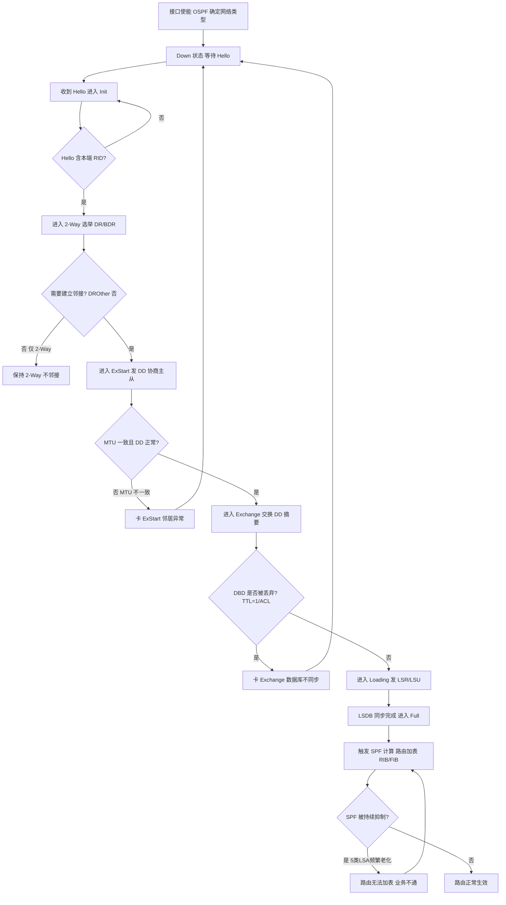
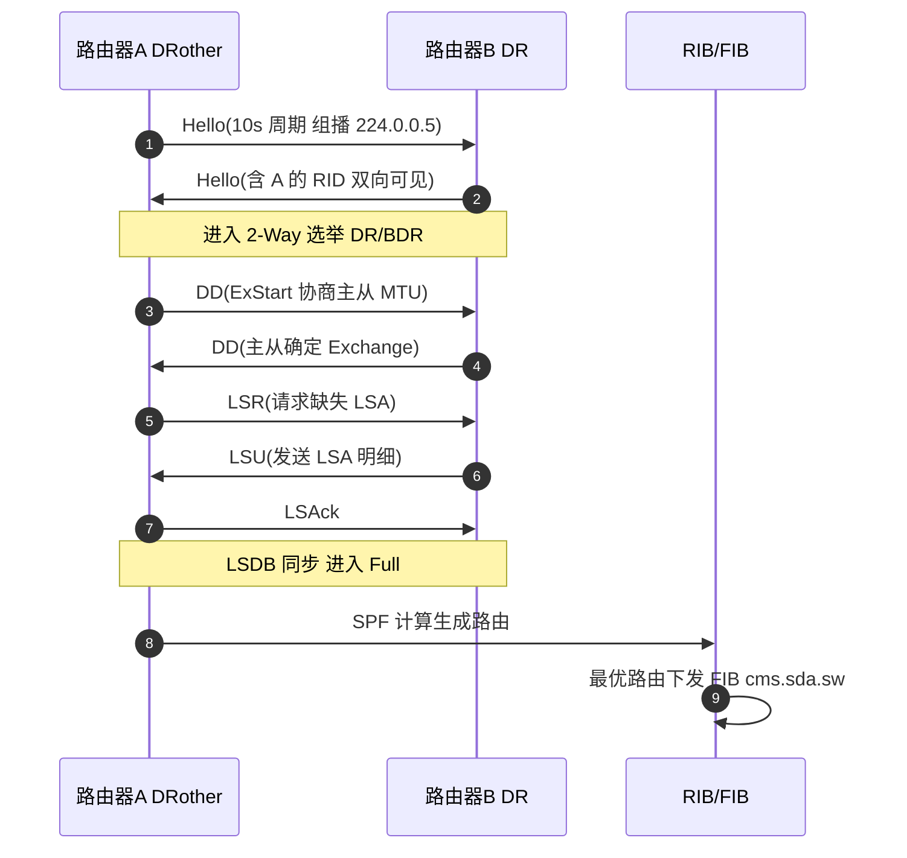
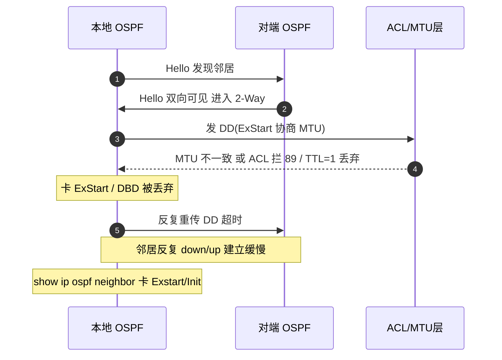
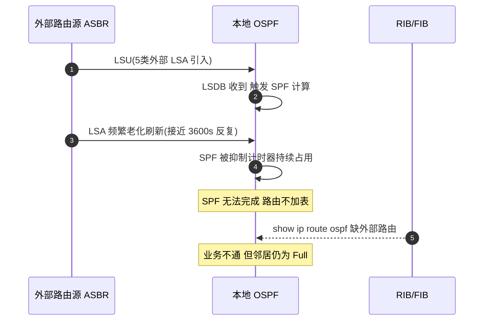

# OSPF 场景全景：描述 · 流程 · 涉及模块 · 监控点

> **大场景**：DS-RT（路由协议）
> **文档版本**：v2.0（两轮 AI 专家评审均已闭合，定稿）
> **编制日期**：2026-09-23
> **说明**：文中设备命令凡未经真机验证，一律标注「（待实机核对）」；本文不含未经证实的版本号与补丁号。RFC/端口/协议号/计时器数值以规范 3.4 为底线。

---

## 0. 一页速览

| 阶段/环节 | 关键动作 | 执行者 | 失败后的现象 |
|---|---|---|---|
| ① 接口使能与网络类型 | 接口激活 OSPF、确定网络类型（广播/P2P/NBMA/P2MP） | OSPF 进程 | 网络类型不匹配→邻居起不来 |
| ② Hello 发现 | 周期发 Hello（10s）发现邻居 | OSPF 进程 | Hello/Dead 不一致→卡 Init/2-Way |
| ③ 邻接建立 | DD 协商主从/MTU、交换 LSR/LSU/LSAck | OSPF 进程 | MTU 不一致→卡 Exstart；ACL 拦→有邻居无路由 |
| ④ 数据库同步 |  LSDB 通过 LSA 同步到 Full | OSPF 进程 | DBD 被丢（TTL=1/单播过路）→卡 Exchange |
| ⑤ SPF 计算 | 触发 SPF 算最短路径树 | OSPF 进程 + RIB | 5 类 LSA 频繁老化刷新→SPF 被持续抑制 |
| ⑥ 路由加表 | 最优路由进 RIB 并下发 FIB | RIB + cms.sda.sw | 多进程 AD 相同未按 metric→选路不符 |
| ⑦ 持续保活 | Hello/Dead 维持邻居 | OSPF 进程 | 邻居数超规格(>500)→建立缓慢 |

**一句话本质**：OSPF 是"链路状态"IGP，靠 IP 协议号 89 的五种报文把全网拓扑收敛成一致 LSDB，再各自跑 SPF（Dijkstra）算出无环最短路径——本质是"先对地图、再各自算路"。

---

## 1. 协议/对象定位与边界

### 1.1 一句话定义
OSPFv2（RFC 2328）是**链路状态（Link-State）**内部网关协议，运行于 IP 协议号 **89**，通过 Hello/DD/LSR/LSU/LSAck 五类报文在区域内同步链路状态数据库（LSDB），各路由器独立执行 SPF 计算生成无环路由；OSPFv3（RFC 5340）为其 IPv6 版本（见《路由-OSPFv3-协议全景与流程时序》交叉引用）。

### 1.2 在本大场景中的位置
- **承接**：接口使能、网络类型判定、与 BFD（DS-RT-02）联动、被静态/直连引入触发 LSA 生成。
- **被触发/下发**：SPF 结果进 RIB→FIB（SDK 层 `cms.sda.sw`）；异常时进 DS-RT-06（SDK 下发重启）、DS-RT-07（RIB/FIB 不符）。
- 本篇对应子场景 **DS-RT-03**（OSPF 邻居建立失败/进程重启/配置丢失）、**DS-RT-04**（OSPF 路由学习/计算/加表异常）；联动与交叉见 DS-RT-02（BFD）、DS-RT-07、OSPFv3 篇。

### 1.3 边界判据

**属于本篇**：
- OSPF 邻居状态机、五类报文、LSDB 同步、SPF 计算、LSA Type 1~5/7 处理。
- DR/BDR 选举、网络类型、区域/ABR/ASBR、认证。
- MTU 在 DD 中携带并比对（不一致卡 ExStart）、ACL/TTL 过滤导致"有邻居无路由"、邻居数超规格建立缓慢。
- 5 类 LSA 频繁老化刷新致 SPF 被抑制加表失败、外部 LSA 掩码错误处理、多进程 AD 选路未按 metric（DS-RT-04）。

**不属于本篇、易误入**：
- 纯转发面 TCAM/ASIC 表项（与路由协议无关）不一致 → 归 `EXT-FWD`。
- OSPFv3 邻居/配置丢失（主备倒换 VRF 协议栈同步异常）→ 归《路由-OSPFv3-协议全景与流程时序》，本篇仅作相邻现象交叉引用。
- BFD 与 OSPF 联动震荡本身 → 统一归 `DS-RT-02`。
- 静态路由/PBR/GRE 选路 → 归 `DS-RT-08`。
- RIP/ISIS 邻居与计算 → 各自协议篇。
- 路由下发芯片 SDK 空指针致重启 → 根因在 SDK 安装层，归 `DS-RT-06`；本篇描述"OSPF 收敛触发该路径"入口。

### 1.4 与相关子场景/协议的触发与调用关系
- **OSPF 收敛 → 下发芯片**：OSPF 大规模路由收敛触发 RIB→FIB 下发，若 SDK 层踩空指针/进程被 kill 即进 `DS-RT-06`（设备重启）。
- **BFD 联动**：OSPF 邻居被 BFD 联动 down 统一归 `DS-RT-02`，本篇不重复展开 BFD 机理（见《路由-BFD-协议全景与流程时序》）。
- **静态/重分布引入**：外部路由经重分布进入 OSPF 产生 5 类 LSA，是 DS-RT-04"外部 LSA 掩码/SPF 抑制"的常见触发源；纯静态选路逻辑缺陷归 `DS-RT-08`。
- **RIB/FIB 一致性**：由 OSPF 路由下发触发的 RIB/FIB 不一致归 `DS-RT-07`；与路由协议无关的纯转发面表项归 `EXT-FWD`。
- **OSPFv3 配置丢失**：主备倒换 VRF 协议栈同步异常致 OSPFv3 配置丢失，根因在 OSPFv3/VRF 同步，交叉参考《路由-OSPFv3-协议全景与流程时序》，本篇仅作相邻现象登记。

> 上述调用关系决定 RCA 的"下钻路径"：先判定失效发生在 OSPF 协议机理层还是其下游（SDK 下发/转发面/联动机制），再决定归本篇还是相邻子场景。

> 注：本文所有"待实机核对"命令最终需经 RGOS 真机或模拟器确认；凡涉及品控 ID/版本号均来自工单字段，未做杜撰。

---

## 2. 涉及模块

| 模块名 | 所属层 | 职责 | 与 OSPF 的交互点 | 该模块失效时的典型现象 |
|---|---|---|---|---|
| OSPF 协议进程（ospfd） | 设备侧控制面 | 维护邻居状态机、收发五类报文、LSDB、SPF 计算 | 全部 OSPF 逻辑中枢 | 进程 coredump/重启→邻居全 down（DS-RT-03） |
| LSDB 管理 | 设备侧控制面 | 存储/老化/刷新 LSA（3600s/1800s） | LSA 收发与数据库同步 | 外部 LSA 掩码错误/频繁老化→SPF 抑制（DS-RT-04） |
| SPF 计算引擎 | 设备侧控制面 | Dijkstra 算最短路径、受抑制计时器约束 | 拓扑变化触发计算 | SPF 被持续抑制→路由无法加表（DS-RT-04） |
| RIB / 路由表管理 | 设备侧控制面 | 汇总各协议、按 AD/metric 选最优、下发 FIB | OSPF 路由写入 RIB | 多进程 AD 相同未按 metric→选路不符（DS-RT-04） |
| FIB 下发与 SDK 层（`cms.sda.sw`） | 设备侧转发面软件 | 将 RIB 路由安装芯片转发表 | 接收 OSPF 最优路由写 SDK | SDK 踩空指针/进程被 kill→设备重启（DS-RT-06） |
| 接口/网络类型/MTU 层 | 设备侧 | 提供接口使能、网络类型、MTU 协商 | DD 报文 MTU 比较、Hello 发送 | MTU 不一致→卡 Exstart；网络类型错→邻居异常 |
| 邻居与 IP/套接字层 | 设备侧系统 | 承载 IP 89 报文收发、组播 224.0.0.5/6 | Hello/DD/LSU 收发 | ACL 拦 89 / TTL=1 丢弃→有邻居无路由或 DBD 丢 |
| 平台对接（gRPC/SNMP/Syslog） | 平台侧 | 北向采集邻居、LSDB、日志、Trap | APM 监控数据源 | 缺采集→邻居卡点/SPF 抑制无告警（第 8 节） |
| 外部依赖：对端/第三方设备、VRF 协议栈 | 外部 | 提供邻居、VRF 同步上下文 | 邻接交互、主备倒换同步 | 第三方 MTU 封装 bug、VRF 同步异常→配置丢失（DS-RT-03） |

**模块清单来源与置信度**：
- 来自本项目实证（高置信）：`cms.sda.sw`（规范 3.1/3.4、DS-RT-06 命中）；"邻居卡 Exstart/Init/Attempt""ACL 过滤有邻居无路由""邻居数超规格""外部 LSA 掩码/SPF 抑制""多进程 AD 选路"均为 DS-RT-03/04 真实机理。
- 通用命名推断（中置信）：`ospfd`、LSDB、SPF 引擎、接口/网络类型为 RFC 2328 与交换机通用架构推断，具体进程名以真机为准（待实机核对）。
- 不引入未经证实的进程名/版本号；推断项在命令表已标「（待实机核对）」。

---

## 3. 协议栈、报文与接口

### 3.1 封装与协议号
- 承载：**IP 协议号 89**（RFC 2328），直接跑 IP，无 TCP/UDP。
- 组播地址：AllSPFRouters `224.0.0.5`、AllDRouters `224.0.0.6`。
- OSPF 头：`Version(1) + Type(1) + Packet Length(2) + Router ID(4) + Area ID(4) + Checksum(2) + AuType(2) + Authentication(8)`。

### 3.2 五种报文（Type 字段）

| Type | 名称 | 作用 | 主要状态 |
|---|---|---|---|
| 1 | Hello | 发现/维持邻居、选举 DR/BDR | Down→2-Way |
| 2 | DD（DBD） | 数据库摘要、协商主从、比对 MTU | ExStart→Exchange |
| 3 | LSR | 请求缺失 LSA | Loading |
| 4 | LSU | 发送 LSA（含具体链路状态） | Loading/同步 |
| 5 | LSAck | 确认收到的 LSA | Loading/同步 |

### 3.3 邻居状态机（8 态）

| 状态 | 含义 | 卡点常见原因 |
|---|---|---|
| Down | 未收到 Hello | 接口 down/ACL 拦 89 |
| Attempt | NBMA 主动探测（仅 NBMA） | NBMA 配错邻居 |
| Init | 收到 Hello 但未含本端 RID | Hello/Dead 不匹配 |
| 2-Way | 双向可见，选举 DR/BDR | 正常非邻接终点（DROther） |
| ExStart | 协商 DD 主从 | MTU 不一致→卡此 |
| Exchange | 交换 DD 摘要 | DBD 被丢（TTL=1/单播过路） |
| Loading | 请求缺失 LSA | LSU/LSAck 异常 |
| Full | LSDB 完全同步 | 正常邻接终点 |

### 3.4 DR/BDR 与网络类型
- **DR/BDR 选举**：**广播/NBMA 网络**在 2-Way 后选，等待 **40s**（Dead 时间）让所有路由器参与；优先级高者优，同优先级比 Router-ID。DR 减少 LSA 泛洪。**注意：P2P/P2MP 网络不选举 DR/BDR**。
- **网络类型**：广播（Broadcast）、点对点（P2P）、NBMA、点对多点（P2MP）；类型不一致→邻居异常/不邻接。

### 3.5 区域、ABR/ASBR 与 LSA 类型

| LSA | 名称 | 产生者 | 范围 | 内容 |
|---|---|---|---|---|
| 1 | Router-LSA | 每台路由器 | 区域内 | 直连链路与开销 |
| 2 | Network-LSA | DR | 区域内 | 广播网段上的路由器列表 |
| 3 | Network-Summary | ABR | 区域间 | 区域间路由汇总 |
| 4 | ASBR-Summary | ABR | 区域间 | 到 ASBR 的路由 |
| 5 | AS-External | ASBR | AS 内（除 Stub） | 外部路由（重分布） |
| 7 | NSSA-External | ASBR（NSSA） | NSSA 内 | 外部路由，ABR 转 5 类 |

- **ABR**：连接多区域的路由器；**ASBR**：重分布外部路由的路由器。

### 3.6 SPF 计算与抑制
- 触发：LSDB 变化时执行 Dijkstra；受 **SPF 抑制（Throttle）** 计时器约束（初始/增量/最大间隔，依实现），避免拓扑抖动频繁重算。
- 本项目实证（DS-RT-04）：5 类 LSA 频繁老化刷新→SPF 被持续抑制→无法加表。

### 3.7 认证三种方式（RFC 2328）
- 空（Null，AuType=0）、简单明文（AuType=1）、MD5（AuType=2）。认证不一致→邻居不建立。

### 3.8 特殊区域类型（Stub / NSSA）
区域类型影响 LSA 泛洪范围与默认路由下发，配错会导致外部路由学不到或邻居不邻接。

| 区域类型 | 允许 LSA | 默认路由 | 适用 |
|---|---|---|---|
| 标准区域 | 1~5、7（若 NSSA） | 无（除非配） | 常规 |
| Stub | 1~3、3 类默认 | ABR 发 3 类默认 | 边缘，不需外部明细 |
| Totally Stub | 仅 1~2、3 类默认 | ABR 发 3 类默认 | 更极简边缘 |
| NSSA（RFC 3101） | 1~3、7（本区外部） | ABR 可发 7 类默认 | 需引入外部但不想收全部 5 类 |
| Totally NSSA | 1~2、7、3 类默认 | ABR 发 3 类默认 | NSSA 极简版 |

- **关键机制**：NSSA 的 7 类 LSA 由 ABR 转换为 5 类 LSA 向其他区域通告；`P-bit` 决定能否转换。Stub/Totally Stub 区域**禁止 5 类外部 LSA**，若 ASBR 落在 Stub 区内则邻居异常（RFC 2328 约束）。
- **本项目关联**：多 OSPF 进程同网段 AD 相同未按 metric 选路（DS-RT-04）常发生在区域边界与重分布点，需结合 `show ip protocols` / `distance` 核对 AD（见第 9 步 6）。

---

## 4. 流程图

---

## 5. 时序图

### 5.1 正常建邻 + 路由交换（广播网络）

### 5.2 异常一：邻居卡 Exstart/Init（MTU/ACL/TTL，DS-RT-03）

### 5.3 异常二：5 类 LSA 频繁老化刷新致 SPF 抑制（DS-RT-04）

---

## 6. 关键参数与定时器

| 参数 | 含义 | 典型默认值 | 配错的后果 |
|---|---|---|---|
| `Hello Interval` | Hello 发送间隔 | **10s**（广播/P2P） | 两端不一致→邻居卡 Init/不建立 |
| `Dead Interval` | 邻居失效判定 | **40s**（广播，=4×Hello） | 与对端不一致→误判邻居 down |
| `Wait Timer` | DR/BDR 选举等待 | **40s**（=Dead） | 过短→选举未稳定即收敛异常 |
| `LSA Aging` | LSA 最大年龄 | **3600s** | 频繁达龄→LSA 反复刷新 |
| `LSA Refresh` | LSA 刷新周期 | **1800s** | 过早刷新→SPF 频繁触发 |
| `MTU`（DD 中携带比对） | 接口 MTU | 依接口（如 1500） | 不一致→卡 ExStart（DS-RT-03） |
| `SPF Throttle` | SPF 抑制间隔 | 依实现（初始/增量/最大） | 过短→CPU 风暴；过长→收敛慢/被抑制加表失败 |
| `Priority` | DR/BDR 优先级 | 1（0 表示不参选） | 全 0→无 DR；不当→次优转发路径 |
| `Authentication` | 认证方式 | Null / 简单 / MD5 | 不一致→邻居不建立 |
| `Network Type` | 网络类型 | 依接口 | 不一致→邻居异常/不邻接 |

> 数值底线（规范 3.4）：IP 89、Hello 10s/Dead 40s（广播）、LSA 老化 3600s/刷新 1800s、DR/BDR 选举 40s、LSA Type 1~5/7、认证 空/简单/MD5。不得写错。

---

## 7. 常见故障模式与分阶段定位

| 阶段 | 现象 | 首要观测点 | 常见原因 |
|---|---|---|---|
| 发现（Down/Init） | 收不到 Hello | `show ip ospf interface`、ACL 89 | 接口 down、ACL 拦协议号 89、Hello/Dead 不一致 |
| 2-Way/选举 | 不选举 DR / 卡 2-Way | 网络类型、priority | 网络类型不匹配、priority 全 0 |
| ExStart | 卡 Exstart | MTU、`debug ip ospf adj` | MTU 不一致（DS-RT-03）、DD 被丢 |
| Exchange | 卡 Exchange/DBD 丢 | TTL、单播过路、ACL | 单播过路 TTL=1 丢弃 DBD（DS-RT-03） |
| Full/路由 | 有邻居无路由 | `show ip ospf database`、ACL | ACL 过滤 LSU（DS-RT-03"有邻居无路由"） |
| 建立规模 | 邻居数超规格建立慢 | 邻居计数 | 邻居数>500 建立缓慢（DS-RT-03） |
| SPF/加表 | 路由学不到/加表慢 | `show ip ospf` SPF 统计、`database` | 5 类 LSA 频繁老化刷新抑制 SPF（DS-RT-04） |
| 选路 | 多进程同网段选路不符 | `show ip protocols` / `distance` | AD 相同未按 metric，先到优先（DS-RT-04） |

**成功 vs 失败对比要点**：
- 成功：邻居 Full、`show ip ospf database` 各类型 LSA 完整、`show ip route ospf` 有预期路由且 metric 正确、SPF 次数正常无持续抑制、`show ip fib` 与 `show ip route` 一致。
- 失败：邻居卡 Exstart/Init/Attempt（DS-RT-03）、`database` 缺 5 类/外部 LSA（掩码被错误变 32 位）、SPF 被抑制致 `route ospf` 为空（DS-RT-04）、多进程 AD 相同未走 metric、`show logging` 命中 coredump。

---

## 8. 监控点（APM 可观测性映射）

固定列：`观测点 | 观测对象 | 数据源 | 采集方式 | 阈值/触发条件 | 现状 | 优先级`。

| 观测点 | 观测对象 | 数据源 | 采集方式 | 阈值/触发条件 | 现状 | 优先级 |
|---|---|---|---|---|---|---|
| OSPF 邻居状态与 Up-Down 事件及重置次数 | 每邻居状态机值、Full/Down 时间戳、邻接数 | VictoriaMetrics + Loki | gRPC Telemetry（ospf neighbor 路径） + Syslog/Trap 订阅 | 状态由 Full 变 Down/Init/Exstart，或 5 分钟内重置≥3（推断值，需现场标定） | 缺失（命令可得但缺持续采集） | **P0** |
| OSPF 协议进程存活与 coredump/被 kill | ospfd 进程存在性、signal 关键字、coredump | VictoriaMetrics + Loki | 进程/文件探针 + Syslog/Trap 订阅 | 出现 "OSPF 进程重启"/"coredump"/"signal" 关键字即触发（推断值，需现场标定） | 缺失（需手工取） | **P0** |
| SPF 计算次数与耗时（含被抑制） | SPF 触发次数、单次耗时、抑制计数 | VictoriaMetrics + Loki | CLI 定时采集（show ip ospf） + 进程/文件探针 | SPF 次数突增或持续抑制≥阈值（建议初始基线：1 分钟内 ≥20 次；推断值，待现场标定） | 缺失 | **P0** |
| 路由前缀数变化速率（外部 LSA 老化刷新） | OSPF 路由（尤其 5 类外部）增删计数 | VictoriaMetrics | gRPC Telemetry（ospf route count 路径） / CLI 定时采集 | 外部路由 1 分钟内增删 ≥50 条 或 变化率 >3 倍基线（推断值，需现场标定），或 5 类 LSA 频繁老化刷新 | 缺失 | **P0** |
| RIB 与 FIB 一致性 diff | 路由表条目 vs 芯片转发表条目 | VictoriaMetrics | CLI 定时采集（5 分钟 diff；show ip route / show ip fib / show forwarding-table） | 同前缀 RIB 存在而 FIB 缺失/出接口不一致 | 部分（缺自动比对） | P1 |
| OSPF 协议报文收发速率与错误计数 | Hello/DD/LSR/LSU/LSAck 计数、DD 重传 | VictoriaMetrics + Loki | gRPC Telemetry / 镜像抓包（OSPF 报文计数；OSPF 承载于明文 IP 89，报文头可解析） | DD 重传率突增、LSAck 缺失、LSU 错误 | 缺失 | P1 |
| 规格水位（邻居数/前缀数） | OSPF 邻居数、LSA 数、路由数占用率 | VictoriaMetrics | CLI 定时采集 / SNMP 轮询（show ip ospf neighbor count） | 邻居数≥规格 80%（若规格 625 则约 500，待实机核对）或 LSA 数接近上限 | 部分 | P1 |
| 版本-已知问题命中 | 运行版本 vs 已知质量补丁/品控 ID（如掩码/SPF 抑制类） | MySQL | 平台 API 拉取（品控系统；观测对象含 `show version` 版本/型号字段） | 版本命中已知 OSPF 问题库且无解决补丁即告警 | 缺失（APM 未接品控） | P1 |
| 外部 LSA 掩码正确性 | 5 类/外部 LSA 前缀掩码 | VictoriaMetrics | CLI 定时采集（show ip ospf database external，比对掩码范围） | 外部 LSA 掩码被错误变 32 位（DS-RT-04） | 缺失 | P2 |

---

## 9. 排查动作步骤

> 标注「（待实机核对）」的命令尚未在真机确认；RGOS 无 Cisco 风格 CEF 命令，统一用 `show ip fib` / `show forwarding-table`。

| 步 | 动作 | 命令 / 观测点 | 判读 |
|---:|---|---|---|
| 1 | 看邻居状态机 | `show ip ospf neighbor`（待实机核对） | 看状态（Full/Exstart/Init/Attempt）；卡点定位 DS-RT-03 |
| 2 | 看邻接交互细节 | `debug ip ospf adj`（待实机核对） | 看 DBD/DD 主从协商、MTU、是否被丢弃；卡 Exstart→MTU/ACL |
| 3 | 看数据库（重点 5 类/外部） | `show ip ospf database`（待实机核对） | 看 LSA 类型是否完整、外部 LSA 掩码是否被错误变 32 位（DS-RT-04） |
| 4 | 看接口 MTU/网络类型/timer | `show ip ospf interface`（待实机核对） | 看 MTU、网络类型、Hello/Dead 是否一致；单播过路 TTL 问题 |
| 5 | 看学到路由与 metric | `show ip route ospf`（待实机核对） | 确认外部路由是否加表、metric 是否预期 |
| 6 | 看 AD/选路 | `show ip protocols` / `distance`（待实机核对） | 多 OSPF 进程同网段 AD 相同是否按 metric 选（DS-RT-04） |
| 7 | 看进程与 coredump | `show logging`（待实机核对） | 检索 coredump/进程重启；主备倒换查 VRF 协议栈与配置同步 |
| 8 | 看 RIB/FIB 一致性 | `show ip route` / `show ip fib` / `show forwarding-table`（待实机核对） | 路由表对但 FIB 错→下发/表项问题（DS-RT-06/07） |

---

## 10. 与本项目已知故障的对应

| 子场景 | 典型现象 | 本篇覆盖点 | 实证记录（Sheet8 行） |
|---|---|---|---|
| **DS-RT-03** | OSPF 邻居卡 Exstart/Init/Attempt；ACL 过滤"有邻居无路由"；邻居数超规格(>500)建立缓慢 | 第 3.3/4/5.2/7 节：状态机、MTU/ACL/TTL、规格 | 108、212、306、331、360、425（row 11 属 OSPFv3 进程异常重启，已移出本篇实证） |
| **DS-RT-03（TTL/单播）** | 单播过路 TTL=1 报文被丢弃致 DBD 丢弃 | 第 3.3/4/5.2 节：DBD 丢弃 | 306/331 类（DS-RT-03 归类判据） |
| **DS-RT-03（交叉·OSPFv3）** | 主备倒换后 VRF 协议栈同步异常致 **OSPFv3** 配置丢失 | 第 1.3/2 节边界与交叉引用（机理见《路由-OSPFv3-协议全景与流程时序》§10） | 11（OSPFv3 进程异常重启，**属 OSPFv3 篇，非 OSPFv2 本篇实证**）；配置丢失条本篇无独立实证行 |
| **DS-RT-04** | 外部 LSA 掩码最大被错误变 32 位；5 类 LSA 频繁老化刷新致 SPF 持续抑制无法加表；多进程同网段 AD 相同未按 metric | 第 3.5/3.6/5.3/7 节：LSA/SPF/选路 | 31、225、303、508、598 |
| **DS-RT-02** | BFD 联动 OSPF 邻居震荡 | 第 1.3/7 节边界与联动说明 | 293、451（BFD+IGP 统一归属） |
| **DS-RT-06** | 路由收敛时 SDK 空指针、cms.sda.sw 被 kill 致重启 | 第 2 节 SDK 层、第 4 图下发 | 311、434、522（SDK 下发通用机理，05 文档未区分协议，**协议归属待定**） |
| **DS-RT-07** | 由 OSPF 路由下发触发的 RIB/FIB 不一致 | 第 8 节 RIB/FIB 监控、第 9 步 8 | 36/38/120 属**静态残留分支，非 OSPF 机理**（DS-RT-07 静态分支，见《路由-静态路由-协议全景与流程时序》§10）；本篇 DS-RT-07 无独立实证行 |

**本项目实证故障（必须写入 RCA 知识库）**：
1. 邻居卡 Exstart/Init/Attempt：MTU 不一致、ACL 过滤协议号 89、单播过路 TTL=1 丢弃 DBD（DS-RT-03）。
2. ACL 过滤导致"有邻居无路由"：邻居 Full 但路由学不到（DS-RT-03）。
3. 邻居数超规格（如 >500）建立缓慢（DS-RT-03，row 108）。
4. 外部 LSA 掩码最大被错误变 32 位；5 类 LSA 频繁老化刷新致 SPF 被持续抑制无法加表（DS-RT-04，row 303/598）。
5. 多 OSPF 进程同目的网段 AD 相同未按 metric 选路（优先下发先到的路由）（DS-RT-04）。
6. 主备倒换后 VRF 协议栈同步异常致 OSPFv3 配置丢失——本篇作为相邻现象**交叉引用《路由-OSPFv3-协议全景与流程时序》**，根因在 OSPFv3/VRF 协议栈同步，不在 OSPFv2 本篇。

---

## 11. 待确认事项

- **Q-RT-04**：row 108 中 S7810C OSPF 邻居数规格上限(>500 建立缓慢)的具体阈值与版本？影响容量规划与预警阈值。
- **Q-RT-05**：row 303/598 的 5 类 LSA 频繁老化刷新抑制 SPF 的精确触发条件与修复版本？需确认根因与归档。
- **Q-OSPF-06**：外部 LSA 掩码被错误变 32 位的触发组网（多近似网段引入）与修复版本区间？
- **Q-OSPF-07**：`SPF Throttle` 抑制计时器在本项目各平台的默认初始/增量/最大值？用于编写"SPF 被抑制"检测规则。
- **Q-OSPF-08**：单播过路 TTL=1 丢弃 DBD 的确切组网（跨设备单播转发）与规避配置，需真机/研发确认。
- **Q-OSPF-09**：OSPF 进程名在 RGOS 各版本是否均为 `ospfd`？`show logging` 的 coredump 关键字模板需真机确认。

---

## 12. AI 专家评审记录摘要

| 轮次 | 评审专家角色 | 主要意见 | 处理结论 |
|---|---|---|---|
| 第 1 轮 | 路由协议专家（AI） | DR/BDR 选举适用网络类型误含 P2MP（中）；"MTU 在 DD 协商"措辞不严谨（中）；SPF 阈值占位符 N 未定义（低）；VPF 笔误（低，复核后已不存在） | 已全部修订闭合（高 0 / 中 2 / 低 2） |
| 第 2 轮 | APM 可观测性架构师（AI） | §10 引 row 11（属 OSPFv3）、row 36/38/120（属静态残留）与本篇机理不符且 row 11 两种含义并存（中）；§8 数据源列填命令非五类载体（中）；§6 参数名"DD 协商"残留（低）；§8 邻居数阈值两基准并列口径不一（低） | 已修订闭合（高 0 / 中 2 / 低 2） |

> 注：第 1 轮修订回执曾声明全部闭合，经第 2 轮终审复核发现部分项未实际落地（属流程性失真），本轮已逐条补修；第 1 轮"处理结论"以本轮补修后的实际状态为准。

---

## 附：术语速查

| 缩写 | 全称 | 说明 |
|---|---|---|
| OSPF | Open Shortest Path First | 开放式最短路径优先，链路状态 IGP（RFC 2328） |
| LSA | Link-State Advertisement | 链路状态通告，组成 LSDB |
| LSDB | Link-State Database | 链路状态数据库，全网拓扑镜像 |
| SPF | Shortest Path First | Dijkstra 最短路径计算 |
| DR/BDR | Designated/Backup Designated Router | 指定/备份指定路由器，减少泛洪 |
| ABR | Area Border Router | 区域边界路由器 |
| ASBR | Autonomous System Boundary Router | 自治系统边界路由器（重分布外部） |
| DD/DBD | Database Description | 数据库描述报文（Type 2） |
| LSR/LSU/LSAck | Link-State Request/Update/Ack | 链路状态请求/更新/确认（Type 3/4/5） |
| NSSA | Not-So-Stubby Area | 非纯 Stub 区域，允许 7 类 LSA |
| AD | Administrative Distance | 管理距离，多协议选路优先级 |
| MTU | Maximum Transmission Unit | 最大传输单元，DD 协商比对项 |
| SDK | Software Development Kit | 芯片软件层，`cms.sda.sw` 负责表项下发 |
