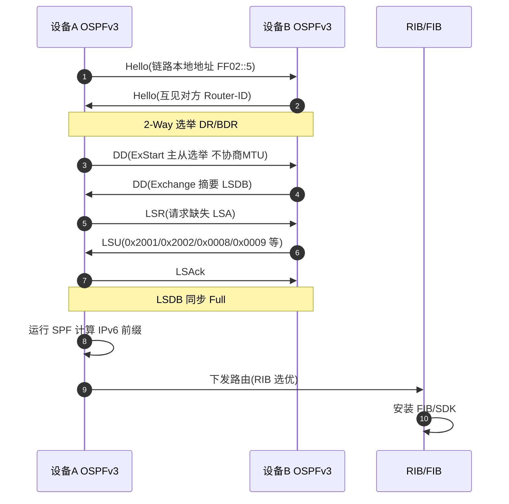
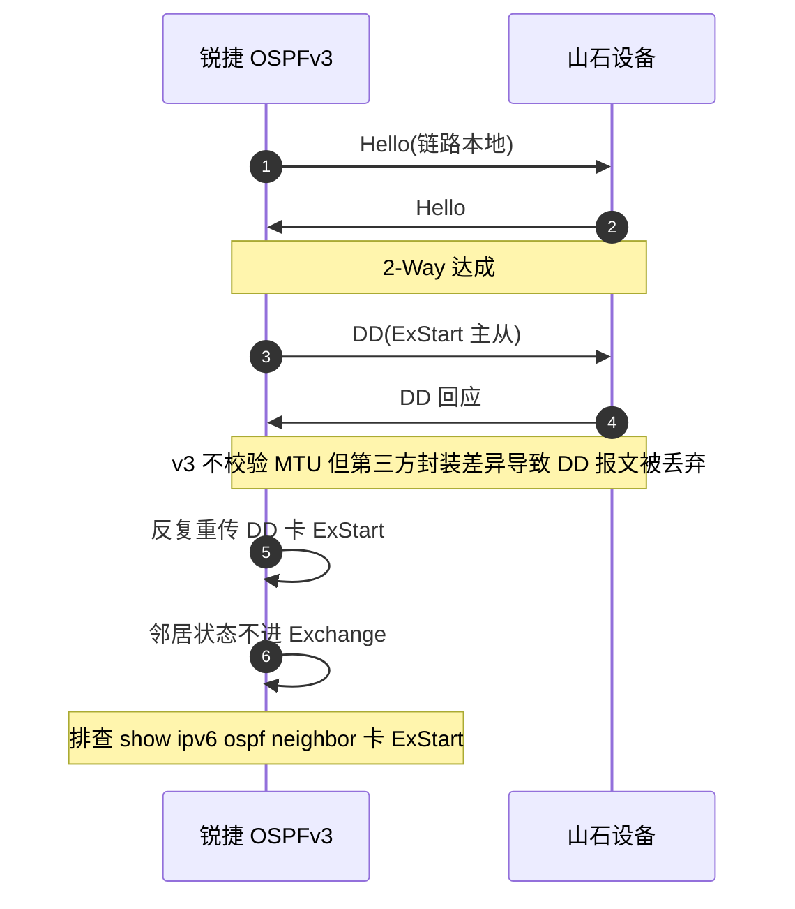
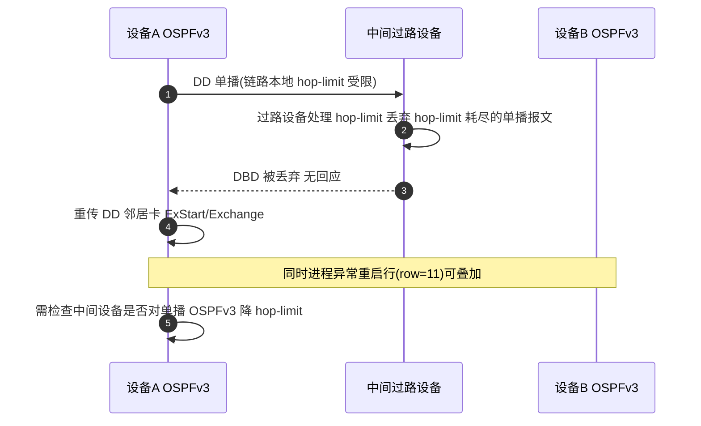

# OSPFv3 场景全景：描述 · 流程 · 涉及模块 · 监控点

> **大场景**：DS-RT（路由协议）
> **文档版本**：v2.0（两轮 AI 专家评审均已闭合，定稿）
> **编制日期**：2026-09-23
> **说明**：文中设备命令凡未经真机验证，一律标注「（待实机核对）」；本文不含未经证实的版本号与补丁号。OSPFv3 技术事实底线以 RFC 5340、RFC 4552 为准，与 OSPFv2（RFC 2328）的差异是本篇重点。

---

## 0. 一页速览

| 阶段 | 关键动作 | 执行者 | 失败后的现象 |
|---|---|---|---|
| ① 链路发现 | 接口启用 IPv6，OSPFv3 用链路本地地址发 Hello | 协议进程 | 邻居不出现在列表，卡 Down |
| ② 邻接建立 | 选 DR/BDR（广播网）、ExStart/Exchange 交换 DD | 两设备 | 卡 ExStart（MTU/DD 异常）、卡 2-Way |
| ③ 数据库同步 | 发 LSR/LSU/LSAck，同步 LSA | 两设备 | LSA 数量不对、路由算不出 |
| ④ 路由计算 | 跑 SPF，生成 Intra-Area-Prefix 路由 | 协议进程 | 有邻居无路由 |
| ⑤ 下发转发表 | RIB→FIB/SDK 下发 | RIB/FIB 模块 | 路由表有但转发不对 |
| ⑥ 维护 | 周期 Hello、LSA 老化刷新、IPsec 保活 | 协议进程 | 邻居周期震荡、进程重启 |

**一句话本质**：OSPFv3 是 OSPFv2 的 IPv6 重写版——协议骨架相同，但**改为 per-link 运行、用链路本地地址做下一跳、Router-LSA 不再带前缀、认证交给 IPsec、DD 不再协商 MTU**；现场 90% 的"v2 能起 v3 起不来"都出在这几处差异上。

---

## 1. 协议/对象定位与边界

### 1.1 一句话定义

OSPFv3（RFC 5340）是 OSPF 的 IPv6 版本，承载于 IPv6、协议号仍为 89，用于 IPv6 单播/组播路由的域内（AS 内）链路状态路由计算；它运行在**链路（per-link）**而非子网之上。

### 1.2 在本大场景中的位置

- 承接：接口 IPv6 使能、OSPFv3 进程/区域配置、BFD 联动配置（见《路由-BFD-协议全景与流程时序》DS-RT-02）。
- 被触发：邻居建立异常、进程重启、配置丢失后进入 RCA；与《路由-OSPF-协议全景与流程时序》（DS-RT-03/04，覆盖 v2）共享同一套排查框架，但本篇只处理 v3 的差异点。
- 下游：RIB/FIB 下发异常归 DS-RT-07；SDK 下发失败致重启归 DS-RT-06。

### 1.3 边界判据

**属于本篇**：
- OSPFv3 邻居建立失败/卡状态（Down/Init/2-Way/ExStart/Exchange/Loading/Full）。
- OSPFv3 进程异常重启、主备倒换后 v3 配置丢失。
- OSPFv3 与第三方（如山石）对接的 MTU 封装、IPsec、hop-limit（IPv6 无 TTL 概念）相关异常。
- OSPFv3 的 LSA 类型（0x0008/0x0009/0x200x）与 SPF 计算。

**不属于本篇、易误入**：
- OSPFv2（IPv4）邻居/路由问题 → 归《路由-OSPF-协议全景与流程时序》DS-RT-03/04。
- 纯 IPv4 路由表/转发不一致 → DS-RT-07（但 v3 路由同样会触发，本篇在第 7/8 节覆盖 v3 观测）。
- BFD 会话自身震荡（非 OSPF 部分） → 归《路由-BFD-协议全景与流程时序》DS-RT-02；本篇仅在第 10 节交叉引用。
- IS-IS/ RIP 的 IPv6 承载 → 归各自篇章。

---

## 2. 涉及模块

| 模块名 | 所属层 | 职责 | 与协议的交互点 | 该模块失效时的典型现象 |
|---|---|---|---|---|
| `ospfv3` 协议进程 | 设备侧进程 | 维护邻居状态机、LSDB、SPF 计算、LSA 生成/泛洪 | 收发 Hello/DD/LSR/LSU/LSAck；生成 Router/Network/Intra-Area-Prefix-LSA | 进程 coredump/重启（对应 row=11）；邻居全 down、路由消失 |
| RIB 管理模块 | 设备侧控制面 | 汇总各协议路由、按 AD 选优、下发 FIB | 接收 OSPFv3 算出的 IPv6 前缀 | 路由未进 RIB、选路错 |
| FIB/SDK 下发 | 设备侧转发面 | 把 RIB 条目写成芯片表项（含 v6 LPM） | 接收 RIB 下发，安装/删除 IPv6 路由 | 路由表有但转发错（DS-RT-07） |
| 邻接与套接字层 | 设备侧协议支撑 | 管理 IPv6 套接字、组播 ff02::5（AllSPFRouters）/ff02::6（AllDRouters）、IPsec SA | DD/Hello 收发、IPsec 封装校验 | IPsec 失败致邻居起不来；hop-limit 受限的过路单播报文被丢弃致 DBD 丢（DS-RT-03） |
| BFD 联动层 | 设备侧控制面 | 提供毫秒级链路检测并触发 OSPFv3 邻居 down | 接收 BFD session down 事件 | BFD 震荡联动 OSPFv3 邻居闪断（DS-RT-02，交叉引用） |
| VRF/协议栈同步 | 设备侧系统 | 维护 VRF 与多协议栈配置一致性 | 主备倒换时同步 OSPFv3 配置 | 倒换后 v3 配置丢失（DS-RT-03） |
| APM 采集代理 | 平台侧/设备侧 agent | 拉取邻居表、LSDB、进程状态 | gRPC/SNMP/CLI 采集 | 监控盲区致故障滞后发现 |

**模块清单来源与置信度**：`ospfv3` 进程、`RIB`/`FIB`/`SDK 下发`、邻接套接字、BFD 联动层、VRF 同步均为通用协议栈命名，结合本项目 DS-RT-03（row=11/108/212/306/331/360/425）实证；`cms.sda.sw`(SDK 下发进程) 来自规范 3.1 实证名词，OSPFv3 触发 v6 大路由收敛时可能踩其空指针（DS-RT-06 机理同构，本篇引用不展开）。"CB 卡 counter 致 FP 安装失败"属 IS-IS 实证（row=293），本篇不纳入本模块。

---

## 3. 协议栈、报文与接口

### 3.1 封装与基础属性

| 项 | 值 |
|---|---|
| 承载协议 | IPv6，下一层协议号 89（与 v2 同） |
| 源/目的地址 | 链路本地地址 `fe80::/10`；组播 `FF02::5`（全 OSPF 路由器）、`FF02::6`（DR/BDR） |
| 认证 | **IPsec（RFC 4552）**，ESP/AH，不再有报文内 Auth Type 字段 |
| DD 报文 MTU 协商 | **已取消**（v2 在 DD 中带 Interface MTU 并校验，v3 不协商） |

### 3.2 五种报文（与 v2 同型，语义一致）

| Type | 名称 | 作用 | v3 差异点 |
|---|---|---|---|
| 1 | Hello | 发现/维持邻居、选 DR | 用链路本地地址；不携带认证字段 |
| 2 | DD（DBD） | 描述 LSDB 摘要、ExStart 主从选举 | **不再协商/校验 MTU** |
| 3 | LSR | 请求缺失 LSA | — |
| 4 | LSU | 发送 LSA | — |
| 5 | LSAck | 确认 LSA | — |

### 3.3 OSPFv3 LSA 类型编码（关键差异）

| LSA 类型 | 编码 | 名称 | 与 v2 关系 |
|---|---|---|---|
| Router-LSA | `0x2001` | 路由器链路状态 | v2 Type1；**v3 不再携带地址前缀** |
| Network-LSA | `0x2002` | 广播网 MA 上 DR 生成的网段 | v2 Type2 |
| Inter-Area-Prefix-LSA | `0x2003` | 区域间 IPv6 前缀 | 对应 v2 Type3 网络汇总 |
| Inter-Area-Router-LSA | `0x2004` | 区域间 ASBR 可达 | 对应 v2 Type4 |
| AS-External-LSA | `0x2005` | 外部路由 | v2 Type5 |
| Type-7 LSA | `0x2007` | NSSA 外部 | v2 Type7 |
| **Link-LSA** | `0x0008` | **v3 新增**：通告链路本地地址、IPv6 前缀、Option | v2 无 |
| **Intra-Area-Prefix-LSA** | `0x0009` | **v3 新增**：把前缀绑回 Router/Network-LSA | v2 无（前缀原在 Type1/2 内） |

> 说明：v2 中前缀直接内嵌于 Router-LSA/Network-LSA；v3 把前缀剥离到 `0x0009`，并在 `0x0008` 中携带链路边信息，这是"per-link"模型的核心。

### 3.4 OSPFv2 与 OSPFv3 对照表

| 维度 | OSPFv2（RFC 2328） | OSPFv3（RFC 5340） |
|---|---|---|
| 承载网络 | IPv4（子网 per-subnet） | IPv6（链路 per-link） |
| 下一跳 | 子网内邻居 IPv4 地址 | **IPv6 链路本地地址** |
| 前缀位置 | Router/Network-LSA 内嵌 | **Link-LSA(0x0008)+Intra-Area-Prefix-LSA(0x0009)** |
| 认证 | 报文内 Auth Type（空/简单/MD5） | **IPsec（RFC 4552）承载** |
| DD 报文 | 携带并校验 Interface MTU | **不协商 MTU** |
| 地址语义 | 协议与地址强耦合 | 协议与地址解耦，多实例/多地址族更灵活 |
| 组播地址 | 224.0.0.5 / 224.0.0.6 | FF02::5 / FF02::6 |
| Option 字段 | 在报文头 | 上移到 Hello/DD 及 LSA 头部 |
| 实例标识 | 无 | 支持 Instance ID（同链路多进程） |

---

## 4. 流程图

```mermaid
flowchart TD
    A["接口使能 IPv6 并启用 OSPFv3"] --> B["构造 Hello 用链路本地地址发送"]
    B --> C{"对端在同一链路且 Area/Instance 匹配?"}
    C -->|否| Z1["邻居不出现 检查区域/Instance/链路本地"]
    C -->|是| D["收到 Hello 进入 2-Way 选举 DR/BDR"]
    D --> E["ExStart 主从选举 交换 DD 摘要"]
    E --> F{"DD 交互正常?"}
    F -->|否 "MTU 封装/第三方兼容问题"| Z2["卡 ExStart 见 DS-RT-03 row=212"]
    F -->|是| G["Exchange/Loading 同步 LSA 0x2001-0x2009"]
    G --> H{"LSDB 完整 路由可达?"}
    H -->|否 "LSA 缺失/前缀未绑定"| Z3["有邻居无路由 查 0x0009"]
    H -->|是| I["SPF 计算生成 IPv6 路由"]
    I --> J["RIB 选优下发 FIB/SDK"]
    J --> K{"下发成功?"}
    K -->|否| Z4["路由表有转发错 见 DS-RT-07"]
    K -->|是| L["邻接 Full 业务通"]
    L --> M{"进程/BFD/配置事件?"}
    M -->|"进程重启 row=11"| Z5["全邻居 down 重算"]
    M -->|"BFD down 联动"| Z6["邻居被置 down 见 DS-RT-02"]
    M -->|"主备倒换配置丢失"| Z7["v3 配置丢失 见 DS-RT-03"]
```

---

## 5. 时序图

### 5.1 正常建邻 + 路由交换



### 5.2 异常一：对接第三方 MTU 封装致 DD 丢弃（DS-RT-03 row=212）



### 5.3 异常二：单播过路 hop-limit 受限报文被丢弃致 DBD 丢弃（DS-RT-03）

> 注：该机理在本项目工单中源自 OSPFv2 场景（IPv4 的 TTL=1）；在 OSPFv3 中应理解为 IPv6 **hop-limit** 受限，勿套用 IPv4 的 TTL 术语。



---

## 6. 关键参数与定时器

| 参数 | 含义 | 典型默认值 | 配错的后果 |
|---|---|---|---|
| Hello Interval | 发 Hello 间隔 | 10s（广播/P2P） | 不一致→邻居起不来 |
| Dead Interval | 收不到 Hello 判 dead | 40s（广播） | 与对端不一致→震荡 |
| Router Dead | 邻居失效 | =4×Hello | 过短→误判 down |
| LSA Refresh | LSA 刷新周期 | 1800s | 频繁刷新→SPF 抖动 |
| Max Age | LSA 最大年龄 | 3600s | 异常老化→路由撤销 |
| MTU | 接口 MTU | 依接口 | v3 不协商，但第三方封装差异仍可致 DD 丢（DS-RT-03） |
| Instance ID | 同链路多实例 | 0 | 不一致→邻居不识 |
| BFD 联动 | 毫秒检测 | 依配置 | 见 DS-RT-02 |

---

## 7. 常见故障模式与分阶段定位

| 阶段 | 现象 | 首要观测点 | 常见原因 |
|---|---|---|---|
| 链路发现 | 邻居列表无对端 | `show ipv6 ospf neighbor`（待实机核对） | 链路本地不通、区域/Instance 不符 |
| 邻接建立 | 卡 ExStart/Exchange | DD 收发、MTU 封装 | 第三方 MTU 封装差异（row=212）、hop-limit 受限过路丢包（DS-RT-03） |
| 数据库同步 | 有邻居无路由 | LSDB 中 0x0009 前缀 | Link/Intra-Area-Prefix-LSA 缺失 |
| 路由计算 | 路由算不出 | SPF 统计 | SPF 被抑制（同 DS-RT-04 机理但 v3） |
| 进程运行 | 邻居全 down、周期重启 | 进程/日志 | OSPFv3 进程异常重启（row=11） |
| 配置持久化 | 倒换后 v3 配置丢失 | running-config | VRF 单/多协议栈同步 bug（DS-RT-03） |
| 下发转发 | 表有转发错 | RIB vs FIB | v6 大路由收敛 SDK 空指针（DS-RT-06/07） |

**成功 vs 失败对比要点**：
- 成功：邻居 Full、`show ipv6 ospf neighbor` 稳定、LSDB 含完整 0x0008/0x0009、路由进 RIB 且 FIB 一致。
- 失败：卡 ExStart（MTU/封装）、进程重启（row=11）、倒换丢配置、hop-limit 受限过路丢 DD。核心是**先判 v3 专有差异点**（per-link/链路本地/IPsec/无 MTU 协商），再套用 v2 排查框架。

---

## 8. 监控点（APM 可观测性映射）

> 固定列：`观测点 | 观测对象 | 数据源 | 采集方式 | 阈值/触发条件 | 现状 | 优先级`。数据源/采集方式仅取规范 3.5 列表，落到 VictoriaMetrics / Loki / MySQL / Pyroscope / Redis。

| 观测点 | 观测对象 | 数据源 | 采集方式 | 阈值/触发条件 | 现状 | 优先级 |
|---|---|---|---|---|---|---|
| OSPFv3 邻居状态与状态迁移事件 | 邻居状态机（Down→Full）跳变、卡 ExStart/2-Way | VictoriaMetrics | gRPC Telemetry（ospf neighbor 路径） / CLI 定时采集（show ipv6 ospf neighbor） | 5 分钟内状态重置≥3 次或卡非 Full 超 60s（推断值，需现场标定） | 缺失 | P0 |
| OSPFv3 进程存活与重启 | `ospfv3` 进程退出/coredump/重启 | VictoriaMetrics + Loki | Syslog/Trap 订阅 + 进程/文件探针 | 出现进程重启/coredump 关键字即触发（对应 row=11；推断值，需现场标定） | 缺失 | P0 |
| LSA 数量与老化异常 | LSDB 中 0x0008/0x0009/0x200x 数量、MaxAge 占比 | VictoriaMetrics | CLI 定时采集（show ipv6 ospf database） / gRPC Telemetry | LSA 数突变 >20%，或 MaxAge LSA 占比 >5%（推断阈值，待实机核对/现场标定） | 缺失 | P0 |
| SPF 计算次数与耗时 | SPF 触发次数、单次耗时 | VictoriaMetrics | CLI 定时采集 | 1 分钟 SPF 次数>50 或单次>500ms（推断值，需现场标定） | 缺失 | P1 |
| 路由前缀数与变化速率 | IPv6 OSPFv3 路由前缀数量、增减速率 | VictoriaMetrics | gRPC Telemetry / CLI 定时采集 | 前缀数 1 分钟变化>10%（推断值，需现场标定） | 部分 | P1 |
| 协议报文收发与错误计数 | Hello/DD/LSR/LSU/LSAck 收发、DD 丢弃计数 | VictoriaMetrics | SNMP 轮询 / CLI 定时采集 | DD 丢弃计数持续增长（MTU/封装/hop-limit 问题指征） | 缺失 | P1 |
| 规格水位（邻居数/LSA 数） | OSPFv3 邻居数、LSDB 规模占用 | VictoriaMetrics | CLI 定时采集 / SNMP 轮询 | 邻居数≥80% 规格或 LSDB 接近上限（推断值，需现场标定） | 缺失 | P1 |
| RIB 与 FIB 一致性 | v6 OSPFv3 路由 RIB vs FIB 条目 diff | VictoriaMetrics | CLI 定时采集（show ipv6 route ospf vs show ipv6 fib） | 同一前缀 RIB 有 FIB 缺/出接口不一致 | 缺失 | P1 |
| 主备倒换后配置一致性 | OSPFv3 进程/区域/网络配置是否丢失 | MySQL | CLI 定时采集（配置快照入 MySQL，倒换前后 diff） | 倒换前后配置 diff 出现 v3 配置缺失（DS-RT-03） | 缺失 | P1 |
| IPsec SA 协商状态 | OSPFv3 IPsec（RFC 4552）SA 建立/失败 | VictoriaMetrics | CLI 定时采集 | SA 协商失败 5 分钟内 >3 次 或 连续 2 个采集周期失败（推断值，需现场标定） | 缺失 | P2 |

**P0 说明**： neighbor 状态跳变、进程重启、LSA 老化异常为本篇最关键的三条，直接对应 DS-RT-03 的"进程重启/建邻失败"实证。

---

## 9. 排查动作步骤

| 步 | 动作 | 命令 / 观测点 | 判读 |
|---:|---|---|---|
| 1 | 看 OSPFv3 邻居状态 | `show ipv6 ospf neighbor`（待实机核对） | 卡 ExStart→MTU/封装/hop-limit 问题；卡 2-Way→检查网络类型/区域/Instance 不符（广播网仍选举 DR/BDR，per-link 改变的是前缀承载方式而非 DR 机制） |
| 2 | 看邻接交互细节 | `debug ipv6 ospf adj`（待实机核对） | 观察 DD 是否丢弃、主从选举是否完成 |
| 3 | 看接口与 MTU/封装 | `show ipv6 ospf interface`（待实机核对） | 第三方对接重点查 MTU 封装差异（row=212） |
| 4 | 看 LSDB 与前缀绑定 | `show ipv6 ospf database`（待实机核对） | 缺 0x0008/0x0009→有邻居无路由 |
| 5 | 看进程与重启 | `show logging`、`show version` | 检索 ospfv3 coredump/重启（row=11） |
| 6 | 看 BFD 联动 | `show bfd neighbor`（待实机核对） | 邻居 down 与 BFD down 时间同步→DS-RT-02 |
| 7 | 看倒换后配置 | `show running-config | section ospfv3`（待实机核对） | 主备倒换后 v3 配置丢失（DS-RT-03） |
| 8 | 比对 RIB/FIB | `show ipv6 route ospf` vs `show ipv6 fib`（待实机核对） | 表有转发错→DS-RT-07 |

---

## 10. 与本项目已知故障的对应

| 子场景 | 机理 | 本篇覆盖点 | 实证记录 |
|---|---|---|---|
| `DS-RT-03` | OSPFv3 邻居建立失败/进程重启/配置丢失 | 第 4/5/7/9 节 | row=11 OSPFv3 进程异常重启；row=212 RG-N18010 对接山石邻居建立不成功（MTU 封装相关）；复位/主备倒换后 OSPFv3 配置丢失（VRF 协议栈同步 bug）；单播过路 hop-limit 受限报文被丢弃致 DBD 丢弃 |
| `DS-RT-02` | BFD 联动 IGP 震荡 | 第 8/9 节交叉引用 | BFD down 联动 OSPFv3 邻居 down，归 BFD 篇统一处理 |
| `DS-RT-06` | 路由下发 SDK 失败致重启 | 第 7/8 节（v6 大路由收敛） | v6 收敛触发 cms.sda.sw 空指针，机理同构引用 |
| `DS-RT-07` | RIB/FIB 不一致 | 第 7/8 节 | v6 路由表有转发错 |

> 注：`DS-RT-03` 同时覆盖 OSPF 与 OSPFv3，本文只展开 v3 部分；v2 部分见《路由-OSPF-协议全景与流程时序》。

---

## 11. 待确认事项

- **Q-OSPFv3-01**：OSPFv3 进程异常重启（row=11）命中的具体品控 ID/质量补丁号？——影响版本结论准确性。问路由研发/TAC。
- **Q-OSPFv3-02**：对接山石 MTU 封装差异（row=212）是锐捷封装实现问题还是对端兼容问题？精确触发版本与规避配置？——问 TAC 二线。
- **Q-OSPFv3-03**：主备倒换后 v3 配置丢失是 VRF 单协议栈还是多协议栈同步 bug？影响范围与修复版本？——问系统/路由研发。
- **Q-OSPFv3-04**：单播过路 hop-limit 受限丢 DBD，中间设备降低 hop-limit 的精确机制与可观测计数名？——问转发/协议研发。
- **Q-OSPFv3-05**：本数据集 OSPFv3 样本（约 4 条）远少于 OSPFv2，v3 专有结论是否需补充更多样本？——问数据治理。

---

## 12. AI 专家评审记录摘要

| 轮次 | 评审专家角色 | 主要意见 | 处理结论 |
|---|---|---|---|
| 第 1 轮 | 路由协议专家（AI） | 模块表混入 IPv4 组播 224.0.0.0（中）；v3 场景沿用 IPv4 的 "TTL=1" 术语（中）；MaxAge 阈值未标待核对（低）；DBD 机理跨文档照搬未改写（低） | 已全部修订闭合（高 0 / 中 2 / 低 2） |
| 第 2 轮 | APM 可观测性架构师（AI） | §8 数据源列全表未落五类载体、与抬头声明自相矛盾（中）；§9 步1「per-link 无 DR」与 §0②/§3.2/§3.4 自相矛盾（中）；§8 阈值多数未标推断/待核（低）；§11 仍用「TTL=1 丢 DBD」术语（低）；§12「DBD」笔误（低） | 已修订闭合（高 0 / 中 2 / 低 3） |

> 注：第 1 轮修订回执曾声明全部闭合，经第 2 轮终审复核发现部分项未实际落地（属流程性失真），本轮已逐条补修；第 1 轮"处理结论"以本轮补修后的实际状态为准。

---

## 附：术语速查

| 缩写 | 全称 | 说明 |
|---|---|---|
| OSPFv3 | OSPF for IPv6 | RFC 5340，IPv6 链路状态路由协议 |
| LSA | Link State Advertisement | 链路状态通告 |
| Link-LSA | — | 0x0008，v3 新增，通告链路本地与前缀 |
| Intra-Area-Prefix-LSA | — | 0x0009，v3 新增，前缀绑定回 Router/Network |
| DD/DBD | Database Description | 数据库描述报文 |
| IPsec | IP Security | RFC 4552，承载 OSPFv3 认证 |
| per-link | — | 基于链路运行（非子网） |
| LSDB | Link State Database | 链路状态数据库 |
| SPF | Shortest Path First | 最短路径优先计算 |
| DIS/DR | Designated Router | 指定路由器（广播网减少邻接数） |
| VRF | Virtual Routing and Forwarding | 虚拟路由转发实例 |
