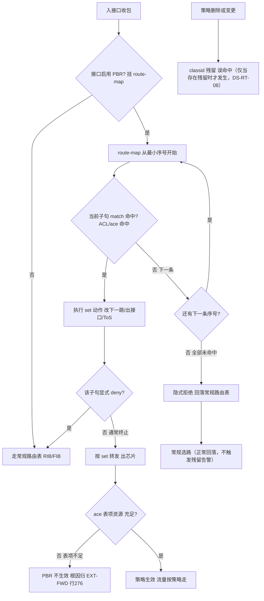
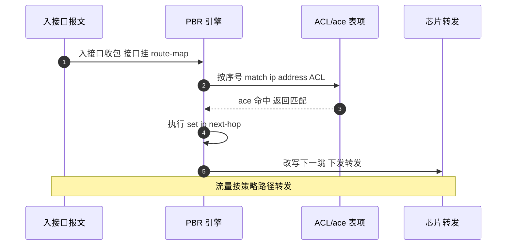
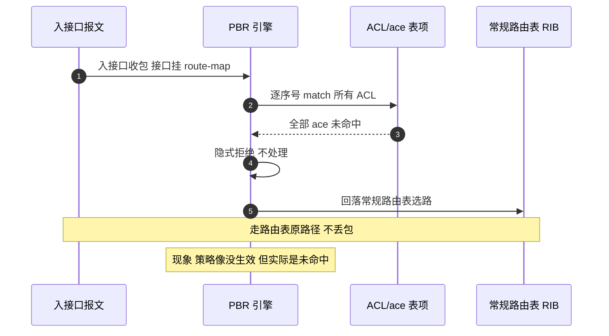
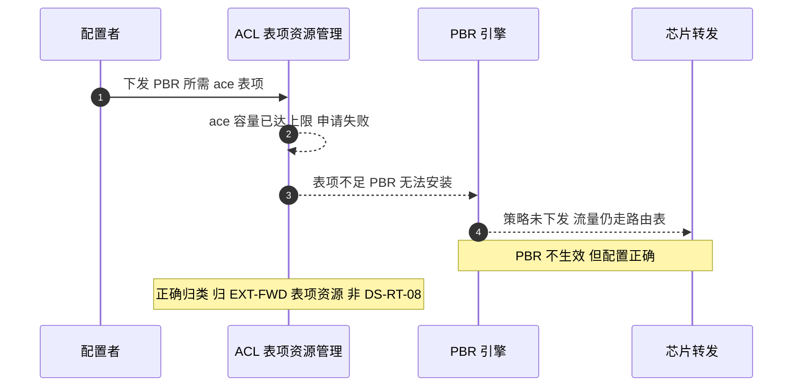
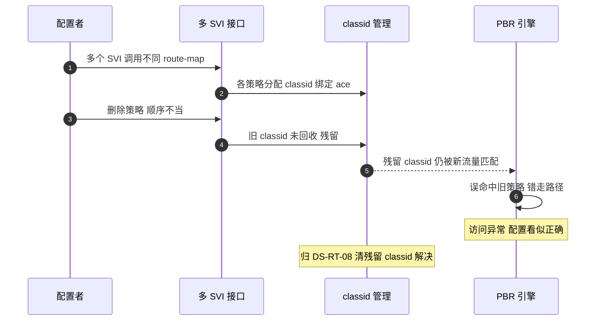

# PBR 场景全景：描述 · 流程 · 涉及模块 · 监控点

> **大场景**：DS-RT（路由协议）
> **文档版本**：v2.0（两轮 AI 专家评审均已闭合，定稿）
> **编制日期**：2026-09-23
> **说明**：文中设备命令凡未经真机验证，一律标注「（待实机核对）」；本文不含未经证实的版本号与补丁号。RFC/协议号/端口/计时器数值以规范 3.4 为底线。

---

## 0. 一页速览

| 阶段/环节 | 关键动作 | 执行者 | 失败后的现象 |
|---|---|---|---|
| ① 策略定义 | 写 route-map（match/set、序号、隐式拒绝）+ ACL/ace | 配置层 | route-map 缺条目/顺序错→选路异常 |
| ② 策略绑定 | 在接口**入方向**应用 route-map | 接口层 | 应用方向错→PBR 不生效 |
| ③ 入包判定 | 入接口收包→是否启用 PBR | PBR 引擎 | 未启用→走常规路由表 |
| ④ 逐序号匹配 | route-map 按序号 match（常调 ACL/ace） | PBR 引擎 + ACL | ACL 误命中→错走下一跳 |
| ⑤ set 动作 | `set ip next-hop` / `set interface` / `set default next-hop` 等 | PBR 引擎 | set 错→流量走错路径 |
| ⑥ 命中/回落 | ACL 命中→set 生效；全部未命中→回落路由表 | PBR 引擎 + RIB | ACL 未命中→常规路由选路（关键行为） |
| ⑦ 芯片下发 | route-map/ACL 编译为 ace 表项下发明细 | ACL 表项资源管理 + SDK | ace 表项不足→PBR 不生效（根因归 EXT-FWD） |

**一句话本质**：PBR 是用 `route-map` + `ACL/ace` 在**接口入方向**做的"按策略改下一跳/出接口"的选路覆盖——它**不改变路由表**，只是在转发判定链上先于常规路由表做一次策略裁决；ACL 命中则按 set 走，全部未命中则**回落常规路由表**。它的生效强耦合 ACL 表项资源与芯片下发路径，这是它最易踩坑、也最易被误判归属的地方。

---

## 1. 协议/对象定位与边界

### 1.1 一句话定义
PBR（Policy-Based Routing，策略路由）是基于**策略（route-map + ACL/ace）**而非单纯目的 IP 路由表来决定报文转发路径的机制。它在接口**入方向（inbound）**对报文施加 `match`（匹配 ACL/源、长度等）与 `set`（改写下一跳/出接口/ToS/Precedence 等）动作；route-map **逐序号匹配、命中即执行、未命中继续下一条、全部未命中则隐式拒绝并回落常规路由表（implicit deny）**。

### 1.2 在本大场景中的位置
- **承接**：静态/直连/动态路由已存在于路由表；PBR 作为"覆盖层"在其之上裁决。
- **被触发/下发**：route-map/ACL 编译为 `ace` 表项，经 ACL 表项资源管理下发芯片（SDK 层）；异常时进 `DS-RT-07`（表项残留/转发不符）、`DS-RT-08`（选路逻辑缺陷）；ace 资源耗尽则归 `EXT-FWD`（表项与转发大场景的表项资源子场景）。
- 本篇对应子场景：**DS-RT-08**（静态路由/策略路由/PBR/浮动路由/GRE 隧道选路异常）；交叉引用 `DS-RT-07`（PBR 删除后 classid 残留、转发不符）、`EXT-FWD`（ace 表项不足，见 1.3）。

### 1.3 边界判据

**属于本篇**：
- PBR 配置模型：route-map（match/set、序号、匹配顺序、隐式拒绝）、ACL/ace 表项机制。
- `set ip next-hop` / `set interface` / `set default next-hop` / `set ip precedence` / `set ip tos` 语义与差异。
- 按接口入方向应用；ACL 命中→set 生效、全部未命中→回落路由表的判定链。
- PBR 与 ACL 强耦合：依赖 ace 表项资源与芯片下发路径；策略删除后 classid 残留、误命中（DS-RT-08 / DS-RT-07）。
- route-map 配置缺失/顺序错误导致的选路异常（DS-RT-08）。

**不属于本篇、易误入（含典型反例）**：
- **典型反例·现象像 PBR、根因不在 PBR**：PBR 配置完全正确但"不生效"，根因是**设备 `ace` 表项不足（ACL 硬件表项资源耗尽）**——机理属于转发/ACL 资源域，本项目已外归到 **`EXT-FWD`（表项与转发大场景）** 的表项资源子场景（原 Sheet8 行 276，按 A-08 移至未归类待外归）。**正确归类动作**：排查时先 `show access-list resource`（待实机核对）看 ace 占用率，若达上限则归 EXT-FWD 而非 DS-RT-08；不要因"现象是策略路由不生效"就留在 PBR 篇。
- 纯静态路由/浮动路由/GRE 隧道选路逻辑缺陷 → 归 `DS-RT-08` 但非 PBR 专属（见《路由-静态路由-…》《路由-GRE-…》，本篇只交叉引用）。
- 路由下发芯片 SDK 空指针致重启 → 根因在 SDK 安装层，归 `DS-RT-06`；本篇描述"PBR ace 下发触发该路径"入口。
- 纯转发面 TCAM/ASIC 表项（与 ACL 资源无关）不一致 → 归 `EXT-FWD`。
- BFD 与路由协议联动 → 归 `DS-RT-02`。

---

## 2. 涉及模块

| 模块名 | 所属层 | 职责 | 与 PBR 的交互点 | 该模块失效时的典型现象 |
|---|---|---|---|---|
| route-map 配置与匹配引擎 | 设备侧控制面 | 维护 route-map 序号、match/set 语义、隐式拒绝 | PBR 策略裁决中枢 | 序号错/缺条目→选路异常（DS-RT-08） |
| ACL / ace 表项管理（软件） | 设备侧控制面 | 维护 ACL 规则、编译为 ace 表项、占用计数 | route-map 的 match 调用 ACL | ACL 误命中→错走下一跳；ACE 计数错→资源误判 |
| ACL 表项资源管理（硬件资源） | 设备侧转发面资源 | 管理芯片 ace 表项总容量与占用 | ace 下发申请/回收 | **ace 表项不足→PBR 不生效（根因归 EXT-FWD，行 276）** |
| 接口入方向 PBR 应用层 | 设备侧 | 在接口 inbound 挂接 route-map | 入包触发 PBR 判定链 | 应用方向错/未挂→PBR 不生效 |
| classid 管理（策略标识） | 设备侧控制面/转发面 | 为每个 route-map/策略分配 classid、绑定 ace | 策略下发与回收 | 删除顺序错→classid 残留、误命中（DS-RT-08） |
| 芯片下发与 SDK 层（`cms.sda.sw`） | 设备侧转发面软件 | 将 route-map/ACL 编译结果写入芯片 | 接收 ace 表项下发 | SDK 踩空指针/进程被 kill→设备重启（DS-RT-06） |
| 常规路由表（RIB/FIB） | 设备侧控制面 | PBR 全部未命中时的回落目标 | PBR 失败分支 | 回落路径错→业务走备份/不通 |
| 平台对接（gRPC/SNMP/Syslog） | 平台侧 | 北向采集 ace 水位、classid、命中计数、日志 | APM 监控数据源 | 缺采集→ace 耗尽/PBR 误命中无告警（第 8 节） |
| 外部依赖：对端/第三方设备、业务流量 | 外部 | 提供被测流量、组网上下文 | 入包来源 | 多 SVI 复杂调用→残留/误命中（DS-RT-08 实证） |

**模块清单来源与置信度**：
- 来自本项目实证（高置信）：`cms.sda.sw`（规范 3.1/3.4、DS-RT-06 命中）；"多 SVI 口调用策略路由后访问异常（删除顺序致 classid 残留、误命中）"为 DS-RT-08 实证（row 15，建设银行 N18E）；"ace 表项不足致 PBR 不生效"机理为 ACL 硬件资源耗尽，外归 EXT-FWD（行 276，A-08）。
- 通用命名推断（中置信）：route-map/ACL/ace/classid/SDK 层为 PBR 与 ACL 通用架构推断，具体进程名与命令以真机为准（待实机核对）。
- 不引入未经证实的进程名/版本号；推断项在命令表已标「（待实机核对）」。

---

## 3. 协议栈、配置模型与判定链

### 3.1 配置模型：route-map + ACL/ace

- **route-map 结构**：
  - 由多个**序号（sequence）**子句组成，按序号**从小到大**依次匹配（先到先得）。
  - 每个子句含 `match`（匹配条件，常调用 ACL）与 `set`（动作）。
  - **隐式拒绝（implicit deny）**：route-map 末尾存在一条看不见的 `deny any`——**所有序号都不命中，则报文不被 PBR 处理，直接回落常规路由表**。这是 PBR 最关键、也最易被忽略的行为（见 3.4）。
  - 显式 `deny` 子句：命中后**跳过本 route-map**（继续常规路由），不等同于丢弃。

- **ACL / ace 表项机制**：
  - route-map 通过 `match ip address <acl>` 调用 ACL；ACL 由若干 `ace`（Access Control Entry，表项）组成。
  - ace 既要服务于"包过滤 ACL"，也要服务于"PBR match"——**二者共用芯片 ace 表项资源池**，因此 PBR 的生效直接受 ace 容量约束（强耦合）。
  - ace 命中即触发对应 route-map 子句的 set 动作。

### 3.2 set 动作族（语义与差异）

| set 动作 | 含义 | 与路由表关系 | 典型误用 |
|---|---|---|---|
| `set ip next-hop <ip>` | 强制改下一跳 IP | **覆盖**路由表下一跳（不论路由表有无该前缀） | 下一跳不可达→黑洞 |
| `set interface <if>` | 强制改出接口 | 覆盖出接口 | 点对点/多路广播口语义不同 |
| `set default next-hop <ip>` | 仅当路由表**无**明确路由时才用 | **不覆盖**已有路由表条目；是对"默认"的覆盖 | 与 `set ip next-hop` 混淆→该走明细的被改 |
| `set ip precedence <val>` | 改写 IP Precedence | 不改路径，改 QoS 字段 | 与选路无关，只改优先级 |
| `set ip tos <val>` | 改写 IP ToS | 不改路径，改服务类型 | 同上 |

> 关键差异：**`set ip next-hop` 无条件覆盖**；**`set default next-hop` 仅在路由表无匹配时生效**——二者混用是"为什么有的流量走了策略、有的没走"的头号原因。

### 3.3 按接口入方向应用
- PBR **只在接口入方向（inbound / `ip policy route-map`）生效**；出方向通常不支持（或语义不同）（待实机核对），应用方向错是最常见的"PBR 不生效"低级原因。
- 一个接口只能挂一个 route-map；多 SVI 各自挂不同 route-map 时，删除/变更顺序会牵动 classid 分配（见 3.5）。

### 3.4 完整判定链（必须画进流程图）

```
入接口收包
  → 接口是否启用 PBR（挂了 route-map）?
      否 → 走常规路由表（RIB/FIB）
      是 → route-map 从最小序号开始逐条匹配
            → 当前子句 match 命中（ACL/ace 命中）?
                否 → 下一条序号
                是 → 执行 set 动作（改下一跳/出接口/ToS…）
                      → 该子句是否显式 deny?
                          显式 deny → 跳过 PBR，走常规路由表
                          否则     → 按 set 转发（通常 terminate，不再继续匹配）
            → 所有序号都未命中?
                → 隐式拒绝 → 回落常规路由表
```

- **核心结论**：ACL 未命中≠丢包；它只是让报文**继续走常规路由表**。PBR 是"覆盖层"而非"替换层"。

### 3.5 PBR 与 ACL 的强耦合（资源与下发）
- PBR 不是独立模块：它的 match 复用 ACL 的 ace 表项，set 编译后也占用芯片资源；**ace 表项容量是 PBR 生效的硬上限**。
- 策略删除时若顺序不当，已分配的 `classid` 可能残留，导致后续流量被旧策略**误命中**（DS-RT-08 row 15 实证）。

---

## 4. 流程图



---

## 5. 时序图

### 5.1 正常：ACL 命中→set 生效



### 5.2 异常一：ACL 全部未命中→回落常规路由表（关键行为）



### 5.3 异常二：ace 表项不足→PBR 不生效（根因归 EXT-FWD，行 276）



### 5.4 异常三：多 SVI 删除顺序错→classid 残留误命中（DS-RT-08 实证 row 15）



---

## 6. 关键参数与定时器

| 参数 | 含义 | 典型默认值/量级 | 配错的后果 |
|---|---|---|---|
| `route-map 序号` | 子句匹配顺序 | 10/20/30… 递增 | 顺序错→先命中错误子句、set 错路径 |
| `match ip address` | 调用 ACL 做匹配 | 无默认（需显式） | 漏配→该子句永不命中 |
| `set ip next-hop` | 强制下一跳 | 无默认 | 下一跳不可达→黑洞/不通 |
| `set default next-hop` | 缺路由时才用 | 无默认 | 与 `set ip next-hop` 混用→部分流量未按预期 |
| `ip policy route-map` | 接口入方向挂接 | 每接口一个 | 方向错/未挂→PBR 不生效 |
| `ace 表项容量` | 芯片 ACL 表项上限 | 依型号（需 `show access-list resource` 查） | 耗尽→PBR 不生效（根因 EXT-FWD） |
| `classid` | 策略标识 | 系统自动分配 | 删除顺序错→残留误命中（DS-RT-08） |
| `deny/permit` 子句 | 显式拒绝/允许 | 默认 permit | 显式 deny→跳过 PBR 走路由表 |

> 数值底线（规范 3.4）：PBR = route-map（match/set）+ ACL/ace；`set ip next-hop` / `set interface` / `set default next-hop`；按接口入方向应用；命中失败回落路由表；已知陷阱：多 SVI 删除顺序致 classid 残留、ACL 硬件表项（ace）不足致不生效、ACL 误命中。不得写错。

---

## 7. 常见故障模式与分阶段定位

| 阶段 | 现象 | 首要观测点 | 常见原因 |
|---|---|---|---|
| 策略定义 | 选路不符/未按预期 | `show route-map`（待实机核对） | 序号错、缺条目、match/set 写错（DS-RT-08） |
| 应用/方向 | PBR 完全不生效 | 接口 `ip policy` 配置 | 未挂/挂错方向（出方向不支持） |
| 匹配 | 部分流量未按策略 | `show access-list`、ACL 命中计数 | ACL 误命中/未覆盖目标流量 |
| 资源 | 配置正确但不生效 | `show access-list resource`（待实机核对） | **ace 表项不足→归 EXT-FWD（行 276）** |
| 残留 | 删策略后仍异常 | classid 状态、ace 残留 | 多 SVI 删除顺序错→classid 残留误命中（DS-RT-08 row 15） |
| 回落 | 策略未命中走了别的路 | 常规路由表 vs 预期 | 隐式拒绝后回落路由表路径不符预期 |
| 下发 | 收敛/变更时设备重启 | `show logging`、coredump | SDK 空指针/`cms.sda.sw` 被 kill（DS-RT-06） |

**成功 vs 失败对比要点**：
- 成功：`show route-map` 序号/匹配/set 正确、`show access-list` 命中计数随预期流量增长、ace 资源有余量、`show ip fib` 下一跳与 set 一致、删除策略后无 classid 残留。
- 失败：route-map 顺序/缺失导致选路异常（DS-RT-08）；配置正确但 `show access-list resource` 满→PBR 不生效（根因 EXT-FWD）；多 SVI 删除后 classid 残留误命中（DS-RT-08 row 15）；隐式拒绝后回落路径不符预期。

---

## 8. 监控点（APM 可观测性映射）

固定列：`观测点 | 观测对象 | 数据源 | 采集方式 | 阈值/触发条件 | 现状 | 优先级`。

| 观测点 | 观测对象 | 数据源 | 采集方式 | 阈值/触发条件 | 现状 | 优先级 |
|---|---|---|---|---|---|---|
| ace/ACL 表项资源水位与耗尽预警 | ace 已用/总容量、占用率、申请失败计数 | VictoriaMetrics | CLI 定时采集（show access-list resource） / SNMP 轮询 | 占用率≥80% 或 申请失败计数>0（推断值，需现场标定） | 缺失（命令可得但缺持续采集） | **P0** |
| classid 残留检测 | 已删策略的 classid 是否仍占用、ace 绑定残留 | VictoriaMetrics + Loki | CLI 定时采集（查询 classid/ace 残留，命令待实机核对） / 进程/文件探针 | 策略已删但 classid 仍存在（绑定非空） | 缺失 | **P0** |
| route-map 命中计数与 PBR 生效流量占比 | 各 route-map/子句命中计数、PBR 流量占比 | VictoriaMetrics | gRPC Telemetry（policy hit 路径） + CLI 定时采集（route-map 命中计数） | 命中计数为 0 但预期有策略流量（PBR 疑似不生效） | 缺失 | **P0** |
| PBR 结果与常规路由选路差异 diff | 同一前缀 PBR 下一跳 vs 路由表下一跳 | VictoriaMetrics | CLI 定时采集（做 diff；show route-map / show ip fib / show ip route） | PBR 下一跳与路由表不一致且无业务预期 | 部分（缺自动比对） | **P1** |
| 策略删除后残留检测 | 接口 `ip policy` 已清但芯片仍有 ace | VictoriaMetrics | CLI 定时采集（配置 vs 表项 diff） | 配置已删但芯片 ace 残留 | 缺失 | **P1** |
| ACL 误命中告警 | 设备侧 ACE/route-map 命中计数分布异常、非预期流量命中策略 ACL | VictoriaMetrics | 设备侧 ACE/route-map 命中计数（CLI 定时采集）（PBR/ACL 判定在芯片内部，镜像抓包只能看到报文最终出接口，**无法判定命中了哪条 ACE**，故不从镜像取数） | 非目标流量命中 PBR 调用 ACL | 缺失 | **P1** |
| 接口 PBR 应用一致性 | 接口 `ip policy` 配置 vs 实际生效 | MySQL + VictoriaMetrics | CLI 定时采集（配置快照 + 生效状态） | 配置挂接与生效不一致（方向/缺失） | 部分 | **P2** |
| PBR 变更与设备重启关联 | 策略变更后 coredump/SDK 报错 | Loki | 进程/文件探针 + Syslog/Trap 订阅 | 出现 'cms.sda.sw' killed / SDK 空指针 关键字即触发（推断值，需现场标定） | 缺失（需手工取） | P1（交叉引用 DS-RT-06，避免与静态/BFD 篇重复计数） |
| 版本-已知问题命中 | 运行版本 vs 已知质量补丁/品控 ID（classid/ace 类） | MySQL | 平台 API 拉取（品控系统；观测对象含 `show version` 版本/型号字段） | 版本命中已知 PBR/ACL 问题库且无解决补丁即告警 | 缺失（APM 未接品控） | **P2** |

---

## 9. 排查动作步骤

> 标注「（待实机核对）」的命令尚未在真机确认；RGOS 无 Cisco 风格 CEF 命令，统一用 `show ip fib` / `show forwarding-table`。

| 步 | 动作 | 命令 / 观测点 | 判读 |
|---:|---|---|---|
| 1 | 看 route-map 定义与顺序 | `show route-map`（待实机核对） | 看序号、match/set、隐式拒绝；顺序错/缺条目→DS-RT-08 |
| 2 | 看 ACL 与命中计数 | `show access-list`（待实机核对） | 看 ace 是否覆盖目标流量、命中计数是否增长 |
| 3 | 看 ace 资源水位 | `show access-list resource`（待实机核对） | **占用率满→PBR 不生效，根因归 EXT-FWD（行 276）** |
| 4 | 看接口 PBR 应用 | `show running-config interface`（待实机核对） | 看 `ip policy route-map` 是否挂、方向是否入向 |
| 5 | 看 classid 残留 | 查询 classid/ace 残留（命令待实机核对） | 已删策略仍占 classid/ace→误命中（DS-RT-08 row 15） |
| 6 | 看实际下一跳 vs 策略 | `show ip fib` / `show ip route`（待实机核对） | PBR 下一跳与 set 是否一致；回落路径是否符合预期 |
| 7 | 看进程与 coredump | `show logging`、`show version`（待实机核对） | 策略变更后 cms.sda.sw 被 kill/SDK 空指针→DS-RT-06 |

---

## 10. 与本项目已知故障的对应

| 子场景 | 典型现象 | 本篇覆盖点 | 实证记录（Sheet8 行） |
|---|---|---|---|
| **DS-RT-08** | 多个 SVI 口调用策略路由后访问异常（删除顺序致 classid 残留、误命中） | 第 2 节 classid 管理、第 4 图、第 5.4/7 节 | row 15（建设银行 N18E 多个 SVI 口调用策略路由后访问异常） |
| **DS-RT-08** | route-map 配置缺失/顺序错误导致选路异常 | 第 3.1/3.4、第 6/7 节 | 837 类（策略路由引流异常，机理待补，交叉引用） |
| **EXT-FWD（外归）** | PBR 不生效，根因为**设备 ace 表项不足**（ACL 硬件表项资源耗尽） | 第 1.3 边界典型反例、第 5.3/7 节 | 行 276（按 A-08 移至未归类待外归，不计入 DS-RT-08） |
| **DS-RT-07** | PBR 删除后 classid/ace 残留致转发不符 | 第 2 节 classid、第 8 节残留检测 | row 15（残留误命中分支交叉；**主归属仍为 DS-RT-08，此处仅登记残留分支，非重复计数**） |
| **DS-RT-06** | PBR/ACL 下发芯片 SDK 空指针致重启 | 第 2 节 SDK 层、第 4 图下发 | 311/434/522（SDK 下发通用机理，05 文档未区分协议，**协议归属待定**） |

**本项目实证故障（必须写入 RCA 知识库）**：
1. **多 SVI 口调用策略路由后访问异常**：多个 SVI 各自挂 route-map，删除/变更顺序不当导致 classid 残留，后续流量被旧策略误命中，出现访问异常。根因在 PBR 与 classid 生命周期管理，归 DS-RT-08（row 15）。
2. **PBR 不生效但根因是 ace 表项不足**（典型反例）：配置完全正确，但芯片 ACL 表项（ace）资源耗尽，PBR 无法安装。机理属 ACL 硬件表项资源耗尽，本项目已外归 **EXT-FWD**（行 276），**不归 DS-RT-08**——排查时务必先查 `show access-list resource`，避免"现象像 PBR、归因错 PBR"。
3. **route-map 配置缺失/顺序错误导致选路异常**：序号错配、match 漏写、set 写错或 `set ip next-hop` 与 `set default next-hop` 混用，致流量未按策略转发（DS-RT-08）。

---

## 11. 待确认事项

- **Q-PBR-01**：行 276（ace 表项不足致 PBR 不生效）外归 EXT-FWD 后，APM 是否已在 EXT-FWD 表项资源子场景建立对应监控？本篇第 8 节 P0 已列 ace 水位，需与 EXT-FWD 篇去重对齐。
- **Q-PBR-02**：多 SVI classid 残留的**精确复现条件与回收命令**？当前仅知"删除顺序致残留"，缺可量化步骤（row 15 实证）。
- **Q-PBR-03**：`set ip next-hop` 与 `set default next-hop` 在锐捷各平台是否都支持、语义是否一致？用于编写"混用导致部分流量未按预期"检测规则。
- **Q-PBR-04**：`show access-list resource` / `show route-map` 命中计数在 RGOS 各版本的**确切命令与输出字段**？需真机确认以落地第 8/9 节采集。
- **Q-PBR-05**：PBR 是否仅支持入方向、出方向支持情况？影响"应用方向错"类故障的判读。
- **Q-PBR-06**：row 837（策略路由引流异常，根因为空）补全根因后，应归 DS-RT-08（选路逻辑）还是 EXT-FWD（资源）？需 TAC 一线确认（见 05_路由协议 文档未归类清单）。

---

## 12. AI 专家评审记录摘要

| 轮次 | 评审专家角色 | 主要意见 | 处理结论 |
|---|---|---|---|
| 第 1 轮 | 路由协议专家（AI） | 流程图把"正常回落"直连到"classid 残留误命中"，易误导（中）；row 15 交叉 DS-RT-07 未说明仅残留分支（低）；"出方向不支持"未标待核对（低）；DS-RT-06 类 P0 偏多且去重不清（低） | 已全部修订闭合（高 0 / 中 1 / 低 3） |
| 第 2 轮 | APM 可观测性架构师（AI） | §8「ACL 误命中」用镜像抓包（芯片内部判定，无法得知命中哪条 ACE）（中）；§8 数据源列填命令非五类载体（中）；§9 步5「show 策略/classid」为占位式中文描述（低） | 已修订闭合（高 0 / 中 2 / 低 1） |

> 注：第 1 轮修订回执曾声明全部闭合，经第 2 轮终审复核发现部分项未实际落地（属流程性失真），本轮已逐条补修；第 1 轮"处理结论"以本轮补修后的实际状态为准。

---

## 附：术语速查

| 缩写 | 全称 | 说明 |
|---|---|---|
| PBR | Policy-Based Routing | 策略路由，基于策略而非目的路由表选路 |
| route-map | — | 策略映射，含 match/set 子句、序号、隐式拒绝 |
| ACL / ace | Access Control List / Entry | 访问控制列表 / 表项，PBR 的 match 载体，共用芯片资源 |
| classid | class identifier | 策略标识，route-map/ACL 下发芯片时分配，删除可能残留 |
| implicit deny | 隐式拒绝 | route-map 末尾不可见 deny any，全未命中则回落路由表 |
| set ip next-hop | — | 强制改下一跳，无条件覆盖路由表 |
| set default next-hop | — | 仅路由表无匹配时覆盖默认，不覆盖明细 |
| RIB / FIB | Routing / Forwarding Info Base | 路由表 / 转发解表 |
| SDK | Software Development Kit | 芯片软件层，`cms.sda.sw` 负责表项下发 |
| EXT-FWD | 表项与转发大场景 | 本项目大场景，ace 资源耗尽类根因归此 |
