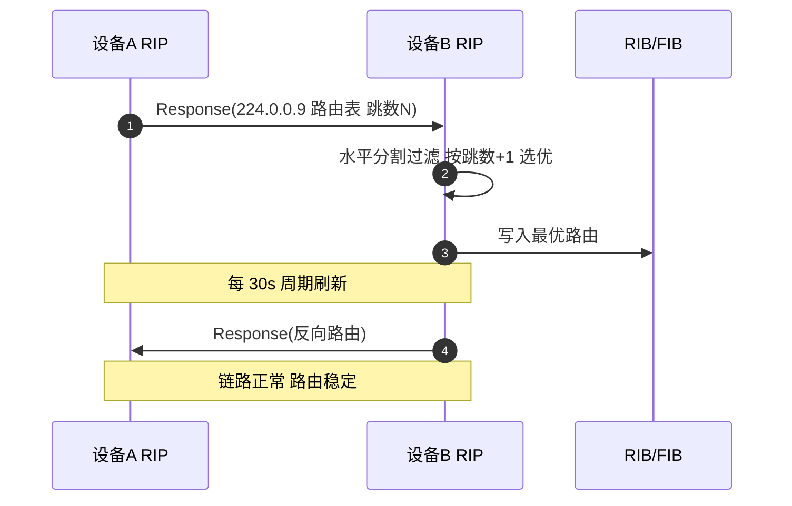
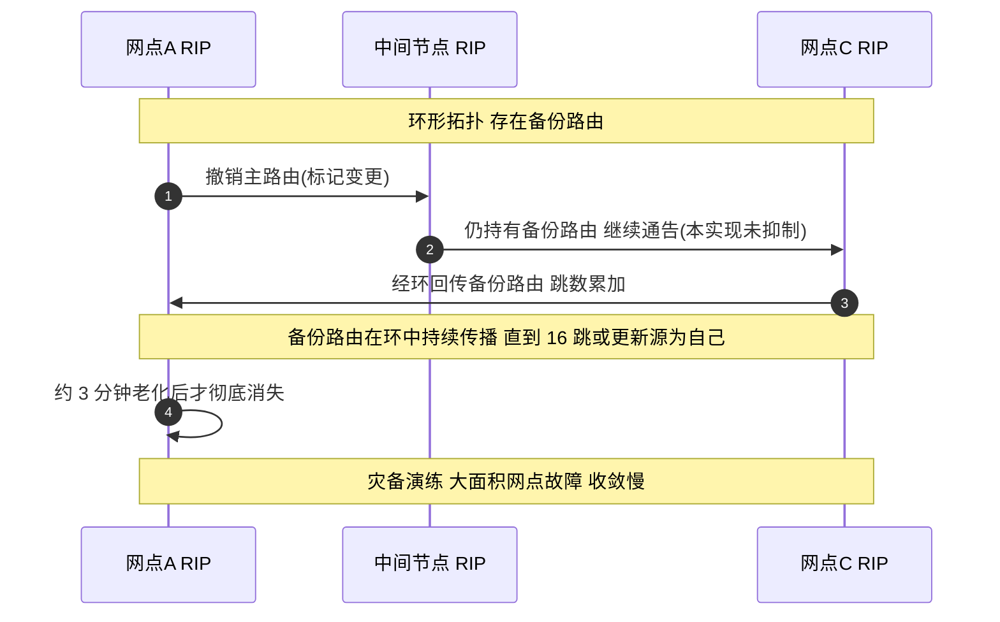
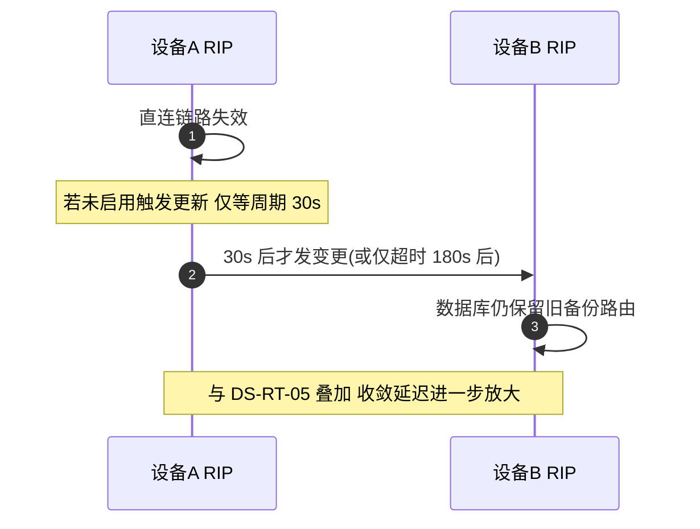

# RIP 场景全景：描述 · 流程 · 涉及模块 · 监控点

> **大场景**：DS-RT（路由协议）
> **文档版本**：v2.0（两轮 AI 专家评审均已闭合，定稿）
> **编制日期**：2026-09-23
> **说明**：文中设备命令凡未经真机验证，一律标注「（待实机核对）」；本文不含未经证实的版本号与补丁号。RIP 技术事实底线以 RFC 2453、RFC 2080 为准。本篇核心是 `DS-RT-05` 的"无抑制计时器+备份路由残留"慢收敛实证。

---

## 0. 一页速览

| 阶段 | 关键动作 | 执行者 | 失败后的现象 |
|---|---|---|---|
| ① 周期更新 | 每 30s 向 224.0.0.9 发完整/增量路由表 | RIP 进程 | 更新源故障→路由不刷新 |
| ② 邻居学习 | 收邻居更新，按跳数选最优 | RIP 进程 | 学到次优/备份路由 |
| ③ 计时器驱动 | 超时/抑制/刷新倒计数 | RIP 进程 | 抑制缺失→坏路由继续传播 |
| ④ 触发更新 | 拓扑变立即发更新 | RIP 进程 | 未触发→收敛慢 |
| ⑤ 下发 RIB/FIB | 最优路由进表 | RIB/FIB | 表有转发错（DS-RT-07） |
| ⑥ 老化撤销 | 16 跳标记不可达、刷新删除 | RIP 进程 | **本实现无抑制+留备份→环形组网慢收敛（DS-RT-05）** |

**一句话本质**：RIP 是"跳数距离矢量"协议，靠周期广播和简单防环（水平分割/毒性逆转）工作；它的慢收敛在环形+备份路由拓扑里被放大——本实现未设计抑制计时器且数据库保留备份路由，被撤销的备份路由会一直传播直到 16 跳或更新源为自己，再经约 3 分钟老化才消失。

---

## 1. 协议/对象定位与边界

### 1.1 一句话定义

RIP（RFC 2453，RIPv2）是基于"跳数"的距离矢量路由协议，UDP 端口 520，组播 224.0.0.9，最大跳数 15、**16 表示不可达**；用于小型/简单网络。IPv6 版本为 RIPng（RFC 2080，UDP 521，ff02::9）。

### 1.2 在本大场景中的位置

- 承接：接口启用 RIP、network 宣告、计时器/认证/触发更新配置、BFD 联动（归 DS-RT-02）。
- 被触发：RIP 收敛异常（慢收敛、备份路由残留）进入 RCA；路由下发异常归 DS-RT-07。
- 对比锚点：与 OSPF/IS-IS 的链路状态快速收敛机制差异，是本篇第 7/8 节重点。

### 1.3 边界判据

**属于本篇**：
- RIPv2 邻居建立（实际无显式建邻，靠收更新）、路由学习/通告。
- 计时器（更新 30s/超时 180s/抑制 120s/刷新）、水平分割、毒性逆转、触发更新、认证。
- 环形+备份路由组网下的慢收敛（DS-RT-05，本实现无抑制计时器+备份路由残留）。
- RIPng（IPv6 距离矢量）。

**不属于本篇、易误入**：
- OSPF/IS-IS 收敛问题 → 各自篇章（DS-RT-03/04 等）。
- 静态/PBR/GRE 选路 → DS-RT-08。
- 纯转发面 RIB/FIB 不一致（非 RIP 机理）→ DS-RT-07（但 RIP 路由同样会触发，本篇引用）。
- BFD 会话自身震荡 → DS-RT-02（交叉引用）。

---

## 2. 涉及模块

| 模块名 | 所属层 | 职责 | 与协议的交互点 | 该模块失效时的典型现象 |
|---|---|---|---|---|
| `rip` 协议进程 | 设备侧进程 | 维护路由数据库、计时器、收发更新、防环 | 每 30s 组播更新、处理路由数据库（路由表项）条目 | 进程退出→路由老化消失；**本实现保留备份路由致残留** |
| 计时器管理 | 设备侧协议支撑 | 更新/超时/抑制/刷新倒计数 | 驱动路由撤销与刷新 | **抑制计时器未实现→坏路由继续传播（DS-RT-05）** |
| 防环逻辑 | 设备侧协议支撑 | 水平分割、毒性逆转 | 出接口抑制/反转 | 关水平分割→环路 |
| RIB 管理 | 设备侧控制面 | 汇总选优、下发 | 收 RIP 路由按 AD 选 | 选路错、备份路由优先 |
| FIB/SDK 下发 | 设备侧转发面 | 写芯片 v4 路由 | 接收 RIB 下发 | 表有转发错（DS-RT-07） |
| 邻接/套接字 | 设备侧 | UDP 520 收发、224.0.0.9 | 更新报文收发 | 组播被过滤→学不到路由 |
| 触发更新 | 设备侧协议 | 拓扑变立即通告 | 直连失效即发 | 未触发→收敛慢 |
| APM 采集代理 | 平台侧/设备侧 | 拉取数据库/状态 | CLI/gRPC/SNMP | 监控盲区 |

**模块清单来源与置信度**：`rip` 进程、计时器、防环、RIB/FIB、套接字均为通用命名，结合本项目 DS-RT-05（row=162）实证；"无抑制计时器+备份路由保留"为**本项目实证缺陷**（规范 3.4 明确：实现未设计抑制计时器且保留备份路由，环形组网下收敛慢）。FIB/SDK 模块 `cms.sda.sw` 来自规范 3.1。IS-IS 的 CB 卡 counter/FP 安装失败（row=293）不属本篇。

---

## 3. 协议栈、报文与接口

### 3.1 封装与基础属性

| 项 | RIPv2 值 | RIPng 值 |
|---|---|---|
| 承载 | UDP 520 | UDP 521 |
| 目的地址 | 224.0.0.9（组播） | ff02::9（组播） |
| 标准 | RFC 2453 | RFC 2080 |
| 最大跳数 | 15，16=不可达 | 同 |
| 认证 | 报文内（RIPv2 明文/MD5） | 用 IPv6 扩展头/AH（无内置简单认证） |

### 3.2 RIPv2 报文结构（命令 + 路由项）

| 字段 | 说明 |
|---|---|
| Command | 1=request，2=response |
| Version | 2 |
| AFI / 地址族 | IPv4 |
| 路由项（最多 25 条） | 目的 IP、掩码、下一跳、**跳数 metric** |
| 认证项 | 替代首条路由项，type=2（明文）/3（MD5） |

### 3.3 计时器（RFC 2453 基线）

| 计时器 | 默认 | 作用 | 配错后果 |
|---|---|---|---|
| 更新 Update | 30s | 周期发全部/部分路由 | 太短→带宽/CPU 风暴 |
| 超时 Timeout | 180s | 路由无刷新则标记无效 | 太短→误删有效路由 |
| 抑制 Holddown | 120s | 坏路由在抑制期内不更新 | **本实现未实现→DS-RT-05** |
| 刷新 Flush | 依实现（标准建议 240s，本项目规范未钉死） | 彻底删除路由 | 见 3.4 |

> 注：刷新计时器标准值常见 240s，本项目规范 3.4 仅列"刷新"未钉死数值，本文标注待实机核对。

### 3.4 防环机制

| 机制 | 作用 | 局限 |
|---|---|---|
| 水平分割 split-horizon | 不从入接口回传该路由 | 环形网仍可能经第三方绕回 |
| 毒性逆转 poison-reverse | 向源发 16 跳（不可达） | 增加更新量 |
| 触发更新 | 拓扑变立即通告 | 依赖实现开启 |
| 最大跳数 15 | 限制环路范围 | 牺牲大网络 |

### 3.5 RIPv1 有类路由局限（对比）

| 局限 | 说明 |
|---|---|
| 不携带子网掩码 | 仅有类（A/B/C），不支持 VLSM |
| 不支持认证 | 明文无保护 |
| 广播更新 | 255.255.255.255，无组播 |
| 不支持 CIDR 聚合 | 边界路由难聚合 |

---

## 4. 流程图

```mermaid
flowchart TD
    A["接口启用 RIP 并 network 宣告"] --> B["每 30s 组播 224.0.0.9 发送路由表"]
    B --> C{"邻居收到更新?"}
    C -->|否 "组播被过滤/认证错"| Z1["学不到路由 查 224.0.0.9/认证"]
    C -->|是| D["按跳数选最优 写入数据库"]
    D --> E["水平分割/毒性逆转防环"]
    E --> F{"拓扑变更?"}
    F -->|是 "触发更新开启"| G["立即发变更更新 加速收敛"]
    F -->|否| H["等待计时器老化"]
    H --> I{"路由被撤销?"}
    I -->|否| B
    I -->|是 "正常实现"| J["进抑制 120s 后刷新删除"]
    I -->|是 "本实现无抑制+留备份"| K["备份路由继续传播更新"]
    K --> L{"到达 16 跳 或 更新源为自己?"}
    L -->|否| K
    L -->|是| M["约 3 分钟老化后消失"]
    M --> N["收敛完成 但耗时数分钟"]
    N --> O["DS-RT-05 灾备演练大面积故障"]
```

---

## 5. 时序图

### 5.1 正常更新 + 路由学习



### 5.2 异常：环形+备份路由慢收敛（DS-RT-05 row=162）



### 5.3 异常：触发更新缺失放大慢收敛



---

## 6. 关键参数与定时器

| 参数 | 含义 | 典型默认值 | 配错的后果 |
|---|---|---|---|
| 更新周期 | 发更新间隔 | 30s | 太短→风暴；太长→收敛慢 |
| 超时 | 无刷新判无效 | 180s | 太短→误删 |
| 抑制 | 坏路由冻结期 | 120s（**本实现未实现**） | 缺失→坏路由继续传播 |
| 刷新 | 彻底删除 | 依实现（待实机核对） | 过短→抖动 |
| 最大跳数 | 15 可达/16 不可达 | 15 | 超 15 即不可达 |
| 水平分割 | 出接口抑制 | 默认开 | 关→环路风险 |
| 毒性逆转 | 发 16 跳 | 可选 | 关→防环弱 |
| 触发更新 | 拓扑变即告 | 默认开（依实现） | 关→收敛慢 |

---

## 7. 常见故障模式与分阶段定位

| 阶段 | 现象 | 首要观测点 | 常见原因 |
|---|---|---|---|
| 更新收发 | 学不到邻居路由 | 更新收发计数、224.0.0.9 可达 | 组播被过滤、认证不匹配 |
| 路由选择 | 选到次优/备份 | `show ip rip database`（待实机核对） | 备份路由保留（DS-RT-05） |
| 计时器 | 路由迟迟不消失 | 超时/刷新计时 | **无抑制计时器→坏路由残留（DS-RT-05）** |
| 收敛 | 拓扑变后数分钟才通 | 收敛耗时 | 环形+备份+无抑制（row=162） |
| 防环 | 路由环路/计数到 16 | 跳数分布 | 水平分割关、触发更新关 |
| 下发 | 表有转发错 | RIB vs FIB | DS-RT-07 |

**成功 vs 失败对比要点**：
- 成功：链路失效后触发更新立即通告、抑制计时器冻结坏路由、刷新后干净删除，收敛在秒级。
- 失败（本实现）：无抑制计时器 + 数据库保留备份路由 → 环形网中撤销的备份路由持续传播至 16 跳或更新源为自己，再经约 3 分钟老化，**收敛达数分钟**，灾备演练大面积故障（row=162）。与 Cisco/华三/华为实现（含抑制计时器）差异显著。

**横向对照：RIP 与 OSPF/IS-IS 收敛机制根本差异**

| 维度 | RIP（距离矢量） | OSPF/IS-IS（链路状态） |
|---|---|---|
| 路由信息 | 邻居告知"整张路由表" | 仅泛洪链路状态（LSA/LSP） |
| 计算范围 | 每张路由独立跳数累加 | 全网点同时跑 SPF（Dijkstra） |
| 触发传播 | 周期 30s + 触发更新 | 拓扑变立即泛洪 LSA/LSP |
| 防环 | 水平分割/毒性逆转/最大跳 | 链路状态天然无环 + 序列号/老化 |
| 收敛速度 | 慢（计时器驱动，秒~分钟） | 快（毫秒~秒级） |
| 抑制机制 | 抑制计时器（**本实现缺失**） | 无对应概念，靠 SPF 重算 |

**为什么 RIP 慢收敛在环形组网里被放大**：环形拓扑存在多条可达路径，备份路由经第三方节点绕回形成"环路传播"；正常情况下抑制计时器会冻结被撤销的坏路由、毒性逆转发 16 跳阻断；本实现两者都弱（无抑制+留备份），坏路由在环中反复累加跳数，直到封顶 16 跳或更新源识别为自己才停止，再叠加约 3 分钟老化——环形把"单点慢"放大成"全网大面积慢"。

---

## 8. 监控点（APM 可观测性映射）

> 固定列：`观测点 | 观测对象 | 数据源 | 采集方式 | 阈值/触发条件 | 现状 | 优先级`。

| 观测点 | 观测对象 | 数据源 | 采集方式 | 阈值/触发条件 | 现状 | 优先级 |
|---|---|---|---|---|---|---|
| RIP 邻居/更新源可达性与状态迁移 | 更新收发、邻居（更新源）消失 | VictoriaMetrics + Loki | gRPC Telemetry / CLI 定时采集 | 180s 内无更新源刷新即告警 | 缺失 | P0 |
| RIP 进程存活与重启 | `rip` 进程退出/coredump | Loki | Syslog/Trap 订阅 / 进程/文件探针 | 进程重启关键字即触发 | 缺失 | P0 |
| 备份路由残留与跳数异常 | 数据库中跳数接近 16、被撤销路由仍存在 | VictoriaMetrics | CLI 定时采集（show ip rip database） / gRPC Telemetry | 存在跳数≥15 或撤销后超 60s 仍存在的路由（DS-RT-05 指征；推断值，需现场标定） | 缺失 | P0 |
| 路由前缀数与变化速率 | RIP 路由前缀数量、增减速率 | VictoriaMetrics | gRPC Telemetry / CLI 定时采集 | 1 分钟变化>10%（推断值，需现场标定） | 部分 | P1 |
| 协议报文收发与错误计数 | UDP 520 收发、更新/请求计数 | VictoriaMetrics | SNMP 轮询 / CLI 定时采集 | 更新计数突降 0 或错误计数增长 | 缺失 | P1 |
| 收敛耗时 | 拓扑变更到路由稳定时长 | VictoriaMetrics + Loki | 设备侧 CLI 定时采集 + 事件日志（Loki） | 收敛耗时 >60s；环形 + 备份路由组网建议 >30s 即告警（推断阈值，待实机核对） | 缺失 | P1 |
| 规格水位（路由数） | RIP 路由表规模 | VictoriaMetrics | CLI 定时采集 / SNMP 轮询 | 路由数≥80% 规格（推断值，需现场标定） | 缺失 | P1 |
| RIB 与 FIB 一致性 | RIP 路由 RIB vs FIB diff | VictoriaMetrics | CLI 定时采集（show ip route vs show ip fib） | 同前缀 RIB 有 FIB 缺/出接口不一致 | 缺失 | P1 |
| 触发更新启用状态 | 触发更新配置/事件 | MySQL + Loki | CLI 定时采集（配置快照入 MySQL） + Syslog/Trap 订阅 | 拓扑变无触发更新事件 | 缺失 | P2 |

**P0 说明**：邻居更新源消失、进程重启、备份路由残留是 DS-RT-05 慢收敛最直接的三条可观测证据；其中"备份路由残留"是本实现独有缺陷的特异性指标。

---

## 9. 排查动作步骤

| 步 | 动作 | 命令 / 观测点 | 判读 |
|---:|---|---|---|
| 1 | 看 RIP 数据库 | `show ip rip database`（待实机核对） | 查备份路由与超时、是否残留 |
| 2 | 看路由表 | `show ip route rip`（待实机核对） | 确认路由表是否含被撤销路由 |
| 3 | 看计时器/更新 | `show ip rip`（待实机核对） | 查 update/timeout/holddown 配置 |
| 4 | 看邻接更新源 | 更新收发计数 | 更新源是否持续刷新 |
| 5 | 比对 RIB/FIB | `show ip route` vs `show ip fib`（待实机核对） | 表有转发错→DS-RT-07 |
| 6 | 拓扑核查 | 组网图（环形+备份） | 确认是否环形+备份路由（DS-RT-05 条件） |
| 7 | 规避/根治 | 断交叉线或升级版本 | 临时断开交叉线路，彻底升级版本 |

---

## 10. 与本项目已知故障的对应

| 子场景 | 机理 | 本篇覆盖点 | 实证记录 |
|---|---|---|---|
| `DS-RT-05` | RIP 收敛异常（无抑制计时器+备份路由残留） | 第 3/4/5/7/8/9 节 | row=162 广西工行百色&北海分行核心交换机 RIP 收敛异常，4G 灾备演练网点大面积故障 |
| `DS-RT-07` | RIB/FIB 不一致 | 第 7/8/9 节 | RIP 路由同样会触发表有转发错 |
| `DS-RT-02` | BFD 联动 | 第 1/2 节交叉引用 | RIP 可联动 BFD，归 BFD 篇统一处理 |
| `DS-RT-08` | 静态/PBR 选路 | 第 1 节边界 | RIP 与静态浮动主备场景可交叉；该交叉为机制推断，**无独立实测行**（05 文档 DS-RT-08 实证行为 10/15/60/106/390/470/574/813，无 RIP 专属行） |

> 注：`DS-RT-05` 本数据集仅 1 条样本（row=162），机理独特（无抑制计时器+备份路由残留），按 A-09 但书保留独立子场景，未与 OSPF 学习类假合并。

---

## 11. 待确认事项

- **Q-RIP-01**：本实现"无抑制计时器"是设计取舍还是缺陷？与 Cisco/华三/华为的抑制计时器实现差异的精确代码级原因？——问 RIP 研发。
- **Q-RIP-02**：刷新计时器在本实现的真实默认值（标准建议 240s）？影响"约 3 分钟老化"的精确量化？——问路由研发/TAC。
- **Q-RIP-03**：row=162 灾备演练的具体组网（几节点环、几处备份路由）与收敛耗时实测值？——问 TAC 一线补全样本。
- **Q-RIP-04**：是否有已发布版本修复该缺陷（无抑制+备份残留）？对应版本/补丁号？——问产品/质量（严禁本文编造版本号）。
- **Q-RIP-05**：本数据集 RIP 仅 1 条，是否需补充更多样本以支撑统计规律？——问数据治理。

---

## 12. AI 专家评审记录摘要

| 轮次 | 评审专家角色 | 主要意见 | 处理结论 |
|---|---|---|---|
| 第 1 轮 | 路由协议专家（AI） | "LSA 式路由条目"术语误用（RIP 为距离矢量，无 LSA）（低）；收敛阈值"更低"未量化（低）；刷新计时器数值来源需显式声明（低）；DS-RT-08 交叉缺实证锚点（低） | 已全部修订闭合（高 0 / 中 0 / 低 4） |
| 第 2 轮 | APM 可观测性架构师（AI） | §8 数据源列填观测对象/手段、未落五类载体（中）；§10 DS-RT-08 交叉仍无实证锚点（低）；§8 收敛耗时用"平台 API 拉取"不当（低） | 已修订闭合（高 0 / 中 1 / 低 2） |

> 注：第 1 轮修订回执曾声明全部闭合，经第 2 轮终审复核发现部分项未实际落地（属流程性失真），本轮已逐条补修；第 1 轮"处理结论"以本轮补修后的实际状态为准。

---

## 附：术语速查

| 缩写 | 全称 | 说明 |
|---|---|---|
| RIP | Routing Information Protocol | 距离矢量路由协议（RFC 2453） |
| RIPng | RIP next generation | IPv6 版（RFC 2080） |
| DV | Distance Vector | 距离矢量算法 |
| Holddown | — | 抑制计时器（本实现缺失） |
| Split-Horizon | — | 水平分割防环 |
| Poison Reverse | — | 毒性逆转（发 16 跳） |
| Metric | — | 跳数，最大 15，16=不可达 |
| Trigger Update | — | 触发更新加速收敛 |
| Flush | — | 刷新计时器彻底删除路由 |
| RIB/FIB | — | 路由表/转发表 |
