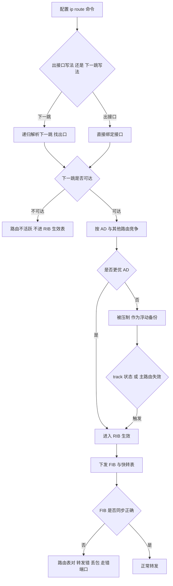
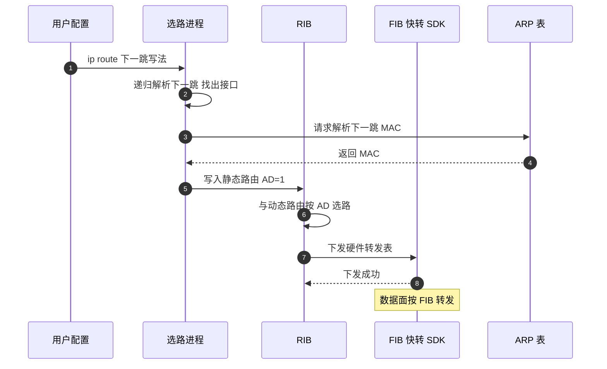
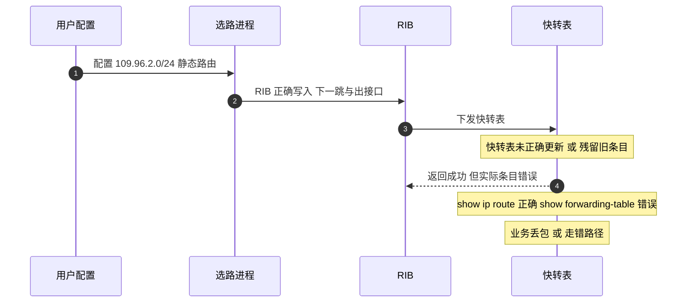
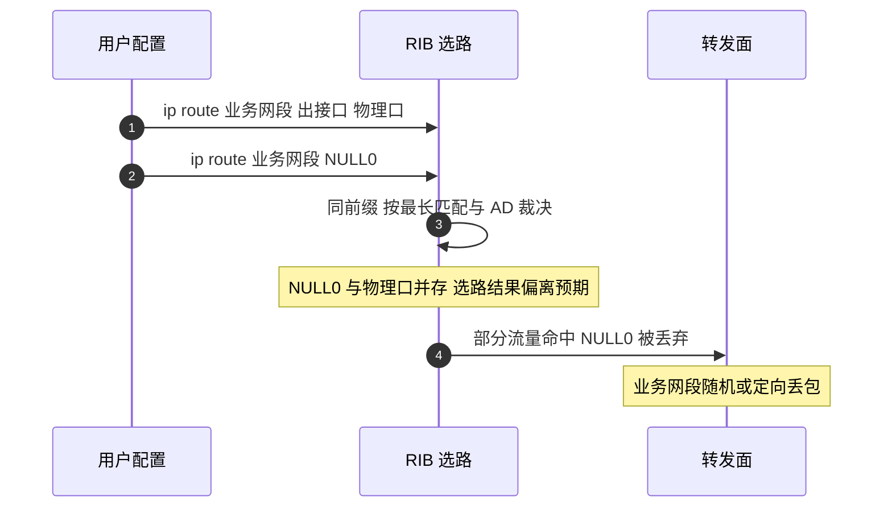

# 静态路由 场景全景：描述 · 流程 · 涉及模块 · 监控点

> **大场景**：DS-RT（路由协议）
> **文档版本**：v2.0（两轮 AI 专家评审均已闭合，定稿）
> **编制日期**：2026-09-23
> **说明**：文中设备命令凡未经真机验证，一律标注「（待实机核对）」；本文不含未经证实的版本号与补丁号。

---

## 0. 一页速览

| 阶段 | 环节 | 关键动作 | 执行者 | 失败后的现象 |
|---|---|---|---|---|
| ① 配置 | 下发静态路由 | `ip route` 写入配置，计算递归下一跳 | 用户 / 配置进程 | 命令语法错、递归不可达未进表 |
| ② 解析 | 下一跳解析 | 递归查找出接口 / ARP 解析 | 选路进程 / ARP | 下一跳不可达，路由不活跃 |
| ③ 加表 | RIB 生成 | 进入路由表，带 AD 参与选路 | 选路进程 | 被更优 AD 压制（浮动不生效） |
| ④ 下发 | FIB/快转下发 | 写芯片转发表 / 快转表 | RIB→FIB/SDK | 路由表对、转发错（残留/不一致） |
| ⑤ 联动 | track / 浮动 / NULL0 | track 探测、AD 主备、聚合防环 | 选路 / 探测进程 | track down 不消失、NULL0 抢业务 |
| ⑥ 转发 | 数据面命中 | 按 FIB/快转转发 | 芯片 / 快转 | 丢包、走错端口、环路 |

**一句话本质**：静态路由是「人工写死的路标」，它的问题 90% 不在"有没有写进去"，而在"写进去后转发面到底认不认、认的是不是这一条"。

---

## 1. 协议/对象定位与边界

### 1.1 一句话定义

静态路由是网络管理员手工下发的、无邻居交互、无算法计算的固定转发路径；它直接进 RIB，靠管理距离（AD）与动态路由竞争，靠出接口/下一跳写法决定递归方式与快转依赖。

### 1.2 在本大场景中的位置（承接什么、被什么触发）

- **承接**：用户配置、动态路由重分布引入、track 探测对象状态、GRE 隧道接口状态、浮动路由主备切换。
- **被触发**：PBR 命中失败后回落路由表（静态路由是回落候选）、GRE 隧道把静态路由的下一跳指向 Tunnel 接口、BFD 联动（静态路由本身不直接接 BFD，但 `track` 可桥接）。
- **与 DS-RT-07 的关系**：静态路由的 `permanent`、出接口写法等会直接导致"路由表正确但快转/FIB 不一致"的残留类故障，是 DS-RT-07 静态残留分支的主来源。

### 1.3 边界判据

**属于本篇：**

- `ip route` 的出接口写法 / 下一跳写法的语义差异与递归行为。
- 管理距离（AD）与浮动路由主备。
- `NULL0` 聚合防环。
- `permanent` 关键字与快转一致性。
- `track` 联动静态路由的生效/消失逻辑。
- 静态路由与动态路由互引（redistribute static）。
- 路由表正确但快转/FIB 不一致的静态残留类故障（DS-RT-07 静态分支）。

**不属于本篇、易误入：**

- PBR 策略路由选择 → 归《路由-PBR-协议全景与流程时序》。
- GRE 隧道封装与隧道路由 → 归《路由-GRE-协议全景与流程时序》。
- BFD 与路由协议联动震荡 → 归《路由-BFD-协议全景与流程时序》。
- 纯芯片 LPM 算法 bug / TCAM 表项（与静态路由无关）导致的不一致 → 归表项与转发大场景 EXT-FWD。
- 跨 VRF 互导路由未指定出接口走软转 → 归 DS-RT-07（已单列），但机制边界见本篇 1.2。

---

## 2. 涉及模块

| 模块名 | 所属层 | 职责 | 与协议交互点 | 该模块失效时典型现象 |
|---|---|---|---|---|
| 选路 / 策略进程（RIB 计算） | 设备侧控制面 | 维护 `ip route`、递归解析下一跳、按 AD 选路、生成 RIB | 接收配置、track 状态、动态重分布 | 路由不进表、浮动不切换、递归解析错 |
| RIB（路由信息库） | 设备侧控制面 | 统一存放所有协议路由，做选路仲裁 | 静态路由是 RIB 的一等公民 | RIB 与 FIB 不一致 |
| FIB / 快转 / SDK 下发 | 设备侧转发面 | 把 RIB 条目翻译成芯片转发表、快转表 | 静态路由出接口/下一跳直接决定硬件表项 | 路由表对、快转错、出接口残留 |
| 隧道接口驱动 | 设备侧控制面 | 管理 Tunnel 接口 up/down、封装状态 | 静态路由下一跳为 Tunnel 时的递归锚点 | 隧道 down 但静态路由仍在 |
| track 探测进程 | 设备侧控制面 | 周期探测目标可达性，联动路由增删 | `ip route ... track` 的生效判据 | track down 后路由不消失 |
| ARP / 邻居表 | 设备侧转发面 | 解析下一跳 MAC，支撑多路访问出接口写法 | 出接口写法在以太网上依赖 ARP | 硬件出接口与 ARP 不一致、走错端口 |
| 配置落盘（EMB） | 设备侧管理后端 | 配置持久化、回显 | `show running-config` 中静态路由呈现 | 配置丢失、重配恢复 |
| 平台对接（APM / UNC） | 平台侧 | 采集 RIB/FIB、下发配置 | 监控点数据源 | 缺持续采集导致无法自动比对 |

**模块清单来源与置信度**：

- 高置信（来自本项目工单/文档实证）：选路进程、RIB、FIB/快转/SDK 下发、ARP、`cms.sda.sw`（DS-RT-06 提及）、`permanent` 与快转不一致（row 120）、出接口与 ARP 不一致（row 38）、track down 不消失、修改 LP/shutdown 不失效（row 36）。
- 通用命名推断（行业通用，未在本项目单独点名）：隧道接口驱动、track 探测进程、配置落盘 EMB。这些机制在 RGOS 中存在，但本文按其通用语义描述，具体进程名以真机为准。

---

## 3. 协议栈、报文与接口

静态路由无独立报文（不跑邻居协议），它的"数据模型"是配置条目与 RIB 表项。

### 3.1 命令语义模型

```
ip route <前缀> <掩码> <下一跳|出接口> [管理距离] [permanent] [track <id>]
```

| 要素 | 含义 | 关键行为 |
|---|---|---|
| 下一跳 `<ip>` | 递归解析目标 | 需可被其他路由解析；依赖 ARP（多路访问）；形成递归查找链 |
| 出接口 `<if>` | 直接指定出口 | 点对点链路（PPP/串口）等价于直连，无需 ARP；以太网出接口单独写需对端开 proxy-ARP 或 ARP 该目的 |
| 管理距离 `[AD]` | 0~255，越小越优 | 同前缀不同 AD → 浮动主备；默认静态 AD=1 |
| `permanent` | 接口 down 也保留 | 路由始终在 RIB；但快转/FIB 是否同步以实现为准 |
| `track <id>` | 关联探测对象 | track up 才进表；track down 应撤出 |

### 3.2 出接口写法 vs 下一跳写法（核心差异）

| 维度 | 下一跳写法 | 出接口写法（点对点） | 出接口写法（多路访问） |
|---|---|---|---|
| 递归查找 | 需要，依赖另一条可达路由解析出接口 | 不需要，直接绑定 | 不需要，直接绑定 |
| 对 ARP 依赖 | 依赖（解析下一跳 MAC） | 不依赖 | 依赖（解析目的 IP MAC，需 proxy-ARP） |
| 快转依赖 | 下一跳表项 + ARP 表 | 接口直连表项 | 接口 + ARP |
| 特殊场景 | 点到点链路上下一跳常为对端接口 IP | 最稳，无递归无 ARP | 易出问题，需对端配合 |

**结论**：以太网等广播多路访问介质上，纯出接口写法比下一跳写法更易踩坑；推荐"出接口 + 下一跳"双写以同时锁定出口与递归。

### 3.3 表项结构（逻辑视图）

```
RIB 条目：前缀 / 掩码 / 下一跳 / 出接口 / AD / 来源(static) / 标志(permanent/track)
   ↓ 下发
FIB/快转条目：前缀 / 掩码 / 硬件出接口 / 下一跳 MAC / 老化
```

本项目的核心矛盾就在"RIB 条目正确，但 FIB/快转条目错误/残留/未更新"（DS-RT-07 静态分支）。

---

## 4. 流程图



---

## 5. 时序图

### 5.1 正常：静态路由加表与下发



### 5.2 异常一：路由表正确但快转表错误（row 120）



### 5.3 异常二：同时配置 NULL0 与物理接口导致业务丢包（row 410）

> **归类提示（第 1 轮评审）**：row 410 在《05_路由协议_场景拆解与RCA做法》6.1 节被列入「未归类 · 机理缺失」（根因字段为「-」）。本节仅作**现象形态**描述，**不作为 DS-RT-08 的实证机理**；其机理归属待工单补录后确认（见第 11 节）。



---

## 6. 关键参数与定时器

| 参数 | 含义 | 典型默认值 | 配错的后果 |
|---|---|---|---|
| 静态路由 AD | 管理距离，越小越优先 | 1 | 浮动主备颠倒、备份抢主 |
| `permanent` | 接口 down 保留路由 | 关闭 | 接口 down 仍转发到黑洞 |
| `track` | 关联探测对象 | 无 | track down 路由应撤未撤 |
| NULL0 聚合 | 防环与汇总黑洞 | 无 | 与明细冲突抢流量 |
| 递归深度 | 下一跳再解析层级 | 实现相关 | 递归断链致路由不活跃 |
| 快转老化 | 快转表项刷新周期 | 实现相关 | 旧表项残留致转发错 |

---

## 7. 常见故障模式与分阶段定位

| 阶段 | 现象 | 首要观测点 | 常见原因 |
|---|---|---|---|
| 配置 | 路由不进表 | `show ip route` 是否见该前缀 | 下一跳不可达、递归断链 |
| 解析 | 浮动不切换 | 主路由失效后备份是否顶上 | AD 配反、track 未联动 |
| 加表 | 路由表对转发错 | RIB vs FIB/快转 diff | 静态残留、permanent 不同步（DS-RT-07） |
| 联动 | track down 不消失 | `show track` 状态 vs 路由存在性 | track 联动实现缺陷 |
| 接口 | shutdown/LP 不失效 | 接口 down 后路由是否还在 | 路由不随接口状态失效（row 36） |
| 出接口 | 走错端口/无 ARP | 出接口 + ARP 一致性 | 以太网纯出接口写法（row 38） |
| 聚合 | 业务网段丢包 | 是否同时存在 NULL0 与明细 | NULL0 抢业务（row 410） |

**成功 vs 失败对比要点**：

- 成功定位：先 `show ip route` 确认 RIB，再 `show ip fib`/`show forwarding-table` 比对 FIB，二者不一致即锁定"静态残留/快转不一致"分支；清 ARP / 重配 / 去 `permanent` 能验证假设。
- 失败定位：只看 RIB 就下结论"路由没问题"，忽略快转/FIB，导致"路由表对但业务不通"长期无解。

---

## 8. 监控点（APM 可观测性映射）

| 观测点 | 观测对象 | 数据源 | 采集方式 | 阈值/触发条件 | 现状 | 优先级 |
|---|---|---|---|---|---|---|
| RIB 与 FIB 一致性 diff | 同前缀在路由表与转发表的存在性/出接口差异 | VictoriaMetrics | CLI 定时采集（show ip route / show ip fib / show forwarding-table，待实机核对） | 同一前缀路由表有而 FIB 缺失、或出接口不一致 | 缺失 | **P0** |
| 快转表与路由表差异（上条的细分） | 快转表条目与 RIB 下一跳/出接口偏差 | VictoriaMetrics | CLI 定时采集（show forwarding-table，待实机核对） | 路由表正确但快转表错误（row 120 类，静态路由典型） | 缺失 | **P0**（与上条同源，专指快转/残留分支，非重复计数） |
| 路由残留检测 | 已失效/已删前缀仍在 FIB 残留 | VictoriaMetrics | CLI 定时采集（show ip fib，待实机核对） | 配置删除或接口 down 后 FIB 条目仍存活超阈值时长（推断值，需现场标定） | 缺失 | P1 |
| 同前缀 NULL0 与明细并存 | 业务网段同时指向 NULL0 与物理口 | MySQL | CLI 定时采集（show running-config 配置快照入 MySQL，待实机核对） | 同一前缀出现 NULL0 与具体接口两条静态 | 缺失 | P1 |
| permanent 路由与接口状态背离 | permanent 路由在接口 down 后仍生效 | MySQL + VictoriaMetrics | CLI 定时采集（配置快照 + 接口状态） | permanent 路由出接口实际 down | 缺失 | P1 |
| track 联动一致性 | track down 但路由未撤 | VictoriaMetrics | CLI 定时采集（show track / show ip route，待实机核对） | track 状态为 down 但关联静态路由仍存在 | 缺失 | P1 |
| 接口 down 后路由失效性 | shutdown/LP 修改后静态路由是否消失 | VictoriaMetrics | CLI 定时采集（show ip route + 接口状态，待实机核对） | 接口 down 后关联静态路由未在预期时间内撤出（row 36 类；推断值，需现场标定） | 缺失 | P1 |
| 出接口与 ARP 一致性 | 硬件出接口与 ARP 表下一跳 MAC 匹配 | VictoriaMetrics | CLI 定时采集（show arp / 芯片表项，待实机核对） | 出接口绑定但 ARP 缺失/错（row 38 类） | 缺失 | P2 |
| 静态路由配置快照 | 全量静态路由配置版本 | MySQL | CLI 定时采集（show running-config 快照入 MySQL） | 配置变更审计、回滚比对 | 部分（命令可得但缺持续采集） | P2 |

---

## 9. 排查动作步骤

| 步 | 动作 | 命令 / 观测点 | 判读 |
|---:|---|---|---|
| 1 | 看 RIB 是否有机条 | `show ip route` 查前缀、下一跳、AD（待实机核对） | 确认静态路由是否进表、是否主用/被浮动压制 |
| 2 | 比对 FIB/快转 | `show ip fib` / `show forwarding-table`（待实机核对） | 与 RIB 不一致 → 静态残留/快转不一致（DS-RT-07） |
| 3 | 看递归与 ARP | `show arp` / `show ip route 下一跳`（待实机核对） | 下一跳不可达、ARP 缺失 → 出接口写法问题 |
| 4 | 看 track 状态 | `show track`（待实机核对） | track down 但路由在 → 联动缺陷 |
| 5 | 看 NULL0 冲突 | `show running-config | sec ip route`（待实机核对） | 同前缀 NULL0+明细 → 业务丢包（row 410） |
| 6 | 接口失效验证 | shutdown/LP 后复查 `show ip route`（待实机核对） | 路由不消失 → 不随接口失效（row 36） |
| 7 | 清 ARP/重配验证 | `clear arp`、重配静态路由 | 恢复则验证假设，否则升级版本 |

---

## 10. 与本项目已知故障的对应

| 子场景 | 对应条目 | 本篇覆盖点 |
|---|---|---|
| `DS-RT-07`（静态残留分支） | row 120 路由表对快转错（静态）；row 36 修改 LP/shutdown 路由不失效；row 38 出方向走老聚合无 ARP/MAC | 出接口与 ARP 不一致、permanent 与快转不一致、路由不随接口失效 |
| （未归类 · 机理缺失，见 05 文档 6.1） | row 410 同时配 NULL0 与物理接口业务网段静态路由丢包 | 根因字段为「-」，**不计入 DS-RT-08 实证**；仅作现象参考 |
| `DS-RT-07` 待外归/未归类 | row 667 静态路由转发错误下一跳；row 843 路由转发错误；row 680 路由环路 | 出接口/下一跳解析错误、递归环路 |

**覆盖范围声明**：本篇覆盖 DS-RT-07 的静态残留分支与 DS-RT-08 中纯静态路由选路缺陷。PBR/GRE/BFD 相关静态路由异常分别见对应分篇；ace 表项不足（row 276）已外归 EXT-FWD，不在本篇。**边界补充**：静态路由本身不直接触发 `DS-RT-06`（路由下发 SDK 空指针致设备重启）——该机理发生在 SDK 安装层，仅在极端大规模路由变动时与静态路由间接相关，本篇不覆盖。

---

## 11. 待确认事项

- **Q-ST-01　`permanent` 与快转表的一致性边界**：permanent 路由在接口 down 时，快转/FIB 是否同步撤出？需研发明确实现，影响 row 120 类残留判据。
- **Q-ST-02　`show ip fib` / `show forwarding-table` 是否为 RGOS 实际命令**：本文按规范标注「待实机核对」，需确认真机命令名与输出字段。
- **Q-ST-03　同前缀 NULL0 与物理接口的选路裁决规则**：最长掩码优先还是 AD 优先？决定 row 410 的触发条件，需研发确认。
- **Q-ST-04　`track` 联动静态路由的撤出时延**：track down 到路由撤出的时间窗，影响监控阈值设定。

---

## 12. AI 专家评审记录摘要

| 轮次 | 评审专家角色 | 主要意见 | 处理结论 |
|---|---|---|---|
| 第 1 轮 | 路由协议专家（AI） | row 410 归因与 05 文档冲突（05 列为「机理缺失」）（中）；同节内未归类记录处理口径不一致（低）；两条 P0 实质重复（低）；未声明是否覆盖 DS-RT-06（低） | 已全部修订闭合（高 0 / 中 1 / 低 3） |
| 第 2 轮 | APM 可观测性架构师（AI） | §8 数据源列填命令非五类载体（中）；§8 配置快照采集方式误用「平台 API 拉取」且现状与"命令可得"矛盾（低）；§9 命令分隔符误用全角斜线（应为半角 `|`）（低） | 已修订闭合（高 0 / 中 1 / 低 2） |

> 注：第 1 轮修订回执曾声明全部闭合，经第 2 轮终审复核发现部分项未实际落地（属流程性失真），本轮已逐条补修；第 1 轮"处理结论"以本轮补修后的实际状态为准。

---

## 附：术语速查

| 缩写 | 全称 | 说明 |
|---|---|---|
| RIB | Routing Information Base | 路由信息库，控制面统一选路结果 |
| FIB | Forwarding Information Base | 转发信息库，芯片转发表 |
| AD | Administrative Distance | 管理距离，静态默认 1，越小越优 |
| NULL0 | Null 接口 0 | 黑洞接口，用于聚合防环 |
| track | 跟踪对象 | 探测目标可达性并联动路由 |
| 递归 | Recursion | 下一跳需经另一条路由解析出接口 |
| 浮动路由 | Floating Static | 高 AD 静态路由作备份 |
