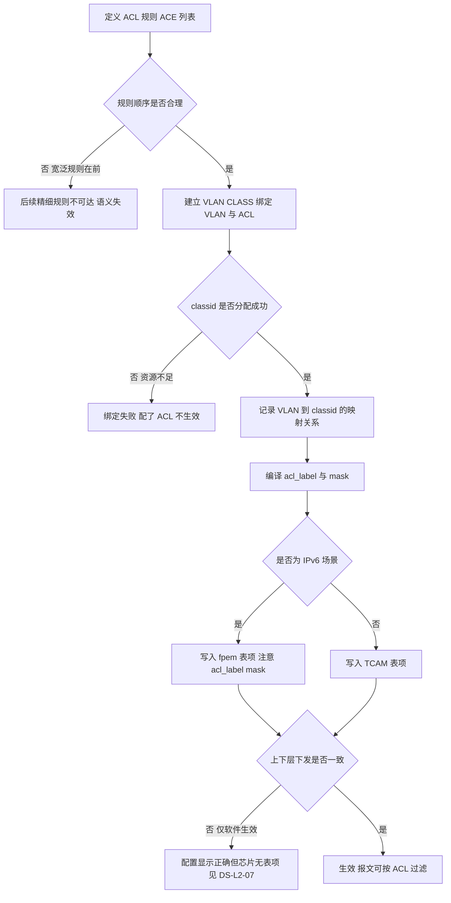
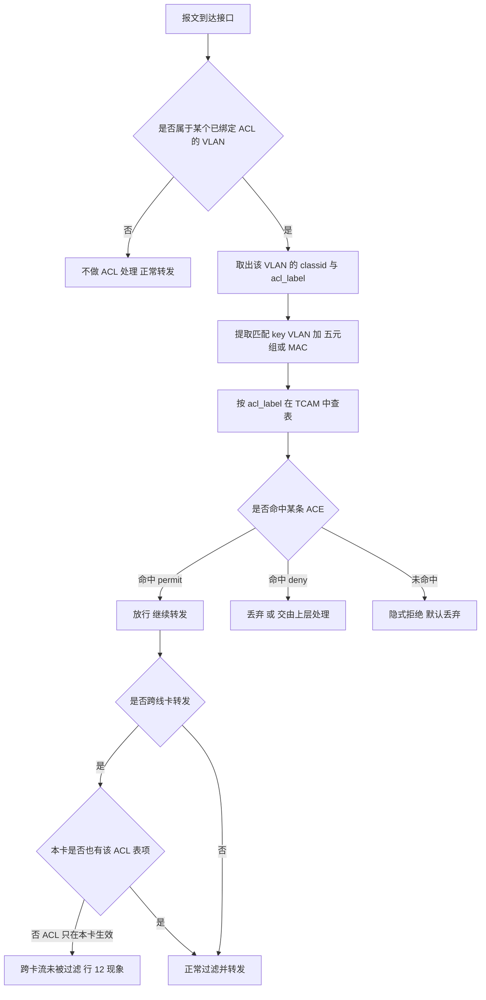
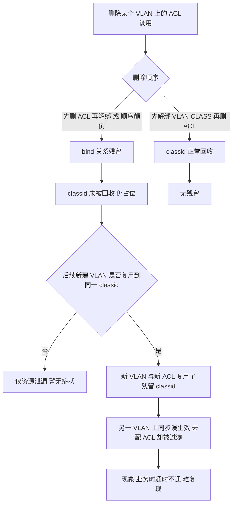
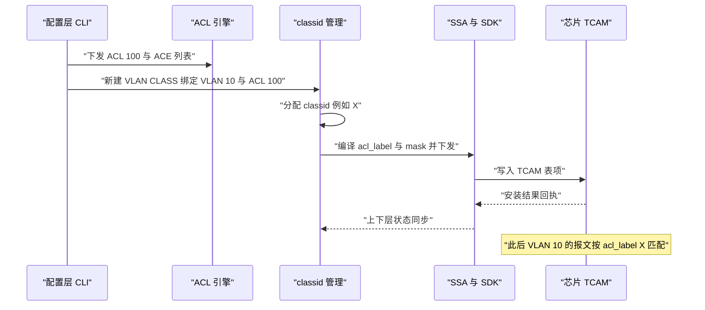
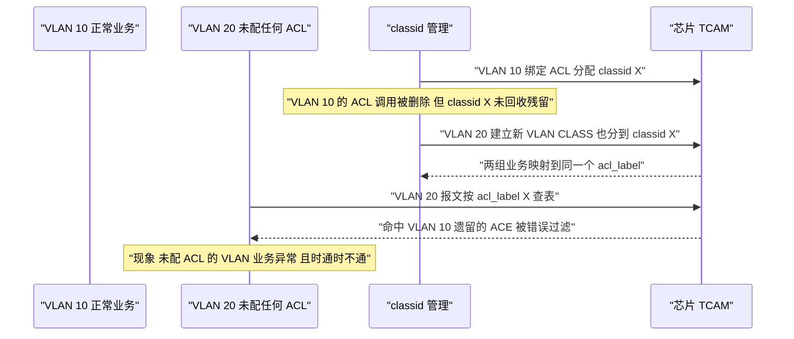
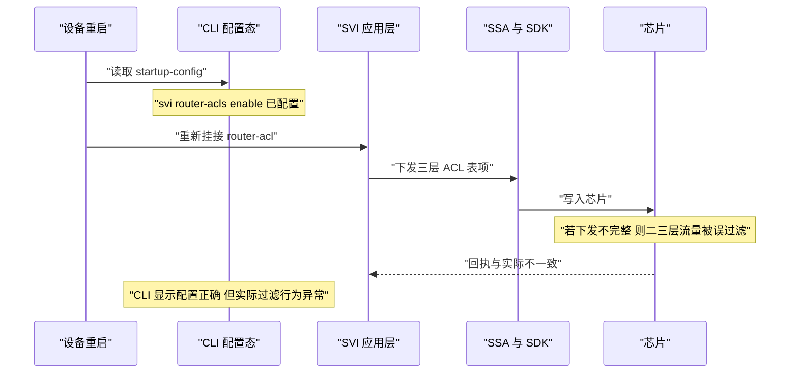

# 1 ACL 与 VLAN CLASS 场景全景：描述 · 流程 · 涉及模块 · 监控点

> **大场景**：DS-L2（二层与环网）
> **文档版本**：v1.0（新增，尚未走两轮 AI 专家评审）
> **编制日期**：2026-09-24
> **上游依据**：`../03_二层与环网_场景拆解与RCA做法.md`（`DS-L2-05` `DS-L2-07`）
> **交叉引用**：`../../07_表项与转发_场景拆解与RCA做法.md`（`EXT-FWD`，ace 表项资源）、`../05_路由协议_场景拆解与RCA做法.md`（`DS-RT-07`/`08`，PBR 的 classid 残留）
> **说明**：设备命令凡未经真机验证，一律标注「（待实机核对）」；本文不含未经证实的版本号、补丁号与品控 ID。

---

## 1.1 一页速览

| 阶段/环节 | 关键动作 | 执行者 | 失败后的现象 |
|---|---|---|---|
| ① 定义 ACL | 写 ACE 规则（匹配字段 + permit/deny） | 配置层 | 规则顺序错→误命中/漏命中 |
| ② 绑定到 VLAN | 建立 VLAN CLASS，把 VLAN 与 ACL 关联 | 配置层 | 未绑定→配了 ACL 也不生效 |
| ③ 分配 classid | 为一个 VLAN+ACL 组合分配唯一 classid | classid 管理 | **classid 冲突→跨 VLAN 误生效** |
| ④ 编译 acl_label | 把 classid 编译为芯片可识别的 acl_label | 编译层 | **acl_label mask 错→业务叠加失败** |
| ⑤ 下发 TCAM | 写入芯片 TCAM / fpem 表项 | SDK → 芯片 | 未下发或残留→ACL 不生效或误生效 |
| ⑥ 报文匹配 | 提 key → TCAM 查表 → 执行动作 | 芯片转发面 | 跨卡不生效、上下层不一致 |
| ⑦ 回收 | 删除配置时回收 classid 与表项 | classid 管理 | **删除时序错→残留，被新 VLAN 复用** |

**一句话本质**：ACL 是"**匹配规则**"，VLAN CLASS 是"**把规则与 VLAN 绑起来并翻译成芯片编号（classid / acl_label）**"的那一层胶水。所以真正的坑不在 ACL 语法写错，而在**编号的分配与回收**——classid 是有限资源，删除时若回收时序不当就会残留，被下一个 VLAN 复用到，于是出现"我明明没在这个 VLAN 上配 ACL，它却被 ACL 过滤了"这类最难解释的现象。

---

## 1.2 定位与边界

### 1.2.1 一句话定义

- **ACL（Access Control List）**：一组按序排列的 ACE（Access Control Entry）规则，逐条匹配报文字段（源/目的 IP、源/目的 MAC、以太类型、协议号、端口等），命中即执行 permit / deny 并**停止后续匹配**；全部未命中则执行**隐式拒绝（implicit deny）**。
- **VLAN CLASS**：把「VLAN」与「ACL」绑定为一个命名的类别，由系统为其分配 **classid**，并编译为芯片侧的 **acl_label**（含 mask），使 VLAN 具备"按 ACL 过滤"的能力。它解决的是"ACL 是全局的，但我要只在某个 VLAN 上生效"这个问题。
- **SVI router-acl**：在 SVI（VLAN 三层接口）上应用的 ACL，作用于**三层流**（跨网段流量），与本篇的二层 ACL 是不同位置的应用点。

### 1.2.2 在本大场景中的位置

- **承接**：ACL 是协议 VLAN（匹配特征）、superVLAN（不走 ACL 走 SCL）、灵活 QinQ（流分类）、PBR（match 来源）的**公共匹配底座**。
- **被触发**：classid / acl_label 经 `classid 管理 → 编译 → SDK → 芯片 TCAM` 下发；表项残留归 `DS-L2-07`；跨 VLAN 误生效归 `DS-L2-05`。
- **本篇对应子场景**：`DS-L2-05`（二层 ACL / VLAN CLASS 匹配与残留异常）为主，交叉 `DS-L2-07`（`vlan class` 表项未下发/残留）。

### 1.2.3 边界判据

**属于本篇：**

- SVI `router-acl` 跨卡三层流不生效（芯片硬件限制：ACL 只作用于本线卡）。
- IPv6 `fpem` 表项 `acl_label` mask 问题导致业务叠加失败。
- `vlanif` ACL 调用残留 —— 残留 ACL 的 classid 与**另一个 VLAN** 的 classid 一致，导致 ACL 在那个 VLAN 上**同步误生效**。
- `svi router-acls enable` 重启后上下层不一致，导致 ACL 过滤二三层流量。
- VLAN CLASS / `acl_label` / classid 的分配、下发与回收异常。

**不属于本篇、易误入（含典型反例）：**

- **典型反例·现象像 ACL、根因不在 ACL 规则**：PBR 配置完全正确但"不生效"，根因是**芯片 ace 表项资源耗尽**——机理属转发/ACL 资源域，本项目已外归到 **`EXT-FWD`（表项与转发）** 的表项资源子场景。**正确动作**：先看 ace 占用率，若达上限则归 `EXT-FWD` 而非本篇。
- **典型反例·现象像 ACL**：实际是芯片 **TCAM 表项未下发**（`DS-L2-07`，行 94、289）——ACL 语法与 classid 全对，只是没落到芯片。归类看失效点落在"匹配逻辑"还是"表项下发"。
- 安全 ACL / QoS 策略本身的**策略语义错误**（该放行的被拒了）→ 归『安全/QoS』；本篇只收纳"表项匹配或残留导致二层误生效"。
- protocol-vlan 的**动态划 VLAN 行为**不生效 → 归 `DS-L2-01`（见《二层-VLAN与superVLAN-…》）；本篇只处理它的 ACL 匹配路径本身。
- PBR 的 set 动作选路错误、route-map 序号问题 → 归 `DS-RT-08`。
- 纯 TCAM/ASIC 表项不一致（与 ACL 无关）→ 归 `EXT-FWD`。

---

## 1.3 涉及模块

| 模块名 | 所属层 | 职责 | 与本技术的交互点 | 该模块失效时的典型现象 |
|---|---|---|---|---|
| ACL 定义与匹配引擎 | 设备侧控制面 | 维护 ACE 列表、匹配顺序、隐式拒绝 | 规则语义的唯一权威 | 顺序错→误命中；漏 deny→未拦截 |
| VLAN CLASS 绑定层 | 设备侧控制面 | 把 VLAN 与 ACL 绑定成类别 | 决定"ACL 在哪个 VLAN 生效" | 未绑定→配了 ACL 不生效 |
| classid 管理（分配与回收） | 设备侧控制面/转发面 | 为每个 VLAN+ACL 组合分配唯一 classid | 下发与回收的生命周期 | **回收时序错→残留→跨 VLAN 误生效（`DS-L2-05`）** |
| acl_label / mask 编译 | 设备侧转发面软件 | 把 classid 编译为芯片识别字段 | IPv6 场景下走 `fpem` 表项 | **mask 错→业务叠加失败（行 55）** |
| ace 表项资源池 | 转发面硬件资源 | 芯片 ACL 表项总容量 | 与 PBR、包过滤共用 | 资源耗尽→策略不生效（外归 `EXT-FWD`） |
| TCAM / fpem 表项下发（SSA/SDK） | 设备侧转发面软件 | 把编译结果写入芯片 | 配置到芯片的落地环节 | 未下发/残留→ACL 不生效或误生效（行 792、863、883） |
| SVI router-acl 应用层 | 设备侧控制面 | 在 SVI 上挂接 ACL（`svi router-acls enable`） | 三层流过滤 | 重启后上下层不一致→过滤二三层流量 |
| 线卡 / 跨卡转发 | 硬件 | 决定 ACL 作用域 | 跨卡三层流 | **ACL 只在本卡生效→跨卡流不生效（行 12）** |
| APM 采集侧 | 平台侧 | 采集 classid 映射、ACL 命中计数、表项态 | 监控数据源 | 缺采集→残留与冲突无告警（第 8 节） |

**模块清单来源与置信度：**

- 来自本项目实证（高置信）：`vlanif` ACL 调用残留致 classid 一致、跨 VLAN 同步误生效（`DS-L2-05`，行 792、863、883）；SVI `router-acl` 跨卡不生效（行 12，VRRP 下 ACL 异常）；IPv6 `fpem` 表项 `acl_label` mask 致业务叠加失败（行 55，阿里办公网新增 VLAN403 V6 业务不通）。
- 通用命名推断（中置信）：`classid 管理`、`acl_label / mask`、`SSA / SDK`、`fpem` 为转发/ACL 通用架构推断，具体进程名与命令以真机为准（待实机核对）。
- 不引入未经证实的进程名、版本号与补丁号。

---

## 1.4 协议栈、配置模型与判定链

### 1.4.1 ACL 的类型与匹配字段

| ACL 类型 | 主要匹配字段 | 在二层场景中的用途 |
|---|---|---|
| 标准 ACL | 源 IP | 三层过滤，粒度粗 |
| 扩展 ACL | 源/目的 IP、协议号、端口 | 三层过滤主力 |
| 二层 ACL | 源/目的 MAC、以太类型 | 按 MAC 或协议类型做二层过滤，也是协议 VLAN 匹配的基础 |
| 命名 / 编号 ACL | 同上，仅标识方式不同 | 编号便于引用，命名便于维护 |

**匹配规则（三条铁律）：**

1. **自上而下顺序匹配**，命中即执行动作并**停止**后续匹配。
2. 未显式配置的动作一律 **deny**（隐式拒绝）。
3. **规则顺序本身就是语义**——把 permit 写在 deny 后面等于不可达。

### 1.4.2 VLAN CLASS 与 classid 模型

```
VLAN 10 ──┐
          ├── 绑定 ──→ VLAN CLASS（一个类别）
ACL 100 ──┘                 │
                            ├── 分配 classid（有限资源，需全局唯一）
                            ├── 编译为 acl_label + mask
                            └── 下发芯片 TCAM（或 IPv6 走 fpem）
```

- **classid 是 VLAN+ACL 组合的全局唯一编号**。芯片并不知道"VLAN 10 和 ACL 100"是什么，它只知道"acl_label = X"。
- **冲突的本质**：如果两个不同 VLAN 的 VLAN CLASS 拿到了**同一个 classid**，芯片就无法区分——一个 VLAN 上的 ACL 会在另一个 VLAN 上"同步生效"。这不是 ACL 语法问题，是**编号分配/回收问题**。

### 1.4.3 protocol-vlan 走 ACL vs superVLAN 走 SCL

| 特性 | 匹配路径 | 说明 |
|---|---|---|
| 协议 VLAN | **ACL 匹配** | 特征（协议类型 / IP 子网）编译为 ACE |
| superVLAN / subVLAN | **SCL 匹配** | 走内部匹配机制，不经 ACL 表项 |

> 这两条路径同时存在，是 `DS-L2-01` 中"supervlan 与 protocol-vlan 叠加导致 subVLAN 间不通"的机理来源——**同一报文被两条不同的匹配链裁决，优先级不明确时行为不可预期**。

### 1.4.4 完整判定链（必须画进流程图）

```
配置 ACL 规则（ACE 列表）
  → 配置 VLAN CLASS 绑定（VLAN + ACL）
    → classid 管理分配唯一 classid
      → 编译 acl_label + mask
        → SSA → SDK → 下发芯片 TCAM / fpem

报文到达
  → 提取 key（VLAN + 匹配字段）
    → 按 VLAN 找到其 classid / acl_label
      → 在 TCAM 中按 acl_label 查 ACE 表项
        → 命中 → 执行 permit / deny
        → 未命中 → 隐式拒绝
```

---

## 1.5 流程图

### 1.5.1 配置到芯片的下发流程（含失败分支）



### 1.5.2 报文匹配判定链



### 1.5.3 删除时序与 classid 残留流程



---

## 1.6 数据流图

### 1.6.1 二层 ACL 匹配数据流（配置侧到数据侧）



### 1.6.2 classid 冲突导致跨 VLAN 误生效（`DS-L2-05` 核心）



### 1.6.3 SVI router-acl 上下层不一致（重启后）



---

## 1.7 关键参数与配置项

| 参数/配置项 | 默认值/范围 | 配错的后果 |
|---|---|---|
| ACE 顺序 | 自上而下、命中即停 | 宽泛规则在前→精细规则不可达 |
| 隐式拒绝 | 末尾隐含 deny any | 忘配 permit→正常流量被拦 |
| classid | 全局唯一、资源有限 | 冲突/残留→跨 VLAN 误生效 |
| acl_label / mask | 由 classid 编译而来 | mask 错（尤其 IPv6 fpem）→业务叠加失败 |
| VLAN CLASS 绑定 | 需显式绑定 | 未绑定→ACL 不生效 |
| `svi router-acls enable` | 默认视版本而定 | 重启后上下层不一致→过滤二三层流量 |
| 跨卡作用域 | ACL 通常只在本线卡生效 | 跨卡三层流不被过滤（行 12） |
| ace 表项容量 | 芯片上限（与 PBR 共用） | 耗尽→策略不生效（归 `EXT-FWD`） |

---

## 1.8 常见故障模式与分阶段定位

| 故障模式 | 现象 | 定位阶段 | 关键判据 |
|---|---|---|---|
| classid 冲突/残留 | 未配 ACL 的 VLAN 业务被过滤、时通时不通 | ⑦ 回收环节 | 各 VLAN 的 classid 是否重复（行 792、863、883） |
| acl_label mask 错 | IPv6 业务叠加失败 | ④ 编译环节 | fpem 表项与配置是否一致（行 55） |
| 跨卡不生效 | VRRP 场景 ACL 时通时不通 | ⑥ 匹配环节 | 是否跨线卡、ACL 是否只在本卡（行 12） |
| 表项未下发 | 配置正确但完全不生效 | ⑤ 下发环节 | CLI / SSA / SDK 三层比对（行 94、289） |
| 重启后上下层不一致 | `svi router-acl` 过滤二三层流量 | ⑤ 下发环节 | 重启前后行为差异 |
| ace 资源耗尽 | 策略不生效 | 资源环节 | ace 占用率（**外归 `EXT-FWD`**） |
| protocol-vlan 与 supervlan 叠加 | subVLAN 间不通 | 匹配路径 | ACL 与 SCL 优先级冲突（归 `DS-L2-01`） |

**成功 vs 失败对比要点**：本篇的成功定位**必须拿出 classid 对照表**——把每个 VLAN 的 classid 列出来看有没有重复，这是唯一能证明"残留复用"的硬证据。仅凭"业务时通时不通"的描述无法定性。

---

## 1.9 监控点（APM 可观测性映射）

| 观测点 | 观测对象 | 数据源 | 采集方式 | 阈值 / 触发条件 | 现状 | 优先级 |
|---|---|---|---|---|---|---|
| classid 唯一性 | 各 VLAN 的 classid 映射表 | MySQL | CLI 定时采集 | 出现重复 classid 即告警（跨 VLAN 误生效的直接前兆） | 缺失 | P0 |
| VLAN CLASS 表项下发态 | vlan class 表项与 acl_label | Loki + MySQL | CLI 定时采集 | 配置存在但表项缺失即告警 | 缺失 | P0 |
| acl_label mask 一致性 | fpem 表项与配置 | MySQL | CLI 定时采集 | IPv6 场景 mask 与预期不符即告警 | 缺失 | P1 |
| ACL 调用残留 | ACL 调用关系与删除记录 | MySQL | CLI 定时采集 | 存在调用关系但无对应 ACL 定义即告警 | 缺失 | P1 |
| ace 表项资源占用 | ace 占用率 | VictoriaMetrics | SNMP 轮询 | 占用接近上限即告警 | 部分 | P1 |
| SVI router-acl 上下层一致 | CLI 态与芯片态 | MySQL | CLI 定时采集 | 重启后存在差异即告警 | 缺失 | P1 |
| ACL 命中计数 | 各 ACE 命中次数 | VictoriaMetrics | CLI 定时采集 | 配置存在但命中长期为 0，或突增/突降 | 缺失 | P1 |
| 跨卡流过滤缺失 | 线卡 ACL 覆盖情况 | MySQL | CLI 定时采集 | 存在 ACL 未覆盖的线卡且有跨卡流即告警 | 缺失 | P2 |

> **落地口径**：芯片内部"命中的是哪条 ACE"镜像不可得，只能取设备侧的 ACE 命中计数；本表全部观测点走 CLI 与 SNMP。

---

## 1.10 排查动作步骤（按序执行）

| 步 | 动作 | 命令 / 观测点 | 判读 |
|---:|---|---|---|
| 1 | 列出 ACL 定义与调用关系 | `show access-list` | 规则是否存在、被谁调用 |
| 2 | **列出各 VLAN 的 classid** | `show vlan class` / `show vlan class-id`（待实机核对） | **是否有重复 classid——本篇最关键一步** |
| 3 | 查 vlanif ACL 调用残留 | 各 VLAN 的 ACL 调用关系（待实机核对） | 已删除的 ACL 是否仍被调用 |
| 4 | 查 TCAM / fpem 表项 | `show l2-table`（待实机核对）/ `diagnose` 查 vlan class、fpem | 表项是否下发、是否残留 |
| 5 | 核对 svi router-acl 生效态 | 诊断命令确认上下层一致 | CLI 显示与芯片实际是否一致 |
| 6 | 判定是否跨卡问题 | 查 ACL 覆盖的线卡范围 | 跨卡流是否未被过滤 |
| 7 | 查 ace 资源占用 | 相关资源计数（待实机核对） | 达上限则**改归 `EXT-FWD`** |
| 8 | 规避 | 同线卡聚合 / 重新配置 / 升级 | 重配能否恢复（用于反证残留） |

---

## 1.11 与本项目已知故障的对应

| 子场景 | 现象 | 典型记录（Sheet8 行） |
|---|---|---|
| `DS-L2-05` | VRRP 下调用 ACL 异常（跨卡） | 12（N18E） |
| `DS-L2-05` | 新增 VLAN403 网段 V6 业务不通（acl_label mask） | 55（阿里办公网飞天园区 57X） |
| `DS-L2-05` | 调用 ACL 导致业务异常（删除残留） | 792（建行 S7808C） |
| `DS-L2-05` | classid 残留与跨 VLAN 误生效 | 863、883 |
| `DS-L2-07` | VLAN CLASS 未下发/残留 | 94、289、683 |

---

## 1.12 待确认事项

| 编号 | 问题 | 建议问谁 |
|---|---|---|
| `Q-L2-03` | VLAN CLASS / ACL classid 冲突导致跨 VLAN 误生效（行 792/863），ACL 调用残留的根因是**配置删除时序**还是 **classid 分配机制**？是否需要 APM 增加 classid 冲突检测？ | L2 转发 / ACL 模块研发 |
| `Q-L2-ACL-01` | `show vlan class` / `show vlan class-id` 的实际命令名与回显字段（待实机核对）？ | L2 表项团队 |
| `Q-L2-ACL-02` | 跨卡场景下 ACL 的作用域是否有官方支持的命令可直接观测覆盖范围？ | L2 转发 / 线卡驱动 |

---

## 1.13 AI 专家评审记录摘要

本篇为二层系列**新增文档（v1.0）**，尚未走两轮 AI 专家评审流程。待与《二层-VLAN与superVLAN-…》《二层-QinQ与VLAN标签解析-…》《二层-STP与RLDP-…》三篇一并送审。

---

## 1.14 附：术语速查

| 缩写 | 全称 | 说明 |
|---|---|---|
| ACL | Access Control List | 访问控制列表 |
| ACE | Access Control Entry | ACL 中的单条规则 |
| VLAN CLASS | VLAN 类别 | 把 VLAN 与 ACL 绑定的实体 |
| classid | 类别标识 | 每个 VLAN+ACL 组合的全局唯一编号 |
| acl_label | ACL 标签 | classid 编译后供芯片识别的字段，含 mask |
| fpem | 芯片转发表项 | IPv6 场景下的表项载体 |
| SCL | 内部匹配机制 | superVLAN 的匹配路径，与 ACL 路径不同 |
| TCAM | 三态内容寻址存储器 | 芯片中承载 ACL 表项的硬件资源 |
| SVI | Switch Virtual Interface | VLAN 三层接口，router-acl 的应用点 |
| 隐式拒绝 | implicit deny | 未命中任何 ACE 时的默认丢弃行为 |
