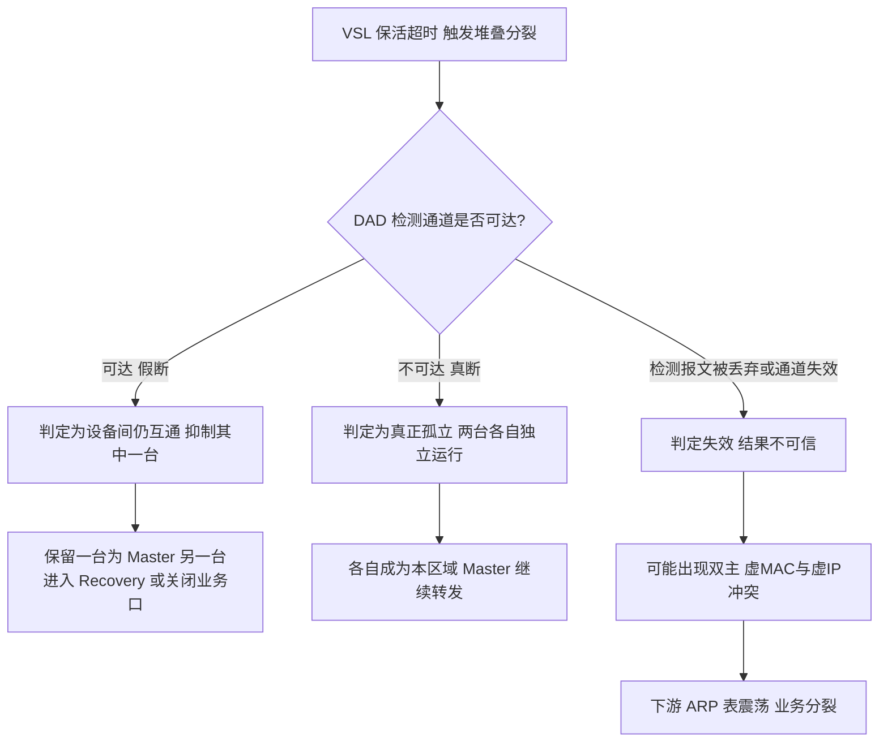
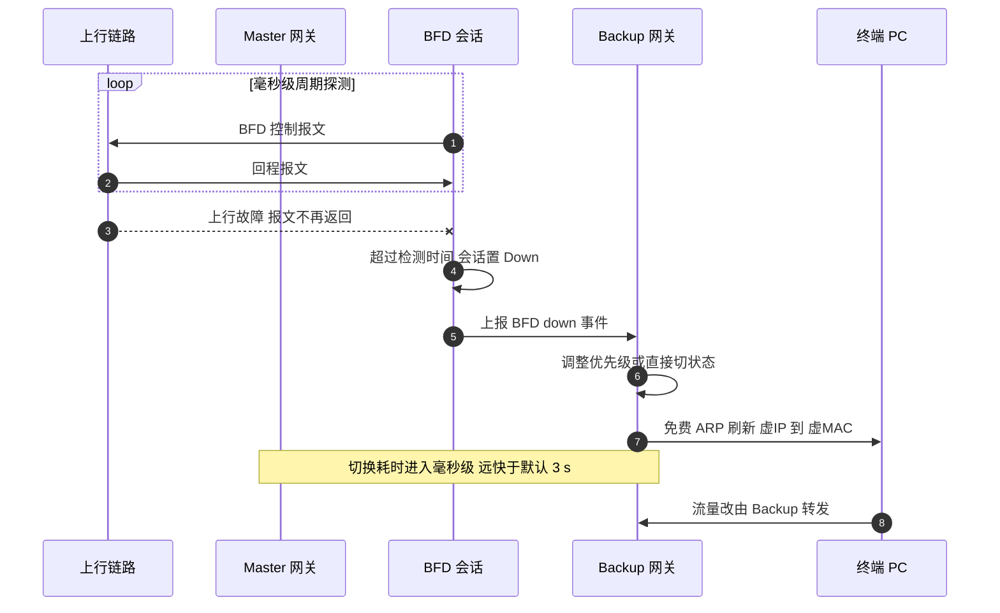
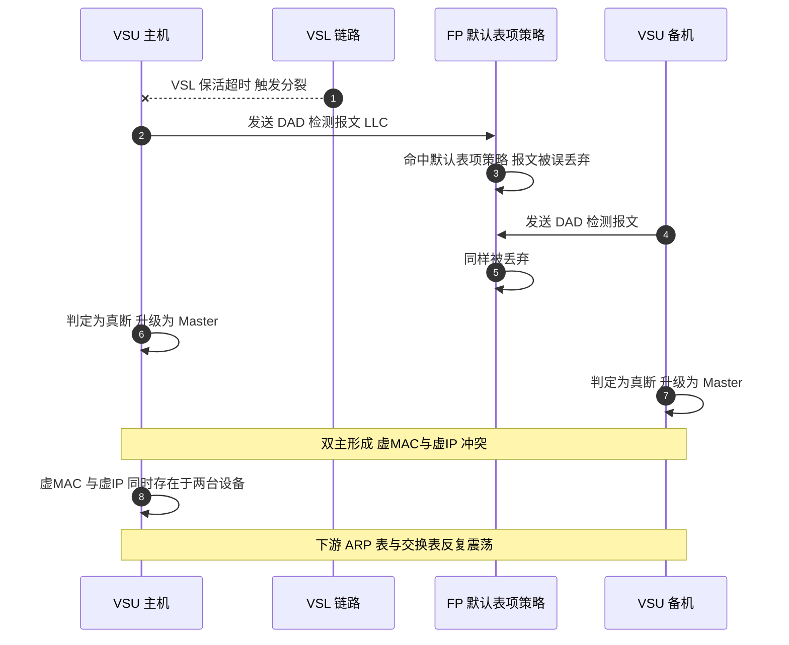

# BFD 在堆叠与虚拟化场景中的用法（DAD / VRRP 联动 / 微 BFD）——补充篇

> **大场景**：DS-STACK（堆叠与虚拟化）——补充视角篇
> **文档版本**：v1.0（精简篇，**未经两轮评审**）
> **编制日期**：2026-09-24
> **⚠️ 前置阅读**：BFD 的**协议本体原理、控制报文字段、三态状态机、检测时间公式、async/Demand/Echo 三模式、认证开销、up-dampening 陷阱、与 OSPF/IS-IS/BGP 的联动差异**，已在 [`路由-BFD-协议全景与流程时序.md`](路由-BFD-协议全景与流程时序.md)（v2.0 定稿）逐节写全，**本篇不重复**。本篇只补那一篇没覆盖的三件事：
> ① BFD 用作**双主检测（DAD）**；② BFD 与 **VRRP** 联动做毫秒级网关切换；③ BFD for LAG（**微 BFD**）在聚合口成员级的用法。
> **标准依据**：`RFC 5880`（基础）/ `5881`（单跳 IP，UDP 3784）/ `5883`（多跳，UDP 4784）/ `RFC 7130`（BFD for LAG，UDP **6784**，目的 MAC **01-00-5E-90-00-01**）
> **说明**：命令凡未经真机验证一律标「（待实机核对）」；设备命令以 RGOS 为准（只有 `show`，无 `display`）。

---

## 0. 一页速览：BFD 在堆叠场景的三个落点

| 落点 | 检测什么 | 触发什么 | 典型时延 | 本实现证据状态 |
|---|---|---|---|---|
| ① **VRRP 联动** | Backup 到 Master（或到上行网关）的**可达性** | 调整备份组优先级 → 抢占为主；或直接切换 VRRP 状态 | **毫秒级（可达 50 ms）** | 通用机制；本实现的支持情况与命令**待实机核对** |
| ② **双主检测 DAD** | 分裂后两台"各自以为自己是主"的设备之间是否**真的**还能互通 | 判定分裂合法性：真断（确实互不可达）→ 允许各自独立运行；假断（VSL 断但设备间仍可达）→ **抑制其中一台**，避免双主 | 取决于检测方式与周期 | 本项目实证的**本实现 DAD 走 LLC 报文**（被 FP 默认表项丢弃 → `DS-STACK-09`）；**是否同时支持用 BFD 做 DAD 待核实** |
| ③ **微 BFD（BFD for LAG）** | **每一条成员链路**（不是整个聚合口）的多层转发能力 | 把故障成员从 LAG 的负载均衡表中排除，快于 LACP 慢周期 | 毫秒级 | 通用机制（RFC 7130）；本实现支持平台**待实机核对** |

**一句话本质**：BFD 的价值不在 BFD 自己，而在**它把上层机制的超时判定换成事件驱动**——VRRP 从约 3 s 缩到 50 ms、DAD 从"等保活超时"缩到即时判定、LAG 从 90 s 缩到毫秒级。代价是：**BFD 自身会震荡**，而它震荡时被放大的恰恰是这些高可用机制。

---

## 1. 定位与边界

### 1.1 与《路由-BFD》的分工

| 主题 | 归属 |
|---|---|
| 报文结构 / 三态状态机 / 检测时间公式 / 三模式 / 认证 / up-dampening / 与 OSPF·IS-IS·BGP 联动 / 链路震荡因果链 | **《路由-BFD-协议全景与流程时序》**（本篇不重复） |
| BFD 做 DAD、BFD 联动 VRRP、微 BFD 联动聚合口 | **本篇** |

### 1.2 边界判据

**属于本篇：**

- VSU 分裂后判定"真断 vs 假断"的双主检测机制及其失效（含检测报文被丢弃）。
- VRRP 与 BFD 联动的时序、联动方式差异与失灵。
- 聚合口成员级快速检测（微 BFD）的会话与成员剔除行为。

**不属于本篇、易误入：**

- **纯 BFD 协议面问题**（会话卡 Down、规格满、up-dampening 与 BGP 定时器错配、跨厂商互操作）→ 归《路由-BFD》与 `DS-RT-02`。
- **VSU 分裂本身**（VSL 保活超时、芯片寄存器、DMA 中断掩码）→ 归 `DS-STACK-01`；本篇只处理"分裂之后靠什么判定双主"。
- **VRRP 本体行为**（组 ID、虚地址、虚 MAC 时序）→ 归《堆叠-VRRP》与 `DS-STACK-07`；本篇只处理"BFD 作为加速器"这一角色。
- **聚合口本体行为**（模式配对、成员属性、HASH 偏载）→ 归《堆叠-链路聚合》。

---

## 2. 涉及模块

| 模块名 | 所属层 | 职责 | 与 BFD 的交互点 | 失效时的典型现象 |
|---|---|---|---|---|
| BFD 会话管理 | 设备侧控制面 | 会话状态机、收发、检测时间计算 | 全部 BFD 逻辑中枢 | 会话卡 Down / 震荡 |
| **双主检测（DAD）模块** | 设备侧控制面 | 分裂后判定双主合法性，决定抑制哪一台 | 订阅 DAD 检测结果 | 检测报文被丢弃 → **假断被当真断 → 双主** |
| VRRP 状态机 | 设备侧控制面 | 网关冗余选举 | 订阅 BFD 事件做优先级调整 / 状态直切 | BFD 误 down → 网关无谓切换 |
| Track / 联动层 | 设备侧控制面 | 把 BFD 状态翻译成优先级或状态变更 | BFD → Track → VRRP 的中间层 | 联动未配或方向配错 → 故障时切换不发生时 |
| LAG / 聚合管理 | 设备侧控制面 | 维护活动成员表 | 微 BFD 结果决定成员是否参与负载均衡 | 成员被误剔除 → 带宽骤降 |
| FP / 硬件表项层 | 转发面 | 承载 DAD / BFD 报文的转发与过滤策略 | **DAD 报文被 FP 默认策略丢弃即在此层** | 端口持续 drop、双主（`DS-STACK-09` 实证） |
| VSL 保活机制 | 设备侧控制面 | 判断堆叠链路是否真的断了 | 与 DAD 配合：保活超时 → 触发分裂 → DAD 判定是否双主 | 保活误超时 + DAD 失效 → 双主（`DS-STACK-01`） |
| 平台对接（Syslog / Telemetry / SNMP） | 平台侧 | 采集 BFD 会话、DAD 状态、成员剔除事件 | APM 数据源 | 无采集 → 双主与误剔除均无感知（§8） |

---

## 3. 三个落点的机制细节

### 3.1 落点一：BFD 与 VRRP 联动（毫秒级网关切换）

**为什么需要联动**：纯 VRRP 靠 Master_Down 定时器（默认约 3 × 通告间隔 ≈ 3 s）发现 Master 失联。若 Master **设备本身活着但上行断了**，VRRP 状态仍是 Master、通告照发，形成一个"网关在位但转不出去"的黑洞——这正是 VRRP 必须靠 track 联动的根本原因。

**三种常见联动方式**（厂商实现差异较大，需以本实现为准）：

| 联动方式 | 监视对象 | 影响方式 | 适用场景 |
|---|---|---|---|
| **普通方式（改优先级）** | Backup 监视 Master（或监视上行） | BFD down → **降低本端/对端优先级** → 高者抢占为主 | 最常用；切换由选举规则自然完成 |
| **Link / Peer 配对方式** | 同时监视"主到下游"（Link）与"备到下游"（Peer）两类 BFD | 按两类会话的组合状态**直接切换** VRRP 状态，不经过优先级 | 需要区分"是主侧链路断还是备侧链路断" |
| **基于 VRID 的动态 BFD** | 同一 VRRP 组内自动生成 BFD 会话 | BFD down → **不改优先级**，直接切状态 + 发免费 ARP | 配置最简；行为最"硬" |

**触发方向的关键区别**：

- **降自身优先级**：Master 自己发现上行坏 → 主动把优先级降到低于 Backup → Backup 抢占。**优点**是不依赖两端配置对称。
- **升对端优先级**：Backup 发现与 Master 之间不通 → 抬高自己优先级强行升主。**风险**是若"不通"是单向的，会造成**双主**。

### 3.2 落点二：双主检测 DAD（被判"真断 vs 假断"）

**问题定义**：VSL 断开时，两台设备都认为对方死了，各自升为 Master → **双主**。但"VSL 断"不一定等于"两台设备真的互不可达"——如果它们之间还有另一条路径（例如通过下游交换机绕通），那么**盲目双主是可以避免的**。DAD 的任务就是回答：**我们俩现在还通吗？**

| 检测方式 | 原理 | 典型载体 |
|---|---|---|
| **专用检测报文**（本项目实证方式） | 两台设备之间周期性互发**专用保活/检测报文**（本项目实证为 **LLC 报文**）；通 → 判定"假断"，抑制其中一台；不通 → 判定"真断"，各自独立运行 | 二层专用报文（含 LLC 类型） |
| **BFD 方式** | 在设备间建立 BFD 会话作为独立的双主检测通道（对间可达性做毫秒级判定） | 单跳 BFD（UDP 3784） |
| **直连检测链路（MAD）** | 用一条独立物理链路（或聚合口）专门做双主检测，与业务链路分离 | 独立物理链路 |

**本项目实证的失效模式（`DS-STACK-09`）**：DAD 的 **LLC 报文被 FP 的默认表项策略误丢弃**，导致"明明互不可达却判定为可达"或反之，端口持续 drop、双主判定失效。定位手段是 `fp_tcam` 置 0 做对照验证（详见 04 文档 DS-STACK-09 排查动作）。

> **口径纪律**：本项目**只实证了 LLC 报文方式**。BFD 是否也能作为本实现的 DAD 手段、命令怎么写，**均未证实**，已列入 §11 待确认事项。不要把"通用可实现"写成"本产品已支持"。

### 3.3 落点三：微 BFD（BFD for LAG / 聚合口成员级检测）

**为什么不能用"整口一条 BFD"**：如果在聚合口整体上只跑一条 BFD 会话，那么该会话必然只走**其中一条成员链路**。这条链路断了会话会 down，但**其他链路的状态无法被感知**——BFD 就失去了"逐成员检测"的能力。RFC 7130 的方案是在**每一条成员链路上各跑一条独立的 BFD 会话**（术语：**micro-BFD session**）：

- 每条微 BFD 会话有**自己的本地识别符（Discriminator）、自己的状态变量、自己的状态机**——彼此完全独立，定时器参数甚至可以不同。
- 目的 UDP 端口用 **6784**（区别于单跳 3784 / 多跳 4784），避免与"把整个 LAG 当一条链路"的 BFD 混淆。
- 以太网目的 MAC 用保留组播 **01-00-5E-90-00-01**（Down/AdminDown/Init 阶段及刚进 Up 的前 Detect Mult 个报文必须用它）。
- 源 MAC 用**成员链路自己的 MAC**，以减少对端硬件 MAC 资源占用。
- 微 BFD 报文**一般不打 Tag**；在 802.1q / qinq 环境下可打 VLAN 0（优先级 Tag）——**Tag 处理不当是会话不 Up 的常见原因**。

**与 LACP 的分工**：LACP 也能发现成员故障，但依赖慢/快周期（30 s / 1 s，超时 90 s / 3 s）。微 BFD 的定位是**更快**、**在没有 LACP 也能用**、且能验证成员链路**能否转发三层报文**。

---

## 4. 流程图

### 4.1 双主检测（DAD）判定流程

### 4.2 VRRP 联动 BFD 的数据流

---

## 5. 时序图

### 5.1 正常：BFD 联动实现毫秒级网关切换

### 5.2 异常：DAD 检测报文被 FP 丢弃导致双主

---

## 6. 关键参数与定时器（只列本篇新增项）

> BFD 本身的 `Desired Min TX Interval` / `Required Min RX Interval` / `Detect Mult` / 检测时间公式，见《路由-BFD》§3.3 与 §6，不重复。

| 参数 | 含义 | 典型默认值 | 配错的后果 |
|---|---|---|---|
| VRRP 联动的 BFD 会话类型 | 静态（手工指定标识符 / 自协商）或基于 VRID 的动态 | 依实现 | 类型不支持 → 联动配不上；动态会话未自动生成 → BFD 显示 Up 但 VRRP 不切 |
| 联动方向（降自己 / 升对端） | 谁调整优先级 | 依实现 | 方向配错或只配单侧 → 故障时切换不发生，或单向不通引发双主 |
| **DAD 检测方式与周期** | 专用报文（本项目实证为 LLC）/ BFD / 直连检测链路 | 依平台（待实机核对） | 周期过长 → 双主持续时间长；报文被 FP 丢弃 → 判定失效（`DS-STACK-09` 实证） |
| DAD 的抑制策略 | 假断时抑制哪一台（按角色 / 按优先级 / 按配置） | 依平台 | 抑制对象反复变化 → 角色震荡 |
| 微 BFD 目的端口 | UDP **6784** | 标准固定 | 错端口 → 与单跳 3784 混淆，会话建不起来 |
| 微 BFD 目的 MAC | **01-00-5E-90-00-01** | 标准固定 | 错 MAC → 报文被对端丢弃 |
| 微 BFD 报文的 VLAN Tag | 一般不打 Tag；802.1q/qinq 下可打 VLAN 0 | 依实现 | Tag 处理不当 → 会话不 Up，成员被误剔除 |
| 微 BFD 探测间隔 | 每成员独立可配 | 依实现 | 间隔过短 → CPU/带宽压力；过长 → 快于 LACP 的意义消失 |

---

## 7. 常见故障模式与分阶段定位

| 阶段 | 现象 | 首要观测点 | 常见原因 |
|---|---|---|---|
| 分裂后判定 | 出现双主，两端均为主 | DAD 检测状态查询（待实机核对）+ 分裂日志 | DAD 报文被 FP 默认策略丢弃（`DS-STACK-09`）；DAD 通道本身断开；抑制策略未生效 |
| 分裂后判定 | 判定为"真断"但实际可达 | DAD 检测通道连通性 | 检测通道（物理/逻辑）被 STP 阻塞、VLAN 未放通 |
| VRRP 联动 | 上行已断但 VRRP 未切换 | VRRP 状态 + BFD 会话状态对照 | 未配联动 / 联动方向错 / BFD 会话未建立 |
| VRRP 联动 | 网关反复切换 | BFD 会话震荡计数 + 切换时间戳 | BFD 自身震荡（链路抖动、光模块、FP 安装失败，见《路由-BFD》） |
| VRRP 联动 | 出现双主 | 两端 VRRP 状态 + BFD 会话方向 | 单侧配置为"升自己优先级"且只在一端配 → 单向不通时双方都认为自己该主 |
| 聚合口成员 | 成员被剔除、带宽骤降 | 微 BFD 会话状态 + 成员活动表 | Tag 处理不当、目的 MAC/端口错、误剔除 |
| 聚合口成员 | 成员故障发现慢 | LACP 周期 vs 微 BFD 周期 | 未启用微 BFD，只能等 LACP 慢周期 90 s |

**成功 vs 失败对比要点**

- 成功：DAD 状态与实际连通性一致；BFD 会话稳定 Up、与 VRRP 切换时间戳严格对应；微 BFD 会话全 Up、成员无一被误剔除。
- 失败：双主持续存在；上行断而 VRRP 不切（黑洞）；VRRP 与 BFD 状态互相矛盾（BFD Up 但无流量 / BFD Down 但 VRRP 不切）；成员被无理由剔除。

---

## 8. 监控点（APM 可观测性映射）

固定列：`观测点 | 观测对象 | 数据源 | 采集方式 | 阈值/触发条件 | 现状 | 优先级`。

| 观测点 | 观测对象 | 数据源 | 采集方式 | 阈值/触发条件 | 现状 | 优先级 |
|---|---|---|---|---|---|---|
| 双主检测状态与结果 | DAD 检测通道状态、判定结果（真断/假断）、被抑制设备 | VictoriaMetrics + Loki | CLI 定时采集 + Syslog/Trap 订阅（DAD 状态查询，待实机核对） | 出现双主标志，或 DAD 状态与实际拓扑矛盾 | 缺失 | **P0** |
| DAD 检测报文丢弃计数 | DAD 报文发送/接收/丢弃计数（FP 层） | VictoriaMetrics + Loki | gRPC Telemetry / SNMP 轮询 + Syslog 订阅 | 发送计数正常但接收为 0，或 FP 丢弃计数持续增长 | 缺失 | **P0** |
| BFD 会话状态与 VRRP 角色联动一致性 | BFD 会话状态 vs VRRP 角色 | VictoriaMetrics + Loki | CLI 定时采集 + Syslog 订阅 | BFD 会话 Down 但 VRRP 角色未变（联动失灵）；或 BFD Up 与 VRRP 状态矛盾 | 缺失 | **P1** |
| BFD 触发的主备切换事件 | 切换时间戳、触发源（BFD/track/超时） | Loki | Syslog/Trap 订阅（VRRP + BFD 关键字对齐） | 切换时间戳与 BFD down 事件在 ±1 s 内（推断值，需现场标定） | 缺失 | **P1** |
| 微 BFD 会话状态（按成员） | 每成员微 BFD 会话状态、Up/Down 翻转计数 | VictoriaMetrics + Loki | gRPC Telemetry + Syslog 订阅 | 会话 Down 导致成员被剔除；或成员状态翻转 ≥3 次/10 min | 缺失 | **P2** |
| 聚合口成员剔除与带宽变化关联 | 成员剔除事件 vs 聚合口带宽 | Loki + VictoriaMetrics | Syslog 订阅 + SNMP 轮询 | 成员剔除后聚合带宽下降 > 1/N 且无物理层告警 | 缺失 | **P2** |
| 分裂与双主的时间线关联 | VSL 分裂时刻 → DAD 判定时刻 → 抑制动作时刻 | Loki | Syslog/Trap 订阅 | 三个时刻的时间差超出预期（判定慢 → DAD 周期问题；无抑制动作 → 策略未生效） | 缺失 | **P0** |

> **数据源口径**：只落 `VictoriaMetrics / Loki / MySQL / Pyroscope / Redis` 五类载体。
> **不可观测说明**：**DAD 报文"到底为什么被丢"**（FP 默认表项 / ACL / 芯片策略）无法从协议面直接读出，只能由"发送计数正常 + 接收计数为 0 + 端口丢弃计数增长"三条线索间接反推，并靠 `fp_tcam` 对照验证（研发协助）。

---

## 9. 排查动作步骤

| 步 | 动作 | 命令 / 观测点 | 判读 |
|---:|---|---|---|
| 1 | 先确认是否真的分裂 | 堆叠拓扑与成员状态查询（待实机核对） | 有 split/recovery 才进入 DAD 排查；否则回 `DS-STACK-01` |
| 2 | 看 DAD 检测通道状态 | DAD 状态查询（待实机核对） | 通道未配/未 Up → 后续判定不可信 |
| 3 | 看 DAD 报文的收发与丢弃 | 端口丢弃计数 + DAD 报文计数（待实机核对） | 发得出、收不到 → 疑 FP 默认策略丢弃（`DS-STACK-09`） |
| 4 | 对照验证丢弃原因 | FP 表项对照（`fp_tcam` 置 0，**需研发协助**） | 置 0 后报文可通 → 确认为默认策略误丢 |
| 5 | 看双主抑制策略 | 双主抑制配置与生效对象（待实机核对） | 策略未配/未生效 → 双主持续 |
| 6 | 看 VRRP 与 BFD 联动配置 | 两端 VRRP 与 BFD 联动配置（待实机核对） | 只配单侧、方向配错 → 切换不发生或双主 |
| 7 | 看 BFD 会话是否稳定 | BFD 会话状态与震荡计数（待实机核对） | 震荡 → 转《路由-BFD》排查链路/光模块/FP |
| 8 | 看微 BFD 与成员表 | 微 BFD 会话状态 + 聚合成员活动状态（待实机核对） | 成员被剔除但物理正常 → 查 Tag/MAC/端口配置 |

---

## 10. 与本项目已知故障的对应

| 子场景 | 典型现象 | 本篇覆盖点 | 实证记录（Sheet8 行） |
|---|---|---|---|
| `DS-STACK-01` | VSL 保活超时 / 芯片寄存器异常触发分裂，常伴双主 | §3.2 分裂后判定、§4.1 流程、§5.2 时序 | 104 / 223 / 288 |
| `DS-STACK-09` | 端口持续 drop，根因为**双主检测（DAD）的 LLC 报文被 FP 默认策略丢弃** | §3.2、§6 DAD 参数、§8 报文丢弃计数、§9 步 3/4 | 04 文档 DS-STACK-09 登记记录（LLC 被 FP 丢弃） |
| `DS-STACK-07` | VRRP 主备切换 / 双主 / 虚地址不通 | §3.1 联动方式、§4.2 数据流、§9 步 6 | 29 / 159 / 356 / 477 / 822 / 229 |
| `DS-RT-02`（跨场景） | BFD 联动路由协议震荡、规格满、up-dampening 错配 | 本篇不覆盖，见《路由-BFD》 | 123 / 293 / 451 / 702 |

> 说明：本篇不新造子场景编号与记录号；`DS-STACK-09` 中 LLC 报文被 FP 丢弃是本**实证机理**，但"BFD 作为 DAD 手段"是**通用机制推断**，二者不得混写（见 §11）。

---

## 11. 待确认事项（**本项目关键空白**）

- **Q-DAD-01（最高优先）**：本实现的**双主检测（DAD）支持哪些方式**？LLC 专用报文之外，**是否支持 BFD 方式**？若支持，命令与配置粒度是什么？
- **Q-DAD-02**：DAD 检测报文被 FP 默认表项丢弃的**精确触发条件**与受影响平台/版本？是否已修复？（对应 `DS-STACK-09` 的实际根因）
- **Q-DAD-03**：假断时应抑制哪一台（按角色 / 优先级 / 配置），抑制后该设备的**业务口如何处理**（全关闭 / 仅关业务口 / 保留管理口）？
- **Q-DAD-04**：DAD 的检测周期与超时参数可否调整？默认值是多少？影响 §8 "分裂→判定→抑制"时间线告警的阈值设定。
- **Q-BFD-VRRP-01**：本实现 VRRP 与 BFD 的联动方式属于 §3.1 三种中的哪一种（或都支持）？命令写法（待实机核对）？
- **Q-BFD-VRRP-02**：联动的 BFD 会话标识符是手工指定还是自协商？是否支持基于 VRID 的动态会话？
- **Q-MBFD-01**：微 BFD（RFC 7130）在哪些平台上支持？命令与 802.1q / qinq 环境下的 Tag 处理策略？
- **Q-MBFD-02**：微 BFD 与 LACP 同时启用时，成员剔除的**判定优先级**归谁？

---

## 附：术语速查（本篇新增项）

| 缩写 | 全称 | 说明 |
|---|---|---|
| DAD | Dual-Active Detection | 双主检测：分裂后判定"真断 / 假断" |
| MAD | Multi-Active Detection | 多主检测，DAD 的另一种叫法；也常指"直连检测链路"方式 |
| micro-BFD | — | RFC 7130，每 LAG 成员一条独立 BFD 会话，UDP **6784** |
| Link / Peer BFD | — | 主到下游 / 备到下游 两类链路检测（联动方式之一） |
| Track | — | 联动层，把 BFD 状态翻译为优先级或状态变更 |
| 假断 | — | VSL 断但设备间仍可达；处理不当会造成本可避免的双主 |
| 真断 | — | 设备间确实互不可达；此时各自独立运行是正确行为 |
| Recovery | — | 堆叠/聚合的恢复态（与 DAD 判定结果相关） |
