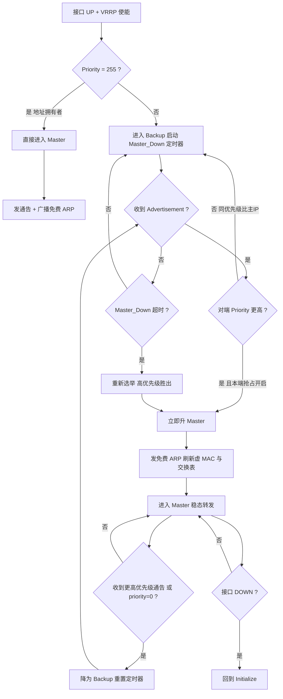
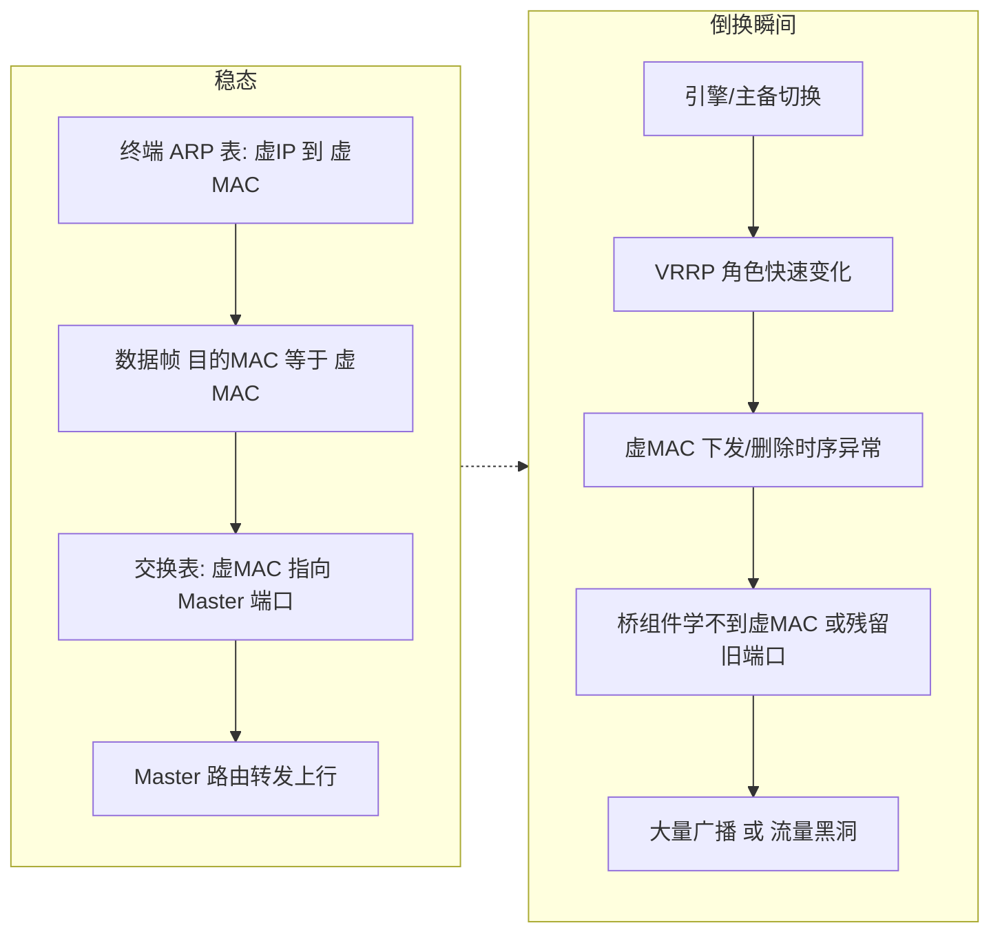
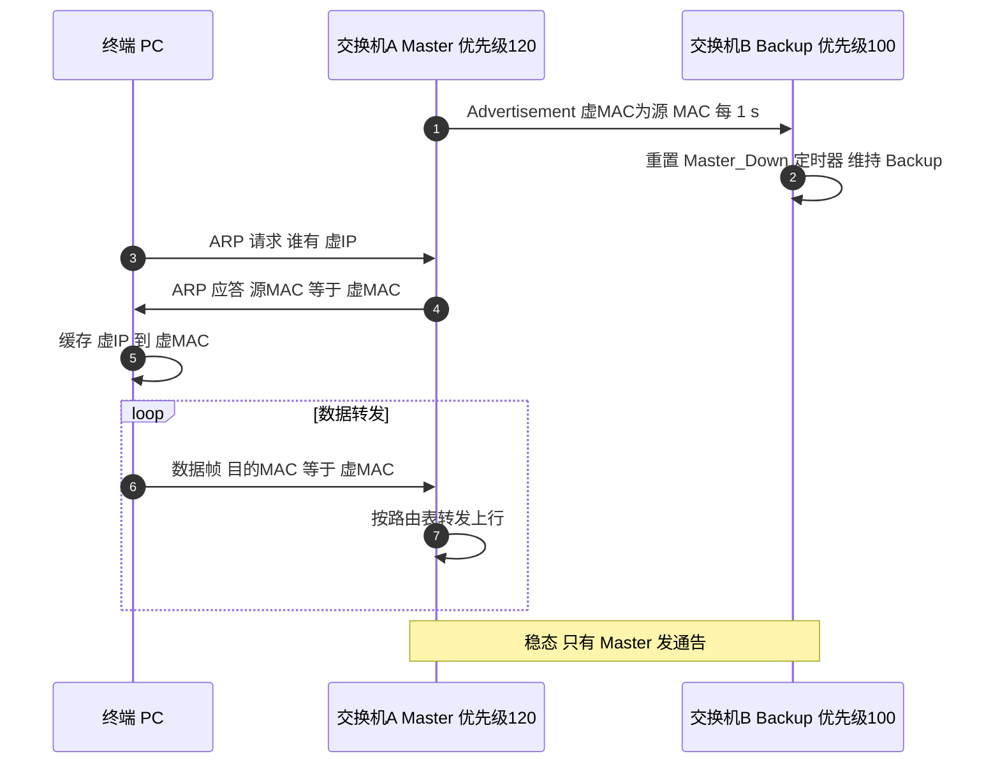
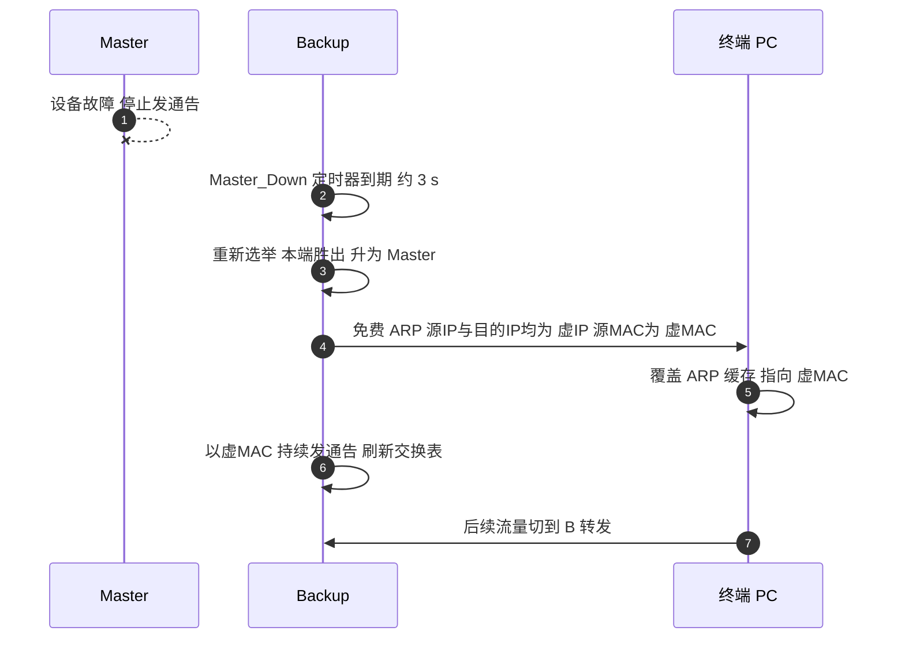
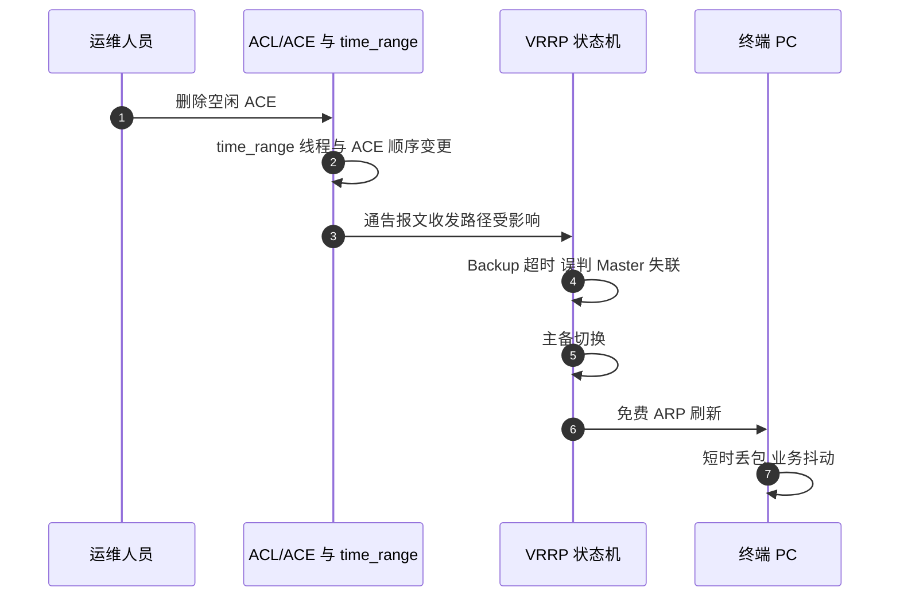

# 1 VRRP 场景全景：描述 · 流程 · 涉及模块 · 监控点

> **大场景**：DS-STACK（堆叠与虚拟化）——对应子场景 `DS-STACK-07`（VRRP / 虚拟网关冗余异常）
> **文档版本**：v1.0（精简篇，**未经两轮评审**；如需定稿请并入 `00_协议梳理总索引.md` 的评审流程）
> **编制日期**：2026-09-24
> **标准依据**：`RFC 9568`（VRRPv3 for IPv4/IPv6，废止 RFC 5798）；`RFC 3768`（VRRPv2）；IPv6 虚拟 MAC 见 RFC 9568 §7.3
> **说明**：设备命令凡未经真机验证一律标注「（待实机核对）」；本文不写未证实的版本号与补丁号。

---

## 1.1 一页速览

| 阶段/环节 | 关键动作 | 执行者 | 失败后的现象 |
|---|---|---|---|
| ① 初始化 | 接口 UP + VRRP 使能，按优先级定初始角色；255 直接 Master 并广播免费 ARP | VRRP 状态机 | 接口未 UP / 配置未下发 → 停在 Initialize，不参与选举 |
| ② 选举 | 周期收发 Advertisement，比优先级；同优先级比接口主 IP 大小 | Master + Backup | 优先级/VRID/虚地址两端不一致 → 双主或虚 IP 不可达 |
| ③ 稳态 | 仅 Master 发通告（默认 1 s）；Master 用**虚 MAC** 作通告源 MAC、应答虚 IP 的 ARP | Master | 通告被 ACL/time_range/FP 丢弃 → Backup 超时误升主 |
| ④ 倒换 | Backup 的 Master_Down 超时或收到 priority=0 → 升 Master，发免费 ARP | Backup | 未发/未刷新免费 ARP → 下游 ARP 缓存指向旧口，终端丢包 |
| ⑤ 虚 MAC 承接 | 虚 MAC 随角色迁移，交换表需重新学习到新端口 | 桥组件 + 硬件 | 虚 MAC 下发/删除时序异常 → 大量广播、学不到虚 MAC |
| ⑥ VSU 叠加 | 角色运行在 VSU 之上，主备引擎切换会引发 VRRP 角色快速变化 | VSU + VRRP | 引擎切换瞬间虚 MAC 反复下发删除 → `DS-STACK-07` 主因 |

**一句话本质**：VRRP 把"多台物理网关"虚拟成"一台虚拟路由器"，**虚 IP + 虚 MAC 成对迁移**；终端只认这对地址，所以切换对终端透明。它解决的是**网关单点故障**，不解决网关与上行链路之间的故障——那是 track / BFD 联动的职责。

---

## 1.2 协议/对象定位与边界

### 1.2.1 一句话定义

VRRP（Virtual Router Redundancy Protocol）是一种**网关冗余选举协议**：同一网段内的多台设备以相同 `VRID` 组成一个虚拟路由器，通过周期 Advertisement 报文选举出唯一的 **Master** 持有虚 IP 与虚 MAC 并转发流量；Master 失联时 Backup 在**秒级**（默认约 3 s）内接替。

- 承载：直接封装在 **IP** 之上，**IP 协议号 112**（无 TCP/UDP 端口，防火墙需放行协议本身）。
- IPv4：目的组播 **224.0.0.18**，目的 MAC **01-00-5E-00-00-12**，TTL **255**；源地址为**接口主 IP**（不是虚 IP）。
- IPv6：目的组播 **ff02::12**。
- 虚 MAC：IPv4 `00-00-5E-00-01-{VRID}`；IPv6 `00-00-5E-00-02-{VRID}`。

### 1.2.2 在本大场景中的位置

- **承接**：`DS-STACK-03`（主备倒换）、`DS-STACK-01`（分裂/双主）——VSU 的角色变化是 VRRP 异常的上游触发。
- **交织**：`DS-STACK-09`（功能面表项缺陷，虚 MAC 学习与 port-security 查询口径在此交叉）。
- **本篇对应子场景**：`DS-STACK-07`（虚地址不可达、主备切换、双主、虚 MAC 时序）。

### 1.2.3 边界判据

**属于本篇：**

- VRRP 组 ID / 虚地址配置不一致导致虚 IP 不可达。
- VRRP 主备切换、双主、抢占（preempt）行为异常。
- 主备引擎切换导致 VRRP 角色快速变化，引发虚 MAC 下发/删除时序异常、桥组件学不到虚 MAC。
- 虚地址 ping 不通命中 SVI / 已知预警（WN 类缺陷）。
- 其他特性（ACL `time_range` 增删等）**触发** VRRP 主备切换。

**不属于本篇、易误入：**

- **VRRP 双主由 VSU 分裂同时引发** → 先归 `DS-STACK-01`，再关联 `DS-STACK-07`。判据：`show switch virtual` 是否同时出现 split/recovery。
- **非 VSU 场景的 VRRP 异常**（普通双机、EG 网关）→ 归可靠性/路由大场景，不占 `DS-STACK-07`。
- **纯 ACL / ACE 匹配错乱但未触发 VRRP 倒换** → 归 `ACL/ACE 异常大场景`。
- **终端 ARP 缓存/老化异常、下游交换机 MAC 表问题** → 归二层与表项大场景；只有落在"虚 MAC 下发/删除时序"这一 VSU 上下文时才归本篇。

---

## 1.3 涉及模块

| 模块名 | 所属层 | 职责 | 与 VRRP 的交互点 | 该模块失效时的典型现象 |
|---|---|---|---|---|
| VRRP 状态机（每 VRID 一实例） | 设备侧控制面 | 维护 Initialize/Master/Backup、收发性通告、选举与抢占 | 全部 VRRP 逻辑中枢 | 双主、虚 IP 不可达、角色反复变化 |
| 接口管理 / SVI | 设备侧控制面 | 提供 IP、接口 UP/DOWN 事件、主 IP 选取 | 接口 UP 是 VRRP 启动前置；主 IP 参与同优先级比较 | 接口抖动 → VRRP 反复 Initialize；主 IP 变更 → 选举结果变化 |
| 虚 MAC 下发与桥组件（MAC 学习） | 转发面 + 硬件 | 把虚 MAC 写入硬件表项；随角色切换下发/删除 | 角色切换触发虚 MAC 增删 | 虚 MAC 未下发/未删除 → 大量广播、转发黑洞（`DS-STACK-07`） |
| FP / 硬件表项层 | 转发面 | 承载虚 MAC 与虚 IP 的转发策略 | 角色切换瞬间表项更新 | 表项时序错乱 → 切换后短时不通 |
| ACL / ACE + `time_range` | 设备侧控制面 | 过滤与时间生效控制 | 增删 ACE 可能影响通告报文收发路径 | 删除空闲 ACE 触发 VRRP 切换（实证见 §10） |
| Track / 联动（接口、IP-SLA、BFD） | 设备侧控制面 | 检测上行可达性，联动调整优先级 | 检测 down → 降优先级 → 让位 | 抖动链路 → 主备来回切换（本节 §6 参数表） |
| VSU 主机/备机引擎 | 设备侧控制面 | 提供承载 VRRP 的虚拟化底座 | 引擎倒换 → VRRP 实例迁移/重启 | 角色快速变化 → 虚 MAC 时序异常 |
| 平台对接（SNMP/Syslog/Telemetry） | 平台侧 | 采集 VRRP 状态、切换事件 | APM 数据源 | 无采集 → 切换无告警、双主无感知（§8） |

**模块清单置信度**：VRRP 状态机、虚 MAC 与桥组件、ACL 触发、Track 抖动为**本项目实证**（§10 行号可查）；进程名/内部组件名未证实者不写。

---

## 1.4 协议栈、报文与配置模型

### 1.4.1 协议栈位置

```
┌────────────────────────────────────────────┐
│ 终端 PC / 服务器   默认网关 = 虚 IP        │
├────────────────────────────────────────────┤
│ ARP / ND（解析虚 IP → 虚 MAC）             │
├────────────────────────────────────────────┤
│ IP（VRRP 协议号 112，TTL 255）             │
│   ↳ 目的 224.0.0.18（组播）/ 源 = 接口主 IP │
├────────────────────────────────────────────┤
│ 以太网（目的 MAC 01-00-5E-00-00-12）       │
└────────────────────────────────────────────┘
```

### 1.4.2 报文字段（VRRPv3；v2 差异见表下）

| 字段 | 长度 | 含义 | 关键取值 |
|---|---|---|---|
| `Version` | 4 bit | 版本 | v2=2 / v3=3 |
| `Type` | 4 bit | 报文类型 | 固定 1 = Advertisement（VRRP 只有这一种报文） |
| `Virtual Rtr ID` | 8 bit | 虚拟路由器 ID | 1–255，两端必须一致 |
| `Priority` | 8 bit | 优先级 | 0–255；默认 **100**；**255 = IP 地址拥有者**（虚拟 IP 与接口真实 IP 相同）；**0 = 主动放弃 Master**（Backup 立即接替，不必等超时） |
| `Count IPvX Addr` | 8 bit | 虚地址个数 | 与地址列表长度对应 |
| `Max Adver Int`（v2 为 `Adver Int`） | 12 bit | 通告间隔 | v3 单位**厘秒**，v2 单位**秒** |
| `Checksum` | 16 bit | 校验和 | v3 用伪首部校验 |
| `IPvX Address(es)` | 变长 | 虚 IP 列表 | 两端必须一致 |
| ~~`Auth Type`~~ | — | 认证类型 | **v3 已取消认证**；v2 支持 0=无 / 1=明文 / 2=MD5 |

### 1.4.3 选举与抢占规则（必须写对）

1. **优先级高者胜**；范围 0–255，默认 100，配置范围实际为 1–254（255 保留给地址拥有者，0 用于主动让位）。
2. **IP 地址拥有者（Priority=255）永为主**，在其在线期间不可被抢占（RFC 9568 明确：地址拥有者总是抢占，与 Preempt 开关无关）。
3. **同优先级**：比较**接口主 IP 地址大小**，大者为 Master。
4. **抢占（Preempt）默认开启**：高优先级设备上线或恢复后夺回 Master。可通过 `preempt delay` 延迟抢占，避免"刚恢复就抢、抢了又抖"。
5. **虚 MAC 的可学习性**：Master 发通告时**以虚 MAC 作源 MAC**，因此上游/下游交换机能在转发路径上学习到虚 MAC 的端口位置——这是切换后流量能自动改道的前提。

### 1.4.4 定时器与切换时间

- 通告间隔（`Adver Int`）默认 **1 s**。
- Backup 的 Master_Down 超时 ≈ **3 × 通告间隔 + 偏斜时间（skew time）**，所以默认约 **3 s** 才判定 Master 失联。
- 结论：**未联动 BFD 时，纯 VRRP 故障切换在秒级（>1 s）**；要进毫秒级必须靠 BFD/Track 联动（见《堆叠-BFD 双主检测与联动-补充篇》）。

### 1.4.5 三种状态的职责

| 状态 | 做什么 | 不做什么 |
|---|---|---|
| **Initialize** | 等待启动事件（接口 UP / 配置生效）；处理设备故障回退 | 不处理、不发送任何 VRRP 报文 |
| **Master** | 周期发通告；以虚 MAC 应答虚 IP 的 ARP；转发目的 MAC 为虚 MAC 的报文；默认允许 ping 通虚 IP | — |
| **Backup** | 监听通告、维护 Master_Down 定时器 | **不应答**虚 IP 的 ARP；目的 IP 为虚 IP 的报文按普通二层转发处理 |

---

## 1.5 流程图

### 1.5.1 选举与主备倒换流程（含失败分支）



### 1.5.2 虚 MAC 随角色迁移的数据流（VSU 叠加场景）



---

## 1.6 时序图

### 1.6.1 正常：主备建立与稳态



### 1.6.2 异常一：Master 失联，Backup 超时升主



### 1.6.3 异常二：删除空闲 ACE 触发 VRRP 主备切换（本项目实证）



**规避方向**：先去 ACL 调用再删 ACE、再重配，避免在业务时段直接删除被引用的 ACE。

---

## 1.7 关键参数与定时器

| 参数 | 含义 | 典型默认值 | 配错的后果 |
|---|---|---|---|
| `vrrp <group> ip <addr>` | 虚 IP，组 ID | 无默认，必配 | 两端组 ID 或虚地址不一致 → 双方各成一组，**虚 IP 不可达或双主** |
| `vrrp <group> priority` | 优先级 | 100 | 两端配成相同 → 靠主 IP 大小定主，结果易与预期相反；误配 255 → 抢占不可控 |
| `Adver Int` | 通告间隔 | 1 s | 过长 → 切换慢；跨版本单位不同（v2 秒 / v3 厘秒）→ 间隔理解错，切换时间失控 |
| `preempt` / `preempt delay` | 抢占开关与延迟 | 默认开启 | 关闭后高优先级设备恢复也不夺回 → 长期次优路径；不配延迟 → 抖动链路来回切换 |
| `track <obj> <decrement>` | 联动降优先级 | 无默认 | 不配 → 上行断了但 VRRP 仍为 Master，形成**"网关在位但转不出去"**的黑洞 |
| `track` 的 `interval/timeout/retry` | 探测节奏 | interval 3 s / timeout 1 s / retry 1 | 链路抖动大时按默认 → 主备来回切换（本项目实证场景，见 §10） |
| 认证（仅 v2） | 明文 / MD5 | 无认证 | 两端认证不一致 → 互相不认通告 → 双主；v3 已取消认证，无法用它对齐 |
| `time_range` + ACE 顺序 | ACL 时间生效 | — | 增删被引用的 ACE → 可能触发 VRRP 切换（实证） |
| VSU 引擎倒换 | 底座切换 | — | 倒换引发 VRRP 角色快速变化 → 虚 MAC 时序异常 |

---

## 1.8 常见故障模式与分阶段定位

| 阶段 | 现象 | 首要观测点 | 常见原因 |
|---|---|---|---|
| 选举 | 虚 IP 不通 / SSH 虚 IP 失败 | `show vrrp brief`（待实机核对）看组与状态 | 两端 VRID 或虚地址不一致；跨版本组 ID 错配 |
| 选举 | 两端都显示 Master（双主） | `show vrrp` 双端对照 + `show switch virtual` | 通告互不可达：ACL/time_range 丢弃、VSL 分裂、网络变更重启 |
| 稳态 | 角色反复切换 | 切换日志时间戳与 `track` 目标可用性 | track 目标抖动 + 默认探测参数；preempt 未加延迟 |
| 倒换 | 切换后终端丢包（数十个包） | 免费 ARP 是否发出、下游 ARP 缓存 | 未发/延迟发免费 ARP；口字形组网下刷新范围不足 |
| 表项 | 切换后大量广播、学不到虚 MAC | 桥组件 MAC 表 + 虚 MAC 是否已下发 | VSU 引擎切换致虚 MAC 下发/删除时序异常（`DS-STACK-07`） |
| 配置 | 引擎切换后 `no vrrp preempt` 等命令丢失 | 主备 `show running-config` 差异比对 | 配置同步丢失（交叉 `DS-STACK-06`） |
| 承载 | 虚 IP ping 不通但 VRRP 状态正常 | SVI 状态、已知预警库比对 | 命中 SVI / WN 类缺陷 |

**成功 vs 失败对比要点**

- 成功：两端 `show vrrp` 一方 Master 一方 Backup、组 ID/虚地址/优先级一致、虚 MAC 在两端均可查、免费 ARP 在切换后立刻发出、track 目标稳定。
- 失败：双端均 Master、虚 IP 在两端都不通、切换时间远大于 3 × 通告间隔、切换后无免费 ARP 记录、虚 MAC 表项残留指向旧端口。

---

## 1.9 监控点（APM 可观测性映射）

固定列：`观测点 | 观测对象 | 数据源 | 采集方式 | 阈值/触发条件 | 现状 | 优先级`。

| 观测点 | 观测对象 | 数据源 | 采集方式 | 阈值/触发条件 | 现状 | 优先级 |
|---|---|---|---|---|---|---|
| VRRP 角色与组状态 | 每 VLAN 每组的角色、虚 IP、虚 MAC、优先级 | VictoriaMetrics + MySQL | CLI 定时采集（`show vrrp brief` 解析，待实机核对） | 出现**双 Master**、或角色由 Backup 变 Master | 部分（命令可得但缺持续采集） | **P0** |
| 主备切换事件与时间戳 | 切换事件、切换原因、切换耗时 | Loki | Syslog/Trap 订阅（VRRP 关键字） | 5 分钟内切换 ≥2 次，或单次切换耗时 > 3 × 通告间隔 | 缺失 | **P0** |
| 两端配置一致性预检 | VRID、虚地址、优先级、抢占、track 配置 | MySQL | 平台 API 拉取 / CLI 定时采集（配置快照入 MySQL） | 同组两端 VRID / 虚地址 / 认证（v2）不一致即告警 | 缺失 | **P0** |
| 免费 ARP 与虚 MAC 学习 | 切换后免费 ARP 发送记录、虚 MAC 表项归属端口 | Loki + VictoriaMetrics | Syslog/Trap 订阅 + CLI 定时采集（MAC 表查询，待实机核对） | 切换后 N 秒内无免费 ARP，或虚 MAC 表项缺失/指向非 Master 端口 | 缺失 | **P1** |
| 虚 IP 可达性拨测 | 虚 IP 的 ICMP/TCP 可达性与时延 | VictoriaMetrics | 主动探针（采集器侧 ping 虚 IP） | 虚 IP 不可达，或时延突增（推断值，需现场标定） | 缺失 | **P1** |
| track 目标抖动率 | track 目标的丢包/时延抖动、切换次数 | VictoriaMetrics + Loki | CLI 定时采集 + Syslog 订阅 | 目标丢包波动导致 10 分钟内主备切换 ≥2 次 | 缺失 | **P1** |
| ACL/time_range 变更与切换的时间相关性 | ACL 变更事件 vs VRRP 切换事件 | Loki + MySQL | Syslog/Trap 订阅 + 配置快照 | 切换时间戳与 ACE 增删在 ±60 s 内（推断值，需现场标定） | 缺失 | **P2** |
| VSU 引擎倒换与 VRRP 角色变化关联 | 引擎倒换事件 vs VRRP 角色变化 | Loki | Syslog/Trap 订阅 | 倒换后出现虚 MAC 残留/缺失或角色快速翻转 | 缺失 | **P1** |

> **数据源口径**：只落 `VictoriaMetrics / Loki / MySQL / Pyroscope / Redis` 五类载体。
> **不可观测说明**：VRRP 报文被丢弃的**具体位置**（芯片/ACL/FP）无法从协议面直接观测，只能由"通告超时 + ACL 变更事件 + FP 丢弃计数"三条线索间接反推。

---

## 1.10 排查动作步骤

| 步 | 动作 | 命令 / 观测点 | 判读 |
|---:|---|---|---|
| 1 | 看两端组与角色 | `show vrrp brief` / `show vrrp <group>`（待实机核对） | 一方 Master 一方 Backup 为正常；**双端 Master = 双主** |
| 2 | 核对组配置一致性 | 两端 `show running-config` 中 VRRP 段（待实机核对） | 比 VRID、虚地址、优先级、抢占、认证（v2），任一不一致即根因候选 |
| 3 | 判是否 VSU 同时分裂 | `show switch virtual`（待实机核对） | 若同时 split/recovery → 先归 `DS-STACK-01`，再关联 `DS-STACK-07` |
| 4 | 抓切换与通告日志 | `show logging` 检索 VRRP 关键字 | 定位切换时刻、是否有通告超时；与引擎倒换时刻对齐 |
| 5 | 查虚 MAC 与免费 ARP | 桥组件 MAC 表查询 + 日志检索 ARP（待实机核对） | 虚 MAC 未学习/残留旧端口 → 虚 MAC 时序异常 |
| 6 | 查影响面 | ACL 配置与 `time_range` 变更记录（待实机核对） | 删除空闲 ACE 触发切换为实证场景，规避为先调用后删除 |
| 7 | 查 track 稳定性 | `show vrrp` 详情 + track 目标探测参数（待实机核对） | 抖动大时按 `interval/timeout/retry` 调参 |
| 8 | 查 SVI 与已知预警 | SVI 状态 + 预警库比对（WN 类） | 虚 IP ping 不通且状态正常 → 疑命中 SVI/WN 缺陷 |

---

## 1.11 与本项目已知故障的对应

| 子场景 | 典型现象 | 本篇覆盖点 | 实证记录（Sheet8 行） |
|---|---|---|---|
| `DS-STACK-07` | 无法通过虚 IP SSH 登录设备 | §3.3 组配置一致性、§9 步 1/2 | 29 |
| `DS-STACK-07` | 删除空闲 ACE 触发 VRRP 主备切换 | §2 模块表、§5.3 时序、§6 参数、§9 步 6 | 159 |
| `DS-STACK-07` | 口字形组网 VRRP 主机重启后终端丢包超 30 个 | §3.3 免费 ARP、§4.2 数据流、§9 步 5 | 356 |
| `DS-STACK-07` | 主备引擎切换后虚 MAC 下发/删除时序异常、桥组件学不到 | §4.2、§8 虚 MAC 观测点 | 477 / 822 |
| `DS-STACK-06 相邻` | 引擎切换后 `no vrrp preempt` 丢失 | §6 参数、§7 配置行 | 229 |
| `DS-STACK-01 相邻` | VSU 分裂同时引发 VRRP 双主 | §1.3 边界判据 | 288（分裂主机理，VRRP 为伴生） |

> 说明：`DS-STACK-07` 在 04 文档中登记为 6 条（29 / 159 / 356 / 477 / 822 / 229），其中 row 421 因根因空缺已移入未归类。本篇不新造记录号。

---

## 1.12 待确认事项

- **Q-STACK-07-01**：RGOS 上 VRRP 组 ID / 虚地址配置不一致时，设备是否会给出显式告警？还是只能靠双端配置比对发现？影响 §8 "配置一致性预检" 的阈值设计。
- **Q-STACK-07-02**：`show vrrp brief` / `show vrrp <group>` 在 RGOS 各版本的确切回显字段（尤其虚 MAC 与 track 状态）？均标（待实机核对）。
- **Q-STACK-07-03**：VSU 引擎切换时，虚 MAC 的**下发与删除顺序**在本实现中的确切时序（先删后加 / 先加后删）？这是 `DS-STACK-07` 时序类根因的关键，需研发确认。
- **Q-STACK-07-04**：删除空闲 ACE 触发 VRRP 切换的精确判据（是 ACE 顺序变化、`time_range` 线程阻塞，还是两者叠加）？影响 §8 的 P2 相关性规则。
- **Q-STACK-07-05**：VRRP 是否支持与 BFD 联动？若支持，与本项目"track 接口/IP 探测"的优先级关系如何？见《堆叠-BFD 双主检测与联动-补充篇》§11。

---

## 1.13 附：术语速查

| 缩写 | 全称 | 说明 |
|---|---|---|
| VRRP | Virtual Router Redundancy Protocol | 虚拟路由器冗余协议，RFC 3768（v2）/ RFC 9568（v3） |
| VRID | Virtual Router ID | 虚拟路由器 ID，1–255，两端必须一致 |
| Master / Backup | — | 主 / 备角色；仅 Master 转发虚 IP 流量 |
| Owner | IP Address Owner | 虚 IP 与接口真实 IP 相同者，优先级固定 255 |
| Preempt | — | 抢占，默认开启 |
| Skew time | — | 偏斜时间，与优先级相关，叠加在 Master_Down 上防同优先级同时升主 |
| GARP | Gratuitous ARP | 免费 ARP，切换后广播以刷新全网缓存 |
| Track | — | 联动检测对象（接口 / IP / BFD），用于降优先级让位 |
| SVI | Switch Virtual Interface | VLAN 三层接口 |
| `DS-STACK-07` | — | VRRP / 虚拟网关冗余异常子场景 |
