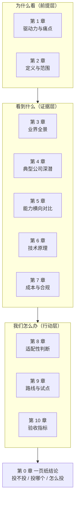

# AI 生成自动化测试用例 · 洞察报告汇报框架

> 本文件是**写报告用的骨架**，不是报告本身。它的作用是：把"要写什么、写到什么程度算合格、哪几处最容易写废"固定下来，避免动笔后跑偏成厂商资料汇编。

## 目录

- [[#0 体例与用法|0 体例与用法]]
- [[#1 报告定位|1 报告定位]]
- [[#2 框架总览|2 框架总览]]
- [[#3 第0章 一页纸结论|3 第0章 一页纸结论]]
- [[#4 第1章 为什么现在看|4 第1章 为什么现在看]]
- [[#5 第2章 定义与范围|5 第2章 定义与范围]]
- [[#6 第3章 业界全景|6 第3章 业界全景]]
- [[#7 第4章 典型公司深潜|7 第4章 典型公司深潜]]
- [[#8 第5章 能力横向对比|8 第5章 能力横向对比]]
- [[#9 第6章 技术原理|9 第6章 技术原理]]
- [[#10 第7章 成本与合规|10 第7章 成本与合规]]
- [[#11 第8章 对我们的适配性|11 第8章 对我们的适配性]]
- [[#12 第9章 路线与试点|12 第9章 路线与试点]]
- [[#13 第10章 验收指标|13 第10章 验收指标]]
- [[#14 附录|14 附录]]
- [[#15 提交前自检清单|15 提交前自检清单]]

---

## 0 体例与用法

### 0.1 语言与术语规范

**英文保留原文，同时给中文**：正文首次出现统一写成 `中文（English）`，此后可单独使用缩写。原因是英文负责检索（GitHub、论文库能搜到），中文负责理解（评审人能读懂）。

- 专有名词：测试预言（test oracle）、变异测试（mutation testing）、检索增强生成（RAG, Retrieval-Augmented Generation）
- 缩写：平均修复时长（MTTR）这类写法，只在本文确有多次引用时才定义
- **不翻译**：命令、代码、路径、URL、版本号、论文编号
- 批量术语用表格并列（英文｜中文｜一句话释义），不要塞进长段落

**术语一致性**：全文对同一事物只用一个译名。建议固定为——测试预言（test oracle）、变异得分（mutation score）、采纳率（acceptance rate）、假绿（false green）、自愈定位器（self-healing locator）。

### 0.2 本文档怎么用

1. 先读 [[#1 报告定位|1 报告定位]]，确认这次汇报的决策问题是什么。**框架服务于决策问题，不是反过来。**
2. 按 [[#2 框架总览|2 框架总览]] 的分章顺序填内容，每章开头有"目的 / 必备要素 / 合格标准"三件套。
3. 第 4 章严格套用 [[#7.1 四段式分析模板|四段式分析模板]]（7.1），这是全篇唯一不能自创格式的地方。
4. 写完用 [[#15 提交前自检清单|15 提交前自检清单]] 过一遍。

---

## 1 报告定位

### 1.1 先钉死三个前置参数

| 参数 | 本次设定 | 说明 |
|---|---|---|
| 决策问题 | 要不要投入、投哪个方向、投多少 | 一切内容都为回答它服务 |
| 读者 | 研发/测试负责人 + 产品负责人 | 关心"能不能降本、能不能复用"，不关心模型选型细节 |
| 汇报时长 | 25 分钟讲 + 15 分钟问答 | 正文页数控制在 18–22 页 |
| 成功标准 | 会后能拿到一个明确动作（试点立项 / 暂缓观察） | 拿不到动作，报告就是无效的 |

### 1.2 一条容易忽略的判断

这是**技术情报汇报**，不是**采购评审**。二者的差别在于：前者要说明"业界能力边界在哪、我们该往哪走"，后者才需要报价。本文档按前者设计；若实际是采购评审，需要额外补第 9 章的商务比价与第 7 章的合同条款风险。

---

## 2 框架总览

### 2.1 两层结构：目录横向，模板纵向

这是本框架与你初稿最大的差别，务必理解：

| 层 | 作用 | 形态 |
|---|---|---|
| **报告目录**（横向） | 让结论浮出来，让读者按主题推进 | 11 个章节，按"前提→证据→行动"排 |
| **分析模板**（纵向） | 保证每个被分析对象被同尺度审视 | 四段式，逐家填 |

你初稿里的"解决什么问题 / 旧技术为何无法解决 / 效果与边界 / 技术原理"这四问，是**模板**，不是章节。把它们串成章节目录，报告会退化成三家厂商各讲一遍的流水账；抽出来当模板用，它才是全篇最有价值的部分。

### 2.2 篇幅分配建议

| 部分 | 页数 | 备注 |
|---|---|---|
| 第 0 章 | 1 页 | 必须单页，不能拆分 |
| 第 1–2 章 | 2 页 | 快速带过 |
| 第 3 章 | 2 页 | 一页全景表 + 一页趋势判断 |
| 第 4 章 | 6–8 页 | 3–5 家，每家 1.5 页 |
| 第 5 章 | 2 页 | 矩阵 + 失败模式 |
| 第 6–7 章 | 3 页 | 原理不需要深讲，讲清"为什么这样选"即可 |
| 第 8–10 章 | 4 页 | 结论落点，页数宁可多给 |
| 附录 | 不限 | 不占正文时间 |

---

## 3 第0章 一页纸结论

**目的**：让没听过汇报的人在 60 秒内知道你的判断。

**必备要素**（四句硬性结构）：

1. **结论**：一句话给出动作建议，例如"建议在两个方向做 POC（概念验证）试点，暂不整体采购"。
2. **三个理由**：每条一句，可被追问。
3. **三个数字**：至少一个业界量化结果、一个我方现状基线、一个预期收益。
4. **一个风险**：主动写出最大的不确定性。

**合格标准**：把这一页单独发出去，读者不需要看正文也能做判断。

**常见错误**：把"业界发展很快""大模型能力很强"当结论——那是背景，不是判断。

---

## 4 第1章 为什么现在看

**目的**：回答"为什么是现在，而不是去年或明年"。

**必备要素**：

- **我方痛点，要带基线数字**：回归用例维护占测试人力的百分比、单次回归耗时、漏测导致的线上问题数（按季度）。
- **旧做法的瓶颈点**：不是"效率低"，而是具体卡在哪一环（用例设计、脚本编写、还是维护）。
- **时点触发因素**：是什么变化让这件事在 2026 年变得可行（模型在代码任务上的能力曲线、工具链成熟、成本下降）。
- **不做什么的代价**：如果今年不动，一年后会怎样。

**合格标准**：痛点数字来自我方真实数据，不能引用外部报告。这一章的可信度决定了整份报告的可信度。

---

## 5 第2章 定义与范围

**目的**：把"AI 生成测试用例"这个模糊说法切干净，否则后文无法比较。

### 5.1 六种形态与判定问句

| 编号 | 形态 | 输入→输出 | 判定问句 | 与 APM/网络设备场景相关度 |
|---|---|---|---|---|
| F1 | 需求驱动用例设计 | 需求文档 → 自然语言用例 | 产出是给人读的还是给机器执行的？ | 低（演示容易，价值难量化） |
| F2 | 代码驱动单元测试 | 源码 → 可执行单测代码 | 测试对象是函数/类吗？ | **高**（APM 后端服务） |
| F3 | 接口驱动用例 | OpenAPI/契约 → 接口测试 | 是否绕开 UI 直接打接口？ | **高**（采集与查询接口） |
| F4 | UI 脚本生成与自愈 | 页面操作 → E2E 脚本 | 依赖浏览器 DOM 吗？ | 低（我方主体不在 UI 层） |
| F5 | 流量反推回归基线 | 生产流量/日志 → 回归用例 | 是否从真实行为反推预期？ | 中（可复用真实采集数据） |
| F6 | 测试数据合成与智能模糊测试 | 模式/约束 → 数据或输入序列 | 产出是数据还是用例？ | 中（认证协议异常注入有用） |

### 5.2 本章必须写死的一句话

明确写出边界，例如：**"本报告聚焦 F2、F3、F5；F1 因效果不可量化、F4 因与我方测试对象不匹配，仅作背景说明。"**

这一句能在汇报现场挡掉相当一部分跑题追问，也是评审人判断你"是否真读进去了"的第一个信号。

### 5.3 术语澄清

必须定义：**测试用例（test case）**、**测试脚本（test script）**、**测试预言（test oracle）** 三者的区别。业界大量宣传把"生成脚本"说成"生成用例"，混淆这两者会直接导致效果被高估。

---

## 6 第3章 业界全景

**目的**：先给地图，再带读者进具体地点。

**必备要素**：

1. **一页分层表**：按玩家类型分五层，每层写"代表厂商 / 主要覆盖形态 / 成熟度 / 典型客户"。

| 层级 | 玩家类型 | 覆盖形态 | 成熟度判断依据 |
|---|---|---|---|
| L1 | 通用编码助手 | F2 | 采用率最高，但测试只是副产物 |
| L2 | 专用测试生成工具 | F2、F3 | 有商业客户与公开案例 |
| L3 | UI/E2E 工具商 | F4 | 商业化最成熟，但赛道与本文不同 |
| L4 | 云厂商与平台 | F1–F3 | 与云生态绑定，可迁移性弱 |
| L5 | 企业自建 | 全形态 | 效果最好但不可采购，只能借鉴 |

2. **一段趋势判断**：这个市场正在往哪收敛（例如从"生成脚本"往"生成 + 自愈 + 反馈闭环"收敛）。趋势判断要给出依据，不要只给结论。

3. **一段"没人解决好的问题"**：明确指出业界共同的空白区。这一条比罗列成功案例更有洞察价值，也是第 8 章我方机会点的铺垫。

**合格标准**：读者看完这一章，能说出"这个领域大致分几派、每派强在哪"。

---

## 7 第4章 典型公司深潜

**目的**：提供可被检验的证据，而不是宣传口径。

### 7.1 四段式分析模板

**每家公司严格按四段写，顺序不变，篇幅接近。** 这是本框架的核心。

| 段 | 必须回答 | 合格标准 | 常见写废方式 |
|---|---|---|---|
| ① 要解决的问题 | 在哪个测试环节、针对哪类资产，遇到什么**可量化**的痛点 | 有具体环节 + 有数字或可核查的事实 | 写成"提升测试效率""降低人力成本"这类通用口号 |
| ② 旧技术为何无法解决 | 旧方案的失效**机制**，不是"不好用" | 能指出机制层面的原因 | 一句"传统方法成本太高"带过，等于没写 |
| ③ 效果与边界 | 公开可查的量化结果 + 明确的能力边界 | 每个数字带来源与时间；边界写到"在哪类输入下会失败" | 只抄厂商首页的成功率，不写失败案例 |
| ④ 技术原理 | 从输入到输出的完整链路 + 关键技术选择及理由 | 能画出数据流；能解释"为何不用另一种做法" | 只写"接入了大模型"，等于没写 |

**② 段的写法示范**（这是最容易写空的一段）：

- ✗ 不合格：「传统符号执行工具在大型 Java 工程上效率低。」
- ✓ 合格：「符号执行（symbolic execution）需要求解路径约束，遇到反射调用、动态代理、依赖注入容器时无法静态确定实际类型，路径在容器边界处爆炸，导致真实工程上的可达路径覆盖率长期停留在个位数，工程师因而放弃使用。」

差别在于：前者是评价，后者是机制。

**③ 段的写法要求**：效果必须区分三类数据，且分开标注——

- **厂商自述**（marketing，可信度最低）
- **客户案例**（有署名，可部分采信）
- **第三方或学术评测**（可信度最高，注意样本是否为我方同类系统）

### 7.2 候选公司清单

以下是**候选池**，不是最终名单。正式写作前必须做一轮时效性核实（2026 年现状），并补上"为什么选它进深潜"的一句话理由。

| 候选 | 类型 | 选它的理由 | 形态 |
|---|---|---|---|
| Meta（TestGen-LLM 相关公开工作） | 超大规模自建 | 有论文级工业部署数据，是目前最硬的公开证据 | F2 |
| Google（单元测试生成相关公开工作） | 超大规模自建 | 对"断言质量"问题有公开讨论 | F2 |
| Diffblue Cover | 专用工具商 | 非纯 LLM 路线（符号执行 + 学习），可作对照组 | F2 |
| GitHub Copilot / Amazon Q Developer | 通用编码助手 | 覆盖面最广，用于说明"基线水位" | F2 |
| Postman（AI 用例生成） | 接口工具商 | 与我方 OpenAPI 资产直接对应 | F3 |
| Tricentis Testim / mabl | UI 工具商 | 自愈定位器是成熟能力，可对比"维护成本"议题 | F4 |
| Meticulous 类 | 流量反推 | 与"用真实采集数据生成回归"的思路同源 | F5 |
| 华为 / 阿里云效 / 腾讯 WeTest 等国内厂商 | 国内平台 | 数据合规前提下更可能可用；但多为实践分享，证据等级较低 | F1–F3 |

**深潜数量控制在 3–5 家**。超过 5 家，读者记不住，且每家的 ② 段都会写薄。

### 7.3 每家公司小节收尾的固定句式

每家最后一句必须是：**「所以这对我们意味着什么：……」**

没有这句，这一节就是资料堆砌。这句也是你事后回答提问时最好用的抓手。

---

## 8 第5章 能力横向对比

**目的**：把上章的分散结论压缩成一张能 30 秒看完的判断表。

### 8.1 能力矩阵

横轴 = 测试形态（F1–F6），纵轴 = 深潜厂商，单元格填 **能做 / 勉强能做 / 不能做**，并附一句限定条件。

**注意**：单元格写"能做"时必须带前提，例如"能做（要求被测代码有完整类型标注）"。无条件的能力声明等于没写。

### 8.2 七种失败模式清单

这是全篇最值钱的一节，也是评审人最可能记住的内容。逐条写"现象 / 成因 / 后果"。

| 编号 | 失败模式 | 现象 | 后果 |
|---|---|---|---|
| M1 | 固化缺陷 | 断言写的是"当前实现的行为"，而非"需求要求的行为" | 把既有 bug 锁进测试，越测越安全是错觉 |
| M2 | 假绿 | 测试通过，但断言为空或只校验"不抛异常" | 掩盖缺陷，比没有测试更危险 |
| M3 | 表面覆盖 | 覆盖率显著上升，变异得分几乎不变 | 投入换来了虚荣指标 |
| M4 | 环境幻觉 | 编造不存在的 API、配置项、字段名 | 编译/运行失败，反向增加返工 |
| M5 | 脆弱测试 | 依赖时间、随机数、执行顺序 | 引入 flaky（不稳定）测试，侵蚀 CI 可信度 |
| M6 | 长尾盲区 | 只覆盖主路径，边界值与异常注入薄弱 | 真实缺陷仍漏检 |
| M7 | 评审债务 | 大量低质量产出涌入评审队列 | 人力从"写用例"转为"读垃圾"，净收益为负 |

**M1 必须展开讲**：这是 LLM 在此任务上的**根本性上限**——它缺少测试预言（test oracle），不知道"正确行为应该是什么"，只能从代码反推"当前行为是什么"。这一条决定了 AI 生成用例在业务规则密集、协议时序严格的场景下（例如认证协议交互）天花板很低。写清这一点，报告的专业度会明显不同。

---

## 9 第6章 技术原理

**目的**：不是科普大模型，而是让读者理解"不同技术路线为什么导致不同边界"。

**组织方式：按技术路线讲，不要按公司讲。** 按公司讲会和第 4 章重复。

| 路线 | 一句话原理 | 主要解决 | 主要短板 |
|---|---|---|---|
| T1 零样本提示 | 直接把代码或接口描述塞进上下文要求生成 | 快速起步 | 无项目上下文，M4 幻觉高发 |
| T2 检索增强（RAG） | 从需求库、历史用例、相似代码中检索上下文注入 | 补业务语义与风格一致性 | 检索质量决定上限，仍需维护知识库 |
| T3 微调（fine-tuning） | 用领域代码与用例语料训练 | 贴合私有编码规范 | 数据准备成本高，模型更新即失效 |
| T4 智能体反馈闭环 | 生成→编译→执行→读覆盖率/报错→再生成 | 把"能编译、能通过"变成硬约束 | 依赖可执行的快速反馈环境 |
| T5 符号执行 + LLM 混合 | 符号执行求路径，LLM 写可读断言 | 覆盖率有保证 | 工程适配成本高，语言支持有限 |
| T6 运行时数据驱动 | 从真实流量/日志反推预期行为 | 回归基线贴近生产 | 只能覆盖已发生的行为 |

**本章必须回答的一个问题**：为什么 T4 比 T1 效果好一个量级？答案是反馈闭环把"生成"变成了"可验证的搜索"，模型幻觉被编译器和测试执行结果自然过滤。这个机制解释了业界为什么都在往 Agent 方向走——也直接关联到我方已有的 AI 助手底座（见 [[#11 第8章 对我们的适配性|第 8 章]]）。

---

## 10 第7章 成本与合规

**目的**：把"能不能用"之外的"敢不敢用"讲清楚。这一章缺失，汇报可能被安全或法务一票否决。

### 10.1 成本结构

| 成本项 | 口径 | 备注 |
|---|---|---|
| 单位生成成本 | 单用例 token 消耗 × 单价 | 要按"生成 N 个才采纳 1 个"折算真实成本 |
| 部署成本 | 公有 API / 私有化开源模型 / 商用私有化 | 三档差异极大，需分别估算 |
| 评测集建设 | 人工构造黄金集（golden set）的工时 | 最容易被漏算的固定投入 |
| 评审成本 | 每百条生成产出的评审工时 | 与 M7 直接相关 |
| CI 增量 | 用例数量增长带来的流水线时长 | 影响迭代节奏，需提前评估 |

### 10.2 合规风险：To B 网络设备场景的硬约束

必须单列小节写清三件事：

1. **数据出域**：测试素材可能含客户网络拓扑、设备配置、认证凭据（802.1X / Portal 场景尤其敏感）。**这一条基本筛掉了公有云 SaaS 形态的工具**，只剩私有化部署或脱敏链路两条路。
2. **许可证污染**：生成代码可能与开源代码高度相似，需要相似性扫描。
3. **审计要求**：生成内容的可追溯性（谁生成、基于什么输入、谁评审通过）。

### 10.3 供应商锁定

模型可替换性、提示词与评测集是否可迁移、退出成本。写成"如果明年换供应商，我们要重做哪些事"。

---

## 11 第8章 对我们的适配性

**目的**：把业界结论映射到我方具体测试对象上。这是全篇唯一"只能我们写"的章节。

**做法**：给一张打分表，逐类测试对象评估，写明判断理由与前置条件。

| 测试对象 | 适配形态 | 适配度 | 判断理由 | 前置条件 |
|---|---|---|---|---|
| 后端服务单元测试 | F2 | 高 | 代码结构规整，可编译可执行，反馈闭环易建 | 需覆盖率采集链路 |
| 采集与查询接口测试 | F3 | 高 | 有 OpenAPI/契约资产，输入输出明确 | 需稳定测试环境 |
| 日志/指标解析逻辑 | F2 | 高 | 纯函数式逻辑，断言易写 | 无 |
| 告警规则与阈值判定 | F2 + F6 | 中 | 规则明确但边界值场景多，依赖领域知识 | 需规则知识库（RAG） |
| 认证协议交互（802.1X / Portal / MAC 无感知） | F3 + F6 | 中低 | 时序与状态机复杂，预言缺失问题突出 | 需协议仿真器/桩 |
| 设备配置校验 | F3 | 中 | 配置项间存在隐式约束 | 需配置模型 |
| 端到端组网场景 | F5 | 低 | 依赖真实设备与拓扑 | 需环境编排 |
| 性能与稳定性 | — | 低 | 不属于用例生成范畴 | — |

**另一个必须写进这一章的点**：我方在做 APM 的 AI 助手（智能体 + 工具调用架构），而 T4 反馈闭环路线所需的底座与之高度重合。**结论倾向是"不必把它当独立采购议题，优先评估复用现有底座"**——这是最容易拿到资源的论证角度，也比单纯比价更有说服力。

**必须同时写"什么情况下不该用"**：适配度低的场景直接给出替代方案，不要留白。敢写边界的报告，可信度远高于只写收益的报告。

---

## 12 第9章 路线与试点

**目的**：给出可执行的动作，而不是"建议关注"。

**必备要素**：

1. **三条路线对比**：采购成熟工具 / 基于现有底座自研 / 混合（工具跑标准层，自研覆盖领域层）。逐条给成本、周期、风险、天花板。
2. **推荐路线 + 理由**，理由必须承接 [[#8 第5章 能力横向对比|第 5 章]] 的能力矩阵和 [[#10 第7章 成本与合规|第 7 章]] 的合规结论。
3. **试点设计**：选哪一个测试对象、多少周、几个人、成功判据是什么。试点范围要小到"失败也不伤筋动骨"。
4. **决策节点**：试点结束后按什么标准继续或终止。**提前写好终止条件**，是这类报告最容易被忽视也最能体现专业度的地方。

---

## 13 第10章 验收指标

**目的**：让"效果好不好"有客观口径，避免被覆盖率绑架。

| 指标 | 定义 | 为什么用它 | 数据来源 |
|---|---|---|---|
| 采纳率 | 被工程师接受并保留的产出 / 生成总量 | 直接反映可用性 | 评审记录 |
| 变异得分 | 注入的人为缺陷被测试捕获的比例 | **测试有效性的客观代理指标**，不受覆盖率虚高影响 | 变异测试工具 |
| 增量覆盖率 | 新增覆盖的行/分支 / 未覆盖总量 | 补充性指标，不单独使用 | 覆盖率工具 |
| 假绿率 | 通过但无有效断言的用例占比 | 直接对应 M2 风险 | 人工抽样 + 静态检查 |
| 单位用例成本 | 总投入 / 采纳用例数 | 与人力基线对比才有意义 | 工时统计 |
| 维护工时变化 | 季度用例维护工时同比 | 检验"降低长期成本"这一核心承诺 | 工时统计 |

**必须写一句反直觉的结论**：覆盖率是虚荣指标，变异得分才是真指标。仅凭覆盖率提升做决策，很可能买到的是 M3（表面覆盖）。这一句会让报告的技术含量立刻不同。

---

## 14 附录

- 附录 A：来源清单（每条含类型标注、发布日期、链接）
- 附录 B：术语表（英文｜中文｜释义）
- 附录 C：POC 记录（若已做）
- 附录 D：被排除的厂商及排除理由（体现筛选严谨性）

**证据等级标注规则**（正文中每个关键数字后都要加）：

| 标记 | 含义 | 采信程度 |
|---|---|---|
| [厂] | 厂商自述或官网宣传 | 低，仅作方向参考 |
| [客] | 有署名的客户案例 | 中，需注意样本偏差 |
| [研] | 学术论文或第三方评测 | 高，注意是否同类系统 |
| [我] | 我方实测或 POC | 最高 |

**时效性提醒**：AI 领域结论衰减很快，2025 年之前的量化结论引用时要标注年份并说明是否仍成立。

---

## 15 提交前自检清单

逐项打勾，任何一项未过不提交。

- [ ] 第 0 章能否单独成页发出，且读者不看正文也能做判断
- [ ] 每家公司小节末尾是否有"所以这对我们意味着什么"
- [ ] 四段式中第 ② 段是否写到了**机制**层面，而不是"效率低"这类评价
- [ ] 是否有至少 3 个可核查的量化数据，且每个都标了证据等级与年份
- [ ] 是否明确写出了"什么情况下不该用"
- [ ] 第 5 章 M1（固化缺陷）是否展开到"测试预言缺失"这一层
- [ ] 第 7 章是否覆盖了数据出域这一 To B 硬约束
- [ ] 第 8 章是否给出了"适配度低"的场景及替代方案
- [ ] 第 9 章是否写了试点的**终止条件**
- [ ] 全部英文术语是否都配了中文（含缩写首次出现）
- [ ] 正文页数是否与汇报时长匹配（约 1 页 / 1.2 分钟）
- [ ] 全文术语是否统一，没有同一事物两个译名

---

## 附：本框架与初稿的差异说明

| 初稿内容 | 本框架处理方式 | 原因 |
|---|---|---|
| 「业界有哪些公司在使用」 | 升级为 [[#6 第3章 业界全景\|第 3 章]]，分层呈现 | 平铺清单无法体现格局差异 |
| 「针对业界公司单独一章」 | 保留为 [[#7 第4章 典型公司深潜\|第 4 章]]，但限制 3–5 家 | 家数过多会导致每家都写不深 |
| 「解决什么问题、旧技术为何无法解决」 | 抽为 [[#7.1 四段式分析模板\|7.1 四段式分析模板]] 第 ①② 段 | 这是模板，不是章节 |
| 「实际效果、优缺点、能力边界」 | 拆成 7.1 第 ③ 段（逐家）+ [[#8 第5章 能力横向对比\|第 5 章]]（横向汇总） | 逐家讲效果无法对比，必须有一次横向收敛 |
| 「基本的技术原理」 | 拆成 7.1 第 ④ 段（逐家）+ [[#9 第6章 技术原理\|第 6 章]]（按路线讲） | 按公司讲原理会与第 4 章重复 |
| （无） | 新增第 0、1、2、7、8、9、10 章 | 汇报需要结论层、定义层、合规层与行动层 |
