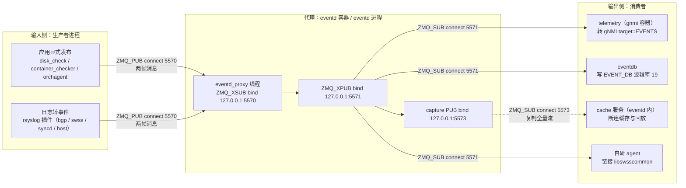
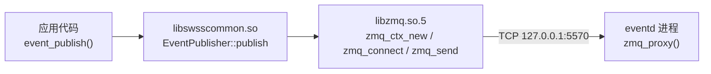
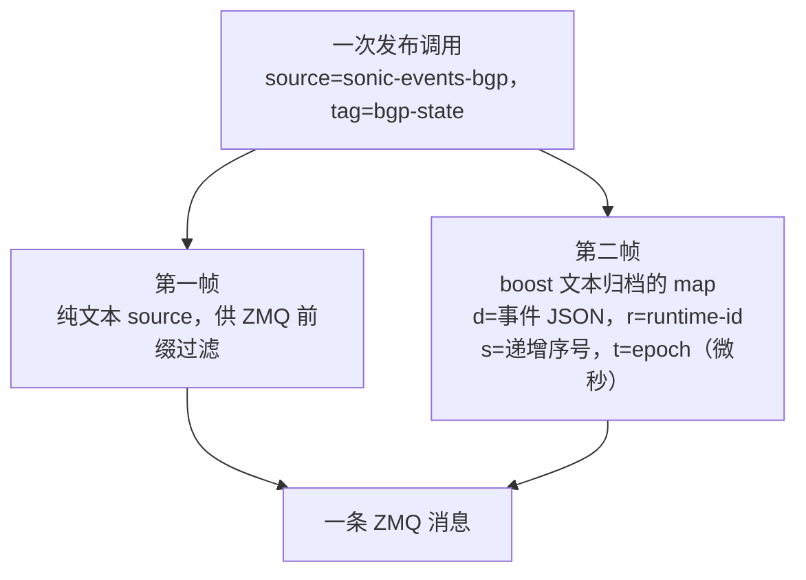
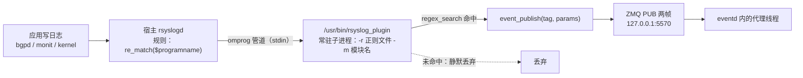
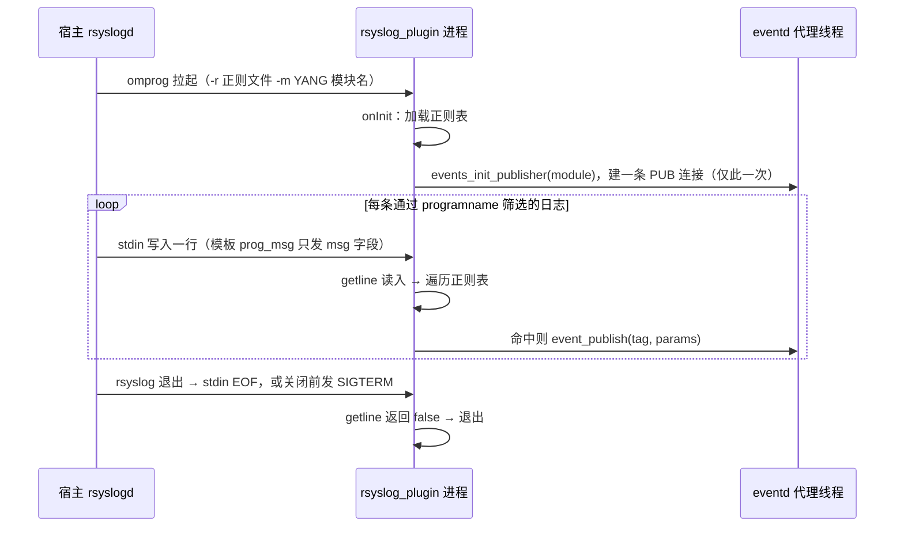
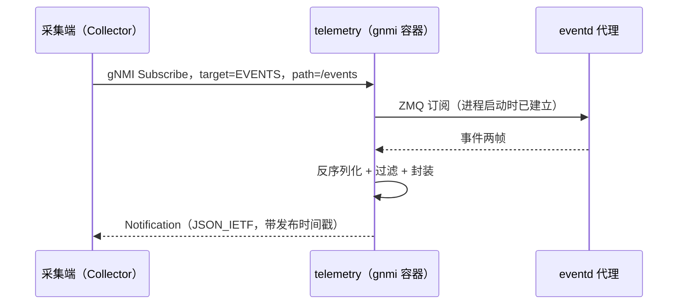
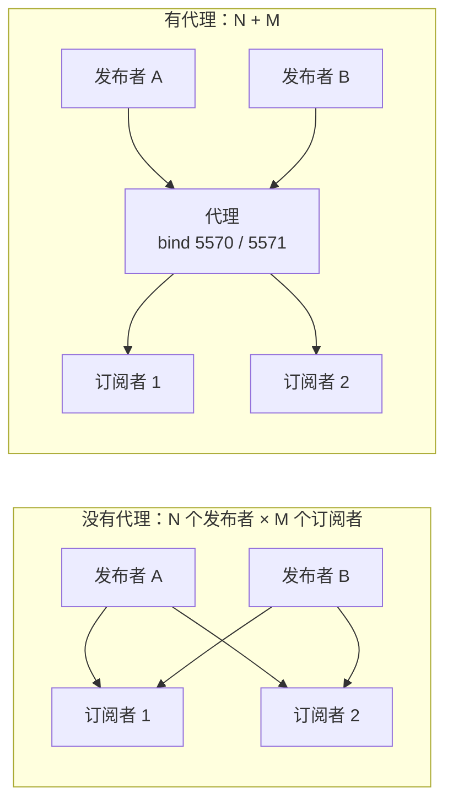

# SONiC 事件数据抓取框架：输入、输出与设计取舍

> 本文回答三个问题：**事件数据从哪来、到哪去、中间怎么走**；以及两个设计层面的疑问：**为什么这条链路不用 Redis**、**为什么要有中间代理**。
> 结论都附源码或文档出处；属于推断的，会明确标注为推断。
> 姊妹文档：[[SONiC-可观测采集与容器架构调研]]（整体容器架构、Redis 访问机制、非 DB 数据采集）。

## 结论先行

**一句话：SONiC 的事件数据是一条独立于 Redis 的 ZeroMQ（零消息队列，ZeroMQ，缩写 ZMQ）发布/订阅通道——生产进程用 `libswsscommon` 把事件发给 `eventd` 进程内的代理线程，代理再分发给三类消费者，对外的主出口是 gNMI（gRPC 网络管理接口）的 `EVENTS` 目标（target）。**

五条要点，按重要性排序：

| # | 结论 | 依据强度 |
|---|---|---|
| 1 | **输入是进程，不是容器**。真正发事件的是 `disk_check.py`、monit 的 `container_checker`、orchagent 等进程，以及 rsyslog 插件；容器只是它们的部署边界 | 源码确认 |
| 2 | **代理不是一个独立进程**。`zmqproxy` 是 HLD 文献里的叫法，代码里是 `eventd` 进程内的 `eventd_proxy` 线程，内部调 `zmq_proxy()` | 源码确认 |
| 3 | **线上是两帧消息**：第一帧只有事件源名（如 `sonic-events-bgp`），第二帧是 boost 文本归档的事件载荷，键压缩为 `d`/`r`/`s`/`t` | 源码确认 |
| 4 | **事件传输不碰 Redis**。Redis 只出现在两个落点：`EVENT_DB`（历史）与 `COUNTERS_EVENTS`（采集质量指标），且都由订阅方写 | 源码确认 |
| 5 | **代理的价值是把 N×M 连接压成 N+M**，并额外提供缓存回放与全量捕获；代价是引入一个无确认（ACK）的中间跳，故障定位多一层 | 结构推断 |

三个最容易误判的点，先摆出来：

| 误判 | 事实 |
|---|---|
| “模块之间都走 Redis，事件当然也走 Redis” | 控制面（`CONFIG_DB`/`APPL_DB`/`STATE_DB` 的表读写）走 Redis；事件面被特意剥离成独立 ZMQ 通道 |
| “`ps` 里能看到 `zmqproxy`” | 看不到。`docker exec eventd ps -ef` 只有 `eventd`；代理是它的第 2 个线程 |
| “`event_publish()` 返回 0 就代表发出去了” | 只代表进了本地发送队列。PUB 无确认，没有订阅者或队列满时静默丢弃 |

## 目录

- [[#1 框架全貌|1 框架全貌]]
- [[#2 输入侧怎么把事件送进来|2 输入侧]]
- [[#3 代理：一个进程内的线程，不是独立服务|3 代理]]
- [[#4 输出侧：三种出口|4 输出侧]]
- [[#5 关键问题一：为什么不用 Redis|5 为什么不用 Redis]]
- [[#6 关键问题二：为什么要有中间代理|6 为什么要有中间代理]]
- [[#7 对 APM 采集的落地建议|7 落地建议]]
- [[#8 排障速查表|8 排障速查表]]
- [[#9 参考资料|9 参考资料]]

---

## 1 框架全貌

### 1.1 一张图看全链路



三个结构性事实，图上体现得很直接：

1. **所有箭头的方向都是“生产者/消费者去连代理”**，代理只负责 `bind`，从不主动连任何人；
2. **同一份事件流被复制成四路**：gNMI 出口、历史库、缓存、自研进程，彼此不影响；
3. **只有两个输出会落到 Redis**（`O2` 的 `EVENT_DB`、以及 `O1` 写的 `COUNTERS_EVENTS` 指标），传输段一个都没有。

### 1.2 输入侧：谁在产生事件

**输入的单位是进程，不是容器。** 这是最容易被“容器化架构”带偏的一点——容器只是部署与权限边界，事件的生产者是具体的守护进程或脚本。

| 输入类型 | 具体是谁 | 怎么产事件 | 占比判断 |
|---|---|---|---|
| 应用显式调用 | `disk_check.py`、monit 的 `container_checker`、orchagent 的个别事件、`events_publish_tool` | 调 `events_init_publisher()` + `event_publish()` | 少数 |
| 日志转事件 | rsyslog 插件，按 `bgp` / `swss` / `syncd` / `dhcp-relay` / `host` 五套映射表解析日志 | 正则命中后调同一套发布接口 | **多数** |

第二类常被忽略，但它才是“系统事件流”的主体：`bgp_events_info.json`、`swss_events_info.json`、`syncd_events_info.json`、`dhcp_relay_events_info.json`、`host_events_info.json` 这几张映射表，定义了“哪一行日志、被哪条正则命中、变成哪个事件标识”。所以**事件覆盖面不是由“谁想发”决定的，而是由这些表加上 YANG 模型决定的**。

有一点需要明确纠正：**`pmon` 容器里的 `thermalctld`、`psud`、`xcvrd` 不调 `event_publish()`**。核对 `thermalctld` 源码，全文只有写 `STATE_DB` 与打日志，没有任何事件 API 调用。硬件越阈值时，实际产生的是“状态快照 + 一行 syslog”，只有当日志内容被 `host_events_info.json` 的 `proclist` 覆盖时，才会被转成事件。这解释了“`show` 里有值、事件流里却没有”的常见现象。

### 1.3 输出侧：谁在消费事件

| 消费者 | 所在容器 | 消费方式 | 用途 |
|---|---|---|---|
| `telemetry` 的 EventClient | `gnmi`（旧版为 `telemetry`） | ZMQ 订阅 `5571`，转 gNMI Notification 下发 | **跨机采集的主出口** |
| `eventdb` | `eventd` | ZMQ 订阅 `5571`，写 Redis | `EVENT` / `ALARM` 表，供 CLI 与 REST 查历史 |
| cache 服务 | `eventd` | ZMQ 订阅 `5573`（代理的捕获口） | 断连期间缓存，重连后回放 |
| 自研进程 | 任意 | 链接 `libswsscommon` 订阅 | 厂商或客户自建的 agent |

两个硬限制会直接影响架构设计：

- **每个进程只允许一个订阅者（subscriber）**，源码里 `EventSubscriber::s_subscriber` 是单例。所以 gNMI 面对多个外部客户端时，过滤只能在 gNMI 层做，不能靠“多开几个 ZMQ 订阅”。
- **ZMQ 层只能按事件源过滤，不能按事件标识（tag）过滤**。只想要 `bgp-state` 这一类，得在 gNMI 或应用层再筛一次。

### 1.4 交互方式：三段各用什么协议

| 段 | 两端 | 协议 | 默认端点 | 有无确认 |
|---|---|---|---|---|
| 生产 → 代理 | `ZMQ_PUB` → `ZMQ_XSUB` | ZMQ over TCP 回环 | `tcp://127.0.0.1:5570` | 无 |
| 就绪探测 | `ZMQ_REQ` → `ZMQ_REP` | 同上 | `tcp://127.0.0.1:5572` | 有往返 |
| 代理 → 订阅者 | `ZMQ_XPUB` → `ZMQ_SUB` | 同上 | `tcp://127.0.0.1:5571` | 无 |
| 代理 → 缓存 | `ZMQ_PUB` → `ZMQ_SUB` | 同上 | `tcp://127.0.0.1:5573` | 无 |
| 设备 → 采集端 | gNMI over gRPC | HTTP/2 | `0.0.0.0:8080`（默认，可配） | 有流控 |
| 落历史 | Redis RESP | Unix domain socket | `/var/run/redis/redis.sock` | 有应答 |

四个端点默认值硬编码在 `libswsscommon` 的配置里，可被 `/etc/sonic/init_cfg.json` 覆盖。

**为什么有 5572 这一路**：`zmq_connect()` 是异步的，返回 0 只代表参数合法，真正的握手在后台 I/O 线程完成。源码注释写得很直白：

> `Any message published before connection establishment is dropped.`

这就是“慢加入者（slow joiner）”问题。所以库在初始化时额外做一次 REQ/REP 往返（`echo_send("hello")`），把“连接已建立”同步出来，避免开机头几条事件凭空消失。

---

## 2 输入侧怎么把事件送进来

### 2.1 库的三层：谁链接谁

| 层 | 具体名字 | 形态 | 与生产者的关系 |
|---|---|---|---|
| 传输协议库 | `libzmq.so.5`（ZeroMQ 本体，纯 C 接口） | 共享库 | 间接依赖，被下一层链接 |
| SONiC 封装库 | `libswsscommon.so`（C++）／`_swsscommon.so`（Python 扩展） | 共享库 | **直接链接**，只需 include `events.h` |
| 代理 | `eventd` 进程内的 `eventd_proxy` 线程 | 进程内线程 | **不链接**，只通过 TCP 对话 |

**不存在“zmqproxy 的库”。** 生产者与代理之间没有函数调用、没有共享内存，只有一条 `127.0.0.1:5570` 的 TCP 连接。



### 2.2 初始化：六步建立连接

| # | 调用 | 所属库 | 作用 |
|---|---|---|---|
| 1 | `events_init_publisher("sonic-events-xxx")` | libswsscommon | 按事件源查静态表 `s_publishers`，命中即复用 |
| 2 | `zmq_ctx_new()` | libzmq | 建上下文（context），同时拉起自己的 I/O 线程 |
| 3 | `zmq_socket(ctx, ZMQ_PUB)` | libzmq | 建发布者类型的 socket |
| 4 | `zmq_setsockopt(ZMQ_LINGER, ...)` | libzmq | 退出时最多等这么久，避免残留消息被直接丢 |
| 5 | `zmq_connect(get_config(XSUB_END_KEY))` | libzmq | 连 `5570`，**立即返回** |
| 6 | `m_event_service.echo_send("hello")` | libswsscommon | 走 `5572` 的 REQ/REP 往返，确认代理就绪 |

一个容易被忽略的细节：**去重只按事件源做，上下文不共享**。第 2 步每次都新建 `zmq_ctx_new()`，所以一个进程发布 3 类事件源，就是 3 个上下文、3 组 I/O 线程、3 条到 `5570` 的连接。

### 2.3 发送：两帧消息的构成

发送是五步：`event_publish()` → 补时间戳 → `convert_to_json(source + ":" + tag, params)` → 组 `internal_event_t` → `zmq_message_send()`（内部用 `ZMQ_SNDMORE` 拼两帧）。



**为什么要两帧**：ZMQ 的订阅匹配只作用于第一帧，且是**字节前缀匹配**。所有事件的第二帧开头都是同一串 `serialization::archive`，如果把 source 和载荷合成一帧，前缀过滤就彻底失效——所有消息看起来都一样。两帧不是为了优雅，是过滤器能工作的前提。

顺带三个由实现决定的行为：

1. **第二帧不是 JSON**。它是 boost 文本归档，`json.loads()` 一定失败。想直接解包，得用 `libswsscommon` 的反序列化，或者放弃直连、改走 gNMI。
2. **序号是每进程每事件源独立递增的**，用于对端检测丢事件（缺口即丢失），不是全局有序。
3. **时间戳取发布时刻**，不是采集侧收到时刻。设备与采集端时钟不同步，会直接表现为“事件时间倒退”。

### 2.4 生产者的四类实际来源

| 来源 | 例子 | 事件源命名 | 备注 |
|---|---|---|---|
| 脚本工具 | `disk_check.py` | `sonic-events-host` | 磁盘异常、只读检测 |
| 容器健康检查 | monit 的 `container_checker` | `sonic-events-host` | 容器反复重启 |
| 网络应用 | orchagent、bgpd | `sonic-events-swss` / `sonic-events-bgp` | 个别显式事件 |
| 日志插件 | rsyslog + `*_events_info.json` | 按映射表决定 | **事件量的主体** |

### 2.5 日志转事件：omprog 拉起的独立程序，不是 rsyslog 模块

这一节回答一个高频误解：它确实是「rsyslog 的插件」，但**不是 `.so` 模块**，而是 [omprog](https://www.rsyslog.com/doc/configuration/modules/omprog.html)（program integration output module，外部程序集成输出模块）拉起的**独立可执行程序** `/usr/bin/rsyslog_plugin`。

更关键的一点：**`events_init_publisher()` 不是每条日志调一次，而是进程启动时调一次。** 每条命中正则的日志只调 `event_publish()`。

#### 2.5.1 五段链路



初始化与逐条发送的时序差别，是理解这条链路的关键：



#### 2.5.2 两层过滤：什么叫「命中」

| 层 | 判定方式 | 不通过时 |
|---|---|---|
| rsyslog 规则 | `if re_match($programname, "bgp") then { action(type="omprog" ...) }` | 日志不进 omprog，插件**根本看不到** |
| 插件正则 | 遍历 `*_regex.json`，逐条 `regex_search`（子串匹配，非全匹配） | 继续试下一条；全不中则丢弃，只留 DEBUG 日志 |

第二层还有一个隐藏的硬条件：`params.size()` 必须**严格等于**捕获组数量加 3，否则这条正则被直接跳过，不报错。源码里是一行短路判断：

```cpp
if (!regex_search(message, matchResults, m_regexList[i].regexExpression)
    || m_regexList[i].params.size() != matchResults.size() - 1
    || matchResults.size() < 4) { continue; }
```

那多出来的 3 个捕获组来自时间戳。插件会给每条正则自动拼一个前缀：

```cpp
string timestampRegex = "^([a-zA-Z]{3})?\\s*([0-9]{1,2})?\\s*([0-9]{2}:[0-9]{2}:[0-9]{2}.[0-9]{0,6})?\\s*";
```

并自动在 `params` 前面插入 `month` / `day` / `time` 三项。所以**自己写的正则里有几个括号，`params` 就要写几项**，多数「正则明明能匹配、却没事件」都是这里多了或少了一个括号。

#### 2.5.3 一条日志的处理细节

| 环节 | 实现 | 影响 |
|---|---|---|
| 输入 | `run()` 里 `getline(cin, line)`，一行一条 | 消息边界由换行决定，日志里有换行会被拆成多条 |
| 时间戳 | 前缀捕获 + `TimestampFormatter::changeTimestampFormat` 转 ISO | 转不出来则不带 `timestamp`，由 `event_publish` 补当前时间 |
| 参数提取 | 捕获组按顺序与 `params` 一一对应 | 顺序错位不报错，字段会静默串位 |
| 参数加工 | `params` 支持 `"名称:lua 代码"`，用全局 `arg` 传入、读全局 `ret` | 可做大小写归一、单位换算、枚举映射 |
| 事件标识 | `source:tag`，`source` 来自 `-m`，`tag` 来自正则文件 | 正则文件里只写 tag，写 source 会变成双重前缀 |
| 失败处理 | `event_publish` 返回非 0 只打 `SWSS_LOG_ERROR` | 无重试、无 ACK、无本地补发 |

一个 `params` 带 Lua 的例子（`ret` 是约定俗成的输出变量）：

```json
{
  "regex": "\\[BGP\\] neighbor (\\S+) state (\\S+)",
  "tag": "bgp-state",
  "params": ["ip", "status:ret = string.lower(arg)"]
}
```

#### 2.5.4 进程模型与失败模式

| 事件 | 行为 | 依据 |
|---|---|---|
| rsyslog 启动或规则首次匹配 | 每个 omprog action 拉起一个**常驻**实例 | omprog 文档：「Executes the configured program and feeds log messages to that binary via stdin」 |
| 程序异常退出 | rsyslog 自动重启 | 同上：「If the program terminates, it is re-started」 |
| rsyslog 退出 | stdin 见 EOF，`getline` 失败，进程自行退出 | 同上 + `run()` 实现 |
| 关闭管道 | `signalOnClose="on"` 先发 SIGTERM，再关 stdin | 配置模板 |
| 初始化失败 | `onInit` 返回 1（正则文件非法）或 2（`events_init_publisher` 失败），进程退出 → 被重启，形成循环 | `main.cpp` 的返回码定义 |
| 发布失败 | 只记录错误，消息丢弃 | `onMessage` 实现 |

两个由此派生的结论：

1. **`ps` 里能看到 `rsyslog_plugin`，且是常驻的**，不是每条日志 fork 一次。想看它有没有活着，直接 `ps -ef | grep rsyslog_plugin`。
2. **同一事件源可能有多条连接**。模板没设 `forceSingleInstance`，rsyslog 用多 worker 线程时每个线程可能各起一个实例，各自 `events_init_publisher` 一次，于是同一 source 出现多条 ZMQ 连接、各自独立的序号序列。

#### 2.5.5 它跑在宿主机，不在 eventd 容器里

这一点很容易搞反，因为配置文件是「在 eventd 镜像里生成」的。实际链条是：

| 步骤 | 位置 | 做什么 |
|---|---|---|
| 1 构建镜像 | eventd 镜像 | 用 `j2` 把 5 份 `*_events_info.json` 渲染成 `host/bgp/swss/syncd/dhcp_relay_events.conf` |
| 2 安装二进制 | **宿主 rootfs** | `sonic-rsyslog-plugin` 包由 `sonic_debian_extension.j2` 的 `install_deb_package` 装入宿主，二进制落 `/usr/bin/rsyslog_plugin` |
| 3 首次建容器 | 宿主 | `docker_image_ctl.j2` 的 eventd 分支把容器内 `/etc/rsyslog.d/rsyslog_plugin_conf/` 全部文件 `docker cp` 到宿主 `/etc/rsyslog.d/` |
| 4 生效 | 宿主 | `systemctl reset-failed rsyslog && systemctl restart rsyslog` |

所以真正执行「日志转事件」的是**宿主机的 rsyslog**。容器内 supervisord 虽然也起了 `rsyslogd`，但那只服务容器自身日志，不加载这 5 份规则。

插件与代理之间的连接之所以能通，是因为 eventd 容器用 `--net=host`：宿主进程连 `127.0.0.1:5570` 就是连到容器内的代理线程，不经过任何端口映射。

#### 2.5.6 四条验证命令

```bash
ps -ef | grep rsyslog_plugin              # 在宿主看；容器里看不到
ls -l /etc/rsyslog.d/*_events.conf        # 5 份规则是否落地
tail -f /var/log/rsyslog_plugin.log       # omprog 的 output 参数指定的文件
logger -t monit "…与 monit_regex.json 匹配的原文…"   # 造一条日志验链路
```

---

## 3 代理：一个进程内的线程，不是独立服务

### 3.1 代理的真实身份

这一点在中文资料里几乎都被写错，需要单独说明。

**设备上不存在 `zmqproxy` 这个可执行文件。** 代理是 `eventd` 进程的第 2 个线程：`eventd_proxy::run()` 创建三个 socket、`bind` 三个端点，然后调用 `zmq_proxy()` 永久阻塞。

三条证据：

| 证据 | 内容 |
|---|---|
| 源码 | `eventd.cpp` 的 `eventd_proxy::run()`：`zmq_socket(m_ctx, ZMQ_XSUB)` → `zmq_bind(...XSUB_END_KEY)` → `ZMQ_XPUB` → `zmq_bind(...XPUB_END_KEY)` → `ZMQ_PUB`（capture）→ `zmq_proxy(frontend, backend, capture)` |
| 进程表 | `docker-eventd/supervisord.conf` 只有 `rsyslogd`、`start.sh`、`eventd`、`eventdb` 四个 program，没有 `zmqproxy` |
| 启动脚本 | `start.sh` 只设置 `RUNTIME_OWNER`，不拉起任何代理进程 |

所以 `ps` 里永远找不到 `zmqproxy`。HLD 文档沿用这个名字描述“代理角色”，代码里它是线程。

`eventd` 进程一共五个线程，各自职责如下：

| 线程 | 职责 |
|---|---|
| 0 主线程 | 处理控制命令：开关缓存、心跳间隔、echo 探测 |
| 1 捕获/缓存 | 订阅 `5573`，把事件存在内存里，供重连回放 |
| 2 **代理** | `bind` XSUB/XPUB/capture，跑 `zmq_proxy()` |
| 3 统计 | 心跳计数、丢事件统计 |
| 4 落库 | 周期性把内存计数器写入 Redis |

### 3.2 四个端点与三种 socket

| 端点 | socket 类型 | 谁 `bind` | 谁 `connect` | 作用 |
|---|---|---|---|---|
| `5570` | `ZMQ_XSUB` | 代理 | 生产者的 `ZMQ_PUB` | 收事件 |
| `5571` | `ZMQ_XPUB` | 代理 | 订阅者的 `ZMQ_SUB` | 分发事件 |
| `5572` | `ZMQ_REP` | 代理侧服务 | 生产者的 `ZMQ_REQ` | 就绪探测、缓存控制 |
| `5573` | `ZMQ_PUB` | 代理（capture 口） | 缓存服务的 `ZMQ_SUB` | 全量复制一份给缓存 |

**XSUB 与 XPUB 这一对不是随便选的**。普通 `PUB` 对订阅者是“隐形”的：发布端看不到谁订了什么，因此无法做多对多转发。XSUB↔XPUB 之间会把订阅/退订当成消息传递（首字节 `0x01` 订阅、`0x00` 退订），代理据此才建得起扇出（fan-out）表。

### 3.3 三个职责：路由、缓存、捕获

| 职责 | 实现 | 解决什么问题 |
|---|---|---|
| 路由 | XPUB/XSUB 转发 + 订阅表 | 让 N 个生产者、M 个消费者解耦 |
| 缓存 | 线程 1 持续捕获，保留最近若干条 | 采集端重启或短暂断连期间不丢事件 |
| 捕获 | `zmq_proxy()` 的可选第三个参数 | 不干扰主链路地复制全量流，用于审计与缓存 |

**它不是消息队列（broker）**：不落盘、不确认、不重传。进程退出，内存里的缓存就没了。

---

## 4 输出侧：三种出口

### 4.1 gNMI EVENTS：跨机标准出口



| 项 | 值 |
|---|---|
| 目标（target） | `EVENTS` |
| 路径（path） | `/events` |
| 支持的订阅模式 | 仅流式 + 变更触发（STREAM + ON_CHANGE） |
| 不支持 | 轮询（POLL）、一次性（ONCE） |
| 认证 | 与其它 gNMI 路径一致，走 TLS 证书 |
| 订阅参数 | `heartbeat`（≤600 秒）、`qsize`（默认 10240）、`usecache`（默认 true） |

这是**唯一适合跨机采集的出口**：有认证、有流控、载荷已解码成 JSON。

### 4.2 EVENT_DB：设备内历史查询

| 项 | 值 |
|---|---|
| 库 | `EVENT_DB`，主 Redis 实例上的**逻辑库 19**（不是独立实例） |
| 表 | `EVENT`、`ALARM`、`EVENT_STATS`、`ALARM_STATS` |
| 写入者 | `eventd` 容器内的 `eventdb` 进程 |
| 保留策略 | 默认 4 万条或 30 天 |
| 前提条件 | 构建开关 `include_system_eventd=y`，且 `/etc/evprofile/default.json` 的 `events` 数组非空 |

`eventdb_wrapper.sh` 会先检查事件档案（event profile）是否为空，为空就直接退出——这解释了为什么有些设备 `EVENT_DB` 是空的、`show event-alarm` 无输出。

事件（Event）与告警（Alarm）语义不同，落表也不同：

| 类型 | 生命周期 | 存储 |
|---|---|---|
| 事件（Event） | 一次性通知，`action` 为空 | `EVENT` 表，跨重启保留 |
| 告警（Alarm） | 有状态：`RAISE` → `CLEAR` / `ACKNOWLEDGE` / `UNACKNOWLEDGE` | `ALARM` 表，reload 时清空 |

### 4.3 直连 ZMQ：设备内自研进程

只有在设备内写原生 agent、且确实需要极低时延时才值得。三个前提：能链接 `libswsscommon`；能接受自己解包 boost 归档；能接受无认证无加密。

```python
import zmq
ctx = zmq.Context()
sub = ctx.socket(zmq.SUB)
sub.setsockopt(zmq.RCVTIMEO, 2000)
sub.connect("tcp://127.0.0.1:5571")
sub.setsockopt(zmq.SUBSCRIBE, b"sonic-events-bgp")  # 过滤的是第一帧（事件源）
source = sub.recv_string()   # 第一帧
body = sub.recv_string()     # 第二帧，boost 文本归档
```

注意两处：`SUBSCRIBE` 过滤的是事件源，不是事件标识；第二帧不能 `json.loads()`。

### 4.4 三个出口的对比与选择

| 维度 | gNMI EVENTS | EVENT_DB | 直连 ZMQ |
|---|---|---|---|
| 跨机 | 支持 | 不支持（设备内 Redis） | 默认只听回环 |
| 认证加密 | 有 | 走 Redis 权限 | 无 |
| 载荷格式 | JSON（已解码） | Redis 表结构 | boost 归档（需自行解包） |
| 历史回溯 | 无（只有实时流） | 有（4 万条/30 天） | 无 |
| 时延 | 多一跳 gRPC | 多一跳落库 | 最低 |
| 适用 | **APM 采集首选** | 设备内排障、审计 | 设备内自研 agent |

---

## 5 关键问题一：为什么不用 Redis

### 5.1 事实层：这条链路确实不碰 Redis

先确认事实，再谈设计意图。事件从生产到下发，逐段看传输介质：

| 段 | 传输 | 经过 Redis |
|---|---|---|
| 生产 → 代理 | ZMQ over TCP 回环 | 否 |
| 代理内部 | 进程内内存队列 | 否 |
| 代理 → gNMI | ZMQ over TCP 回环 | 否 |
| gNMI → 采集端 | gRPC | 否 |
| `eventdb` 写历史 | Redis RESP | **是**（`EVENT_DB` 逻辑库 19） |
| gNMI 写质量指标 | Redis RESP | **是**（`COUNTERS_EVENTS`） |

所以准确表述是：**传输段零 Redis，落点有两处，且都由订阅方写，代理不写。**

在设备上一条命令即可验证：`ss -tnp | grep -E ':557[0-3]'` 看到的是进程间的回环连接，对端是 `telemetry`、`eventd`，不是 `redis-server`。

这里还要区分两个同名不同物的机制：

| | ZMQ 的发布/订阅 | Redis 的 `PUBLISH`/`SUBSCRIBE` |
|---|---|---|
| 中间件 | 无 broker，代理只转发 | Redis 自身承担 broker |
| 过滤粒度 | 第一帧字节前缀（socket 层） | 频道名 |
| 投递语义 | 至多一次，静默丢弃 | 至多一次，同样会丢 |
| 背压可观测 | 有 HWM、有丢包计数 | 只能靠输出缓冲限制间接观察 |
| SONiC 用途 | **事件流** | DB 变更通知（`NotificationProducer`） |

两者并存，名字一样，用途完全不同。

### 5.2 设计层：四条理由

以下四条中，前两条有代码或结构支撑，后两条是推断（标注清楚，避免当成官方结论）。

| # | 理由 | 强度 |
|---|---|---|
| 1 | **故障隔离**：Redis 是控制面的单点，`swss`、`bgp`、`syncd` 全依赖它。事件通道若寄生其上，Redis 抖动会被放大成“事件与业务同时失联” | 结构推断，理由充分 |
| 2 | **过滤发生在 socket 层**：ZMQ 按第一帧前缀过滤，不匹配的消息在引擎里就丢了，不进应用、不做反序列化。Redis 只能按频道过滤，要按来源细分就得为每个来源开频道 | 代码确认 |
| 3 | **背压与丢包可量化**：ZMQ 有高水位（HWM）、有 `missed_cnt`、有三个落库指标。Redis 的 pub/sub 丢弃不可见，只能间接推断 | 代码确认 + 推断 |
| 4 | **需要可控中间点**：缓存回放与全量捕获都要求“有一个能挂东西的中间节点”。Redis pub/sub 是发出即忘，没有可挂载的捕获口 | 代码确认 |

反过来看，如果事件走 Redis，会同时失去这四样东西，而收益仅仅是“复用现有连接”。对一个每台设备只跑几千条/秒事件流的场景，这个收益不足以抵消风险。

### 5.3 反例层：哪里仍然依赖 Redis

不能因为“事件不走 Redis”就以为整条链路与 Redis 无关。三处依赖必须知道：

1. **`EVENT_DB` 在 Redis 里**。查历史事件、`show event-alarm`，读的都是 Redis 逻辑库 19。
2. **`COUNTERS_EVENTS` 在 Redis 里**。`missed_internal`、`missed_by_slow_receiver`、`latency_in_ms` 三个指标，是判断采集质量的主要依据。
3. **端点配置可以来自 `init_cfg.json`**。改端点不走 Redis，但配置来源与其它模块一致。

### 5.4 边界：什么场景 Redis 也够用

这条要客观：**ZMQ 不是普遍更优，只是更适合“设备内高频、可丢、要按源分流”的场景。**

| 场景 | 更合适的选择 | 原因 |
|---|---|---|
| 事件可丢、量大、要按源过滤 | ZMQ | socket 层过滤，无 broker 开销 |
| 不允许丢、需要重放 | Kafka 等持久化日志 | 有磁盘、有偏移量、可重放 |
| 只是想通知“某个表变了” | Redis pub/sub | 已有连接，实现成本最低 |
| 跨机、要认证、要与指标同协议 | gNMI | 复用既有采集通道与证书体系 |

---

## 6 关键问题二：为什么要有中间代理

### 6.1 连接数：N×M 压成 N+M



ZMQ 的 `PUB` 必须 `bind`，这一条约束决定了连接的形状：没有代理时，每个订阅者都要知道每个发布者的地址；有代理时，双方都只知道代理的两个固定端点。

| 维度 | 没有代理 | 有代理 |
|---|---|---|
| 端点数量 | 等于发布者数量 | 固定两个 |
| 连接数 | N×M | N+M |
| 新增发布者 | 所有订阅者都要改配置 | 谁都不用改 |
| 发布者重启 | 订阅者要重连、重传订阅，中间丢一段 | 订阅关系留在代理侧，对订阅者透明 |
| 想加缓存/审计 | 要改每个发布者 | 代理一个捕获口就够了 |

### 6.2 五个具体收益

1. **拓扑解耦**：生产者和消费者互不知道对方存在，只认两个端点。
2. **订阅关系集中**：XPUB 侧维护订阅表，发布者上下线不影响订阅者。
3. **缓存回放**：代理持续捕获，采集端重启期间的空白可补。
4. **审计旁路**：捕获口复制全量流，不影响主链路。
5. **配置单点**：改端点只改一处（`init_cfg.json`），不用逐进程改。

### 6.3 代价与限制

要客观列出代价，否则会误以为它没有成本：

| 代价 | 表现 | 缓解 |
|---|---|---|
| 多一跳 | 时延增加一次内存转发 | 同机回环，量级可忽略 |
| 单点 | `eventd` 挂了，事件全断（业务面不受影响） | supervisord 拉起；采集侧靠序号缺口感知 |
| 无确认 | 代理与订阅者之间丢消息不报错 | `missed_*` 指标 + 序号缺口检测 |
| 不可重放 | 缓存只在内存，重启即失 | 长期留存只能靠 `EVENT_DB` 或外部存储 |
| 无认证 | 端点默认只绑回环，但可被改成对外 | 不要随意改 `xpub_path` 到非回环地址 |

### 6.4 为什么不用 Kafka 或 RabbitMQ

| 维度 | 部署成本 | 设备上的可行性 |
|---|---|---|
| ZMQ | 一个共享库，无独立进程 | 交换机资源受限，可行 |
| Kafka | 需要 broker 集群 + 磁盘 | 交换机上不现实 |
| RabbitMQ | 需要 Erlang 运行时 + broker | 同上 |
| Redis pub/sub | 已有 Redis | 可行，但失去按源过滤与捕获口 |

结论：**在单设备、事件量中等、允许丢弃的前提下，嵌入式库比独立 broker 更合适**。这也解释了为什么 SONiC 选 ZMQ 而不是“上个消息队列”。

---

## 7 对 APM 采集的落地建议

### 7.1 三条推荐路径

| 优先级 | 路径 | 适用 | 主要代价 |
|---|---|---|---|
| 1 | gNMI `EVENTS` | 跨机集中采集，与指标同一通道 | 仅流式，需处理断连重连 |
| 2 | `EVENT_DB` 读取 | 需要历史、需要告警状态 | 有保留上限，非实时 |
| 3 | 设备内自研 agent 直连 `5571` | 需要极低时延、需原始事件源 | 自己解包、自己防丢 |

不建议的做法：**从外部直连设备 `5571`**。默认只绑回环，改配置暴露后无认证无加密，风险与收益不成比例。

### 7.2 五个会咬人的坑

1. **把 `event_publish()` 的返回值当送达凭据**。PUB 无确认，返回 0 只代表进队列。
2. **以为 `ps` 里能看到 `zmqproxy`**。看不到，代理是 `eventd` 的线程。
3. **对第二帧调 `json.loads()`**。它是 boost 文本归档，必然失败。
4. **只按事件标识过滤**。ZMQ 层只能按事件源过滤，`bgp-state` 这类要在应用层再筛。
5. **忽略时钟同步**。时间戳取发布时刻，NTP 不同步会导致事件时间倒退、乱序。

### 7.3 选型判断表

| 你的需求 | 建议 | 说明 |
|---|---|---|
| 要一份统一的事件+指标视图 | gNMI `EVENTS` + 其它 gNMI 路径 | 同一条 gRPC 通道，认证复用 |
| 要做告警生命周期管理 | 读 `EVENT_DB` 的 `ALARM` 表 | 有 `RAISE`/`CLEAR`/`ACK` 状态 |
| 要事件不丢 | 不能只靠 ZMQ | 需在采集侧做序号缺口检测 + 补采 |
| 要极低时延 | 设备内 agent 直连 | 仅限设备内 |
| 要采端口计数变化 | 不要用事件流 | 走 `COUNTERS_DB` 的 DB 订阅 |

最后一条常被混淆：**端口计数、队列水位的变化不产生事件**，它们走 `COUNTERS_DB` 的 on-change 订阅，与事件流是两条独立通道。

---

## 8 排障速查表

| 现象 | 优先检查 | 命令 |
|---|---|---|
| 完全没有事件 | `eventd` 是否在跑、端点是否被改 | `docker ps \| grep eventd`；`jq .events /etc/sonic/init_cfg.json` |
| 有事件但采集侧收不到 | gNMI 订阅是否建立、`target` 是否写 `EVENTS` | `ss -tnp \| grep 5571` |
| 事件变少、时序有缺口 | 丢事件计数 | `redis-cli -n 2 HGETALL COUNTERS_EVENTS` |
| `show event-alarm` 为空 | 事件档案是否为空 | `cat /etc/evprofile/default.json` |
| 时间戳错乱 | 时钟同步 | `show ntp`；对比设备与采集端时间 |
| 硬件告警没进事件流 | 日志的 `$programname` 是否被映射表覆盖 | `cat /etc/rsyslog.d/host_events.conf`（宿主路径） |
| 日志明显命中却无事件 | 正则捕获组数与 `params` 数是否相等（差 3 个时间戳组）；插件进程是否活着 | `ps -ef \| grep rsyslog_plugin`；`tail /var/log/rsyslog_plugin.log` |

三个质量指标的含义要分清：

| 指标 | 升高说明什么 | 处置方向 |
|---|---|---|
| `missed_internal` | 事件在到采集侧之前就丢了（代理或发布侧） | 查代理负载、发布进程 |
| `missed_by_slow_receiver` | 送到了但消费太慢，队列满被丢 | 调大 `qsize`，或降低下游处理耗时 |
| `latency_in_ms` | 端到端时延变大 | 先查时钟同步与链路带宽 |

---

## 9 参考资料

### 9.1 官方文档

| 资料 | 说明 | 链接 |
|---|---|---|
| 事件与告警框架 HLD | 事件/告警语义、`EVENT_DB` 表结构、整体设计 | https://github.com/sonic-net/SONiC/blob/master/doc/event-alarm-framework/event-alarm-framework.md |
| 生产者指南 | `event_publish` 用法、source 与 tag 约定、序列号机制 | https://github.com/sonic-net/SONiC/blob/master/doc/event-alarm-framework/events-producer.md |
| gNMI 遥测文档 | `EVENTS` target、订阅模式、认证方式 | https://github.com/sonic-net/sonic-gnmi/blob/master/doc/grpc_telemetry.md |
| rsyslog omprog 模块 | 外部程序集成：stdin 喂消息、退出后自动重启、`signalOnClose` 语义 | https://www.rsyslog.com/doc/configuration/modules/omprog.html |

### 9.2 源码

| 文件 | 说明 | 链接 |
|---|---|---|
| `events.cpp` | `EventPublisher::init()` 六步建连、`publish()` 与 `send_evt()` | https://github.com/sonic-net/sonic-swss-common/blob/master/common/events.cpp |
| `events_common.h` | 两帧消息格式、四个端点默认值 | https://github.com/sonic-net/sonic-swss-common/blob/master/common/events_common.h |
| `eventd.cpp` | 代理实现：`eventd_proxy::run()` 与 `zmq_proxy()`；五个线程划分 | https://github.com/sonic-net/sonic-buildimage/blob/master/src/sonic-eventd/src/eventd.cpp |
| `events_client.go` | gNMI 侧订阅、转 Notification、写质量指标 | https://github.com/sonic-net/sonic-gnmi/blob/master/sonic_data_client/events_client.go |
| `events_publish_tool.py` | Python 侧真实 API 示例 | https://github.com/sonic-net/sonic-buildimage/blob/master/src/sonic-eventd/tools/events_publish_tool.py |
| `docker-eventd` 目录 | supervisord 配置、日志转事件映射表 | https://github.com/sonic-net/sonic-buildimage/tree/master/dockers/docker-eventd |
| `rsyslog_plugin/main.cpp` | 插件入口：`-r` 正则文件、`-m` 模块名，`onInit` 一次 + `run` 循环 | https://github.com/sonic-net/sonic-buildimage/blob/master/src/sonic-eventd/rsyslog_plugin/main.cpp |
| `rsyslog_plugin.cpp` | `events_init_publisher` 只在 `onInit` 调一次；`onMessage` 逐条 `event_publish` | https://github.com/sonic-net/sonic-buildimage/blob/master/src/sonic-eventd/rsyslog_plugin/rsyslog_plugin.cpp |
| `syslog_parser.cpp` | `regex_search`、捕获组数与 `params` 的严格校验、Lua 参数加工 | https://github.com/sonic-net/sonic-buildimage/blob/master/src/sonic-eventd/rsyslog_plugin/syslog_parser.cpp |
| `rsyslog_plugin.conf.j2` | omprog 模板：`re_match($programname)` 过滤 + 二进制参数 | https://github.com/sonic-net/sonic-buildimage/blob/master/files/build_templates/rsyslog_plugin.conf.j2 |
| `sonic-rsyslog-plugin.install` | 插件安装到宿主 `/usr/bin/rsyslog_plugin` | https://github.com/sonic-net/sonic-buildimage/blob/master/src/sonic-eventd/debian/sonic-rsyslog-plugin.install |
| `docker_image_ctl.j2` | eventd 分支：规则文件 `docker cp` 到宿主并重启 rsyslog | https://github.com/sonic-net/sonic-buildimage/blob/master/files/build_templates/docker_image_ctl.j2 |

### 9.3 ZMQ 基础

| 资料 | 说明 | 链接 |
|---|---|---|
| ZeroMQ 官网 | 模式总览与语言绑定 | https://zeromq.org/ |
| zguide 第 5 章 | XPUB/XSUB 代理模式的原始说明 | https://zguide.zeromq.org/docs/chapter5/ |
| libzmq API | `zmq_proxy` / `zmq_setsockopt` 等 | https://libzmq.readthedocs.io/en/latest/ |

---

## 待核实项

| # | 问题 | 为何重要 | 验证方式 |
|---|---|---|---|
| 1 | 事件是否入 Kafka/外部消息队列（部分厂商发行版） | 影响采集端是否还需接入第二通道 | 查厂商文档；`ss -tnp` 看外连 |
| 2 | 单客户端 10K 事件/秒上限是否为硬限制 | 决定高密度场景是否需要分片订阅 | 压测；查 `events_client.go` 限流逻辑 |
| 3 | 四个端点是否被 `init_cfg.json` 改过 | 改过则沿用文档默认值会连不上 | `jq .events /etc/sonic/init_cfg.json` |
| 4 | `EVENT_DB` 保留策略是否被厂商调整 | 影响历史查询窗口 | `redis-cli -n 19 CONFIG GET maxmemory`；查厂商配置 |
| 5 | 目标版本是 `telemetry` 还是 `gnmi` 容器 | 容器名与服务名不同，命令要改 | `docker ps`；`show feature status` |
| 6 | `eventdb` 是否因事件档案为空而未启动 | 直接导致历史表为空 | `cat /etc/evprofile/default.json` |

## 版本记录

| 版本 | 日期 | 变更 |
|---|---|---|
| v0.1 | 2026-11-11 | 首版：整体框架（输入/输出/交互）、两帧消息、代理真实身份、不用 Redis 的四条理由、中间代理的收益与代价、APM 落地建议与排障速查 |
| v0.2 | 2026-11-11 | 新增 [[#2.5 日志转事件：omprog 拉起的独立程序，不是 rsyslog 模块\|§2.5]]：omprog 外部程序形态、初始化一次与逐条发布、两层过滤与「捕获组数 = params 数 − 3」硬约束、Lua 参数加工、进程模型与失败模式、插件运行在宿主而非容器；同步修正排障表中的规则文件路径并补两条排障项 |
