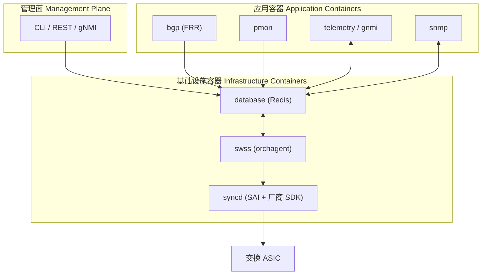
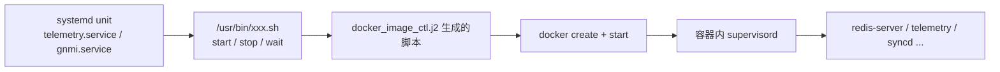
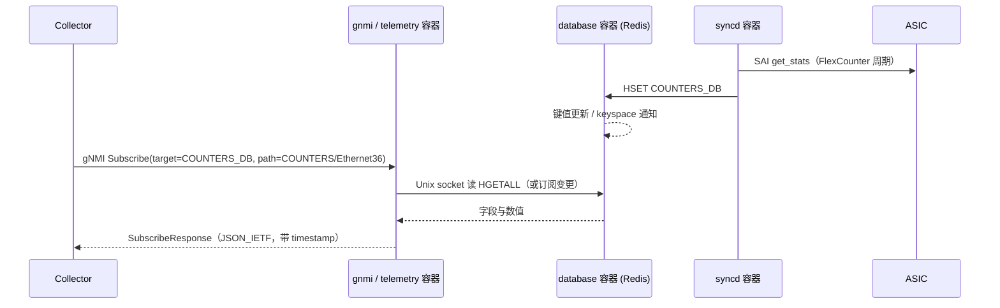
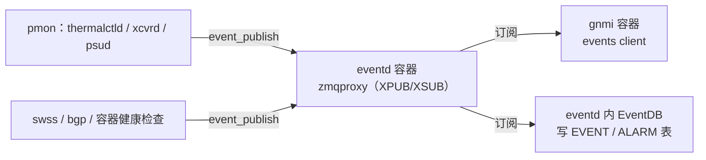

# SONiC 可观测采集框架与容器架构调研

> 本文是个人信息收集阶段的调研笔记，目标是把三件事讲清楚：**SONiC 的整体组成**、**它的可观测采集框架由什么构成**、**采集框架如何穿过容器边界拿到设备数据**。文末附全部来源链接与待核实项。

## 目录

- [[#0 结论先行|0 结论先行]]
- [[#1 SONiC 整体组成|1 SONiC 整体组成]]
- [[#2 可观测采集框架的组成|2 可观测采集框架的组成]]
- [[#3 采集框架通过容器获取设备信息的路径|3 采集框架通过容器获取设备信息的路径]]
- [[#4 容器在其中扮演什么角色|4 容器在其中扮演什么角色]]
- [[#5 版本演进与选型注意|5 版本演进与选型注意]]
- [[#6 对自研采集框架的启示|6 对自研采集框架的启示]]
- [[#7 参考资料|7 参考资料]]
- [[#8 待核实项|8 待核实项]]

## 0 结论先行

1. **SONiC 的本质是"Linux 发行版 + 一组 Docker 容器 + 一个共享 Redis"**，而不是一个单体网络操作系统。模块之间不直接 RPC，全部通过 Redis 的键值与发布/订阅（publish/subscribe）交换状态。官方原文：「SONiC places each module in independent docker containers...」，并依赖 Redis 提供「language independent interface」「multi-process communication」——见 [SONiC Architecture（官方 Wiki）](https://github.com/sonic-net/SONiC/wiki/Architecture)。
2. **采集框架的主干是 gNMI（gRPC Network Management Interface）遥测**：`telemetry` 容器（旧）或 `gnmi` 容器（2023.11 起替代）对外提供 Get / Set / Subscribe / Capabilities，内部由 DB client、non-DB client、events client 分别对接 Redis、`/proc`/平台数据、事件总线。见 [sonic-gnmi 仓库](https://github.com/sonic-net/sonic-gnmi) 与 [grpc_telemetry.md](https://github.com/sonic-net/sonic-gnmi/blob/master/doc/grpc_telemetry.md)。
3. **采集容器不直接访问 ASIC**。它读的是 `database` 容器里的 Redis；而 Redis 里的计数器是 `syncd` 容器通过 SAI（Switch Abstraction Interface）周期性 `get` 出来写进去的。容器在这一环里不是"通道"，而是**进程与权限的隔离边界 + 数据汇合点**。
4. **容器承担的是"故障隔离 + 独立生命周期 + 依赖编排"三件事，不是资源配额**。官方的容器启动模板里没有 `--memory` / `--cpus` 限制，也没有 `--privileged`，硬件访问改用显式 `--device` 与 device cgroup 规则——见 [docker_image_ctl.j2](https://github.com/sonic-net/sonic-buildimage/blob/master/files/build_templates/docker_image_ctl.j2)。

---

## 1 SONiC 整体组成

### 1.1 四个基座

| 基座 | 中文说明 | 作用 | 来源 |
|---|---|---|---|
| Debian Linux | Debian 发行版 | 主机系统、内核网络栈、systemd、包管理；202405 周期升级到 Debian 12（Bookworm） | [架构综述](https://safeguard.sh/resources/blog/how-a-network-switch-is-made-switch-asics-network-operating-systems-and-firmware) |
| SAI | 交换机抽象接口 | 厂商无关的 ASIC 控制 API，向下对接各芯片 SDK | [OCP SAI](https://github.com/opencomputeproject/SAI) |
| Redis | 内存键值数据库 | 全局状态总线：CONFIG_DB / APPL_DB / STATE_DB / COUNTERS_DB / ASIC_DB 等 | [官方 Wiki](https://github.com/sonic-net/SONiC/wiki/Architecture) |
| Docker | 容器运行时 | 每个功能模块一个容器，独立启停、独立镜像 | [官方 Wiki](https://github.com/sonic-net/SONiC/wiki/Architecture) |

分层关系（自下而上）：**ASIC → SAI/SDK → syncd → SWSS（orchagent）→ 应用容器 → 管理面**。



### 1.2 容器清单

官方 Wiki 的架构页列了 9 个容器（database / swss / syncd / bgp / lldp / teamd / snmp / pmon / dhcp-relay），现网版本还多了 nat、macsec、radv、sflow、rest-api、eventd、p4rt、telemetry 或 gnmi 等可选容器。功能开关由 `CONFIG_DB` 的 `FEATURE` 表控制（`config feature state <name> enabled|disabled`）。

| 容器（Container） | 镜像（Image） | 角色 | 关键进程 |
|---|---|---|---|
| database | docker-database | 唯一的数据枢纽 | 多个 redis-server 实例（按 `database_config.json`） |
| swss | docker-swss | 状态仲裁与编排 | orchagent、portsyncd、neighsyncd、fdbsyncd、intfmgrd、vlanmgrd、coppmgrd 等 |
| syncd | docker-syncd-&lt;vendor&gt; | 硬件同步 | syncd、SAI、厂商 SDK、FlexCounter 线程 |
| bgp | docker-fpm-frr | 路由协议栈 | bgpd、zebra、fpmsyncd |
| lldp | docker-lldp | 拓扑发现 | lldpd、lldp_syncd、lldpmgr |
| teamd | docker-teamd | 链路聚合 | teamd、teamsyncd |
| snmp | docker-snmp | 传统监控出口 | snmpd + AgentX 子代理 `sonic_ax_impl` |
| pmon | docker-platform-monitor | 平台/硬件监控 | xcvrd、thermalctld、sensord、fancontrol、ledd、pcied、syseepromd |
| telemetry / gnmi | docker-sonic-telemetry / docker-sonic-gnmi | 遥测出口 | `telemetry` 二进制、dialout client |
| rest-api | docker-sonic-mgmt-framework | REST/RESTCONF 出口 | rest_server（Translib） |
| eventd | docker-eventd | 系统事件总线 | eventd、事件发布/订阅库 |

来源：容器清单见 [官方 Wiki 架构页](https://github.com/sonic-net/SONiC/wiki/Architecture)；容器与镜像对应、supervisord 托管方式见 [DeepWiki: Core Runtime Services](https://deepwiki.com/sonic-net/sonic-buildimage/3-core-runtime-services)；Feature 开关见 [SONiC Feature Control](https://netbergtw.com/top-support/netberg-sonic/sonic-feature-control/)。

### 1.3 七个核心 Redis 库

| DB | 编号 | 内容 | 谁写 | 谁读 |
|---|---|---|---|---|
| APPL_DB | 0 | 应用层运行数据（路由、邻居、下一跳） | fpmsyncd、portsyncd 等 | orchagent |
| ASIC_DB | 1 | 面向 ASIC 的配置与状态（SAI 对象） | orchagent（经 sairedis） | syncd |
| COUNTERS_DB | 2 | 端口/队列/LAG 计数器 | syncd（FlexCounter） | telemetry/gnmi、snmp、CLI |
| LOGLEVEL_DB | 3 | 各模块日志级别 | CLI / 配置 | 各守护进程 |
| CONFIG_DB | 4 | 配置真相源（Source of Truth） | CLI、REST、gNMI Set、minigraph | orchagent、各 mgrd、hostcfgd |
| FLEX_COUNTER_DB | 5 | 计数器组开关与轮询间隔 | orchagent（FlexCounterOrch） | syncd |
| STATE_DB | 6 | 已配置对象的运行状态 | syncd、pmon、应用容器 | telemetry/gnmi、snmp、各 mgrd |

来源：[grpc_telemetry.md](https://github.com/sonic-net/sonic-gnmi/blob/master/doc/grpc_telemetry.md)；数据库职责划分见 [DeepWiki: SONiC Architecture](https://deepwiki.com/sonic-net/sonic-buildimage/1.1-sonic-architecture)。

### 1.4 三条典型数据流

- **配置下行**：CLI / REST / gNMI Set → `CONFIG_DB` → orchagent 翻译 → `ASIC_DB` → syncd → SAI → ASIC。
- **协议下行**：bgpd → zebra → fpmsyncd → `APPL_DB` → orchagent → `ASIC_DB` → syncd。
- **状态上行**：ASIC → SAI → syncd（FlexCounter）→ `COUNTERS_DB`；平台传感器 → pmon → `STATE_DB`。

官方对路由链路的完整描述见 [架构页](https://github.com/sonic-net/SONiC/wiki/Architecture) 的 "Route state interaction" 一节（bgpd → zebra → fpmsyncd → APPL_DB → orchagent → ASIC_DB → syncd → ASIC）。

---

## 2 可观测采集框架的组成

### 2.1 全景：四类数据源 + 四类出口

**数据源**

| 数据源 | 中文说明 | 典型内容 | 采集方式 |
|---|---|---|---|
| Redis DB | 结构化键值数据 | 端口状态、计数器、路由、配置 | DB client（HGET/订阅） |
| 非 DB 数据 | 主机侧文件与平台接口 | `/proc/stat`、`/proc/meminfo`、`/proc/loadavg`、`platform/cpu` | non-DB client |
| 事件 | 系统事件流 | 端口 down、容器异常、BGP 邻居变化 | events client（target=`EVENTS`） |
| 平台硬件 | 传感器、光模块、风扇、电源 | 温度、电压、DDM、PSU 状态 | pmon 守护进程写 `STATE_DB` |

**出口**

| 出口 | 中文说明 | 适用场景 | 来源 |
|---|---|---|---|
| gNMI 遥测 | gRPC 结构化订阅 | 主力，秒级/亚秒级指标、事件 | [sonic-gnmi](https://github.com/sonic-net/sonic-gnmi) |
| SNMP | 传统轮询协议 | 存量 NMS 兼容 | [sonic-snmpagent](https://github.com/sonic-net/sonic-snmpagent) |
| REST / RESTCONF | HTTP 按需查询 | 配置校验、临时取数 | [sonic-mgmt-framework](https://github.com/sonic-net/sonic-mgmt-framework) |
| Syslog | 文本日志 | 故障排查、审计 | 各容器 rsyslog 转发至 host |

补充：CLI（`show`/`counterpoll`）本身也是一条采集路径，直接读 Redis，见 [sonic-utilities](https://github.com/sonic-net/sonic-utilities)。

### 2.2 gNMI 遥测：两种模式、四个 RPC

**RPC**：`Get`（快照）、`Set`（写配置）、`Subscribe`（流式/轮询）、`Capabilities`（能力与模型）。SONiC 的 gNMI 实现基于标准 gNMI 并做定制，见 [gNMI proto 规范](https://github.com/openconfig/gnmi/blob/master/proto/gnmi/gnmi.proto)。

**两种部署模式**

| 模式 | 中文说明 | 连接发起方 | 适用 |
|---|---|---|---|
| Dial-in | 采集器连设备 | Collector → Switch | 常规监控，采集器掌握订阅 |
| Dial-out | 设备连采集器 | Switch → Collector | 设备在 NAT/防火墙后，或采集器无状态 |

Dial-out 的配置写在 `CONFIG_DB` 的 `TELEMETRY_CLIENT` 表，分三类：`Global`（encoding、src_ip、retry_interval、unidirectional）、`DestinationGroup_*`（dst_addr，可多个，失败切换下一个）、`Subscription_*`（dst_group、path_target、paths、report_type、report_interval）。示例：

```json
{
  "TELEMETRY_CLIENT": {
    "Global": {
      "encoding": "JSON_IETF",
      "retry_interval": "30",
      "src_ip": "30.57.185.38",
      "unidirectional": "true"
    },
    "DestinationGroup_HS": {
      "dst_addr": "30.57.186.214:8081,30.57.185.39:8081"
    },
    "Subscription_HS_RDMA": {
      "dst_group": "HS",
      "path_target": "COUNTERS_DB",
      "paths": "COUNTERS/Ethernet*,COUNTERS_PORT_NAME_MAP",
      "report_interval": "5000",
      "report_type": "periodic"
    }
  }
}
```

字段语义与失败重连行为（默认 30 秒重试、按 DestinationGroup 顺序切换）见 [dialout.md](https://github.com/sonic-net/sonic-gnmi/blob/master/doc/dialout.md)。传输层用 `gNMIDialOut.Publish`，消息体复用 gNMI 的 `SubscribeResponse`。

**路径模型**：SONiC 没有完整 YANG 数据模型，路径直接映射 Redis 层级 `DB / TABLE / KEY / FIELD`，`target` 填 DB 名：

```
target = COUNTERS_DB
path   = COUNTERS/Ethernet36/SAI_PORT_STAT_IF_IN_OCTETS
```

支持虚拟路径（服务端做映射，不是真实 key）：`COUNTERS/Ethernet*`（所有口全部计数器）、`COUNTERS/Ethernet*/<counter>`、`COUNTERS/Ethernet<port>/Queues`、`PERIODIC_WATERMARKS/Ethernet*/PriorityGroups`。非 DB 数据用 `target=OTHERS`，路径如 `proc/loadavg`、`platform/cpu`。见 [grpc_telemetry.md](https://github.com/sonic-net/sonic-gnmi/blob/master/doc/grpc_telemetry.md)。

**监听与认证**（以 `gnmi` 容器启动脚本为准）：

- 端口来自 `CONFIG_DB` 的 `TELEMETRY|gnmi.port`，**未配置时默认 8080**；
- 无证书时回落 `--noTLS --bind_address 127.0.0.1`，只允许本机访问；
- `user_auth` 未配置时**默认 `cert`**（fail-closed），证书白名单表为 `GNMI_CLIENT_CERT`；
- 支持 `--vrf mgmt`（管理 VRF）、`--unix_socket /var/run/gnmi/gnmi.sock`（UDS 模式）。

来源：[gnmi-native.sh](https://github.com/sonic-net/sonic-buildimage/blob/master/dockers/docker-sonic-gnmi/gnmi-native.sh)。

### 2.3 计数器链路：从 ASIC 到 gNMI

这是"采集框架如何拿到设备信息"的核心链路，五个环节：

1. **配置**：`CONFIG_DB` 的 `FLEX_COUNTER_TABLE` 决定哪些计数器组开启、轮询间隔多少毫秒（`counterpoll` 命令写入），orchagent 的 FlexCounterOrch 同步到 `FLEX_COUNTER_DB`。
2. **轮询**：syncd 的 FlexCounter 线程按组周期调用 SAI `get_stats`，把结果写入 `COUNTERS_DB`。
3. **落库**：键形如 `COUNTERS:<OID>`，另有 `COUNTERS_PORT_NAME_MAP` 做"端口名 → OID"映射。
4. **读取**：gnmi 容器的 DB client 通过 Unix socket 读 `COUNTERS_DB`，STREAM 模式按 sample interval 周期性读取，或按变更推送。
5. **编码**：按 `JSON_IETF` / `PROTO` / `ASCII` 编码，经 gRPC 流回传采集器。

社区实现里常见的默认轮询间隔：PORT 1000 ms、QUEUE 10000 ms、watermark 类 60000 ms；`PORT_BUFFER_DROP` 允许 30–300 s，`ACL` 允许 1–30 s。这些是社区默认值，**厂商发行版可能调整**，应以设备上的 `counterpoll show` 为准。来源：[DeepWiki: Database Architecture](https://deepwiki.com/edge-core/sonic-swss/5-database-architecture-and-schema)、[DeepWiki: Network Statistics](https://deepwiki.com/sonic-net/sonic-utilities/4.4-network-statistics)、[rates-and-utilization HLD 引用](https://github.com/sonic-net/sonic-sairedis/pull/878)。

### 2.4 高频与事件：两条补强路径

**高频流式遥测（HFST，High Frequency Streaming Telemetry）**：软件轮询在毫秒级微突发面前失效——计数器被读到时事件已经结束。SONiC 2025.11 引入的做法是**反向推送**：ASIC 以 IPFIX 格式按毫秒级节奏推送每端口计数器，`countersyncd`（Rust 实现）接收并按已注册的 IPFIX 模板解析，写入本地计数器库，再通过 OpenTelemetry 导出到 Prometheus/InfluxDB 等。见 [SONiC Foundation 综述](https://sonicfoundation.dev/how-sonic-powers-the-worlds-largest-ai-infrastructure/) 与 [HFST HLD](https://github.com/sonic-net/SONiC/blob/master/doc/high-frequency-telemetry/high-frequency-telemetry-hld.md)；实现提交见 [sonic-swss #3872](https://github.com/sonic-net/sonic-swss/pull/3872)。

**事件遥测**：gNMI 的 `target=EVENTS` 走 events client，**只支持 STREAM 模式**，底层通过 CGO 接 SONiC 事件系统（eventd）。路径参数可调 `heartbeat`（≤600 s）、`qsize`（1024–102400）、`usecache`；自身统计写入 `COUNTERS_DB:COUNTERS_EVENTS`（`missed_internal`、`missed_by_slow_receiver`、`latency_in_ms`）。见 [events_client.go](https://github.com/sonic-net/sonic-gnmi/blob/master/sonic_data_client/events_client.go)。

### 2.5 采集框架的组件拆解

| 组件 | 中文说明 | 职责 | 代码位置 |
|---|---|---|---|
| telemetry / gnmi server | 遥测服务主进程 | 启动 gRPC 服务、TLS、鉴权、路由请求 | `telemetry/telemetry.go` |
| DB client | 数据库客户端 | 按 target 连对应 Redis 实例，读表/键/字段 | `sonic_data_client/db_client.go` |
| non-DB client | 非数据库客户端 | 读 `/proc`、`platform` 等 | `sonic_data_client/non_db_client.go` |
| events client | 事件客户端 | 订阅事件总线，优先级队列缓冲 | `sonic_data_client/events_client.go` |
| dialout client | 拨出客户端 | 按 `TELEMETRY_CLIENT` 配置主动连采集器 | `dialout/` |
| translib / REST client | 模型翻译客户端 | 把 OpenConfig 路径翻译为后端 REST 调用 | `transl_utils/` |

来源：[sonic-gnmi 仓库目录](https://github.com/sonic-net/sonic-gnmi)、[DeepWiki: System Architecture](https://deepwiki.com/sonic-net/sonic-telemetry/1.1-system-architecture)。

---

## 3 采集框架通过容器获取设备信息的路径

先给结论：**采集容器不穿透到 ASIC，也不调用其他容器的进程；它只连一个 Unix socket，读 `database` 容器里的 Redis。**所谓"通过容器采集"，准确说是"**数据在生产容器里被写入共享 Redis，采集容器再从 Redis 取走**"。

### 3.1 容器是怎么被拉起来的



- 每个容器对应一个 systemd unit（如 `gnmi.service`），unit 调用宿主机上的 `*.sh` 脚本；
- 脚本由构建期模板 [docker_image_ctl.j2](https://github.com/sonic-net/sonic-buildimage/blob/master/files/build_templates/docker_image_ctl.j2) 生成，统一实现 `start/stop/wait` 语义；
- 容器内由 **supervisord** 托管具体进程，配置按容器定制（database 容器用它拉起多个 redis 实例）；
- 启动顺序由脚本里的 flock 锁 + 轮询 Redis 就绪（`CONFIG_DB_INITIALIZED`）保证，见 [Core Runtime Services](https://deepwiki.com/sonic-net/sonic-buildimage/3-core-runtime-services)。

### 3.2 关键挂载与运行参数

| 参数/挂载 | 值 | 为什么采集需要它 |
|---|---|---|
| 网络模式 | `--net=host`（单实例）；多 ASIC 为 `--net=container:database$DEV` | 采集器可直接访问宿主管理 IP 的 8080/57400 端口，无需端口映射 |
| Redis 套接字 | `-v /var/run/redis:/var/run/redis:rw` | **采集容器与 database 容器的唯一数据通道** |
| HWSKU | `-v /usr/share/sonic/device/$PLATFORM/$HWSKU/$DEV:/usr/share/sonic/hwsku` | 端口映射、平台差异 |
| 平台目录 | `-v /usr/share/sonic/device/$PLATFORM:/usr/share/sonic/platform:ro` | 读取平台元数据、传感器配置 |
| 热启动状态 | `-v /host/warmboot$DEV:/var/warmboot` | 重启后恢复状态 |
| supervisor 日志 | `--tmpfs /var/log/supervisor:rw` | 容器内日志不落盘 |
| 设备节点 | `--device=...`（syncd/pmon） | 访问 ASIC、I2C、光模块 |
| UTS | `--uts=host` | 共享主机名 |
| 特权 | **不使用 `--privileged`** | 改用 device cgroup 精确授权 |
| 资源限制 | **无 `--memory` / `--cpus`** | 容器不是资源配额边界 |

以上均取自 [docker_image_ctl.j2](https://github.com/sonic-net/sonic-buildimage/blob/master/files/build_templates/docker_image_ctl.j2) 的实际 `docker create` 参数。

### 3.3 一次 Subscribe 的完整路径



分步说明：

1. **采集器建连**：连设备管理 IP 的 gNMI 端口（`TELEMETRY|gnmi.port`，默认 8080）。因为容器是 host 网络，连接直接落到容器内进程。
2. **鉴权与 TLS**：按 `user_auth`（默认 `cert`）、`GNMI_CLIENT_CERT` 白名单校验；无证书场景只绑 `127.0.0.1`。
3. **路径解析**：`target` 决定去哪个 DB（`COUNTERS_DB` / `STATE_DB` / `APPL_DB` / `OTHERS` / `EVENTS`）。
4. **选客户端**：db_client / non_db_client / events_client 三选一。
5. **读 Redis**：通过挂载进来的 `/var/run/redis/redis.sock` 连接 database 容器内的 redis-server，读 table/key/field。**整个过程没有跨容器的 RPC 调用**。
6. **数据从哪来**：`syncd` 容器里的 FlexCounter 线程按 `FLEX_COUNTER_DB` 的间隔调用 SAI，把 ASIC 计数器写进 `COUNTERS_DB`；平台数据由 `pmon` 容器读 `/sys`、hw-management、I2C 后写 `STATE_DB`；协议状态由 `bgp` 容器经 fpmsyncd 写 `APPL_DB`。
7. **编码回传**：按请求的 encoding 序列化，gRPC 流式返回，附 `timestamp`。
8. **反向验证**：采集到的每个数值都能在设备上 `redis-cli -n 2 HGETALL COUNTERS:Ethernet36` 复现——这是排查"采集不到"最快的手段。

### 3.4 为什么容器之间不需要互相调用

Redis 在这里扮演的是**共享内存总线**，不是普通缓存：

- 生产者只写自己的表，消费者只读自己关心的表，双方不需要知道对方存在；
- 支持 pub/sub 与 keyspace 通知，实现"变更即推送"；
- 任一容器重启，其他容器读到的仍是一致状态，系统**降级而不雪崩**；
- 官方表述："applications can subscribe only to the data-views that they require"（[架构页](https://github.com/sonic-net/SONiC/wiki/Architecture)）。

代价也很明确：**Redis 成为单点与性能瓶颈**，且表结构（schema）靠约定而非强类型约束。

### 3.5 三类非 Redis 数据的采集路径

先给结论：**这三类数据的采集主体、通道、权限要求完全不同**，不能笼统说成"通过容器采集"。

| 数据类型 | 谁去取 | 通道 | 是否经过 Redis | 采集容器的权限要求 |
|---|---|---|---|---|
| 非 DB 数据（`/proc`、版本文件） | gnmi 容器自己读 | 容器内文件系统 | 否 | 无额外权限 |
| 系统事件流 | gnmi 容器订阅 eventd | ZMQ（XPUB/XSUB 代理） | 否（另一路 eventd 才落 EventDB） | 能连本机 ZMQ 端点 |
| 平台硬件（光模块/温度/风扇/PSU） | pmon 容器独占 | I2C / sysfs / hw-management → STATE_DB | 是（STATE_DB） | `--device` + device cgroup |

#### 3.5.1 非 DB 数据：采集器直接读 `/proc`

`non_db_client.go` 用一棵前缀树（trie）把**固定**路径映射到取数函数，不是任意文件都能读：

| 路径（target=`OTHERS`） | 实际读取 | 说明 |
|---|---|---|
| `OTHERS/proc/stat` | `/proc/stat` | CPU 时间片，解析后转 JSON |
| `OTHERS/proc/meminfo` | `/proc/meminfo` | 内存 |
| `OTHERS/proc/loadavg` | `/proc/loadavg` | 负载 |
| `OTHERS/proc/uptime` | `/proc/uptime` | 运行时长 |
| `OTHERS/proc/vmstat` | `/proc/vmstat` | 虚拟内存统计 |
| `OTHERS/proc/diskstats` | `/proc/diskstats` | 块设备 IO |
| `OTHERS/platform/cpu` | 由 `/proc/stat` 计算 | CPU 利用率，多时间窗 |
| `OTHERS/osversion/build` | `/etc/sonic/sonic_version.yml` | 镜像版本（带缓存，只读一次） |

两个关键点：

1. **为什么容器里能读到整机数据**：这些 `/proc` 文件属于全局内核视图，不随容器的 PID/网络命名空间隔离。因此采集容器不需要挂载宿主 `/proc`，也不需要 `--pid=host`。例外是 `/proc/meminfo`，在部分 cgroup 配置下会被裁剪成容器视角。
2. **`platform/cpu` 不是平台传感器**：它是从 `/proc/stat` 算出的 CPU 利用率。后台每 100 ms 采样一次写入 3000 槽环形缓冲，对外提供 `100ms` / `1s` / `5s` / `1min` / `5min` 五个窗口，属于"预采样 + 短窗口峰值"，不是每次请求现算。

能力边界：仅支持 `SAMPLE` 流式与 `POLL`，`ONCE` 未实现（函数体直接 `return`）。来源：[non_db_client.go](https://github.com/sonic-net/sonic-gnmi/blob/master/sonic_data_client/non_db_client.go)。

#### 3.5.2 系统事件流：ZMQ 代理跑在 eventd 容器里

事件不走 Redis，走 **ZeroMQ 的 PUB/SUB**，拓扑是"中央代理 + 多发布者 + 多订阅者"：



- **代理**：`eventd` 容器内运行 `zmqproxy`（XPUB/XSUB），由 systemd 保证常驻。发布者连 SUB 端、订阅者连 PUB 端；默认端点硬编码在 `libswsscommon`，可用 `/etc/sonic/init_cfg.json` 覆盖。
- **发布**：`events_init_publisher(source)` + `event_publish(handle, tag, params)`。消息按 YANG 校验，内嵌全局序列号（用于丢事件检测），缺时间戳时自动补齐。
- **订阅**：`events_init_subscriber(use_cache, sources)` + 阻塞式 `event_receive()`，每次返回一个 JSON 字符串，并给出 `missed_cnt`。
- **gNMI 出口**：`target=EVENTS`、路径 `/events`，**只支持 STREAM + ON_CHANGE**；单客户端、上限约 10K 事件/秒，背压溢出计入 `missed-slow-receiver`。gNMI 侧通过 CGO 直接调 swss-common 的订阅 API，**不经过 Redis**。
- **另一路落库**：eventd 内的 EventDB 消费者同样订阅 zmqproxy，把事件写进独立的 `EVENT_DB`（id 19）实例的 `EVENT` / `ALARM` / `EVENT_STATS` / `ALARM_STATS` 表，供 CLI 与 REST 查询；历史默认保留 4 万条或 30 天。
- **缓存与回放**：订阅方 `use_cache=true` 时，eventd 内的 events-cache 侧车会缓存事件，断连重连后回放，缓存溢出计入 `missed-offline-cache`。

来源：[events-producer.md](https://github.com/sonic-net/SONiC/blob/master/doc/event-alarm-framework/events-producer.md)、[event-alarm-framework.md](https://github.com/sonic-net/SONiC/blob/master/doc/event-alarm-framework/event-alarm-framework.md)。

#### 3.5.3 平台硬件：只有 pmon 碰硬件，其他人读 STATE_DB

这是三条路径里唯一"必须持有设备权限"的一条，链路有五段：

1. **pmon 容器内的守护进程**：`xcvrd`（光模块）、`thermalctld`（温度与风扇）、`psud`（电源）、`syseepromd`（EEPROM）、`ledd`、`pcied`、`sensormond`、`chassisd` 等，清单见 [sonic-platform-daemons](https://github.com/sonic-net/sonic-platform-daemons)。
2. **调用 Platform API**：统一接口在 [sonic-platform-common](https://github.com/sonic-net/sonic-platform-common)（Chassis / Sfp / Thermal / Fan / PSU / Component），具体实现由厂商 `sonic_platform` 包提供，底层是 I2C、sysfs、CPLD 寄存器或 `hw-management`。
3. **容器如何获得权限**：pmon 的启动参数按平台动态生成 `--device=/dev/i2c-*` 与 `--device-cgroup-rule=c <major>:* rwm`（支持热插拔总线与 FRU），并挂载 `/var/run/hw-management`、`/sys/module/sx_core`、`/usr/share/sonic/firmware`、`/host/bmc` 等。**不使用 `--privileged`**。
4. **落到 STATE_DB**：`TRANSCEIVER_INFO`、`TRANSCEIVER_DOM_SENSOR`、`TRANSCEIVER_STATUS`、`TEMPERATURE_INFO`、`FAN_INFO`、`PSU_INFO` 等表（表名随版本略有差异，以设备上 `redis-cli -n 6 KEYS '*'` 为准）。
5. **出口只读**：gnmi 容器经 db client 读 `STATE_DB`，SNMP 容器经 AgentX 子代理读 `STATE_DB`，**两者都不碰 I2C**。平台数据在采集侧没有"直采"选项，只有"读库"。

补充一条闭环：thermalctld / psud / xcvrd 在越过阈值时还会调用 `event_publish()`，把故障同时送进 3.5.2 的 ZMQ 通道。**同一份硬件数据，一条进 STATE_DB 做状态快照，一条进事件流做告警**。

#### 3.5.4 三条路径的工程含义

| 维度 | 非 DB（/proc） | 事件（ZMQ） | 平台（pmon → STATE_DB） |
|---|---|---|---|
| 采集粒度 | 由订阅 sample interval 决定 | 事件驱动，毫秒级 | 由 pmon 轮询周期决定（光模块/温度常见数十秒） |
| 历史数据 | 无，只有瞬时值 | 有缓存回放，EventDB 可查历史 | 只有当前值，历史需外部存储 |
| 失败表现 | 路径不在 trie 中 → 直接报错 | 背压/断连 → 丢事件并计数 | pmon 异常 → STATE_DB 停更，值变陈旧 |
| 扩展方式 | 改代码加路径（硬编码 trie） | 新增 YANG 事件 + `event_publish` | 厂商实现 Platform API |

一句话概括：**非 DB 是"采集器自己看"，事件是"别人主动告诉它"，平台是"别人写好了它去读"**。三种模式对应三种可靠性边界，排障时应先判断问题落在哪一类，再去查对应的容器与表。

### 3.6 跨容器访问 Redis 的具体机制

先纠正两个容易混淆的前提：

- **Redis 不在"基础镜像"里**，它跑在独立的 `database` 容器（镜像 `docker-database`）中；
- **七个库不是七个进程**，而是同一批 redis-server 实例上的**逻辑库**（`SELECT 0..6`）。映射写在 `database_config.json` 的 `DATABASES` 段：库名 → `id` + `separator` + `instance`。

**三条访问通道**

| 通道 | 适用场景 | 实现方式 | 证据 |
|---|---|---|---|
| Unix domain socket（主通道） | 单 ASIC / 多 ASIC 通用 | 宿主机 `/var/run/redis<DEV>` 同时 bind mount 到 database 与各业务容器的 `/var/run/redis` | [docker_image_ctl.j2](https://github.com/sonic-net/sonic-buildimage/blob/master/files/build_templates/docker_image_ctl.j2) |
| TCP 回环 | 单 ASIC（`--net=host`） | 所有容器共享 host 网络命名空间，`127.0.0.1:6379` 即达 | [docker-database-init.sh](https://github.com/sonic-net/sonic-buildimage/blob/master/dockers/docker-database/docker-database-init.sh) |
| TCP bridge IP | 多 ASIC 命名空间 | database 用 bridge 网络；其他容器 `--net=container:database$DEV`，地址取 eth0 | 同上 |

**为什么这不叫"跨容器网络"**

1. bind mount 共享的是**宿主机同一个 inode**，不是复制文件；
2. Unix socket 是**文件系统对象**，连接时内核按路径解析到该 inode，在两个容器内的进程之间建立 socket pair；
3. 全程不经过 veth / docker0 / NAT / 端口映射，也不要求两个容器在同一网络命名空间。

真正跨命名空间的是多 ASIC 场景：database 容器独立在 bridge 网络里，业务容器共享它的网络命名空间，才需要用到 TCP。

**客户端如何定位数据库**

swsscommon / redis 客户端读取 `/var/run/redis/sonic-db/database_config.json`（可用 `SONIC_DB_CONFIG_FILE` 覆盖路径），按库名查 `instance`，再取该实例的 `unix_socket_path` 或 `hostname:port`。精简后的结构：

```json
{
  "INSTANCES": {
    "redis": { "hostname": "127.0.0.1", "port": 6379,
               "unix_socket_path": "/var/run/redis/redis.sock" }
  },
  "DATABASES": {
    "APPL_DB":     { "id": 0, "separator": ":", "instance": "redis" },
    "COUNTERS_DB": { "id": 2, "separator": ":", "instance": "redis" },
    "CONFIG_DB":   { "id": 4, "separator": "|", "instance": "redis" },
    "STATE_DB":    { "id": 6, "separator": "|", "instance": "redis" }
  }
}
```

注意 `separator` 的差异：`CONFIG_DB`/`STATE_DB` 用 `|` 分隔表名与键（`PORT|Ethernet0`），`APPL_DB`/`COUNTERS_DB` 用 `:`（`COUNTERS:Ethernet0`）。这是拼 key 时最常见的错。

**权限与失败模式**

- redis-server 以 `redis` 用户运行，supervisord 里显式 `user=redis`；socket 位于 bind mount 目录内，业务容器以 root 运行可直接连接。非 root 客户端需要调整 `unixsocketperm`。
- 启动参数为 `--bind 127.0.0.1 <hostname> --port <port> --unixsocket <path>`；`hostname` 是 `127.0.0.1` 时保持 protected mode，非回环地址时显式 `--protected-mode no`。
- 三类典型故障：socket 文件不存在（database 未就绪）、`database_config.json` 与实际实例不一致、客户端容器非 root 且 socket 权限不足。

**多 ASIC 与 chassis 的差异**

- 多 ASIC：socket 路径带设备后缀（`/var/run/redis0/redis.sock`、`/var/run/redis1/redis.sock`），每个 ASIC 一套 `database<DEV>` / `swss<DEV>` / `syncd<DEV>`；
- chassis：另起 `redis_chassis` 实例（端口 6380，socket `/var/run/redis-chassis/redis_chassis.sock`），并给容器加 `--add-host redis_chassis.server:<ip>`。

来源：[database_config.json.j2](https://github.com/sonic-net/sonic-buildimage/blob/master/dockers/docker-database/database_config.json.j2)、[supervisord.conf.j2](https://github.com/sonic-net/sonic-buildimage/blob/master/dockers/docker-database/supervisord.conf.j2)。

---

## 4 容器在其中扮演什么角色

### 4.1 六个角色

1. **部署与生命周期单元**：一个功能 = 一个镜像 = 一个容器 = 一个 systemd unit。可以单独 `systemctl restart gnmi`，不影响转发面。
2. **故障隔离边界**：某容器崩溃或内存泄漏不会拖垮其他容器；`CONTAINER_FEATURE.auto_restart` 可配置关键进程退出后整容器重启。见 [Monitoring and Auto-Mitigating Unhealthy Containers](https://github.com/sonic-net/SONiC/blob/master/doc/monitoring_containers/monitoring_containers.md)。
3. **依赖编排单元**：`swss.sh` 等脚本用 flock + 轮询 Redis 就绪状态，决定 syncd、teamd、bgp 的启动顺序；多 ASIC 下按 `asic0/asic1` 命名空间起多实例（`swss0`、`syncd1`）。
4. **权限边界**：不做 `--privileged`，改为显式 `--device` 与 `--device-cgroup-rule`，把"能碰哪些设备节点"写进容器配置——这比单纯 root 运行更可控。
5. **交付单元**：升级即换镜像；2023.11 起 `gnmi` 容器整体替代 `telemetry` 容器，就是一次容器级替换（见 [sonic-buildimage PR #19153](https://github.com/sonic-net/sonic-buildimage/pull/19153)）。
6. **扩展单元**：sidecar 模式（`telemetry-sidecar`）在不重启主容器的前提下同步证书、脚本与依赖；`telemetry-watchdog` 独立探活 gRPC 端点。见 [Management and Telemetry Services](https://deepwiki.com/sonic-net/sonic-buildimage/3.3-routing-services)。

### 4.2 边界与代价（重要）

- **不是强资源隔离**：启动模板未设置 `--memory` / `--cpus`，一个容器占满内存仍会影响整机。SONiC 用 monit 的 `memory_checker` 做阈值告警，而不是 cgroup 硬限制。
- **不是编排平台**：单机 Docker + systemd，没有 Kubernetes 式调度、滚动升级、健康探针体系。
- **共享内核**：容器共用宿主内核，内核态问题（驱动、ASIC SDK）无法被容器隔离。
- **镜像体积代价**：每个容器各带一套 Debian 用户态，镜像与内存开销显著，这是社区 SONiC 在接入层交换机（2 核 / 2 GB 内存）上吃力的原因之一，见 [Containerized NOS 分析](https://plvision.eu/blog/products/containerized-nos)。

## 5 版本演进与选型注意

| 时间点 | 变化 | 影响 | 来源 |
|---|---|---|---|
| 2023.11 | `gnmi` 容器替代 `telemetry` 容器 | 容器名、镜像名、`systemctl` 单元名都变；`FEATURE` 表仍可能残留 `telemetry` 条目 | [PR #19153](https://github.com/sonic-net/sonic-buildimage/pull/19153) |
| 2024 | `gnmi` 原生代理增强：管理 VRF、SmartSwitch/DPU、ZMQ 8100、GNOI | 采集需按 VRF 与 DPU 场景调整连接地址 | [gnmi-native.sh](https://github.com/sonic-net/sonic-buildimage/blob/master/dockers/docker-sonic-gnmi/gnmi-native.sh) |
| 2025.11 | HFST 进入 release：IPFIX 毫秒级推送 + OpenTelemetry 导出 | 从"软件轮询"转向"硬件推送"，需要平台/芯片支持 | [HFST HLD](https://github.com/sonic-net/SONiC/blob/master/doc/high-frequency-telemetry/high-frequency-telemetry-hld.md) |

实践注意：

1. **先确认容器名**：`docker ps | grep -E "gnmi|telemetry"`，再看 `show feature status`。
2. **先确认端口与认证**：`redis-cli -n 4 HGETALL "TELEMETRY|gnmi"`；默认 8080、默认 `user_auth=cert`。

## 6 对自研采集框架的启示

> 以下为个人判断，不是官方结论。

1. **采集端只依赖"稳定的数据契约"，不依赖生产者**。SONiC 的采集器不知道 orchagent 怎么实现，只知道 `COUNTERS_DB` 的表结构。自研 APM 若把采集器与具体数据源进程耦合，任何一侧升级都会互相牵连。
2. **三层分离值得照搬**：生产（syncd/pmon）→ 汇聚（Redis）→ 出口（gNMI）→ 消费（Collector）。映射到 APM 现有栈，汇聚层就是 VictoriaMetrics / Loki / MySQL，出口层才是采集 Agent。**出口层应可独立重启、独立限流**。
3. **轮询有天花板**。SONiC 用 FlexCounter 轮询撑到 1 s 级，毫秒级必须换硬件推送（HFST）。若 APM 的诊断场景需要亚秒级，就要在选型阶段确认芯片是否支持 IPFIX/INT，而不是先堆采集频率。
4. **通配符与虚拟路径能显著降请求数**。`COUNTERS/Ethernet*` 一次拿全端口，避免 N 次 RPC；自研接口设计应保留"批量/通配"语义。
5. **容器化解决隔离，不解决配额**。若把采集 Agent 容器化，内存/CPU 限制、日志轮转、优雅退出都要自己补，SONiC 这套模板里没有。
6. **弱 schema 是隐性成本**。Redis 表结构靠社区约定，跨版本漂移只能靠适配层兜。自研采集应对指标名做注册表与版本兼容层。

## 7 参考资料

### 7.1 官方架构与代码

| 资料 | 说明 | 链接 |
|---|---|---|
| SONiC Wiki | 官方文档总入口 | https://github.com/sonic-net/SONiC/wiki |
| SONiC Architecture | 容器清单、DB 职责、状态交互链路（官方权威） | https://github.com/sonic-net/SONiC/wiki/Architecture |
| sonic-buildimage | 镜像与容器构建主仓库 | https://github.com/sonic-net/sonic-buildimage |
| sonic-swss | orchagent 与各 syncd/mgrd | https://github.com/sonic-net/sonic-swss |
| sonic-sairedis | syncd、SAI redis、FlexCounter 实现 | https://github.com/sonic-net/sonic-sairedis |
| sonic-utilities | CLI、`counterpoll`、`show` 系列 | https://github.com/sonic-net/sonic-utilities |
| sonic-platform-daemons | pmon 内各平台守护进程 | https://github.com/sonic-net/sonic-platform-daemons |
| OCP SAI | 交换机抽象接口规范 | https://github.com/opencomputeproject/SAI |

### 7.2 遥测协议与实现

| 资料 | 说明 | 链接 |
|---|---|---|
| sonic-gnmi | 现行 gNMI/gNOI 实现（原 sonic-telemetry） | https://github.com/sonic-net/sonic-gnmi |
| grpc_telemetry.md | 路径模型、DB target、RPC、端口与认证 | https://github.com/sonic-net/sonic-gnmi/blob/master/doc/grpc_telemetry.md |
| dialout.md | Dial-out 配置模型、重连策略、示例 | https://github.com/sonic-net/sonic-gnmi/blob/master/doc/dialout.md |
| gNMI proto | 协议规范（Subscribe/Subscription 语义） | https://github.com/openconfig/gnmi/blob/master/proto/gnmi/gnmi.proto |
| OpenConfig telemetry model | Dial-out 配置参考的 YANG 模型 | https://github.com/openconfig/public/blob/master/release/models/telemetry/openconfig-telemetry.yang |
| events_client.go | 事件订阅实现与统计口径 | https://github.com/sonic-net/sonic-gnmi/blob/master/sonic_data_client/events_client.go |
| non_db_client.go | `OTHERS` 路径清单、`/proc` 读取与 CPU 利用率计算 | https://github.com/sonic-net/sonic-gnmi/blob/master/sonic_data_client/non_db_client.go |
| sonic-telemetry（旧仓库） | 历史实现，已迁移至 sonic-gnmi | https://github.com/sonic-net/sonic-telemetry |

### 7.3 容器与运行时

| 资料 | 说明 | 链接 |
|---|---|---|
| docker_image_ctl.j2 | 容器 `docker create` 参数、挂载、多 ASIC 命名 | https://github.com/sonic-net/sonic-buildimage/blob/master/files/build_templates/docker_image_ctl.j2 |
| gnmi-native.sh | gnmi 容器启动参数：端口、VRF、认证、UDS | https://github.com/sonic-net/sonic-buildimage/blob/master/dockers/docker-sonic-gnmi/gnmi-native.sh |
| sonic-platform-common | Platform API：Chassis / Sfp / Thermal / Fan / PSU | https://github.com/sonic-net/sonic-platform-common |
| 容器监控与自愈 | `CONTAINER_FEATURE.auto_restart`、monit 检查 | https://github.com/sonic-net/SONiC/blob/master/doc/monitoring_containers/monitoring_containers.md |
| Feature 开关实践 | `config feature state` 与 `FEATURE` 表 | https://netbergtw.com/top-support/netberg-sonic/sonic-feature-control/ |
| DeepWiki: 架构总览 | 社区对 buildimage 的结构化解读（非官方） | https://deepwiki.com/sonic-net/sonic-buildimage/1.1-sonic-architecture |
| DeepWiki: 运行时服务 | 容器生命周期、database 初始化、启动依赖 | https://deepwiki.com/sonic-net/sonic-buildimage/3-core-runtime-services |

### 7.4 计数器、高频与事件

| 资料 | 说明 | 链接 |
|---|---|---|
| COUNTERS_DB 与 FlexCounter | 表结构、默认轮询组、Lua 插件（社区解读） | https://deepwiki.com/edge-core/sonic-swss/5-database-architecture-and-schema |
| counterpoll 与统计工具 | 轮询间隔约束、`portstat`/`queuestat` 实现 | https://deepwiki.com/sonic-net/sonic-utilities/4.4-network-statistics |
| 轮询间隔单位修复 | 毫秒/秒换算的社区讨论，含 HLD 引用 | https://github.com/sonic-net/sonic-sairedis/pull/878 |
| HFST HLD | 高频流式遥测设计（IPFIX + countersyncd） | https://github.com/sonic-net/SONiC/blob/master/doc/high-frequency-telemetry/high-frequency-telemetry-hld.md |
| HFST 实现提交 | countersyncd（Rust）与 Actor 模型 | https://github.com/sonic-net/sonic-swss/pull/3872 |
| SONiC Foundation 综述 | HFST 在 AI 集群中的动机与效果 | https://sonicfoundation.dev/how-sonic-powers-the-worlds-largest-ai-infrastructure/ |
| events-producer.md | 事件发布/订阅 API、zmqproxy 拓扑与序列号机制 | https://github.com/sonic-net/SONiC/blob/master/doc/event-alarm-framework/events-producer.md |
| event-alarm-framework.md | EventDB 消费者、EVENT/ALARM 表结构与持久化 | https://github.com/sonic-net/SONiC/blob/master/doc/event-alarm-framework/event-alarm-framework.md |

### 7.5 第三方分析（非官方，供交叉验证）

| 资料 | 说明 | 链接 |
|---|---|---|
| Containerized NOS 分析 | 容器化架构的收益与接入层资源瓶颈 | https://plvision.eu/blog/products/containerized-nos |
| SONiC 深度架构解读 | 容器、DB、SAI 的分层说明 | https://sonicfoundation.dev/deep-dive-into-sonic-architecture-design/ |
| NOS 构成拆解 | 镜像里到底装了什么（Debian、SDK、平台包） | https://safeguard.sh/resources/blog/how-a-network-switch-is-made-switch-asics-network-operating-systems-and-firmware |

## 8 待核实项

| # | 问题 | 为何重要 | 建议验证方式 |
|---|---|---|---|
| 1 | 目标版本是 `telemetry` 还是 `gnmi` 容器 | 容器名/单元名/镜像名全不同 | `docker ps`、`show feature status` |
| 2 | 实际 gNMI 端口与认证模式 | 默认 8080、默认 `cert`，发行版可能改 | `redis-cli -n 4 HGETALL "TELEMETRY\|gnmi"` |
| 3 | 各计数器组实际轮询间隔 | 决定可达到的最小采集粒度 | `counterpoll show` |
| 4 | 平台是否支持 HFST / INT | 决定能否做毫秒级诊断 | 查芯片与厂商发行版说明 |
| 5 | 多 ASIC / DPU 的容器与命名空间布局 | 影响采集寻址与 Redis 实例选择 | `ip netns list`、`docker ps` |
| 6 | `STATE_DB` 中平台表的版本差异 | 光模块/传感器字段名随版本变化 | `redis-cli -n 6 KEYS '*'` 抽样比对 |

---

## 版本记录

| 版本 | 日期 | 变更 |
|---|---|---|
| v0.1 | 2026-11-10 | 首版：整体组成、采集框架、容器角色、参考链接与待核实项 |
| v0.2 | 2026-11-10 | 新增 §3.6 跨容器访问 Redis 的机制：bind mount + Unix socket、三条通道、database_config.json 与失败模式 |
| v0.3 | 2026-11-10 | 重写 §3.5：非 DB 数据（non_db_client 直读 /proc）、事件流（eventd 的 ZMQ 代理 + EventDB）、平台硬件（pmon 独占 I2C → STATE_DB）三条路径，补三条路径对比与工程含义 |
