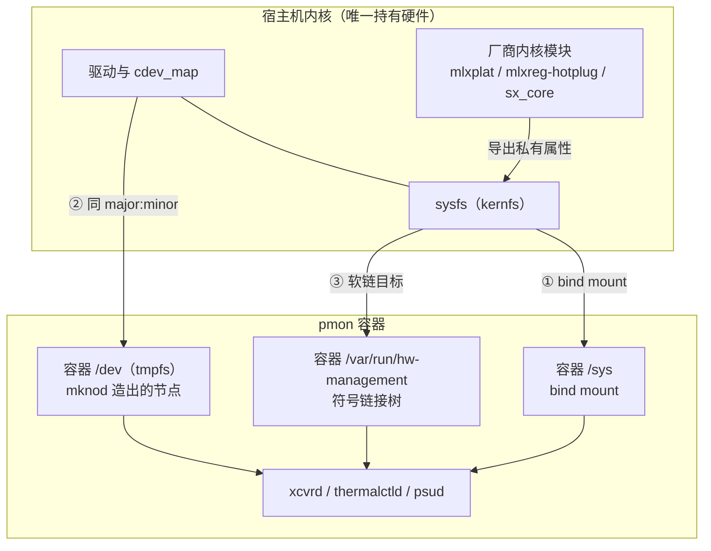
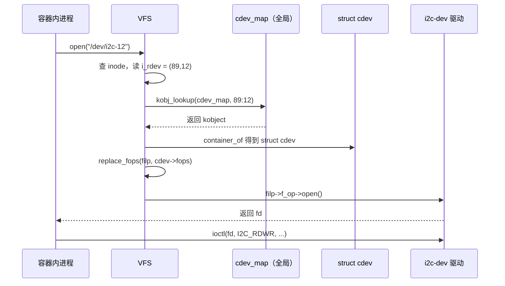
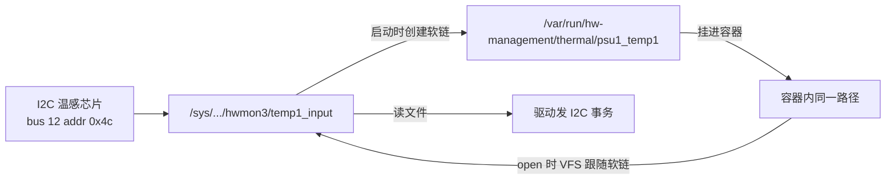

# SONiC 容器访问宿主硬件：三条通路的原理与数据清单

> 本文是 [[SONiC-平台硬件数据采集-数据位置与采集链路#3.6 前置条件：容器怎样看见宿主硬件|主文档 §3.6]] 的展开。主文档回答"谁采、采什么、送到哪"，本文只回答一件事：**容器凭什么能读到宿主的硬件**。三个子问题分别对应 [[#2 通路一：/sys 直接可见|§2]]、[[#3 通路二：mknod 造设备节点|§3]]、[[#4 通路三：厂商私有挂载|§4]]。

## 结论先行

**三条通路不是三个可选方案，而是同一件事的三个入口。** 它们各自解决一个不同的问题：

| 通路 | 一句话本质 | 解决什么问题 |
|---|---|---|
| ① `/sys` bind mount | 把内核对象树挂进容器，读文件就是读硬件 | **路径可见** |
| ② `mknod` | 在容器 `/dev` 造一个同 `major:minor` 的 inode，打开它就打开了宿主驱动 | **句柄可用** |
| ③ 厂商私有挂载 | 厂商内核模块把硬件拓扑翻译成稳定命名的符号链接，再挂给容器 | **路径稳定** |

四条最容易搞错的事实，先摆出来：

| 常见说法 | 实际情况 |
|---|---|
| "容器里的 `/dev/i2c-1` 是从宿主 bind mount 过来的" | **不是**。容器 `/dev` 是独立 tmpfs，节点由 `mknod` 现造，宿主 `/dev` 不动 |
| "有了设备节点就能读硬件" | **不够**。还要过 device cgroup，未放行时 `open` 直接返回 `EPERM` |
| "`/sys` 和 `/dev` 是同一个东西" | **完全不同的两条路**。`/sys` 不需要设备节点，也不需要 `major:minor` |
| "厂商私有挂载是把硬件驱动搬进容器" | **不是**。驱动永远在宿主内核，挂进来的只是**符号链接与路径** |

## 目录

- [[#0 先建立三个概念|§0]]
- [[#1 三条通路总览|§1]]
- [[#2 通路一：/sys 直接可见|§2]]
- [[#3 通路二：mknod 造设备节点|§3]]
- [[#4 通路三：厂商私有挂载|§4]]
- [[#5 三者对比与选型|§5]]
- [[#6 验证命令|§6]]
- [[#7 参考资料|§7]]

---

## 0 先建立三个概念

后面所有讨论都建立在这三个概念的区分上，混了就全乱。

| 概念 | 是什么 | 存在哪里 | 容器要什么 |
|---|---|---|---|
| **设备节点**（device node） | 一个 inode，里面只存 `(major, minor)` 两个数 | `/dev/xxx` | 容器 `/dev` 里要有这个 inode |
| **sysfs 属性**（sysfs attribute） | kernfs 里的一个文件，绑定到某个内核对象的 `show()`/`store()` 回调 | `/sys/...` | `/sys` 要挂进来 |
| **驱动**（driver） | 内核模块，注册到 `cdev_map` 或总线，真正发总线事务 | **宿主内核，全系统唯一一份** | 容器不需要、也无法拥有 |

一句话串起来：**驱动在宿主内核里，节点是打开驱动的钥匙，sysfs 是绕过钥匙直接从窗口递东西。**

> 本文与主文档的分工：[[SONiC-平台硬件数据采集-数据位置与采集链路#3.6 前置条件：容器怎样看见宿主硬件|主文档 §3.6]] 给的是参数清单（`-v /sys`、`--device`、`--device-cgroup-rule`），本文给的是这些参数背后的机制。设备节点如何生成、`/sys` 为何能读到实时值、`/var/run/hw-management` 到底是什么，都在下面三节。

---

## 1 三条通路总览



三条通路的对照，先给结论，细节在后面三节：

| 维度 | ① `/sys` | ② `mknod` | ③ 厂商私有 |
|---|---|---|---|
| 访问对象 | 内核对象的属性文件 | 字符设备（`/dev/*`） | 厂商定义的路径树 |
| 实现手段 | `-v /sys/:/sys/:rw` | `mknod <path> c <maj> <min>` | `-v <宿主路径>:<容器路径>` |
| 需要 `major:minor` | 否 | **是** | 否 |
| 需要 cgroup 放行 | 否 | **是** | 否 |
| 能否热插拔 | 天然支持（树是活的） | 需 udev 补造节点 | 需厂商脚本更新链接 |
| 容器重启后 | 自动恢复 | **节点丢失，要 resync** | 自动恢复 |
| 典型使用者 | thermalctld、psud、syseepromd | 直读 I2C 的厂商插件 | Mellanox 全部 daemon |

---

## 2 通路一：/sys 直接可见

### 2.1 为什么它不需要设备节点

这是通路一最反直觉的地方：**读 `/sys/class/hwmon/hwmon0/temp1_input` 不需要 `/dev` 下有任何东西。**

原因在 sysfs 的实现方式。sysfs 建在 kernfs 之上，每个属性文件在创建时就绑定了两个回调：

```c
struct device_attribute {
    ssize_t (*show)(struct device *dev, struct device_attribute *attr, char *buf);
    ssize_t (*store)(struct device *dev, struct device_attribute *attr,
                     const char *buf, size_t count);
};
```

- `read()` 走 VFS 通用路径 → `kernfs_fop_read` → 调 `show()` → 驱动去发 I2C 事务、返回值填进 buffer
- `write()` 走 `kernfs_fop_write` → 调 `store()` → 驱动去写硬件寄存器

全程不经过 `cdev_map`，不查 `major:minor`，不碰 device cgroup。**所以在容器里能不能读 sysfs，只取决于两件事：挂载点存在、文件权限够。**

这就是为什么 `-v /sys/:/sys/:rw` 这一行，比所有 `--device` 加起来覆盖的采集项还多。

### 2.2 提供哪些数据：六大类

下表按"类别 → 路径模式 → 关键属性 → 单位 → SONiC 谁在消费"组织。路径里的 `N` 是索引号，实际值因平台而异。

**① hwmon：板级传感器（最核心的一类）**

路径：`/sys/class/hwmon/hwmonN/`

| 属性 | 含义 | 单位 | 备注 |
|---|---|---|---|
| `name` | 芯片驱动名 | — | 如 `coretemp`、`pmbus`、`jc42`、`mlxsw` |
| `tempN_input` | 当前温度 | 毫摄氏度 | 42000 = 42 ℃ |
| `tempN_max` / `tempN_crit` | 高温阈值 / 临界阈值 | 毫摄氏度 | 部分芯片可写 |
| `tempN_emergency` | 紧急关机阈值 | 毫摄氏度 | 光模块常用 |
| `tempN_label` | 传感器名 | — | 如 `Composite`、`CPU Core 0` |
| `fanN_input` | 风扇实测转速 | RPM | — |
| `fanN_target` | 目标转速 | RPM | 只读或可写，看驱动 |
| `fanN_fault` | 转速故障标志 | 0/1 | 卡死时为 1 |
| `pwmN` | PWM 占空比 | 0–255 | **可写**，fancontrol 用它控风 |
| `pwmN_enable` | PWM 使能 | 0/1/2 | 2 = 自动 |
| `inN_input` | 电压 | 毫伏 | 12000 = 12 V |
| `currN_input` | 电流 | 毫安 | — |
| `powerN_input` | 功率 | 微瓦 | 48000000 = 48 W |
| `humidityN_input` | 湿度 | 千分之一 % | 液冷平台才有 |

对应的芯片与驱动：`coretemp`（CPU）、`jc42`/`tmp421`/`lm75`（板级温感）、`pmbus`（PSU）、`max1363`（ADC 电压）、`mlxsw`（Mellanox ASIC）。

**② 光模块 EEPROM：optoe 注册的 sysfs 文件**

路径：`/sys/bus/i2c/devices/<bus>-<addr>/`

| 文件 | 内容 | 大小 |
|---|---|---|
| `eeprom` | 模块低页（A0h，地址 0x50） | 128/256 字节 |
| `eeprom1` | 模块高页（A2h 上半，地址 0x51） | 128 字节 |
| `name` | 驱动名，通常是 `optoe1`/`optoe2` | — |
| `hwmon/hwmonN/temp1_input` | 模块温度（部分平台 optoe 注册 hwmon） | 毫摄氏度 |

注意 `eeprom` 这个名字是 **optoe 驱动自己起的**，`at24` 驱动（普通 EEPROM，如整机 syseeprom）也叫 `eeprom`。区别看 `name` 文件。

**③ 热区：thermal zone（内核热管理框架）**

路径：`/sys/class/thermal/thermal_zoneN/`

| 属性 | 含义 |
|---|---|
| `type` | 热区名，如 `x86_pkg_temp`、`mlxsw` |
| `temp` | 当前温度，毫摄氏度 |
| `trip_point_N_temp` | 第 N 个触发点温度 |
| `policy` | 调频策略 |

SONiC 的 `thermalctld` 主要走 hwmon，thermal zone 更多被内核自己的 step_wise 调速器使用（Mellanox 的风扇曲线就跑在这上面）。

**④ PCIe：链路与错误计数**

路径：`/sys/bus/pci/devices/<BDF>/`

| 属性 | 含义 |
|---|---|
| `vendor` / `device` | 厂商 ID / 设备 ID |
| `class` | 设备类别（0x020000 = 以太网控制器） |
| `current_link_speed` / `current_link_width` | 当前链路速率与宽度 |
| `max_link_speed` / `max_link_width` | 理论最大值 |
| `aer_dev_correctable` / `aer_dev_fatal` / `aer_dev_nonfatal` | AER（高级错误报告）计数 |
| `config` | 配置空间前 64 字节可读；完整读写需 `CAP_SYS_RAWIO` |
| `power_state` / `enable` | 电源状态与使能 |

`pcied` 守护进程就是读这些判断"网卡是否掉链路、是否降速"。

**⑤ LED / watchdog / 电源**

| 路径 | 内容 | 谁用 |
|---|---|---|
| `/sys/class/leds/<name>/brightness` | LED 亮度（可写） | `ledd` |
| `/sys/class/leds/<name>/trigger` | 触发模式（如 `timer`） | `ledd` |
| `/sys/class/watchdog/watchdogN/timeout` | 看门狗超时 | 硬件看门狗 |
| `/sys/class/power_supply/*/online` | 外部供电是否在位 | 部分平台 |

**⑥ 平台私有：`/sys/module/<模块名>/` 与 `/sys/devices/platform/`**

| 路径 | 内容 | 说明 |
|---|---|---|
| `/sys/module/sx_core/asicN/temperature` | Spectrum ASIC 温度 | 单位 **1/8 ℃**，scale=8 |
| `/sys/devices/platform/mlxplat/i2c_mlxcpld.*/` | CPLD 寄存器窗口 | Mellanox CPLD |
| `/sys/devices/platform/<平台名>/` | 厂商自定义属性 | 各家不同 |

这一类严格说仍属通路一（在 `/sys` 下），但因为命名不标准、只有厂商自己知道含义，实际由通路三的稳定命名包装后再用。

### 2.3 单位换算：最容易错的地方

sysfs 的单位是内核定死的，**不做换算就会得到荒谬的数**。

| 量 | sysfs 单位 | 换算 | 典型错值 |
|---|---|---|---|
| 温度 | 毫摄氏度 | ÷1000 | 直接显示 42000 ℃ |
| 电压 | 毫伏 | ÷1000 | 显示 12000 V |
| 电流 | 毫安 | ÷1000 | 显示 8500 A |
| 功率 | 微瓦 | ÷1e6 | 显示 48000000 W |
| 湿度 | 千分之一 % | ÷1000 | — |
| PWM | 0–255 无单位 | ÷255×100 得百分比 | — |
| Spectrum ASIC 温度 | **1/8 ℃** | ÷8 | 显示 336 ℃ |

最后一行是真正的坑：Mellanox 的 `thermal.py` 里写着 `"scale": 8`，而其他传感器是 `DEFAULT_TEMP_SCALE = 1000`。**同一份代码里两种 scale 并存**，抄代码时抄错一个就是数量级错误。

### 2.4 读与写的语义差别

| 操作 | 内核动作 | 是否触发硬件 | 风险 |
|---|---|---|---|
| `read()` | 调 `show()` | 是（发总线事务） | 无 |
| `write()` | 调 `store()` | 是（改寄存器） | **可能改硬件状态** |

所以 `-v /sys/:/sys/:rw` 里的 `rw` 不是随手写的：`fancontrol` 要写 `pwmN` 才能控风。代价是容器内可以写整个 sysfs——包括不该碰的节点。SONiC 用 `CAP_SYS_ADMIN` + AppArmor 放松来配套，属于"功能优先"的取舍。

反过来，很多属性是**只读**的（`-r--r--r--`），写会返回 `EACCES`。判断方法很简单：

```bash
ls -l /sys/class/hwmon/hwmon0/temp1_input   # -r--r--r-- 只读
ls -l /sys/class/hwmon/hwmon0/pwm1          # -rw-r--r-- 可写
```

### 2.5 一个反例：NVMe SMART 不在 sysfs 里

`/sys/block/nvme0n1/` 下有容量、队列、设备型号，但**健康日志（温度、磨损、剩余寿命）拿不到**——那要走 NVMe 管理命令：

```bash
nvme smart-log /dev/nvme0        # 内部是 ioctl(NVME_IOCTL_ADMIN_CMD)
```

这说明通路一不是万能的：**只有驱动愿意用 sysfs 暴露的属性才看得见**。驱动没暴露的，只能回到通路二（拿 `/dev/nvme0` 发 ioctl）。`stormond` 判断 SSD 健康就是这条路。

---

## 3 通路二：mknod 造设备节点

这一节回答四个问题：造出来是什么意思、为什么必须造、原理是什么、造完能访问什么。

### 3.1 "造出来"到底造了什么

先破一个直觉：**设备节点里没有任何数据，也没有任何"设备内容"。**

一个字符设备节点就是一个 inode，核心字段只有两个：

```c
struct inode {
    umode_t  i_mode;   // S_IFCHR | 权限位
    dev_t    i_rdev;   // 高 12 位 major，低 20 位 minor
    ...
};
```

`mknod /dev/i2c-12 c 89 12` 做的事情，用一句话说就是：**在指定路径创建一个 inode，标记它是字符设备，并把 `(89, 12)` 这两个数写进 `i_rdev`。**

它不创建驱动、不初始化硬件、不分配总线、不加载模块。**它只是写了一块门牌。**

真正的"房间"（驱动）一直在宿主内核里，而且全系统只有一间。所以准确的类比是：

> `mknod` 不是盖房子，是**在容器这个小区门口钉一块指向同一栋楼的门牌**。门牌可以有很多块（宿主一块、容器一块），楼只有一栋。

这就是为什么容器里造的节点和宿主节点"行为完全一致"——它们指向同一个 `struct cdev`。

### 3.2 为什么必须造：devtmpfs 与 tmpfs 的差别

那为什么宿主不用造、容器就得造？因为两者的 `/dev` 是**不同文件系统**。

| | 宿主机 `/dev` | 容器 `/dev` |
|---|---|---|
| 文件系统 | **devtmpfs** | **tmpfs** |
| 节点来源 | 内核在设备注册时**自动创建**（`devtmpfs_create_node`） | 内核不会自动填，只放 Docker 预置的少数节点 |
| 谁维护 | 内核 + udev（改权限、加符号链接） | Docker（启动时建几个）+ 你（`mknod`） |
| 默认内容 | 全系统所有已注册设备 | `null`、`zero`、`full`、`random`、`urandom`、`tty`、`console`、`ptmx`、`shm` 等 |

所以容器里 `ls /dev` 看不到 `i2c-12`，不是权限问题，是**这个文件系统里根本没有那个 inode**。内核不会替你补，因为 tmpfs 没有 devtmpfs 那套"设备注册即建节点"的机制。

补的办法只有两个：

1. **让 Docker 帮你造**：`--device=/dev/sda` → Docker 在容器内 `mknod` 同路径节点 + 加 cgroup allow
2. **自己造**：`mknod`（SONiC 的热插拔节点走这条，由 `pmon-dev-bridge.sh` 执行）

两者本质完全相同，区别只是谁是执行者。

### 3.3 原理：从 `open()` 到驱动，中间发生了什么

这是本节的核心。整个链路只有四步，但每一步都决定了"为什么跨 namespace 仍然有效"。



对应的内核代码路径（简化，保留关键判断）：

```c
/* fs/char_dev.c */
static int chrdev_open(struct inode *inode, struct file *filp)
{
    struct kobject *kobj = kobj_lookup(cdev_map, inode->i_rdev, &idx);
    if (!kobj)
        return -ENODEV;                       /* major 没注册 */
    struct cdev *new = container_of(kobj, struct cdev, kobj);
    replace_fops(filp, new->fops);            /* 换成驱动的 fops */
    if (filp->f_op->open)
        return filp->f_op->open(inode, filp);
    return 0;
}
```

**关键结论：`cdev_map` 是内核全局表，以 `(major, minor)` 为键，与 mount namespace、PID namespace 统统无关。**

所以：

- 宿主 `/dev/i2c-12` 的 inode 是 `(89,12)`，容器 `/dev/i2c-12` 的 inode 也是 `(89,12)`
- 两个 inode 不同（位于不同文件系统），但 `open` 时查的是**同一张表**、落到**同一个 `struct cdev`**、调**同一个驱动的 `open()`**
- 因此容器内 `ioctl(fd, I2C_RDWR, ...)` 和宿主上执行完全等价

这就是"跨 namespace 共享硬件"的全部原理。**硬件从来没有被搬进容器，只是被多钉了一块门牌。**

### 3.4 造完还要过两道关

`mknod` 成功 ≠ `open` 成功。中间还有两次检查：

| 关卡 | 检查什么 | 失败返回 | 判断方法 |
|---|---|---|---|
| ① major 已注册 | `cdev_map` 里有没有这个 major | `ENODEV` / `ENXIO` | 宿主 `grep i2c /proc/devices` |
| ② device cgroup | 该容器的 devices 控制器是否放行 | `EPERM` | `docker inspect` 看 `DeviceCgroupRules` |
| ③ LSM（AppArmor/SELinux） | 策略是否允许访问该路径 | `EACCES` | `aa-status`、`dmesg` 有 `apparmor="DENIED"` |

三者的错误码不同，这是排障时最有效的线索：

```text
ENODEV  → 节点造错了 major，或驱动模块没加载
EPERM   → 节点和驱动都对，cgroup 没放行
EACCES  → 前两关都过，被 LSM 或文件权限挡住
EBUSY   → 驱动存在但设备被独占（少见）
```

`mknod` 本身需要 `CAP_MKNOD`。Docker 默认 capability 集合里**包含** `CAP_MKNOD`，所以容器内直接 `mknod` 是允许的——这也是 `pmon-dev-bridge.sh` 能在容器里跑 `mknod` 的前提。

### 3.5 能做到的效果：五条

| # | 效果 | 说明 |
|---|---|---|
| 1 | **最小暴露** | 只造需要的那几个节点，不是把宿主 `/dev` 整目录搬进来（`/dev/mem` 天然不在内） |
| 2 | **支持热插拔后补造** | i2c mux 后面的总线要插模块才出现，`docker create` 时无法预知，只能运行时补 |
| 3 | **不依赖宿主路径存在** | 只要有 `major:minor` 就能造；宿主路径改名、变成符号链接都不影响 |
| 4 | **与宿主完全等价** | 同一 `cdev`、同一驱动、同一 `ioctl` 语义，无性能损耗（只多一次 VFS 查找） |
| 5 | **可精确控制权限位** | `mknod` 时给 mode，可造出 `0600` 只给 root 的节点 |

同时有两条硬限制：

- **造不出未注册的 major**。宿主没有的设备，容器里造出来也打不开。
- **容器重启即消失**。容器 `/dev` 是 tmpfs，重启后节点全丢，必须靠 `resync` 重新收敛（见 [[SONiC-平台硬件数据采集-数据位置与采集链路#3.6.3 通路二：设备节点要靠 mknod 造出来|主文档 §3.6.3]]）。

### 3.6 造完能访问哪些数据

这是"通路二到底值不值得用"的关键。下表按总线类型列，都是**必须走设备节点**才能拿到的数据：

| 总线/设备 | 典型节点 | 能读到的数据 | 读法 |
|---|---|---|---|
| **I2C** | `/dev/i2c-N` | 光模块 A0h/A2h 原始字节、CPLD 寄存器、温感芯片（lm75/tmp421）、PSU PMBus（VOUT/IOUT/TEMP）、风扇控制器、EEPROM（24c02） | `ioctl(I2C_RDWR)` 或 `smbus2` |
| **SPI** | `/dev/spidevN.M` | SPI flash（BIOS/CPLD 固件）、部分 CPLD | `ioctl(SPI_IOC_MESSAGE)` |
| **GPIO** | `/dev/gpiochipN` | 端口 presence、reset 控制、LED、中断聚合 | `ioctl(GPIO_V2_GET_LINE_IOCTL)` |
| **mtd** | `/dev/mtdN` | flash 分区原始读写、坏块信息 | `read`/`write`/`ioctl(MEMGETINFO)` |
| **uio** | `/dev/uioN` | 用户态驱动设备（DPU、FPGA、部分网卡） | `mmap` + `read` 中断 |
| **ipmi** | `/dev/ipmiN` | BMC 传感器、SEL 日志、电源控制 | `ioctl(IPMICTL_SEND_COMMAND)` |
| **PCIe** | `/sys/bus/pci/devices/*/config` | 配置空间（需 `CAP_SYS_RAWIO`） | `pread`/`pwrite` |
| **NVMe** | `/dev/nvmeN` | SMART 健康日志、温度、磨损 | `ioctl(NVME_IOCTL_ADMIN_CMD)` |
| **厂商字符设备** | `/dev/cpld`、`/dev/fpga`、`/dev/port` 类 | CPLD/FPGA 寄存器窗口、复位控制 | 厂商自定义 `ioctl` |

几个具体读法示例：

```python
# 方式一：smbus2（最常用，封装了 ioctl）
from smbus2 import SMBus
bus = SMBus(12)
data = bus.read_i2c_block_data(0x50, 0, 128)     # 读光模块 A0h 前 128 字节

# 方式二：直接 ioctl（性能更好，一次可做多段传输）
import fcntl, struct
I2C_RDWR = 0x0707
msg = struct.pack('HBBH', 0x50, 0, 2, 128)       # addr, flags, len, buf_ptr
```

```python
# PMBus 读 PSU 输出电压（线性格式，需按协议换算）
raw = bus.read_i2c_block_data(0x58, 0x8B, 2)     # VOUT_MODE 后读 VOUT
```

为什么厂商有时宁可走 `ioctl` 而不走 sysfs：**一次系统调用可以传多段消息**（`I2C_RDWR` 支持 `iov` 数组），读 256 字节 EEPROM 只需 1 次而不是 256 次。高频采样时这个差别很明显。

### 3.7 一个反直觉点：有节点不代表该用

SONiC 里光模块 EEPROM 的**主路径是 sysfs**（optoe 的 `eeprom` 文件），不是 `/dev/i2c-*`。原因：

- optoe 驱动已经处理了分页（page select）、bank 切换、并发锁、超时重试
- 用 `smbus2` 直读要自己实现这些，容易在高速模块上踩坑

所以现实是：**通路二是"厂商坚持自己实现协议"时的后备路径，而不是默认路径。** 只有在下列情况才走它：

1. 器件没有内核驱动（裸 CPLD、私有时序芯片）
2. 需要 CDB（CMIS 命令数据块）等 sysfs 不暴露的操作
3. 需要批量传输的性能优势

### 3.8 手工实验：在容器里造一个节点

想亲眼看懂，可以在 pmon 里做一个只读实验（不改任何状态）：

```bash
# 宿主：确认 i2c 的 major
grep -w i2c /proc/devices            # 输出形如 " 89 i2c"

# 容器：看默认有没有节点
docker exec pmon ls /dev/i2c-*       # 通常为空或只有部分

# 容器：手工造一个（major 89，minor 取宿主实际值）
docker exec pmon mknod /dev/i2c-test c 89 1
docker exec pmon ls -l /dev/i2c-test
# crw-r--r-- 1 root root 89, 1 ... /dev/i2c-test

# 试着读：成功说明三关都过；EPERM 说明 cgroup 没放行
docker exec pmon python3 -c "import os; print(len(os.read(open('/dev/i2c-test','rb',buffering=0).fileno(), 1)))"
```

如果 `mknod` 后 `open` 报 `EPERM`，去 `docker inspect pmon --format '{{json .HostConfig.DeviceCgroupRules}}'` 看有没有 `c 89:* rwm`——这就是第 3.4 节第二关的现场。

---

## 4 通路三：厂商私有挂载

### 4.1 它解决的是"总线号漂移"，不是"权限"

先看一个真实痛点。假设某平台有两颗温感芯片：

```text
今天：温感 A 在 i2c-12 地址 0x4c，温感 B 在 i2c-13 地址 0x4c
明天：加了一条 i2c mux 或换了 SKU，温感 A 变成 i2c-15，温感 B 变成 i2c-12
```

如果上层代码写死 `open('/sys/bus/i2c/devices/12-004c/hwmon/...')`，换个平台就直接读到错的东西——**而且不报错，读到的是另一个传感器的值**。

Mellanox 官方的原话说得很直白：

> "The major advantage of working with sysfs is that it makes HW hierarchy easy to understand and control **without having to learn about HW component location and the buses through which they are connected**."

翻译成工程语言：**把"物理总线坐标"翻译成"逻辑名字"，让上层只认名字。**

这就是通路三的全部动机。它不是权限问题（权限由通路一解决），而是**命名稳定性问题**。

### 4.2 hw-management 是什么

`hw-management`（仓库 `Mellanox/hw-mgmt`）不是一个程序，而是**三层组合**：

| 层 | 组成 | 作用 |
|---|---|---|
| 内核模块 | `mlxplat`、`mlxreg-hotplug`、`i2c-mlxcpld`、`leds-mlxreg`、`mlx-wdt`、`mlxsw` | 把 CPLD、I2C mux、LED、看门狗、ASIC 挂到内核总线上 |
| 用户态服务 | `hw-management.sh`、`hw-management-tc.service`、udev 规则 | 启动时枚举拓扑，创建 `/var/run/hw-management` 下的**符号链接** |
| 配置 | `/etc/hw-management-sensors/` | 传感器阈值、风扇曲线 |

关键机制在第二层：**`/var/run/hw-management` 里几乎全是符号链接，不是真实文件。**

```text
/var/run/hw-management/thermal/module1_temp_input
    → /sys/bus/i2c/devices/12-0050/hwmon/hwmon3/temp1_input

/var/run/hw-management/thermal/psu1_temp1
    → /sys/bus/i2c/devices/8-0058/hwmon/hwmon5/temp1_input
```

所以"挂载厂商私有目录"这件事的实质是：**挂一份链接表进来，链接的目标仍在 `/sys` 里。**

### 4.3 目录树与内容

`/var/run/hw-management/` 的标准结构：

| 目录 | 内容 | 典型文件 |
|---|---|---|
| `config/` | 平台配置：风扇最小/最大转速、默认值、各类延时 | `fan_min_speed`、`psu_delay` |
| `eeprom/` | 整机、PSU、风扇、CPU 的 EEPROM 链接 | `sys_eeprom`、`psu1_eeprom` |
| `environment/` | 电压、电流、ADC 值 | `volt_mon1`、`curr_mon1` |
| `led/` | LED 控制 | `led_status`、`led_psu` |
| `power/` | 电源相关 | `power_consumption` |
| `system/` | 系统健康、复位、CPLD 版本 | `cpld1_version`、`system_health` |
| `thermal/` | **最主要的一层**，温控与传感器 | 见下 |
| `watchdog/` | 看门狗属性 | `main/timeout`、`aux/timeout` |

`thermal/` 下的命名规则是最值得记的部分：

| 文件 | 含义 | 单位 |
|---|---|---|
| `asic` | ASIC 环境温度 | 毫摄氏度 |
| `port_amb` / `fan_amb` | 端口侧 / 风扇侧进风温度 | 毫摄氏度 |
| `psu1_temp1` | PSU1 内部温度 | 毫摄氏度 |
| `psu1_pwr_status` | PSU1 电源好信号（1 好 / 0 断） | 0/1 |
| `fan1_input` | 风扇 1 转速 | RPM |
| `pwm` | 当前 PWM | 0–255 |
| `cooling_cur_state` | 当前散热档位（1–10） | 档 |
| `module1_temp_input` | 1 号光模块温度 | 毫摄氏度 |
| `mlxsw/` 子目录 | ASIC 热区相关 | — |
| `mlxsw-moduleN/` 子目录 | 第 N 个模块的热区 | — |

厂商 `thermal.py` 里那张 `THERMAL_NAMING_RULE` 表，做的就是把这些名字映射成 `Thermal` 对象：

```python
"psu thermals": {
    "name": "PSU-{} Temp",
    "temperature": "psu{}_temp1",
    "high_threshold": "psu{}_temp1_max",
}
```

**注意它只写文件名，不写路径前缀，更不写 bus/addr。** 前缀由 `CHASSIS_THERMAL_SYSFS_FOLDER = '/run/hw-management/thermal'` 统一给。这就是"命名稳定"带来的解耦——换硬件，改内核模块和链接表，`thermal.py` 一行不动。

### 4.4 原理：软链 + bind mount，缺一不可



三个技术要点：

1. **为什么用符号链接而不是复制**。sysfs 不支持硬链接（一个 kobject 对应一个 dentry），只能软链。软链在 VFS 解析路径时跟随，`open` 一次就到达真实节点，**不增加额外系统调用**。
2. **软链在容器内必须"能解析到底"**。如果只挂 `/var/run/hw-management` 而不挂 `/sys`，链接目标 `/sys/bus/i2c/...` 在容器里不存在，`open` 返回 `ENOENT`，表现为"文件明明在，就是打不开"。**这是通路三最典型的故障。**
3. **`/var/run` 是 tmpfs**。链接表在每次启动时重建，容器必须在链接表生成之后启动，否则挂进来是空目录。SONiC 靠 systemd 的依赖顺序保证这一点。

所以 Mellanox 分支的挂载参数是**成组出现**的：

```bash
-v /sys/:/sys/:rw                              # 软链目标
-v /var/run/hw-management:/var/run/hw-management:rw   # 软链本身
-v /etc/hw-management-sensors:/etc/hw-management-sensors:ro  # 阈值配置
```

**一个诚实的技术判断**：按当前 master 的 `docker-platform-monitor.mk`，`-v /sys/:/sys/:rw` 是无条件的，因此 `-v /sys/module/sx_core` 与 `-v /sys/devices/platform/mlxplat` 这两条在当前代码里是**冗余的**（已被 `/sys` 覆盖），属于显式声明或历史遗留。真正不可省略的只有 `/var/run/hw-management`（不在 `/sys` 下）和 `/etc/hw-management-sensors`（配置目录）。老版本分支可能 `/sys` 是只读挂载，那时这两条才有独立意义。

### 4.5 能做到什么程度

**能做到：**

| 能力 | 具体表现 |
|---|---|
| 读全部传感器 | 温度、电压、电流、功率、风扇转速、模块 DDM、PSU 20 字段 |
| 写控制量 | 风扇 PWM、LED 亮度、复位信号、热区 trip point |
| 拿拓扑信息 | CPLD 版本、板卡型号、槽位编号、模块在位 |
| 收热插拔事件 | `mlxreg-hotplug` 产生 udev 事件，模块插入可被感知 |
| 屏蔽平台差异 | 同一份 `thermal.py` 适配几十个 SKU |

**做不到：**

| 限制 | 原因 |
|---|---|
| 不能替代业务逻辑 | 它只提供"值"，阈值判断、单位换算、去重仍在 daemon 里 |
| 不能跨厂商 | 命名规则是 Mellanox 私有的，Broadcom 平台没有这套树 |
| 不能绕过内核模块 | 模块没加载，树就是空的；容器里挂载也救不了 |
| 链接可能悬空 | 模块拔出后软链还在，`open` 报 `ENOENT`，需要 `os.path.exists` 先判 |

最后一条在采集侧必须防御：**读之前先判断链接是否可解析**，否则会得到一堆 `ENOENT` 日志。

### 4.6 另一类私有挂载：`/sys/module/sx_core`

`/sys/module/sx_core/` 不是 hw-management 的一部分，而是 **Spectrum ASIC 的 SDK 内核模块**导出的属性：

```text
/sys/module/sx_core/asic0/temperature     # 单位 1/8 ℃
/sys/module/sx_core/asic1/temperature     # 多 ASIC 平台
```

为什么 hwmon 里没有它：ASIC 温度由 SDK 直接读芯片内部传感器（通过 PCIe 寄存器），**不是板级 I2C 温感**，所以不走 hwmon 框架。这也是 `thermal.py` 里 `scale: 8` 的来源——SDK 用的是 1/8 ℃ 定点。

多 ASIC 平台上，`asicN` 的 N 与 syncd 实例号对应；采集端做去重时必须带上这个 N，否则会把两个 ASIC 的温度混成一个。

### 4.7 其他厂商的等价物

| 厂商 | 私有通路 | 形态 |
|---|---|---|
| Mellanox | `/var/run/hw-management` | 符号链接树 + 标准 hwmon |
| Broadcom 白盒 | 平台自定义 `/dev/<name>` 或 `/sys/kernel/debug/` | 字符设备 + debugfs |
| Marvell | PDDF（平台数据驱动框架） | JSON 描述拓扑 + 通用驱动，加载后生成 hwmon |
| Cisco / Arista | 厂商平台库 + 私有字符设备 | 直接 `ioctl`，无统一命名 |

**共性**：都是"厂商内核模块定义命名空间，用户态按名字访问"。**差异**：Mellanox 用软链，Broadcom 用字符设备，Marvell 用 JSON 驱动。

顺带说 PDDF：它试图用一份 JSON 把"哪个 i2c 总线上有什么芯片"声明出来，由通用驱动加载成标准 hwmon。这是**把通路三收敛回通路一**的思路——目前只有部分平台支持。

### 4.8 为什么必须单独挂载：三个理由

| 理由 | 说明 |
|---|---|
| 路径不在 `/sys` 下 | `/var/run/hw-management` 在 tmpfs，`/sys` 通配覆盖不到 |
| 需要可写 | 风扇 PWM、LED 控制要写，而某些分支 `/sys` 是只读挂载 |
| 语义边界清晰 | 显式列出"这个容器用 hw-management"，便于审计容器权限 |

反过来，如果只挂 `/var/run/hw-management` 不挂 `/sys`，**所有链接都会悬空**——这是排查顺序里必须最先确认的一条。

---

## 5 三者对比与选型

### 5.1 全维度对照

| 维度 | ① `/sys` | ② `mknod` | ③ 厂商私有 |
|---|---|---|---|
| 解决什么 | 路径可见 | 句柄可用 | 路径稳定 |
| 访问对象 | kernfs 属性 | 字符设备 | 符号链接树 |
| 依赖 `major:minor` | 否 | **是** | 否 |
| 依赖 cgroup | 否 | **是** | 否 |
| 依赖厂商内核模块 | 部分 | 否 | **是** |
| 热插拔 | 树自动更新 | 需 udev 补造 | 需厂商脚本更新链接 |
| 容器重启 | 自动恢复 | **丢失，需 resync** | 自动恢复 |
| 单次读的开销 | 1 次 syscall + 1 次总线事务 | 1 次 syscall（可多段）+ 事务 | 与 ① 相同（软链在 VFS 解析） |
| 典型故障 | `ENOENT`（没挂） | `EPERM`（cgroup）/`ENODEV`（major 错） | `ENOENT`（软链悬空） |
| SONiC 用它的地方 | 温感、风扇、EEPROM、PCIe | 直读 I2C/CPLD 的厂商插件 | Mellanox 全部 daemon |

### 5.2 选型口诀

```text
器件已注册标准 hwmon / i2c / pci 驱动   → 通路一（sysfs），别造节点
只有厂商私有协议，或需要 CDB/批量传输   → 通路二（/dev + ioctl）
厂商已提供稳定命名树                     → 通路三（直接用名字，别碰 bus/addr）
```

三条并不互斥。**Mellanox 上三者同时在用**：温度走通路三（`/var/run/hw-management`），模块 EEPROM 走通路一（`/sys/bus/i2c/.../eeprom`），CPLD 寄存器走通路二（`/dev/` 下的厂商节点）。

### 5.3 性能差异：什么时候 ioctl 更快

| 操作 | sysfs 路径 | ioctl 路径 |
|---|---|---|
| 读 `temp1_input`（2 字节） | 1 次 syscall | 1 次 syscall + 构造 msg |
| 读 128 字节 EEPROM | 1 次 syscall（optoe 一次读完） | 1 次 syscall（`I2C_RDWR` 多段） |
| 读 256 字节分 8 段 | 8 次 `seek` + `read`，8 次总线事务 | 8 段打包成 1 次 syscall，仍 8 次事务 |
| 每秒 100 次采样 | 开销可接受 | 明显更省 CPU |

结论：**总线事务次数由协议决定，谁都不能省；能省的只是系统调用次数。** 高频小数据量采集（如 100 ms 一次的 ASIC 温度）才值得为 ioctl 写定制代码。

---

## 6 验证命令

**第一步，确认 `/sys` 通不通（不需要任何节点）：**

```bash
docker exec pmon ls /sys/class/hwmon/
docker exec pmon cat /sys/class/hwmon/hwmon0/name
docker exec pmon cat /sys/class/hwmon/hwmon0/temp1_input
```

**第二步，确认节点在不在、major 对不对：**

```bash
ls -l /dev/i2c-1                       # 宿主
docker exec pmon ls -l /dev/i2c-1      # 容器，major:minor 应完全一致
udevadm info -e --tag-match=pmon-hotplug | grep -E 'DEVNAME|MAJOR|MINOR'
```

**第三步，确认 cgroup 放行：**

```bash
docker inspect pmon --format '{{json .HostConfig.DeviceCgroupRules}}'
docker inspect pmon --format '{{json .HostConfig.Devices}}'
```

**第四步，确认厂商软链没悬空：**

```bash
docker exec pmon ls -l /var/run/hw-management/thermal/ | head
docker exec pmon readlink -f /var/run/hw-management/thermal/asic
docker exec pmon test -e /var/run/hw-management/thermal/asic && echo OK || echo DANGLING
```

**第五步，看 LSM 有没有拦：**

```bash
aa-status | grep pmon
dmesg | grep -i 'apparmor.*DENIED' | tail
```

判读顺序：**`/sys` 能读 → 通路一正常；`/sys` 能读但 `/dev` 没节点 → 通路二断在 udev/mknod 桥；节点在但 `EPERM` → cgroup；`/var/run/hw-management` 里文件在但打不开 → 通路三软链悬空（`/sys` 没挂）。**

---

## 7 参考资料

| 资料 | 内容 | 链接 |
|---|---|---|
| Mellanox hw-mgmt | `/var/run/hw-management` 目录结构与软链机制 | https://github.com/Mellanox/hw-mgmt |
| hw-mgmt README | 各子目录用途与真实文件名示例 | https://github.com/Mellanox/hw-mgmt/blob/master/README.md |
| Linux sysfs 接口 | hwmon 属性与单位定义 | https://docs.kernel.org/hwmon/sysfs-interface.html |
| Linux 字符设备 | `chrdev_open`、`cdev_map`、`register_chrdev` | https://docs.kernel.org/driver-api/cdev.html |
| i2c-dev | `I2C_RDWR` ioctl 与用户态访问 | https://docs.kernel.org/i2c/dev-interface.html |
| devices cgroup | v1/v2 的设备访问控制 | https://docs.kernel.org/admin-guide/cgroup-v2.html |
| pmon-dev-bridge.sh | 容器内 `mknod` 的实现 | https://github.com/sonic-net/sonic-buildimage/blob/master/files/image_config/pmon/pmon-dev-bridge.sh |
| docker-platform-monitor.mk | `/sys` 挂载与 capability | https://github.com/sonic-net/sonic-buildimage/blob/master/rules/docker-platform-monitor.mk |
| mlnx-platform-api thermal.py | hw-management 路径表与 `scale` | https://github.com/sonic-net/sonic-buildimage/blob/master/platform/mellanox/mlnx-platform-api/sonic_platform/thermal.py |

站内相关文档：

- [[SONiC-平台硬件数据采集-数据位置与采集链路]]：数据在哪、谁采、谁发，含 [[SONiC-平台硬件数据采集-数据位置与采集链路#3.6 前置条件：容器怎样看见宿主硬件|参数清单]]
- [[SONiC-观测出口与容器网络-外部通信机制]]：容器拿到数据之后，如何与外部通信（另一个方向的正交问题）
- [[SONiC-可观测采集与容器架构调研]]：整体组成、容器角色、跨容器 Redis
- [[SONiC-事件数据抓取框架-输入输出与设计取舍]]：事件流与 ZMQ 代理
- [[SONiC-日志管道与事件转化-rsyslog运行机制]]：日志如何变成事件

## 待核实项

| # | 事项 | 影响 | 验证方法 |
|---|---|---|---|
| 1 | 目标平台 `/var/run/hw-management` 实际子目录与文件名 | 决定采集路径能否直接复用 | `ls /var/run/hw-management/thermal \| head -50` |
| 2 | `sx_core` 在本平台是否导出 `temperature`，单位是否仍为 1/8 ℃ | 温度值差 8 倍 | `cat /sys/module/sx_core/asic0/temperature`，与 `show platform temperature` 对比 |
| 3 | 本平台 `/sys` 挂载是 `rw` 还是 `ro` | 决定能否控风、能否写 LED | `docker inspect pmon --format '{{json .Mounts}}' \| grep sys` |
| 4 | 厂商插件是否用 `smbus2` 直读 `/dev/i2c-*`（而非 optoe sysfs） | 决定是否需要 cgroup 放行 i2c major | `grep -r "smbus\|SMBus" /usr/lib/python3/dist-packages/sonic_platform/` |
| 5 | 本平台是否启用 PDDF | 启用后走通用 hwmon，命名与厂商私有树不同 | `ls /usr/share/sonic/device/pddf/*.json` |
| 6 | `pwm` 写权限与 `pwmN_enable` 取值 | 控风是否有效 | `ls -l /sys/class/hwmon/hwmon*/pwm*` |

## 版本记录

| 版本 | 日期 | 变更 |
|---|---|---|
| v0.1 | 2026-11-11 | 首版：三概念辨析、三条通路总览、通路一六类数据清单与单位换算、通路二 `mknod` 内核原理（`cdev_map`）与可访问数据、通路三 hw-management 软链机制与能力边界、选型口诀与验证命令 |
