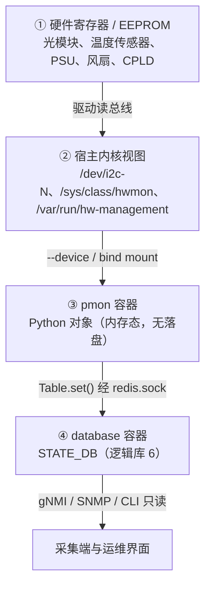
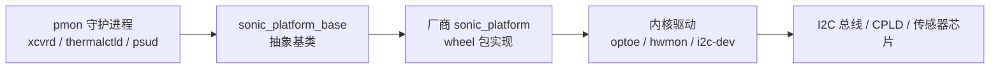
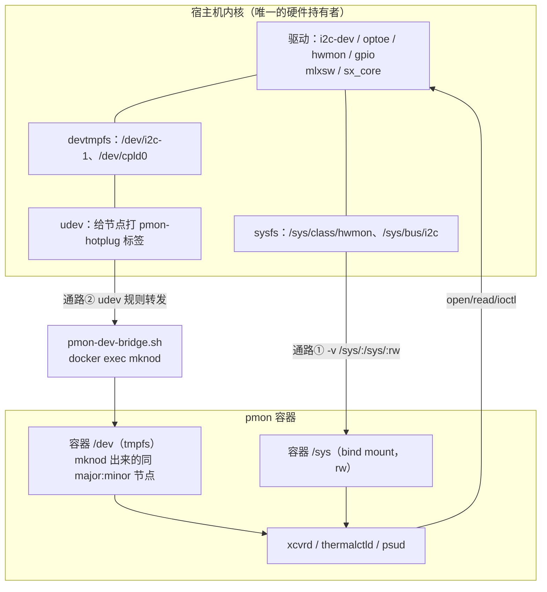
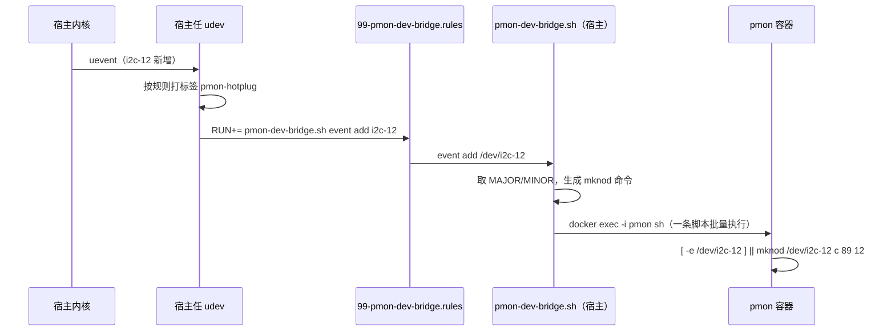
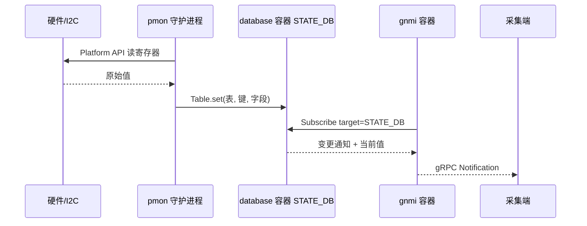

# SONiC 平台硬件数据采集：数据在哪、谁采、谁发

> 本文只回答一个问题域：**平台硬件数据（光模块、温度、风扇、电源、EEPROM、LED、PCIe）是怎么被采集并送到采集端的**。三个子问题——数据在哪里、由谁采、由谁发——分别对应 [[#1 数据在哪里：四层位置|§1]]、[[#2 采集哪些数据：按守护进程分工|§2]]、[[#4 由谁发送：写 STATE_DB，再由采集器读走|§4]]。软件层指标（CPU/内存）与事件流另有专文，见 [[#7 参考资料|§7]]。

## 结论先行

**一句话：平台硬件数据由 pmon 容器内的守护进程采集——容器本身无特权，先靠三条通路拿到访问能力（`/sys` 绑定挂载、`mknod` 造设备节点、厂商私有挂载），再由守护进程调用 Platform API（平台接口）、经厂商插件落到 I2C（内部集成电路总线）设备节点、sysfs（系统伪文件系统）属性或 hw-management（硬件管理）软链树读出硬件，结果写进 database 容器的 STATE_DB（状态库，逻辑库 6）；gNMI 与 SNMP 只读这张库，不碰硬件。**

这句话里有三个层次，不要混为一谈：

| 层次 | 谁在做 | 关键机制 | 展开 |
|---|---|---|---|
| **准入**：容器凭什么能碰硬件 | Docker + 宿主 udev | 三条通路：`-v /sys`、`mknod` + cgroup 放行、厂商私有挂载 | [[#3.6 前置条件：容器怎样看见宿主硬件\|§3.6]] |
| **取值**：从哪个入口读 | Platform API + 厂商 `sonic_platform` wheel | 落到 `/dev/i2c-*`、`/sys/...`、`/var/run/hw-management/...` | [[#3 怎么采集：Platform API 的四层调用栈\|§3]] |
| **落库**：结果放哪 | pmon 内的各 daemon | `Table.set()` 写 STATE_DB | [[#4 由谁发送：写 STATE_DB，再由采集器读走\|§4]] |

三条通路各自解决一个不同的问题，这是理解"容器为什么能读硬件"的关键：

| 通路 | 本质 | 解决什么 | 典型用途 |
|---|---|---|---|
| ① `/sys` bind mount | 内核对象树挂进容器，读文件即读硬件 | **路径可见** | 温度、风扇、光模块 EEPROM、PCIe |
| ② `mknod` | 在容器 `/dev` 造同 `major:minor` 的 inode | **句柄可用** | 直读 I2C/SPI/GPIO/CPLD 寄存器 |
| ③ 厂商私有挂载 | 厂商内核模块导出的软链表 | **路径稳定**（屏蔽总线号漂移） | Mellanox 的 `/var/run/hw-management` |

三者不互斥，Mellanox 平台同时用三条。原理与数据清单见 [[SONiC-容器访问硬件三条通路-原理与数据清单]]。

五条要点：

| # | 结论 | 依据 |
|---|---|---|
| 1 | **原始数据在硬件与宿主内核，不在容器里**；pmon 靠三条通路拿到访问权（`-v /sys`、`mknod` + device cgroup、厂商私有挂载），**不用 `--privileged`** | `docker_image_ctl.j2`、`rules/docker-platform-monitor.mk`、`pmon-dev-bridge.sh` |
| 2 | **采集者是 pmon 内的 Python 守护进程**，一个硬件域一个 daemon（xcvrd / thermalctld / psud / syseepromd …） | `docker-pmon.supervisord.conf.j2` |
| 3 | **采集动作统一走 Platform API**，最终只落到三类入口：`/dev/*` 设备节点、`/sys/*` 属性、`/var/run/hw-management/*` 软链；读哪个寄存器由厂商 `sonic_platform` wheel（Python 二进制分发包）决定 | [Porting Guide](https://github.com/sonic-net/SONiC/wiki/Porting-Guide)、`sonic_platform_base` |
| 4 | **发送方就是采集方**：写 STATE_DB 表，而非发事件 | 各 daemon 用 `swsscommon.Table(...).set()` |
| 5 | **消费方是 gNMI（gRPC 网络管理接口）与 SNMP（简单网络管理协议）**，target 为 `STATE_DB`，路径 `TABLE/KEY/FIELD` | [grpc_telemetry.md](https://github.com/sonic-net/sonic-gnmi/blob/master/doc/grpc_telemetry.md) |

四个最常见的误判，先破掉：

| 误判 | 实际 |
|---|---|
| 硬件数据由 gNMI 直接去读 I2C | gNMI 容器**没有** `/dev/i2c-*` 权限，只读 STATE_DB |
| pmon 采集完会发事件 | 已核实 xcvrd、thermalctld、psud **均不调用** `event_publish`，只写库 + 打日志 |
| 硬件数据落在宿主某个文件里 | 除 syslog 外不落盘；结构化结果只在 Redis 内存库，重启即重建 |
| 把"三条访问通路"与"三类硬件入口"当成同一件事 | 前者是**容器准入**（`/sys` 挂载、`mknod`、厂商挂载），后者是**硬件暴露形态**（I2C 节点、sysfs、hw-management）。前者见 [[#3.6 前置条件：容器怎样看见宿主硬件\|§3.6]]，后者见 [[#1.3 三类访问入口\|§1.3]] |

## 目录

- [[#1 数据在哪里：四层位置]]
- [[#2 采集哪些数据：按守护进程分工]]
- [[#3 怎么采集：Platform API 的四层调用栈]]
- [[#4 由谁发送：写 STATE_DB，再由采集器读走]]
- [[#5 六个容易踩的边界]]
- [[#6 排障速查]]
- [[#7 参考资料]]

---

## 1 数据在哪里：四层位置

### 1.1 四层落点



| 层 | 具体位置 | 归属 | 是否持久 |
|---|---|---|---|
| ① 硬件 | 模块内 EEPROM、传感器芯片、PSU（电源单元）控制器、CPLD（复杂可编程逻辑器件）寄存器 | 硬件本体 | 是（断电仍在） |
| ② 内核视图 | `/dev/i2c-*`、`/sys/bus/i2c/devices/*`、`/sys/class/hwmon/*`、`/var/run/hw-management/*` | 宿主机内核 | 每次启动重建 |
| ③ pmon 容器 | `sonic_platform` 对象（`Sfp`/`Thermal`/`Fan`/`Psu`/`Chassis`） | pmon 容器 | 否，进程内存 |
| ④ STATE_DB | `TRANSCEIVER_*`、`TEMPERATURE_INFO`、`PSU_INFO` 等表 | database 容器 | 否，Redis 内存库 |

### 1.2 「数据在宿主机」只对了一半

这句话在**访问路径**上成立，在**数据归属**上不成立。三个精确说法：

1. **设备节点属于宿主**。`/dev/i2c-1` 由宿主内核创建，容器默认看不到；pmon 通过 `--device` 与 `--device-cgroup-rule` 拿到指定主设备号的访问权，不是共享宿主 `/dev` 目录。
2. **sysfs 是内核的实时投影**。`/sys/class/hwmon/hwmon0/temp1_input` 这类文件没有"存储"含义，读一次就是向芯片发一次总线事务；它属于宿主内核视图，但内容来自硬件。
3. **SONiC 自己不产硬件数据**，只做搬运：从设备节点读到 Python 对象，再序列化进 Redis。所以"数据在哪"的正确答案是**在硬件上，被内核暴露，被 pmon 读出，被 STATE_DB 缓存**。

一个直接推论：**把 pmon 停掉，硬件照常工作，STATE_DB 里的值却会冻结在最后一刻**——这正是 [[#5 六个容易踩的边界|§5]] 里"数据陈旧但不报错"的成因。

### 1.3 三类访问入口

**先明确口径：本节讲的是"硬件被暴露成什么形态"，不是"容器怎么拿到访问权"。** 两者容易混：三类入口的容器准入方式其实各不相同——I2C 设备节点要 `mknod` 加 cgroup 放行，sysfs 只要挂载即可，hw-management 要求软链目标在容器内可见。准入机制统一放在 [[#3.6 前置条件：容器怎样看见宿主硬件|§3.6]]。

厂商插件的写法取决于平台把硬件暴露成哪一类入口，SONiC 三条都支持：

| 入口 | 典型平台 | 读法 | 例子 |
|---|---|---|---|
| I2C 设备节点 | 多数白盒交换机 | `ioctl`/`smbus` 读写 `/dev/i2c-N` | 光模块 EEPROM（`optoe` 驱动）、CPLD 寄存器 |
| sysfs | 有标准 hwmon 驱动的平台 | 读 `/sys/class/hwmon/*/temp*_input` | 温度、风扇转速、电压 |
| hw-management | Mellanox（NVIDIA）平台 | 读 `/var/run/hw-management/` 下的树 | 模块温度、风扇 PWM（脉宽调制）、PSU 状态 |

Mellanox 走第三条，所以 pmon 启动时额外挂载了 `/var/run/hw-management`、`/sys/devices/platform/mlxplat`、`/etc/hw-management-sensors`（挂载机制见 [[#3.6 前置条件：容器怎样看见宿主硬件|§3.6]]，其中后两条已被 `-v /sys` 覆盖，属冗余声明）。

---

## 2 采集哪些数据：按守护进程分工

### 2.1 光模块：xcvrd

**xcvrd** 是 pmon 里最重的守护进程，管所有可插拔模块（SFP/QSFP/QSFP-DD/OSFP 等可插拔封装，含 CMIS（通用管理接口规范）模块）。

| 维度 | 内容 |
|---|---|
| 采集内容 | 厂商/型号/序列号/波长/传输距离、DDM（数字诊断监控）实时值（温度、电压、Tx/Rx（发送/接收）光功率、偏置电流）、告警阈值、链路告警标志位（flag）、固件版本、VDM（厂商诊断监控） |
| 触发方式 | **事件驱动 + 周期兜底**：`chassis.get_change_event(timeout)` 拿插拔事件；`SfpStateUpdateTask` 主循环超时 60 s（`STATE_MACHINE_UPDATE_PERIOD_MSECS = 60000`） |
| DOM 周期 | `DEFAULT_DOM_INFO_UPDATE_PERIOD_SECS = 60`，可被 `--dom_update_interval` 覆盖 |
| 写库表 | `TRANSCEIVER_INFO`、`TRANSCEIVER_DOM_SENSOR`、`TRANSCEIVER_DOM_THRESHOLD`、`TRANSCEIVER_DOM_TEMPERATURE`、`TRANSCEIVER_STATUS`、`TRANSCEIVER_STATUS_SW`、`TRANSCEIVER_DOM_FLAG*`、`TRANSCEIVER_FIRMWARE_INFO`、`TRANSCEIVER_PM`、`TRANSCEIVER_VDM_*` |

三个值得记住的实现细节：

1. **静态与动态分表**。`TRANSCEIVER_INFO` 存型号序列号（插上后基本不变），`TRANSCEIVER_DOM_SENSOR` 存实时值，拔模块时前者可留、后者必删——代码里 `delete_port_data_from_db(..., delete_intf_tbl=True)` 正是干这个。
2. **状态用软件表兜底**。`TRANSCEIVER_STATUS_SW` 记录"软件视角"的插入/移除/错误，因为硬件状态表在模块异常时读不到，而软件表还能回答"这个口到底插没插"。
3. **EEPROM 读失败会重试**。`SFP_EEPROM_NOT_READY` 走 `retry_eeprom_set`，间隔 60 s（`RETRY_EEPROM_READING_INTERVAL`），所以新插模块出现在库里可能有分钟级延迟。

### 2.2 温度与风扇：thermalctld

| 维度 | 内容 |
|---|---|
| 采集内容 | 各温度传感器当前值/高低温阈值/临界阈值，风扇转速/目标转速/方向/是否故障，风扇抽屉，液冷泄漏等级 |
| 默认周期 | **60 s**（`thermal_monitor_update_interval=60`、`INTERVAL=60`） |
| 周期可变 | `platform.json` 里 `thermals[*].polling_interval`、`fan_drawers[0].polling_interval`、`psus[0].polling_interval`，取最小值自动调整主循环 |
| 写库表 | `TEMPERATURE_INFO`、`FAN_INFO`、`FAN_DRAWER_INFO`、`PHYSICAL_ENTITY_INFO`、`LIQUID_COOLING_INFO`、`SYSTEM_LEAK_STATUS`、`LEAK_PROFILE` |
| 液冷周期 | 0.5 s（`liquid_cooling_update_interval`），独立线程 |

**这里有 SONiC 的一种常见做法：写库去重。** 代码只在值变化时才 `set()`，避免每个周期都刷新时间戳导致订阅方被无意义唤醒（液冷状态表尤其明显）。

### 2.3 电源：psud

电源单元（PSU，power supply unit）的采集由 psud 负责，它的刷新周期是 pmon 里最短的一档。

| 维度 | 内容 |
|---|---|
| 采集内容 | 20 个字段：型号、序列号、版本、温度、输出电压/电流/功率、输入电压/电流、最大功率、告警阈值、presence、power-good 状态、时间戳 |
| 默认周期 | **3 s**（`PSU_INFO_UPDATE_PERIOD_SECS = 3`），是 pmon 里刷得最快的一类 |
| 写库表 | `PSU_INFO`（键 `PSU <n>` 或实体名）、`CHASSIS_INFO`、`FAN_INFO`、`PHYSICAL_ENTITY_INFO` |
| 状态字段 | 用的是 `get_powergood_status()`，不是 `get_status()`——写库字段名是 `status`，取 false 就是电源未就绪 |

周期为什么是 3 s 而非 60 s：电源掉电是秒级事件，`show platform psustatus` 的时效性直接取决于这个值。

### 2.4 整机 EEPROM：syseepromd

| 维度 | 内容 |
|---|---|
| 采集内容 | TLV（类型-长度-值）格式的整机信息：产品名、序列号、基址 MAC（介质访问控制地址）、厂商、制造日期、平台名、ONIE（开放网络安装环境）版本 |
| 默认周期 | **60 s**（`EEPROM_INFO_UPDATE_PERIOD_SECS = 60`） |
| 写库表 | `EEPROM_INFO`（**注意不是** `DEVICE_METADATA`） |
| 特殊逻辑 | 不重新读硬件，只做**表完整性检查**：键数量或键名变了才 `clear_db()` + 重写。EEPROM 是只读的，没必要反复读 |

`show syseeprom` 能秒回，就是因为读的是这张表而非 I2C。

### 2.5 其余守护进程

| 进程 | 职责 | 说明 |
|---|---|---|
| `ledd` | 前面板与端口 LED 控制 | 主要按 CONFIG_DB 配置点灯，不产出采集指标 |
| `pcied` | PCIe（高速外设互连）设备信息与故障 | 写 PCIe 相关状态表，表名随版本变化 |
| `sensormond` | 传感器监控（新版引入） | 覆盖 lm-sensors 能读到的部分 |
| `chassisd` | 模块化机箱的线卡/交换板/DPU 状态 | 仅模块化机箱或 SmartSwitch 启动 |
| `bmcctld` | BMC（基板管理控制器）管理 | 仅 `IS_SWITCH_BMC == 1` |
| `stormond` | SSD（固态硬盘）/存储健康 | 见 `ssd_tools` |
| `ycabled` | Y 型线缆（DualToR） | 仅 `subtype == DualToR` |
| `fancontrol` | 风扇转速 PID（比例-积分-微分）调节 | 有 `fancontrol` 配置才启动，与 thermalctld 分工：一个读、一个控 |
| `lm-sensors` | 一次性脚本 | 有 `sensors.conf` 才跑，用于暴露 hwmon |
| `chassis_db_init` | 机箱库初始化 | 一次性的，非采集进程 |

### 2.6 pmon 内进程清单与启停控制

pmon 的 supervisord 模板里有 16 个 `[program:]` 段，**但不会全启动**——每个都由条件包裹：

```text
rsyslogd（autostart=false，由 dependent-startup 触发）
bmcctld(条件) → chassisd(条件) → chassis_db_init(条件)
lm-sensors(条件) → fancontrol(条件) → ledd → xcvrd → ycabled(条件)
→ psud → syseepromd → thermalctld → pcied → sensormond(条件) → stormond
```

启动顺序由 `dependent_startup` 与 `priority` 控制，全部依赖 `rsyslogd:running`。**是否启动由 `pmon_daemon_control.json` 决定**（平台目录下的 `skip_xcvrd`、`skip_psud`、`skip_thermalctld` 等开关），这是"某台设备 `show platform` 有数据、另一台没有"的第一排查点。

### 2.7 STATE_DB 表清单总表

只列已核实的表，字段细节以设备实际为准：

| 表 | 写入者 | 内容 | 键形态 |
|---|---|---|---|
| `TRANSCEIVER_INFO` | xcvrd | 模块静态信息 | 端口名 `Ethernet0` |
| `TRANSCEIVER_DOM_SENSOR` | xcvrd | 实时 DDM 值 | 端口名 |
| `TRANSCEIVER_DOM_THRESHOLD` | xcvrd | 告警阈值 | 端口名 |
| `TRANSCEIVER_DOM_TEMPERATURE` | xcvrd（可选任务） | 模块温度 | 端口名 |
| `TRANSCEIVER_STATUS` | xcvrd | 硬件状态位 | 端口名 |
| `TRANSCEIVER_STATUS_SW` | xcvrd | 软件视角状态 | 端口名 |
| `TRANSCEIVER_FIRMWARE_INFO` | xcvrd | 固件版本 | 端口名 |
| `TRANSCEIVER_PM` | xcvrd | 性能监控 | 端口名 |
| `TEMPERATURE_INFO` | thermalctld | 温度与阈值 | 传感器名 / `chassis 1` |
| `FAN_INFO` | thermalctld / psud | 风扇转速与状态 | 风扇名 |
| `FAN_DRAWER_INFO` | thermalctld | 风扇抽屉 | 抽屉名 |
| `PSU_INFO` | psud | 电源全字段 | `PSU 1` |
| `EEPROM_INFO` | syseepromd | 整机 TLV | TLV 键 |
| `PHYSICAL_ENTITY_INFO` | thermalctld / psud / sensormond | 实体层级（供 SNMP 实体 MIB（管理信息库）） | 实体名 |
| `LIQUID_COOLING_INFO` | thermalctld | 液冷状态 | 传感器名 |
| `SYSTEM_LEAK_STATUS` | thermalctld | 系统泄漏等级 | `system` |

---

## 3 怎么采集：Platform API 的四层调用栈

### 3.1 调用栈



四层的职责边界很清楚：

| 层 | 提供方 | 职责 |
|---|---|---|
| daemon | `sonic-platform-daemons` 仓库 | 决定**采什么、多久采一次、写哪张表** |
| 抽象基类 | `sonic-platform-common` 仓库（`sonic_platform_base`） | 定义 `Chassis`/`Sfp`/`Thermal`/`Fan`/`Psu` 的方法签名与兜底实现 |
| 厂商实现 | 平台包 `sonic_platform-1.0-py3-none-any.whl` | 决定**怎么读**：哪个 I2C 地址、哪个 sysfs 文件、哪个 CPLD 寄存器 |
| 驱动/硬件 | 内核 + 硬件 | 真正发起总线事务 |

这也解释了为什么同一条 `show platform temperature` 在不同厂商设备上表现不同：**上层完全一样，差别全在第三层**。

### 3.2 厂商实现放在哪、怎么进容器

按 [Porting Guide](https://github.com/sonic-net/SONiC/wiki/Porting-Guide)：

1. 厂商编译出 `sonic_platform-1.0-py3-none-any.whl`，内含 `platform.py`、`chassis.py`、`sfp.py`、`thermal.py`、`fan.py`、`fan_drawer.py`、`psu.py`、`eeprom.py`、`led.py`、`component.py`、`watchdog.py`；
2. wheel 包放到宿主的 `device/<厂商>/<ONIE 平台串>/` 目录；
3. **pmon 容器启动时**检查并安装该 wheel（未安装才装）；
4. 运行时入口固定为 `sonic_platform.platform.Platform().get_chassis()`。

因此排查"平台 API 报 `NotImplementedError`"时，要看的不是 daemon，而是 `pip3 show sonic-platform` 与 `python3 -c "import sonic_platform; print(sonic_platform.__file__)"`。

### 3.3 权限模型：--device 加 device cgroup，不用 --privileged

pmon 是唯一需要直接碰硬件的容器，它的授权方式很克制：

| 手段 | 具体内容 | 目的 |
|---|---|---|
| `--device=` | `sd[a-z]+`、`mmcblk*`、`nvme*`、`watchdog*`（跳过磁盘分区） | 存储与看门狗 |
| `--device-cgroup-rule=` | `c <major>:* rwm`，major 来自 `i2c`、`spi`、`mtd`、`gpiochip`、`uio`、`ipmidev`、`ipmi`、`cpld`、`fpga`，以及带 `pmon-hotplug` udev 标签的节点 | 按**主设备号**放行整类字符设备，支持热插拔 |
| bind mount | `-v /sys/:/sys/:rw`、`/var/run/hw-management`、`/sys/devices/platform/mlxplat`、`/sys/module/sx_core`、`/etc/hw-management-sensors`、`/usr/share/sonic/firmware` | 平台特定的 sysfs 与固件目录 |
| capability | `--cap-add=SYS_RAWIO`、`--cap-add=SYS_ADMIN`、`--security-opt apparmor=unconfined`、`--security-opt systempaths=unconfined` | 允许寄存器级 I/O 与 sysfs 写 |
| `--privileged` | **不使用** | 源码注释明确：改用精确授权替代 |

一个细节值得注意：`--device-cgroup-rule` 的通配规则不会匹配 major 1（`/dev/mem` 所在），**通配路径下 `/dev/mem` 进不来**；但 aspeed（BMC）平台在 `RUN_OPT` 里显式写了 `--device=/dev/mem:/dev/mem:rw`，因为要读 BMC 的 devmem 寄存器空间。这是"点名授权"与"整类放行"的区别。

**这些参数只是结论清单。它们为什么能让容器看见硬件、节点是谁造的、放行发生在哪一层，见 [[#3.6 前置条件：容器怎样看见宿主硬件|§3.6]]。**

### 3.4 轮询周期对照

| 数据 | 守护进程 | 默认周期 | 可调 |
|---|---|---|---|
| 光模块插拔/状态 | xcvrd `SfpStateUpdateTask` | 事件驱动，兜底 60 s | — |
| 光模块 DOM | xcvrd `DomInfoUpdateTask` | 60 s | `--dom_update_interval` |
| 光模块温度（高频） | xcvrd `DomThermalInfoUpdateTask` | 未配置则不启动 | `--dom_temperature_poll_interval` |
| 温度/风扇 | thermalctld | 60 s | `platform.json` 各传感器 |
| 电源 | psud | 3 s | — |
| 整机 EEPROM | syseepromd | 60 s（仅校验完整性） | — |
| 液冷泄漏 | thermalctld | 0.5 s | `--liquid_cooling_update_interval` |

**这张表直接决定采集端能看到的时延下限。** 想做到秒级温度曲线，靠 gNMI 订阅 `TEMPERATURE_INFO` 没用——数据源本身 60 s 才更新一次，订阅再快也只是重复读同一个值。

### 3.5 两类触发：周期轮询与变更事件

| 类型 | 代表 | 机制 |
|---|---|---|
| 周期轮询 | psud、thermalctld、syseepromd、xcvrd DOM | `stop_event.wait(N)` 或 `datetime` 时间戳比较 |
| 变更事件 | xcvrd 插拔、链路 flap | `chassis.get_change_event(timeout)`，平台可实现为中断或轮询，daemon 侧不关心 |

xcvrd 还有一层状态机（`INIT` → `NORMAL` → `EXIT`）：平台未就绪时重试 24 次 × 5 s，仍失败就退出交给 supervisord 重启。**这解释了设备启动初期"光模块表是空的、过几分钟才有"的现象。**

---

### 3.6 前置条件：容器怎样看见宿主硬件

前面几节讲的是"pmon 调 Platform API 读硬件"，跳过了最关键的一步：**pmon 是个容器，它凭什么能 `open('/sys/class/hwmon/hwmon0/temp1_input')`？**

本节专门回答这个问题。[[#3.3 权限模型：--device 加 device cgroup，不用 --privileged|§3.3]] 给的是参数清单，本节讲机制。

> 三条通路的**内核原理、可访问数据清单、单位换算与故障错误码**已单独展开：[[SONiC-容器访问硬件三条通路-原理与数据清单]]。本节保留结论与参数，需要"为什么"时看那份文档。

#### 3.6.1 先纠正模型：硬件不是"一个文件"

三个概念要分清，否则所有讨论都会跑偏：

| 概念 | 本质 | 容器关心什么 |
|---|---|---|
| 设备节点 `/dev/i2c-1` | 一个 inode，带 `major:minor`（i2c-dev 通常是 `89:1`） | **容器 `/dev` 里有没有这个 inode** |
| sysfs `/sys/class/hwmon/hwmon0/temp1_input` | 内核对象树的投影，读它 = 调驱动的 `show()` 回调 | **`/sys` 有没有挂进容器、是否可写** |
| 驱动与硬件 | 内核模块注册到总线，真正发 I2C/PCIe 事务 | 容器**不**隔离驱动，驱动永远在宿主内核里跑 |

由此得到三条硬结论：

1. **容器不虚拟化硬件**。它只决定"你看不看得见入口"和"你 open 会不会被拒"。
2. **`/dev` 下的节点是造出来的，不是共享的**。容器 `/dev` 是独立的 tmpfs，默认只有 `null`/`zero`/`random`/`tty`/`shm` 等少数节点；宿主 `/dev/i2c-1` 不会自动出现。
3. **sysfs 不需要节点**。读 `/sys/...` 走的是文件系统路径，只要挂进来了就能读，不需要 `ioctl`，也不需要 `--device`。

所以 SONiC 的授权是**三通路 + 一道守门**，而不是一个 `--privileged` 打包了事：



#### 3.6.2 通路一：把 `/sys` 直接挂进来（覆盖大部分只读采集）

`rules/docker-platform-monitor.mk` 里只有一行，但它是 pmon 能读温度、风扇、光模块 EEPROM 的根本原因：

```make
# Add sysfs mounts for hardware access
$(DOCKER_PLATFORM_MONITOR)_RUN_OPT += -v /sys/:/sys/:rw
```

三个要点：

1. **sysfs 是内核单实例视图**。`/sys` 不像 `/proc` 有 per-namespace 的部分（网络除外），bind mount 进容器后，容器看到的 `hwmon0` 与宿主看到的是**同一批内核对象**。不存在"容器自己一份 sysfs"。
2. **读文件就是读硬件**。`cat /sys/class/hwmon/hwmon0/temp1_input` 不是读缓存，是触发该 hwmon 驱动的 `show()` 回调 → 发一次 I2C/SMBus 事务。所以这个"文件"没有持久化含义，每次读都是新值（[[#1.2 「数据在宿主机」只对了一半|§1.2]]）。
3. **`:rw` 不是随手写的**。`fancontrol` 要往 `/sys/class/hwmon/*/pwmN` 写占空比，只读挂载会直接废掉控风能力。代价是容器内可写整个 sysfs，所以配套给了 `CAP_SYS_ADMIN` 与 `apparmor=unconfined`。

一个常见误解：以为光模块 EEPROM 必须走 `/dev/i2c-*`。实际上 `optoe` 驱动已经把每个模块注册成了 sysfs 文件：

```text
/sys/bus/i2c/devices/<bus>-0050/eeprom        ← 模块 EEPROM（A0h）
/sys/bus/i2c/devices/<bus>-0050/eeprom1       ← 分页区（A2h 上半）
```

`SfpOptoeBase.read_eeprom()` 就是对这个文件做 `open(..., 'rb', buffering=0)` + `seek(offset)` + `read(num_bytes)`，**完全不用 `ioctl`**：

```python
def read_eeprom(self, offset, num_bytes):
    try:
        with open(self.get_eeprom_path(), mode='rb', buffering=0) as f:
            if offset >= SFP_OPTOE_UPPER_PAGE0_OFFSET and \
               offset < (SFP_OPTOE_UPPER_PAGE0_OFFSET + SFP_OPTOE_PAGE_SIZE) and \
               self.get_optoe_current_page() != 0:
                self.set_page0()          # 写 offset 127 切回 page 0
            f.seek(offset)
            return bytearray(f.read(num_bytes))
    except (OSError, IOError):
        return None                        # 读失败返回 None，不抛异常
```

注意最后一行：**读硬件失败被吞成 `None`**，上层 daemon 只会写 `N/A` 或跳过——这就是"模块坏了但库里字段是空的、没有报错"的源头。

#### 3.6.3 通路二：设备节点要靠 mknod 造出来

走 sysfs 之外，还有一类访问必须拿字符设备节点：**直接 ioctl 读写 I2C、SPI、GPIO、CPLD 寄存器**。这类平台（多数白盒）在厂商 `sonic_platform` 里用 `smbus2`/`python-periphery` 打开 `/dev/i2c-N` 发 `I2C_RDWR`。

Docker 给节点的方式有两段，SONiC 两段都用：

**第一段：`docker create` 时只给"确定的"设备。**

```bash
get_pmon_device_mounts() {
    local fixedregex='sd[a-z]+|mmcblk[0-9].*|nvme[0-9].*|watchdog[0-9]*'
    find /dev/ -maxdepth 1 | grep -E "$fixedpathregex" | while read -r device; do
        # 跳过 sda1 / nvme0n1p1 这类分区
        if [ -b "$device" ] && [ -e "/sys/class/block/$(basename "$device")/partition" ]; then
            continue
        fi
        echo "--device=$device"
    done
}
```

只烘焙 `sd*`/`mmcblk*`/`nvme*`/`watchdog*`——**存储与看门狗**。总线类节点（i2c/spi/gpio/cpld/fpga）**故意不打进 create**，原因很实在：i2c mux 后面的总线要等模块插上才出现，create 那一刻它根本不存在，写进去会让 `docker start` 直接失败。

**第二段：运行时用 udev + `mknod` 补进容器。**



宿主脚本的核心只有三行逻辑：

```bash
# 只镜像字符设备，major 必须有效
[ -c "$node" ] || return 0
major=$(( 16#$(stat -c '%t' "$node") ))
minor=$(( 16#$(stat -c '%T' "$node") ))
printf "[ -e '%s' ] || mknod '%s' c %d %d\n" "$node" "$node" "$major" "$minor"
```

三个设计细节值得记住：

1. **`mknod` 在容器内执行，宿主 `/dev` 一个字节都不动**。这是它比 `-v /dev:/dev` 干净的地方。
2. **幂等**。`[ -e X ] ||` 保证重复 resync 不会报 `File exists`。
3. **重启会清空**。容器 `/dev` 是 tmpfs，容器一重启节点全没了 → 所以 `postStartAction` 必须调一次 `pmon-dev-bridge.sh resync`，把当时已存在的节点重新收敛一遍。**这就是"容器重启后 i2c 节点消失、要重新插拔模块才恢复"这类现象的机理**（新版已用 resync 兜住，老版本没有）。

`resync` 与 `event` 的分工：

| 子命令 | 触发者 | 作用范围 |
|---|---|---|
| `resync` | pmon 启动后（postStartAction） | 一次性收敛**所有**带 `pmon-hotplug` 标签的节点 |
| `event add` | udev 规则 | 单个热插拔新增节点，`mknod` |
| `event remove` | udev 规则 | 单个移除节点，`rm -f` |

#### 3.6.4 守门：device cgroup（有节点 ≠ 能用）

这是最容易漏的一层。**即使 `/dev/i2c-12` 已经 `mknod` 出来了，只要 cgroup 没放行，`open()` 仍然返回 `EPERM`。**

Linux 的 devices cgroup 控制器默认 deny-all，Docker 的三条路径会往里加白名单：

| 写法 | 效果 | 是否造节点 |
|---|---|---|
| `--device=/dev/sda` | 放行该 `major:minor` | **是**，容器内 `mknod` |
| `--device-cgroup-rule='c 89:* rwm'` | 放行**整类** major 89 的字符设备 | **否**，只加规则 |
| `--privileged` | 全放行 | 是（全量） |

SONiC 只用前两种。而 `--device-cgroup-rule` 的 major 号是**运行时算出来的**，不硬编码：

```bash
get_pmon_device_cgroup_rules() {
    {
        # ① /proc/devices 字符设备区里，驱动名命中白名单的 major
        sed -n '/Character devices:/,/Block devices:/p' /proc/devices \
          | awk '$2 ~ /^(i2c|spi|mtd|gpiochip|uio|ipmidev|ipmi|cpld|fpga)$/ { print $1 }'
        # ② 已打 pmon-hotplug 标签节点的 major
        udevadm info -e --tag-match=pmon-hotplug 2>/dev/null | sed -n 's/^E: MAJOR=//p'
    } | sort -un | while read -r major; do
        [ "${major:-0}" -gt 0 ] && echo "c $major:* rwm"
    done
}
```

为什么要这么绕，而不是直接写 `c 89:*`：

- **major 会变**。`gpiochip`、`uio`、`cpld` 这类多是动态分配（misc 设备），不同内核版本、不同平台号不一样；硬编码必然在某块板上失效。
- **`/proc/devices` 只有驱动名，没有节点**。某些驱动注册了 major 但当前没有节点（总线没插模块），这时 `--device` 无从下手，只能靠"按类放行"预留权限。
- **粒度是"整类"而非"单设备"**。放行 `c 89:*` 等于放行所有 i2c 总线，比单设备宽；但仍比 `--privileged` 窄得多——至少 `/dev/mem`（major 1）、`/dev/kmsg`、块设备都不在内。

**cgroup v1 与 v2 的差别只在这一层的实现**：v1 靠 `devices.allow` 文件，v2 靠 eBPF 程序挂到 `cgroup/devices`。Docker 参数语义不变，但排查时看的东西不同（v1 看 `/sys/fs/cgroup/devices/docker/<id>/devices.list`，v2 得用 `bpftool cgroup tree`）。

#### 3.6.5 通路三：厂商私有挂载（Mellanox 的 hw-management）

Mellanox 不走 `optoe` + `hwmon` 的通用路径，而是由 `hw-management` 内核模块把整机的传感器、模块、PSU 状态**统一导出成一棵树**：

```bash
# docker_image_ctl.j2 的 mellanox + pmon 分支
-v /sys/devices/platform/mlxplat:/sys/devices/platform/mlxplat:rw
-v /sys/module/sx_core:/sys/module/sx_core:rw
-v /var/run/hw-management:/var/run/hw-management:rw
-v /etc/hw-management-sensors:/etc/hw-management-sensors:ro
```

于是厂商 `thermal.py` 干的事情就是拼路径读文件：

```python
CHASSIS_THERMAL_SYSFS_FOLDER = '/run/hw-management/thermal'
# 规则表里每一项就是"文件名模板"
"psu thermals":  {"temperature": "psu{}_temp1", "high_threshold": "psu{}_temp1_max"}
"ASIC{}":        {"sysfs_folder": "/sys/module/sx_core/asic{}/temperature", "scale": 8}

def get_temperature(self):
    value = utils.read_float_from_file(self.temperature, None, log_func=logger.log_info)
    return value / self.scale if (value is not None and value != 0) else None
```

两个可直接复用的观察：

- **`scale` 是必须的**。hwmon 惯例是毫摄氏度（`temp1_input` = 42000 表示 42 ℃），所以 `DEFAULT_TEMP_SCALE = 1000`；而 ASIC 那路是 1/8 ℃ 定点，`scale = 8`。**采集端拿到原始值不做 scale 就会得到 42000 这种数**。
- **`/var/run/hw-management` 必须单独挂**，因为它在 `/var/run` 下，不在 `/sys` 通配范围内。这就是"为什么挂了 `/sys` 还要再加一条"的答案。

#### 3.6.6 能力集：sysfs 之外还需要什么

| 配置 | 解决什么问题 | 不给会怎样 |
|---|---|---|
| `--cap-add=SYS_RAWIO` | `/dev/mem`、`iopl()`、部分裸寄存器 ioctl | 某些 CPLD/PCIe 访问直接 `EPERM` |
| `--cap-add=SYS_ADMIN` | 容器内 mount、改 sysfs 部分属性 | 写 PWM、切 EEPROM 页可能失败 |
| `--security-opt apparmor=unconfined` | AppArmor 默认 profile 会挡 `/sys` 与字符设备 | 报 `Permission denied` 但 `ls -l` 权限看着是够的 |
| `--security-opt systempaths=unconfined` | 新版 Docker 对 `/proc`、`/sys` 的路径级限制 | 同上，且更隐蔽 |

`systempaths=unconfined` 是较新 Docker 才有的选项：Docker 默认把 `/proc/sys`、`/sys` 等标记为"受保护路径"，即使有 `CAP_SYS_ADMIN` 也不让写。**排查"权限都对但就是写不进去"时，先看这个而不是看文件 mode。**

#### 3.6.7 一次完整的穿透：从 `get_temperature()` 到芯片

以光模块温度为例，把三层串起来：

```text
① xcvrd 调 sfp.get_temperature()
② SfpOptoeBase.get_temperature() → self.get_xcvr_api().get_module_temperature()
③ XcvrApi 读 EEPROM 字节：read_eeprom(offset=22, num_bytes=2)
④ open('/sys/bus/i2c/devices/12-0050/eeprom', 'rb') + seek(22) + read(2)
   └─ 前提：/sys 已 bind mount 进容器（通路①）
⑤ 内核 optoe 驱动 show/read 回调 → i2c_transfer() → /dev/i2c-12 对应适配器
   └─ 前提：驱动在宿主内核里，容器不需要节点
⑥ 模块 EEPROM 返回 0x1A 0x2B → 换算 42.5 ℃
⑦ Table(STATE_DB, 'TRANSCEIVER_DOM_SENSOR').set('Ethernet0', ...)
```

注意第 ④→⑤ 步：**这条路只用了 sysfs，一个设备节点都不需要**。所以"光模块 EEPROM 读不到"时，去 `ls /dev/i2c-*` 是查错方向——应该先看 `/sys/bus/i2c/devices/` 下有没有 `12-0050`。

反过来，如果厂商用 `smbus2` 直读 `/dev/i2c-12`，那么第 ④ 步换成 `ioctl(fd, I2C_RDWR, &msg)`，此时**节点存在 + cgroup 放行**两个条件缺一不可。

#### 3.6.8 为什么不用 `-v /dev:/dev`

三个理由，都能在源码注释里找到影子：

1. **会暴露 `/dev/mem`**。`/dev/mem` 能读写全部物理内存，等于把内核绕过；这是 `--privileged` 级别的风险，而不是"只读硬件"。
2. **节点集合随平台变化**。不同 SKU 的 i2c 总线数、CPLD 数量都不同，bind mount 整个 `/dev` 等于放弃了"按平台最小授权"。
3. **热插拔时序对不上**。bind mount 是**目录级**共享，宿主新增节点容器能看见；但 SONiC 要的是"只让 pmon 看见它该看的那些"，目录级共享做不到过滤。

所以最终形态是：**目录级的 `/sys` 共享（内容无害，且必须 rw 才能控风）+ 设备级的 `mknod` 精确镜像（只镜像打了标签的节点）+ major 级的 cgroup 放行（应对热插拔与动态 major）**。

#### 3.6.9 自己验证：四条命令定位断在哪一层

**宿主侧，看有哪些节点被打了标签：**

```bash
udevadm info -e --tag-match=pmon-hotplug | grep -E 'DEVNAME|MAJOR|MINOR'
```

**容器侧，看节点在不在、major 对不对：**

```bash
docker exec pmon ls -l /dev/i2c-* /dev/cpld* 2>/dev/null
ls -l /dev/i2c-1        # 与上一行对比 major:minor 是否一致
```

**容器侧，看 cgroup 放行了哪些 major：**

```bash
docker inspect pmon --format '{{json .HostConfig.DeviceCgroupRules}}'
docker inspect pmon --format '{{json .HostConfig.Devices}}'
```

**容器侧，看 sysfs 通不通（这一步不需要节点）：**

```bash
docker exec pmon ls /sys/class/hwmon/
docker exec pmon cat /sys/class/hwmon/hwmon0/temp1_input
docker exec pmon ls /sys/bus/i2c/devices/ | head
```

判读顺序：**`/sys` 能读 → 通路① 正常，问题在厂商插件解析；`/sys` 能读但 `/dev` 没节点 → 通路② 断（udev 标签/桥脚本）；节点在但 `open` 报 `EPERM` → 守门层断（cgroup）；报 `Permission denied` 但 cgroup 也有 → 看 AppArmor 与 `systempaths`。**

---

## 4 由谁发送：写 STATE_DB，再由采集器读走

### 4.1 发送方就是采集方

pmon 守护进程采完数据后，直接调 `swsscommon.Table(db, 'TABLE').set(key, fvs)` 写入 STATE_DB。**它们不调用 gNMI、不调用 REST、不发事件**。写库这一步走的是 [Redis 跨容器那条 Unix socket 通道](SONiC-可观测采集与容器架构调研.md)，与业务模块写库的方式完全一致。



### 4.2 消费方：三条路径

| 消费方 | 读取方式 | 典型用途 |
|---|---|---|
| gNMI | `target=STATE_DB`，路径 `TABLE/KEY/FIELD` | 外部采集器、APM |
| SNMP | `sonic-snmpagent` 的实体 MIB 读 `PHYSICAL_ENTITY_INFO` 等表 | 传统网管 |
| CLI / REST（表述性状态转移） | `show platform ...`、`show interface transceiver ...` | 人工排查 |

gNMI 侧路径写法（以温度为例）：

```bash
gnmi_get -target_addr 127.0.0.1:8080 -xpath_target STATE_DB \
         -xpath "TEMPERATURE_INFO/CPU Core 0/temperature"
```

**注意字段名不是固定的**：`TEMPERATURE_INFO` 里温度字段可能是 `temperature`、`instant`、`average` 等，取决于厂商插件实现，订阅前先 `KEYS` + `HGETALL` 探一遍。

### 4.3 硬件数据不会进事件流（重要边界）

已核实 `thermalctld`、`psud`、`xcvrd` 源码中**没有任何 `event_publish` 调用**。所以硬件越阈值时，SONiC 只产生两样东西：

1. STATE_DB 里的状态变化（值本身）；
2. 一行 syslog。

只有当这行 syslog 被 `*_events_info.json` 的 `proclist` 与正则覆盖时，才会被 [rsyslog 插件转成事件](SONiC-日志管道与事件转化-rsyslog运行机制.md)。这解释了两个常见困惑：

- **`show platform temperature` 显示超阈值，但事件流里没有告警**——因为压根没发事件；
- **有告警事件，但当前值已经正常**——事件是日志时刻的快照，与当前状态不同步。

要做"硬件阈值告警"，正确做法是在采集端对 `TEMPERATURE_INFO` / `PSU_INFO` 做规则判断，而不是等 SONiC 发事件。

### 4.4 一次完整走查（以光模块温度为例）

```text
1. xcvrd 的 DomInfoUpdateTask 每 60 s 触发
2. 调 chassis.get_sfp(port).get_transceiver_bulk_status()
3. 厂商插件读 /sys/bus/i2c/devices/<n>-0050/hwmon/... 或 ioctl 到 /dev/i2c-N
4. 解析后得到 temperature=42.5
5. Table(STATE_DB, 'TRANSCEIVER_DOM_SENSOR').set('Ethernet0', [('temperature','42.5'), ...])
6. gnmi 的 DB client 收到 STATE_DB 变更（或订阅时读当前值）
7. 封装成 Notification 发给采集端
```

第 5 步是分界点：**在这之前是 pmon 的内部实现，在这之后才是可观测接口**。做 APM 只需关心第 6 步之后。

---

## 5 六个容易踩的边界

| # | 边界 | 表现 | 原因 |
|---|---|---|---|
| 1 | **数据陈旧但无报错** | 温度半小时不变，`show` 仍有值 | STATE_DB 无 TTL（生存时间），pmon 挂了表不清理；`PSU_INFO` 有 `timestamp` 字段可判断 |
| 2 | **字段名随厂商变化** | 换个平台 `HGETALL` 少几个字段 | 字段由厂商插件决定，不在核心代码里 |
| 3 | **周期即精度上限** | 订阅 1 s 但曲线 60 s 一个点 | 见 [[#3.4 轮询周期对照\|§3.4]]，采集频率高于生产频率无意义 |
| 4 | **pmon 每 ASIC 一个** | 多 ASIC 平台上 `docker ps` 出现 `pmon0`/`pmon1` | 端口类硬件按 ASIC 划分，机箱级（PSU/风扇）可能只在其中一个有 |
| 5 | **daemon 可能被禁用** | 某台设备完全没有 `TRANSCEIVER_*` 表 | `pmon_daemon_control.json` 里 `skip_xcvrd=true` |
| 6 | **`NotImplementedError` 静默兜底** | 某字段恒为 `N/A` 或缺字段 | 抽象基类返回 `NOT_AVAILABLE`，daemon 不报错，只写 `N/A` |

第 1 条最值得在采集侧做防御：**给每个指标带上采集侧时间戳，并检查 `PSU_INFO` 的 `timestamp`、`TEMPERATURE_INFO` 的 `timestamp` 是否停滞**，比等告警更早发现问题。

---

## 6 排障速查

**第一步，确认进程在不在：**

```bash
docker exec pmon supervisorctl status
docker exec pmon ps -ef | grep -E 'xcvrd|thermalctld|psud|syseepromd'
```

**第二步，确认库里有值：**

```bash
redis-cli -n 6 KEYS 'TRANSCEIVER_*' | head
redis-cli -n 6 HGETALL 'TEMPERATURE_INFO|CPU Core 0'
redis-cli -n 6 HGETALL 'PSU_INFO|PSU 1'
redis-cli -n 6 HGETALL 'EEPROM_INFO|Product Name'
```

**第三步，确认硬件入口可见：**

```bash
docker exec pmon ls /dev/i2c-* | head
docker exec pmon cat /sys/class/hwmon/hwmon0/temp1_input
docker exec pmon ls /var/run/hw-management/thermal | head   # Mellanox
```

**第四步，确认平台 API 装对了：**

```bash
docker exec pmon python3 -c "import sonic_platform as s; print(s.__file__)"
docker exec pmon python3 -c "import sonic_platform.platform as p; print(p.Platform().get_chassis())"
```

四步的判读顺序：**进程不在 → 看 `pmon_daemon_control.json`；进程在但库无值 → 看日志里的 `NotImplementedError`；库有值但采集端没有 → 查 gNMI 订阅路径与字段名。**

---

## 7 参考资料

| 资料 | 内容 | 链接 |
|---|---|---|
| sonic-platform-daemons | 各守护进程源码（xcvrd / thermalctld / psud / syseepromd） | https://github.com/sonic-net/sonic-platform-daemons |
| xcvrd.py | 光模块采集主流程与状态机 | https://github.com/sonic-net/sonic-platform-daemons/blob/master/sonic-xcvrd/xcvrd/xcvrd.py |
| dom_mgr.py | DOM 更新周期与写表逻辑 | https://github.com/sonic-net/sonic-platform-daemons/blob/master/sonic-xcvrd/xcvrd/dom/dom_mgr.py |
| xcvr_table_helper.py | 光模块 STATE_DB 表名常量全集 | https://github.com/sonic-net/sonic-platform-daemons/blob/master/sonic-xcvrd/xcvrd/xcvrd_utilities/xcvr_table_helper.py |
| thermalctld | 温度/风扇采集与周期参数 | https://github.com/sonic-net/sonic-platform-daemons/blob/master/sonic-thermalctld/scripts/thermalctld |
| psud | 电源采集与 `PSU_INFO` 字段 | https://github.com/sonic-net/sonic-platform-daemons/blob/master/sonic-psud/scripts/psud |
| syseepromd | 整机 EEPROM 采集与 `EEPROM_INFO` | https://github.com/sonic-net/sonic-platform-daemons/blob/master/sonic-syseepromd/scripts/syseepromd |
| sonic-platform-common | 抽象基类 `sonic_platform_base` | https://github.com/sonic-net/sonic-platform-common |
| Porting Guide | 厂商 `sonic_platform` wheel 包要求与目录结构 | https://github.com/sonic-net/SONiC/wiki/Porting-Guide |
| docker_image_ctl.j2 | pmon 的 `--device`、cgroup 规则与挂载 | https://github.com/sonic-net/sonic-buildimage/blob/master/files/build_templates/docker_image_ctl.j2 |
| docker-platform-monitor.mk | `-v /sys/:/sys/:rw`、`CAP_SYS_RAWIO`、aspeed 的 `/dev/mem` | https://github.com/sonic-net/sonic-buildimage/blob/master/rules/docker-platform-monitor.mk |
| pmon-dev-bridge.sh | 用 `mknod` 把热插拔总线节点镜像进 pmon 容器 | https://github.com/sonic-net/sonic-buildimage/blob/master/files/image_config/pmon/pmon-dev-bridge.sh |
| 99-pmon-dev-bridge.rules | 把 udev add/remove 事件转发给桥脚本 | https://github.com/sonic-net/sonic-buildimage/blob/master/files/image_config/udev/rules.d/99-pmon-dev-bridge.rules |
| optoe_eeprom_rw.py | `read_eeprom`/`write_eeprom` 的 sysfs 实现与分页处理 | https://github.com/sonic-net/sonic-platform-common/blob/master/sonic_platform_base/sonic_xcvr/optoe_eeprom_rw.py |
| mlnx thermal.py | hw-management sysfs 路径表与 `scale` 换算 | https://github.com/sonic-net/sonic-buildimage/blob/master/platform/mellanox/mlnx-platform-api/sonic_platform/thermal.py |
| docker-pmon.supervisord.conf.j2 | pmon 内 16 个 program 与启动条件 | https://github.com/sonic-net/sonic-buildimage/blob/master/dockers/docker-platform-monitor/docker-pmon.supervisord.conf.j2 |
| grpc_telemetry.md | gNMI 的 `STATE_DB` target 与路径格式 | https://github.com/sonic-net/sonic-gnmi/blob/master/doc/grpc_telemetry.md |
| 实体 MIB 扩展 | SNMP 读 `PHYSICAL_ENTITY_INFO` | https://github.com/sonic-net/sonic-snmpagent/blob/master/doc/snmp/extension-to-physical-entity-mib.md |

站内相关文档：

- [[SONiC-可观测采集与容器架构调研]]：整体组成、三条采集路径对比、容器角色
- [[SONiC-容器访问硬件三条通路-原理与数据清单]]：`/sys`、`mknod`、厂商私有挂载的原理与数据清单
- [[SONiC-观测出口与容器网络-外部通信机制]]：容器里的 gNMI / SNMP / REST 如何与外部通信
- [[SONiC-事件数据抓取框架-输入输出与设计取舍]]：事件流的输入输出与代理设计
- [[SONiC-日志管道与事件转化-rsyslog运行机制]]：日志如何变成事件

## 待核实项

| # | 事项 | 影响 | 验证方法 |
|---|---|---|---|
| 1 | `pcied`、`sensormond`、`chassisd` 写入的具体表名与字段 | 决定能否直接订阅 | `redis-cli -n 6 KEYS '*' \| grep -iE 'pcie\|sensor\|chassis\|module'` |
| 2 | 目标平台 `TEMPERATURE_INFO` 的温度字段名 | 订阅路径写错会查不到 | `redis-cli -n 6 HGETALL 'TEMPERATURE_INFO\|<传感器名>'` |
| 3 | 目标平台 `pmon_daemon_control.json` 是否禁用了某 daemon | 决定表是否存在 | `cat /usr/share/sonic/device/<platform>/<hwsku>/pmon_daemon_control.json` |
| 4 | `--device-cgroup-rule` 在本平台生成的 major 列表 | 决定 i2c 访问是否放行 | `docker inspect pmon \| grep -A20 DeviceCgroupRules` |
| 5 | `TRANSCEIVER_DOM_TEMPERATURE` 是否启用 | 高频模块温度是否可得 | `ps -ef \| grep dom_temperature_poll_interval` |
| 6 | 多 ASIC 下机箱级硬件归属哪个 pmon 实例 | 影响采集端去重 | `docker ps \| grep pmon`；`redis-cli -n 6 KEYS 'PSU_INFO*'` |
| 7 | 本镜像是否带 `pmon-dev-bridge.sh`（该脚本较新，老分支没有） | 决定热插拔后节点是否自动出现 | `ls -l /usr/local/bin/pmon-dev-bridge.sh`；`ls /etc/udev/rules.d/99-pmon-dev-bridge.rules` |
| 8 | 本平台 cgroup 版本（v1 / v2） | 决定"节点在但 open 报 EPERM"时去哪个路径排查 | `stat -fc %T /sys/fs/cgroup` → `tmpfs` 为 v1，`cgroup2fs` 为 v2 |
| 9 | AppArmor 是否启用 | 决定是否出现"权限看着够但写不进 sysfs" | `aa-status`；`docker inspect pmon --format '{{json .HostConfig.SecurityOpt}}'` |

## 版本记录

| 版本 | 日期 | 变更 |
|---|---|---|
| v0.1 | 2026-11-11 | 首版：数据四层位置、按守护进程分工与 STATE_DB 表清单、Platform API 四层调用栈与授权模型、轮询周期对照、发送方与消费方链路、六条边界与排障速查 |
| v0.2 | 2026-11-11 | 新增 [[#3.6 前置条件：容器怎样看见宿主硬件\|§3.6]]：设备节点/sysfs/驱动三概念辨析、三通路一守门（`/sys` bind mount、udev 标签加 `mknod` 桥、device cgroup 按 major 放行、厂商私有挂载）、能力集与 AppArmor、`read_eeprom` 与 hw-management 的真实读法、四条验证命令；修正 `/dev/mem` 表述（通配规则排除，aspeed 平台显式点名放行） |
| v0.3 | 2026-11-11 | 3.6 节的三条通路拆出独立文档 [[SONiC-容器访问硬件三条通路-原理与数据清单]]：补内核侧原理（`cdev_map`、devtmpfs 与 tmpfs 差别、错误码判读）、通路一六类数据清单与单位换算、通路二可访问数据表、通路三 hw-management 软链机制；修正 3.6.3 节标题内反引号（会破坏锚点） |
| v0.4 | 2026-11-11 | 重写 [[#结论先行\|结论先行]]：把"容器准入（三条通路）"与"硬件入口（三类形态）"拆成两层，新增三层拆解表与三条通路对照表；要点表第 1/3 条同步改写；误判表增第 4 条（两者不可混为一谈）；1.3 节补口径说明 |
