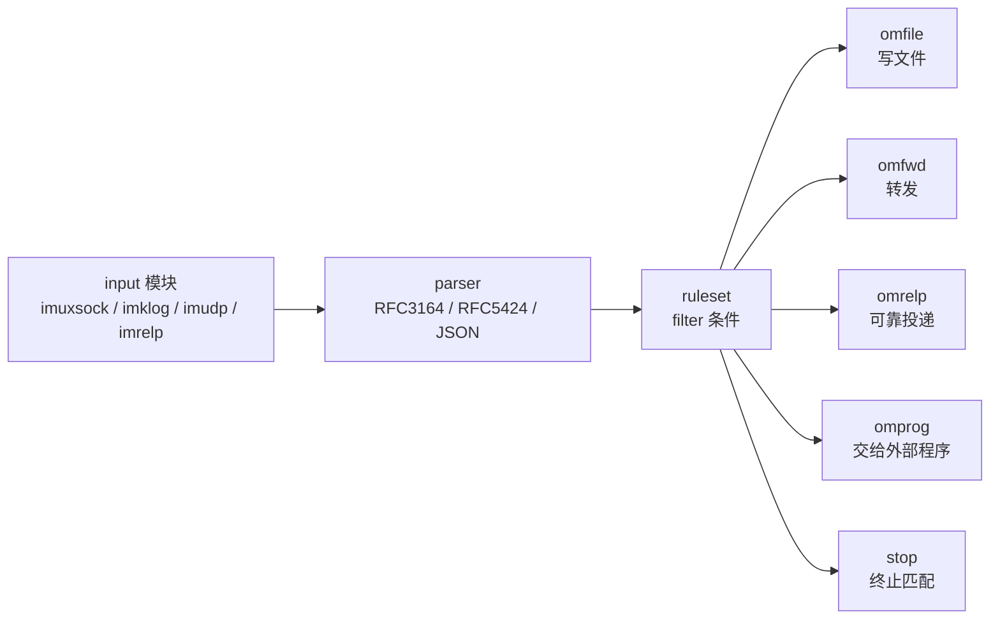
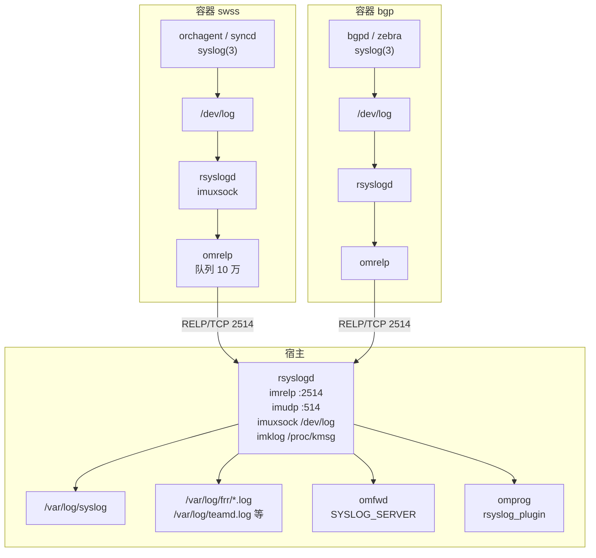
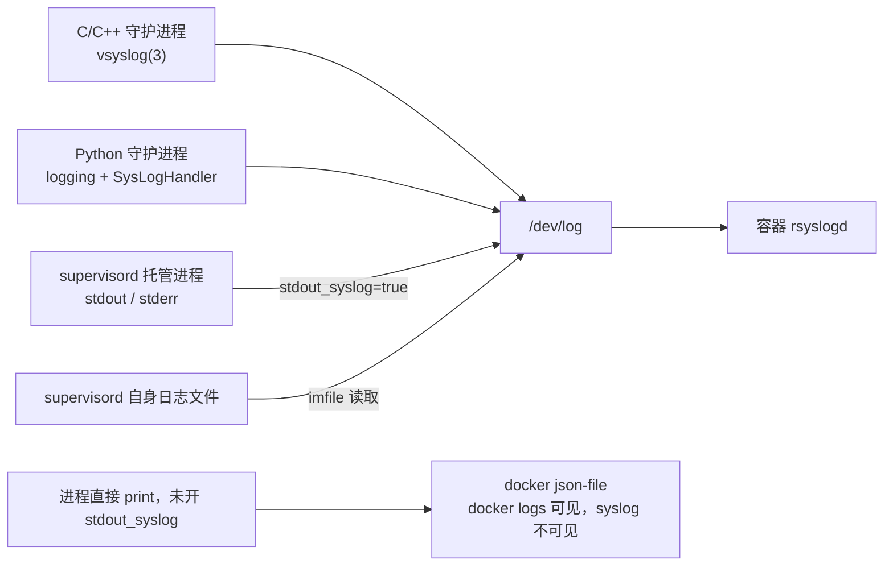
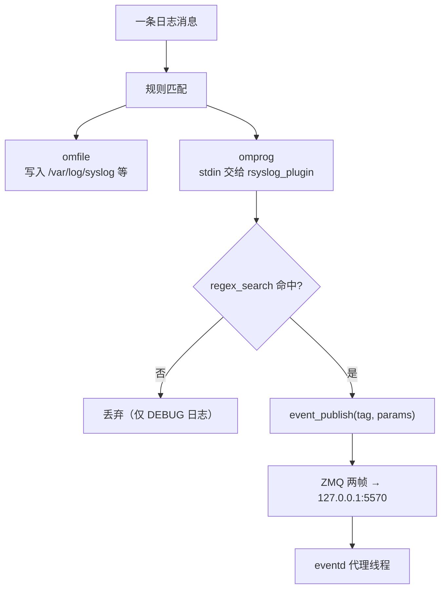

# SONiC 日志管道与事件转化：rsyslog 运行机制详解

> 本文回答四个问题：rsyslog 本身怎么运转、SONiC 里每个模块怎么把日志交给它、日志最终落在哪里、其中极小一部分如何被转化成事件。所有结论尽量落到源码与配置原文，推断项单独标注。

## 结论先行

**一句话：SONiC 的日志链路是「两级 rsyslog + 一条 RELP 回传」——每个容器内跑一份 rsyslogd，收本容器进程投递到容器内 `/dev/log`（Unix 域套接字，[[#3.1.1 /dev/log 到底是什么：容器里的一个套接字，不是目录|非目录、非文件]]）的日志，经 RELP（reliable event logging protocol，可靠事件日志协议）2514 端口送到宿主；宿主 rsyslog 负责落盘、对外转发，并用 omprog 把命中正则的少量日志行交给 `rsyslog_plugin` 变成事件。**

五条要点：

| # | 结论 | 依据 |
|---|---|---|
| 1 | **容器日志不靠挂载 `/var/log` 汇总**，靠 TCP 上的 RELP | 容器 `rsyslog.conf` 只有 `omrelp` action，无 `omfile` |
| 2 | **每个容器都有一份 rsyslogd**，由 supervisord 托管 | `[program:rsyslogd]`，`/usr/sbin/rsyslogd -n -iNONE` |
| 3 | **只有写 `syslog(3)` 的进程才进这条管道**；纯 stdout 只进 docker 的 json-file | swss 用 `vsyslog()`；supervisord 需 `stdout_syslog=true` 才转 |
| 4 | **落盘在宿主的 `/var/log/`**，按 facility 分文件，其余进 `/var/log/syslog` | 宿主 `99-default.conf` |
| 5 | **日志转事件是全量日志里的极小子集**，由 `programname` 与正则白名单双重筛选 | `*_events_info.json` + `*_regex.json` |

三个常见误判，先排除：

| 误判 | 事实 |
|---|---|
| 「容器日志通过共享 `/var/log` 目录汇总」 | 每个容器有独立 mount namespace；实际是 RELP 送到宿主，宿主写自己的 `/var/log` |
| 「`docker logs` 看到的就是 syslog」 | 两者是并行通道：stdout/stderr 进 json-file（2 MB × 5 轮转），只有 `syslog(3)` 才进 rsyslog |
| 「所有日志都会被解析成事件」 | 只有 5 个事件源、几十条正则覆盖的行会变成事件，其余只落盘 |

---

## 目录

- [[#1 rsyslog 的运行机制|1 rsyslog 的运行机制]]
- [[#2 SONiC 的两级部署|2 SONiC 的两级部署]]
- [[#3 每个模块怎么把日志交给 rsyslog|3 每个模块怎么把日志交给 rsyslog]]
- [[#4 日志落到哪里|4 日志落到哪里]]
- [[#5 日志怎么转化成事件|5 日志怎么转化成事件]]
- [[#6 失败模式与排障|6 失败模式与排障]]
- [[#7 参考资料|7 参考资料]]
- [[#待核实项|待核实项]]

---

## 1 rsyslog 的运行机制

### 1.1 它不是一个「日志服务」，是一条处理流水线

rsyslog 的进程模型很朴素：**单进程 + 多线程**，内部由「输入 → 解析 → 规则集 → 动作」四段组成，中间用队列解耦。没有中心 broker，也没有外部依赖。

处理一条消息的完整路径：



四类模块，记住分工就不会混：

| 类别 | 前缀 | 作用 | SONiC 里用到的 |
|---|---|---|---|
| 输入模块 | `im`（input module） | 从某处取消息 | `imuxsock`、`imklog`、`imudp`、`imrelp`、`imfile` |
| 输出模块 | `om`（output module） | 把消息送到某处 | `omfile`、`omfwd`、`omrelp`、`omprog` |
| 解析模块 | `pm`（parser module） | 把原始行解析成结构化属性 | 默认 RFC3164 解析器 |
| 消息修饰 | `mm`（message modification） | 改写消息内容 | SONiC 未使用 |

`imuxsock` 监听的是 Unix domain socket `/dev/log`；`imklog` 读 `/proc/kmsg`；`imrelp` 和 `imudp` 监听 TCP/UDP 端口。这四种输入在 SONiC 里同时存在，分别对应「本机进程」「内核」「其它容器」「旧式转发」。

### 1.2 规则是怎么写的：filter 加 action

rsyslog 配置有两种语法：传统的 `selector action`（如 `*.* /var/log/syslog`）和现代的 RainerScript（`if ... then { action(...) }`）。SONiC 两套都在用，同一个文件里混排。

一条规则的语义是**顺序匹配、逐条执行**，除非遇到 `stop`：

```
*.*;cron,auth,authpriv.none    -/var/log/syslog
auth,authpriv.*                /var/log/auth.log
cron.*                         /var/log/cron.log
```

第一行的选择器读法：所有 facility 的所有级别，**排除** `cron`、`auth`、`authpriv` 三个 facility（`.none` 表示该 facility 不要）。路径前的 `-` 表示「不要每次写完都 fsync」，是吞吐优化。

第二、三行把被排除的三类单独落盘。所以 `auth.log` 里的内容**不会**同时出现在 `syslog` 里，这是排查「日志明明打了却找不到」时第一个要看的地方。

`stop` 的作用是终止后续规则。SONiC 用它做分流，例如：

```
if re_match($programname, "bgp[0-9]*#bgpd") then {
    /var/log/frr/bgpd.log
    action(type="omprog" binary="/usr/bin/rsyslog_plugin -r /etc/rsyslog.d/bgpd_regex.json -m sonic-events-bgp" ...)
    stop
}
```

`bgpd` 的日志写进专属文件、送进事件插件，然后**不再进入 `syslog`**。这是「同一个进程的日志为何只在某个文件里」的标准解释。

### 1.3 属性与模板：事件筛选靠的就是这些字段

rsyslog 把每条消息解析成一组属性（property），规则和模板都基于它们：

| 属性 | 含义 | 在 SONiC 里的用途 |
|---|---|---|
| `$programname` | 产生日志的程序名（tag 去掉 PID 与冒号） | 几乎所有分流规则的第一判据 |
| `$syslogtag` | 原始 tag，可能含 PID，如 `orchagent:` | 拼接输出格式 |
| `$syslogfacility` / `$syslogseverity` | facility 与级别 | `selector` 分流、`*.err` 之类过滤 |
| `$msg` | 消息正文 | `startswith` / `contains` 判断 |
| `$hostname` | 主机名 | 输出格式 |
| `$!` / `$.` | 结构化数据 / 局部变量 | `set $.CONTAINER_NAME=getenv(...)` |

模板（template）决定输出长相。SONiC 宿主定义的核心模板是：

```
$template SONiCFileFormat,"%TIMESTAMP:::date-year% %TIMESTAMP%.%TIMESTAMP:::date-subseconds% <hostname> %syslogseverity-text:::uppercase% %syslogtag%%msg:::sp-if-no-1st-sp%%msg:::drop-last-lf%\n"
```

拆开看就是：年、ISO 时间戳（含微秒）、主机名、大写级别、tag、正文。`sp-if-no-1st-sp` 保证 tag 和正文之间恰好一个空格，`drop-last-lf` 去掉正文自带的换行，避免出现空行。

### 1.4 队列：rsyslog 为什么不会把调用方阻塞死

rsyslog 有两级队列，这是理解「日志丢了但业务没卡」的关键：

| 队列 | 位置 | 作用 | SONiC 的取值 |
|---|---|---|---|
| 主队列（main queue） | 输入与规则之间 | 吸收突发流量 | 默认（内存，较小） |
| 动作队列（action queue） | 每个 action 之前 | 单个慢目标不拖累其它 action | 容器转发用 `LinkedList`，10 万条 |

容器侧的配置把这件事写得很直白：

```
queue.type="LinkedList" queue.size="100000" queue.discardMark="80000"
queue.discardSeverity="6" queue.timeoutEnqueue="0"
```

- `size=100000`：队列上限十万条；
- `discardMark=80000`：到八万条开始丢弃低优先级消息；
- `discardSeverity=6`：只丢 `info` 及以下，保留 `notice` 及以上；
- `timeoutEnqueue=0`：**入队不等待**，队列满立即返回。

源码注释解释了取舍：宁可丢日志，也不能让 `syslog()` 调用卡住容器启动。这是「日志缺失但业务正常」时不要先怀疑业务的理由。

### 1.5 一个容易被忽略的开关：重复消息压缩

`$RepeatedMsgReduction on` 会把连续相同的消息压成「message repeated N times」。好处是省空间，代价是**时间线被压缩**：一段高频重复日志在文件里只留首条和计数。

做时序分析或事件统计时，这个开关必须纳入考虑，否则会把「重复 5000 次」误判成「只发生 1 次」。

---

## 2 SONiC 的两级部署

### 2.1 拓扑：容器内一份，宿主一份



两个要点：

1. **容器内不落盘**（正常情况下）。容器 `rsyslog.conf` 里没有 `omfile`，`*.*` 全部走 `omrelp`。
2. **宿主是唯一的汇聚点**，也是唯一的落盘点。所以 `show logging`、`/var/log/syslog`、`logrotate` 都只跟宿主有关。

### 2.2 容器侧：默认配置长什么样

基础镜像 `docker-base-bookworm` 在构建时安装 `rsyslog` 与 `rsyslog-relp`，并 COPY 一份静态配置到 `/etc/rsyslog.conf`：

```
module(load="imuxsock" SysSock.RateLimit.Interval="300" SysSock.RateLimit.Burst="20000")
set $.CONTAINER_NAME=getenv("CONTAINER_NAME");
template (name="ForwardFormatInContainer" type="string"
  string="<%PRI%>%TIMESTAMP:::date-rfc3339% %HOSTNAME% %$.CONTAINER_NAME%#%syslogtag%%msg:::sp-if-no-1st-sp%%msg%")
module(load="omrelp")
*.* action(type="omrelp" target=`echo $SYSLOG_TARGET_IP` port="2514"
           action.resumeRetryCount="60"
           queue.type="LinkedList" queue.size="100000"
           queue.discardMark="80000" queue.discardSeverity="6"
           queue.timeoutEnqueue="0" windowSize="512"
           queue.timeoutShutdown="1500"
           Template="ForwardFormatInContainer")
```

三个设计点：

- **`%$.CONTAINER_NAME%#` 前缀**：把容器名塞进 tag，宿主收到后 `$programname` 就变成 `swss#orchagent` 这种形式。这是宿主规则能按容器分流的原因，也是你自己写规则时最容易漏掉的前缀。
- **`windowSize="512"`**：RELP 是带确认的批量协议，窗口从默认 128 提到 512，一次多发一些再等 ACK，换吞吐；代价是断连时可能重复投递。
- **`queue.timeoutShutdown="1500"`**：退出时最多等 1.5 秒把队列排空，排不完就丢。

多 ASIC 平台会换一份配置。`docker_image_ctl.j2` 的 `updateSyslogConf()` 在 `NUM_ASIC > 1` 时用 `rsyslog-container.conf.j2` 重新渲染，`docker cp` 覆盖容器内 `/etc/rsyslog.conf`，目的只有一个：把 `target` 从 `127.0.0.1` 改成 `docker0` 网关地址，并带上正确的容器名。

### 2.3 宿主侧：接收、落盘、转发三件事

宿主 `/etc/rsyslog.conf` 不是静态文件，而是由 `rsyslog-config.sh` 在启动时用 `sonic-cfggen` 渲染 `rsyslog.conf.j2` 生成，然后 `systemctl restart rsyslog`。

输入段：

```
module(load="imuxsock" ...)                      # 宿主进程
module(load="imklog" ParseKernelTimestamp="off" KeepKernelTimestamp="on")
module(load="imudp")  input(type="imudp"  address="<udp_server_ip>" port="514")
module(load="imrelp") input(type="imrelp" address="<udp_server_ip>" port="2514")
```

`address` 的取值由平台形态决定：

| 平台 | 监听地址 | 原因 |
|---|---|---|
| 单 ASIC | 回环 `lo` 的 IPv4 地址 | 容器 `--net=host`，`127.0.0.1` 即达 |
| 多 ASIC | `docker0` 网关地址 | 各 ASIC 容器在独立 netns，回环不通 |
| `dhcp_server`（桥接容器） | `docker0` 网关地址 | 该容器用 bridge 网络，需要显式放行 2514 |

`dhcp_server` 是唯一走 bridge 的容器，所以它额外需要一条 iptables 规则放行 TCP 2514，由 `caclmgrd` 管理，启动脚本会轮询等这条规则就位。

输出段由 `$IncludeConfig /etc/rsyslog.d/*.conf` 引入，实际生效的是三份文件：

| 文件 | 来源 | 职责 |
|---|---|---|
| `00-sonic.conf` | 镜像，`j2` 渲染 | BGP、teamd、gNMI、telemetry、OTel、STP 的专属文件与事件插件 |
| `99-default.conf` | 镜像 | 按 facility 落盘到 `syslog` / `auth.log` / `cron.log` |
| `*_events.conf` | eventd 容器首次启动时 `docker cp` 到宿主 | 5 套日志转事件规则 |

### 2.4 为什么用 RELP 而不是挂载目录

这不是随手选的技术，四个约束共同决定：

| 约束 | 挂载 `/var/log` 的问题 | RELP 的解法 |
|---|---|---|
| 命名空间隔离 | 多容器同时写同一文件，轮转与锁冲突 | 各容器写自己的队列，宿主统一落盘 |
| 可靠投递 | 挂载只保证「文件在」，不保证「写得进」 | RELP 带 ACK 与重连，断连可重传 |
| 背压可控 | 磁盘满时写失败，错误散落在各容器 | 队列 + 丢弃策略集中在发送端，可观测 |
| 安全边界 | 容器可写宿主日志，等于绕过了只读根 | 只开一个 TCP 端口，方向单一 |

代价也要说清：**RELP 是「至少一次」语义**，断连重传会产生重复行。看到 `syslog` 里同一秒出现两条完全相同的内容，先想 RELP 重传，而不是应用打了两遍。

---

## 3 每个模块怎么把日志交给 rsyslog

### 3.1 三条写入路径



**关键区分：把日志投递到 `/dev/log` 才进 syslog；只写 stdout 则只进 docker 的 json-file。** 这两条通道互不覆盖，排障时必须先确认日志走的是哪条。

#### 3.1.1 /dev/log 到底是什么：容器里的一个套接字，不是目录

「进程写入 `/dev/log`」这句话容易引来一个误会，以为 `/dev/log` 是目录、日志先落成文件。实际相反：

| 问题 | 答案 |
|---|---|
| `/dev/log` 是什么类型 | **Unix 域套接字（Unix domain socket）**，`ls -l` 显示类型位为 `s`，大小 0，没有内容可读 |
| 谁创建它 | **容器内自己的 rsyslogd**。imuxsock 模块启动时按默认路径 `/dev/log` 执行 unlink + create（[imuxsock 文档](https://www.rsyslog.com/doc/configuration/modules/imuxsock.html)：`SysSock.Name` 默认即 `/dev/log`） |
| 是不是宿主机的 `/dev/log` | **不是**。`docker_image_ctl.j2` 全文没有 `-v /dev/log`、没有 `--device /dev/log`、没有 `--privileged`；容器的 `/dev` 是运行时挂的 tmpfs（临时文件系统） |
| 每个容器是否共用一份 | **不共用**。`/dev/log` 是文件系统路径，受挂载命名空间（mount namespace）隔离，每个容器一份、互不可见 |
| 传输的是什么 | glibc 的 `syslog(3)` 把 `<PRI>时间戳 主机名 tag[pid]: 消息` 组装成一条**数据报（datagram）**，`sendto()` 到该套接字；不是写文件、不带换行分帧 |

所以「容器内 rsyslogd 收本容器进程写入 `/dev/log` 的日志」的准确含义是：**同一容器内的进程把消息投给该容器 rsyslogd 监听的本地套接字**。三个「不是」值得记住：

1. **不是共享内存**。宿主有自己的 `/dev/log`（宿主 rsyslogd 的），容器的 `/dev/log` 与它毫无关系。容器之间也不共享，`docker exec swss cat /dev/log` 会报「Is a directory / 无此设备」之类的错，因为它不可读。
2. **不是所有日志都走这里**。只有调用 `syslog(3)` / `vsyslog(3)` 的代码路径才投递；写 stdout 的进程根本不碰它，日志只进 docker 的 json-file。
3. **不是必然存在**。它由容器内 rsyslogd 创建；若该进程没起来，`/dev/log` 就不存在，此时 `syslog(3)` 的 `sendto()` 失败，而 **glibc 不回报错、不抛异常**——调用方照常运行，日志静默消失。这是「进程活着但一条日志都看不到」的典型成因。

容器侧的完整去向在 [`docker-base-bookworm/etc/rsyslog.conf`](https://github.com/sonic-net/sonic-buildimage/blob/master/dockers/docker-base-bookworm/etc/rsyslog.conf)：`module(load="imuxsock" ...)` 收 `/dev/log`，规则区只有一条 `*.* action(type="omrelp" ... port="2514")`，**没有任何 `omfile`**。也就是说，日志进容器 rsyslogd 后立刻被转发，不在容器磁盘留副本。

四条现场验证命令：

```bash
docker exec swss ls -l /dev/log                 # 应为 srw-rw-rw- 1 root root 0 ... /dev/log
docker exec swss cat /proc/net/unix | grep log   # 看到 /dev/log 的 unix socket 条目
docker exec swss ss -xp | grep -E 'dev/log|2514' # 本地 socket 与到宿主的 RELP 连接
docker exec swss ps -ef | grep rsyslogd          # 确认容器 rsyslogd 在跑
```

一个容易误判的边界：容器 rsyslogd 重启时 imuxsock 会 unlink 旧套接字并重建，**已持有旧 fd 的进程**（glibc 缓存了连接）可能继续往被删除的 inode 发消息，表现为「重启后部分进程日志消失、重启该进程即恢复」。遇到这类现象先查容器 rsyslogd 的重启历史。

### 3.2 各模块清单

| 模块 / 容器 | 写入方式 | `$programname` 形态 | 宿主落点 |
|---|---|---|---|
| `swss`（orchagent、portsyncd 等） | `swss::Logger` → `vsyslog()` | `swss#orchagent` | `/var/log/syslog` |
| `syncd` | `swss::Logger` 同款 | `syncd#syncd` | `/var/log/syslog` |
| `bgp`（FRR） | zlog → `syslog(3)` | `bgp#bgpd`、`bgp#zebra`、`bgp#staticd`、`bgp#watchfrr` | `/var/log/frr/bgpd.log`、`zebra.log`（**不进 syslog**） |
| `teamd` | `syslog(3)` | `teamd#teamd` 一类 | `/var/log/teamd.log`（不进 syslog） |
| `pmon`（xcvrd、thermalctld、psud 等） | Python `logging` + `SysLogHandler` | `pmon#xcvrd` | `/var/log/syslog` |
| `gnmi` / `telemetry` | supervisord `stdout_syslog=true` | `gnmi-native`、`telemetry`、`dialout` | `/var/log/gnmi.log`、`/var/log/telemetry.log` |
| `eventd` | `eventd` / `eventdb` 进程写 syslog | `eventd#eventd` | `/var/log/syslog` |
| `monit`（宿主） | `set logfile syslog` | `monit` | `/var/log/syslog` |
| 内核（宿主） | `imklog` 读 `/proc/kmsg` | `kernel` | `/var/log/syslog` |
| `systemd`（宿主） | journald → syslog 转发 | `systemd` | `/var/log/syslog` |
| `dockerd`（宿主） | journald → syslog 转发 | `dockerd` | `/var/log/syslog` |

两条注记：

- `pmon` 的 Python 守护进程并非全部显式配 `SysLogHandler`，部分依赖 `sonic_py_common` 的日志封装；上表按主流实现归纳，具体以设备上 `$programname` 实测为准（见 [[#6 失败模式与排障|6 失败模式与排障]] 的 `logger` 验证法）。
- `systemd` 与 `dockerd` 之所以出现在 syslog，是 Debian 默认 `ForwardToSyslog=yes` 的行为；若目标版本关闭了该选项，这两类只在 `journalctl` 里可见。

### 3.3 swss 的特殊性：日志级别和输出可以在线改

`swss::Logger` 不只是 `vsyslog` 的包装，它还订阅 `CONFIG_DB` 的 `LOGGER|<daemon>` 表：

| 字段 | 作用 | 默认 |
|---|---|---|
| `log_level` | 调整该守护进程的最小级别 | 各进程自带，如 `NOTICE` |
| `log_output` | `SYSLOG` / `STDOUT` / `STDERR` | `SYSLOG` |

```cpp
if (m_output == SWSS_SYSLOG) {
    vsyslog(prio, fmt, ap);
} else {
    ... vprintf / vfprintf ...
}
```

这条机制带来两个实用结论：

1. **改级别不用重启进程**。`config loglevel orchagent DEBUG` 这类命令改的是 `CONFIG_DB`，`Logger` 的监听线程收到变更后立即生效。
2. **把 `log_output` 改成 `STDOUT` 会让日志从 syslog 消失**，转而进 docker 的 json-file。排障时遇到「日志突然全没了」，先查这张表。

### 3.4 FRR 的 programname 为什么会变形

容器侧模板把容器名拼在 tag 前面：

```
%$.CONTAINER_NAME%#%syslogtag%
```

于是 `bgpd` 发出的 `bgpd[...]: message` 到了宿主就变成 `bgp#bgpd: message`，解析出的 `$programname` 是 `bgp#bgpd`。这解释了两件事：

- 规则里必须写 `bgp[0-9]*#bgpd` 而不是 `bgpd`；`[0-9]*` 是给多实例（`bgp0`、`bgp1`）留的。
- 你自己加规则时，**不要假设 `$programname` 是裸进程名**，先在 `syslog` 里看一眼真实值。

---

## 4 日志落到哪里

### 4.1 宿主文件清单

| 文件 | 内容 | 来源规则 |
|---|---|---|
| `/var/log/syslog` | 除 cron、auth、authpriv 外的所有 facility | `*.*;cron,auth,authpriv.none` |
| `/var/log/auth.log` | 认证相关（SSH、sudo、PAM） | `auth,authpriv.*` |
| `/var/log/cron.log` | 定时任务 | `cron.*` |
| `/var/log/frr/bgpd.log` | BGP 主进程 | `re_match($programname, "bgp[0-9]*#bgpd")` + `stop` |
| `/var/log/frr/zebra.log` | zebra / staticd / watchfrr | `bgp[0-9]*#(frr\|zebra\|staticd\|watchfrr)` + `stop` |
| `/var/log/teamd.log` | teamd | `$programname contains "teamd_"` + `stop` |
| `/var/log/gnmi.log` | gNMI 容器输出 | `$msg startswith " gnmi-native"` + `stop` |
| `/var/log/telemetry.log` | telemetry / dialout | `$msg startswith " telemetry"` 或 `" dialout"` + `stop` |
| `/var/log/otel.log` | OTel collector | `$msg startswith " otel"` + `stop` |
| `/var/log/stpd.log` | STP | `$programname contains "stp"` 且消息含 `STP_SYSLOG` |
| `/var/log/swss/*.rec` | orchagent 结构化录制（非 rsyslog 写） | 由应用直接写，但纳入同一套轮转 |
| `/var/log/rsyslog_plugin.log` | 事件插件自身的 stdout/stderr | `omprog` 的 `output` 参数 |

`/var/log/kern.log`、`/var/log/daemon.log`、`/var/log/messages` 在轮转配置里**仍然列着**，但注释明确写着「这些文件不应该再被创建，列在这里只是为了万一出现时也能被轮转」。所以在新版本上找不到它们属于正常。

### 4.2 一行日志的字段拆解

```
2026-11-11T16:20:31.123456+08:00 sonic NOTICE swss#orchagent: :- addPort: Ethernet0
└──────────────┬──────────────┘ └─┬─┘ └──┬─┘ └──────┬──────┘ └────────────┬───────────┘
           ISO 时间戳(微秒)        主机名   级别    容器#进程名              正文
```

四个字段各有用途：

- **时间戳**取的是产生日志的时刻，不是宿主收到的时刻；容器与宿主时钟不同步时，这个差值会直接表现为日志「乱序」。
- **级别**被 `%syslogseverity-text:::uppercase%` 转成大写，方便 grep。
- **`容器#进程名`** 是 SONiC 特有的复合字段，等价于其它系统的「来源」。
- **正文**前的 `:-` 或 `:-` 风格符号来自各进程自己的格式约定（swss 用 `:-` 表示正文开始），不是 rsyslog 加的。

### 4.3 与 docker 日志的并行关系

| 通道 | 内容 | 查看方式 | 生命周期 |
|---|---|---|---|
| rsyslog | 调用 `syslog(3)` 的消息 | `show logging`、`cat /var/log/syslog` | 受 logrotate 管理，可长期保留 |
| docker json-file | 容器 stdout/stderr | `docker logs <container>` | 2 MB × 5 个文件，滚动覆盖 |

`--log-opt max-size=2M --log-opt max-file=5` 是 `docker_image_ctl.j2` 在未指定 `--log-driver` 时自动加上的，目的是防止容器刷屏把磁盘写满。这也意味着 **`docker logs` 只能看到最近约 10 MB**，做历史分析必须用 syslog。

### 4.4 轮转策略：按大小，不按天

宿主默认的 `/etc/logrotate.d/rsyslog` 是 `daily / rotate 4`，但 SONiC 用自己的模板覆盖，规则按 `/var/log` 分区大小分档：

| `/var/log` 分区大小 | 单文件轮转阈值 |
|---|---|
| ≤ 200 MB | 1 MB |
| ≤ 400 MB | 2 MB |
| > 400 MB | 16 MB |

```
rotate 5000
compress
delaycompress
missingok
notifempty
```

`rotate 5000` 不是「保留 5000 天」，而是**按大小轮转下的上限次数**，实际保留量由分区容量与清理脚本共同约束。`delaycompress` 让最近一个归档不压缩，便于正在写入的排查。

`swss` 的 `.rec` 文件轮转后会向对应 `orchagent` 发 `SIGHUP`，多 ASIC 平台还会按文件名精确匹配进程，避免误伤其它实例。这是一个容易忽略的细节：**轮转失败导致 orchagent 写文件句柄失效，是「日志停更但进程还在」的常见原因之一**。

### 4.5 对外转发：SYSLOG_SERVER

宿主配置会遍历 `CONFIG_DB` 的 `SYSLOG_SERVER` 表，为每台服务器生成一条 `omfwd`：

```
*.<severity> action(type="omfwd" Target="<server>" Port="<port>" Protocol="<udp|tcp>"
                    Template="SONiCForwardFormat" action.resumeRetryCount="60"
                    queue.type="LinkedList" queue.size="20000"
                    Address="<source>" Device="<vrf>")
```

支持的字段：

| 字段 | 作用 | 默认 |
|---|---|---|
| `port` | 目标端口 | 514 |
| `protocol` | `udp` 或 `tcp` | `udp` |
| `vrf` | 出接口绑定的 VRF | `default` |
| `source` | 源地址绑定 | 不绑 |
| `severity` | 只转发该级别及以上 | `*` |
| `filter` + `filter_regex` | `include` / `exclude` 正则 | 不过滤 |

另外两个可选项值得知道：

- **`DEVICE_METADATA|localhost` 的 `syslog_with_osversion=true`** 会在转发模板里插入镜像版本，便于远端按版本聚合。
- **`syslog_counter=true`** 会额外加载 `omprog`，把计数交给 `/usr/bin/syslog-counter`，用于统计日志速率。它带 `confirmMessages="on"`，属于少数会等外部程序确认的 action。

格式为 `welf` 时改用 `WelfRemoteFormat`，输出成防火墙设备常见的 WELF 格式，供安全平台采集。

---

## 5 日志怎么转化成事件

### 5.1 同一条日志，两条消费路径



**落盘与转事件是并列的两个 action，不是先后关系。** 一行日志可以同时进文件和进事件流；某些规则因为 `stop` 在事件 action 之后，落盘只到专属文件、不再进 `syslog`。

### 5.2 插件形态：omprog 拉起的独立进程

| 维度 | 事实 |
|---|---|
| 模块 | `omprog`（program integration output module，外部程序集成输出模块） |
| 程序 | `/usr/bin/rsyslog_plugin`，来自 `sonic-rsyslog-plugin` 包 |
| 位置 | **宿主 rootfs**，不在 eventd 容器 |
| 生命周期 | 每个 action 一个常驻实例，退出后被 rsyslog 重启 |
| 输入 | rsyslog 通过 stdin 逐行写入（模板 `prog_msg` 只发 `%msg%` 加换行） |
| 初始化 | `events_init_publisher(模块名)` 在**进程启动时执行一次** |
| 逐条处理 | 每命中一行调用一次 `event_publish(tag, params)` |

配置形如：

```
if re_match($programname, "monit") then {
  action(type="omprog"
         binary="/usr/bin/rsyslog_plugin -r /etc/rsyslog.d/monit_regex.json -m sonic-events-host"
         output="/var/log/rsyslog_plugin.log"
         signalOnClose="on"
         template="prog_msg")
}
```

`output` 是插件的 stdout/stderr 落点，插件自己的错误日志（比如正则文件缺失）都写在这里，是排障第一现场。

### 5.3 两层筛选：什么是「命中」

第一层在 rsyslog 里，按进程名粗筛：

```
if re_match($programname, "bgp[0-9]*#bgpd") then { ... omprog ... }
```

第二层在插件里，遍历正则表逐条 `regex_search`（子串匹配）：

```cpp
if (!regex_search(message, matchResults, m_regexList[i].regexExpression)
    || m_regexList[i].params.size() != matchResults.size() - 1
    || matchResults.size() < 4) { continue; }
```

隐藏的硬条件：**捕获组数量必须严格等于 `params` 数量加 3**。多出来的 3 个组来自插件自动拼的时间戳前缀：

```cpp
string timestampRegex = "^([a-zA-Z]{3})?\\s*([0-9]{1,2})?\\s*([0-9]{2}:[0-9]{2}:[0-9]{2}.[0-9]{0,6})?\\s*";
```

同时 `params` 前面会自动插入 `month` / `day` / `time` 三项。所以自己写的正则里有几个括号，`params` 就得写几项；数量不符时**整条被静默跳过**，不报错。

### 5.4 一次完整走查

以一条 `bgpd` 日志为例：

| 步 | 发生什么 | 具体值 |
|---|---|---|
| 1 | bgpd 调 `syslog()` | `bgpd[1234]: [BGP] neighbor 10.0.0.1 state Established` |
| 2 | 容器 rsyslogd 收 `/dev/log` | 加上容器前缀 → `bgp#bgpd[1234]: ...` |
| 3 | RELP 送到宿主 2514 | 带 ACK，队列满则按级别丢弃 |
| 4 | 宿主规则匹配 | `re_match($programname, "bgp[0-9]*#bgpd")` 命中 |
| 5 | 写专属文件 | `/var/log/frr/bgpd.log` |
| 6 | omprog 转发该行 | 走 stdin 进入 `rsyslog_plugin` |
| 7 | 插件遍历 `bgpd_regex.json` | `regex_search` 命中，取 `tag` 与参数 |
| 8 | `event_publish` | 事件标识 `sonic-events-bgp:bgp-state` |
| 9 | ZMQ 发布 | `127.0.0.1:5570`，两帧（源名 + 载荷） |
| 10 | `stop` | 该行不再进入 `/var/log/syslog` |

第 10 步是最容易误判的地方：**能在 `bgpd.log` 里看到的日志，往往在 `syslog` 里找不到**，因为它被 `stop` 截断了。

### 5.5 覆盖范围：五套映射表

| 事件源模块 | 映射表 | 覆盖的进程 |
|---|---|---|
| `sonic-events-host` | `host_events_info.json` | `monit`、`systemd`、`kernel`、`dockerd`、`arista`、`python3` |
| `sonic-events-bgp` | `bgp_events_info.json` | `bgp`（另有 `bgpd_events_info.json` 覆盖 `bgpd` 直连路径） |
| `sonic-events-swss` | `swss_events_info.json` | swss 侧进程 |
| `sonic-events-syncd` | `syncd_events_info.json` | syncd |
| `sonic-events-dhcp-relay` | `dhcp_relay_events_info.json` | dhcp_relay |

每份映射表的 `proclist` 给出「进程名 → 正则文件」，`yang_module` 给出事件源名。正则文件（如 `monit_regex.json`）与映射表一起安装在宿主 `/etc/rsyslog.d/`。

**注意覆盖范围的三个空档**：

1. **没有映射表的进程一律不产生事件**，哪怕日志内容再像故障。
2. **映射表按进程名匹配，不按内容全局匹配**。同一个错误由不同进程打出，可能只有其中一个被覆盖。
3. **正则文件是白名单**，新增一类事件必须改文件、重启 rsyslog，不能靠配置下发。

### 5.6 为什么不做「全量日志转事件」

技术上可行（把 `*.*` 都交给 omprog），但设计上不这么做，原因有三：

| 原因 | 量化影响 |
|---|---|
| 事件通道是无确认的 PUB/SUB | 全量转发会把丢事件概率放大到不可忽略 |
| 正则匹配是纯 CPU 开销 | 每行都要遍历正则表，日志高峰时变成瓶颈 |
| 事件语义要求「有意义的离散事实」 | 全量转发等于把日志流改名，下游仍要再筛一次 |

所以 SONiC 的选择是：**日志负责「全量留痕」，事件负责「少量通知」**。两者不是替代关系。

---

## 6 失败模式与排障

| 现象 | 最可能的原因 | 验证命令 |
|---|---|---|
| `show logging` 没输出，但 `docker logs` 有 | 进程写 stdout，未开 `stdout_syslog` | `docker logs <c> --tail 50`；查 supervisord 配置 |
| 某个容器日志完全缺失 | 容器 rsyslogd 未起 / RELP 目标不可达 | `docker exec <c> ps -ef \| grep rsyslogd`；`ss -tnp \| grep 2514` |
| 日志进错文件 | 规则顺序或 `stop` 截断 | `cat /etc/rsyslog.d/00-sonic.conf` |
| `auth.log` 有、`syslog` 没有 | `99-default.conf` 的 `.none` 排除 | 直接看 `99-default.conf` 第一行规则 |
| 日志重复出现两条 | RELP 重传（至少一次语义） | 对比时间戳与内容是否完全一致 |
| 高频日志「消失」 | `$RepeatedMsgReduction on` 压缩 | 搜 `message repeated` |
| 日志量突然下降 | 队列满触发 `discardSeverity=6` | 查容器 rsyslogd 状态；临时调大 `queue.size` |
| 事件有、日志文件没有 | 规则里 `stop` 在落盘之前 | 看 `00-sonic.conf` 该分支顺序 |
| 事件全丢、`rsyslog_plugin.log` 刷错误 | 正则文件缺失或 JSON 非法，进程反复重启 | `tail /var/log/rsyslog_plugin.log`；`ps -ef \| grep rsyslog_plugin` |
| 改完配置不生效 | 改的是容器内副本，未重启宿主 rsyslog | `systemctl restart rsyslog`；确认改的是 `/etc/rsyslog.conf` 而非模板 |

四条通用验证手法：

```bash
logger -t mytest "hello from host"        # 造一条宿主日志，看是否进 syslog
logger -t monit "…触发 monit_regex 的原文…" # 造一条能命中正则的日志，看是否产生事件
rsyslogd -N1                              # 校验配置语法（不启动）
ss -tnp | grep -E ':2514|:514|:5570'      # 看三条关键连接是否存在
```

最后一条最实用：**2514 断了是容器日志丢，5570 断了是事件丢，两者可以同时正常但互不影响**——这也是排查时先分层、再定位的前提。

---

## 7 参考资料

### 7.1 rsyslog 官方

| 资料 | 说明 | 链接 |
|---|---|---|
| rsyslog 文档总览 | 模块、配置语法、队列参数 | https://www.rsyslog.com/doc/ |
| omprog 模块 | 外部程序集成：stdin 投喂、退出重启、`signalOnClose` | https://www.rsyslog.com/doc/configuration/modules/omprog.html |
| omrelp 模块 | RELP 客户端参数与队列语义 | https://www.rsyslog.com/doc/configuration/modules/omrelp.html |
| imrelp 模块 | RELP 服务端监听配置 | https://www.rsyslog.com/doc/configuration/modules/imrelp.html |
| RELP 协议 | 可靠事件日志协议的确认与重传机制 | https://www.rsyslog.com/doc/whitepapers/relp.html |

### 7.2 SONiC 源码与配置

| 文件 | 说明 | 链接 |
|---|---|---|
| `rsyslog.conf.j2` | 宿主配置模板：输入端口、模板、`SYSLOG_SERVER` 转发、`syslog_counter` | https://github.com/sonic-net/sonic-buildimage/blob/master/files/image_config/rsyslog/rsyslog.conf.j2 |
| `rsyslog-config.sh` | 宿主配置生成脚本：`sonic-cfggen` 渲染 + 重启服务 | https://github.com/sonic-net/sonic-buildimage/blob/master/files/image_config/rsyslog/rsyslog-config.sh |
| `00-sonic.conf.j2` | 专属分流规则：frr、teamd、gnmi、telemetry、otel、stp 与 bgpd 事件 | https://github.com/sonic-net/sonic-buildimage/blob/master/files/image_config/rsyslog/rsyslog.d/00-sonic.conf.j2 |
| `99-default.conf` | 默认落盘规则：`syslog` / `auth.log` / `cron.log` | https://github.com/sonic-net/sonic-buildimage/blob/master/files/image_config/rsyslog/rsyslog.d/99-default.conf |
| `rsyslog-container.conf.j2` | 多 ASIC 场景的容器配置模板 | https://github.com/sonic-net/sonic-buildimage/blob/master/files/image_config/rsyslog/rsyslog-container.conf.j2 |
| `rsyslog-container-relp-udp.conf` | RELP 失败回落 UDP/514 的变体 | https://github.com/sonic-net/sonic-buildimage/blob/master/files/image_config/rsyslog/rsyslog-container-relp-udp.conf |
| `docker-base-bookworm/etc/rsyslog.conf` | 容器默认配置：`imuxsock` + `omrelp` | https://github.com/sonic-net/sonic-buildimage/blob/master/dockers/docker-base-bookworm/etc/rsyslog.conf |
| `docker-base-bookworm/etc/rsyslog.d/supervisor.conf` | `imfile` 读取 supervisord 日志 | https://github.com/sonic-net/sonic-buildimage/blob/master/dockers/docker-base-bookworm/etc/rsyslog.d/supervisor.conf |
| `docker_image_ctl.j2` | `SYSLOG_TARGET_IP` 注入、多 ASIC 配置重渲染、json-file 上限 | https://github.com/sonic-net/sonic-buildimage/blob/master/files/build_templates/docker_image_ctl.j2 |
| `logrotate/rsyslog.j2` | 轮转策略：按分区大小分档、`rotate 5000`、swss SIGHUP | https://github.com/sonic-net/sonic-buildimage/blob/master/files/image_config/logrotate/rsyslog.j2 |
| `docker-eventd/supervisord.conf` | 容器内 `rsyslogd` 的托管方式与启动顺序 | https://github.com/sonic-net/sonic-buildimage/blob/master/dockers/docker-eventd/supervisord.conf |
| `logger.cpp`（sonic-swss-common） | `swss::Logger` 的 `vsyslog` 实现与 `CONFIG_DB` 动态级别 | https://github.com/sonic-net/sonic-swss-common/blob/master/common/logger.cpp |
| `rsyslog_plugin/rsyslog_plugin.cpp` | 日志转事件的逐条处理逻辑 | https://github.com/sonic-net/sonic-buildimage/blob/master/src/sonic-eventd/rsyslog_plugin/rsyslog_plugin.cpp |
| `rsyslog_plugin/syslog_parser.cpp` | 正则匹配与捕获组数量校验 | https://github.com/sonic-net/sonic-buildimage/blob/master/src/sonic-eventd/rsyslog_plugin/syslog_parser.cpp |

### 7.3 相关文档

| 文档 | 说明 |
|---|---|
| [[SONiC-事件数据抓取框架-输入输出与设计取舍]] | 事件流全链路、为什么不用 Redis、为什么要有代理 |
| [[SONiC-可观测采集与容器架构调研]] | SONiC 整体组成、gNMI 采集框架、容器角色 |

---

## 待核实项

| # | 问题 | 为何重要 | 验证方式 |
|---|---|---|---|
| 1 | 目标版本 `CONTAINER_NAME` 环境变量的注入位置 | 决定 `$programname` 里是否带容器前缀 | `docker exec <c> env \| grep CONTAINER_NAME` |
| 2 | `systemd` / `dockerd` 日志是否确实转发进 syslog | 关闭 `ForwardToSyslog` 时只能查 journald | `grep -r ForwardToSyslog /etc/systemd/`；`journalctl -u docker` |
| 3 | 各 Python 守护进程是否统一用 `SysLogHandler` | 影响「日志只在 docker logs 里」的判断 | `docker exec pmon grep -rn SysLogHandler /usr/lib/python3/dist-packages/` |
| 4 | `rsyslog-container-relp-udp.conf` 的启用条件 | 老平台可能仍在用 UDP 回落 | `grep -rn relp-udp /usr/share/sonic/templates/` |
| 5 | `/var/log` 分区实际大小与轮转分档 | 决定单文件 1 MB 还是 16 MB、保留多少历史 | `df -h /var/log`；`cat /etc/logrotate.d/rsyslog` |
| 6 | `SYSLOG_CONFIG_FEATURE` 是否被厂商配置覆盖 | 影响容器侧限速与丢日志行为 | `redis-cli -n 4 HGETALL 'SYSLOG_CONFIG_FEATURE\|swss'` |
| 7 | 是否启用了 `syslog_counter` | 开启后会多一个 omprog 进程与计数文件 | `redis-cli -n 4 HGET 'DEVICE_METADATA\|localhost' syslog_counter` |

## 版本记录

| 版本 | 日期 | 变更 |
|---|---|---|
| v0.1 | 2026-11-11 | 首版：rsyslog 运行机制（模块、规则、属性、队列）、SONiC 两级部署与 RELP 回传、各模块写入路径与落点清单、轮转与外部转发、日志转事件的两层筛选与完整走查、失败模式与排障 |
| v0.2 | 2026-11-11 | 新增 [[#3.1.1 /dev/log 到底是什么：容器里的一个套接字，不是目录\|§3.1.1]]：`/dev/log` 是容器内 rsyslogd 创建的 Unix 域套接字（非目录、非宿主共享、非必然存在），含三条边界、四条验证命令与 rsyslogd 重启导致的部分进程日志丢失；同步修正结论先行中「写入 `/dev/log`」的措辞为「投递到套接字」 |
