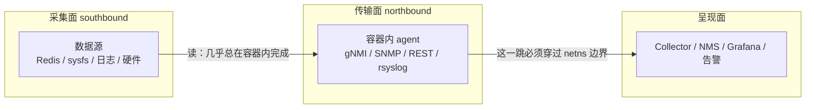
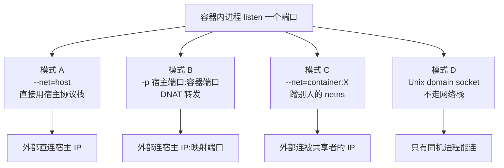
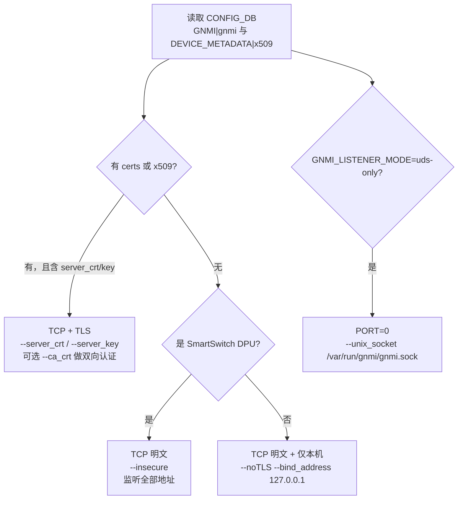
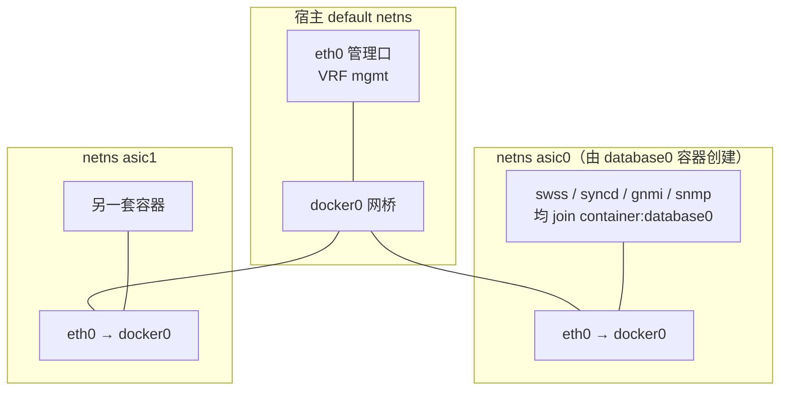

# SONiC 观测出口与容器网络：容器里的 gNMI 如何与外部通信

> 本文回答一个问题：**采集框架的进程都在容器里，它们凭什么能让外部世界连进来、又凭什么能连出去**。以 gNMI（gRPC 网络管理接口，gRPC Network Management Interface）为主线，旁及 SNMP（简单网络管理协议）、REST API（基于 HTTP 的配置接口）、日志与事件出口。容器如何拿到**硬件**访问权是另一条正交的线，见 [[SONiC-容器访问硬件三条通路-原理与数据清单]]；数据从哪里来见 [[SONiC-平台硬件数据采集-数据位置与采集链路]]。

## 结论先行

**一句话：SONiC 根本没有用"容器网络"，而是让几乎所有容器直接共享宿主的网络命名空间（network namespace）——容器与外部通信时，走的不是一条"容器到宿主"的转发链路，而是宿主自己的协议栈、自己的网卡、自己的路由表。**

五条要点：

| # | 结论 | 依据 |
|---|---|---|
| 1 | 单芯片平台上，除 `dhcp_server` 外**所有容器都 `--net=host`**；`docker_image_ctl.j2` 里没有任何一条端口映射真正生效 | [docker_image_ctl.j2](https://github.com/sonic-net/sonic-buildimage/blob/master/files/build_templates/docker_image_ctl.j2) |
| 2 | 因此容器内 `ss -lntp` 看到的就是**宿主全量监听端口**；"这个端口属于哪个容器"在网络上不可分辨 | `NET="host"` 分支 |
| 3 | gNMI 默认监听 **8080/tcp**；但**未配置证书时只绑 `127.0.0.1`**，即开箱状态下外部根本连不进来 | `gnmi-native.sh` 的 `--noTLS --bind_address 127.0.0.1` 分支 |
| 4 | 启用管理 VRF（虚拟路由转发，virtual routing and forwarding）后，gNMI 被显式加 `--vrf mgmt`、SNMP 被写成 `agentAddress udp:[ip]@mgmt:161`——**服务要"搬进"VRF 才能被管理网访问**，这正是不能改用端口映射的根本原因 | 同上；`snmpd.conf.j2` |
| 5 | 容器之间大量"隐式 IPC"（日志 RELP 2514、事件 ZMQ 5570、FRR AgentX 3161）都指向 `127.0.0.1`——**它们能通，纯粹因为共用一个 loopback**。这是共享 netns 的红利，也是换成 bridge 网络后第一个崩掉的东西 | `docker_image_ctl.j2` 的 `SYSLOG_TARGET_IP=127.0.0.1` |

三个先破掉的误判：

| 常见说法 | 实际情况 |
|---|---|
| "容器对外通信靠 `-p 8080:8080` 端口映射" | **不是**。SONiC 模板里一条 `-p` 都没有（`docker-sonic-restapi.mk` 里那条 `-p=8081:8081/tcp` 在 host 网络下被 Docker 直接忽略） |
| "gNMI 装了就能连" | **不能**。无证书时它只监听 loopback，配置了证书才对外；这是刻意的失败关闭（fail-closed）默认 |
| "容器网络是隔离的，所以观测服务天然安全" | **恰恰相反**。gnmi 容器是 SONiC 里权限最大的容器之一（`--pid=host`、`SYS_ADMIN`、`userns=host`、AppArmor 关闭），因为它要执行 gNOI 的主机级操作 |

---

## 目录

- [[#1 问题：输出端为什么要单独设计|§1]]
- [[#2 SONiC 的答案：共享宿主网络命名空间|§2]]
- [[#3 gNMI 的对外通信|§3]]
- [[#4 其他出口进程|§4]]
- [[#5 多芯片机箱：namespace 链|§5]]
- [[#6 横向比较：四条出口通路|§6]]
- [[#7 排障|§7]]
- [[#8 安全：出口比入口更宽|§8]]
- [[#9 待核实项|§9]]
- [[#10 参考资料|§10]]

---

## 1 问题：输出端为什么要单独设计

### 1.1 三个平面

任何可观测系统都能切成三段。切开的目的是：**它们的失败模式完全不同**。



| 平面 | 主要约束 | 典型故障 |
|---|---|---|
| 采集面（southbound） | 权限：能不能读 `/sys`、`/dev`、Redis socket | 读不到、读到 `N/A` |
| 传输面（northbound） | 可达性与身份：外部能不能连进来、连出去时源 IP 是谁 | 连不上、连上了但 ACL 不认 |
| 呈现面（presentation） | 语义：路径能不能映射成指标、单位对不对 | 数据在但图表是平的 |

前两篇文档（[[SONiC-平台硬件数据采集-数据位置与采集链路]]、[[SONiC-容器访问硬件三条通路-原理与数据清单]]）讲的全是**采集面**。本文只讲**传输面**。这一面之所以值得单写，因为它和采集面**方向相反**：采集面是"容器向外伸手"，传输面是"外部向容器伸手"，而容器隔离恰好对后者最不友好。

### 1.2 容器隔离切断了什么

Docker 默认给容器一个**独立的 network namespace**，里面只有一块 `eth0`（veth 一端），连到宿主上的 `docker0` 网桥。于是三样东西被切断：

| 被切断的 | 后果 |
|---|---|
| **网卡列表** | 容器看不到宿主的管理口 `eth0` 和业务口，也就无法"从管理口应答" |
| **路由表** | 宿主的 VRF、策略路由、每个 ASIC 的路由表，容器里一条都看不到 |
| **监听端口的可达性** | 容器内 `bind(0.0.0.0:8080)` 只在自己的 netns 里可达，外部要靠 DNAT 才能摸到 |

反过来，只要让容器**加入宿主的 netns**（`--net=host`），这三样一次性全部拿回来——代价是隔离也没了。SONiC 选择了后者。

### 1.3 四种暴露方式

把"容器内的服务如何被外部访问"穷举，只有四条路。后面 [[#6 横向比较：四条出口通路|§6]] 会逐条评分，这里先建立坐标系：



SONiC 单芯片用 **A**，多芯片用 **C**，gNMI 的本地接入用 **D**，**B 基本不用**。

---

## 2 SONiC 的答案：共享宿主网络命名空间

### 2.1 NET 的三种取值

`docker_image_ctl.j2` 是所有 SONiC 容器启停的统一入口。它在 `start()` 里根据 `$DEV`（ASIC 编号）算出一个 `NET` 变量，然后原样传给 `docker create --net=$NET`：

```bash
if [[ -z "$DEV" || $DATABASE_TYPE == "dpudb" || "$DEV" == *"dpu"* ]]; then
    NET="host"
    ...
else
    if [ -n "$redis_dir_list" ]; then
        id=`expr $DEV + 1`
        redis_dir=`echo $redis_dir_list | cut -d " " -f $id`
        REDIS_MNT=$REDIS_MNT" -v $redis_dir:$redis_dir:rw "
    fi
    
    NET="bridge"
    DB_OPT=$DB_OPT" -v /var/run/redis$DEV:/var/run/redis:rw "
    
    NET="container:database$DEV"
    DB_OPT=""
    
fi
```

翻译成三种情况：

| 场景 | `NET` | 含义 |
|---|---|---|
| 单芯片（`DEV` 为空）、DPU、`*dpu*` | `host` | 直接进入宿主 netns |
| 多芯片的 `database` 容器 | `bridge` | 独立 netns，接 `docker0` |
| 多芯片的其他容器 | `container:database$DEV` | 加入 `database$DEV` 的 netns |

唯一被排除的是 `dhcp_server`（`bridged_containers` 白名单），它必须独立 netns 才能做 DHCP 中继隔离：

```bash

...

        --net=$NET \

```

### 2.2 证据：-p 没有一条真正生效

模板全文没有 `--publish`，也没有 `-p`。唯一出现端口映射的地方是 REST API 的 Makefile：

```make
$(DOCKER_RESTAPI)_RUN_OPT += -p=8081:8081/tcp
```

而它启动时 `NET=host`。Docker 在这种情况下会打印一条警告并**丢弃**端口发布：

```text
WARNING: Published ports are discarded when using host network mode
```

所以这条 `-p` 是历史遗留：早期 restapi 可能跑在 bridge 上，改成 host 网络后没删。**读 Makefile 得出"REST 走端口映射"是错的，必须结合 `--net` 一起读。**

同理，`docker ps` 的 `PORTS` 列在 SONiC 里基本都是空的——因为 host 网络下 Docker 不记录端口归属。

### 2.3 为什么必须这样：VRF、源 IP、localhost IPC

三个理由，从强到弱。

**① 管理 VRF：这是硬约束。**

SONiC 可以开启管理 VRF（`MGMT_VRF_CONFIG|vrf_global` 的 `mgmtVrfEnabled`）。开启后管理口 `eth0` 属于 VRF `mgmt`，它的路由在**独立的路由表**里，默认命名空间的进程看不到。容器若在 bridge 网络，它只有 `docker0` 那条路由，**无论怎么配都到不了管理网**。

所以 gNMI 启动脚本里有一段专门处理：

```bash
MGMT_VRF_ENABLED=`sonic-db-cli CONFIG_DB hget "MGMT_VRF_CONFIG|vrf_global" "mgmtVrfEnabled"`
if [[ x"${MGMT_VRF_ENABLED}" == x"true" ]]; then
    TELEMETRY_ARGS+=" --vrf mgmt"
fi
```

SNMP 走的是另一条路，写在配置模板里——把 VRF 直接编进监听地址：

```text
agentAddress {{ protocol(agentip) }}:[{{ agentip }}]@{{ vrf }}:{{ port }}
```

即 `agentAddress udp:[10.0.0.2]@mgmt:161`。这和 `--vrf mgmt` 是同一件事的两种表达：**把 socket 绑进 VRF，而不是让容器去"路由到"VRF**。

**② 源 IP：网络设备的管理面靠源地址识人。**

如果改用 `-p`，外部看到的源 IP 会被 DNAT/SNAT 改写（变成 `docker0` 网关或宿主地址），设备侧的 ACL、TACACS 审计、syslog 归属全部失真。共享宿主 netns 时，连接直接由宿主协议栈发出，**源地址就是设备的真实接口地址**，不做任何地址转换。

**③ 本地 IPC：隐性但致命的一条。**

SONiC 里大量跨容器通信写的是 `127.0.0.1`，因为它们默认"大家都在一起"：

| 通信 | 地址 | 出处 |
|---|---|---|
| 容器 rsyslog 转发日志给宿主 rsyslog | `127.0.0.1:2514`（RELP） | `SYSLOG_TARGET_IP=127.0.0.1`，见 [[SONiC-日志管道与事件转化-rsyslog运行机制]] |
| 事件发布者连 eventd 代理 | `127.0.0.1:5570` | 见 [[SONiC-事件数据抓取框架-输入输出与设计取舍]] |
| FRR 的 SNMP subagent 连 snmpd | `tcp:localhost:3161` | `snmpd.conf.j2` 的 `agentxsocket` |

```text
# snmpd.conf.j2 原文注释
# internal socket to allow extension to other docker containers
# Currently the other container using this is docker-fpm-frr
agentxsocket tcp:localhost:3161
```

这段注释把机制说得很白：**两个不同容器之间用 `localhost` 通信**。只有共享 netns 才可能。

多芯片时这条红利消失，于是脚本立刻改口——日志目标从 `127.0.0.1` 换成 `docker0` 网关地址：

```bash
if [[ ($NUM_ASIC -gt 1) ]]; then
    SYSLOG_TARGET_IP=$(docker network inspect bridge --format='{{(index .IPAM.Config 0).Gateway}}')
fi
```

**这一行代码就是"共享 netns 是红利"最硬的证据：一旦容器不在同一 netns，`127.0.0.1` 立刻失效，必须换成网关 IP。**

### 2.4 代价：端口、iptables、conntrack 全部共享

共享 netns 不是免费的。四笔账：

| 代价 | 具体表现 |
|---|---|
| **端口全局唯一** | 两个容器不能监听同一端口，没有 namespace 隔离兜底。改端口要改容器，不是改 Docker 参数 |
| **防火墙归属混乱** | 所有容器共用宿主的 `iptables`/`nftables` 与连接跟踪（conntrack）。容器无法给自己单独设防，Docker 的 `--iptables` 也不介入（因为没有 veth） |
| **排障歧义** | `ss -lntp` 在容器内和宿主里输出一致，看得到别人的端口。判断"谁在监听"只能靠 `docker exec` 逐个比对 PID |
| **控制面 ACL 直接生效** | 这是好处也是风险：`caclmgrd` 写的规则同时管住所有容器。配了控制面 ACL 后末尾会追加全量 `DROP`，**gNMI 8080 不在放行白名单里就会被一起 drop** |

最后一条值得展开。`caclmgrd` 的服务常量表只有这些：

```python
ACL_SERVICES = {
    "NTP":  {"ip_protocols": ["udp"], "dst_ports": ["123"]},
    "SNMP": {"ip_protocols": ["tcp", "udp"], "dst_ports": ["161"], "multi_asic_ns_to_host_fwd": True},
    "SSH":  {"ip_protocols": ["tcp"], "dst_ports": ["22"], "multi_asic_ns_to_host_fwd": True},
    "REDFISH": {"ip_protocols": ["tcp"], "dst_ports": ["443"]},
    "EXTERNAL_CLIENT": {"ip_protocols": ["tcp"]},
    "ANY": {"ip_protocols": ["any"], "dst_ports": ["0"]},
}
```

**没有 gNMI 8080，也没有 REST 8081。** 默认策略是 `ACCEPT`，只有当配置里存在控制面 ACL 规则时才在末尾追加：

```python
if num_ctrl_plane_acl_rules > 0:
    iptables_cmds.append(prefix + ['iptables', '-A', 'INPUT', '-j', 'DROP'])
```

所以现象是二元的：**没配控制面 ACL → 全通；配了 → 只放行表里那几个服务，gNMI 默认被挡。** 配置 gNMI 时若要过 ACL，得自己加一条 `EXTERNAL_CLIENT` 或自定义规则。

---

## 3 gNMI 的对外通信

### 3.1 进程与启动链

gnmi 容器的 supervisord 是四条 program 的依赖链，不是并行拉起：

| 顺序 | program | 作用 | 等待 |
|---|---|---|---|
| 1 | `rsyslogd` | 容器内日志 | — |
| 2 | `start.sh` | 初始化 | `rsyslogd:running` |
| 3 | `gnmi-native.sh` | 拼参数并 `exec /usr/sbin/telemetry` | `start:exited` |
| 4 | `dialout` | `exec /usr/sbin/dialout_client_cli -logtostderr -v 2` | `gnmi-native:running` |

注意第 3、4 步的关系：**dial-in 服务端和 dial-out 客户端是两个独立进程**，同一镜像内各跑各的，配置也分开（前者读 `GNMI|gnmi`，后者读 `TELEMETRY_CLIENT|*`）。

### 3.2 三种监听形态

`gnmi-native.sh` 按 CONFIG_DB 里有没有证书，分成三条互斥的路径：



| 形态 | 关键参数 | 外部可达 | 适用 |
|---|---|---|---|
| TCP + TLS | `--port 8080 --server_crt ... --server_key ...` | 可达（受 ACL 约束） | 生产 |
| TCP 明文仅 loopback | `--noTLS --bind_address 127.0.0.1` | **不可达** | 无证书时的安全兜底 |
| TCP 明文全地址 | `--insecure` | 可达但无加密 | 仅 SmartSwitch DPU，缺证书时 |
| UDS（Unix 域套接字）only | `--port 0 --unix_socket /var/run/gnmi/gnmi.sock` | 只有同机进程 | 机内采集器、免 TLS |

代码原样：

```bash
else
    TELEMETRY_ARGS+=" --noTLS --bind_address 127.0.0.1"
    NO_TLS_FALLBACK=true
fi
...
case "${GNMI_LISTENER_MODE-config}" in
    config)
        ;;
    uds-only)
        PORT=0
        if ! mkdir -p /var/run/gnmi || ! chmod 0750 /var/run/gnmi; then
            echo "Failed to prepare gNMI socket directory /var/run/gnmi" >&2
            exit $SOCKET_DIRECTORY_ERROR
        fi
        TELEMETRY_ARGS+=" --unix_socket /var/run/gnmi/gnmi.sock"
        ;;
esac
```

UDS 之所以能被宿主侧程序用到，是因为容器把宿主目录挂了进来：

```make
$(DOCKER_GNMI)_RUN_OPT += -v /var/run/gnmi:/var/run/gnmi:rw
```

这条挂载是"**只挂一个 socket，不暴露任何网络端口**"的极简出口，很适合机内自采（例如同机的轻量 exporter 直接读 socket，绕过 TLS 与 ACL）。

### 3.3 端口从哪里来

优先级只有两级：

```bash
if [ -z "$GNMI" ]; then
    PORT=8080
else
    PORT=$(extract_field "$GNMI" '.port')
    if ! [[ $PORT =~ ^[0-9]+$ ]]; then
        echo "Incorrect port value ${PORT}, expecting positive integers" >&2
        exit $INCORRECT_TELEMETRY_VALUE
    fi
fi
```

| 配置 | 结果 |
|---|---|
| CONFIG_DB 无 `GNMI\|gnmi` | 8080 |
| `GNMI\|gnmi.port = 9340` | 9340（非数字直接退出，不猜） |
| `GNMI_LISTENER_MODE=uds-only` | 0（关闭 TCP） |

注意最后一种：**`PORT=0` 是在算出 8080 之后覆盖的**，所以 UDS 模式没有 TCP 监听，扫描器看不到任何端口。这在"设备只允许带内采集"的场景里是个有用开关。

### 3.4 VRF 绑定

两处 VRF，语义不同：

| 参数 | 来源 | 含义 |
|---|---|---|
| `--vrf mgmt` | `MGMT_VRF_CONFIG\|vrf_global.mgmtVrfEnabled=true` | 跟随系统级管理 VRF 开关，自动绑进 `mgmt` |
| `--gnmi_vrf <name>` | `GNMI\|gnmi.vrf` | 显式指定任意 VRF，覆盖默认行为 |

且有一条安全互锁——**明文回退时不允许绑到非 default VRF**：

```bash
if [[ -n "$GNMI_VRF" && "$GNMI_VRF" != "null" ]]; then
    if [[ "$NO_TLS_FALLBACK" == "true" && "$GNMI_VRF" != "default" ]]; then
        echo "Ignoring gNMI VRF '$GNMI_VRF': certificate-free fallback is restricted to localhost; configure TLS certificates for management-VRF access" >&2
    else
        TELEMETRY_ARGS+=" --gnmi_vrf $GNMI_VRF"
    fi
fi
```

日志写得很直白：想从管理网访问，先配证书。

### 3.5 认证与 TLS：为什么开箱只能本机连

这是实际踩坑最多的一点。默认发行版没有 gNMI 证书，脚本走 `--noTLS --bind_address 127.0.0.1`，于是：

```text
外部 telnet 设备 8080        → 连不上（端口没在对外地址上监听）
设备上 gnmi_get -target_addr 127.0.0.1:8080 → 通
```

认证模式由 `GNMI|gnmi.user_auth` 决定，默认值是**失败关闭**：

```bash
# Fail-closed default: if user_auth is unset, force cert mode.
if [ -z "$USER_AUTH" ] || [ "$USER_AUTH" == "null" ]; then
    USER_AUTH="cert"
fi
```

| `user_auth` | 效果 | 附加参数 |
|---|---|---|
| `cert`（默认） | 校验客户端证书 | `--config_table_name GNMI_CLIENT_CERT`，可选 `--enable_crl`、`--crl_expire_duration` |
| `password` | 用户名口令 | 与 TLS 组合使用；明文传输时口令不保密 |
| `jwt` | JWT 令牌 | 同上 |
| `false` | 不认证 | 强制附加 `--allow_no_client_auth` |

安全边界由 TLS 与认证两层叠加，不能互相替代。官方文档明确写了：

> `--noTLS` disables transport encryption, not configured application authentication. Password and JWT authentication selected with `--client_auth` remain enforced on the loopback TCP listener, including gNOI File RPCs.
>
> Loopback routing alone does not authorize local users.

**"绑在 127.0.0.1 就等于安全"是错的**：同机任何进程都能连，所以仍要认证；只是把攻击面从网络收窄到本机。

### 3.6 dial-out：由设备发起

dial-in 是"外部来拉"，dial-out 是"设备去推"。后者在容器里更好做，因为它只需要**出向**连接——不需要任何端口暴露，正好绕开 [[#1.2 容器隔离切断了什么|§1.2]] 说的入向可达性问题。

配置全部在 CONFIG_DB 的 `TELEMETRY_CLIENT` 表，三类键：

| 键 | 作用 | 关键字段 |
|---|---|---|
| `TELEMETRY_CLIENT\|Global` | 全局 | `encoding`（默认 `JSON_IETF`）、`src_ip`（默认取管理口 IP）、`retry_interval`（默认 30 s）、`unidirectional`（默认 true） |
| `TELEMETRY_CLIENT\|DestinationGroup_<名>` | 采集器地址组 | `dst_addr` 逗号分隔的 `IP:PORT` 列表，失败自动切下一个 |
| `TELEMETRY_CLIENT\|Subscription_<名>` | 订阅 | `dst_group`、`path_target`（如 `COUNTERS_DB`）、`paths`、`report_type`（`periodic`/`stream`/`once`）、`report_interval`（毫秒，默认 5000） |

一个可用的最小配置（`COUNTERS_DB` 每 5 秒推一次到两台采集器）：

```json
{
  "TELEMETRY_CLIENT": {
    "Global": { "encoding": "JSON_IETF", "retry_interval": "30", "src_ip": "10.0.0.2", "unidirectional": "true" },
    "DestinationGroup_DC1": { "dst_addr": "10.1.1.10:8081,10.1.1.11:8081" },
    "Subscription_Ports": {
      "dst_group": "DC1",
      "path_target": "COUNTERS_DB",
      "paths": "COUNTERS/Ethernet*,COUNTERS_PORT_NAME_MAP",
      "report_type": "periodic",
      "report_interval": "5000"
    }
  }
}
```

`src_ip` 这个字段很有意思：它存在的唯一理由就是**让设备在多地址环境下声明"我是谁"**。这也反证了 [[#2.3 为什么必须这样：VRF、源 IP、localhost IPC|§2.3]] 的观点——身份可辨是刚需，而不是可选项。

### 3.7 dial-in 与 dial-out 对照

| 维度 | dial-in（gNMI server） | dial-out（dialout_client） |
|---|---|---|
| 谁发起 TCP | 外部 collector | 设备 |
| 需要入向可达 | **是**（端口 + ACL + 证书） | **否**（只要出向能出去） |
| 穿透 NAT/防火墙 | 难 | 易 |
| 谁掌握订阅状态 | collector（每台设备各存一份） | 设备（配置在 CONFIG_DB） |
| 容器网络难点 | 端口暴露与 VRF 绑定 | 源地址选择与 DNS |
| 适用 | 交互式排障、按需 Get | 大规模周期采集、collector 无状态 |

一句话选型：**能推就别拉**。这不只是 SONiC 的结论，是所有容器化采集 agent 的共性——出向永远比入向好做。

---

## 4 其他出口进程

### 4.1 SNMP

SNMP（简单网络管理协议）比 gNMI 更“老派”，它把网络细节全写进配置：

| 配置 | 作用 |
|---|---|
| `agentAddress udp:161` / `udp6:161` | 默认监听全部地址的 161 |
| `agentAddress udp:[10.0.0.2]@mgmt:161` | 绑到指定 IP 的 `mgmt` VRF（由 `SNMP_AGENT_ADDRESS_CONFIG` 生成） |
| `trapsink <ip>:<port>%<vrf> <community>` | v1 trap，支持 `%vrf` 后缀 |
| `trap2sink` / `informsink` | v2c trap 与 inform |
| `agentxsocket tcp:localhost:3161` | 给 FRR 容器用的 AgentX 通道 |

配置文件里有一条很说明问题的注释：

```text
# Note: disabled snmp traps due to side effect of causing snmpd to listen on all ports (0.0.0.0)
```

**trapsink 会让 snmpd 在所有地址上开监听**——这是 net-snmp 的历史行为，也解释了为什么很多部署里“明明只想收 trap，结果 161 也被暴露了”。

### 4.2 REST API

REST API 的启动命令由 `restapi.sh` 拼装，两种模式：

| 条件 | 参数 | 结果 |
|---|---|---|
| `client_auth=true` + `allow_insecure=true` | `-enablehttp=true` | HTTP 也开 |
| `client_auth=true` + 证书齐全 | `-enablehttps=true -servercert=... -serverkey=... -clientcert=...` | 双向 TLS |
| 证书缺失 | 不退出，`sleep 60` 后重试 | 容器反复等待，表现为“REST 一直没起来” |

```bash
if [[ -f $SERVER_CRT && -f $SERVER_KEY && -f $CA_CRT ]]; then
    RESTAPI_ARGS+=" -enablehttps=true -servercert=$SERVER_CRT -serverkey=$SERVER_KEY -clientcert=$CA_CRT -clientcertcommonname=$CLIENT_CRT_CNAME"
    break
fi
...
logger "Waiting for certificates..."
sleep 60
```

这是个容易误判的故障：不是崩溃、不是 restart，而是**卡在等待证书的循环里**。

### 4.3 日志与事件出口

| 出口 | 方向 | 地址 | 说明 |
|---|---|---|---|
| 日志（RELP，可靠事件日志协议） | 容器 → 宿主 | `127.0.0.1:2514/tcp` | 单芯片；多芯片改 `docker0` 网关 |
| 事件（ZMQ） | 容器 → eventd | `127.0.0.1:5570/5571` | 代理在 eventd 进程内，非独立进程 |
| 事件（ZMQ） | eventd → 订阅者 | `5572/5573` | 宿主内分发 |
| gNMI ZMQ | 容器内 | `8100` | 仅 SmartSwitch，`-zmq_port=8100` |

这些都不出设备，因此完全不涉及外部网络——但它们全都依赖 `127.0.0.1` 可达，是共享 netns 的直接产物。

### 4.4 对外端口总表

| 进程 | 容器 | 端口 / 套接字 | 协议 | 谁能访问 | 默认状态 |
|---|---|---|---|---|---|
| gNMI dial-in | gnmi | 8080 | TCP | 外部 collector | 无证书时只绑 loopback |
| gNMI UDS | gnmi | `/var/run/gnmi/gnmi.sock` | UDS | 同机进程 | 需 `GNMI_LISTENER_MODE=uds-only` |
| gNMI dial-out | gnmi | 出向 → collector | TCP | 由设备发起 | 需配 `TELEMETRY_CLIENT` |
| SNMP agent | snmp | 161 | UDP/TCP | 外部 NMS | 开 |
| SNMP trap | snmp | 出向 → 162 | UDP | 由设备发起 | 需配 `SNMP_TRAP_CONFIG` |
| AgentX | snmp | 3161 | TCP | frr 容器（`localhost`） | 开 |
| REST API | restapi | 8081 | TCP | 外部工具 | 需证书 |
| rsyslog RELP | 各容器 | 2514 | TCP | 宿主 rsyslog | 开 |
| 事件 ZMQ | 各容器 | 5570/5571 | TCP | eventd | 开 |
| gNMI ZMQ | gnmi | 8100 | TCP | SmartSwitch 内部 | 仅 SmartSwitch |

---

## 5 多芯片机箱：namespace 链

### 5.1 拓扑

多芯片平台上 `NET` 变成 `bridge` 与 `container:database$DEV`，网络结构从"一个平面"退化成"一串命名空间"：



关键点：

1. `database` 容器是唯一 `--net=bridge` 的，**它创建了 netns**；
2. 其他容器用 `--net=container:database$DEV` 加入，因此**同 ASIC 的所有容器仍在同一个 netns 里**，`127.0.0.1` 依然可用；
3. `link_namespace()` 把这个 netns 链到 `/var/run/netns/asicN`，于是可以用 `ip netns exec asic0 ...` 排查。

```bash
link_namespace() {
    mkdir -p /var/run/netns
    PID="$(docker inspect -f '{{.State.Pid}}' "${DOCKERNAME}")"
    ...
    ln -s /proc/$PID/ns/net /var/run/netns/$NET_NS
}
```

### 5.2 前端流量如何进 namespace

`caclmgrd` 会为多芯片生成 `nat` 规则，把"从面板口进来、目的地址属于宿主"的流量 DNAT 到宿主，反向再做 SNAT：

```python
def generate_fwd_traffic_from_namespace_to_host_commands(...)
    # nat 表 PREROUTING / POSTROUTING
```

同时对 `multi_asic_ns_to_host_fwd=True` 的服务（`SNMP`、`SSH`），规则不写 `INPUT` 而写 `FORWARD`：

```python
if namespace != DEFAULT_NAMESPACE and self.ACL_SERVICES[acl_service]["multi_asic_ns_to_host_fwd"]:
    rule_cmd += ["-A", "FORWARD"]
else:
    rule_cmd += ["-A", "INPUT"]
```

含义是：**这些流量不是发给本 namespace 的，而是借道转发给宿主。** 这也解释了为什么多芯片下 SNMP 能被管理网访问，而 gNMI（常量表里没有、`multi_asic_ns_to_host_fwd` 不适用）需要额外设计。

### 5.3 结构后果

| 后果 | 表现 |
|---|---|
| gNMI 实例数 = ASIC 数 | 每个 `asicN` 各有一个 `telemetry`，端口相同但 netns 不同，不冲突 |
| 外部可达性依赖 DNAT | 管理网到 ASIC netns 没有天然路径，需要显式规则或带内地址 |
| `localhost` IPC 仍可用 | 同 ASIC 容器共享 netns，所以 `2514`/`5570` 照旧 |
| 日志目标必须改 | `SYSLOG_TARGET_IP` 从 `127.0.0.1` 换成 `docker0` 网关 |
| 排障必须带 netns | `ip netns exec asic0 ss -lntp`，宿主的 `ss` 看不到 asic0 里的监听 |

---

## 6 横向比较：四条出口通路

前面讲的是 SONiC 怎么做。这一节把它抽象成通用规律——**任何容器化可观测 agent 都会遇到同一个问题**：采集在容器里，输出必须回到网络世界。

### 6.1 四种模式

| 模式 | 机制 | 典型写法 | 谁在用 |
|---|---|---|---|
| **A 宿主网络** | 容器直接用宿主 netns | `--net=host` | SONiC 单芯片、node_exporter、Netdata、Telegraf 宿主模式 |
| **B 端口映射** | Docker 在宿主加地址转换（DNAT） | `-p 9100:9100` | 普通 Docker Compose、K8s NodePort/Service |
| **C 共享 netns** | 加入另一个容器的 netns | `--net=container:x` | K8s Pod 内多容器、SONiC 多芯片、sidecar |
| **D Unix 域套接字**（Unix domain socket） | 不走网络栈 | `-v /run/x.sock:/run/x.sock` | gNMI UDS、docker.sock、Fluent Bit 的 `/dev/log` |

### 6.2 四维评分

| 维度 | A 宿主网络 | B 端口映射 | C 共享 netns | D UDS |
|---|---|---|---|---|
| **入向可达性** | 最好（直接监听宿主地址） | 好（需记得发布端口） | 好（继承被共享者） | 无（仅同机） |
| **源 IP 可辨** | 保留真实地址 | **丢失**（SNAT 成网关） | 保留 | 不适用 |
| **隔离性** | 无 | 最好 | 无 | 最好（文件权限） |
| **VRF 可见** | 是 | **否** | 取决于被共享者 | 不涉及 |
| **端口冲突风险** | 高（全局唯一） | 低（可改映射） | 高 | 无 |
| **额外开销** | 零 | 一次 DNAT/conntrack | 零 | 系统调用级 |

结论很简单：**要身份和 VRF，就只能在 A 与 C 之间选**；B 适合无状态、不吃源 IP 的服务；D 只适合机内消费。

### 6.3 主流框架怎么选

以下是通行做法，不是 SONiC 的强制规定：

| 框架 | 出口方式 | 为什么 |
|---|---|---|
| Prometheus node_exporter | A（`--net=host`） | 要读 `/proc`、`/sys`，且被 Prometheus 直连抓取 |
| Telegraf | A + 挂 `docker.sock` | 采集宿主机与容器指标，输出到远端 |
| OpenTelemetry Collector | A 或 C（sidecar） | 既接收 OTLP 又导出，入向需可达 |
| Fluent Bit / Vector | A + 挂 `/var/log`、`/dev/log` | 要接宿主的 journald/syslog socket |
| Netdata | A | 需要全量 `/proc`、`/sys`、cgroup |
| SNMP exporter | A | 源地址需为设备真实地址，否则 ACL 不认 |
| gNMI collector | 反向（dial-out） | 设备主动推，绕开入向可达性 |

可以看出一个规律：**越靠“读宿主”的 agent，越倾向 A；越靠“被推送”的 agent，越倾向 C；只有纯应用侧 agent 才用 B。**

### 6.4 通用故障模式

这份清单与具体框架无关，遇到"数据采到了但外面看不到"时逐条过：

| # | 故障 | 现象 | 判据 |
|---|---|---|---|
| 1 | 源 IP 被 SNAT | 设备侧 ACL 拒绝、审计记录里全是网关地址 | 抓包看 `src` |
| 2 | 容器看不到 VRF | 能 ping 通管理网，但服务连不上管理网 | `ip route show table all` 在容器内为空 |
| 3 | 端口冲突 | 容器起来但立刻退出，日志 `address already in use` | 宿主 `ss -lntp` 已有同端口 |
| 4 | 证书 SAN 不匹配 | TLS 握手失败，提示 `x509: certificate is valid for ...` | 证书 SAN vs 访问用的域名/IP |
| 5 | 控制面 ACL 拦了 | 本机 `curl` 通，外部不通 | `iptables -L INPUT -n -v` 末尾有 DROP |
| 6 | 容器重启 IP 变 | 采集目标失联，DNS 记录过期 | bridge 模式下容器 IP 非固定 |
| 7 | 健康检查误判 | 探针连 `localhost` 成功，外部不可达 | 探针源地址 |
| 8 | MTU 不一致 | 小包通、大包卡住（gNMI Subscribe 大响应） | `ping -M do -s 1400` |
| 9 | 时间不同步 | TLS 校验失败、JWT 过期 | `chronyc tracking` |
| 10 | 只绑了 loopback | 端口在但外部连不上 | `ss -lntp` 显示 `127.0.0.1:8080` |

第 10 条正是 SONiC gNMI 的默认状态，也是"新设备 gNMI 连不上"的第一嫌疑。

---

## 7 排障

### 7.1 命令

```bash
# 1. 容器用的是哪种网络模式
docker inspect gnmi --format '{{.HostConfig.NetworkMode}}'
docker inspect gnmi --format '{{json .HostConfig.PortBindings}}'

# 2. 容器内监听（host 网络下与宿主一致）
docker exec gnmi ss -lntp

# 3. 宿主视角，确认端口到底绑在哪个地址
ss -lntp | grep -E '8080|161|8081|2514'

# 4. 多芯片：进 namespace 看
ip netns list
ip netns exec asic0 ss -lntp

# 5. 控制面 ACL 是否拦了
iptables -L INPUT -n -v --line-numbers | tail -20

# 6. gNMI 实际参数（启动日志里会打印完整命令行）
docker logs gnmi 2>&1 | grep 'gnmi args'
```

第 6 条最省事：`gnmi-native.sh` 在 `exec` 之前会把拼好的参数打进日志：

```bash
echo "gnmi args: $TELEMETRY_ARGS"
```

### 7.2 判读

| 观察 | 结论 |
|---|---|
| `NetworkMode` 是 `host` | 端口没有映射，直接看宿主 `ss` |
| `NetworkMode` 是 `container:...` | 去被共享容器的 netns 里看，宿主的 `ss` 看不到 |
| `ss` 显示 `127.0.0.1:8080` | 走了无证书回退分支，需配 `GNMI\|certs` |
| `ss` 没有任何 8080 | `GNMI_LISTENER_MODE=uds-only`，或进程已退出 |
| 本机通、外部不通 | 先看 `iptables INPUT` 末尾 DROP，再看上游 ACL |
| `docker logs` 有 `Ignoring gNMI VRF` | 明文回退 + 配了非 default VRF，被安全互锁拒绝 |

---

## 8 安全：出口比入口更宽

这是本次调研里最反直觉的一条。

### 8.1 gnmi 的能力集

gnmi 容器的启动参数（`rules/docker-sonic-gnmi.mk`）：

```make
$(DOCKER_GNMI)_RUN_OPT += -v /:/mnt/host:ro
$(DOCKER_GNMI)_RUN_OPT += -v /tmp:/mnt/host/tmp:rw
$(DOCKER_GNMI)_RUN_OPT += -v /var/tmp:/mnt/host/var/tmp:rw
$(DOCKER_GNMI)_RUN_OPT += --pid=host
$(DOCKER_GNMI)_RUN_OPT += --cap-add=SYS_ADMIN
$(DOCKER_GNMI)_RUN_OPT += --cap-add=SYS_BOOT
$(DOCKER_GNMI)_RUN_OPT += --cap-add=SYS_PTRACE
$(DOCKER_GNMI)_RUN_OPT += --cap-add=NET_ADMIN
$(DOCKER_GNMI)_RUN_OPT += --cap-add=DAC_OVERRIDE
$(DOCKER_GNMI)_RUN_OPT += --security-opt apparmor=unconfined
$(DOCKER_GNMI)_RUN_OPT += --security-opt seccomp=unconfined
$(DOCKER_GNMI)_RUN_OPT += --userns=host
```

逐条翻译：

| 参数 | 等价能力 |
|---|---|
| `--pid=host` | 看见并操作宿主所有进程 |
| `SYS_ADMIN` | 挂载、`nsenter`、大量管理操作的总钥匙 |
| `SYS_BOOT` | 重启设备 |
| `SYS_PTRACE` | 调试任意进程（配合 `--pid=host` 等于可读宿主内存） |
| `NET_ADMIN` | 改路由、改 iptables、抓包 |
| `DAC_OVERRIDE` | 绕过文件权限检查 |
| `userns=host` | 不做用户命名空间映射，容器 root 即宿主 root |
| `apparmor/seccomp unconfined` | 内核层防护关闭 |
| `-v /:/mnt/host:ro` | 可读宿主整个文件系统 |

**这是 SONiC 里权限最高的容器，没有之一。** 原因不是疏忽，而是 gNOI（gRPC 网络运维接口）的语义要求：装镜像、重启、读写任意文件、执行 host 命令，这些本来就是"运维动作"，必须穿透容器边界。

### 8.2 与 pmon 对照

| 维度 | pmon（采集入口） | gnmi（观测出口） |
|---|---|---|
| 网络 | `--net=host`（无隔离） | `--net=host`（同） |
| 权限模型 | 精确授权：`--device` + `--device-cgroup-rule` 按 major 放行 | 准特权：`--pid=host` + `SYS_ADMIN` + `userns=host` |
| `--privileged` | 明确不用 | 不用，但效果接近 |
| 文件系统 | 只挂平台目录 | 挂整个 `/` |
| LSM | 默认 | 显式 `unconfined` |
| 攻击面 | 能读硬件，不能改系统 | 能改系统、能重启、能读全盘 |

结论：**可观测系统的"出口"往往是整台设备上最危险的可信边界**。而它的补偿控制只有一个——默认不对外监听（无证书时绑 loopback）+ 强制客户端证书。理解这一点，就能理解为什么脚本里那些"没证书就只绑 127.0.0.1"的代码不是保守，而是必需。

---

## 9 待核实项

以下需上设备确认，本文不做断言：

| # | 待核实 | 影响 | 建议命令 |
|---|---|---|---|
| 1 | 多芯片下管理网到各 `asicN` 的 gNMI 是否有现成 DNAT 规则 | 决定 dial-in 在多芯片上是否开箱可用 | `ip netns exec asicN iptables -t nat -L -n -v` |
| 2 | `GNMI_LISTENER_MODE` 由谁注入（容器 env 还是 systemd） | 影响 UDS 模式的启用方式 | `docker inspect gnmi --format '{{json .Config.Env}}'` |
| 3 | 不同版本 `--noTLS --bind_address` 的行为是否一致 | 老版本可能默认 `0.0.0.0` | `docker logs gnmi \| grep 'gnmi args'` |
| 4 | `agentAddress ...@vrf` 在所用 net-snmp 版本是否支持 | 影响管理 VRF 下 SNMP 可达性 | `snmpd -v`；`cat /etc/snmp/snmpd.conf` |
| 5 | 控制面 ACL 是否有厂商预置的 gNMI 放行规则 | 决定是否需要手加 8080 | `show acl table`；`iptables -L INPUT -n` |
| 6 | 多芯片 gNMI 的实例数与端口是否逐 ASIC 独立 | 影响采集器目标清单 | `docker ps --filter name=gnmi` |
| 7 | `-p=8081:8081/tcp` 在目标版本是否已被移除 | 判断是否残留历史配置 | `docker inspect restapi` 看警告 |

---

## 10 参考资料

| 主题 | 来源 | 链接 |
|---|---|---|
| 容器启停与 `--net` 计算 | `docker_image_ctl.j2` | https://github.com/sonic-net/sonic-buildimage/blob/master/files/build_templates/docker_image_ctl.j2 |
| gNMI 容器参数与能力集 | `rules/docker-sonic-gnmi.mk` | https://github.com/sonic-net/sonic-buildimage/blob/master/rules/docker-gnmi.mk |
| gNMI 启动参数拼装 | `gnmi-native.sh` | https://github.com/sonic-net/sonic-buildimage/blob/master/dockers/docker-sonic-gnmi/gnmi-native.sh |
| gNMI 进程编排 | `docker-sonic-gnmi/supervisord.conf` | https://github.com/sonic-net/sonic-buildimage/blob/master/dockers/docker-sonic-gnmi/supervisord.conf |
| dial-out 启动 | `dialout.sh` | https://github.com/sonic-net/sonic-buildimage/blob/master/dockers/docker-sonic-gnmi/dialout.sh |
| gNMI 协议与 dial-in / dial-out | `grpc_telemetry.md` | https://github.com/sonic-net/sonic-gnmi/blob/master/doc/grpc_telemetry.md |
| dial-out 配置字段 | `doc/dialout.md` | https://github.com/sonic-net/sonic-gnmi/blob/master/doc/dialout.md |
| SNMP 监听与 VRF 绑定 | `snmpd.conf.j2` | https://github.com/sonic-net/sonic-buildimage/blob/master/dockers/docker-snmp/snmpd.conf.j2 |
| REST API 启动与证书 | `restapi.sh` | https://github.com/sonic-net/sonic-buildimage/blob/master/dockers/docker-sonic-restapi/restapi.sh |
| 控制面 ACL 与服务端口表 | `caclmgrd` | https://github.com/sonic-net/sonic-host-services/blob/master/scripts/caclmgrd |
| Redis 跨容器访问 | 见本文档集中相关篇目 | [[SONiC-可观测采集与容器架构调研]] |

---

## 版本记录

| 版本 | 日期 | 变更 |
|---|---|---|
| v0.1 | 2026-11-11 | 首版：三个平面与容器隔离切断点、`NET` 三种取值与 `-p` 失效证据、共享 netns 的 VRF 与源 IP 动机、gNMI 三种监听形态与 dial-out 配置、SNMP/REST/日志/事件出口对照、多芯片 namespace 链、四种通用出口模式与十类故障、排障命令与判读、gnmi 与 pmon 权限对照 |
