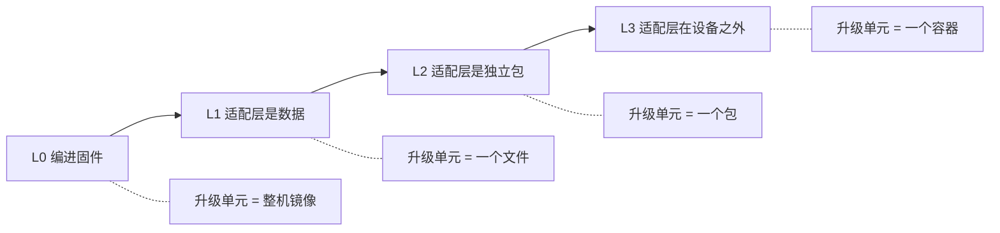
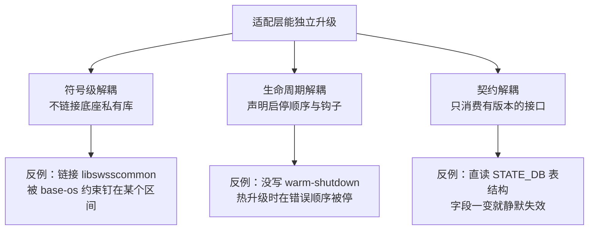

> 本文回答两个连在一起的问题：前端与设备的发布节奏对不上时业界怎么办；以及更进一步——**能不能加一个适配层，让它在设备升级时被单独升级**。
>
> 结论在这份文档里是分层给的：[[#0 结论先行|结论]] → [[#2 适配层的四个落点|四个落点]] → [[#3 单独升级适配层的三个前提|三个前提]] → [[#4 五个代价：这笔交易怎么算|代价]]。SONiC 侧的证据与现有文档互链：[[SONiC-可观测采集与容器架构调研]]、[[SONiC-观测出口与容器网络-外部通信机制]]。

## 0 结论先行

**一句话：有，而且这是业界解决该问题的主流做法之一；但"单独升级适配层"有一个硬边界——能单独升级的是"包"和"描述数据"，不是"依赖底座内核与私有库的那部分代码"。**

这个边界不是理论推演，是写在产品规则里的：

| 产品 | 规则原文 | 边界含义 |
|---|---|---|
| SONiC 扩展包（spm） | `database`、`syncd`、`swss`、`pmon` 被列为 built-in，**不能**作为扩展包装卸 | 带厂商 SDK、需要宿主内核驱动、与 OS 深度耦合的组件，只能整机升级 |
| SONiC 扩展包（spm） | `Restrictions: No support for REST/Klish CLI/gNMI extensions` | 连"给 gNMI 加扩展"都不允许，只允许"新增一个独立服务" |
| Cisco NSO 的 NED | 包名形如 `ncs-6.0-cisco-nx-5.13.1.1.signed.bin` | 前半段是"预编译针对的底座版本"，后半段是适配层版本——**适配置必须对底座大版本重新编译** |

所以正确的问法不是"能不能单独升级适配层"，而是：**适配层与底座之间还剩几根线？线越少，越能单独升级。**

四条线，按断开难度排序：

| 耦合线 | 形式 | 断了之后 | 断不掉的结果 |
|---|---|---|---|
| 符号级 | 链接底座的 `.so`、import 私有 Python 包 | 可跨版本运行 | 被底座 ABI（应用二进制接口，Application Binary Interface）钉死，每个底座版本一个包 |
| 生命周期 | 必须随整机重启、必须按特定顺序启停 | 可热升级 | 升级时数据断流，或起在错误的阶段 |
| 契约级 | 消费未版本化的内部表结构 | 可跨版本读 | 底座改字段即崩，且是静默的 |
| 部署级 | 与固件同一个镜像 | 可独立装卸 | 任何"单独升级"都是覆盖，下次整机升级被抹掉 |

## 1 问题的形状：不是"两个节奏对齐"

真实场景比"前端月更、设备月更"更糟：前端月更甚至周更，固件季更，而客户机房里跑着过去两三年的四五个固件版本。要验的组合是 `12 × 5 = 60` 种。

因此业界的共识是**不让两个节奏对齐，而是让它们只共享一条极窄的、带版本语义的契约**。前端之所以能快，是因为它不该知道设备跑的是哪个版本。

上一层的通用解法可以压缩成四句话，本文不展开但作为前提：

| 解法 | 机制 | 例子 |
|---|---|---|
| 能力协商（capability negotiation） | 连上先问"你会什么"，不比较版本号 | gNMI（gRPC 网络管理接口，gRPC Network Management Interface）的 `Capabilities` 返回 `supported_models` / `supported_encodings` / `gNMI_version`；NETCONF（网络配置协议，Network Configuration Protocol）的 `hello`；OpenAPI 的 `/openapi.json` |
| 契约只增不改 | 字段号不复用、新字段可选、模型带 revision | protobuf 字段规则、YANG（数据建模语言，Yet Another Next Generation）的 `revision`、`ietf-yang-library` |
| 归一化层（narrow waist） | 差异由采集侧吸收，前端只见规范模型 | OpenTelemetry Collector、Telegraf processor |
| 支持窗口（version skew policy） | 明确承诺"支持最近 N 个版本"，超出不保证 | Kubernetes：`kubelet` 可比 `kube-apiserver` 落后最多 3 个 minor，`kubectl` 只允许 ±1 |

但**只做归一化层而不让它独立发布，等于没做**——组合数只是从"前端 × 固件"搬到"适配层 × 固件"，量级一点没减。这就是"适配层能不能单独升级"成为关键的原因。

## 2 适配层的四个落点

同样是"加一层适配层"，它放在哪里，决定了独立升级的粒度差三个数量级。



### 2.1 L1：适配层是数据（改文件就能适配）

**核心思想是把"解析能力"和"设备知识"分开。** 解析器是代码，随主程序发版；设备知识是数据文件，可以随时换。

Prometheus 的 `snmp_exporter` 是这个形态最干净的样本：

| 组成 | 是什么 | 谁在什么时候改 |
|---|---|---|
| `snmp_exporter` 二进制 | 解析器：按配置遍历（walk）OID（对象标识符，Object Identifier）、把表映射成带标签的指标 | 随 exporter 发版，很少动 |
| 生成器（generator） | 把 MIB（管理信息库，Management Information Base）编译成 `snmp.yml` | 厂商出新 MIB 时跑一次 |
| `snmp.yml` | 设备知识：walk 哪些 OID、怎么映射标签 | **可以单独替换** |

它的官方说明明确写了两件事：`snmp.yml` **不应该手改**，要改就重新生成；如果厂商 MIB 不在内置集合里，把 MIB 丢进生成器的 `mibs/` 目录再 `make generate`。启动时 `--config.file` 可以给多次，还支持 glob（`snmp*.yml`）——这意味着**多厂商、多版本的适配描述可以并存并按需加载**。

社区还专门维护了一个仓库收集各厂商 MIB 与 generator 配置，这本身就是"适配层作为独立数据资产发布"的证据。

同样的形态还有三种常见变体：

- NETCONF/YANG：模型文件（`.yang`）独立于设备固件分发，设备只需支持 `ietf-yang-library` 就能被问到"我装了哪些模型、哪个 revision"；
- 各类采集器的映射规则（mapping / pipeline / parser 配置），如 Fluent Bit 的 parser、Logstash 的 grok；
- 协议网关的路由表式配置，如 SNMP（简单网络管理协议，Simple Network Management Protocol）的 view 与 community、gNMI 的 path subscription 清单。

**能到什么程度**：只靠换数据，你能适配"同一套接口的新设备、新字段、新表"，不能适配"新接口"。要采一种全新的数据（比如从 SNMP 换到 gNMI），还得改代码，那就要落到 L2 或 L3。

**代价**：数据文件的版本同样要有语义。snmp_exporter 的做法是把它当构建产物（CI 里比对生成结果有没有 diff），禁止手改——**手改的配置必然在下次生成时被覆盖**，这和后面 [[#5 为什么不能打补丁式适配|打补丁式适配]] 是同一类错误。

### 2.2 L2：适配层是同机上的独立包（换包，重启服务）

这是"你要的那种方案"最直接的对应物：**适配层以独立版本号、独立包的形式存在，装在同一台设备上，可以单独装卸与升级。**

#### 2.2.1 Cisco NSO 的 NED：最典型的商业实现

NED（Network Element Driver，网元驱动）是"每厂商、每版本一个包"的设备驱动。证据全在文件名里：

```text
ncs-6.0-cisco-nx-5.13.1.1.signed.bin
│   │  │      │     │
│   │  └ 厂商/协议 └ NED 版本
│   └ 预编译针对的 NSO 版本
└ 产品代号
```

官方文档原话说得很直白：*"The filenames indicate which version of NSO the NEDs are pre-compiled for (in this case NSO 6.0), and the version of the NED."* 安装过程是：跑 `sh` 校验签名（走 Cisco 证书链）→ 解出 `.tar.gz` → 解到 `packages/neds/` 目录。**整个过程不碰 NSO 本体。**

它同时暴露了这套方案的代价——**版本矩阵是双向的**：Function Pack 的安装指南里会写"NSO 6.1.4 对应 IOSXR CLI NED 7.46 / 7.52"，并注明老 NED 只能用老功能，建议新上设备用新 NED。也就是说：**适配层能独立发版，但必须声明"我为哪个底座预编译"**。

为什么 NED 敢这么做？因为它只依赖南向协议（CLI / NETCONF / SNMP），不 import NSO 的核心库。**它是"翻译官"，不是"器官"。**

#### 2.2.2 SONiC 扩展包（spm）：把耦合写成可校验的声明

SONiC 有一套官方机制叫 SONiC Application Extension，工具是 `sonic-package-manager`（spm）。它的设计恰好回答了你这个问题，并且把"边界"写成了机器可校验的规则。

**包就是镜像，清单（manifest）就是镜像标签（label）。** 一个扩展包 = 一个 SONiC 兼容的 Docker 镜像，镜像上打一个 label `com.azure.sonic.manifest`，值是 JSON 字符串。选 label 而不是随包文件，是因为 **label 可以通过镜像仓库 API 查到，不用先把整个镜像拉下来**——这让"查看版本、查看兼容性"变成一次轻量查询。

manifest 的字段分层很值得抄（以下为实际 schema）：

| 段 | 关键字段 | 作用 |
|---|---|---|
| `package` | `version`、`name`、`description` | 语义化版本，支持 `1.0.0-dev+153` 这类后缀 |
| `package` | `base-os` | **对底座组件的版本约束**，如 `{"libswsscommon": ">1.0.0"}` |
| `package` | `depends` / `breaks` | 对其它包的依赖与冲突，支持 `>=1.0.0,!=1.2.2,<=3.0.0` 与 per-component 约束 |
| `package` | `init-cfg`、`changelog`、`debug-dump` | 初始配置、变更记录、排障脚本 |
| `service` | `requires`/`wanted-by`/`after`/`before` | 直接映射 systemd 语义，**决定启停顺序** |
| `service` | `warm-shutdown` / `fast-shutdown` 的 `after`/`before` | 热升级与快速重启时插在哪两个组件之间 |
| `service` | `post-start-action`、`pre-shutdown-action`、`asic-service`、`host-service` | 生命周期钩子与归属 |
| `container` | `cap-add`、`devices`、`volumes`、`mounts`、`environment`、`tmpfs` | 需要的权限与挂载 |
| `processes` | `name`、`reconciles` | 容器内进程，以及是否参与热启动（warm boot）的状态核对（reconcile） |
| `cli` | `show`/`config`/`clear`、`auto-generate-*-source-yang-modules` | CLI 插件，甚至可以从 YANG 自动生成 |

三个机制最值得学：

**① 底座版本从哪来——`/etc/sonic/sonic_version.yml`。** 底座组件（`libswsscommon`、`sonic-utilities` 等）都有语义化版本，记在这个文件里。包的 `base-os` 段就是拿它比。

**② 自动兼容性检查——靠 SDK 镜像的继承 label。** SONiC SDK 镜像会把各库版本写成 label（如 `com.azure.sonic.versions.libswsscommon`），业务镜像基于它构建，label 自动继承。于是：**manifest 里没写约束时，系统默认按 `^$major.$minor.0` 校验**。这条设计非常聪明——它把"我悄悄依赖了某个库"这种隐性耦合，变成了安装时必然被检查的显式声明。

**③ 安装即校验，四道关。** 底座镜像版本匹配 → 依赖树构建并逐项校验 → 冲突检查（我 break 别人、别人 break 我）→ CLI 插件可装或可跳过。任何一项不过就报错，**不会自动帮你装依赖或解冲突**。要硬来只能 `--force`，而它会打一条 WARN 把跳过的约束念出来：

```text
WARN: feature depends on syncd^1.1.1 while installed version is 1.0.5. Ignoring.
```

这条 WARN 就是"我知道我在破坏契约"的书面确认。

**CLI 的真实形状**（按 `sonic-utilities` 当前代码，不是 HLD 的设计稿）：

| 命令 | 作用 | 关键选项 |
|---|---|---|
| `install` | **安装或升级**（同一个命令，docstring 就是 "Install/Upgrade package"） | `--from-repository 仓库:tag`、`--from-tarball`、`--force`、`-y`、`--allow-downgrade`、`--enable`、`--set-owner {local,kube}`、`--skip-host-plugins`、`--name` |
| `uninstall` | 卸载 | `--keep-config` 保留 CONFIG_DB 里的 feature 配置 |
| `reset` | 回到默认版本 | 这是**回滚抓手** |
| `update` | 只应用"改过的本地 manifest" | 注意：**它不是升级版本**，容易误用 |
| `list` / `show package versions` / `show package manifest` / `show package changelog` | 查 | `--all` 看仓库里所有 tag |
| `repository add/remove` | 管理仓库 | `--default-reference` 可给 tag（标签）或 **sha256 digest（摘要）** |

**升级流程的设计值得单独说**：它不是"卸了再装"。为了减少停机，镜像拉取与模板渲染在**旧容器还在跑**的时候完成；然后停止旧容器（用的是旧的自动生成脚本，因为新脚本可能与旧容器不兼容），替换脚本，再启动新服务，最后删除旧镜像。文档原话：*"stop the old container using old auto-generated service file and container management scripts, then replace the old scripts with new one and start the service."*

**回滚能力是它最弱的一环，必须知道**：spm **不同时保留两个版本**（*"only single version of the package can be installed at any given time"*），所以没有 A/B 双跑；回退靠 `install` 老版本加 `--allow-downgrade`（默认拒绝降级，因为包可能不支持降级），或者 `reset` 回默认版本。

#### 2.2.3 Elastic 的集成包：适配层作为独立发布单元

Elastic 的说法直接用了"解耦"这个词——集成的定义里写着 *"Decoupled release process from the {stack}"*。一个集成（integration）是一个**独立版本化的包**，里面同时装四样东西：采集配置、ingest pipeline（解析与变换规则）、索引模板、预置看板。它经 package registry 分发，由 Fleet 装进 Elasticsearch 与 Kibana，agent 只负责按策略采集。

这套设计的教训同样直接：官方明确警告**不要手动改 Fleet 托管的资产**，因为集成升级时会被覆盖；想定制只能用 `@custom` 这种有约定的挂载点。**"包"是发布单元，包内的资产归包管**——这是 L2 形态必备的纪律。

### 2.3 L3：适配层在设备之外（不动设备）

如果适配层根本不在设备上跑，"单独升级适配层"就退化成"升级一个普通服务"，问题消失。

Azure IoT Edge 是这个形态最清楚的描述。它的模块就是容器镜像，按 tag 版本；更新时推新 tag + 新部署清单，**设备定期来拉**。官方快速入门里有一句几乎就是答案：

> 在将新部署提交到 IoT Edge 设备时，不会向设备推送任何内容。相反，设备会定期查询 IoT Hub，以获取任何新指令。如果设备找到更新的部署清单，它将使用有关新部署的信息从云中提取模块镜像，然后开始在本地运行模块。

注意它的方向：**pull 而不是 push**。这解决了设备在 NAT 后面、没有公网入口的问题，也天然带来了滚动与灰度——部署可按设备 twin 的 tag 条件命中子集，还能用 layered deployment 在基础部署之上叠加模块。更新时的默认行为是逐模块串行（拉镜像 → 停旧 → 起新），有模块依赖时可以设 `ModuleUpdateMode=WaitForAllPulls` 先全拉再统一切换。

工程上还有一条实战细节：**用具体 tag（`1.6.0`）而不是滚动 tag（`1.6`）**，官方建议开发用滚动、生产用具体 tag。

同类形态：OpenTelemetry Collector、Telegraf、Fluent Bit 跑在设备外或旁路，设备只暴露 gNMI / SNMP / 事件流。SONiC 的 gNMI 外推（dial-out） 就是这种思路——采集器在外部订阅，设备侧版本怎么变，只影响订阅的路径集。

**代价**：设备必须暴露足够稳定的协议。如果某个数据只能靠"进设备读它的私有实现"才拿得到，L3 就做不了，只能退回 L1/L2。

### 2.4 L0：编进固件（对照组，说明为什么前三个值得做）

适配层与业务代码一起编进固件镜像。此时"升级适配层"= "升级整机"，停机窗口、验证周期、客户排期全都要走一遍。

它的唯一优点是**几乎没有兼容问题**——因为不存在版本组合。所有"适配层独立升级"的方案，本质都是**用兼容性风险换发布速度**，后面 [[#4 五个代价：这笔交易怎么算|代价]] 一节讲这笔交易怎么算。

### 2.5 四个落点对比

| 维度 | L0 编进固件 | L1 适配层是数据 | L2 适配层是独立包 | L3 适配层在设备外 |
|---|---|---|---|---|
| 升级单元 | 整机镜像 | 一个配置文件 | 一个包（镜像 + manifest） | 一个容器 |
| 是否停机 | 必须 | 重载即可 | 停服务，秒级到分钟级 | 不需要碰设备 |
| 能否跨固件版本 | 不存在组合 | 能（解析器不变就行） | 能，但要声明 `base-os` 约束 | 能，只剩协议契约 |
| 能否灰度到部分设备 | 难 | 容易（按设备发不同文件） | 容易（按仓库 tag） | 最容易（按 tag 条件命中） |
| 回滚 | 整机回退 | 换回旧文件 | `reset` 或装旧版本，**无 A/B** | 换回旧 tag |
| 典型代表 | 多数 NOS 内置 telemetry | snmp_exporter 的 `snmp.yml`、YANG 模型 | NSO NED、SONiC spm、Elastic 集成包 | IoT Edge 模块、OTel Collector |
| 适配能力上限 | 全（随便改代码） | 只能重组已有能力 | 可写新代码，但受底座 ABI 与权限限制 | 受设备暴露的协议限制 |

一句话选型：**能放设备外就放设备外；放不出去就把"知识"做成数据；只有必须写新代码又必须在设备内时，才做独立包。**

## 3 单独升级适配层的三个前提

这一节是本文最实用的部分。很多团队"加了适配层"却依然没法单独发版，都是栽在这三根线上。



### 3.1 符号级解耦：不要链接底座的私有库

这是最硬的一根线。SONiC 的 `base-os` 约束把后果写得非常明确：

```json
{ "package": { "base-os": { "libswsscommon": ">1.0.0" } } }
```

一旦你的适配器 `import swsscommon`，它就绑定了 `libswsscommon` 的 ABI。而 ABI 不会跨大版本兼容，于是：

- 约束写松（`>1.0.0`）→ 校验通过，运行时崩；
- 约束写紧（`^1.2.0`）→ 安全了，但**只有底座还在 1.2.x 时能升级**，等于又回到"每个固件版本一个适配层包"。

**破解办法是换协议，不换绑定方式**：

| 想拿的数据 | 差的做法（符号耦合） | 好的做法（协议解耦） |
|---|---|---|
| 交换机状态表 | import `swsscommon`，调 `SonicV2Connector` | 说 Redis 协议（RESP，REdis Serialization Protocol）直连，或走 gNMI |
| 平台传感器 | import 厂商 `sonic_platform` wheel 的类 | 读 sysfs / hw-management 软链；或读 STATE_DB |
| 事件 | link `-levents`，调 `event_publish` | 订阅 ZMQ 端点，自己解析两帧消息 |
| 配置 | 直接改 `CONFIG_DB` | 调 `config_db` CLI 或 REST/gNMI |

后者的代价是要自己维护一份 schema 解析，收益是**这份解析可以独立于底座发版**。SONiC 事件流这一侧的细节见 [[SONiC-事件数据抓取框架-输入输出与设计取舍]]，其中"两帧 + 文本 payload"的设计恰好让外部消费者不需要链任何库。

顺带一个判断法则：**如果你的适配层需要用底座的头文件才能编译，它就不可能在底座换大版本后单独升级。**

### 3.2 生命周期解耦：必须能声明"我插在哪"

适配层不是无状态的旁路进程，它往往要读写底座的数据、依赖底座的服务在跑。于是它天然被卷进启停顺序：

- 底座还没起，适配层就去连 Redis → 连不上，进入重试或退出；
- 整机热重启（warm reboot）时，适配层被在所有组件之后才停 → 采集到最后一段错乱数据；
- 适配层比 `swss` 先起 → 读到空表，写进时序库后就是一段永久假死。

spm 用 manifest 的 `service` 段把这件事变成声明式的，字段直接映射 systemd：

```json
{
  "service": {
    "name": "apm-collector",
    "requires": ["database"],
    "after": ["swss", "syncd"],
    "warm-shutdown": { "after": ["swss"], "before": ["syncd"] },
    "fast-shutdown": { "after": ["swss"], "before": ["syncd"] },
    "post-start-action": "/usr/local/bin/apm-init",
    "pre-shutdown-action": "/usr/local/bin/apm-flush"
  }
}
```

`warm-shutdown` 的 `after`/`before` 意思很具体：**我要插在 `swss` 停了之后、`syncd` 停之前被停掉**。没有这段声明，热升级脚本只能把你当"剩余容器"一起粗暴停掉。

更细的一层是 `processes[].reconciles`——标记容器内哪些进程参与 warm boot 后的状态 reconcile。不标，就意味着底座认为你没有需要恢复的状态。

**没有这一层声明，所谓"单独升级"只能靠重启整机来保证顺序，那就退化成 L0 了。**

### 3.3 契约解耦：不要消费未版本化的内部结构

最隐蔽的一根线。典型症状是"直读内部表当 API"：

```python
# 反面：把 STATE_DB 的表结构当成对外契约
for key in db.keys("STATE_DB", "PORT_TABLE|*"):
    d = db.get_all("STATE_DB", key)
    speed = d["speed"]        # 字段名跨版本会变，这里会静默 KeyError 或 None
```

表结构是**内部实现**，不是契约。它随版本增删字段是正常的，甚至可能整表改名。用它的适配层会呈现一种极难排查的故障形态：**不报错，只是某些字段一直是空值**。

三条可用的替代：

| 替代 | 为什么稳定 |
|---|---|
| gNMI | 有 `Capabilities` 可协商、路径由 YANG 模型定义、模型带 revision |
| 事件流 | payload 带 schema 版本，消费端按版本路由到不同解析器 |
| 自有规范模型（narrow waist） | 适配层内部转换，外部只见规范模型；底座变了只改一个 adapter |

这条对"前端"尤其致命：如果前端直读 Redis，那么**前端一升级就可能崩，而且崩的原因在设备侧**——两个团队的发布被强行绑死，正是要避免的事。

## 4 五个代价：这笔交易怎么算

"适配层独立升级"不是免费的。它把风险从"发布太慢"换成了"组合太多"，以下五条必须提前认账。

| 代价 | 具体表现 | 缓解 |
|---|---|---|
| **支持矩阵反转** | 从"我们测 N 个固件"变成"客户实测 M 个适配层 × N 个固件" | 契约测试矩阵：设备模拟器 + 三档固件快照 + 适配层头部版本，进 CI；这是两边唯一的共同资产 |
| **回滚语义缺失** | spm 单版本、IoT Edge 靠换 tag、NED 靠重装旧包——都**不是原子回滚** | 要么在前端做"降级渲染"（能力开关），要么在部署层做 A/B（双容器 + 切流量） |
| **信任与签名** | NED 是 `signed.bin` + 证书链校验；spm 明文写着"假定三方镜像是可信的"，加包需进 `packages.json` 由社区验证 | 签名 + 摘要固定（`--default-reference` 可给 **sha256 digest**，比 tag 可靠） |
| **责任边界** | 装了三方包出事，是包的问题还是底座的问题 | manifest 里带 `changelog` 与 `debug-dump`（spm 就有这两个字段），排障时一键取证 |
| **磁盘与启动开销** | 不同包基于不同版本 SDK，镜像基础层无法共享，官方提示"总体积可能翻倍" | 统一 SDK 基线；限制可安装包数量 |

还有一条隐性代价值得单独说：**降级默认是被禁止的**。spm 的 `--allow-downgrade` 说明写着"默认情况下降级尝试会失败，因为降级可能不被包支持"。这句话背后的现实是：**反向兼容没人做**。向上的兼容性容易保证，向下的几乎没人测。所以"回滚"在 L2 形态里往往只有"回到默认版本"这一条干净路径。

## 5 为什么不能打补丁式适配

一个必须点破的误区：在设备上"手动改几个文件、放一个脚本"来实现适配，看起来是 L1/L2，其实是**假的独立升级**。

原因在部署模型：适配层的文件一旦落在基础镜像的文件系统里，**下次整机升级就被新镜像覆盖掉**，而且不会报错。问题会在几周后以"某个字段又空了"的形式出现。

SONiC 对此有明确的处理机制，正好说明这不是小事——SONiC-2-SONiC 升级时要处理扩展包的迁移：

- 取新系统的 `packages.json` 与版本要求，与当前运行版本比对；
- 新镜像里定义的默认版本更高，就在新镜像中安装/升级；更低，则安装当前运行的版本（**不强行升到新默认值**）；
- 新旧 `packages.json` 合并写入新镜像；
- 因为装包必须在镜像安装期完成，需要挂载新镜像文件系统、**在新镜像的 chroot 里起 dockerd**；
- 想干净重装可跳过迁移：`sonic-installer install -y sonic.bin --no-package-migration`。

这段话包含两个可直接照搬的经验：**① 扩展包的版本状态必须单独持久化（`packages.json`），不能只存在文件系统里；② 整机升级时必须做一次"版本合并"，而不是"新镜像说了算"。**

顺带一条历史线索：SONiC 原本有个 `sonic-installer upgrade-docker` 子命令能做部分容器升级，HLD 明确它会**被 spm 取代**。原因是前者只能换镜像，无法表达依赖、冲突、启停顺序——**"能换镜像"和"能安全地换组件"是两件事。**

## 6 落到 APM 与 SONiC 场景

结合你自己的场景（设备侧 APM 采集 + Web 端 AI 助手，前端月更、设备季更），可以落成五条。

| # | 动作 | 理由 |
|---|---|---|
| 1 | 采集/适配器**先争取放到设备外**（L3），设备侧只保证 gNMI / 事件流出口稳定 | 升级完全不动设备，灰度与回滚都简单；SONiC 的 gNMI dial-out 与 ZMQ 事件流都支持这种用法 |
| 2 | 必须进设备时，做成 **spm 扩展包**（L2），manifest 写 `base-os` 约束、`after/before`、`warm-shutdown` | 借用现成的校验、启停顺序、卸载与 reset 能力，不要自己发明 |
| 3 | 扩展包**不要链接** `libswsscommon` / `libsairedis` | 否则 `base-os` 约束会把适配层钉死在某几个固件版本，独立升级名存实亡 |
| 4 | 前端只吃**归一化模型 + capability**，不读 `STATE_DB` 表结构 | 表结构是内部实现；字段变更会导致"不报错但一直是空值" |
| 5 | 建契约测试矩阵：设备模拟器 + 三档固件 × 适配层头部版本；发布承诺"前端支持最近 3 个固件版本，超出降级为只读" | 把"尽力兼容"换成"明确窗口"，这是 Kubernetes 验证过的做法 |

一个具体的架构建议：**把"知识"和"代码"分离**。设备的指标口径、阈值、字段映射这类内容，做成随包发布的配置文件（L1），让现场问题可以通过换配置解决；只有采不到数据时才需要换包（L2）。这样月度发版里绝大多数是 L1 变更，风险面极小。

## 7 待核实

| # | 待核实项 | 影响 | 怎么验 |
|---|---|---|---|
| 1 | spm 的限制清单在 master 是否仍禁止 gNMI 扩展（本文引用的是 Phase 1 HLD 的设计） | 决定能否把 collector 做成"gNMI 扩展"而非独立服务 | 读 `sonic-utilities` 最新 HLD 与 `sonic_package_manager` 源码 |
| 2 | 多芯片 / SmartSwitch 下扩展包与 `asic-service` 的配合 | 决定扩展包能否访问某一路 ASIC 的数据 | manifest 中 `asic-service: true` 的实际行为 |
| 3 | 扩展包在 warm reboot 中 `reconciles` 的实际校验方式 | 决定升级是否真的不断流 | 上设备跑 `warm-reboot -v` 看停止顺序 |
| 4 | 各家 NED 的实际发版节奏与底座节奏的比例 | 用于校准"适配层比底座快多少倍"的经验值 | 查 Cisco 下载页 NED 的 release 历史 |
| 5 | IoT Edge 模块 tag 回退时，模块 twin 里的期望状态如何处理 | 影响"换回旧版本"是否需要额外清理 | 官方 `production-checklist` 的 volume 与 twin 说明 |

## 版本记录

| 版本 | 日期 | 变更 |
|---|---|---|
| v0.1 | 2026-11-11 | 首版：四个落点（L0–L3）与代表产品证据（NSO NED、SONiC spm、Elastic 集成包、snmp_exporter、IoT Edge）、单独升级的三个前提（符号级/生命周期/契约）、五个代价、打补丁式适配的反例与 SONiC-2-SONiC 迁移机制、APM 场景五条落地建议 |
