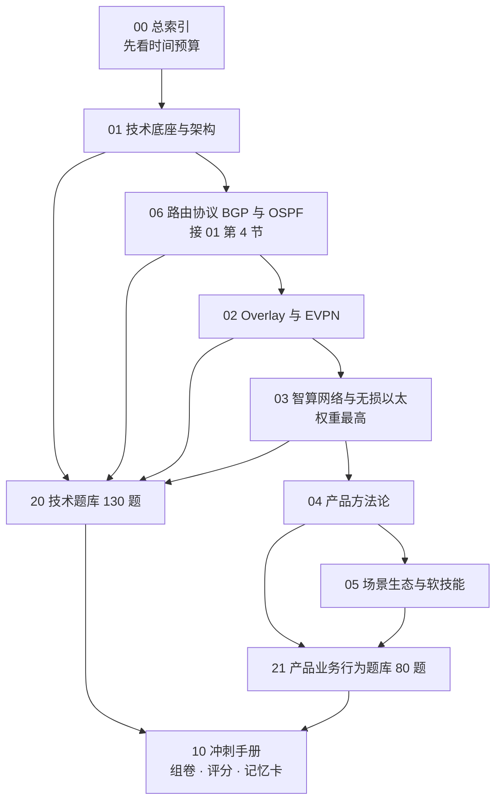

# 00 学习总索引

> 这套资料共 9 份，回答四个问题：**学什么、学多久、怎么验证、来不及怎么办。**
> 结论先给：**全部 21.5 小时（10–11 天）；重点 9.5 小时（3 天）；极限 6.5 小时（1 天）。**

## 目录

- [[#1 一句话总览|1 一句话总览]]
- [[#2 学习地图|2 学习地图]]
- [[#3 时间预算（三种口径）|3 时间预算]]
- [[#4 知识点分层统计|4 分层统计]]
- [[#5 文件导航|5 文件导航]]
- [[#6 核心知识点速查|6 核心知识点速查]]
- [[#7 使用规则|7 使用规则]]
- [[#8 进度追踪|8 进度追踪]]

---

## 1 一句话总览

【结论】这份 JD 要的不是"懂网络的人"，也不是"懂产品方法的人"，而是**能判断"哪个技术方向值多少钱"的人**。所以资料结构按"技术可信度 → 产品方法论 → 客户与商业感"三层搭建，每层都配了图和自测题。

三句话概括全库：

1. **技术层**（01–03 册）：让你在技术面扛住三层追问，不要求会配命令。
2. **产品层**（04 册）：让你把"我参与过"讲成"我判断过"。
3. **场景层**（05 册）：让你说出客户为什么掏钱，而不是只会讲参数。

---

## 2 学习地图

**读法说明**：01→06→02→03 是技术主线，顺序不能乱（06 依赖 01 的 eBGP 选型结论，02 依赖 01 的转发概念并直接复用 06 的 BGP 机制，03 依赖 02 的 Overlay 概念）。04、05 可并行。

---

## 3 时间预算（三种口径）

### 3.1 直接回答"要学多久"

| 口径 | 覆盖范围 | 总时长 | 折算天数 | 适合场景 |
|---|---|---|---|---|
| **全部学完** | 6 册精讲全文 + 210 题全做 + 行为题全练 | **约 21.5 小时** | 每天 2 h → 10–11 天 | 还有两周以上 |
| **重点学完** | 全部【核心】标记 + 核心题约 110 道 + 白板复述 | **约 9.5 小时** | 每天 3 h → **3 天** | 一周内面试 |
| **极限突击** | 核心骨架 + 三套速测卷 + 必背数字 | **约 6.5 小时** | 1 天 | 明天就面 |

### 3.2 为什么是这几个数

【支撑】计算依据：中文理解型阅读约 250–300 字/分钟；全库精讲正文约 6.4 万字，纯阅读约 4 小时，加上看图、复述、做题，倍率约 3 倍，得 11.5 小时；题库 210 题按 1.5 分钟/题（含看解析）约 5.2 小时；行为题录音演练 2 小时；模拟与复盘 2.2 小时。合计约 21 小时，取整为 21.5 小时。

**这意味着**：如果每天只有 1 小时，全部学完需要 21 天，此时应该直接走"重点 9.5 小时"路径，不要试图全读。

### 3.3 详细拆分与日程

- 逐项拆解表：见 [[10-三天冲刺手册#1 时间预算总表|时间预算总表]]
- 三天小时级日程：见 [[10-三天冲刺手册#2 三天冲刺日程|三天冲刺日程]]
- 一天极限版：见 [[10-三天冲刺手册#3 一天极限版|一天极限版]]

---

## 4 知识点分层统计

### 4.1 总量

| 层级 | 数量 | 定义 | 掌握标准 |
|---|---|---|---|
| 【核心】 | **111 条** | 答不出即被判定"不懂这一块" | 脱稿 90 秒 + 扛住一次追问 |
| 【支撑】 | 74 条 | 显著提升专业度评分 | 记住结论与取舍 |
| 【细节】 | 15 条 | 问到概率约 20% | 知道在哪查 |
| 考题 | **210 题** | 技术 130 + 产品业务行为 80 | 核心题正确率 ≥ 85% |

### 4.2 各册分布

| 册 | 核心 | 支撑 | 细节 | 核心占比 | 重点学习时长 |
|---|---|---|---|---|---|
| [[01-精讲-技术底座与架构]] | 17 | 11 | 5 | 52% | 1.0 h |
| [[02-精讲-Overlay与EVPN]] | 19 | 10 | 2 | 61% | 0.8 h |
| [[03-精讲-智算网络与无损以太]] | 18 | 11 | 2 | 58% | 1.2 h |
| [[04-精讲-产品方法论]] | 19 | 17 | 1 | 51% | 0.6 h |
| [[05-精讲-场景生态与软技能]] | 11 | 16 | 3 | 37% | 0.5 h |
| [[06-精讲-路由协议BGP与OSPF]] | 27 | 9 | 2 | 71% | 0.9 h |
| **合计** | **111** | **74** | **15** | 55% | **5.0 h（另加做题 4.5 h）** |

**读法**：06 与 02、03 的核心占比最高（71%、61%、58%），说明这三册"几乎没有水分"，**时间紧就整册读，不要跳**。05 的核心占比最低，时间紧可以只读核心段。

---

## 5 文件导航

### 5.1 精讲六册

| 文件 | 讲什么 | 何时读 | 读完能做到 |
|---|---|---|---|
| [[01-精讲-技术底座与架构]] | 报文转发、四代架构与规模计算、硬件芯片、路由协议选型、高可用、可观测性 | 第一天上午 | 能算 1024 卡、能画报文一生、能答 eBGP 选型 |
| [[02-精讲-Overlay与EVPN]] | VXLAN 封装、EVPN 五类路由、网关形态、多租户、MTU 排障 | 第一天下午 | 能背五类路由、能算 50 字节、能排查大包不通 |
| [[03-精讲-智算网络与无损以太]] | JCT/MFU、RDMA、无损三件套、PFC 四风险、三种拓扑、IB 与 UEC 选型、训练慢定位 | 第二天全天 | 能画无损闭环、能比较 IB 与以太、能定位 MFU 低 |
| [[04-精讲-产品方法论]] | 需求流程、真伪判据、文档体系、RICE、四条取舍轴、Roadmap、IPD、质量闭环、生命周期 | 第三天上午 | 能讲完整需求流程、能算 RICE、能排 Roadmap |
| [[05-精讲-场景生态与软技能]] | 六类客户决策链、组网形态、产业链、竞品话术、金字塔表达、STAR、决策矩阵 | 第三天上午 | 能说清客户差异、能写 3 个案例、能答抗压题 |
| [[06-精讲-路由协议BGP与OSPF]] | OSPF 五报文七状态与 LSA、BGP 四报文六状态与选路属性、RR、BFD/GR、机制到规格的映射、邻居起不来分层排障 | 第一天上午（接 01 第 4 节） | 能画两个状态机、能答选路顺序、能把协议讲成产品规格 |

### 5.2 题库两册

| 文件 | 题量 | 构成 | 用法 |
|---|---|---|---|
| [[20-题库-技术类]] | 130 | PM-A 转发与协议 35 / PM-B Overlay 与架构 30 / PM-C 智算 35 / PM-G 路由协议 30 | 学完 01–03、06 后做，按模块对应 |
| [[21-题库-产品业务行为类]] | 80 | PM-D 方法论 30 / PM-E 场景生态 25 / PM-F 行为 25 | D、E 可笔试；F 必须录音口述 |

### 5.3 工具与底稿

| 文件 | 作用 |
|---|---|
| [[10-三天冲刺手册]] | 时间预算、三天日程、组卷方案、评分规则、必背数字、20 张记忆卡、面试前 72 小时清单 |
| [[数据中心网络产品经理-知识点大纲]] | 原始大纲（JD 能力映射、能力项权重），用于查"这个知识点为什么在这里" |

---

## 6 核心知识点速查

【核心】时间极紧时，只背这 33 条。每条都能在对应册找到详解。

### 6.1 技术类（21 条）

| # | 核心知识点 | 一句话 | 出处 |
|---|---|---|---|
| 1 | 报文一生 | 解析→查表→入队→过网→出队→发光 | [[01-精讲-技术底座与架构#1 报文的一生：转发原理底座\|01 §1]] |
| 2 | 丢包四位置 | 入口、网内、出口、光 | [[01-精讲-技术底座与架构#1 报文的一生：转发原理底座\|01 §1]] |
| 3 | 时延五段 | 串行、传播、排队、处理、光 | [[01-精讲-技术底座与架构#1 报文的一生：转发原理底座\|01 §1]] |
| 4 | 1 KB 时延 | 100G 上 82 ns、400G 上 20 ns | [[01-精讲-技术底座与架构#1 报文的一生：转发原理底座\|01 §1]] |
| 5 | 弃用 STP 三理由 | 收敛慢、链路浪费、广播失控 | [[01-精讲-技术底座与架构#1 报文的一生：转发原理底座\|01 §1]] |
| 6 | 四代架构 | 三层→大二层→Spine-Leaf→AI Fabric | [[01-精讲-技术底座与架构#2 架构四代演进与规模计算\|01 §2]] |
| 7 | 1024 卡算法 | 64×400G 两层 + 8 网卡服务器 | [[01-精讲-技术底座与架构#2 架构四代演进与规模计算\|01 §2]] |
| 8 | 交换容量 | 端口数 × 速率 × 2 | [[01-精讲-技术底座与架构#3 交换机硬件与芯片\|01 §3]] |
| 9 | eBGP 四理由 | 扩展、策略、隔离、体系一致 | [[01-精讲-技术底座与架构#4 路由协议：为什么大 DC 用 BGP\|01 §4]] |
| 10 | M-LAG 与堆叠 | 前者双活可逐台升级，后者单控制面 | [[01-精讲-技术底座与架构#5 高可用与故障收敛\|01 §5]] |
| 11 | VXLAN 50 字节 | 14+20+8+8 | [[02-精讲-Overlay与EVPN#2 VXLAN 封装逐字段拆解\|02 §2]] |
| 12 | EVPN 五类路由 | 一发现、二找人、三广播、四选主、五网段 | [[02-精讲-Overlay与EVPN#4 EVPN：把学习搬到控制面\|02 §4]] |
| 13 | 分布式网关 | 网关在每台 Leaf，东西向一跳直达 | [[02-精讲-Overlay与EVPN#5 集中式网关与分布式网关\|02 §5]] |
| 14 | JCT 与 MFU | AI 看任务完成时间，不看平均带宽 | [[03-精讲-智算网络与无损以太#1 为什么 AI 训练需要另一种网络\|03 §1]] |
| 15 | 无损三件套 | PFC 刹车、ECN 松油门、DCQCN 降功率 | [[03-精讲-智算网络与无损以太#3 RoCEv2 无损三件套\|03 §3]] |
| 16 | PFC 四风险 | 队头阻塞、死锁、风暴、难调 | [[03-精讲-智算网络与无损以太#4 PFC 的四个风险\|03 §4]] |
| 17 | 三拓扑 | 胖树、轨对齐、多平面 | [[03-精讲-智算网络与无损以太#5 拓扑：胖树、轨对齐与多平面\|03 §5]] |
| 18 | 三路线选型 | IB 确定性、RoCEv2 成本、UEC 未来 | [[03-精讲-智算网络与无损以太#7 IB、RoCEv2 与 UEC 的选型\|03 §7]] |
| 19 | OSPF 骨架 | 五报文七状态，2-Way 是稳态，ExStart 查 MTU | [[06-精讲-路由协议BGP与OSPF#3 OSPF：从邻居到路由\|06 §3]] |
| 20 | BGP 骨架 | 四报文六状态，选路比属性不比跳数，iBGP 要 RR | [[06-精讲-路由协议BGP与OSPF#4 BGP：从邻居到选路\|06 §4]] |
| 21 | 协议到规格 | 邻居数、条目数、ECMP 组数、BFD 间隔 | [[06-精讲-路由协议BGP与OSPF#6 产品经理视角：机制如何变成规格与功能\|06 §6]] |

### 6.2 产品与场景类（12 条）

| # | 核心知识点 | 一句话 | 出处 |
|---|---|---|---|
| 22 | 三类判断 | 做不做、先做谁、做成什么样 | [[04-精讲-产品方法论#1 产品经理的三类产出\|04 §1]] |
| 23 | 需求四闸 | 频次、影响、可复用、可实现 | [[04-精讲-产品方法论#3 需求真伪判据与痛点四问\|04 §3]] |
| 24 | 痛点四问 | 第三问最狠：你现在怎么绕过去的 | [[04-精讲-产品方法论#3 需求真伪判据与痛点四问\|04 §3]] |
| 25 | 文档边界 | MRD 决定投不投，PRD 决定做成什么样 | [[04-精讲-产品方法论#4 文档体系：MRD、BRD、PRD、SRS\|04 §4]] |
| 26 | 验收三段式 | 条件 → 操作 → 结果 + 阈值 | [[04-精讲-产品方法论#5 PRD 的质量判据\|04 §5]] |
| 27 | RICE | 触达×影响×信心 ÷ 投入 | [[04-精讲-产品方法论#6 优先级：四个框架与算例\|04 §6]] |
| 28 | 四条取舍轴 | 标准/定制、平台/单点、广度/稳定、交付/架构债 | [[04-精讲-产品方法论#7 DC 产品特有的四条取舍轴\|04 §7]] |
| 29 | 承诺纪律 | 范围可谈，日期不可谈 | [[04-精讲-产品方法论#8 Roadmap 三层与承诺管理\|04 §8]] |
| 30 | 质量闭环三步 | 先止血、根因分类、横向排查 | [[04-精讲-产品方法论#11 质量问题闭环\|04 §11]] |
| 31 | 客户三问差异 | 互联网问便宜快、政企问不出事、智算问跑满 | [[05-精讲-场景生态与软技能#1 六类客户的决策链差异\|05 §1]] |
| 32 | 竞争话术三步 | 承认强项、重设战场、指标锁死 | [[05-精讲-场景生态与软技能#4 竞品定位三角与竞争话术\|05 §4]] |
| 33 | STAR 四段 | 背景 15 秒、冲突 20 秒、判断 35 秒、结果 20 秒 | [[05-精讲-场景生态与软技能#7 STAR 案例骨架\|05 §7]] |

---

## 7 使用规则

### 7.1 三条规则

【核心】

1. **先测后学**：每册读完立刻做对应模块的题，不做题等于没读。**测试驱动比通读效率高约 2 倍**——因为做题会暴露"以为懂了"的幻觉。
2. **先图后文**：每节先看图，再用文字补齐。图能记住，段落记不住。
3. **先口述后笔写**：技术题必须开口讲，行为题必须录音。**心里想通 ≠ 嘴上说得出**，而面试只考后者。

### 7.2 三个不要

【核心】

1. **不要通读【细节】段**：13 条细节全部投入产出比很低，面试问到概率约 20%。
2. **不要背参数数值**：PFC 门限、ECN 门限这类没有通用最优值，背了反而显得不懂。要背的是"为什么没有通用值"。
3. **不要编造不了解的产品型号**：规格记不清就说"具体规格我需要确认"，比说错强。

### 7.3 交叉验证方法

【支撑】学完后用三种方式自检：

- **白板测试**：60 秒画出 Spine-Leaf、无损闭环、训练慢定位树
- **降维测试**：向非技术朋友解释 PFC 为什么危险，对方听懂即合格
- **反驳测试**：自己扮演面试官问"为什么不用另一种方案"，能答上即过关

---

## 8 进度追踪

### 8.1 学习进度

- [ ] 01 技术底座与架构（核心 1.0 h / 全部 2.5 h）
- [ ] 02 Overlay 与 EVPN（核心 0.8 h / 全部 1.8 h）
- [ ] 03 智算网络与无损以太（核心 1.2 h / 全部 2.5 h）
- [ ] 04 产品方法论（核心 0.6 h / 全部 2.0 h）
- [ ] 05 场景生态与软技能（核心 0.5 h / 全部 1.5 h）

### 8.2 测试进度

- [ ] 速测卷 A（技术基础，100 分）得分 ____ / 及格 85
- [ ] 速测卷 B（智算，100 分）得分 ____ / 及格 85
- [ ] 速测卷 C（产品与场景，100 分）得分 ____ / 及格 85
- [ ] 完整测评卷（200 分）得分 ____ / 合格 150、优秀 180

### 8.3 面试材料

- [ ] 3 个 STAR 案例写完（技术判断 / 需求取舍 / 交付救火）
- [ ] 我方产品线一页纸（三条产品线、三个规格、两个标杆客户）
- [ ] 必背数字卡能默写 15 条以上
- [ ] 3 个反问准备好
- [ ] 白板三张图能在 60 秒内画出

### 8.4 卡住时怎么办

【支撑】

| 症状 | 原因 | 动作 |
|---|---|---|
| 读完记不住 | 只读没测 | 立刻做该模块题，用错题反查 |
| 讲不出来 | 只输入没输出 | 录音讲 90 秒，回放找断点 |
| 技术追问答不上 | 只记结论没记取舍 | 补该知识点的"代价是什么"这一段 |
| 时间不够 | 试图全读 | 切到 [[10-三天冲刺手册#3 一天极限版\|一天极限版]] |
| 焦虑 | 目标模糊 | 只看[[#6 核心知识点速查\|核心 33 条]]，先建立掌控感 |

---

> 维护约定：每完成一次面试，回来把新遇到的高频题补进题库，并在对应精讲册加一句"实际被问到"。三个月后这套资料就是个人定制的了。
