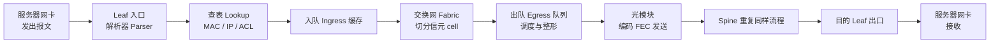
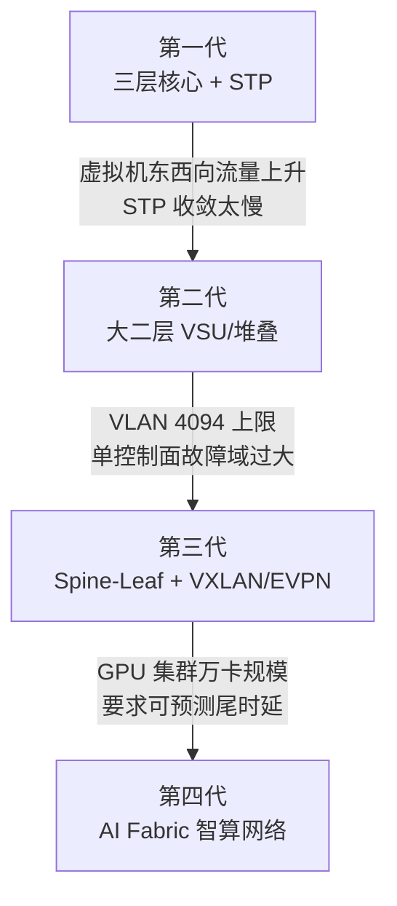
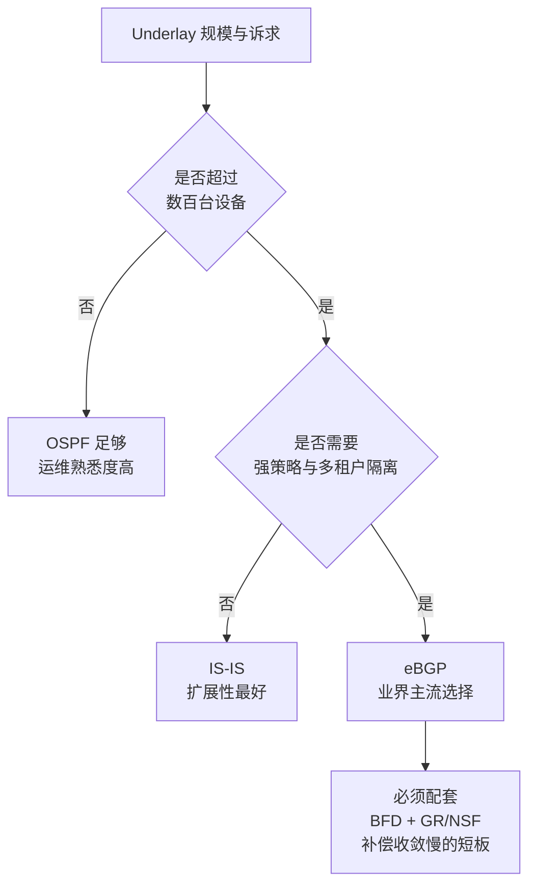
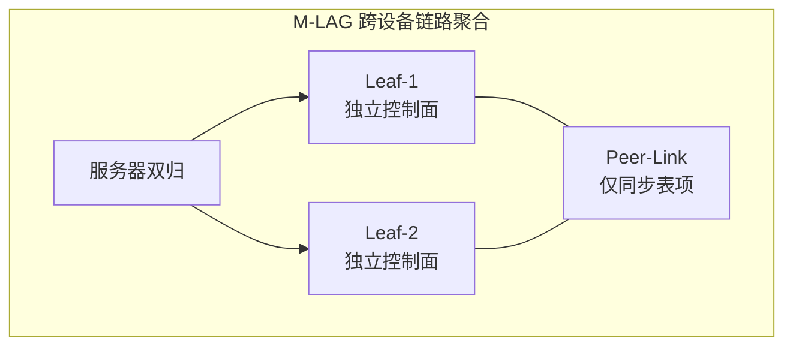
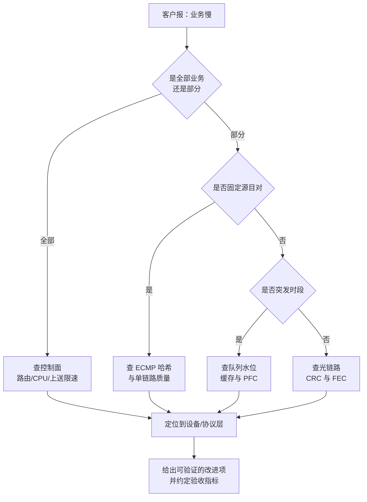

# 01 技术底座与架构（精讲）

> 本册解决一个问题：**让技术面的三层追问停在第二层，而不是把你问穿。**
> 覆盖范围：报文转发原理、架构四代演进、硬件与芯片、路由协议、高可用、可观测性。

## 分层标记说明

| 标记 | 含义 | 面试要求 | 学习方式 |
|---|---|---|---|
| 【核心】 | 答不出即被判定"不懂网络" | 必须脱稿讲 90 秒 + 扛住一次追问 | 精读 + 复述 + 白板画 |
| 【支撑】 | 能显著提升专业度评分 | 知道结论与取舍，细节可模糊 | 读 + 记住结论句 |
| 【细节】 | 加分项，问到概率约 20% | 知道在哪查即可 | 扫读，留印象 |

**本册学习时长**：核心 70 分钟 / 全部 130 分钟。

## 目录

- [[#1 报文的一生：转发原理底座|1 报文的一生]]
- [[#2 架构四代演进与规模计算|2 架构四代演进]]
- [[#3 交换机硬件与芯片|3 硬件与芯片]]
- [[#4 路由协议：为什么大 DC 用 BGP|4 路由协议]]
- [[#5 高可用与故障收敛|5 高可用]]
- [[#6 可观测性：把设备状态翻译成业务语言|6 可观测性]]
- [[#7 本册速记卡|7 本册速记卡]]

---

## 1 报文的一生：转发原理底座

### 1.1 一句话结论

【核心】**所有网络问题，最终都能定位到"某一个报文在某一跳的某一个队列里被丢或被延迟"。** 你只要能把这句话展开成一条链路，就已经赢了大多数候选人。

### 1.2 图：一个报文的完整旅程

**这张图的四个用途**（面试时可以用它回答一切"怎么定位"的问题）：

1. 丢包只可能发生在四类位置：**入口缓存溢出、交换网丢弃、出口队列尾丢、光链路误码**。
2. 时延只可能来自五段：串行化、传播、排队、设备处理、光模块。
3. 任何"加带宽没用"的问题，一定卡在**队列或哈希**，而不是卡在总带宽。
4. 任何"偶发且无规律"的丢包，先怀疑**光链路与 FEC**，而不是先怀疑配置。

### 1.3 为什么数据中心抛弃了生成树

【核心】二层网络的三个原始缺陷，决定了它无法承载云与 AI 的东西向流量：

- **收敛慢**：生成树（STP）故障收敛在秒级，而 DC 业务要求毫秒级，AI 训练要求微秒级尾时延可控。
- **链路浪费**：STP 会阻塞冗余链路，正常状态下最多只有一半链路承载流量，带宽利用率上限被锁死在 50% 左右。
- **广播域不可控**：虚拟机规模增长后，广播与未知单播泛洪会吞掉大量带宽。

**结论句（可直接背）**："数据中心不是不用二层，而是把二层从'物理网络'降级为'Overlay 的逻辑能力'，物理层交给三层路由 + 等价多路径。"

### 1.4 三层转发与等价多路径

【核心】三层转发做三件事：**最长前缀匹配（longest prefix match）选出口 → 解析下一跳 MAC → 递减 TTL 后转发**。

等价多路径（Equal-Cost Multi-Path，ECMP）是 Spine-Leaf 的带宽来源：同一个目的前缀有多条等价下一跳时，交换机按哈希把流量分散到多条链路上。它带来两个必然的副作用，也是高频追问点：

| 副作用 | 成因 | 后果 | 解法 |
|---|---|---|---|
| 哈希不均（polarization） | 五元组哈希落入同一桶，多条大象流撞到同一条上行 | 部分链路拥塞、部分空闲，整体吞吐下降 | 动态负载均衡（DLB）、逐包喷洒（packet spray）、调整哈希因子 |
| 乱序（reordering） | 逐包走不同路径，到达顺序变化 | TCP 误判丢包而降速；RDMA 需重组能力 | 选择性重传、网卡侧乱序重组（UEC 的核心设计） |

【细节】哈希因子通常包含源/目的 IP、源/目的端口、协议号。这也是为什么"改一个端口号性能就变了"——它改变的是哈希结果。

### 1.5 时延预算：必须会算的两个数

【核心】串行化时延 = 报文长度 ÷ 链路速率。这是唯一一个产品经理必须能现场口算的网络公式。

- 1 KB 报文 = 8192 bit；在 100G（1×10¹¹ bit/s）端口上：8192 ÷ 1×10¹¹ ≈ **82 ns**
- 同样报文在 400G 端口上：≈ **20 ns**
- 64 B 小包在 400G 上：512 ÷ 4×10¹¹ ≈ **1.3 ns**

**为什么这个数重要**：当客户说"我们要把时延从 5 μs 降到 3 μs"，你要能立刻判断——设备转发时延通常在**亚微秒到数微秒**量级，而排队时延在拥塞时可以到**毫秒**量级。所以**优化时延的正确战场是消除排队，不是换更快的芯片**。这句话说出来，面试官会认为你真的懂。

### 1.6 丢包的七个位置（排障清单）

【核心】按层次从下往上排查，不要跳步：

| 序 | 位置 | 典型症状 | 判据 |
|---|---|---|---|
| 1 | 光模块/光纤 | 偶发、无规律、大包更容易丢 | 光功率、CRC 错误计数、FEC 纠正计数增长 |
| 2 | 链路聚合 | 单成员链路故障后流量不均 | 成员口流量分布、LACP 状态 |
| 3 | 路由/转发表 | 整段不通或路径震荡 | 路由表变化日志、BFD 抖动 |
| 4 | ECMP 哈希 | 特定源目对稳定慢，换端口就快 | 逐跳流量对比 |
| 5 | 入口缓存 | 突发时丢，平稳时不丢 | 入口丢弃计数、微突发（micro-burst）监测 |
| 6 | 出口队列 | 拥塞端口周期性丢 | 队列水位、尾丢计数 |
| 7 | 控制面上送 | 协议报文丢、CPU 高 | CoPP 策略、CPU 占用 |

【细节】第 7 项"控制面上送"（Control Plane Policing，CoPP）是很多人答不出的点：当协议报文上送 CPU 被限速丢弃时，表现是"路由偶尔断、业务偶尔抖"，而数据面完全正常。

### 1.7 记忆锚

> 报文的一生 = 解析 → 查表 → 入队 → 过网 → 出队 → 发光。
> 丢包只在四处：入口、网内、出口、光。
> 时延只在五段：串行、传播、排队、处理、光。

---

## 2 架构四代演进与规模计算

### 2.1 一句话结论

【核心】**架构演进不是技术进步的自然结果，而是流量方向变化的结果**——当东西向流量占比从 20% 涨到 90%，任何"以南北向为核心"的架构都会崩塌。

### 2.2 图：四代架构的驱动力

### 2.3 四代对比（背这张表）

【核心】

| 维度 | 第一代 | 第二代 | 第三代 | 第四代 |
|---|---|---|---|---|
| 拓扑 | 核心-汇聚-接入 | 大二层 + 堆叠 | Spine-Leaf 两级 CLOS | 轨对齐 / 多平面 |
| 二层范围 | STP 阻塞 | 全局大二层 | Overlay 逻辑二层 | Overlay + 无损优先级 |
| 带宽利用 | ≤ 50% | 50%–70% | 接近 100%（ECMP） | 接近 100% + 喷洒 |
| 主要指标 | 连通性 | 虚拟机迁移范围 | 收敛比与多租户 | 任务完成时间（JCT） |
| 典型规模 | 千级服务器 | 数千虚拟机 | 万级服务器 | 千至十万级 GPU |
| 遗留问题 | 东西向绕行 | VLAN 上限、故障域 | 哈希不均、运维复杂 | 无损调优、故障定位 |

### 2.4 规模计算：产品经理的"会算账"

【核心】**这是本节唯一必须动手算的东西**，面试中能现场算出来的人极少。

**两级胖树的三条恒等式**

1. 无阻塞条件：`每台 Leaf 上行带宽 = 每台 Leaf 下行带宽`
2. Spine 数量：`Spine 数 = Leaf 上行端口总数 ÷ 每台 Spine 下行端口数`
3. 服务器数量：`服务器数 = (Leaf 数 × 每 Leaf 下行端口数) ÷ 每台服务器占用端口数`

**算例（务必自己推一遍）**：用 64 端口 400G 交换机组建无阻塞两层网络，服务器每台 8 张 400G 网卡。

- Leaf 配置：32 个下行 + 32 个上行（满足无阻塞）
- Spine 数 = （Leaf 数 × 32）÷ 32 = Leaf 数。若 Leaf 取 32 台，则 Spine 也是 32 台
- 服务器数 = （32 × 32）÷ 8 = **128 台**
- GPU 数 = 128 × 8 = **1024 张**

**结论**：这就是为什么 AI 集群必须换更高密度的交换机（128×400G 或 64×800G）、或引入第三层、或改用多平面。**"1024 卡"不是玄学，是端口账算出来的。** 这个推导在面试中极具杀伤力。

【支撑】收敛比（oversubscription）：实际部署很少做 1:1。互联网客户常见 1:3，智算常见接近 1:1。收敛比直接决定成本，也决定"客户说带宽不够"时你该建议扩容还是改架构。

### 2.5 常见追问

1. "为什么 Spine-Leaf 任意两点都是等跳数？" → 两级结构下任何 Leaf 到任何 Leaf 都是 Leaf→Spine→Leaf，跳数固定为 3，因此时延可预测，这是 AI 场景选择它的根本原因。
2. "超过两层怎么办？" → 引入 Super-Spine 组成三层 CLOS，或改用多平面架构（每平面独立两层）。
3. "客户说 5000 卡，你怎么组网？" → 先问单卡带宽与收敛比要求 → 反推端口需求 → 判断两层是否够 → 不够则给三层或多平面方案，并把成本差异摆出来。

---

## 3 交换机硬件与芯片

### 3.1 框式与盒式的取舍

【支撑】

| 维度 | 框式（chassis） | 盒式（box） |
|---|---|---|
| 架构 | 多级多平面 CLOS、信元交换、零背板正交 | 单芯片 |
| 优势 | 单机端口密度高、可换线卡长期演进 | 成本低、故障域小、部署粒度灵活 |
| 劣势 | 单价高、功耗高、单机故障影响面大 | 容量受单芯片限制 |
| 典型位置 | Spine / 核心 / DCI | Leaf / TOR |
| 选型判据 | 需要"一次规划、多年演进" | 需要"按需扩容、快速交付" |

【细节】"零背板 + 正交"的价值：线卡直接插到交换网板上，省掉背板走线带来的信号损耗与故障点，同时为未来更高速率留出升级空间。这是框式产品彩页的常见卖点，能解释原理比背卖点更有说服力。

### 3.2 交换容量的算法

【核心】`交换容量 = 面板端口数 × 单端口速率 × 2`（全双工）。算错这个数在标书对比里是硬伤。

- 例：48 × 400G + 8 × 400G = 56 个 400G 端口 → 56 × 400G × 2 = **44.8 Tbps**
- 换算式：51.2T 芯片约等于 64 个 800G 端口 或 128 个 400G 端口

### 3.3 缓存：为什么 AI 场景在意它

【支撑】缓存决定"突发能不能扛住"。

- 浅缓冲（浅缓存，几十至数百 MB 共享）：适合平稳转发，性价比高
- 深缓冲（GB 级）：适合长肥管道（long fat pipe）场景，如 DCI、存储、跨域传输
- AI 训练的同步突发（incast）会在极短时间内把端口打满，此时**缓存 + 调度算法**共同决定丢不丢包

**判断句**："缓存不是越大越好。大缓存会把拥塞从'丢包'变成'排队'，而 AI 训练怕的是尾时延，长队列同样致命。"这句话能立刻区分出你懂不懂 AI 场景。

### 3.4 芯片格局（知道名字 + 定位）

【支撑】

- 博通（Broadcom）：Tomahawk 系列（51.2T / 102.4T 量级，追求单芯片容量）、Jericho 系列（深缓冲 + 分布式调度，面向 AI 与广域）
- 英伟达（NVIDIA）：Spectrum 系列（与 GPU 生态绑定，配合 Spectrum-X 方案）
- 思科（Cisco）：Silicon One（自研芯片 + 系统整合）
- 盛科（Centec）：国产商用芯片主力，中低端已规模应用，高端追赶中

【核心】产品经理层面的关键判断：**芯片可获得性（交期、功能开放度、SDK 支持、路线图同步）本身就是产品竞争力的一部分**。国产厂商的产品经理必须能谈这个，否则会被认为不懂供应链。

### 3.5 光与 SerDes（端口速率的物理上限）

【支撑】

- 可插拔光模块：400G/800G 的 QSFP-DD 与 OSFP 封装；DR（500 m 级）、FR（2 km 级）对应不同传输距离
- 单通道速率：112G → 224G SerDes 演进，决定"同样面板能出多少带宽"
- 前向纠错（FEC）：速率越高越依赖 FEC，代价是额外时延（数百纳秒级）
- 相干光（ZR/ZR+）：用于 DCI 长距，把相干模块直接插在交换机上，省掉独立传输设备

【细节】CPO（共封装光学）把光引擎搬进交换芯片封装内，好处是功耗与信号完整性，代价是不可热插拔、可维护性下降。这个"代价"是产品经理该说的话。

### 3.6 白盒与解耦

【支撑】SONiC（开放网络操作系统）+ SAI（交换抽象接口）让软件与硬件解耦。

**商业含义（比技术含义更重要）**：硬件趋于同质化 → 毛利被压缩 → 价值向软件、方案、服务迁移。所以产品经理要回答"我们的溢价从哪来"，答案不能是"我们的盒子更好"，而应该是"我们的方案更难被替代"。

---

## 4 路由协议：为什么大 DC 用 BGP

> **本节只回答"选谁"，不回答"怎么工作"。** BGP 与 OSPF 的报文、状态机、LSA、选路属性、以及它们如何变成产品规格项，见 [[06-精讲-路由协议BGP与OSPF]]。两节的关系是：本节给你结论，那一册给你扛追问的弹药。

### 4.1 三者的定位

【核心】

| 协议 | 类型 | 强项 | 弱项 | DC 中的角色 |
|---|---|---|---|---|
| OSPF | 链路状态 | 收敛快、实现普及、区域划分 | 大表项压力、策略表达弱 | 中小规模 underlay、园区 |
| IS-IS | 链路状态 | TLV 扩展性强、天然支持 IPv6/流量工程 | 配置门槛高、人才少 | 超大 underlay、运营商 |
| BGP | 路径向量 | 策略可控、多路径、故障域隔离 | 默认收敛慢、配置繁琐 | **大规模 DC underlay 主流（eBGP）** |

### 4.2 决策树：面试现场这样答

### 4.3 四条理由（背下来）

【核心】"为什么大 DC 用 eBGP 不用 OSPF"的标准答法：

1. **扩展性**：BGP 只传增量、支持路由反射器（route reflector）分层，表项与邻居规模都能撑住数万级设备；OSPF 的链路状态泛洪在超大域内会成为负担。
2. **策略表达力**：BGP 可以用属性做精细的选路与隔离，天然适配多租户与流量工程。
3. **故障域隔离**：每个 Leaf 一个 AS 号，单台设备的配置错误不会污染全域链路状态库。
4. **运维体系一致**：与 DCI、WAN 侧共用一套 BGP 运维经验与工具链。

**必须同时承认代价**（这一步最能体现成熟度）：BGP 默认收敛慢，必须配合双向转发检测（BFD）、优雅重启（GR）、不停止转发（NSF）来补偿；同时配置复杂度高于 OSPF，对自动化工具依赖更强。

### 4.4 追问与陷阱

- "BGP 会不会环路？" → AS_PATH 天然防环；同一 AS 内靠路由反射器与全互联约束。
- "为什么不用 iBGP 全互联？" → N² 邻居数不可扩展，必须用路由反射器或联邦（confederation）。
- "路由震荡怎么办？" → 路由抑制（dampening）、BFD 快速切换、接口稳定性检测。

---

## 5 高可用与故障收敛

### 5.1 一句话结论

【支撑】**可靠性不是一个功能，是四个层级的组合：链路级、设备级、网关级、升级级。** 缺任何一层，客户都能找出一个场景把你问倒。

### 5.2 M-LAG 与堆叠：最容易考错的对比

【核心】两者都能"两台设备当一台用"，但本质完全不同：

| 维度 | M-LAG | 堆叠 / VSU |
|---|---|---|
| 控制面 | 两台独立，仅同步转发表项 | 合为一台，主备 |
| 转发 | 双活，两台都用 | 主设备转发为主 |
| 升级 | 可逐台升级，业务中断窗口小 | 通常需整机重启，窗口大 |
| 故障域 | 较小（控制面独立） | 较大（主控故障影响整机） |
| 运维 | 配置需一致性检查，稍复杂 | 配置简单，像单机 |
| 适用 | 互联网/智算等对升级窗口敏感的客户 | 中小规模、运维能力弱的客户 |

**面试答法**："如果客户每年只能给 2 次维护窗口，选 M-LAG；如果客户运维人手少、规模不大，选堆叠更省心。"

### 5.3 收敛技术栈（按时间尺度记）

【支撑】

| 技术 | 解决什么 | 时间尺度 |
|---|---|---|
| BFD | 快速探测链路/路径故障 | 毫秒级（常见 3.3 ms × 3） |
| FRR | 预置备份路径，故障即刻切换 | 毫秒级 |
| GR / NSF | 控制面重启时转发不中断 | 秒级期间不停业务 |
| ISSU | 版本升级不中断业务 | 分钟级窗口内不停业务 |

**产品经理的表达**：不要承诺"零中断"，要承诺"可验证的中断窗口"。例如"单台 Leaf 升级对业务的影响控制在 50 ms 内，且不影响同组其他设备"。含糊的"高可靠"会被追问到崩。

### 5.4 冗余度与成本的换算

【支撑】把可靠性翻译成钱：

- Spine 从 N+1 提到 N+2 → 硬件成本增加约 1/N
- 双上联 → 服务器网卡与线缆翻倍
- 跨可用区双活 → 增加一条 DCI 链路与一套控制面

**能说出"每提升一档可靠性，成本增加多少"的人，才像产品经理。**

---

## 6 可观测性：把设备状态翻译成业务语言

### 6.1 一句话结论

【核心】**网络产品最大的体验缺口不是性能，而是"出问题时说不清问题在哪"。** 谁能把设备指标翻译成业务影响，谁就掌握了差异化。

### 6.2 指标体系（按"能不能定位问题"筛）

【核心】

| 层 | 指标 | 能回答什么问题 |
|---|---|---|
| 物理 | 光功率、CRC 错误、FEC 纠正计数 | 是不是链路质量问题 |
| 链路 | 端口利用率、LACP 状态、误码率 | 是不是链路容量或聚合异常 |
| 转发 | 队列水位、尾丢计数、ECMP 分流偏差 | 是不是拥塞或哈希不均 |
| 拥塞 | PFC pause 帧数与持续时长、ECN 标记率 | 无损网络是否在异常反压 |
| 控制面 | 路由震荡次数、BFD 抖动、CPU 占用 | 是不是控制面不稳 |
| 业务 | 任务完成时间、重传率、应用时延 | 客户到底受了多大影响 |

**排序逻辑**：越靠上的指标越"设备语言"，越靠下越"业务语言"。多数厂商只做到第二层，能做到第六层的就是差异化。

### 6.3 采集技术（三句话讲清）

【支撑】

1. **gNMI（gRPC 网络管理接口）流式订阅**：替代 SNMP 轮询，秒级甚至亚秒级推送，是当前主流。
2. **带内遥测（In-band Network Telemetry，INT）**：让报文自己携带逐跳的设备 ID、队列深度、时延，实现"跟包观测"。
3. **sFlow / NetFlow 采样**：看流量构成与 TopN 会话，成本低、精度有限。

### 6.4 故障定位决策树（可直接用于面试问答）

**注意最后一步**：定位不是终点，"给出可验证的改进项 + 约定验收指标"才是产品经理的产出。这句话在任何排障类问题里都适用。

---

## 7 本册速记卡

【核心】十分钟过一遍，能复述即达标。

| 序 | 一句话 |
|---|---|
| 1 | 丢包只在四处：入口、网内、出口、光 |
| 2 | 时延五段：串行、传播、排队、处理、光 |
| 3 | 1 KB 在 100G 上 82 ns、在 400G 上 20 ns |
| 4 | DC 不用 STP 的三个理由：收敛慢、链路浪费、广播不可控 |
| 5 | Spine-Leaf 任意两点恒为 3 跳，时延可预测 |
| 6 | 64×400G 两层无阻塞 + 8 网卡服务器 = 1024 卡 |
| 7 | 交换容量 = 端口数 × 速率 × 2 |
| 8 | 大 DC 用 eBGP 的四理由：扩展、策略、隔离、体系一致 |
| 9 | BGP 的代价用 BFD + GR/NSF 补 |
| 10 | M-LAG 双活可逐台升级，堆叠单控制面升级窗口大 |
| 11 | 缓存越大不一定越好，AI 怕的是尾时延不是平均值 |
| 12 | 可观测性的终点是"业务影响"，不是"设备告警" |

---

## 8 自测入口

本册对应题库模块：**PM-A（转发原理与协议基础）**、**PM-B 部分（架构演进）**。

- 想快速验证：做重点速测卷，见[[10-三天冲刺手册#4 组卷方案与评分规则|冲刺手册的组卷方案]]
- 想彻底查漏：做[[20-题库-技术类#模块 PM-A 转发原理与协议基础（A-001 ~ A-035）|PM-A 题库]]中标注为本册范围的题目
