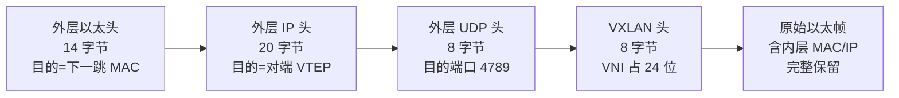
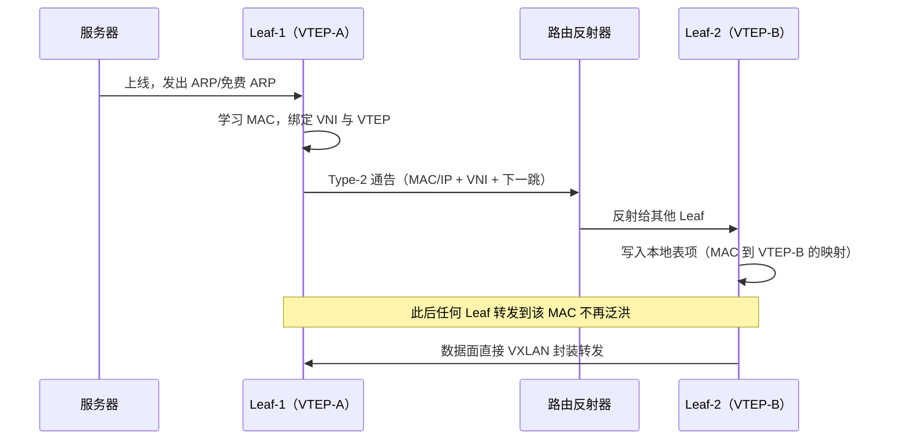
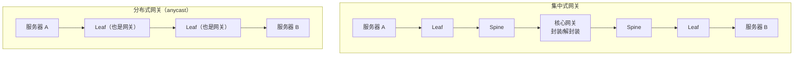

# 02 Overlay 与 EVPN（精讲）

> JD 原文点名"EVPN-VXLAN"。这一册是技术面**权重最高**的部分，也是最容易被追问到第四层的地方。
> 目标：能画出封装结构、能口述五类路由、能解释集中式与分布式网关的差别、能算清 MTU。

## 分层标记说明

| 标记 | 含义 | 面试要求 |
|---|---|---|
| 【核心】 | 答不出即被判定"不懂 Overlay" | 脱稿 90 秒 + 扛住追问 |
| 【支撑】 | 显著提升专业度 | 知道结论与取舍 |
| 【细节】 | 问到概率约 20% | 知道在哪查 |

**本册学习时长**：核心 55 分钟 / 全部 95 分钟。

## 目录

- [[#1 为什么需要 Overlay|1 为什么需要 Overlay]]
- [[#2 VXLAN 封装逐字段拆解|2 VXLAN 封装拆解]]
- [[#3 VTEP 与转发流程|3 VTEP 与转发流程]]
- [[#4 EVPN：把学习搬到控制面|4 EVPN]]
- [[#5 集中式网关与分布式网关|5 网关形态对比]]
- [[#6 对称 IRB 与非对称 IRB|6 IRB 两种模式]]
- [[#7 多租户隔离：VRF、RD 与 RT|7 多租户隔离]]
- [[#8 大包不通：MTU 排障|8 MTU 排障]]
- [[#9 Overlay 在智算场景的边界|9 智算场景边界]]
- [[#10 本册速记卡|10 本册速记卡]]

---

## 1 为什么需要 Overlay

### 1.1 一句话结论

【核心】**Overlay 不是"为了新技术而新技术"，而是为了解决物理网络的三个硬约束：VLAN 数量上限、二层域范围、租户隔离。**

### 1.2 三个硬约束

【核心】

| 约束 | 具体数字/事实 | 造成的业务问题 |
|---|---|---|
| VLAN 上限 4094 | 12 位 VLAN ID 的理论上限 | 云平台一个租户要几十个网段，几千租户直接爆表 |
| 二层域范围 | 二层网络靠泛洪与 MAC 学习，规模越大广播越多 | 虚拟机迁移范围受限；广播风暴风险随规模放大 |
| 租户隔离 | 物理网络只有一张转发表 | 无法在"一张物理网"上跑"多张逻辑网" |

### 1.3 解决思路（一句话）

【核心】把"逻辑网络"从物理网络中解耦出来：**物理层只负责 IP 可达（underlay），逻辑层用隧道封装出任意多的虚拟网络（overlay）**。这样加一个租户不再需要动物理网络。

**类比（对客户讲）**：Underlay 是城市道路，Overlay 是快递信封上的"楼层+房间号"。道路不需要为每个房间修一条专线，只要信封写清楚地址，快递员（VTEP）就能送到。

---

## 2 VXLAN 封装逐字段拆解

### 2.1 一句话结论

【核心】**VXLAN 做的事情只有一件：把原始以太帧整个塞进一个 UDP 报文里，用 24 位 VNI 标识它属于哪个虚拟网络。**

### 2.2 图：封装结构（从外到内）

### 2.3 关键字段与数字

【核心】

| 字段 | 长度 | 作用 | 面试要点 |
|---|---|---|---|
| 外层目的 MAC | 6 B | 指向下一跳设备的 MAC | 由 underlay 路由决定，与内层无关 |
| 外层 IP | 20 B | 源/目的 VTEP 地址 | 这是 VXLAN 能跨三层的原因 |
| UDP 目的端口 | 2 B | 默认 4789 | 用于 ECMP 哈希因子；RoCEv2 用 4791 |
| VXLAN 头 | 8 B | 含 24 位 VNI + 保留位 | **24 位 = 约 1600 万网段** |
| 内层原始帧 | 可变 | 客户真实流量 | 内层 MTU 受外层开销挤压 |

### 2.4 必须记住的那笔账

【核心】**外层开销 = 14 + 20 + 8 + 8 = 50 字节。**

由此推出两条铁律：

1. Underlay 的 MTU 必须 ≥ 内层 MTU + 50。
2. 若服务器用默认 1500，则 underlay 至少要 1550；工程上统一配 9000（巨帧）以留余量。

**这条账是所有"大包不通"故障的根源**，见 [[#8 大包不通：MTU 排障|§8]]。

### 2.5 常见误解（面试陷阱）

【支撑】

- 误解一："VXLAN 是加密隧道" → 不是。VXLAN 无加密，需要加密要叠加 MACsec 或 IPsec。
- 误解二："VNI 就是 VLAN 的升级版，一一对应" → 不是。VNI 与 VLAN 可以多对多映射，映射关系由网关或 VTEP 配置决定。
- 误解三："VXLAN 需要专门的硬件" → 现代交换芯片早已硬件转发，性能损失主要在封装后的报文变大导致的带宽占用（约 3.3% 于 1500 字节报文）。

---

## 3 VTEP 与转发流程

### 3.1 一句话结论

【核心】**VTEP（隧道端点）是 Overlay 的"海关"：进去封装、出来解封装。VTEP 放在哪，决定了整个网络的性能与成本结构。**

### 3.2 VTEP 的三种位置（选型判断）

【核心】

| 位置 | 优势 | 劣势 | 适用 |
|---|---|---|---|
| 集中在核心/网关 | 接入设备简单、成本低 | 所有跨网段流量绕行核心，东西向时延高 | 早期方案、南北向为主 |
| 分布在 Leaf（推荐） | 流量就近封装、东西向一跳直达 | 每台 Leaf 都要支持 Overlay | 当前主流 |
| 在服务器（软件 VTEP） | 与虚拟化平台解耦 | 消耗服务器 CPU、性能受限 | 特定云平台 |

### 3.3 首包与后续包（控制面 vs 数据面）

【核心】理解"第一次怎么找到对端"是理解 EVPN 价值的钥匙：

- **泛洪学习模式（flood-and-learn）**：不知道目的 MAC 在哪 → 向整个 VNI 泛洪 → 收到回应后学到 MAC-VTEP 映射。问题：泛洪量大、收敛慢、规模大时不可接受。
- **控制面模式（EVPN）**：由 BGP 提前把"MAC/IP 在哪个 VTEP"通告给所有 Leaf → 转发时直接命中，**根本不泛洪**。

---

## 4 EVPN：把学习搬到控制面

### 4.1 一句话结论

【核心】**EVPN 的本质是：用 BGP 当"通讯录"，把 MAC/ARP 学习从数据面泛洪搬到控制面通告。**

### 4.2 五类路由（这张表必须能背）

【核心】

| 类型 | 名称 | 解决什么 | 记法 |
|---|---|---|---|
| Type 1 | 以太自动发现路由（A-D） | 快速收敛、多归链路（multi-homing）的指定转发者选举与别名 | "发现" |
| Type 2 | MAC/IP 通告路由 | 发布某 MAC/IP 挂在哪个 VTEP；支撑 ARP 抑制 | "找人"——最常用 |
| Type 3 | 包含组播以太标签路由（IMET） | 告诉别人"广播/未知单播/组播该往哪些 VTEP 发" | "广播名单" |
| Type 4 | 以太段路由 | 多归场景下选出唯一指定转发者（DF），防重复 | "选主" |
| Type 5 | IP 前缀路由 | 发布网段路由，支撑 L3 对称 IRB 与外部互联 | "报网段" |

**记忆口诀**：一发现、二找人、三广播、四选主、五网段。

### 4.3 建路时序（画出这张图就赢了）

### 4.4 EVPN 相比泛洪学习的四个收益

【核心】

1. **抑制泛洪**：BUM 流量（广播/未知单播/组播）从"全网泛洪"变成"按需列表复制"。
2. **收敛更快**：控制面事件驱动，不必等泛洪老化。
3. **支持多活**：Type 1/4 支撑服务器双归两台 Leaf 同时转发。
4. **ARP 抑制**：网关代答 ARP，减少广播域内的 ARP 风暴。

**这四条就是"为什么 EVPN 成为云数据中心标准"的完整答案。**

---

## 5 集中式网关与分布式网关

### 5.1 一句话结论

【核心】**集中式网关把所有跨网段流量送到一台设备做路由，分布式网关让每台 Leaf 都能当网关——差别是"东西向流量要不要绕路"。**

### 5.2 图：流量路径对比

**关键差异（用一句话说清）**：集中式方案下，A 到 B 的流量要"上两个来回"；分布式方案下，一跳直达。**这就是"低时延"叙事的技术依据。**

### 5.3 分布式网关的两个实现要点

【核心】

- **同一个网关 IP 与 MAC 部署在所有 Leaf 上**（anycast 网关）：虚拟机迁移后网关地址不变，无需重新配置。
- **表项要同步**：MAC/IP 表、ARP 表通过 EVPN 在全网同步，保证任何一台 Leaf 都能直接回应。

### 5.4 代价（要说得出）

【支撑】分布式网关要求每台 Leaf 都具备完整的 L3 与 Overlay 能力 → 设备规格要求更高、配置更复杂、故障定位链路更长。**没有免费的午餐，这句话在任何架构取舍里都成立。**

---

## 6 对称 IRB 与非对称 IRB

### 6.1 一句话结论

【支撑】**对称 IRB：每一跳都做封装/解封装；非对称 IRB：首跳路由、末跳桥接。**

### 6.2 对比

【支撑】

| 维度 | 对称 IRB | 非对称 IRB |
|---|---|---|
| 转发方式 | 源 Leaf 路由 + 封装 → 目的 Leaf 解封装 + 路由 | 源 Leaf 路由 + 封装 → 目的 Leaf 直接桥接 |
| 表项要求 | 各 Leaf 只需本 VNI 的 ARP/MAC | 需要所有 VNI 的 ARP，规模大时不可行 |
| 扩展性 | 好，当前主流 | 差，受限于表项 |
| 适用 | 大规模多租户 | 小规模、早期部署 |

**判断句**："租户超过几百个、网段上千时，非对称 IRB 的 ARP 表会撑爆 Leaf，必须上对称 IRB。"

---

## 7 多租户隔离：VRF、RD 与 RT

### 7.1 一句话结论

【支撑】**隔离靠三件套：VRF 提供独立路由表，RD 让不同租户的相同网段不冲突，RT 决定路由发给谁。**

### 7.2 三件套分工

【支撑】

| 组件 | 作用 | 一句话记忆 |
|---|---|---|
| VRF（虚拟路由转发） | 单设备内多张独立路由表 | "一个租户一张表" |
| RD（路由区分符） | 给相同前缀加唯一前缀，避免冲突 | "同名不冲突的身份证" |
| RT（路由目标） | 控制路由的导入导出 | "谁能收到我的路由" |

**商业含义**：这套机制让"一张物理网卖多次"成为可能——这是云网络商业模型的技术底座。产品经理讲到这里，就从"技术"跨到了"商业"。

---

## 8 大包不通：MTU 排障

### 8.1 一句话结论

【核心】**80% 的"Overlay 上线后业务异常"，根因是 MTU 没有为 50 字节开销留出空间。**

### 8.2 典型症状（能对上号就说明你真见过）

【核心】

- `ping` 小包通、大包不通
- TCP 三次握手成功，但一传大文件就卡死或极慢
- SSH 能登录，但执行输出多的命令会断
- 监控上看不到丢包，因为丢在隧道封装后的外层

### 8.3 算例

【核心】服务器 MTU 9000 → 封装后外层报文 9050 → 若 underlay 某段链路 MTU 仍为 1500，则该报文被丢弃或被分片（IPv4 可分片但性能极差，IPv6 直接丢弃）。

**正确配置**：全路径 underlay MTU ≥ 9050（工程上常统一 9216），且服务器与网关一致。

### 8.4 排查顺序

【支撑】

1. 确认服务器网卡 MTU、容器/虚拟化层 MTU
2. 确认 VTEP 接口 MTU
3. 逐跳确认 underlay 链路 MTU（含 DCI 与防火墙段落）
4. 用带 DF 标志位的大包 ping 验证（不分片）

---

## 9 Overlay 在智算场景的边界

### 9.1 一句话结论

【支撑】**VXLAN 在通算云里是标配，在 AI 训练面里往往被"简化甚至不用"——原因是封装开销、哈希行为与无损参数会互相干扰。**

### 9.2 三个具体影响

【支撑】

1. **封装增加报文长度**，影响无损网络的缓存与 PFC 门限计算。
2. **外层 UDP 端口变化**会改变 ECMP 哈希分布，需与负载均衡策略统一设计。
3. **多租户隔离**在训练面常用 VRF 或独立物理平面替代，追求确定性而非灵活性。

### 9.3 技术演进方向（知道名字即可）

【细节】VXLAN-GPO（Generic Protocol Extension，支持更多载荷类型与更精确的拥塞标记）、SRv6（分段路由，用 IPv6 扩展头做路径编程，部分厂商在 DCI 与云网协同场景推广）。

---

## 10 本册速记卡

【核心】

| 序 | 一句话 |
|---|---|
| 1 | Overlay 解决三件事：VLAN 数量、二层范围、租户隔离 |
| 2 | 封装开销 50 字节 = 14+20+8+8 |
| 3 | VNI 24 位，约 1600 万网段 |
| 4 | UDP 目的端口 4789，RoCEv2 是 4791 |
| 5 | 五类路由：一发现、二找人、三广播、四选主、五网段 |
| 6 | EVPN 四收益：抑泛洪、快收敛、多活、ARP 抑制 |
| 7 | 分布式网关 = 网关在每台 Leaf，东西向一跳直达 |
| 8 | 对称 IRB 才撑得住大规模多租户 |
| 9 | 隔离三件套：VRF 表、RD 防冲突、RT 控传播 |
| 10 | 大包不通先查 MTU，underlay ≥ 内层 + 50 |

---

## 11 自测入口

本册对应题库模块：**PM-B（Overlay 与架构演进）**。
快速验证见[[10-三天冲刺手册#4 组卷方案与评分规则|冲刺手册的组卷方案]]；彻底查漏见[[20-题库-技术类#模块 PM-B Overlay 与架构演进（B-001 ~ B-030）|PM-B 题库]]。
