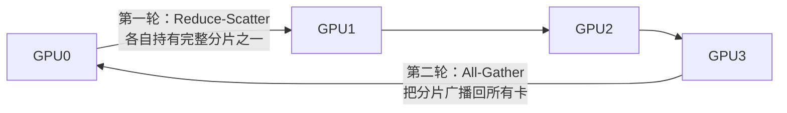
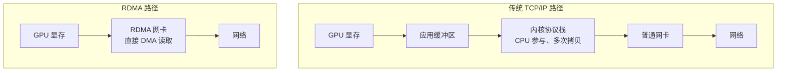
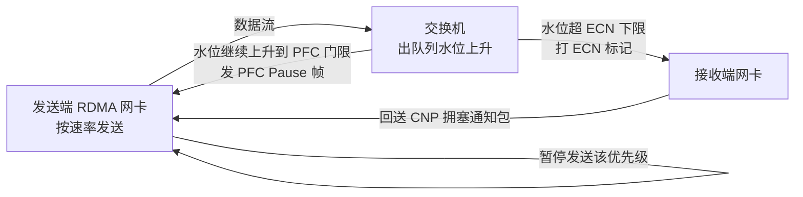
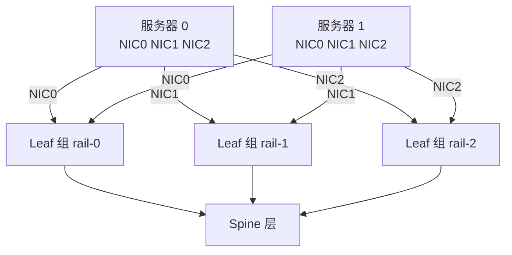
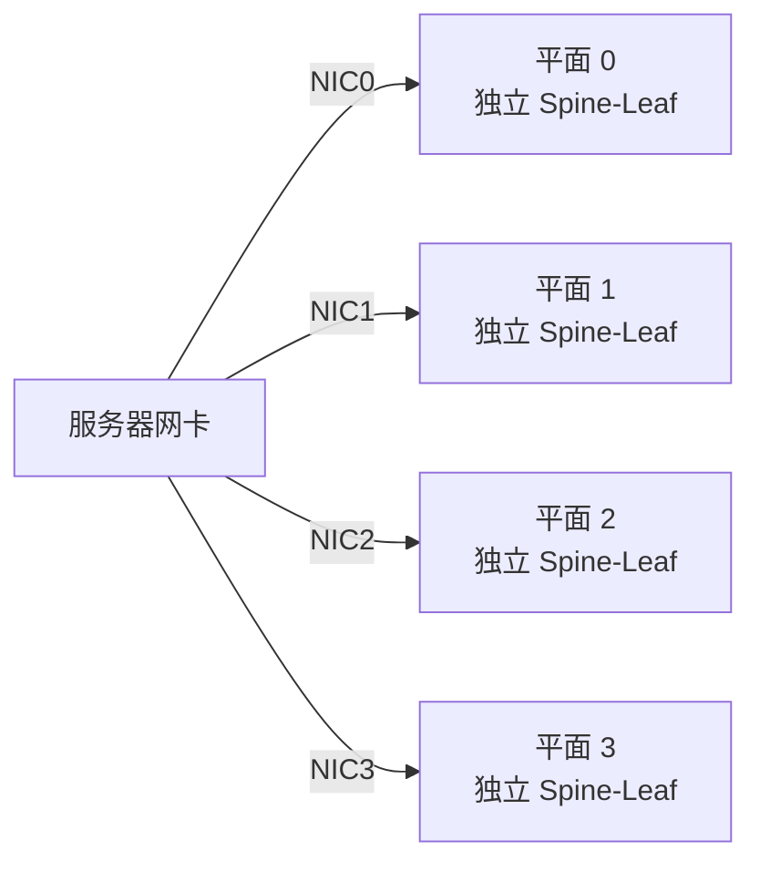
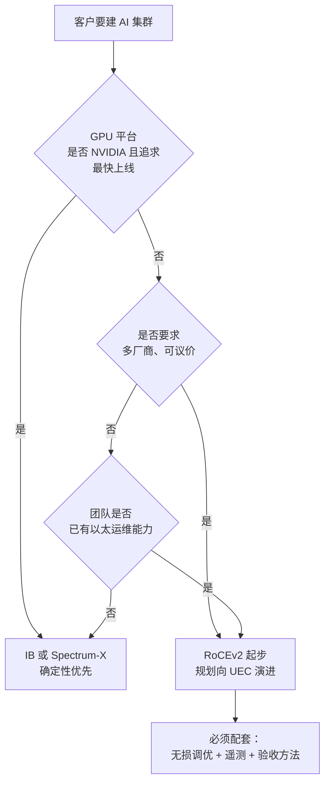
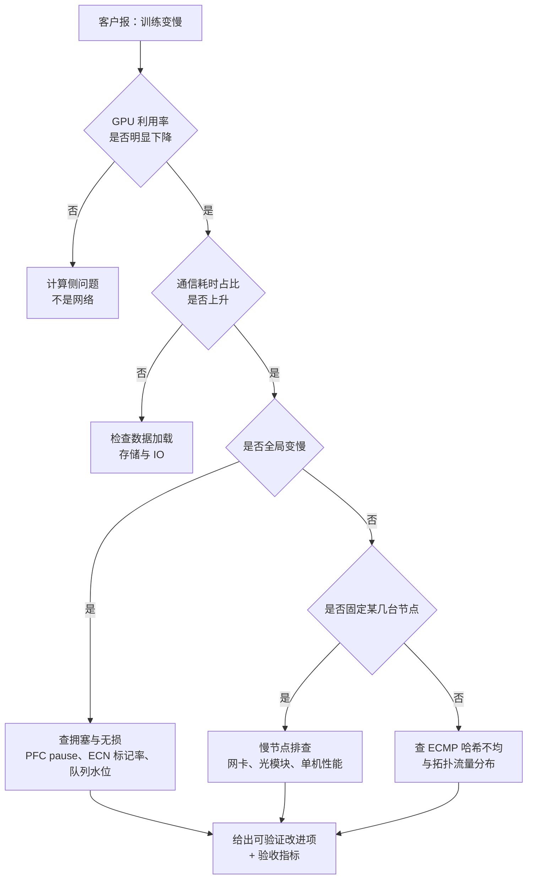

# 03 智算网络与无损以太（精讲）

> **这一册是这份 JD 的分水岭。** 传统 DC 知识谁都能背，智算网络答不出来，就会被判定为"上一代网络的产品经理"。
> 目标：能讲清"为什么 AI 需要另一种网络"，能画出无损闭环，能比较 IB 与以太并给出选型建议。

## 分层标记说明

| 标记 | 含义 | 面试要求 |
|---|---|---|
| 【核心】 | 答不出即被判定"不懂智算" | 脱稿 90 秒 + 扛住追问 |
| 【支撑】 | 显著提升专业度 | 知道结论与取舍 |
| 【细节】 | 问到概率约 20% | 知道在哪查 |

**本册学习时长**：核心 80 分钟 / 全部 120 分钟。

## 目录

- [[#1 为什么 AI 训练需要另一种网络|1 为什么需要另一种网络]]
- [[#2 RDMA：绕开内核的直取|2 RDMA 原理]]
- [[#3 RoCEv2 无损三件套|3 无损三件套]]
- [[#4 PFC 的四个风险|4 PFC 四风险]]
- [[#5 拓扑：胖树、轨对齐与多平面|5 拓扑设计]]
- [[#6 负载均衡的三代演进|6 负载均衡演进]]
- [[#7 IB、RoCEv2 与 UEC 的选型|7 三种路线选型]]
- [[#8 UEC 与 UET 的机制|8 UEC 机制]]
- [[#9 三网分离|9 三网分离]]
- [[#10 训练慢怎么定位|10 训练慢定位]]
- [[#11 智算产品与通算产品的功能差异|11 产品差异]]
- [[#12 本册速记卡|12 本册速记卡]]

---

## 1 为什么 AI 训练需要另一种网络

### 1.1 一句话结论

【核心】**因为 AI 训练考核的是"最慢那一次同步完成得多快"，而不是"平均带宽用了多少"。** 这一个指标差异，推翻了整个通算网络的设计假设。

### 1.2 三个关键概念（必须能解释）

【核心】

| 概念 | 全称 | 含义 | 为什么重要 |
|---|---|---|---|
| 集合通信 | collective communication | 多卡之间同步梯度/参数的通信模式 | 训练的必经步骤，占训练时间 20%–50% |
| JCT | Job Completion Time，任务完成时间 | 整个训练任务从开始到结束的耗时 | **客户真正付费购买的指标** |
| MFU | Model FLOPs Utilization，模型算力利用率 | 实际算力 ÷ 峰值算力 | 网络差 → 卡等数据 → MFU 掉 |

### 1.3 AllReduce 是怎么跑的

【核心】以 Ring AllReduce 为例，分两个阶段：

- **Reduce-Scatter 阶段**：把数据切成 N 份，沿环传递并累加，最终每张卡持有其中一份的完整结果。
- **All-Gather 阶段**：每个分片再沿环绕一圈，所有卡都拿到全部结果。

**关键洞察（能说出来就赢了）**：Ring 算法下，**任何一张卡的慢，都会拖慢整个环**。所以 AI 网络不是"平均主义"网络，而是"最慢者决定上限"的网络。这就是为什么：

- 尾时延比平均时延重要一个数量级
- 一条 PFC pause 帧的影响面是整条环，而不是一条流
- 一个"慢节点"（straggler）能让整个集群的 MFU 掉一半

### 1.4 流量特征（与传统云的对照）

【核心】

| 特征 | 通算云业务 | AI 训练 |
|---|---|---|
| 方向 | 南北向为主 | 东西向 90% 以上 |
| 流形态 | 大量中小流 | 少量大象流 + 同步突发 |
| 关注指标 | 平均带宽、连接数 | 尾时延、JCT |
| 突发性 | 中等 | 极强（incast，多打一） |
| 容错 | 重传可接受 | 重传代价极高（拖慢整环） |
| 调度 | 尽力而为 | 需要确定性 |

---

## 2 RDMA：绕开内核的直取

### 2.1 一句话结论

【核心】**RDMA 让一台机器的网卡直接读写另一台机器的内存（对 AI 而言是显存），不经过 CPU、不拷贝数据、不进入内核协议栈。**

### 2.2 图：两条路径的差别

### 2.3 三个收益与两个前提

【核心】

**收益**：

1. **时延低**：省掉内核处理与内存拷贝，端到端从数十微秒降到个位微秒。
2. **CPU 占用低**：CPU 不参与数据搬运，可以把核留给业务。
3. **吞吐高**：零拷贝 + 大消息，接近线速。

**前提（面试常考）**：

1. **必须无损**：RDMA 的可靠性依赖"不丢包"，一旦丢包重传代价远高于 TCP（这也是为什么需要 PFC/ECN）。
2. **必须提前注册内存**：内存区域（Memory Region）需向网卡注册并锁定，属于"预先约定"模型。

### 2.4 两种实现路线

【支撑】

- **InfiniBand（IB）**：专用网络，链路层自带信用流控，原生无损。
- **RoCEv2**：在标准以太网上承载 RDMA，靠 PFC + ECN + DCQCN 人为造出"无损"。**成本低、可复用现有以太运维，但无损是"配出来的"，不是"天生"的。**

---

## 3 RoCEv2 无损三件套

### 3.1 一句话结论

【核心】**PFC 是刹车、ECN 是提前松油门、DCQCN 是发动机自己降功率。三者缺一，无损网络就只能在"丢包"与"死锁"之间二选一。**

### 3.2 闭环图（必须能白板画）

### 3.3 三个机制的分工（背这张表）

【核心】

| 机制 | 标准 | 作用点 | 触发条件 | 作用 | 副作用 |
|---|---|---|---|---|---|
| PFC | IEEE 802.1Qbb | 链路级、逐跳 | 端口缓存超过 xoff 门限 | 发暂停帧，让对方停发指定优先级 | 队头阻塞、死锁、风暴 |
| ECN | RFC 3168 | 网络层标记 | 队列超过最小门限 | 在报文上打标记，通知端侧降速 | 门限设置不当会误伤或失效 |
| DCQCN | 厂商/联盟算法 | 端到端 | 收到 CNP 或标记 | 网卡侧调整发送速率 | 参数需实测调优 |

### 3.4 参数与调优逻辑（知道原理，不要背数值）

【支撑】

- **PFC xoff/xon 门限**：xoff 要留出足够缓冲，使"暂停帧到达前已经发出的报文"不至于溢出；xon 要避免频繁抖动。
- **ECN 最小/最大门限**：min 太低会误标（本来不拥塞也降速），太高会来不及（等标记时已经丢包）。
- **DCQCN 加性增、乘性减**：类似 TCP 的 AIMD，但时间尺度是微秒级。

**面试安全答法**："这些参数没有通用最优值，取决于端口速率、缓存大小、流量模型与线缆时延，必须用真实业务流量做闭环调优，并给出可复现的验收指标。"——这句话比背任何数值都专业。

---

## 4 PFC 的四个风险

【核心】这是智算网络面试的必答题，四个风险都要能展开一句。

| 风险 | 机理 | 表现 | 对策 |
|---|---|---|---|
| 队头阻塞（HOL） | PFC 按优先级暂停，同优先级内所有流一起停 | 一条拥塞流拖死无关业务 | 精细 QoS 分级、按业务分优先级、避免单优先级承载多业务 |
| PFC 死锁 | 环路或缓存分配不当，暂停帧互相等待 | 整片网络流量归零，且不自动恢复 | 无环设计、PFC 看门狗（watchdog）自动恢复、缓存水线规划 |
| PFC 风暴 | 暂停帧逐跳扩散，反压传播到全网 | 大面积性能骤降 | 限制反压范围、按端口隔离、监控 pause 帧速率 |
| 参数难调 | xoff/xon、ECN、缓存三者强耦合 | 调好一个坏另一个 | 自动化调优工具、模板化配置、实测验收 |

**加分表述**："PFC 的问题是它用'停'来解决拥塞，而'停'会传染。所以业界的下一代方向是**不用 PFC 也能无损**——这正是 UEC 要解决的问题。"这句话直接把你的认知拉到 2026 年的水位。

---

## 5 拓扑：胖树、轨对齐与多平面

### 5.1 三种拓扑的定位

【核心】

| 拓扑 | 结构 | 优势 | 代价 | 适用 |
|---|---|---|---|---|
| 标准胖树（fat-tree） | 两级 Spine-Leaf | 通用、运维熟悉 | 集合通信跨多跳、哈希易不均 | 中小规模、通用训练 |
| 轨对齐（rail-optimized） | 同序号网卡接同一组 Leaf | 同轨通信一跳直达，降低跳数与哈希压力 | 布线复杂、Leaf 数量随网卡数增长 | 大规模 GPU 集群主流 |
| 多平面（multi-plane） | 2 或 4 个物理独立平面 | 单平面故障只损失部分带宽；天然分流 | 光模块与端口成本成倍增加 | 万卡级、追求可用性 |

### 5.2 图：轨对齐拓扑

**为什么有效（一句话）**：集合通信的对称性使得同轨 GPU 之间流量最大，把它们放在同一 Leaf 下，等于把最大流量变成"一跳"，同时避免了跨 Spine 的哈希不均。

### 5.3 图：多平面

**价值**：平面之间物理隔离，单平面故障只降带宽不中断训练；同时天然提供 4 倍等价路径，缓解哈希不均。

---

## 6 负载均衡的三代演进

### 6.1 一句话结论

【核心】**AI 流量把"按流哈希"这个用了二十年的方法逼到了尽头，因为大象流一撞车，整条链路的带宽就废了。**

### 6.2 三代技术对照

【核心】

| 代际 | 方法 | 原理 | 局限 |
|---|---|---|---|
| 第一代 | ECMP 按流哈希 | 五元组哈希选一条路径 | 大象流撞车（polarization），多路径利用率低 |
| 第二代 | 动态负载均衡（DLB） | 按链路实时负载调整分流，可让同一流换路径 | 换路径引入乱序，需端侧容忍 |
| 第三代 | 逐包喷洒（packet spray） | 每个包独立选路，充分打散 | 强乱序，必须端侧重组（UEC 网卡能力） |

### 6.3 关键取舍（面试可直接用）

【支撑】

- 通算业务怕乱序（TCP 会误判丢包而降速），所以只能用第一/二代。
- AI 训练用 RDMA，网卡具备乱序重组能力，才能用第三代。
- **"能不能用包喷射"取决于网卡，不取决于交换机**——这是判断客户方案是否成熟的关键问题。

---

## 7 IB、RoCEv2 与 UEC 的选型

### 7.1 一句话结论

【核心】**IB 买的是确定性，RoCEv2 买的是成本与生态，UEC 买的是未来。** 面试时给判断依据，不要给结论。

### 7.2 三方对比

【核心】

| 维度 | InfiniBand | RoCEv2（以太） | UEC / UET（以太） |
|---|---|---|---|
| 无损机制 | 链路层信用流控，原生无损 | PFC + ECN + DCQCN，配置出来 | NSCC + RCCC + LLR + CBFC，可不依赖 PFC |
| 多路径 | 自适应路由 | 按流 ECMP，可加 DLB/喷洒 | 逐包喷洒 + 乱序原生支持 |
| 重传 | 链路级 | 窗口式，代价高 | 按包选择性重传 |
| 网内计算 | SHARP（网内归约） | 依赖厂商方案 | 演进中 |
| 生态 | 单一厂商主导 | 多厂商、开放 | 多厂商、开放，网卡生态待成熟 |
| 成本 | 高 | 中 | 中（长期目标更低） |
| 运维 | 专用工具链 | 复用现有以太体系 | 复用 + 新遥测 |

### 7.3 选型决策树

**面试加分句**："我的建议不是选协议，而是选**可验证的性能承诺**。无论 IB 还是以太，都要在客户的真实模型上跑一次 AllReduce 线性度测试，把结果写进合同附件。"

---

## 8 UEC 与 UET 的机制

### 8.1 一句话结论

【支撑】**UEC 想做的事：在标准以太网上，做出 IB 级的确定性，同时保留多厂商与低成本。**

### 8.2 核心机制（六个名词，一句话一个）

【支撑】

| 机制 | 全称 | 作用 |
|---|---|---|
| UET | Ultra Ethernet Transport | 无连接 RDMA 传输层，替代 RoCEv2 的传输语义 |
| 逐包喷洒 | packet spraying | 一个消息的包分散到所有可用路径 |
| 乱序交付 | out-of-order delivery | 网络允许乱序，网卡负责重组 |
| 选择性重传 | selective retransmission | 只重传丢失的包，不重传整个窗口 |
| NSCC | Network-Signaled Congestion Control | 发送端依据网络信令（时延、ECN、裁剪包）调速 |
| LLR | Link Layer Retry | 链路层逐跳重传，把丢包屏蔽在传输层之外 |
| CBFC | Credit-Based Flow Control | 基于信用的流控，替代 PFC 暂停 |

### 8.3 进展与落地瓶颈

【支撑】

- 规范：1.0 于 2025 年 6 月发布，后续有 1.0.x 维护版本 `[待核实：以官网为准]`
- 生态：已有开关芯片与测试仪表完成线速互通验证 `[待核实]`
- **瓶颈在网卡侧**：没有支持 UET 的网卡，交换机能力再强也用不上

**产品判断（可直接讲）**："交换机的产品定义应该做**能力预留 + 平滑演进**：先具备喷洒友好转发、乱序容忍、细粒度遥测，等网卡生态成熟时，同一个硬件平台可以通过软件升级支持，而不是让客户换整机。"

### 8.4 相邻动向（知道即可）

【细节】开放计算项目（OCP）下的 ESUN 与 SUE-T 工作流，把以太推进到机柜内加速器互联（scale-up）领域，与 NVLink 形成竞争。这决定未来"柜内互联是否也会以太化"。

---

## 9 三网分离

### 9.1 一句话结论

【支撑】**智算中心的网络不是一个网，而是三张网：参数面、数据面、业务面。** 混在一起是外行方案。

### 9.2 三张网的职责

【支撑】

| 网络 | 承载 | 关键要求 | 典型带宽 |
|---|---|---|---|
| 参数面（训练网） | 梯度同步、集合通信 | 极低尾时延、无损、可预测 | 400G/800G 起 |
| 数据面（存储网） | 训练数据读取、checkpoint 写入 | 大带宽、稳定吞吐 | 100G/200G/400G |
| 业务面（管理网） | 调度、监控、镜像分发、带外管理 | 可靠、易运维 | 10G/25G/100G |

**为什么必须分离**：checkpoint 写入的突发流量如果和梯度同步共用一张网，会直接破坏无损参数与尾时延。**这是"方案级"的认知，比懂协议更值钱。**

---

## 10 训练慢怎么定位

### 10.1 一句话结论

【核心】**先分清是"算得慢"还是"等得慢"，再分是"网络丢"还是"网络堵"，最后分是"全局"还是"个别节点"。**

### 10.2 决策树（面试可直接照着讲）

### 10.3 四个必查指标（记下来）

【核心】

| 指标 | 阈值判断 | 说明 |
|---|---|---|
| PFC pause 帧速率与持续时长 | 持续增长即为异常 | 反压是否在扩散 |
| ECN 标记率 | 过高说明长期拥塞，为 0 说明门限过高 | 拥塞是否被正确感知 |
| 队列水位分布 | 少数端口满、多数空闲 = 哈希不均 | 是否负载不均 |
| NCCL 线性度 | 规模翻倍而带宽不翻倍 = 扩展性问题 | 集合通信效率 |

---

## 11 智算产品与通算产品的功能差异

### 11.1 一句话结论

【支撑】**智算产品不是"更快的通算产品"，它多了一整套"确定性"能力。**

### 11.2 差异清单（做产品规划时用）

【支撑】

| 能力 | 通算产品 | 智算产品 |
|---|---|---|
| 无损 | 可选 | 必需，且要一键配置与自愈 |
| 负载均衡 | ECMP | ECMP + DLB/喷洒 |
| 遥测 | 秒级 | 微秒级、逐包/逐流 |
| 拓扑管理 | 手工 | 自动化布线校验、轨对齐规划 |
| 故障恢复 | 分钟级可接受 | 秒级，且要能隔离慢节点 |
| 验收方法 | 带宽测试 | AllReduce 线性度、JCT 对比 |
| 交付形态 | 单机 | 方案（含调优服务） |

**产品经理的关键判断**：智算客户买的不是交换机，是"训练能跑满"。所以产品交付物必须包含**验收方法与调优服务**，这直接对应 JD 里"提升客户信任度"。

---

## 12 本册速记卡

【核心】

| 序 | 一句话 |
|---|---|
| 1 | AI 网络考核 JCT 与尾时延，不是平均带宽 |
| 2 | Ring AllReduce 里最慢一卡决定整环 |
| 3 | RDMA = 内核旁路 + 零拷贝 + 内存预注册 |
| 4 | PFC 是刹车，ECN 提前松油门，DCQCN 自己降功率 |
| 5 | PFC 四风险：队头阻塞、死锁、风暴、难调 |
| 6 | 轨对齐让最大流量变一跳 |
| 7 | 多平面 = 4 倍等价路径 + 故障只降带宽 |
| 8 | 包喷射能不能用，取决于网卡不是交换机 |
| 9 | IB 买确定性，RoCEv2 买成本，UEC 买未来 |
| 10 | 三网分离：参数面、数据面、业务面 |
| 11 | 四个必查：PFC 时长、ECN 标记率、队列分布、NCCL 线性度 |
| 12 | 智算卖的是"训练能跑满"，不是盒子 |

---

## 13 自测入口

本册对应题库模块：**PM-C（智算网络与无损以太）**，是题库中权重最高的模块。
快速验证见[[10-三天冲刺手册#4 组卷方案与评分规则|冲刺手册的组卷方案]]；彻底查漏见[[20-题库-技术类#模块 PM-C 智算网络与无损以太（C-001 ~ C-035）|PM-C 题库]]。
