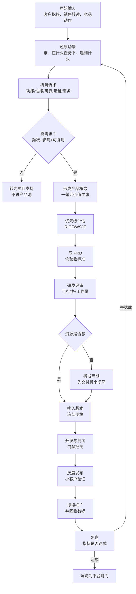
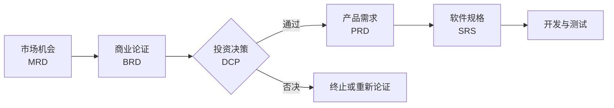
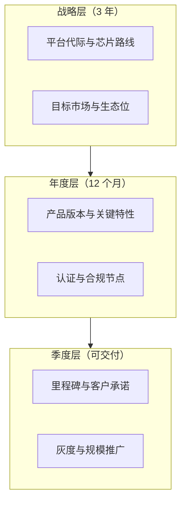
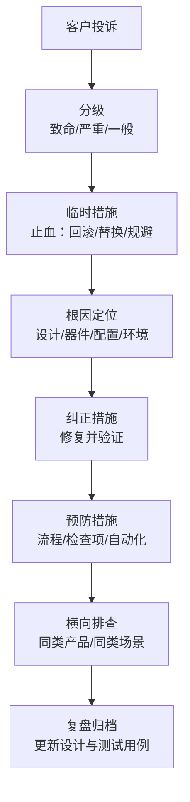
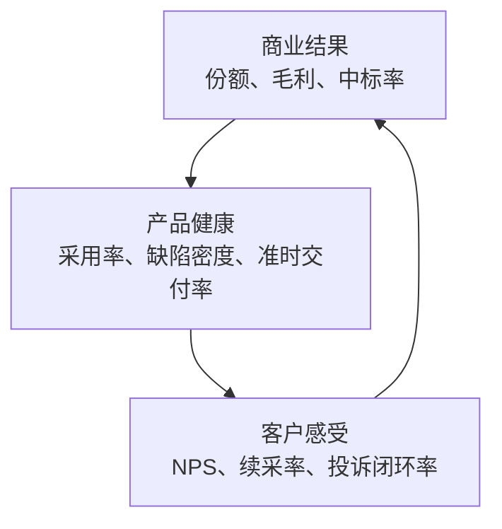

# 04 产品方法论（精讲）

> JD 里"产品思维"四个字，拆开是三件事：**懂需求、能落地、善迭代**。
> 本册给的是可执行的流程与判据，不是概念。技术强、产品弱，是这类岗位最常见的落选原因。

## 分层标记说明

| 标记 | 含义 |
|---|---|
| 【核心】 | 答不出即被判定"没有方法论" |
| 【支撑】 | 显著提升专业度 |
| 【细节】 | 问到概率约 20% |

**本册学习时长**：核心 65 分钟 / 全部 110 分钟。

## 目录

- [[#1 产品经理的三类产出|1 三类产出]]
- [[#2 需求处理全流程|2 需求处理全流程]]
- [[#3 需求真伪判据与痛点四问|3 真伪判据]]
- [[#4 文档体系：MRD、BRD、PRD、SRS|4 文档体系]]
- [[#5 PRD 的质量判据|5 PRD 质量判据]]
- [[#6 优先级：四个框架与算例|6 优先级框架]]
- [[#7 DC 产品特有的四条取舍轴|7 四条取舍轴]]
- [[#8 Roadmap 三层与承诺管理|8 Roadmap 与承诺]]
- [[#9 IPD 体系与评审点|9 IPD 体系]]
- [[#10 研发协同与交付门禁|10 交付门禁]]
- [[#11 质量问题闭环|11 质量问题闭环]]
- [[#12 上市与生命周期|12 上市与生命周期]]
- [[#13 指标树|13 指标树]]
- [[#14 本册速记卡|14 本册速记卡]]

---

## 1 产品经理的三类产出

### 1.1 一句话结论

【核心】**产品经理的产出不是文档，是三类判断：做什么、先做哪个、做成什么样。**

### 1.2 三类判断与对应证据

【核心】

| 判断类型 | 问题 | 需要的证据 | 输出去向 |
|---|---|---|---|
| 要不要做 | 这个需求值不值得投入 | 客户频次、损失量化、可复用性 | 需求池决策 |
| 先做哪个 | 资源有限时怎么排 | RICE/WSJF、战略权重、竞争窗口 | Roadmap |
| 做成什么样 | 边界与验收标准 | 场景、指标、竞品基线 | PRD 与验收标准 |

**面试价值**：任何"你怎么做产品"的开放问题，都可以用这三类判断搭骨架，避免答成流水账。

---

## 2 需求处理全流程

### 2.1 图：从客户抱怨到版本上线

### 2.2 流程里三个最容易漏的动作

【核心】

1. **还原场景**：不还原场景，就会把客户给的"方案"当成"需求"。
2. **约定验收标准**：没有阈值的要求，交付时必然扯皮。
3. **回收数据**：不做这一步，产品经理就永远在凭感觉做下一个版本。

---

## 3 需求真伪判据与痛点四问

### 3.1 真伪判据（四道闸）

【核心】一个诉求要同时通过四道闸，才算产品需求：

| 闸门 | 判据 | 不通过则 |
|---|---|---|
| 频次 | 是否有多个客户/多次出现 | 单客户一次性 = 项目需求 |
| 影响 | 是否造成可量化损失（停机时长、订单金额） | 说不清损失 = 优先级靠后 |
| 可复用 | 能否抽象为通用能力 | 只能硬编码 = 定制，走项目 |
| 可实现 | 是否突破现有架构且无替代方案 | 需重做平台 = 进下一代规划 |

### 3.2 痛点四问（访谈提问清单）

【核心】

1. 这个问题多久发生一次？
2. 发生的时候影响多少业务？（量化到钱或时长）
3. 你们现在怎么绕过去的？绕过的成本是多少？
4. 如果明天就解决，你愿意为此多付多少（或接受多少溢价）？

**第 3 问最关键**：客户现有的"绕行方案"就是他的真实支付意愿证明。没有绕行方案的痛点，通常不是真痛点。

### 3.3 常用分析工具

【支撑】

- **JTBD（Jobs To Be Done，任务化视角）**：客户"雇佣"产品去完成什么任务。交换机的任务通常是"把训练跑完""把变更做安全""把故障查清楚"。
- **KANO 模型**：基本型（没有会被骂）、期望型（越多越满意）、兴奋型（超预期）。DC 产品里"稳定转发"是基本型，"一键无损调优"是兴奋型。
- **5 Why**：连续追问五层，穿透到根因。注意问"为什么"时要问事实，不要问猜测。

---

## 4 文档体系：MRD、BRD、PRD、SRS

### 4.1 一句话结论

【核心】**四份文档不是四个模板，是四个不同的读者、四个不同的问题。**

### 4.2 图：文档流

### 4.3 四份文档的边界

【核心】

| 文档 | 回答的问题 | 读者 | 关键内容 | 不写什么 |
|---|---|---|---|---|
| MRD（市场需求文档） | 市场要不要、为谁做、凭什么赢 | 产品线、管理层 | 市场机会、目标客户、竞争态势、差异化假设 | 不写具体功能细节 |
| BRD（商业需求文档） | 投多少、赚多少、风险多大 | 决策层 | 投入产出、盈亏平衡点、风险与对策 | 不写技术方案 |
| PRD（产品需求文档） | 做成什么样、怎么验收 | 研发、测试 | 场景、功能、性能指标、约束、验收标准 | 不写代码级设计 |
| SRS（软件需求规格） | 代码怎么写 | 开发 | 接口、状态机、异常分支、数据结构 | 不重复商业论证 |

**面试常考的坑**："MRD 和 PRD 有什么区别？"——答"一个偏市场一个偏功能"太浅，要答"**读者不同导致决策对象不同：MRD 决定要不要投，PRD 决定做什么样**"。

---

## 5 PRD 的质量判据

### 5.1 一句话结论

【核心】**一条需求如果不能让测试写出用例、不能让研发估出工作量，它就是不合格的需求。**

### 5.2 必备八要素

【核心】

1. 背景与目标（为什么要做，对应哪个客户/市场）
2. 用户与场景（谁、在什么条件下用）
3. 功能描述（正常流 + 异常流 + 边界条件）
4. 性能与容量指标（可测的数字）
5. 兼容与标准符合性（与既有版本、标准协议的关系）
6. 依赖与约束（芯片能力、上游器件、其他团队）
7. 风险与对策
8. 验收标准

### 5.3 验收标准的三段式写法

【核心】`给定条件 → 操作 → 期望结果 + 阈值`

**反例**："支持大规模 EVPN 部署"——无法验收。
**正例**："在 200 台 Leaf、5000 个 VNI 的拓扑下，单 Leaf 重启后，全网 MAC 表收敛时间 ≤ 3 秒，业务丢包 ≤ 10 个报文。"

**为什么这条重要**：DC 产品的验收标准往往是投标承诺的一部分，写得模糊等于给自己埋雷。

### 5.4 需求描述的三层粒度

【支撑】

- 史诗（Epic）：一个客户场景，如"智算集群无损开局"
- 特性（Feature）：可独立交付的能力，如"PFC 一键配置与自愈"
- 故事（Story）：可在一到两周内完成的切片，如"PFC 门限自动推荐"

**粒度价值**：对客户讲史诗（价值），对研发排特性（里程碑），对测试拆故事（用例）。

---

## 6 优先级：四个框架与算例

### 6.1 框架对照

【核心】

| 框架 | 公式/逻辑 | 适用 | 风险 |
|---|---|---|---|
| RICE | （触达 × 影响 × 信心）÷ 投入 | 需求池排序 | 参数主观，容易"调参凑结论" |
| WSJF | 延迟成本 ÷ 工作量 | 敏捷团队排期 | 延迟成本难量化 |
| KANO | 基本/期望/兴奋分类 | 功能取舍与资源倾斜 | 分类依赖调研质量 |
| MoSCoW | 必须有/应该有/可以有/这次不做 | 版本范围锁定 | 容易变成"都要" |

### 6.2 RICE 算例（要能现场算）

【核心】需求 A：影响 40 个客户/季，影响强度 2（高），信心 80%，投入 8 人周
→ RICE = (40 × 2 × 0.8) ÷ 8 = **8.0**

需求 B：影响 10 个客户/季，影响强度 3（极高），信心 50%，投入 3 人周
→ RICE = (10 × 3 × 0.5) ÷ 3 = **5.0**

**结论**：A 优先。但要注意一个反直觉的判断——如果 B 是某个战略客户的准入条件（不做就丢标），则**战略权重应当覆盖 RICE 结果**。这句话说出来，说明你懂框架的边界。

### 6.3 WSJF 算例

【支撑】延迟成本 = 业务价值 + 时间紧迫性 + 风险降低与机会开启。
需求 C：延迟成本 8，工作量 4 → WSJF = 2.0
需求 D：延迟成本 6，工作量 5 → WSJF = 1.2
→ C 优先。

### 6.4 一条经验法则

【支撑】"**先做会丢单的，再做会加分的，最后做会好看的。**" 这三类分别对应：竞品已具备而我方缺失（丢单）、客户明确要求但非强制（加分）、内部提案的体验优化（好看）。

---

## 7 DC 产品特有的四条取舍轴

### 7.1 一句话结论

【核心】**通用产品方法论只管"价值与成本"，DC 产品还必须处理"平台与定制、稳定与新颖"的结构性矛盾。**

### 7.2 四条轴

【核心】

| 取舍轴 | 两端 | 判据 | 典型错误 |
|---|---|---|---|
| 标准产品 vs 客户定制 | 摊薄成本 / 拿单能力 | 能否抽象为平台能力；定制是否可被第二个客户复用 | 为大客户改架构，导致主线延期一年 |
| 平台化 vs 单点最优 | 长期成本低 / 单场景性能好 | 场景差异是否在接口层可隔离 | 每个场景一套代码，维护成本爆炸 |
| 功能广度 vs 稳定优先 | 卖点多 / 回归风险低 | 客户类型：互联网敢试新，金融运营商怕风险 | 为赶标把未验证特性推给保守客户 |
| 短期交付 vs 架构债 | 当期收入 / 下一代成本 | 是否影响下一代平台兼容性 | 老单板被迫兼容，芯片升级被拖住 |

### 7.3 回答模板（任何取舍题都能用）

【支撑】**选 A → 依据是 X → 我放弃了 B 的收益 Y → 补偿方案是 Z。**

只说选了 A 不说放弃什么，会被判定为思考不完整。

---

## 8 Roadmap 三层与承诺管理

### 8.1 图：三层结构

### 8.2 Now / Next / Later 表达法

【核心】

| 区间 | 承诺强度 | 对客户怎么说 |
|---|---|---|
| Now（本季度） | 可承诺日期 | "X 月版本交付，已排入研发计划" |
| Next（本年度） | 方向确定、日期待定 | "方向已定，具体版本随下次评审确认" |
| Later（明年及以后） | 探索性 | "在路线图上，取决于芯片与客户需求" |

### 8.3 承诺管理（最容易翻车）

【核心】**必须区分"对客户的承诺版本"与"内部目标版本"，两者混用必然失信。**

- 承诺版本：经过研发确认、有资源保障、可写进合同
- 内部目标：争取达成，不对外承诺
- 一旦承诺就必须交付，宁可缩小范围也不要延期——**范围可谈，日期不可谈**，这是客户信任的底线

**与 JD 的对应**：JD 写"提升客户对于我司产品的信任"，落地动作就是这条纪律。

### 8.4 Roadmap 的必备附件

【支撑】一页"本版本不做什么及原因"。它比 Roadmap 本身更能体现判断力，也能提前挡住销售的不合理承诺。

---

## 9 IPD 体系与评审点

### 9.1 一句话结论

【支撑】**IPD（集成产品开发）是把"产品成功"从个人能力变成组织流程的方法，国内网络厂商普遍采用。**

### 9.2 六阶段

【支撑】

### 9.3 两类评审点（面试提到即加分）

【支撑】

| 类型 | 名称 | 作用 | 谁参加 |
|---|---|---|---|
| DCP | 决策评审点（Decision Check Point） | 投资决策：继续/调整/终止 | 高层投资决策团队 |
| TR | 技术评审点（Technical Review） | 技术把关：方案是否可进入下一阶段 | 技术专家、研发、测试 |

**典型节点**：DCP1 概念决策 → DCP2 计划决策 → DCP3 发布决策；TR1–TR6 覆盖需求、方案、设计、样机、验证、转产。

### 9.4 $APPEALS 需求分析八维度

【支撑】用于结构化拆解客户需求，避免遗漏维度：

| 维度 | 中文 | 在 DC 产品中的具体化 |
|---|---|---|
| $ Price | 价格 | 单端口成本、TCO |
| A vailability | 可获得性 | 交期、供货稳定性 |
| P ackaging | 包装 | 形态（框式/盒式）、配置灵活性 |
| P erformance | 性能 | 容量、时延、无损能力 |
| E ase of use | 易用性 | 开局自动化、配置复杂度 |
| A ssurance | 保证 | 可靠性、服务响应、SLA |
| L ife cycle cost | 生命周期成本 | 功耗、空间、升级成本、EOL 支持 |
| S ocial acceptance | 社会接受度 | 国产化、合规、品牌 |

**用法**：客户访谈后按八维度打钩，缺失维度就是下一轮要问的问题。

---

## 10 研发协同与交付门禁

### 10.1 图：六道门

### 10.2 每道门的关键问题

【支撑】

| 门 | 关键问题 | 谁能否决 |
|---|---|---|
| 需求评审 | 场景是否清楚、验收是否可测 | 产品与架构 |
| 规格冻结 | 变更是否走变更流程 | 产品 |
| 设计评审 | 是否满足性能与可靠性指标 | 架构与测试 |
| 测试准入 | 用例覆盖是否足够、环境是否就绪 | 测试 |
| 转产验证 | 工艺与物料是否稳定 | 制造与供应链 |
| 发布评审 | 遗留缺陷是否可接受、回滚方案是否有 | 产品质量 |

### 10.3 跨部门语言翻译

【支撑】

| 对象 | 他关心什么 | 你该说什么 |
|---|---|---|
| 研发 | 技术可行、工作量、架构一致性 | 约束、边界、优先级 |
| 测试 | 可验证性、回归成本 | 验收标准、影响面 |
| 市场 | 卖点、竞品对比 | 价值主张、差异化 |
| 销售/售前 | 能否答标、交付周期 | 配置、报价、承诺边界 |
| 供应链 | 交期、器件风险 | 需求预测、替代方案 |

---

## 11 质量问题闭环

### 11.1 图：从客户投诉到预防

### 11.2 三个必答要点

【核心】

1. **先止血再定位**：客户现场第一优先级是恢复业务，不是查清原因。
2. **根因要分类**：设计缺陷、器件批次、配置错误、环境因素，四类的改进动作完全不同。
3. **必须横向排查**：同一个根因往往存在于多个型号，只修一个客户是治标。

**与 JD 的对应**：JD 写"解决客户核心关注（交付、质量问题）"，这段必须有真实案例，且要能说出**你推动了哪个流程改进**，而不只是"我协调修复了"。

---

## 12 上市与生命周期

### 12.1 图：生命周期四阶段

### 12.2 GTM 七件套

【支撑】

1. 目标客户与场景（先打谁）
2. 价值主张（FAB：特性-优势-利益）
3. 竞争定位（跟谁比、比什么）
4. 定价与配置（门槛配置 + 溢价项）
5. 样板点与 POC 方案（怎么证明）
6. 渠道与销售赋能（谁来卖、怎么讲）
7. 度量（怎么判断上市成功）

### 12.3 EOL 的三个里程碑

【支撑】

| 里程碑 | 含义 | 客户影响 |
|---|---|---|
| EOM（停止生产） | 不再制造 | 只能买库存 |
| EOS（停止销售） | 不再接受订单 | 必须选替代型号 |
| EOL（停止支持） | 不再提供补丁与服务 | 安全与合规风险 |

**产品经理的纪律**：提前 12 个月以上通知，同步给出替代机型与迁移方案。通知不足会直接引发客户投诉，也会毁掉"信任度"这条 JD 要求。

### 12.4 POC 的设计要点

【支撑】POC 不是演示，是**一次预先约定判据的考试**：

1. 先定验证清单：要证明哪 3 个指标
2. 再定测试拓扑与流量模型（必须贴近客户真实业务）
3. 约定通过标准与判定人
4. 约定失败后的处理（是调整方案还是退出）

---

## 13 指标树

### 13.1 图：三层指标

### 13.2 指标清单与用途

【支撑】

| 层 | 指标 | 全称 | 用来判断什么 |
|---|---|---|---|
| 商业 | 中标率 | win rate | 竞争力强弱 |
| 商业 | 毛利率 | gross margin | 定价与成本控制是否合理 |
| 产品 | 特性采用率 | adoption | 功能是否被真实使用 |
| 产品 | 缺陷密度 | defect density | 质量投入是否足够 |
| 产品 | 准时交付率 | OTD，On-Time Delivery | 承诺管理是否有效 |
| 产品 | 平均修复时长 | MTTR | 服务能力 |
| 客户 | 净推荐值 | NPS | 口碑与复购潜力 |

**面试用法**：不要罗列指标，要说"我用哪个指标判断这个功能成不成功"，例如"PFC 一键配置"的成败指标是**开通工时下降比例**与**无损相关工单数量下降**。

---

## 14 本册速记卡

【核心】

| 序 | 一句话 |
|---|---|
| 1 | 产品经理的产出是三类判断：做不做、先做谁、做成什么样 |
| 2 | 四道闸判真伪：频次、影响、可复用、可实现 |
| 3 | 痛点四问的第三问最狠：你现在怎么绕过去的 |
| 4 | MRD 决定投不投，PRD 决定做成什么样 |
| 5 | 验收标准三段式：条件 → 操作 → 结果+阈值 |
| 6 | RICE = 触达×影响×信心 ÷ 投入，战略权重可覆盖结果 |
| 7 | 先做会丢单的，再做会加分的，最后做会好看的 |
| 8 | 范围可谈，日期不可谈 |
| 9 | IPD 六阶段 + DCP 决策 + TR 技术把关 |
| 10 | 质量问题：先止血、再分类根因、必须横向排查 |
| 11 | EOL 提前 12 个月通知，配迁移方案 |
| 12 | POC 是预先约定判据的考试，不是演示 |

---

## 15 自测入口

本册对应题库模块：**PM-D（产品方法论与需求工程）**。
快速验证见[[10-三天冲刺手册#4 组卷方案与评分规则|冲刺手册的组卷方案]]；彻底查漏见[[21-题库-产品业务行为类#模块 PM-D 产品方法论（D-001 ~ D-030）|PM-D 题库]]。
