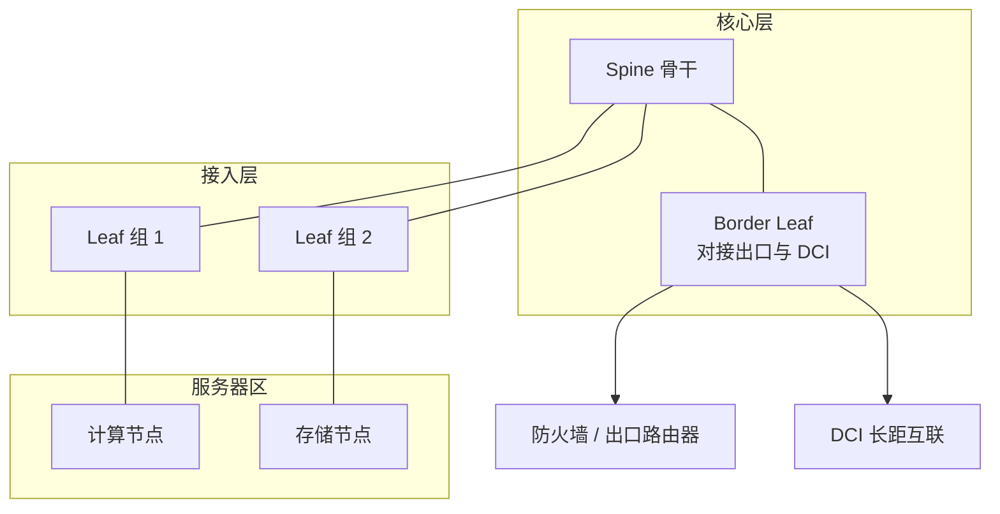
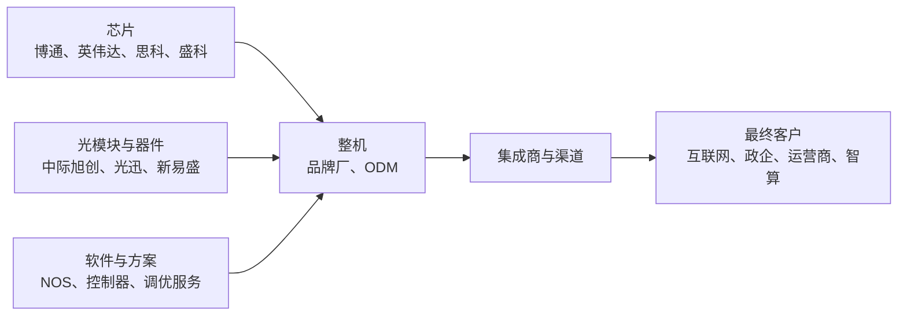
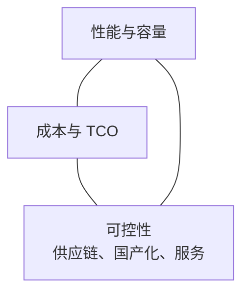
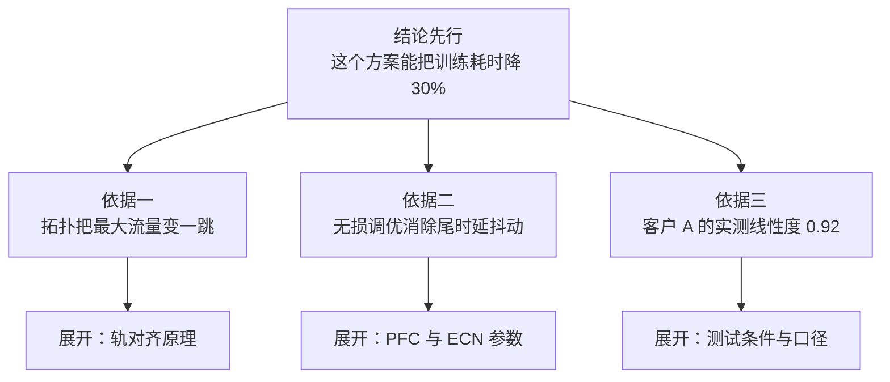
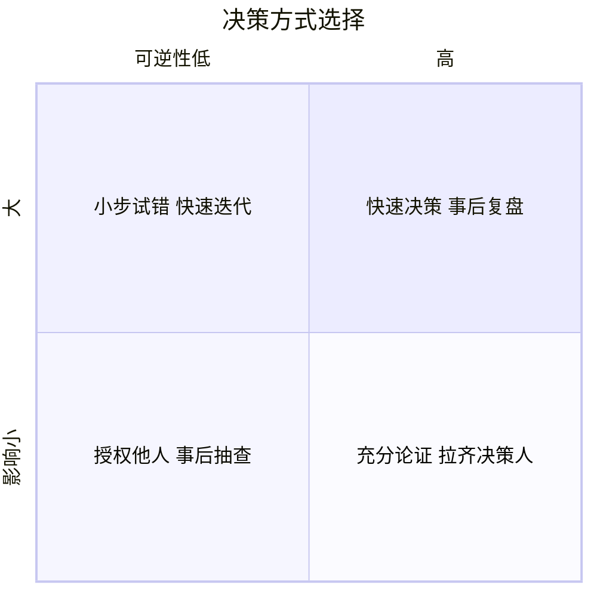

# 05 场景生态与软技能（精讲）

> JD 的后半段几乎全在这里：懂场景、知生态、会协同、能表达、抗压、学习。
> 技术可以突击，这一册决定面试官"喜不喜欢跟你一起干活"。

## 分层标记说明

| 标记 | 含义 |
|---|---|
| 【核心】 | 答不出即被判定"不懂客户" |
| 【支撑】 | 显著提升专业度 |
| 【细节】 | 问到概率约 20% |

**本册学习时长**：核心 50 分钟 / 全部 85 分钟。

## 目录

- [[#1 六类客户的决策链差异|1 客户决策链]]
- [[#2 三种组网形态|2 组网形态]]
- [[#3 产业链地图与生态位|3 产业链]]
- [[#4 竞品定位三角与竞争话术|4 竞品定位]]
- [[#5 商业模式与销售通路|5 商业模式]]
- [[#6 技术表达：金字塔与三套讲法|6 技术表达]]
- [[#7 STAR 案例骨架|7 STAR 骨架]]
- [[#8 跨部门冲突处理|8 冲突处理]]
- [[#9 抗压与决策：可逆性矩阵|9 决策矩阵]]
- [[#10 学习力与信息源|10 学习力]]
- [[#11 本册速记卡|11 本册速记卡]]

---

## 1 六类客户的决策链差异

### 1.1 一句话结论

【核心】**同样是"要一台交换机"，六类客户的决策人、验证方式、付钱逻辑完全不同。答不出差异，等于告诉对方你只会讲产品参数。**

### 1.2 对照表（背这张）

【核心】

| 客户 | 决策人 | 验证方式 | 付钱逻辑 | 一句话痛点 |
|---|---|---|---|---|
| 互联网/云 | 技术负责人 + 采购 | 实验室实测 + 灰度上线 | 每端口成本、规模效应 | 交付速度与自动化 |
| 智算中心 | 技术委员会 + 业务方 | 真实模型跑线性度 | 训练效率折算 | 卡等数据，MFU 上不去 |
| 政企/政务云 | 集成商 + 甲方信息中心 | 招标评分 + 资质审查 | 预算与合规 | 出了问题谁负责 |
| 金融 | 科技部 + 风险合规 | 长周期验证 + 双活演练 | 风险规避 | 变更不能出事 |
| 运营商 | 集团集采 + 省公司 | 入网测试 + 互通测试 | 集采价格与供货能力 | 标准符合性与规模交付 |
| 超算/科研 | 项目组 + 专家组 | 基准测试 + 论文级验证 | 项目经费 | 极致性能与定制 |

### 1.3 一句话差异（面试直接答）

【核心】**互联网客户问"你能不能更便宜更快"，政企客户问"你能不能不出事"，智算客户问"你能不能让我训练跑满"。** 三句话对应三种产品定义方式。

---

## 2 三种组网形态

### 2.1 图：一个典型 DC 的完整网络

### 2.2 三个区域的职责与选型

【核心】

| 区域 | 职责 | 关键要求 | 典型产品形态 |
|---|---|---|---|
| Spine 核心 | 提供全互联与高密上行 | 大容量、高可靠、可演进 | 框式或高密盒式 |
| Leaf 接入 | 服务器接入与网关 | 端口密度、Overlay 能力、缓存 | 盒式 |
| Border Leaf | 对接出口、DCI、安全设备 | 策略能力、多 VRF、接口灵活性 | 盒式或框式 |
| 带外管理网 | 设备管理与远程运维 | 独立、简单、可靠 | 低端盒式 |

### 2.3 DCI 与多 AZ

【支撑】

- **DCI（数据中心互联）**：跨机房延伸，方案有裸纤 + DWDM、相干光 ZR/ZR+ 直连、EVPN 多域对接
- **多 AZ**：同城 1–2 ms 时延内做双活，关键约束是"跨 AZ 的二层延伸范围"与"控制面一致性"
- **边界安全**：防火墙旁挂（流量绕行但解耦）与串联（路径短但引入单点）的取舍

### 2.4 智算场景专用：三网分离

【支撑】参数面（训练）、数据面（存储）、业务面（管理）三张物理或逻辑独立的网络，详见智算精讲册。**面试提这一条，等于告诉对方你做过真实智算方案。**

---

## 3 产业链地图与生态位

### 3.1 图：五个环节

### 3.2 每个环节的话语权

【支撑】

| 环节 | 谁有话语权 | 对产品经理的影响 |
|---|---|---|
| 芯片 | 少数厂商垄断高端 | 交期与功能开放度直接约束 Roadmap |
| 光模块 | 成本占比上升、产能波动大 | 影响毛利结构与交付承诺 |
| 整机 | 品牌厂与 ODM 竞争 | 白盒化压缩硬件毛利 |
| 软件与方案 | 差异化主战场 | 价值与溢价的主要来源 |
| 集成商 | 掌握政企客户关系 | 渠道政策与赋能材料决定落地效率 |

### 3.3 标准组织（记住名字与各管什么）

【细节】

| 组织 | 管什么 |
|---|---|
| IEEE | 以太网物理层与链路层标准（含 PFC、链路聚合） |
| IETF | 路由与 Overlay 协议（BGP、EVPN、VXLAN 的 RFC） |
| OCP | 开放硬件与 SONiC 生态 |
| OIF | 光互连与电接口规范 |
| UEC | AI/HPC 以太网传输栈 |
| ODCC | 国内开放数据中心标准与评测 |

---

## 4 竞品定位三角与竞争话术

### 4.1 图：三角定位

### 4.2 三家典型打法的差异（点到为止，不贬低）

【支撑】

| 类型 | 强项 | 软肋 | 我方应对 |
|---|---|---|---|
| 国际头部（思科、Arista） | 生态完整、软件成熟 | 价格高、国产化受限 | 打 TCO 与本地服务响应 |
| 国内头部（华为、新华三） | 全栈方案、自研芯片 | 客户担心单一供应商锁定 | 打开放性与多厂商互通 |
| 白盒/ODM | 价格极低 | 服务与方案能力弱 | 打方案交付与售后保障 |
| GPU 生态方（英伟达） | 与算力绑定、性能背书 | 成本高、封闭 | 打多厂商与成本 |

### 4.3 竞争话术的三步结构

【支撑】

1. **承认对方强项**（建立可信度）
2. **把战场换到我方强项**（重设评价标准）
3. **用可验证指标锁死**（把争论变成测试）

示例："对方单机容量确实更高。但在客户 1:3 收敛比的实际部署下，真正的约束是上行利用率与哈希效率。我们可以用同一套流量模型跑一次对比，把结果写进 POC 报告。"

---

## 5 商业模式与销售通路

### 5.1 收入结构

【支撑】

| 来源 | 特点 | 趋势 |
|---|---|---|
| 硬件 | 一次性、毛利承压 | 白盒化下持续下行 |
| 软件授权 | 高毛利、可续费 | 控制器、分析平台是增长点 |
| 服务 | 稳定、黏性强 | 调优与验收服务在智算场景价值高 |
| 方案捆绑 | 提升客单价 | 从卖盒子到卖能力 |

### 5.2 通路差异

【支撑】

- **直销**：互联网大客户、智算项目，需要产品经理直接参与方案与 POC
- **渠道**：政企与区域市场，产品经理的产出是"赋能材料"（对标表、报价配置、话术）

### 5.3 定价三法

【支撑】

| 方法 | 逻辑 | 适用 |
|---|---|---|
| 成本加成 | 成本 + 目标毛利 | 标准化产品 |
| 竞争定价 | 对标竞品报价 | 同质化竞争、集采 |
| 价值定价 | 按客户收益比例定价 | 智算等收益可量化的场景 |

---

## 6 技术表达：金字塔与三套讲法

### 6.1 图：金字塔结构

### 6.2 三套讲法（同一件事，三种受众）

【核心】

| 受众 | 关心 | 讲法 | 例子（讲 VXLAN） |
|---|---|---|---|
| 客户业务方 | 有什么好处 | 场景 + 收益 | "虚拟机迁移不用改地址，业务不中断" |
| 客户技术方 | 怎么实现、有什么代价 | 原理 + 取舍 | "50 字节开销要求 MTU 提到 9000" |
| 研发 | 约束与边界 | 参数 + 限制 | "需要芯片支持 16M VNI 表项与硬件封装" |
| 管理层 | 钱与风险 | 投入产出 + 风险 | "这个特性可提升 3 个大客户的中标概率" |

### 6.3 降维技巧

【支撑】

- **类比要有边界**：说"VXLAN 像给信件套信封"之后，补一句"但信封会让信变厚，所以路要修宽一点（MTU）"，否则类比会误导
- **数字要少而准**：一次表达最多三个数字，多了记不住
- **白板优先**：能画就不要念。60 秒画出 Spine-Leaf，比讲十分钟有效

---

## 7 STAR 案例骨架

### 7.1 一句话结论

【核心】**面试不是让你讲经历，是让你证明判断力。一个案例讲 90 秒，四句话结构。**

### 7.2 骨架

【核心】

| 段 | 时长 | 内容 | 常见错误 |
|---|---|---|---|
| 背景 | 15 秒 | 客户/项目/规模，一句话 | 铺垫太长，讲了三分钟背景 |
| 冲突 | 20 秒 | 卡在哪：技术约束、资源冲突、客户施压 | 没有冲突，听起来很顺 |
| 判断 | 35 秒 | 你的依据 + 你放弃了什么 | 只说做了什么，不说为什么 |
| 结果 | 20 秒 | 可量化结果 + 代价/遗留 | 只讲成功，不讲代价 |

### 7.3 三个必备案例（必须提前写好）

【核心】

1. **技术判断案例**：在两种方案间做选择，用数据说服了研发或客户
2. **需求取舍案例**：拒绝或改造了一个客户需求，并保住了关系
3. **交付救火案例**：质量问题或进度危机中的处置与流程改进

**自检**：每个案例能否被追问三层而不崩？如果第三层答不上，说明你只记得结论，不记得过程。

### 7.4 反问清单（面试收尾用）

【支撑】

1. 这个岗位负责的产品线，未来 12 个月最重要的一个目标是？
2. 团队里产品经理与研发、市场的分工边界是怎样的？
3. 这个岗位的考核指标构成是什么？
4. 目前产品最大的短板，你们希望新人先解决哪一个？

第 4 问最加分——它展示你已经在用产品经理的方式思考。

---

## 8 跨部门冲突处理

### 8.1 四个高频冲突与解法

【支撑】

| 冲突 | 表面诉求 | 真实约束 | 解法 |
|---|---|---|---|
| 研发说"做不了" | 拒绝需求 | 架构限制或排期不足 | 先分清是"不能"还是"这期不能"，前者改方案，后者拆两期 |
| 测试说"回归量太大" | 不想测 | 用例覆盖与人力 | 用影响面分析缩小范围，给出风险接受人 |
| 销售说"客户明天要" | 立刻交付 | 客户内部节点压力 | 给可交付的最小可用版本 + 明确后续节奏 |
| 供应链说"器件 40 周" | 无法交付 | 物料长周期 | 提前锁料、给替代方案、调整承诺口径 |

### 8.2 三条原则

【支撑】

1. **把立场翻译成约束**：对方说"不行"，问"是哪一条约束导致不行"
2. **给选项不给问题**：向上汇报时带 2–3 个选项 + 推荐
3. **留下书面结论**：口头共识等于没有共识，尤其是跨部门承诺

---

## 9 抗压与决策：可逆性矩阵

### 9.1 图：四象限决策

若上图未渲染，用文字版：**高影响 + 不可逆 = 充分论证并拉齐决策人；高影响 + 可逆 = 小步试错快速迭代；低影响 + 不可逆 = 授权他人并抽查；低影响 + 可逆 = 快速决策事后复盘。**

### 9.2 抗压类问题的答法结构

【核心】"如果 KPI 要求你推一个你不认同的功能，怎么办？"

1. **先接受目标**：业绩是前提，不表演清高
2. **澄清目标**：KPI 想解决的是份额、毛利还是交付速度？手段与目标可能不匹配
3. **给替代方案**：用更低成本达成同一目标的路径
4. **若仍须执行**：明确风险、约定回退条件、留好记录

**禁忌**：直接说"我会坚持专业判断拒绝执行"，这会被判定为不懂组织。

### 9.3 情绪处理

【支撑】客户当众质疑产品时：先接情绪（"这个问题确实影响你们业务"）→ 再要事实（"能给我具体时间和现象吗"）→ 最后给承诺（"今天下班前给你初步结论"）。**不在会议上争对错。**

---

## 10 学习力与信息源

### 10.1 固定信息源（每周 1 小时）

【细节】

| 类型 | 具体来源 | 看什么 |
|---|---|---|
| 厂商 | 官网彩页、发布会、技术白皮书 | 规格演进与卖点话术 |
| 市场 | Dell'Oro、IDC 季度摘要 | 份额与增速方向 |
| 标准 | IETF 草案、UEC 官网、OCP 文档 | 协议走向 |
| 会议 | OFC、OCP Summit、国内行业峰会 | 光互连与架构趋势 |
| 客户 | 招标公告、中标结果 | 真实竞争格局与配置偏好 |

### 10.2 学习方法（输出倒逼）

【支撑】每周写半页笔记，固定三段式：**是什么 → 为什么现在重要 → 对我方产品意味着什么**。三段缺一段，说明你只是"看到"，没有"想通"。

### 10.3 面试前 72 小时的信息校准

【支撑】

1. 官网最新产品页与方案页（确认型号与规格口径）
2. 最近一次发布会或财报中的网络业务表述
3. 目标客户的公开招标与中标信息（判断主战场）
4. 行业媒体近三个月的深度稿（把握叙事热点）

---

## 11 本册速记卡

【核心】

| 序 | 一句话 |
|---|---|
| 1 | 互联网问便宜快，政企问不出事，智算问训练跑满 |
| 2 | Spine 核心、Leaf 接入、Border 对接出口与 DCI |
| 3 | 产业链五环节，价值正从硬件转向软件与方案 |
| 4 | 竞争话术三步：承认强项、重设战场、指标锁死 |
| 5 | 定价三法：成本加成、竞争定价、价值定价 |
| 6 | 同一件事三种讲法：收益、原理、约束 |
| 7 | STAR 四段：背景 15 秒、冲突 20 秒、判断 35 秒、结果 20 秒 |
| 8 | 冲突处理：把立场翻译成约束 |
| 9 | 可逆的快做，不可逆的多花时间验证 |
| 10 | 每周半页笔记：是什么、为什么重要、对产品意味着什么 |

---

## 12 自测入口

本册对应题库模块：[[21-题库-产品业务行为类#模块 PM-E 场景生态与竞品（E-001 ~ E-025）|PM-E]] 与 [[21-题库-产品业务行为类#模块 PM-F 行为与案例（F-001 ~ F-025）|PM-F]]。
行为题建议对着镜子或录音答，90 秒内讲完才算过。
