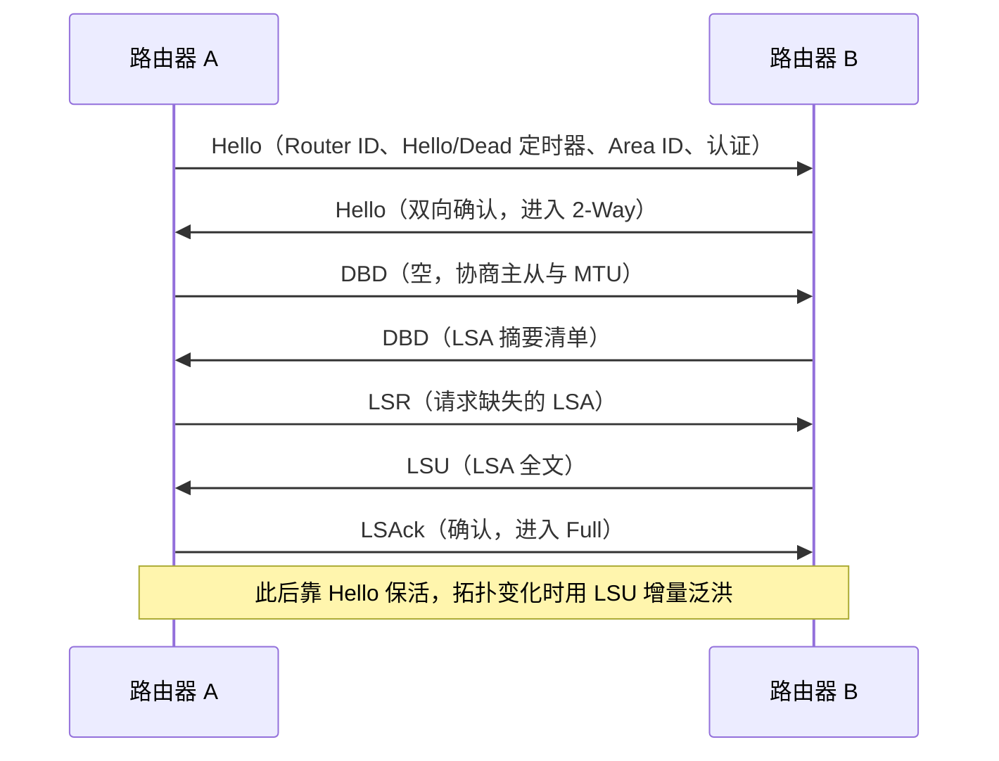
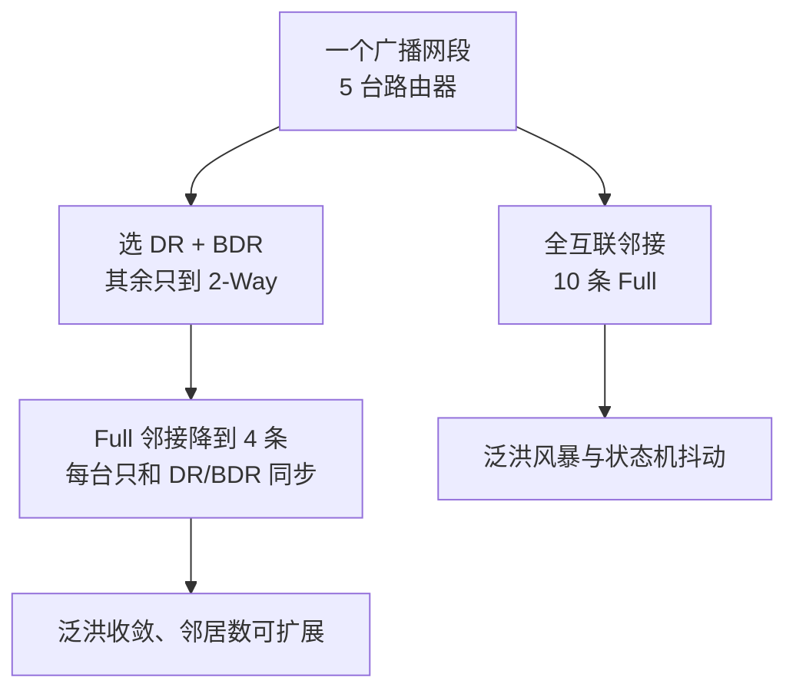
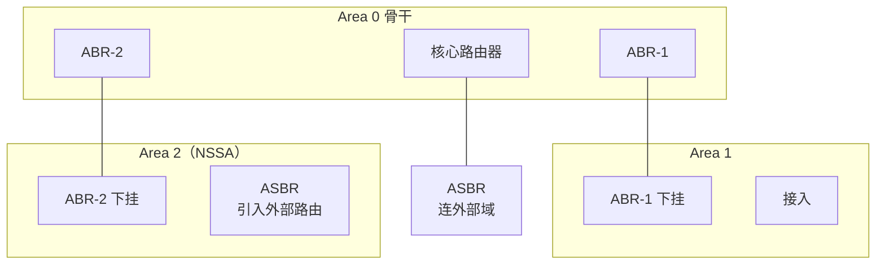
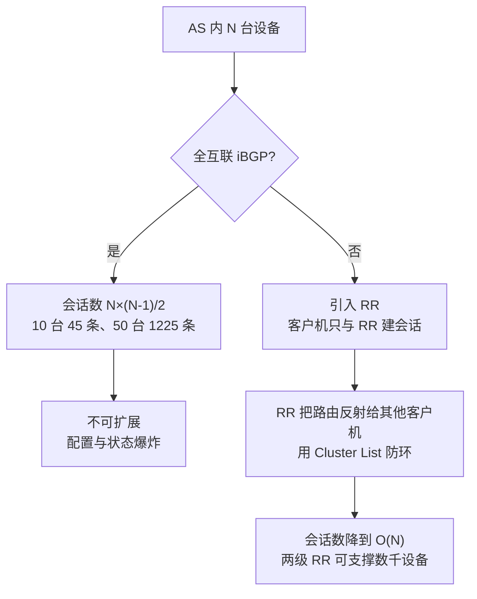
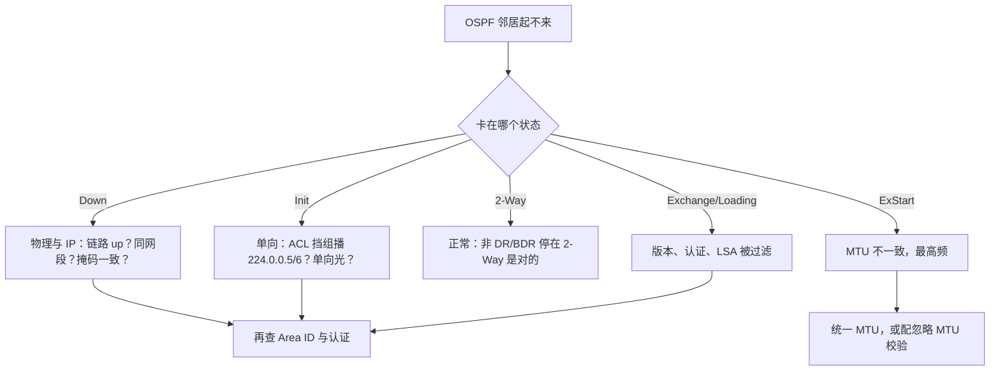
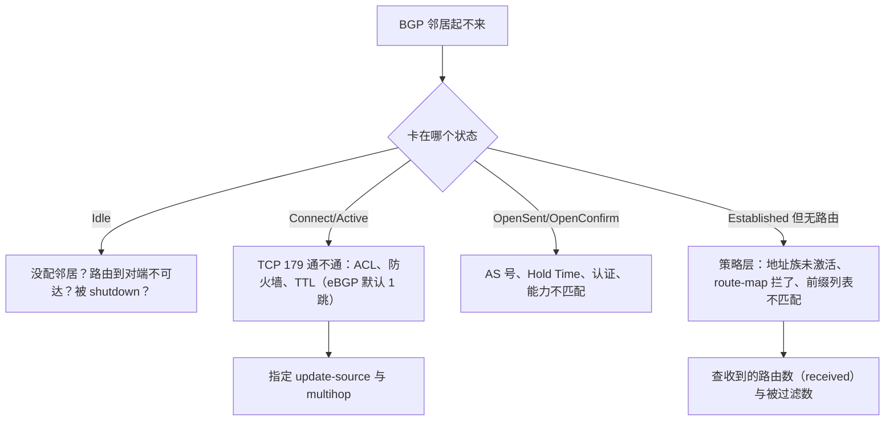

# 06 路由协议精讲：BGP 与 OSPF

> 本册解决一个问题：JD 写了「熟悉 BGP、OSPF、EVPN」，面试官追问到**报文和状态机**这一层时，你能不能接住，并且把它翻译成**产品语言**。
> 与 [[01-精讲-技术底座与架构#4 路由协议：为什么大 DC 用 BGP|01 册第 4 节]]的分工：那一节回答「**选谁**」，本册回答「**它怎么工作、参数落在产品哪里**」。

## 分层标记说明

| 标记 | 含义 | 面试要求 | 学习方式 |
|---|---|---|---|
| 【核心】 | 答不出即被判定"协议这块是空的" | 必须脱稿讲 60 秒 + 扛住一次追问 | 精读 + 复述 + 白板画 |
| 【支撑】 | 能显著提升专业度评分 | 知道结论与取舍，细节可模糊 | 读 + 记住结论句 |
| 【细节】 | 加分项，问到概率约 20% | 知道在哪查即可 | 扫读，留印象 |

**本册学习时长**：核心 55 分钟 / 全部 120 分钟（1.8 万字，7 张图）。

## 目录

- [[#1 为什么这一册单独存在|1 为什么单独成册]]
- [[#2 五个地基概念：先分清再谈协议|2 五个地基概念]]
- [[#3 OSPF：从邻居到路由|3 OSPF]]
- [[#4 BGP：从邻居到选路|4 BGP]]
- [[#5 对比总表|5 对比总表]]
- [[#6 产品经理视角：机制如何变成规格与功能|6 产品视角]]
- [[#7 排障：邻居起不来怎么分层查|7 排障决策树]]
- [[#8 二十道高频追问与答法|8 高频追问]]
- [[#9 本册速记卡|9 本册速记卡]]

---

## 1 为什么这一册单独存在

### 1.1 一句话结论

【核心】BGP 与 OSPF 在数据中心里的角色是**「把拓扑的连通性变成可计算的路径」**，一个是**策略驱动**（policy-driven，BGP），一个是**拓扑驱动**（topology-driven，OSPF）。产品经理不需要会敲配置，但必须能回答三件事：**为什么选它、它的短板靠什么补、它的参数变成了我们产品上的哪个功能项**。

### 1.2 JD 原话到本册的映射

【核心】

| JD 表述 | 面试官真实想验证的 | 本册对应 |
|---|---|---|
| 熟悉 BGP | 你知道它是路径向量协议、靠属性选路、天然防环，以及**大 DC 为什么用它** | [[#4 BGP：从邻居到选路\|§4]] |
| 熟悉 OSPF | 你知道它是链路状态协议、靠 SPF 算最短路，以及**它的扩展性天花板在哪** | [[#3 OSPF：从邻居到路由\|§3]] |
| 熟悉 EVPN | 你知道 EVPN 本质是**给 BGP 加了一族新的地址族**（AFI/SAFI 25），控制面复用了 BGP 的可靠性 | [[02-精讲-Overlay与EVPN#4 EVPN：把学习搬到控制面\|02 册第 4 节]] |
| 有数据中心网络经验 | 你能把协议参数和 SLA、升级窗口、规格表挂钩 | [[#6 产品经理视角：机制如何变成规格与功能\|§6]] |

**关键洞察**：EVPN 是跑在 BGP 上的。**BGP 不懂，EVPN 只能背结论**——比如"为什么 Leaf 之间要建 iBGP 全互联或 RR"，答案就在 [[#4.4 eBGP 与 iBGP：AS 内为什么要路由反射器|§4.4]]。

### 1.3 三档能力要求（不要越级投入）

【核心】

| 档位 | 要求 | 判定标准 | 投入 |
|---|---|---|---|
| 第一档（必须） | 说得出**取舍与代价** | 三句话讲清"为什么大 DC 用 eBGP 不用 OSPF" | 20 分钟 |
| 第二档（应该） | 说得出**机制骨架** | 能画状态机、能报出报文种类与 LSA 类型 | 40 分钟 |
| 第三档（不要求） | 敲得出配置 | 能配 route-map、调 Hello 定时器 | 不做，能读懂即可 |

**判断依据**：这是产品岗不是交付岗。第一档答不出直接淘汰；第二档答得好是加分；第三档在面试里**问到概率低于 10%**，且答错代价极高。

---

## 2 五个地基概念：先分清再谈协议

【核心】这一节是全册的地基。五个词分不清，后面的报文和状态机全是死记硬背。

### 2.1 控制面与转发面

【核心】**控制面（control plane）负责算路，转发面（forwarding plane）负责跑路**。协议的所有工作都只发生在控制面：邻居建立、交换信息、算出最优路径，最后把结果写进转发表。

**产品含义（必答句）**：控制面故障会导致**新路径算不出来**，但已下发的转发表通常还在，业务不一定立刻中断；转发面故障则会**立刻丢包**。所以"设备重启时业务会不会断"这个问题，答案取决于控制面重启期间转发表是否保留——这正是 [[#4.8 收敛加速：BFD、GR 与 NSF 的分工|§4.8]] 里 GR/NSF 要解决的事。

### 2.2 三种协议类型

【核心】

| 类型 | 怎么知道路 | 代表 | 一句话 |
|---|---|---|---|
| 距离矢量（distance vector） | 只听邻居说"我到那儿多远" | RIP | 靠传闻，收敛慢，易环路 |
| 链路状态（link state） | 每人把**自己的直连链路**告诉全网，各自算最短路 | OSPF、IS-IS | 人人有全图，用 SPF 算 |
| 路径矢量（path vector） | 沿路**记录经过哪些 AS** | BGP | 不算最短路，算**可接受且最优的策略路** |

**最容易考的一句**：BGP 是**路径矢量**不是距离矢量，它不关心"多少跳"，它关心"经过谁的域、符不符合我的策略"。所以 BGP 收敛后选出的路**未必是物理最短**，这是设计选择而非缺陷。

### 2.3 度量与管理距离：为什么不同协议的路不能比较

【支撑】

- OSPF 的度量是**开销（cost）**，无量纲，只在本进程内有意义。
- BGP 的度量是一串**属性（attribute）**，逐级比较，也不跨协议。
- 当一台设备同时学到多个协议的路由时，靠**管理距离（administrative distance，AD）** 决定谁优先：直连 0 / 静态 1 / eBGP 20 / OSPF 110 / IS-IS 115 / iBGP 200。

**产品含义**：客户现场"静态路由压住了动态路由"这类纠纷，根因常在这里。答得上 AD 排序，会显得你真的动过设备。

### 2.4 收敛的三个时间尺度

【核心】

| 阶段 | 干什么 | 典型量级 | 谁决定 |
|---|---|---|---|
| 检测（detection） | 发现邻居或链路没了 | Hello 死掉 40 s；BFD 可到 10–150 ms | 定时器或 BFD |
| 计算（computation） | 重跑 SPF 或重选 BGP 最优 | 毫秒到秒级 | 表项规模、CPU |
| 下发（installation） | 写 FIB、刷硬件表 | 毫秒级 | 芯片与软件架构 |

**必答句**：**"收敛慢"90% 的时间花在检测上，不在计算上**。所以补偿手段优先选 BFD（缩短检测），而不是"优化算法"。这句话是 [[#4.8 收敛加速：BFD、GR 与 NSF 的分工|§4.8]] 与 [[01-精讲-技术底座与架构#5.3 收敛技术栈（按时间尺度记）|01 册收敛技术栈]]的同一逻辑。

### 2.5 故障域与泛洪域

【支撑】链路状态协议靠**泛洪（flooding）** 同步拓扑，泛洪范围就是故障域；BGP 只向邻居发**增量更新**，天然不泛洪，所以一台设备的配置错误不会污染全网。这正是 eBGP 在超大 DC 胜出的第 3 条理由，见 [[01-精讲-技术底座与架构#4.3 四条理由（背下来）|01 册四理由]]。

---

## 3 OSPF：从邻居到路由

### 3.1 一句话结论

【核心】**OSPF（Open Shortest Path First，开放最短路径优先）是链路状态协议：先建邻居、再同步链路状态数据库（LSDB）、再用 SPF 算法算出最短路径树。** 它的优点是"人人都有一张完整地图，收敛快、无环"；代价是"地图越大，泛洪和计算越贵"。

### 3.2 五种报文

【核心】

| 报文 | 全称 | 作用 | 打个比方 |
|---|---|---|---|
| Hello | Hello | 发现邻居、保活、选 DR/BDR | 打招呼，确认对方还在 |
| DBD | Database Description | 描述"我有哪些 LSA"的摘要 | 交换书目清单 |
| LSR | Link State Request | 我要这条 LSA 的全文 | 借书 |
| LSU | Link State Update | 把 LSA 全文发过去 | 给书 |
| LSAck | Link State Acknowledgment | 确认收到 | 签收 |

### 3.3 七个邻居状态

【核心】

| 状态 | 含义 | 卡在这里通常说明 |
|---|---|---|
| Down | 没收到任何 Hello | 链路、IP、Area ID、认证 |
| Init | 收到 Hello 但对方没提我 | 单向通信、ACL 挡了组播 |
| 2-Way | 双向确认（DRother 之间的稳定态） | 正常，非 DR/BDR 停在这里是**正确**的 |
| ExStart | 协商主从与 DBD 序号 | **MTU 不一致最经典** |
| Exchange | 互发 DBD 摘要 | LSA 头异常、版本不符 |
| Loading | 按需请求缺失 LSA | LSR/LSU 被丢、泛洪受限 |
| Full | 数据库完全同步 | 正常终态 |

**面试金句**：**"邻居卡在 ExStart，我第一反应查 MTU。"** 这一句比背七个状态有用十倍——因为它证明你排过障。MTU 也是 Overlay 场景的高频坑，见 [[02-精讲-Overlay与EVPN#8 大包不通：MTU 排障|02 册第 8 节]]。

### 3.4 DR 与 BDR：为什么广播网要选举

【支撑】在一个多路访问网段（broadcast，如共享 VLAN）上，若 N 台路由器两两建邻接，需要 N×(N−1)/2 条邻接关系，且泛洪次数爆炸。OSPF 选出**指定路由器（DR）** 与**备份指定路由器（BDR）**，让所有路由器只与 DR/BDR 建立 Full 邻接，把**邻接数从 O(N²) 降到 O(N)**，泛洪集中到 DR 再统一扩散。

**产品含义**：点到点链路（point-to-point）不需要 DR 选举，所以 Leaf-Spine 全三层组网用的是 P2P 模式。**面试官问"你们 DC 里 OSPF 用广播网还是 P2P"，本质在问你有没有真组过网。**

### 3.5 五类 LSA（背这张表）

【核心】

| 类型 | 名称 | 谁产生 | 描述什么 | 泛洪范围 |
|---|---|---|---|---|
| Type 1 | Router LSA | 每台路由器 | 我的直连链路与开销 | 本区域内 |
| Type 2 | Network LSA | DR | 本网段有哪些路由器 | 本区域内 |
| Type 3 | Summary LSA | 区域边界路由器（ABR） | 别的区域有什么网段 | 跨区域（除末梢区） |
| Type 4 | ASBR Summary LSA | ABR | 谁来当自治系统边界路由器（ASBR） | 跨区域 |
| Type 5 | AS External LSA | ASBR | 外部引入的路由（如静态、BGP） | 全 OSPF 域 |
| Type 7 | NSSA External LSA | NSSA 内的 ASBR | 末梢区内的外部路由 | 仅 NSSA 内 |

**记忆法**：**1 画自己、2 画网段、3 传别区、4 指门神、5 引外部、7 是末梢里的外部**。

### 3.6 区域、ABR 与 ASBR

【核心】**区域（area）的作用是把泛洪域切小**：区域内的拓扑变化不传出区域，区域间只传汇总后的网段（Type 3）。区域 0 是骨干区域，所有其他区域必须挂在它上面。

- **ABR（area border router）**：挂在两个及以上区域，负责区域间汇总。
- **ASBR（autonomous system boundary router）**：把 OSPF 之外的路由（静态、BGP、直连）**引入** OSPF。

**产品含义**：DC 场景下 OSPF 只用**单区域**（Area 0）就够，因为规模不大且拓扑规范；**区域设计是园区与广域的产物**。这一点答出来，面试官会判断你知道"DC 场景不需要抄园区的设计"。

### 3.7 开销计算：那个经典陷阱

【支撑】开销 = 参考带宽 ÷ 接口带宽，参考带宽默认 **100 Mbps**。

| 接口 | 默认开销 | 结果 |
|---|---|---|
| 100 M | 1 | 正常 |
| 1 G | 1 | 与 100 M 同开销 |
| 10 G | 1 | 与 100 M 同开销 |
| 100 G | 1 | **仍然一样** |

**结论**：默认参考带宽下，**100 M 到 100 G 的开销全是 1**，OSPF 完全看不出链路快慢。所以工程上必须改参考带宽（常见改到 100 G 或 1000 G），或者理解"它在 DC 里只用来做连通性，不做带宽选路"。

**这就是 BGP 成为 DC 主流的隐含原因之一**：DC 的选路靠 ECMP 均摊而不是靠 cost 比大小，OSPF 的度量体系在这里几乎失效。

### 3.8 特殊区域（知道名字与动机）

【细节】

| 类型 | 挡掉什么 | 动机 |
|---|---|---|
| Stub（末梢） | 挡 Type 5，用默认路由代替 | 边缘设备表项小、算力弱 |
| Totally Stubby | 挡 Type 3 与 Type 5 | 更省资源，只留一条默认 |
| NSSA（not-so-stubby area） | 挡 Type 5，但允许 Type 7 | 既要省资源，又需要引入外部路由 |

### 3.9 收敛与调优

【支撑】**OSPF 的收敛速度由三个定时器决定**：Hello 间隔（广播网 10 s）、Dead 间隔（40 s，为 Hello 的 4 倍）、SPF 计算节流（默认收到变化后延迟数秒）。

| 手段 | 效果 | 代价 |
|---|---|---|
| 缩短 Hello/Dead | 检测从 40 s 降到数秒 | CPU 与带宽开销上升，易误判抖动 |
| **BFD** | 检测降到 10–150 ms | 需两端支持，会话数占资源 |
| SPF 节流（spf-throttle） | 抑制拓扑抖动导致的反复计算 | 收敛略慢 |
| 增量 SPF（iSPF） | 只重算受影响子树 | 实现相关 |

**必答句**：**"OSPF 的收敛瓶颈是 40 秒的 Dead 定时器，所以生产环境一律配 BFD，不要靠调 Hello。"** 这句话同时说明你知道"为什么调 Hello 是坏主意"（抖动误判）。

---

## 4 BGP：从邻居到选路

### 4.1 一句话结论

【核心】**BGP（Border Gateway Protocol，边界网关协议）是跑在 TCP 179 上的路径矢量协议：它先建可靠的 TCP 会话，再用 UPDATE 交换"我能到哪些网段、经过哪些 AS、带什么属性"，最后按属性序列逐级比较选出最优路径。** 它不追求最短，追求**符合策略**。

### 4.2 四种报文与 19 字节头

【核心】

| 报文 | 作用 | 关键点 |
|---|---|---|
| OPEN | 建立会话，协商版本、AS 号、Hold Time、能力 | 携带 **能力协商（capability）**，EVPN 的地址族就在这里谈 |
| KEEPALIVE | 保活，默认 60 s 一次 | 只有 19 字节头，无内容 |
| UPDATE | 发布或撤销路由 | 携带 NLRI（网络层可达信息）+ 路径属性 |
| NOTIFICATION | 报错并断会话 | 错误码是排障金矿 |

**所有 BGP 报文共用 19 字节固定头**：16 字节标记（marker）+ 2 字节长度 + 1 字节类型。

**产品含义（这是 PM 的差异点）**：EVPN 不是新协议，它是**在 BGP OPEN 里多协商一个地址族（AFI 25 / SAFI 70）**，然后复用 UPDATE 承载 MAC/IP 可达性。所以说"EVPN 借了 BGP 的可靠性"是老实话——BGP 的 TCP 重传、增量更新、策略能力全都被继承了。

### 4.3 六种状态机

【核心】

| 状态 | 含义 | 卡在这里常见原因 |
|---|---|---|
| Idle | 初始，等待启动事件 | 没配邻居、路由不可达、被 shutdown |
| Connect | 正在建 TCP | **TCP 179 被 ACL 或防火墙挡**、TTL 不足 |
| Active | TCP 建连失败，重试中 | 对端没监听、**源地址不对**（未指定 update-source） |
| OpenSent | 已发 OPEN，等对端 OPEN | AS 号不匹配、版本不兼容 |
| OpenConfirm | 收到 OPEN，等 KEEPALIVE | Hold Time 协商失败、认证失败 |
| Established | 会话建立，可交换路由 | 正常；若这里"没路由"，问题在**策略**不在邻居 |

**面试金句**：**"邻居 Established 但没有路由，问题一定在策略（route-map、前缀列表、地址族没激活），不在底层连通性。"** 这句话能直接把面试官从"你背过吗"切换到"你干过吗"。

### 4.4 eBGP 与 iBGP：AS 内为什么要路由反射器

【核心】同一个 AS 内部跑 iBGP 有一条铁律：**iBGP 邻居学到的路由不再传给其他 iBGP 邻居**（水平分割，防环）。于是要么全互联（N 台设备需要 N×(N−1)/2 条会话），要么引入**路由反射器（route reflector，RR）**。

| 对比 | eBGP | iBGP |
|---|---|---|
| 是否跨 AS | 是 | 否 |
| 默认 TTL | 1（需直连，否则要 multihop） | 255 |
| 是否改 next-hop | 默认改为自己 | 默认不改（需 next-hop-self） |
| 防环 | AS_PATH | 水平分割 + Cluster List |
| 典型用途 | Leaf 到 Spine、DCI、多云互联 | Leaf 之间传 EVPN 路由 |

**必答句**：**"DC 里的 eBGP 用在 underlay（每台 Leaf 一个私有 AS 号），iBGP + RR 用在 overlay 传 EVPN 路由。"** 这句话把两张网分清楚了，是这一节最值钱的一句。

### 4.5 选路：属性比较顺序（背这个序列）

【核心】BGP 收到同一前缀的多条路，按顺序逐级比较，**先比出结果的直接胜出，不看后面**：

| 序 | 比较项 | 一句话 |
|---|---|---|
| 1 | Weight（权重，厂商私有） | 本机最高优先，只本地有效 |
| 2 | Local Preference（本地优先） | **AS 内统一意志**：出口选谁 |
| 3 | 本地始发（network / aggregate / redistribute） | 自己发的优于学来的 |
| 4 | AS_PATH 长度 | 经过的 AS 越少越好（**不是跳数**） |
| 5 | Origin（起源） | IGP > EGP > Incomplete |
| 6 | MED（多出口鉴别器） | 告诉邻居"从我这儿进更近"，默认只比同 AS 邻居 |
| 7 | eBGP 优于 iBGP | 外部学来的优先 |
| 8 | 到 next-hop 的 IGP 开销 | 内部更近的优先 |
| 9 | 路由年龄 / Router ID / 邻居地址 | 最后的决胜局 |

**记忆法**：**"权重最大、本地优先、自己发的最好、路短者胜、出身要正、MED 小者优、外胜于内、近者优先。"**

**产品含义**：客户说"流量总走错出口"，八成是 Local Preference 或 MED 配反了。**这两个属性就是流量工程（traffic engineering）的旋钮**，也是"多活出口"方案的技术底座。

### 4.6 防环三件套

【支撑】

1. **AS_PATH**：收到含自己 AS 号的路由直接丢弃（eBGP 防环）。
2. **iBGP 水平分割**：iBGP 学的不再传 iBGP（防 AS 内环）。
3. **Cluster List**：RR 反射时记录经过的簇，见到自己的簇 ID 就丢（防反射环）。

### 4.7 多路径与 ECMP：一个默认值的坑

【核心】**eBGP 默认只装一条最优路由进 FIB**，所以"两台 Spine 各有一条等价路，却只用了一条"是默认行为，不是故障。要跑 ECMP 必须显式开 **maximum-paths**（多路径负载分担）。

| 概念 | 含义 | 影响 |
|---|---|---|
| 最优路径选择 | 按 [[#4.5 选路：属性比较顺序（背这个序列）\|§4.5]] 只选一条 | 默认行为 |
| maximum-paths N | 允许 N 条等价路同时装表 | ECMP 数的上限 |
| 哈希不均 | 五元组哈希导致象流（elephant flow）压一条 | 智算场景致命 |

**产品含义（差异化答法）**：在智算场景，BGP 的 ECMP 只是"粗粒度均摊"，真正的解法是**逐包喷洒（packet spraying）与动态负载均衡（DLB）**，那是 [[03-精讲-智算网络与无损以太#6 负载均衡的三代演进|03 册第 6 节]]的内容。**能主动把 BGP 的 ECMP 局限和 DLB 的动机连起来讲，是这一册最高阶的用法。**

### 4.8 收敛加速：BFD、GR 与 NSF 的分工

【核心】三者解决的是**不同问题**，混起来答就会露馅：

| 机制 | 解决什么 | 时间尺度 | 代价 |
|---|---|---|---|
| **BFD**（bidirectional forwarding detection，双向转发检测） | **检测**：比协议自带定时器更快发现对端不可达 | 10–150 ms | 会话数占资源，需两端支持 |
| **GR / NSF**（graceful restart / non-stop forwarding） | **重启期间不断转发**：控制面重启时保留转发表，由对端协助恢复 | 秒到分钟 | 需协议扩展支持，收敛期路由可能是旧的 |
| **路由抑制（dampening）** | **抑制抖动**：频繁翻动的路由先压住 | 分钟级 | **会延长恢复时间**，是把双刃剑 |

**必答句**：**"BFD 治'发现晚'，GR 治'重启断'，dampening 治'反复抖'；三者都可能互相打架——BFD 太快会让 BGP 频繁重建，dampening 又会把刚恢复的路由压住。"** 这句"机制会互相打架"的表述，是成熟度信号。

### 4.9 策略工具：三个必须知道名字的

【支撑】

| 工具 | 作用 | 用在 |
|---|---|---|
| 前缀列表（prefix-list） | 按网段与掩码匹配路由 | 过滤，比 ACL 精确 |
| 路由映射（route-map） | 匹配后**修改属性**（如设 Local Preference、加 Community） | 流量工程、多租户 |
| 团体属性（community） | 给路由打**标记**，跨设备传递意图 | 大客户定制、跨域策略 |

**产品含义**：**多租户隔离在控制面的实现，本质就是"每个租户一套 VRF + 一套 route-map 标记"**。客户问"你们怎么保证租户 A 的路由不进租户 B"，答"靠 VRF 与 RT（route target）"是对的，但再加一句"底层是 BGP 的扩展团体属性在传递"就是深度，见 [[02-精讲-Overlay与EVPN#7 多租户隔离：VRF、RD 与 RT|02 册第 7 节]]。

### 4.10 一个常被问死的追问

【核心】**"BGP 收敛慢，为什么大 DC 还用它？"**

标准答法分三层：

1. **慢在哪**：慢在默认检测（Hold Time 180 s）与路径比较，不在协议本身算不动。
2. **怎么补**：BFD 把检测压到百毫秒级；GR/NSF 保证升级不断；BGP 只传增量，稳态开销极低。
3. **换来什么**：策略表达力（多租户、流量工程）、故障域隔离（一台配错不污染全网）、与 DCI/云互联同一套体系。

**收尾句**：**"所以我们不是选了'更快的协议'，是选了'可运营的协议'，再用 BFD 把它的短板补上。"**

---

## 5 对比总表

【核心】这张表吃下去，BGP 与 OSPF 的所有零散知识就有了挂钩。

| 维度 | OSPF | BGP |
|---|---|---|
| 协议类型 | 链路状态（link state） | 路径矢量（path vector） |
| 承载 | 直接跑在 IP 上（协议号 89），自己保证可靠 | 跑在 **TCP 179** 上，靠 TCP 保证可靠 |
| 报文 | 5 种（Hello/DBD/LSR/LSU/LSAck） | 4 种（OPEN/KEEPALIVE/UPDATE/NOTIFICATION） |
| 状态机 | 7 态（Down → Full） | 6 态（Idle → Established） |
| 度量 | 开销（cost = 参考带宽 ÷ 带宽） | 属性序列（Weight → LocalPref → AS_PATH → …） |
| 选路依据 | 最短路 | 策略最优路（可能不是最短路） |
| 防环 | SPF 树天然无环 | AS_PATH、水平分割、Cluster List |
| 泛洪 | 有，按区域限制 | 无，只发增量给邻居 |
| 收敛 | 秒级（Dead 40 s，配 BFD 可到百毫秒） | 默认慢（Hold 180 s），配 BFD/GR 可接受 |
| 扩展性 | 单区域数百台量级 | 数万级（靠 RR 分层） |
| 策略能力 | 弱（靠区域与汇总） | 强（属性、route-map、community） |
| 典型角色 | 中小规模 underlay、园区、客户侧接入 | **大规模 DC underlay（eBGP）+ overlay（iBGP/RR）** |
| 排障入口 | 邻居状态 → LSDB → 路由表 | 邻居状态 → 收到的路由 → 属性与策略 |
| 最经典坑 | 邻居卡 ExStart（MTU 不一致） | Established 但没路由（策略/地址族未激活） |
| 一句话 | 人人都有一张地图，各自算最短路 | 每人只告诉邻居"我能到哪、经过谁" |

---

## 6 产品经理视角：机制如何变成规格与功能

【核心】这一节是全册的**得分区**。前面讲的是"懂不懂"，这一节讲的是"能不能用它做产品"。面试官问"这些协议跟产品有什么关系"，答案在这里。

### 6.1 机制到功能的映射表（背这张）

| 协议机制 | 变成产品上的什么 | 客户价值 | 怎么验收 |
|---|---|---|---|
| BFD 会话 | "毫秒级故障切换"特性 | SLA 从秒级进到百毫秒 | 拔纤测业务中断时长 |
| GR / NSF | "升级不断业务"（ISSU） | 免维护窗口，敢在白天升级 | 升级期间打流验证零丢包 |
| BGP maximum-paths | 规格表里的"ECMP 组数" | 带宽利用率、抗单点 | 双上联打流看是否均分 |
| BGP 邻居数 / 路由条目 | 规格表里的"最大邻居数 / 路由表容量" | 大客户能否装得下 | 压测到规格上限看抖动 |
| OSPF 区域与汇总 | 组网模板与开局脚本 | 中小客户快速上线 | 按模板开局时长 |
| route-map / community | 多租户隔离与流量工程策略 | 合规与成本分摊 | 租户间互访必需为 0 |
| AS_PATH / LocalPref | 多出口选路方案（主备、主主） | 出口成本与体验 | 断一路看是否自动切换 |
| 协议收敛参数 | 交付配置基线与调优服务 | 减少现网事故 | 收敛时间测试报告 |
| EVPN 复用 BGP | Overlay 控制面（VXLAN 隧道自动建立） | 少配少错、扩容即插即用 | 加一台 Leaf 是否零配置 |

### 6.2 规格表怎么读（面试可直接用）

【核心】客户标书里关于协议的部分，通常四句话，每句都对应一个可被压测的指标：

| 标书常见表述 | 真实含义 | 产品要盯的 |
|---|---|---|
| 支持 BGP4/BGP4+ | IPv4 与 IPv6 都要支持（BGP4+ = MP-BGP 承载 IPv6） | 是否真有 IPv6 地址族 |
| 支持 EVPN | MP-BGP 的 AFI 25 能力 | 五类路由支持到第几类 |
| 最大 BGP 邻居数 ≥ X | 控制面内存与 CPU 能力 | 到 X 时收敛是否劣化 |
| 支持 BFD for BGP/OSPF | 会话数与最小间隔 | 最小 50 ms 还是 100 ms，会话数上限 |

**一个漂亮的答法**：*"标书里'支持 BGP'这种表述是没有约束力的，真正要比的是四项：邻居数、路由条目数、ECMP 组数、BFD 最小间隔。我们做规格对比时把这四项做成一张表，客户立刻能看出差异。"*

### 6.3 一个真实的取舍：稳定性 vs 恢复速度

【支撑】路由抑制（dampening）能防抖动，但会把"刚恢复的链路"按在惩罚状态里，导致**二次故障时反而更慢**。产品上就变成一个策略选择：

- 面向**金融/政企**：偏稳定，开抑制，慢一点不要紧。
- 面向**互联网/智算**：偏恢复，关抑制，宁可短暂抖动也不能长时间不恢复。

**面试价值**：这是"同一个功能，不同客户要不同默认值"的典型例子，直接呼应 [[04-精讲-产品方法论#7 DC 产品特有的四条取舍轴|04 册四条取舍轴]]。

---

## 7 排障：邻居起不来怎么分层查

【核心】产品经理不需要背命令，但要能说出**分层顺序**。这是"我虽然不敲命令，但我知道怎么组织排障"的表达。

### 7.1 OSPF 邻居卡住

### 7.2 BGP 邻居卡住

**一个加分细节**：BGP 有 **received / accepted / advertised** 三个计数。**"收到的多于接受的"就说明被策略拦了**——这一个数字就能把问题定位到策略层，不用瞎猜。

---

## 8 二十道高频追问与答法

【核心】每条给"30 秒答法"，够用就停，等追问再展开。

| # | 问题 | 30 秒答法 | 陷阱 |
|---|---|---|---|
| 1 | 为什么大 DC 用 eBGP 不用 OSPF | 扩展、策略、隔离、体系一致；代价是收敛慢，用 BFD+GR 补 | 只说优点不说代价 |
| 2 | OSPF 为什么不适合超大规模 | 泛洪域大、SPF 计算贵、策略弱、cost 体系在 DC 失效 | 说成"OSPF 不好" |
| 3 | OSPF 邻居有哪几个状态 | Down→Init→2-Way→ExStart→Exchange→Loading→Full | 漏 2-Way 是稳定态 |
| 4 | 邻居卡 ExStart 怎么查 | 先查 MTU，再查主从协商与版本 | 直接说重启 |
| 5 | DR/BDR 为什么要选 | 邻接从 O(N²) 降到 O(N)，泛洪集中 | 说成"为了冗余" |
| 6 | LSA 有哪几类 | 1 自己、2 网段、3 别区、4 门神、5 外部、7 末梢外部 | 漏 Type 4 |
| 7 | OSPF cost 怎么算 | 参考带宽 ÷ 带宽，默认 100 M，所以 10G/100G 都是 1 | 不知道要改参考带宽 |
| 8 | BGP 有哪几种报文 | OPEN/KEEPALIVE/UPDATE/NOTIFICATION，19 字节头，TCP 179 | 说成 UDP |
| 9 | BGP 六个状态 | Idle→Connect→Active→OpenSent→OpenConfirm→Established | 把 Active 当好事 |
| 10 | 邻居 Established 但没路由 | 策略层：地址族、route-map、前缀列表；看 received vs accepted | 去查物理层 |
| 11 | eBGP 与 iBGP 差别 | 跨不跨 AS、TTL、next-hop 改不改、防环机制 | 漏 next-hop |
| 12 | 为什么要 RR | iBGP 水平分割导致需全互联，N² 不可扩展 | 说成"为了性能" |
| 13 | BGP 选路顺序 | 权重→本地优先→本地始发→AS_PATH→Origin→MED→eBGP 优于 iBGP→IGP 开销 | 顺序答乱 |
| 14 | BGP 怎么防环 | AS_PATH、iBGP 水平分割、Cluster List | 只说 AS_PATH |
| 15 | 为什么默认只有一条路在跑 | eBGP 默认只装最优一条，要开 maximum-paths | 误判为故障 |
| 16 | BFD 与 GR 区别 | BFD 治发现晚，GR 治重启断 | 混为一谈 |
| 17 | 路由抑制有什么副作用 | 延长恢复，二次故障更慢；金融可开、智算建议关 | 只说好处 |
| 18 | EVPN 和 BGP 什么关系 | EVPN 是 BGP 的一个地址族（AFI 25），复用其可靠性与策略 | 说成两种独立协议 |
| 19 | DC 里 underlay 和 overlay 各跑什么 | underlay eBGP 打通 IP，overlay iBGP+RR 传 EVPN 路由 | 混成一套 |
| 20 | 这些协议跟你做产品有什么关系 | 它们变成规格表四项与四个特性：毫秒切换、升级不断、ECMP、多租户隔离 | 答"我不用配" |

---

## 9 本册速记卡

【核心】睡前 5 分钟只看这一页。

| # | 一句话 |
|---|---|
| 1 | 控制面算路、转发面跑路；协议只动控制面 |
| 2 | OSPF 链路状态、BGP 路径矢量；一个算最短路、一个算策略最优 |
| 3 | 收敛慢 90% 慢在检测，所以优先上 BFD，别调 Hello |
| 4 | OSPF 五报文：Hello、DBD、LSR、LSU、LSAck |
| 5 | OSPF 七状态，2-Way 是稳定态，ExStart 卡住查 MTU |
| 6 | DR/BDR 把邻接从 O(N²) 降到 O(N) |
| 7 | LSA：1 自己、2 网段、3 别区、4 门神、5 外部、7 末梢外部 |
| 8 | OSPF cost = 参考带宽 ÷ 带宽，默认 100 M，10G/100G 都是 1 |
| 9 | BGP 四报文、六状态、TCP 179、19 字节头 |
| 10 | BGP 选路：权重、本地优先、自己发、路短、出身正、MED 小、外胜内、近者优 |
| 11 | eBGP 用于 underlay，iBGP + RR 用于 overlay |
| 12 | iBGP 水平分割 → 必须 RR，N² 变 O(N) |
| 13 | Established 没路由 = 策略问题，看 received vs accepted |
| 14 | eBGP 默认一条路，ECMP 要开 maximum-paths |
| 15 | BFD 治发现晚、GR 治重启断、dampening 治抖动但会拖慢恢复 |
| 16 | EVPN 是 BGP 的地址族，不是新协议 |
| 17 | 标书比"支持 BGP"没意义，要比邻居数、条目数、ECMP 组数、BFD 间隔 |
| 18 | 同一功能不同客户不同默认值：抑制开关的取舍 |

## 自测入口

- 本册对应题库：[[20-题库-技术类#模块 PM-G 路由协议 BGP 与 OSPF（G-001 ~ G-030）|PM-G 题库]]
- 快速验证：[[10-三天冲刺手册#4 组卷方案与评分规则|冲刺手册的组卷方案]]（速测卷 A 已含本册核心题）
- 相邻册：[[01-精讲-技术底座与架构#4 路由协议：为什么大 DC 用 BGP|01 册第 4 节]]、[[02-精讲-Overlay与EVPN#4 EVPN：把学习搬到控制面|02 册第 4 节]]
